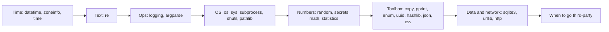

# Chapter 14 — A Tour of the Standard Library

> **What you will learn.** The modules you will reach for every week, and the traps in each: dates and time zones (`datetime`, `zoneinfo`, `time`), regular expressions in depth (`re`), professional logging (`logging`), command-line tools (`argparse`), talking to the operating system (`os`, `sys`, `subprocess`, `shutil`, `pathlib`), randomness done right (`random` vs `secrets`), numbers (`math`, `statistics`, exact `decimal`/`fractions`), a toolbox of small modules (`copy`, `pprint`, `enum`, `uuid`, `hashlib`, `json`, `csv`), an embedded database (`sqlite3` — a database that runs inside your own program rather than as a separate server), basic HTTP (`urllib`, `http`; HTTP is the request/response protocol browsers and web services use to talk to each other — see [System Design Fundamentals](../../../system-design-patterns/modules/00-system-design-fundamentals/README.md)), and when a third-party package (one you install from outside the standard library, e.g. requests, rich, click …) is the better choice.
>
> **Prerequisites.** Chapters 1–12. `collections`, `itertools` and `functools` were covered in Chapters 6, 7 and 11 — see the pointer in §14.10.
>
> **Code.** Every script is in `chapters/14-standard-library-tour/code/`, uses only the standard library, needs no internet (the HTTP demo talks to a server it starts on `127.0.0.1` — the "localhost" address, meaning this same machine), and runs on Python 3.12+:
>
> ```bash
> python chapters/14-standard-library-tour/code/01_datetime_time.py
> ```

"Batteries included" is Python's motto: the standard library ships with a few hundred modules. You don't need to know them all — you need to know which one to reach for and how to use it without falling into its known traps.



---

## 14.1 `datetime` and `zoneinfo` — naive vs aware

### What it is
The `datetime` module has four main types:

| Type | Holds | Example |
|---|---|---|
| `date` | year, month, day | `date(2026, 9, 28)` |
| `time` | hour … microsecond (no date) | `time(14, 30)` |
| `datetime` | date + time (+ optional time zone) | `datetime(2026, 9, 28, 14, 30)` |
| `timedelta` | a duration | `timedelta(days=2, hours=3)` |

A datetime is **naive** if it has no time-zone info (`tzinfo is None`) — it's just "14:30 on some wall clock, somewhere". It is **aware** if it carries a `tzinfo`, so it refers to one exact instant. `zoneinfo.ZoneInfo("Asia/Kolkata")` (3.9+) gives real time-zone rules from the IANA time-zone database (the public, regularly updated list of every region's clock rules, maintained by the Internet Assigned Numbers Authority), including daylight saving time (**DST** — moving clocks forward an hour in summer and back in winter). `datetime.UTC` (3.11+, alias of `timezone.utc`) is the UTC zone (Coordinated Universal Time — the world's reference clock, with no DST, that every other zone is an offset from).

Analogy: a naive time is a note saying "meet at 9"; an aware time is "meet at 9 Tokyo time".

### Why it matters
Time bugs are notoriously common: meetings an hour off after a DST change, reports that miss a day because a server runs in UTC and a user in IST (India Standard Time, UTC+5:30), or crashes from comparing naive and aware values.

### How it works
1. **Store and compute in UTC; convert to local time only for display.**
2. Create aware values: `datetime.now(UTC)`, or `datetime(..., tzinfo=ZoneInfo("Europe/London"))`. Avoid `datetime.utcnow()` — it returns a *naive* value and is deprecated since 3.12.
3. Convert with `.astimezone(ZoneInfo(...))` — same instant, different wall clock.
4. Parse and format: `datetime.fromisoformat("2026-09-28T09:15:00+05:30")` / `.isoformat()` for machine formats (ISO 8601 — the international standard way of writing dates, like `2026-09-28T09:15:00+05:30`); `strptime(text, fmt)` / `strftime(fmt)` for custom formats (`%Y-%m-%d %H:%M`, `%A` weekday name, `%I %p` 12-hour clock, `%Z` zone name).
5. Arithmetic: `datetime ± timedelta`, and `datetime − datetime → timedelta`. **Caution:** adding a `timedelta` to an aware datetime does *wall-clock* arithmetic in its zone — it does not adjust for a DST jump. For "exactly N hours later", convert to UTC, add, convert back.
6. Naive and aware values cannot be compared or subtracted (`TypeError`).
7. On Windows (no system time-zone database) install the `tzdata` package so `zoneinfo` works.

Script `01_datetime_time.py` (key parts):

```python
naive = datetime(2026, 3, 8, 1, 30)
aware = datetime(2026, 3, 8, 1, 30, tzinfo=ZoneInfo("America/New_York"))
naive < aware                                    # TypeError

later = aware + timedelta(hours=1)               # wall-clock arithmetic
real = (aware.astimezone(UTC) + timedelta(hours=1)).astimezone(aware.tzinfo)

meeting_utc = datetime(2026, 9, 28, 14, 0, tzinfo=UTC)
for tz in ["Asia/Kolkata", "Europe/London", "America/Los_Angeles"]:
    print(f"  {tz:<20}", meeting_utc.astimezone(ZoneInfo(tz)).strftime("%a %H:%M %Z"))
```

Output:
```
naive tzinfo      : None
aware             : 2026-03-08T01:30:00-05:00
compare naive/aware: can't compare offset-naive and offset-aware datetimes
aware + 1h (wall) : 2026-03-08T02:30:00-05:00
aware + 1h (real) : 2026-03-08T03:30:00-04:00
  Asia/Kolkata         Mon 19:30 IST
  Europe/London        Mon 15:00 BST
  America/Los_Angeles  Mon 07:00 PDT
fromisoformat     : 2026-09-28 09:15:00+05:30 | utcoffset 5:30:00
strptime          : 2026-09-28 18:05:00 | strftime: 2026-09-28 06:05 PM
date + 30 days    : 2026-03-02 | weekday Monday
days until 2027   : 95
```

On 8 March 2026, New York clocks jump from 02:00 straight to 03:00. The "wall" result, 02:30, is a time that never existed on a New York clock; the UTC round-trip gives the correct 03:30 EDT.

### Common mistakes
- Using naive datetimes in a server that talks to users in several zones.
- Hard-coding offsets (`+05:30`) instead of zone names — offsets change with DST and with politics; the zone name's rules are updated.
- Using `pytz` in new code — its `localize()` API is error-prone; `zoneinfo` replaced it.
- Expecting `date(2026, 1, 31) + "1 month"` — `timedelta` has no months (months vary in length). Use `dateutil.relativedelta` (third-party) for calendar months.

### Real-world examples
Databases such as PostgreSQL store `timestamptz` as UTC; Django (`USE_TZ = True`) and most APIs exchange ISO 8601 strings in UTC; calendar apps store UTC plus the event's zone name so recurring meetings follow DST.

### In the interview
"I keep all datetimes aware and in UTC internally, convert to the user's `ZoneInfo` zone only at display time, and serialise (convert to text for storage or sending) as ISO 8601. Naive datetimes are a bug source because they're ambiguous and can't be compared with aware ones."
- *Why not `utcnow()`?* It returns a naive value that looks local; use `datetime.now(UTC)`.

### Self-check
1. What makes a datetime aware? → A non-None `tzinfo`.
2. How do you show a UTC time in Tokyo? → `dt.astimezone(ZoneInfo("Asia/Tokyo"))`.
3. Does `aware + timedelta(hours=1)` account for DST jumps? → No, it's wall-clock arithmetic; go via UTC.

### TL;DR
Aware + UTC inside, `ZoneInfo` at the edges, ISO 8601 on the wire (in data sent over a network). `timedelta` has no months.

---

## 14.2 `time` — timestamps and timers

### What it is
The `time` module is the lower-level clock interface.

| Function | Returns | Use for |
|---|---|---|
| `time.time()` | seconds since the Unix **epoch** (1970-01-01 UTC), float | timestamps (can jump if the system clock is changed) |
| `time.perf_counter()` | highest-resolution counter, arbitrary start | measuring short durations |
| `time.monotonic()` | never goes backwards, arbitrary start | timeouts, rate limiters (code that caps how many actions happen per second) |
| `time.sleep(s)` | — | pause the thread |
| `time.time_ns()`, `perf_counter_ns()` | integer nanoseconds | avoid float precision loss |

Convert a timestamp to a datetime with `datetime.fromtimestamp(ts, tz=UTC)` — e.g. `1_790_000_000` → `2026-09-21 14:13:20+00:00`.

### Common mistakes
Measuring durations with `time.time()`: if NTP (the network time service) adjusts the clock mid-measurement, you get wrong or even negative durations. Use `perf_counter()` or `monotonic()`. For micro-benchmarks (timing very small pieces of code) use the `timeit` module, which repeats the code and disables garbage collection (Python's automatic freeing of unused memory, which could add random pauses) during timing.

### TL;DR
`time()` for "when", `perf_counter()` for "how long", `monotonic()` for timeouts.

---

## 14.3 `re` — regular expressions, deeper

[Chapter 4](../04-strings/README.md) introduced `re` (`search`, `match`, `findall`, basic patterns). This section adds the parts used in real parsing work.

### What it is
A **regular expression** (regex) is a small pattern language for matching text. Python's `re` module compiles a pattern into a matcher object and runs it with a backtracking engine (when one way of matching fails, it goes back and tries the next alternative).

### How it works — the essentials

| Feature | Syntax | Meaning |
|---|---|---|
| Raw strings | `r"\d+"` | always use them so `\` reaches `re` unchanged |
| Group | `( … )` | capture a part; `m.group(1)` or `m[1]` |
| Named group | `(?P<year>\d{4})` | `m["year"]`, `m.groupdict()` |
| Non-capturing | `(?: … )` | group without capturing |
| Alternation | `cat\|dog` | either |
| Quantifiers | `* + ? {m,n}` | how many times; greedy (match as much as possible) by default |
| Lazy | `*? +? ??` | match as little as possible |
| Anchors | `^ $ \b \A \Z` | line start/end, word boundary, string start/end |
| Lookahead | `(?=…)`, `(?!…)` | require / forbid what follows, without consuming |
| Lookbehind | `(?<=…)`, `(?<!…)` | same, for what precedes (fixed width) |
| Backreference | `\1`, `(?P=name)` | the same text again |

Functions: `re.search` (anywhere), `re.match` (only at the start), `re.fullmatch` (entire string — use it for validation), `re.findall` (list of strings, or tuples if there are groups), `re.finditer` (iterator of match objects — memory-friendly and gives positions), `re.sub(pattern, repl, s)` (repl may be a string with `\1` or a **function** of the match), `re.split`.

Flags: `re.IGNORECASE` (`re.I`), `re.MULTILINE` (`^`/`$` match at each line), `re.DOTALL` (`.` also matches newline), `re.VERBOSE` (`re.X`: whitespace and `#` comments allowed inside the pattern).

**Compile once**: `LINE = re.compile(...)` at module level. `re` also caches recently used patterns, so this is mainly for readability and reuse.

Script `02_regex_deeper.py` parses log lines with a verbose, named-group pattern:

```python
LINE = re.compile(r"""
    ^(?P<date>\d{4}-\d{2}-\d{2})\s     # date
    (?P<time>[\d:]{8})\s+
    (?P<level>[A-Z]+)\s+
    \[(?P<svc>\w+)\]\s                 # service in brackets
    (?P<msg>.*?)\s                     # lazy: stop before the last field
    user=(?P<user>\d+)$
""", re.VERBOSE | re.MULTILINE)

for m in LINE.finditer(LOG):
    if m["level"] == "ERROR":
        print("error:", m.group("svc", "user"), "|", m["msg"])

re.sub(r"\d{12}(\d{4})", lambda m: "*" * 12 + m[1], card)   # function replacement
re.sub(r"(\w+), (\w+)", r"\2 \1", "Lovelace, Ada")            # backreferences
strong = re.compile(r"(?=.*\d)(?=.*[A-Z]).{8,}")              # two lookaheads
```

Output:
```
error: ('payments', '42') | card declined
error: ('auth', '7') | bad password
findall groups  : ['42', '7', '7']
greedy          : <a><b>
lazy            : <a>
masked          : pay ************1111 now
swap            : Ada Lovelace
strong('password'  ): False
strong('Passw0rdX' ): True
IGNORECASE      : ['ERROR', 'ERROR']
split multi     : ['a', 'b', 'c ', 'd']
match vs search : None 1
```

### Trade-offs / when not to use it
- **Structured formats have parsers**: JSON → `json`, CSV → `csv`, HTML → an HTML parser (BeautifulSoup/lxml), URLs → `urllib.parse`, emails → a validation library. Regex on these breaks on edge cases.
- Simple checks are clearer with string methods: `s.startswith("http")`, `"@" in s`, `s.isdigit()`.
- **Catastrophic backtracking**: nested quantifiers like `(a+)+$` on a long non-matching input take exponential time. This caused real outages (periods when a service is down) (Stack Overflow in 2016, Cloudflare in 2019). Avoid nested/ambiguous quantifiers on untrusted input; since 3.11 `re` supports atomic groups `(?>…)` and possessive quantifiers `*+` (both mean "once matched, never go back and retry") to prevent backtracking.

### Common mistakes
- Forgetting the `r` prefix (`"\b"` is a backspace character, not a word boundary).
- Using `match` when you meant `search` (or `fullmatch` for validation).
- Greedy `.*` swallowing too much — use `.*?` or a negated class like `[^\]]*`.
- `findall` with groups returns only the groups, not the whole match.

### In the interview
"I compile patterns with named groups and `re.VERBOSE` so they're readable, use `finditer` for large inputs and `fullmatch` for validation, and I avoid regex for structured formats. I'm careful about nested quantifiers because of catastrophic backtracking on untrusted input."

### TL;DR
Raw strings, named groups, `finditer`, `fullmatch`, `sub` with a function, `VERBOSE` for readability, lazy quantifiers when greedy grabs too much, and no regex for JSON/HTML/CSV.

---

## 14.4 `logging` — levels, handlers, formatters, best practice

### What it is
`logging` is the standard way for programs and libraries to report what they are doing. Four building blocks:

| Part | Job | Example |
|---|---|---|
| **Logger** | the object your code calls; named hierarchically with dots | `logging.getLogger("shop.orders")` |
| **Handler** | sends records (one record = one logged event) somewhere | `StreamHandler` (console), `FileHandler`, `RotatingFileHandler`, `TimedRotatingFileHandler`, `SysLogHandler`, `QueueHandler` |
| **Formatter** | turns a record into text | `"%(asctime)s %(levelname)s %(name)s %(message)s"` |
| **Filter** | drops or edits records | add a request ID to each record |

**Levels** (numbers in brackets): `DEBUG` (10) detail for developers · `INFO` (20) normal events · `WARNING` (30) something unexpected, still working · `ERROR` (40) an operation failed · `CRITICAL` (50) the program may not continue.

### Why it matters (logging vs print)
`print` has no levels, no timestamps, no destinations, and cannot be switched off per module. With logging, the **same code** can be silent in tests, show INFO on the console in development, and send JSON to a log collector (a service that gathers logs from many machines so you can search them) in production — only the configuration changes.

### How it works
1. Each module does `log = logging.getLogger(__name__)`. Names form a tree: `shop.orders` → `shop` → root.
2. A call like `log.info("order placed qty=%d", qty)` creates a **LogRecord** if the logger's effective level allows INFO.
3. The record goes to the logger's handlers, then **propagates** up to the parent's handlers, and so on to the root.
4. Each handler has its own level and formatter, so one record can go to the console (INFO+) and a file (DEBUG+) in different formats.
5. With no configuration at all, WARNING and above are printed to stderr (standard error — the separate output stream for error messages; normal output goes to stdout, standard output) by a fallback handler ("last resort"); DEBUG/INFO are dropped because the root logger's default level is WARNING.
6. Configure **once, at program start** (in `main`), with `logging.basicConfig(level=..., format=...)` for simple apps or `logging.config.dictConfig({...})` for real ones. `basicConfig` does nothing if the root logger already has handlers, unless you pass `force=True`.

Script `03_logging_demo.py`:

```python
log = logging.getLogger("shop.orders")      # normally getLogger(__name__)

def place_order(qty: int) -> None:
    log.debug("validating qty=%s", qty)
    if qty <= 0:
        log.warning("rejected order with qty=%d", qty)
        return
    try:
        1 / (qty - 3)
    except ZeroDivisionError:
        log.exception("pricing failed for qty=%d", qty)   # ERROR + traceback
        return
    log.info("order placed qty=%d", qty)

logging.config.dictConfig({
    "version": 1,
    "disable_existing_loggers": False,
    "formatters": {"short": {"format": "%(levelname)-7s %(name)s: %(message)s"},
                   "full":  {"format": "%(asctime)s %(levelname)s %(name)s "
                                       "%(filename)s:%(lineno)d %(message)s"}},
    "handlers": {"console": {"class": "logging.StreamHandler", "level": "INFO",
                             "formatter": "short", "stream": "ext://sys.stdout"},
                 "file": {"class": "logging.StreamHandler", "level": "DEBUG",
                          "formatter": "full", "stream": file_like}},
    "loggers": {"shop": {"level": "DEBUG", "handlers": ["console", "file"]}},
})
```

Output (console handler; path shortened):
```
INFO    shop.orders: order placed qty=2
WARNING shop.orders: rejected order with qty=0
ERROR   shop.orders: pricing failed for qty=3
Traceback (most recent call last):
  File ".../03_logging_demo.py", line 15, in place_order
    1 / (qty - 3)
    ~~^~~~~~~~~~~
ZeroDivisionError: division by zero
--- file handler got 11 lines; DEBUG line present: True
logger chain: shop.orders -> shop -> root
effective level: DEBUG
```

The console showed INFO and above; the "file" handler (a `StringIO` here) received the DEBUG lines too.

### Best practice
1. `getLogger(__name__)` in every module; never log on the root logger directly in libraries.
2. **Libraries never configure logging.** They only create loggers (optionally adding `logging.NullHandler()`); the application decides where logs go.
3. Pass values as arguments — `log.info("user %s", uid)` — not f-strings. Formatting is then skipped when the level is disabled, and log aggregators (tools that collect and summarise logs) can group identical messages.
4. Inside `except`, use `log.exception(...)` (ERROR level + traceback) or `exc_info=True`.
5. Don't log secrets or personal data (passwords, tokens, card numbers).
6. In production prefer **structured** (JSON) logs — machine-readable records with named fields rather than free text — with context fields (request ID, user ID), rotated files (log files that are closed and archived when they reach a size or age) or stdout collected by the platform (the "12-factor" approach — a well-known checklist for building cloud apps: log to stdout, let Docker/Kubernetes collect; Docker packages an app into a container, a lightweight isolated environment, and Kubernetes runs many containers across machines). `structlog` and `python-json-logger` are common helpers.
7. For high-throughput (handling many events per second) or async apps, `QueueHandler` + `QueueListener` moves slow I/O (input/output such as disk or network writes) off the hot path (the code that runs most often and most needs to be fast).

### Common mistakes
- Calling `basicConfig` in an imported module (it silently wins or silently does nothing).
- Adding handlers inside a function called repeatedly → each message printed many times. Configure once.
- Messages appear twice: a handler on both a child logger and the root, and `propagate` left True.
- `disable_existing_loggers` defaults to **True** in `dictConfig` — loggers created before configuration are silenced. Set it to `False`.

### Real-world examples
Django and Flask configure logging through `dictConfig` (Django's `LOGGING` setting); `uvicorn`, `requests`/`urllib3` and `boto3` all emit through named loggers you can tune, e.g. `logging.getLogger("urllib3").setLevel(logging.WARNING)`.

### In the interview
"Each module gets `getLogger(__name__)`. The application configures handlers and formatters once with `dictConfig`. Libraries don't configure logging. I use lazy `%s` arguments, `log.exception` in except blocks, and structured JSON logs to stdout in containers."
- *Why not print?* No levels, no routing, can't be turned off per module, no timestamps or context.
- *Why are my debug logs missing?* The logger or handler level is above DEBUG — the default root level is WARNING.

### Self-check
1. Default level of the root logger? → WARNING.
2. Which call logs a traceback? → `log.exception(...)` inside `except` (or `exc_info=True`).
3. Why are messages duplicated? → Handlers on several loggers in the chain with propagation.
4. Should a library call `basicConfig`? → No.

### TL;DR
Logger (per module) → handlers (where) → formatters (how). Configure once in the app, lazy args, `log.exception`, structured logs in production.

---

## 14.5 `argparse` — command-line interfaces

### What it is
`argparse` turns `sys.argv` (the list of words typed after the program name) into a validated object, generates `--help`, and prints usage errors.

### How it works
1. Create `ArgumentParser(prog=..., description=...)`.
2. `add_argument("title")` — a **positional** argument (required, identified by its position on the command line rather than by a `--name`).
3. `add_argument("--priority", type=int, choices=..., default=...)` — an **option**; `type` converts the text, `choices` restricts values.
4. `action="store_true"` for on/off flags, `action="count"` for `-vv`, `action="append"` for repeatable options, `nargs="+"` for one-or-more values, `required=True` to force an option.
5. `add_subparsers()` for git-style subcommands (`todo add`, `todo list`).
6. `parse_args()` returns a `Namespace`; on invalid input it prints usage to stderr and exits with status **2** (the exit status is a number a program hands back to the shell when it ends: 0 means success, anything else means some failure). `-h/--help` is added automatically.
7. Make `main(argv=None)` accept a list so tests can call it without a real command line.

Script `04_argparse_cli.py`:

```python
p = argparse.ArgumentParser(prog="todo", description="A tiny todo CLI.")
p.add_argument("-v", "--verbose", action="count", default=0)
sub = p.add_subparsers(dest="command", required=True)

add = sub.add_parser("add", help="add a task")
add.add_argument("title")
add.add_argument("--priority", type=int, choices=range(1, 4), default=2)
add.add_argument("--tag", action="append", default=[])

ls = sub.add_parser("list", help="list tasks")
ls.add_argument("--done", action="store_true")
ls.add_argument("--limit", type=int, default=10)
```

Output:
```
$ todo add Buy milk --priority 1 --tag home --tag shop
  parsed: {'verbose': 0, 'command': 'add', 'title': 'Buy milk', 'priority': 1, 'tag': ['home', 'shop']}
$ todo -vv list --done
  parsed: {'verbose': 2, 'command': 'list', 'done': True, 'limit': 10}
$ todo add x --priority 9
usage: todo add [-h] [--priority {1,2,3}] [--tag TAG] title
todo add: error: argument --priority: invalid choice: '9' (choose from '1', '2', '3')
  exit code: 2
usage: todo [-h] [-v] {add,list} ...
```

(`"Buy milk"` was one list item here; in a real shell — the terminal program, like bash or zsh, that reads your commands — you'd quote it: `todo add "Buy milk"`.)

### Making it runnable
Add a `[project.scripts]` entry in `pyproject.toml` (`todo = "todo.cli:main"`) so `pip install` creates a `todo` command, or run as a module with `python -m todo` using a `__main__.py` ([Chapter 8](../08-modules-packages-environments/README.md)). Finish with `raise SystemExit(main())` so the return code reaches the shell.

### Trade-offs

| Library | Style | Good for |
|---|---|---|
| `argparse` (stdlib) | imperative, no dependency | scripts, tools that must not need installs |
| `click` | decorators, composable command groups | larger CLIs (Flask's `flask` command uses it) |
| `typer` | builds a click CLI from type hints | modern typed CLIs |
| `sys.argv` directly | manual | only for one or two trivial arguments |

### Common mistakes
- `type=bool` — `bool("False")` is `True`. Use `action="store_true"`.
- Parsing `sys.argv` by hand for anything non-trivial.
- Calling `parse_args()` at import time, which breaks tests; do it in `main`.

### TL;DR
Positionals + options with `type`/`choices`/`action`; subparsers for commands; `main(argv=None)` for testability; exit code 2 on usage errors.

---

## 14.6 `os`, `sys`, `subprocess`, `shutil` (+ `pathlib` recap)

### What it is

| Module | Area | Most-used parts |
|---|---|---|
| `os` | the operating system | `os.environ`, `os.getenv`, `os.cpu_count()`, `os.getpid()`, `os.walk`, `os.sep`, `os.replace` (atomic rename — all or nothing) |
| `sys` | the running interpreter | `sys.argv`, `sys.exit()`, `sys.path`, `sys.version_info`, `sys.platform`, `sys.executable`, `sys.stdin/stdout/stderr`, `sys.modules` |
| `subprocess` | running other programs | `subprocess.run([...], capture_output=True, text=True, check=True, timeout=...)` |
| `shutil` | high-level file operations | `copy2`, `copytree`, `move`, `rmtree`, `make_archive`, `which`, `disk_usage` |
| `pathlib` | paths as objects ([Chapter 9](../09-errors-exceptions-files/README.md)) | `Path`, `/`, `.read_text()`, `.glob()`, `.rglob()`, `.mkdir(parents=True)` |
| `tempfile` | throw-away files/dirs | `TemporaryDirectory()`, `NamedTemporaryFile()` |

### How it works — the key rules
1. **Configuration from the environment**: `os.environ.get("APP_ENV", "dev")` (never `os.environ["X"]` if it may be missing — that raises `KeyError`). Environment values are always strings.
2. **Paths**: use `pathlib.Path` for new code; `os.path` functions still work but are more verbose.
3. **Running commands** with `subprocess.run`:
   - Pass a **list** of arguments. Avoid `shell=True` with any user-supplied text — it enables shell injection (an attacker's text being run as extra shell commands, e.g. `"file.txt; rm -rf ~"`).
   - `capture_output=True, text=True` gives `result.stdout` as a `str`.
   - `check=True` raises `CalledProcessError` on a non-zero exit code; `timeout=` raises `TimeoutExpired`.
   - Use `sys.executable` to run "the same Python that runs me".
   - `os.system` and `os.popen` are older, less safe interfaces — prefer `subprocess`.
4. **Deleting trees** with `shutil.rmtree` is permanent — double-check the path. `os.replace(tmp, final)` gives an atomic "write then swap" for safe file updates.
5. **Exit codes**: `sys.exit(0)` success, non-zero failure (it raises `SystemExit`, so `finally` blocks still run).

Script `05_os_sys_subprocess_shutil.py` (key parts):

```python
with tempfile.TemporaryDirectory() as tmp:
    root = Path(tmp)
    (root / "src" / "pkg").mkdir(parents=True)
    (root / "src" / "pkg" / "a.py").write_text("print('hi')\n")
    shutil.copytree(root / "src", root / "backup")
    archive = shutil.make_archive(str(root / "bundle"), "zip", root / "src")
    shutil.rmtree(root / "backup")
    r = subprocess.run([sys.executable, str(root / "src" / "pkg" / "a.py")],
                       capture_output=True, text=True, check=True, timeout=10)
```

Output:
```
python      : (3, 14) | platform: darwin
argv[0]     : 05_os_sys_subprocess_shutil.py
HOME set    : True | APP_ENV = dev (default)
cpu_count>0 : True
copied      : ['backup/notes.txt', 'backup/pkg', 'backup/pkg/a.py']
py files    : ['a.py', 'a.py']
archive     : bundle.zip True
after rmtree: ['bundle.zip', 'src']
child stdout: hi | returncode 0
failed child: returncode 3
which python: True
disk free GB: True
```

### Common mistakes
- `subprocess.run("ls " + user_input, shell=True)` — injection risk.
- Ignoring the return code (forgetting `check=True`).
- `os.chdir` in library code — it changes the working directory (the folder relative paths are resolved from) for the whole process (one running instance of a program).
- String-concatenating paths with `"/"` instead of `Path` or `os.path.join`.

### In the interview
"I use `subprocess.run` with a list of arguments, `check=True`, a timeout, and never `shell=True` on user input. Config comes from `os.environ.get` with defaults, paths are `pathlib.Path`, and temporary work goes in `tempfile.TemporaryDirectory`."

### TL;DR
`os` = OS & env, `sys` = interpreter, `subprocess.run([...], check=True)` = other programs, `shutil` = copy/move/delete trees, `pathlib` = paths.

---

## 14.7 `random` vs `secrets`

### What it is
- `random` produces **pseudo-random** numbers (numbers that look random but come from a deterministic formula) from the Mersenne Twister algorithm: fast, reproducible with a seed (the starting value — the same seed always gives the same sequence), statistically good — but **predictable** once enough outputs are observed.
- `secrets` (3.6+) draws from the operating system's cryptographically secure source (randomness strong enough that an attacker cannot predict it; `os.urandom`): unpredictable, not reproducible.

**Rule: `random` for simulations, games, sampling and tests; `secrets` for passwords, tokens, keys, password-reset links.**

### How it works
`random`: `random.Random(42)` (your own seeded generator — better than the global `random.seed` because other code can't disturb it), `randint(a, b)` (both ends included), `random()` in [0, 1), `uniform`, `choice`, `choices(pop, weights=, k=)` (with replacement), `sample(pop, k)` (without replacement), `shuffle` (in place), `gauss(mu, sigma)`.

`secrets`: `token_bytes(n)`, `token_hex(n)` (2n hex chars — hexadecimal, the digits 0–9 and a–f), `token_urlsafe(n)` (about 1.3 × n characters, URL-safe — only characters that can appear in a web address without escaping), `choice(seq)`, `randbelow(n)`, and `compare_digest(a, b)` — a constant-time comparison that prevents timing attacks (guessing a secret by measuring how long a comparison takes — a normal `==` stops at the first wrong character, so it leaks how many characters were right) when checking tokens.

Output of `06_random_secrets_math_stats.py` (first part):
```
randint      : [6, 1, 1, 6, 3]
choice       : red
sample       : [28, 17, 94]
shuffle      : [7, 2, 5, 6, 0, 3, 4, 9, 8, 1]
weighted     : ['A', 'A', 'A', 'B', 'B', 'A', 'A', 'A']
gauss        : 1.1491
token_urlsafe: 22 chars
token_hex(8) : 16 hex chars
compare_digest: True
```

### Common mistakes
- `random` for security tokens (predictable).
- Comparing secrets with `==` (can leak timing information) — use `secrets.compare_digest`.
- For NumPy (the fast numerical-array library) work, use `numpy.random.default_rng(seed)` instead (ML handbook).

### TL;DR
`random` = reproducible simulation; `secrets` = anything an attacker must not guess.

---

## 14.8 `math`, `statistics`, `decimal`, `fractions`

### What it is
`math` has fast functions on single floats/ints (C library wrappers). `statistics` has descriptive statistics (numbers that summarise a dataset — average, spread, middle value) on small-to-medium data lists — correct and readable, but slower than NumPy/pandas for big arrays.

### How it works — highlights
| Need | Function | Note |
|---|---|---|
| Compare floats | `math.isclose(a, b)` | default relative tolerance 1e-9; `0.1 + 0.2 == 0.3` is `False` |
| Rounding | `math.floor`, `math.ceil`, `math.trunc`, `round` | `round` uses **banker's rounding** (exact halves go to the nearest even number): `round(2.5) == 2`, `round(3.5) == 4` |
| Roots, distances | `sqrt`, `isqrt` (exact int), `hypot`, `dist` | |
| Counting | `comb(n, k)`, `perm(n, k)`, `factorial` | 5 choose 2 = 10 |
| Number theory | `gcd`, `lcm` | `lcm` since 3.9 |
| Logs, constants | `log(x, base)`, `log2`, `log10`, `exp`, `pi`, `e`, `inf`, `nan` | |
| Accurate sums | `math.fsum` | exact float sum |
| Averages | `statistics.mean`, `fmean`, `median`, `mode`, `multimode` | |
| Spread | `pstdev`/`pvariance` (population — you have every value), `stdev`/`variance` (sample — a subset of a larger group; divides by n−1) | |
| Quartiles | `statistics.quantiles(data, n=4)` | |
| Relations | `correlation`, `covariance`, `linear_regression` | 3.10+ |

Output (second part):
```
isclose      : False True
floor/ceil   : -3 -2 2 4
sqrt, hypot  : 4.0 5.0
comb, perm   : 10 20 120
gcd, lcm     : 6 12
log          : 3.0 3.0 2.71828
fsum vs sum  : 1.0 1.0
mean/median  : 5 4.5
mode         : 4
pstdev/stdev : 2.0 2.1381
quantiles    : [4.0, 4.5, 6.5]
correlation  : 0.7746
linear_reg   : LinearRegression(slope=0.6, intercept=2.2)
```

Worked check for the spread: data `[2, 4, 4, 4, 5, 5, 7, 9]` has mean 5; squared deviations sum to 9+1+1+1+0+0+4+16 = 32. Population variance = 32/8 = 4 → `pstdev` = 2.0. Sample variance = 32/7 ≈ 4.571 → `stdev` ≈ 2.1381.

Note on `fsum vs sum`: since Python 3.12, the built-in `sum()` of floats uses compensated (Neumaier) summation (a technique that tracks the tiny rounding error lost at each addition and adds it back), so `sum([0.1] * 10)` is `1.0`; on 3.11 and earlier it was `0.9999999999999999`. `math.fsum` remains the exactly-rounded option.

### `decimal` and `fractions` — exact arithmetic
Floats are binary, so `0.1` cannot be stored exactly and money sums drift. Two stdlib types avoid this:

```python
from decimal import Decimal, ROUND_HALF_UP
from fractions import Fraction

Decimal("0.1") + Decimal("0.2")                                  # Decimal('0.3') - exact
Decimal(0.1)                                                     # 0.1000000000000000055511... (built from the float!)
Decimal("2.675").quantize(Decimal("0.01"), rounding=ROUND_HALF_UP)   # Decimal('2.68')
round(2.675, 2)                                                  # 2.67 - the float is really 2.67499999...
Fraction(1, 3) + Fraction(1, 6)                                  # Fraction(1, 2)
```
- **`Decimal`** is base-10 with a configurable precision (28 significant digits by default) and explicit rounding modes. Use it for money, and always build it from **strings**, not floats.
- **`Fraction`** stores an exact numerator/denominator — handy for maths puzzles and exact ratios, but slow if numbers grow large.
- Both are much slower than `float`; use them where exactness matters, not in numeric loops.

### Common mistakes
- `math.floor(-2.5)` is `-3` (towards minus infinity), not `-2`; `int(-2.5)` is `-2` (towards zero).
- Using `==` on floats. Use `isclose`, or `decimal.Decimal` for money.
- Mixing up `stdev` (sample) and `pstdev` (population).

### TL;DR
`math` for one-number maths, `statistics` for small data summaries; `isclose` for float comparison; `round` is banker's rounding.

---

## 14.9 A toolbox of small modules: `copy`, `pprint`, `enum`, `uuid`, `hashlib`, `json`, `csv`

### `copy` — shallow vs deep
- `copy.copy(x)` — a **shallow** copy: a new outer container that shares the same inner objects.
- `copy.deepcopy(x)` — copies recursively (handles cycles — objects that refer back to themselves — with a memo dict). Slower; customise with `__copy__`/`__deepcopy__`.
- `copy.replace(obj, **changes)` (3.13+) — a modified copy of a dataclass, namedtuple, datetime, etc.

```
shallow sees change: ['a', 'b', 'c'] | deep: ['a', 'b']
```
The shallow copy shares the `hosts` list, so appending through `cfg` shows up in it.

### `pprint` — readable nested data
`pprint.pp(obj, width=50)` (3.8+) prints nested structures across lines, keeping insertion order (`pprint.pprint` sorts dict keys by default). Output:
```
{'service': 'api',
 'replicas': 3,
 'env': {'DB_URL': 'postgres://db:5432/app',
         'DEBUG': False},
 'ports': [80, 443],
 'owners': ['platform-team', 'sre']}
```
Also `pprint.pformat` returns the string, handy in log messages.

### `enum` — named constants
Covered in [Chapter 10](../10-oop-in-python/README.md). `Enum` for a closed set of named values, `StrEnum` (3.11+) whose members *are* strings (great for JSON and databases), `IntEnum`, `Flag` for combinable bits (on/off options that can be OR-ed together), `auto()` for automatic values (for `StrEnum` it gives the lower-cased member name):
```
StrEnum: active BANNED | Enum: Color.GREEN ['RED', 'GREEN']
```

### `uuid` — unique identifiers
A **UUID** is a 128-bit identifier, written as 36 characters, that can be generated anywhere without coordination.

| Function | Based on | Use |
|---|---|---|
| `uuid4()` | random | the default for IDs |
| `uuid5(namespace, name)` / `uuid3` | SHA-1 / MD5 hash of a name | the same input always gives the same ID |
| `uuid1()` | time + MAC address (the hardware ID of a network card) | leaks the machine's MAC; avoid |
| `uuid7()` (3.14+) | Unix time + random | time-ordered, so database indexes (sorted lookup structures that make queries fast) stay compact |

```
uuid4 version: 4 | uuid5 is deterministic: 6639460f-3425-5329-8097-a58f06127860
```

### `hashlib` — cryptographic hashes
A **hash function** maps any bytes to a fixed-size digest (the short output "fingerprint"); the same input always gives the same digest, and a good one makes it infeasible to find two inputs with the same digest.

```python
hashlib.sha256(b"hello").hexdigest()      # '2cf24dba5fb0a30e...'
h = hashlib.sha256()
for chunk in (b"hel", b"lo"):              # hash large files chunk by chunk
    h.update(chunk)
key = hashlib.pbkdf2_hmac("sha256", b"s3cret", salt, 100_000)
```
Output:
```
sha256('hello'): 2cf24dba5fb0a30e ...
streamed equal : True
pbkdf2 key len : 32
```
Rules:
- Use SHA-256 (or BLAKE2, `hashlib.blake2b`) for integrity checks (confirming data wasn't altered), cache keys, content addressing (naming data by the hash of its contents) (Git identifies objects by SHA-1 and is adding SHA-256 support).
- MD5 and SHA-1 are broken for security; fine only for non-security checksums (quick values used to detect accidental corruption).
- **Never store passwords with a plain fast hash.** Use a slow, salted key-derivation function (KDF — deliberately slow hashing designed for passwords; a **salt** is random data mixed into each password so identical passwords hash differently): `hashlib.scrypt` or `pbkdf2_hmac` with a random per-user salt (`secrets.token_bytes(16)`) and a high iteration count — or the third-party `argon2-cffi`/`bcrypt`. (The demo's fixed salt is only for reproducibility.)
- For message authentication (proving a message came from someone holding a shared secret key and wasn't changed) use `hmac` (`hmac.new(key, msg, "sha256")`) and compare with `hmac.compare_digest`.
- Python's built-in `hash()` is **not** a stable hash: for strings it is randomised per process.

### `json` and `csv` — recap (Chapter 9)
- `json.dumps(obj, default=str, sort_keys=True, indent=2)` — `default` is called for unsupported types (dates, sets, Decimal); tuples become lists; `json.loads` returns plain dicts/lists.
- `csv.DictWriter`/`DictReader` handle quoting (`"Li, Wei"` stays one field). Open files with `newline=""`.

```
json: {"id": 7, "tags": ["a", "b"], "when": "2026-09-28"} | back: ['a', 'b']
csv text: ['name,city', 'Asha,Pune', '"Li, Wei",Oslo']
csv read: {'name': 'Li, Wei', 'city': 'Oslo'}
```

### More small modules worth knowing

| Module | Does | Example |
|---|---|---|
| `tomllib` (3.11) | Read TOML (a simple `key = value` config format) config files (read-only) | `tomllib.load(open("pyproject.toml", "rb"))` |
| `zipfile`, `tarfile`, `gzip` | Read/write archives and compressed files | `gzip.open("log.gz", "rt")` streams a compressed text file |
| `base64` | Encode bytes as ASCII (plain English letters/digits) text | `base64.b64encode(b"hi")` → `b'aGk='` |
| `textwrap` | Wrap/indent/dedent paragraphs | `textwrap.dedent(help_text)` |
| `shlex` | Split a command line like a shell does | `shlex.split('git commit -m "fix bug"')` → `['git', 'commit', '-m', 'fix bug']` |
| `difflib` | Diffs and "did you mean" matches | `difflib.get_close_matches("pyhton", ["python", "java"])` |
| `getpass` | Read a password without echoing it | `getpass.getpass()` |
| `string` | Constants and simple templates | `string.ascii_lowercase`, `string.Template("$name")` |
| `timeit`, `cProfile`, `tracemalloc` | Timing, profiling (measuring where time is spent), memory tracing | [Chapter 17](../17-performance-memory-internals/README.md) |

### TL;DR
`deepcopy` for independent nested copies; `pprint.pp` for readable dumps; `StrEnum` for string constants; `uuid4`/`uuid7` for IDs; SHA-256 for integrity, scrypt/pbkdf2/argon2 for passwords; `json` `default=`; csv via `DictReader/DictWriter`.

---

## 14.10 Pointer: `collections`, `itertools`, `functools`

These three are covered in depth elsewhere; here is where to look:

| Module | Highlights | Chapter |
|---|---|---|
| `collections` | `Counter`, `defaultdict`, `deque`, `namedtuple`, `OrderedDict`, `ChainMap` | 6 |
| `itertools` | `chain`, `islice`, `groupby`, `product`, `permutations`, `combinations`, `accumulate`, `batched` (3.12), `pairwise` | 11 |
| `functools` | `lru_cache`/`cache`, `partial`, `reduce`, `wraps`, `total_ordering`, `singledispatch`, `cached_property` | 7, 11, 12 |
| `heapq`, `bisect` | priority queues (always hand out the smallest item next), binary search (repeatedly halving a sorted list) in sorted lists | 5, 6 |
| `dataclasses`, `abc`, `contextlib` | records, abstract classes, context managers | 10, 12 |

---

## 14.11 `sqlite3` — an embedded SQL database

### What it is
**SQLite** is a complete SQL (Structured Query Language — the standard language for querying relational, table-based databases) database stored in a single file (or in memory), running inside your process — no server to install. `sqlite3` is Python's built-in driver (the library that lets a program talk to a particular database) for it (following the DB-API 2.0 standard, PEP 249, shared with PostgreSQL/MySQL drivers).

### How it works
1. `con = sqlite3.connect("app.db")` (or `":memory:"`).
2. `con.execute(sql, params)` runs one statement; `executemany` runs it for each row.
3. **Always use placeholders** (`?` or `:name`) for values — the driver escapes them (makes special characters harmless), preventing **SQL injection** (an attack where user-typed text is run as part of the SQL command). Never build SQL with f-strings from user input.
4. `with con:` wraps a **transaction** (a group of changes that must all succeed or all fail together): it commits (makes the changes permanent) on success and rolls back (undoes them) if an exception escapes (it does *not* close the connection — call `con.close()`).
5. `con.row_factory = sqlite3.Row` lets you read columns by name.
6. Results: `.fetchone()`, `.fetchall()`, or iterate the cursor (the object that steps through the result rows).

Script `08_sqlite_demo.py`:

```python
con = sqlite3.connect(":memory:")
con.row_factory = sqlite3.Row
con.execute("""CREATE TABLE expense (
                 id INTEGER PRIMARY KEY,
                 category TEXT NOT NULL,
                 amount REAL NOT NULL CHECK (amount > 0))""")
with con:
    con.executemany("INSERT INTO expense (category, amount) VALUES (?, ?)", rows)

total = con.execute("SELECT SUM(amount) AS s FROM expense WHERE category = ?",
                    (cat,)).fetchone()["s"]

try:
    with con:                          # both inserts, or neither
        con.execute("INSERT INTO expense (category, amount) VALUES ('gift', 5)")
        con.execute("INSERT INTO expense (category, amount) VALUES ('bad', -1)")
except sqlite3.IntegrityError as e:
    print("rolled back:", e)
```

Output:
```
food total: 19.75
  travel  n=1 sum=40.0
  food    n=2 sum=19.75
  books   n=1 sum=18.0
rolled back: CHECK constraint failed: amount > 0
rows now: 4
```
The valid `gift` insert was rolled back together with the invalid one — that is atomicity (all-or-nothing).

### When not to use it
Many concurrent writers (several connections writing at the same time; SQLite allows one writer at a time; WAL — write-ahead log — mode helps readers) or a database shared by several servers over a network — use PostgreSQL/MySQL. SQLite is excellent for apps, tests, caches, CLIs (command-line tools), prototypes and small-to-medium websites.

### Real-world examples
SQLite is in every Android and iOS device, in browsers (Firefox and Chrome store history/bookmarks in it) and in many desktop apps. Django uses it as the default development database.

### Common mistakes
- `f"... WHERE name = '{name}'"` — injection.
- Forgetting to commit (changes vanish when the connection closes).
- `(cat)` instead of `(cat,)` — parameters must be a sequence; a one-item tuple needs the comma.

### TL;DR
`connect` → `execute` with `?` placeholders → `with con:` for transactions → `Row` for named columns.

---

## 14.12 `urllib` and `http` (brief)

### What it is
- `urllib.parse` — split, build and encode URLs: `urlparse`, `parse_qs`, `urlencode`, `urljoin`, `quote`.
- `urllib.request` — a basic HTTP client: `urlopen(Request(url, headers=..., data=...), timeout=...)`.
- `urllib.error` — `HTTPError` (server replied with 4xx/5xx — HTTP status codes in the 400s mean the client's request was wrong, 500s mean the server failed) and `URLError` (couldn't connect).
- `http.HTTPStatus` — named status codes (`HTTPStatus.NOT_FOUND == 404`).
- `http.server` — a minimal HTTP server (also `python -m http.server 8000` to share a folder). The docs warn it is **not for production**.

Script `09_urllib_http.py` starts a local server on `127.0.0.1` (a port is a numbered "door" on a machine that a network service listens on; port 0 = "any free port") in a background thread (a second line of execution running alongside the main program), then calls it:

```python
u = urlparse("https://api.example.com:8443/v1/users?id=7&sort=name#top")
print("parsed :", u.scheme, u.hostname, u.port, u.path, parse_qs(u.query))

req = Request(f"{base}/greet?{urlencode({'name': 'Asha'})}",
              headers={"Accept": "application/json"})
with urlopen(req, timeout=5) as resp:
    print("GET    :", resp.status, resp.headers["Content-Type"], json.load(resp))
```

Output:
```
parsed : https api.example.com 8443 /v1/users {'id': ['7'], 'sort': ['name']}
encode : q=type+hints&page=2
urljoin: https://x.org/docs/b
GET    : 200 application/json {'message': 'hello Asha'}
error  : 404 Not Found
```

### When not to use it
For real HTTP clients, `urllib.request` lacks connection pooling (reusing already-open connections instead of opening a new one per request), convenient JSON/auth/retry handling and async. Use **requests** (synchronous — each call blocks until the reply arrives; the most popular) or **httpx** (sync + async, HTTP/2 — a newer, faster version of HTTP). For servers, use a framework (FastAPI, Flask, Django) behind a production server (uvicorn, gunicorn — programs built to serve many real users efficiently and safely).

### Common mistakes
- No `timeout=` — a stuck server hangs your program forever.
- Building query strings by hand instead of `urlencode` (spaces and `&` break).

### TL;DR
`urllib.parse` is great; `urllib.request` is fine for quick, dependency-free scripts; use requests/httpx for real clients.

---

## 14.13 When to reach for third-party packages

### How to decide
1. **Is the stdlib version good enough?** For scripts and tools that must run anywhere without installs (CI helpers — CI, continuous integration, is the server that runs your tests on every change — system scripts), prefer the standard library.
2. **Is there a clear community standard?** If a package is the de-facto choice, well maintained, and widely used, the dependency is usually worth it.
3. **Cost of a dependency:** install size, security updates, licence, and supply-chain risk (the danger that a package you depend on is compromised; typo-squatting packages — malicious ones with names one letter off popular ones — exist). Pin versions and use a lock file (a file recording the exact version of every installed dependency) ([Chapter 8](../08-modules-packages-environments/README.md)).

| Need | stdlib | Common third-party choice | Why switch |
|---|---|---|---|
| HTTP client | `urllib.request` | **requests**, **httpx** | sessions/pooling, JSON, auth, retries, async (httpx) |
| CLI | `argparse` | **click**, **typer** | composable commands, less boilerplate, type-hint driven (typer) |
| Terminal output | `print`, `logging` | **rich** | colours, tables, progress bars, pretty tracebacks and logging handler |
| Dates | `datetime`, `zoneinfo` | `python-dateutil`, `pendulum`, `arrow` | month arithmetic, fuzzy parsing |
| Validation | dataclasses | **pydantic** | runtime validation ([Chapter 13](../13-type-hints/README.md)) |
| Data tables | `csv`, `statistics` | **pandas**, **polars** | vectorised (whole-column operations run in fast compiled code) analysis at scale |
| Numerics | `math`, `random` | **NumPy** | fast arrays |
| Testing | `unittest` | **pytest** | simpler tests, fixtures, plugins ([Chapter 15](../15-testing-and-debugging/README.md)) |
| Env config | `os.environ` | `python-dotenv`, `pydantic-settings` | `.env` files, typed settings |
| Passwords | `hashlib.scrypt` | `argon2-cffi`, `bcrypt` | modern password hashing |
| Database | `sqlite3` | **SQLAlchemy**, `psycopg` | ORM (maps tables to classes) / PostgreSQL |

Quick taste of what the three named in the outline look like (need `pip install requests rich click` — not run here):

```python
import requests
r = requests.get("https://api.github.com/repos/python/cpython", timeout=10)
r.raise_for_status()                 # HTTPError on 4xx/5xx
print(r.json()["stargazers_count"])

from rich.console import Console
from rich.table import Table
t = Table("service", "status"); t.add_row("api", "[green]up[/]")
Console().print(t)                   # a coloured, boxed table

import click
@click.command()
@click.argument("name")
@click.option("--count", default=1, type=int)
def hello(name: str, count: int) -> None:
    for _ in range(count):
        click.echo(f"Hello {name}")
```

### TL;DR
Default to the standard library; switch when a well-maintained community standard removes real pain (requests/httpx, click/typer, rich, pytest, pydantic, pandas). Pin what you add.

---

## 14.14 Chapter self-check

1. Naive vs aware datetime? → Aware has `tzinfo`; store aware UTC, convert with `astimezone(ZoneInfo(...))` for display.
2. Timer for measuring code? → `time.perf_counter()`.
3. Regex function for validating a whole string? → `re.fullmatch`.
4. Why `log.info("x=%s", x)` instead of an f-string? → Formatting is skipped when disabled; aggregators group by template.
5. What should a library do about logging configuration? → Nothing beyond `getLogger(__name__)` (and optionally `NullHandler`).
6. argparse error exit code? → 2.
7. Safest way to run a command with user input? → `subprocess.run([...list...], check=True, timeout=...)`, no `shell=True`.
8. `random` or `secrets` for a password-reset token? → `secrets`.
9. `round(2.5)`? → 2 (banker's rounding).
10. Shallow copy of `{"a": [1]}`, append to original's list — does the copy change? → Yes.
11. How to store passwords? → Salted slow KDF (scrypt/pbkdf2/argon2), never plain SHA-256.
12. How to pass values into SQL safely? → `?` placeholders with a parameters tuple.
13. Why prefer requests/httpx over urllib.request? → Pooling, JSON/auth/retries, async (httpx), nicer API.

## Chapter TL;DR
- **Time:** aware datetimes in UTC, `ZoneInfo` for display, ISO 8601 on the wire; `perf_counter` for durations, `monotonic` for timeouts.
- **re:** raw strings, named groups, `VERBOSE`, `finditer`, `fullmatch`, `sub` with a function; beware catastrophic backtracking; don't regex JSON/HTML/CSV.
- **logging:** `getLogger(__name__)`, configure once with `dictConfig`, lazy args, `log.exception`, libraries don't configure, structured logs in production.
- **argparse:** positionals/options/subcommands, `main(argv=None)`, exit code 2 on errors.
- **OS:** `os.environ.get`, `sys.argv`/`sys.exit`, `subprocess.run([...], check=True, timeout=...)`, `shutil` for trees, `pathlib` for paths, `tempfile` for scratch space.
- **Numbers:** `random` (seeded `Random`) vs `secrets`; `math.isclose`, banker's `round`; `statistics` mean/median/stdev/quantiles/regression.
- **Toolbox:** `deepcopy`, `pprint.pp`, `StrEnum`, `uuid4`/`uuid7`, `hashlib` (SHA-256; KDFs for passwords), `json` `default=`, `csv.Dict*`.
- **sqlite3:** placeholders, `with con:` transactions, `sqlite3.Row`.
- **HTTP:** `urllib.parse` always; `urllib.request` for quick scripts; requests/httpx for real work.
- **Third-party** when a community standard clearly beats the stdlib — then pin it.
