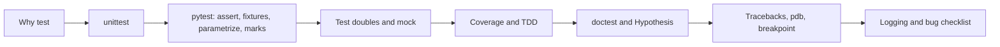
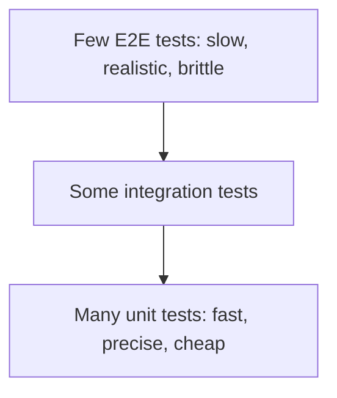
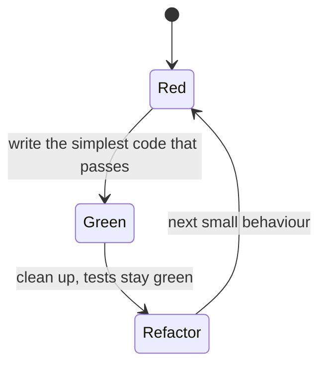

# Chapter 15 — Testing and Debugging

> **What you will learn.** Why automated tests pay for themselves, and how to write them: the built-in `unittest` style, then **pytest** — plain `assert`, fixtures, `parametrize`, `tmp_path`, marks and `conftest.py`. How to isolate code from slow or external dependencies with **test doubles** and `unittest.mock` (`Mock`, `patch`, `side_effect`, autospec). How to measure what your tests exercise with **coverage**, the red-green-refactor **TDD** loop, executable examples with **doctest**, and **property-based testing** with Hypothesis. Then debugging: reading tracebacks, `pdb` and `breakpoint()`, logging instead of `print`, and a checklist of the bugs Python programmers hit most.
>
> **Prerequisites.** Functions, classes, exceptions (Chapters 7, 9, 10). Logging basics are in [Chapter 14](../14-standard-library-tour/README.md).
>
> **Code.** All code is in `chapters/15-testing-and-debugging/code/`: a small module `inventory.py` plus its tests. Install the test tools once, then run everything from that folder:
>
> ```bash
> pip install pytest pytest-cov hypothesis
> cd chapters/15-testing-and-debugging/code
> pytest -q                      # 31 passed, 1 skipped, 1 xfailed
> python debugging_demo.py
> ```
>
> ("xfailed" means a test that was *expected* to fail did fail — see §15.4.5.)



---

## 15.1 Why write tests?

### What it is
An **automated test** is code that runs your code with known inputs and checks the result. Vocabulary used in this chapter:

| Term | Meaning |
|---|---|
| **Unit test** | tests one small piece (a function, a class) in isolation, in milliseconds |
| **Integration test** | tests several pieces together (your code + a real database or file system) |
| **End-to-end (E2E) test** | drives the whole system like a user (HTTP calls, browser) |
| **Test suite** | all the tests of a project |
| **Regression** | a bug that comes back, or a change that breaks something that used to work |
| **SUT** | *system under test* — the code being tested |
| **Arrange–Act–Assert** | the usual three-part shape of a test: set up, do the thing, check the outcome |

### Why it matters
1. **Confidence to change code.** Refactoring (restructuring code without changing its behaviour) without tests is guessing. With a good suite, you change code and learn in seconds whether anything broke.
2. **Bugs are cheaper earlier.** A failing test on your laptop costs minutes; the same bug in production (the live system real users rely on) costs incidents (outages or failures that someone has to respond to), data fixes and trust.
3. **Tests are executable documentation** — they show exactly how the code is meant to be used.
4. **Better design.** Code that is hard to test is usually too coupled (its parts depend too tightly on each other's internals); writing tests pushes you toward small functions with explicit inputs.
5. In Python specifically, there is **no compiler** to catch a typo in a rarely-run branch — only running the code finds it (type checkers help, [Chapter 13](../13-type-hints/README.md)).

### How it works — the test pyramid

Most tests should be fast unit tests; fewer integration tests; a handful of end-to-end tests for the critical paths. Tests run automatically in **CI** (continuous integration — e.g. GitHub Actions runs `pytest` on every push/pull request — a *push* uploads your commits to the shared repository; a *pull request* asks for your changes to be reviewed and merged).

### What makes a good test
- **Fast** (milliseconds), **isolated** (no dependence on other tests or their order), **repeatable** (same result every time — no real clock, network, or unseeded randomness), **self-checking** (pass/fail, no human reading output), and **focused** (one behaviour; the name says which).
- Test **behaviour, not implementation**: check what a function returns or changes, not which private helpers it calls. Then refactoring doesn't break tests.

### Real-world examples
CPython's own suite (`python -m test`) is written with `unittest`; NumPy, pandas, pip and most modern projects use pytest; Django ships a `unittest`-based runner. Pull requests on these projects are merged only when CI is green.

### TL;DR
Tests let you change code safely. Many fast unit tests, fewer integration and E2E tests, all run in CI. Test behaviour, keep tests isolated and deterministic (same input → same result, every run).

---

## 15.2 The module under test

Every example tests the same small module, `inventory.py` (abridged — `# ...` marks omitted lines):

```python
class OutOfStock(Exception):
    """Raised when removing more units than are available."""

def slugify(name: str) -> str:
    """Lower-case, keep letters/digits, join words with '-'.

    >>> slugify("Hello, World!")
    'hello-world'
    """
    words = re.findall(r"[a-z0-9]+", name.lower())
    return "-".join(words)

def apply_discount(price: float, percent: float) -> float:
    if not 0 <= percent <= 100:
        raise ValueError(f"percent must be 0-100, got {percent}")
    return round(price * (1 - percent / 100), 2)

@dataclass
class Inventory:
    stock: dict[str, int] = field(default_factory=dict)

    def add(self, sku: str, qty: int) -> None:
        if qty <= 0:
            raise ValueError("qty must be positive")
        self.stock[sku] = self.stock.get(sku, 0) + qty

    def remove(self, sku: str, qty: int) -> None:
        have = self.stock.get(sku, 0)
        if qty > have:
            raise OutOfStock(f"{sku}: want {qty}, have {have}")
        self.stock[sku] = have - qty

    def low_stock(self, threshold: int) -> list[str]: ...   # built with TDD in §15.8
    def total_units(self) -> int: ...
    def save(self, path: Path) -> None:
        path.write_text(json.dumps(self.stock, sort_keys=True))
    @classmethod
    def load(cls, path: Path) -> "Inventory": ...

def price_in(currency: str, usd: float, client: RateClient) -> float:
    """Convert a USD price using an external rate service (mocked in tests)."""
    rate = client.get_rate(currency)
    if rate <= 0:
        raise ValueError("bad rate")
    return round(usd * rate, 2)
```

Note the design choice in `price_in`: the rate service is **passed in** (dependency injection — handing a function the objects it depends on, rather than letting it build them itself) instead of created inside. That single decision makes it trivial to test with a fake (§15.5).

---

## 15.3 `unittest` basics

### What it is
`unittest` is the standard library's test framework, modelled on Java's JUnit (the "xUnit" family — the common design shared by test frameworks in many languages). Tests are methods of a class that inherits `unittest.TestCase`.

### How it works
1. Create `class TestX(unittest.TestCase)`.
2. Each method whose name starts with `test` is one test.
3. `setUp()` runs before **each** test, `tearDown()` after each; `setUpClass`/`tearDownClass` (class methods) run once per class.
4. Check results with assertion methods (an **assertion** is a check that must be true, or the test fails): `assertEqual`, `assertTrue`, `assertIn`, `assertIsNone`, `assertAlmostEqual` (floats, 7 decimal places by default), `assertRaises` (as a context manager), `assertLogs`.
5. Skip with `@unittest.skip(reason)` / `skipIf(cond, reason)`; `@unittest.expectedFailure` for known bugs.
6. Run: `python -m unittest` (auto-discovers — finds by naming convention, without you listing them — `test*.py` files), `python -m unittest -v test_inventory_unittest`, or `unittest.main()` inside the file.

```python
class TestInventory(unittest.TestCase):
    def setUp(self):                      # runs before EACH test method
        self.inv = Inventory()
        self.inv.add("mug", 5)

    def test_add_accumulates(self):
        self.inv.add("mug", 3)
        self.assertEqual(self.inv.stock["mug"], 8)

    def test_remove_too_many_raises(self):
        with self.assertRaises(OutOfStock):
            self.inv.remove("mug", 99)

    def test_discount(self):
        self.assertAlmostEqual(apply_discount(19.99, 10), 17.99)

    @unittest.skip("demo of skipping")
    def test_skipped(self):
        self.fail("never runs")
```

Output of `python test_inventory_unittest.py`:
```
test_add_accumulates (__main__.TestInventory.test_add_accumulates) ... ok
test_discount (__main__.TestInventory.test_discount) ... ok
test_remove_too_many_raises (__main__.TestInventory.test_remove_too_many_raises) ... ok
test_skipped (__main__.TestInventory.test_skipped) ... skipped 'demo of skipping'

----------------------------------------------------------------------
Ran 4 tests in 0.000s

OK (skipped=1)
```

### Trade-offs — unittest vs pytest

| | `unittest` | `pytest` |
|---|---|---|
| Install | built in | `pip install pytest` |
| Test shape | class + `self.assertX` methods | plain functions + `assert` |
| Setup | `setUp`/`tearDown` | fixtures (reusable, composable, scoped) |
| Data-driven tests | `self.subTest(...)` loop | `@pytest.mark.parametrize` |
| Failure messages | from the assert method | rewritten `assert` shows values and diffs |
| Plugins (add-on packages that extend a tool) | few | large ecosystem (coverage, xdist — runs tests in parallel, asyncio, django…) |
| Runs the other's tests | — | yes, pytest runs `unittest` tests unchanged |

### When to use it
When you can't add dependencies (stdlib-only tools, CPython itself), or in an existing unittest codebase. For everything else, pytest is the community default — and since pytest runs unittest tests, you can migrate gradually.

### TL;DR
`unittest`: `TestCase` classes, `test_` methods, `setUp`, `assertEqual`/`assertRaises`; run with `python -m unittest`. Built in, more verbose than pytest.

---

## 15.4 pytest

### What it is
**pytest** is the most widely used Python test framework. Tests are plain functions using plain `assert`; pytest discovers them, runs them, and explains failures in detail.

### How it works — discovery and running
1. pytest collects files named `test_*.py` or `*_test.py`, functions named `test_*`, and classes named `Test*` (without an `__init__`).
2. Common commands:

| Command | Does |
|---|---|
| `pytest` | run everything under the current folder |
| `pytest -q` / `-v` | quieter / one line per test |
| `pytest test_x.py::test_name` | one test |
| `pytest -k "discount and not bad"` | tests whose names match the expression |
| `pytest -m "not slow"` | select by mark |
| `pytest -x` / `--maxfail=2` | stop after the first/second failure |
| `pytest --lf` | rerun only last-failed tests |
| `pytest -s` | show `print` output (normally captured) |
| `pytest --pdb` | open the debugger at a failure |
| `pytest --durations=5` | list the slowest tests |

3. Settings live in `pyproject.toml` under `[tool.pytest.ini_options]` (e.g. `testpaths = ["tests"]`, `markers = ["slow: ..."]`, `addopts = "-q"`).

### 15.4.1 Plain `assert` and assertion rewriting
pytest rewrites `assert` statements in test files so that on failure it prints the values involved. You write `assert result == expected`, and get a diff (a side-by-side listing of what differs) for free (see §15.8 for a real one). Helpers:
- `pytest.raises(Exc, match="regex")` — the block must raise `Exc` with a message matching the regex (regular expression — a text pattern, see [Chapter 14](../14-standard-library-tour/README.md) §14.3).
- `pytest.approx(x)` — float comparison with tolerance (relative 1e-6 by default): `0.1 + 0.2 == pytest.approx(0.3)`.
- `pytest.warns(Warning)` — the block must emit a warning.

### 15.4.2 Fixtures
A **fixture** is a function that prepares something a test needs (an object, a temp file, a database connection) and optionally cleans it up afterwards. A test requests a fixture simply by naming it as a parameter — pytest calls the fixture and passes in the result (**dependency injection**).

```python
# conftest.py
@pytest.fixture
def inv():
    """A fresh inventory with two products for every test that asks for it."""
    inventory = Inventory()
    inventory.add("mug", 5)
    inventory.add("pen", 10)
    return inventory

# test_inventory_pytest.py
def test_total_units(inv):
    assert inv.total_units() == 15

def test_remove_reduces_stock(inv):
    inv.remove("pen", 4)
    assert inv.stock == {"mug": 5, "pen": 6}

def test_remove_too_many_raises(inv):
    with pytest.raises(OutOfStock, match="want 6, have 5"):
        inv.remove("mug", 6)
```

Rules:
1. **Fresh per test by default** (`scope="function"`): `test_remove_reduces_stock` modifies its `inv`, and the next test still gets the original — tests stay isolated.
2. **Scopes** (how long one fixture value lives and is shared): `function` (default), `class`, `module`, `package`, `session` (one whole `pytest` run). Use wider scopes for expensive, read-only resources (e.g. one database engine per session).
3. **Teardown with `yield`**: code after `yield` runs after the test, even if it fails:
   ```python
   @pytest.fixture
   def audit_log(tmp_path):
       f = (tmp_path / "audit.txt").open("w")
       yield f          # the test runs here
       f.close()        # cleanup
   ```
4. Fixtures can use other fixtures (`audit_log` uses `tmp_path`).
5. `autouse=True` applies a fixture to every test in its scope without naming it — use sparingly.
6. Useful **built-in fixtures**: `tmp_path` (a unique temporary directory as a `Path`), `monkeypatch` (temporarily set attributes, env vars — environment variables, the named text settings a process receives from the operating system — dict items; undone automatically), `capsys` (capture stdout/stderr — the program's normal output and error-output streams), `caplog` (capture log records), `request` (info about the requesting test).

### 15.4.3 `tmp_path` — real files, safely
```python
def test_save_and_load_roundtrip(inv, tmp_path):
    path = tmp_path / "stock.json"          # unique temp dir per test
    inv.save(path)
    assert Inventory.load(path) == inv
    assert path.read_text() == '{"mug": 5, "pen": 10}'
```
Each test gets its own directory, so tests never collide and never write into your project. This is often better than mocking the file system: it tests the real code path and is still fast.

### 15.4.4 `parametrize` — one test, many cases
```python
@pytest.mark.parametrize(
    ("price", "percent", "expected"),
    [(100, 0, 100), (100, 25, 75), (19.99, 10, 17.99), (50, 100, 0)],
)
def test_discount(price, percent, expected):
    assert apply_discount(price, percent) == pytest.approx(expected)

@pytest.mark.parametrize(("raw", "slug"), [
    ("Blue Mug", "blue-mug"),
    ("  --Hello__World-- ", "hello-world"),
    ("", ""),
], ids=["simple", "punctuation", "empty"])
def test_slugify(raw, slug):
    assert slugify(raw) == slug
```
Each tuple becomes a **separate test** with its own ID, so one failing case doesn't hide the others. Include edge cases (unusual inputs at the extremes, where bugs hide): empty input, zero, boundaries (0 and 100), negative numbers, Unicode (non-English and special characters such as `é`, `中`, emoji).

### 15.4.5 Marks
A **mark** is a label on a test that changes how it's selected or run.

| Mark | Effect |
|---|---|
| `@pytest.mark.skip(reason=...)` | never run |
| `@pytest.mark.skipif(sys.platform == "win32", reason=...)` | run only when the condition is false |
| `@pytest.mark.xfail(reason=..., strict=True)` | expected to fail; with `strict=True`, an unexpected *pass* is reported as a failure, so you notice when the bug is fixed |
| `@pytest.mark.parametrize(...)` | data-driven cases |
| `@pytest.mark.slow` (custom) | a label you select with `-m`; register it to avoid "unknown mark" warnings |

```python
@pytest.mark.slow
def test_slow_path():
    time.sleep(0.2)
    assert True

@pytest.mark.xfail(reason="float rounding: 2.675 is stored as 2.67499...; use Decimal",
                   strict=True)
def test_known_bug():
    assert apply_discount(2.675, 0) == 2.68
```
The xfail documents a genuine float issue: the literal `2.675` is stored in binary as slightly less than 2.675, so `round(2.675, 2)` gives `2.67`. The fix would be `decimal.Decimal`.

### 15.4.6 `conftest.py`
`conftest.py` is a special file that pytest loads automatically. Fixtures and hooks (functions with special names that pytest calls at certain moments, such as `pytest_configure`) defined there are available to every test in that directory and below — **no import needed**. Nested folders can have their own `conftest.py`. Ours defines the `inv` fixture and registers the `slow` marker:

```python
def pytest_configure(config):
    config.addinivalue_line("markers", "slow: marks a test as slow")
```
(In a real project you'd register markers in `pyproject.toml` instead.)

### Output
`pytest -v test_inventory_pytest.py`:
```
test_inventory_pytest.py::test_total_units PASSED                        [  6%]
test_inventory_pytest.py::test_remove_reduces_stock PASSED               [ 12%]
test_inventory_pytest.py::test_remove_too_many_raises PASSED             [ 18%]
test_inventory_pytest.py::test_discount[100-0-100] PASSED                [ 25%]
test_inventory_pytest.py::test_discount[100-25-75] PASSED                [ 31%]
test_inventory_pytest.py::test_discount[19.99-10-17.99] PASSED           [ 37%]
test_inventory_pytest.py::test_discount[50-100-0] PASSED                 [ 43%]
test_inventory_pytest.py::test_discount_rejects_bad_percent[-1] PASSED   [ 50%]
test_inventory_pytest.py::test_discount_rejects_bad_percent[101] PASSED  [ 56%]
test_inventory_pytest.py::test_slugify[simple] PASSED                    [ 62%]
test_inventory_pytest.py::test_slugify[punctuation] PASSED               [ 68%]
test_inventory_pytest.py::test_slugify[empty] PASSED                     [ 75%]
test_inventory_pytest.py::test_save_and_load_roundtrip PASSED            [ 81%]
test_inventory_pytest.py::test_audit_written PASSED                      [ 87%]
test_inventory_pytest.py::test_slow_path PASSED                          [ 93%]
test_inventory_pytest.py::test_known_bug XFAIL (float rounding: 2.67...) [100%]

======================== 15 passed, 1 xfailed in 0.31s =========================
```
`pytest -q -m "not slow" test_inventory_pytest.py` → `14 passed, 1 deselected, 1 xfailed`.
`pytest --durations=3` (whole folder):
```
0.20s call     test_inventory_pytest.py::test_slow_path
0.12s call     test_properties.py::test_stock_never_negative
0.04s call     test_properties.py::test_slugify_is_idempotent
```

### Common mistakes
- Tests that depend on each other's side effects or order (use fresh fixtures).
- Asserting on floats with `==` (use `pytest.approx`).
- `pytest.raises` wrapping too much code — the exception might come from the setup line instead of the call you meant.
- Module-level mutable state shared between tests.
- Test files with the same basename in different folders without `__init__.py` — pytest reports an import-mismatch error.

### In the interview
"I use pytest: plain asserts, fixtures for setup with `yield` for teardown, `parametrize` for edge cases, `tmp_path` and `monkeypatch` for files and environment, and marks to separate slow tests. Shared fixtures go in `conftest.py`."
- *Fixture scope?* Default is per function for isolation; session scope for expensive read-only resources.
- *xfail vs skip?* Skip = don't run; xfail = run, expect failure (strict flags an unexpected pass).

### Self-check
1. How does a test get a fixture? → By naming it as a parameter.
2. Where does teardown code go? → After `yield` in the fixture.
3. What does `parametrize` with four tuples produce? → Four separate tests.
4. Does a test need to import fixtures from `conftest.py`? → No, they're discovered automatically.

### TL;DR
pytest = functions + `assert`. Fixtures (scoped, `yield` teardown, in `conftest.py`), `parametrize` for cases, `tmp_path`/`monkeypatch`/`capsys`/`caplog` built-ins, marks for skip/xfail/selection.

---

## 15.5 Test doubles and `unittest.mock`

### What it is
A **test double** is a stand-in for a real dependency (a network API, a payment gateway — the service that actually charges cards, the clock) during a test — like a stunt double in a film. The standard names (from Gerard Meszaros' *xUnit Test Patterns*, popularised by Martin Fowler):

| Double | What it does | Example |
|---|---|---|
| **Dummy** | passed but never used | `None` for an unused logger argument |
| **Stub** | returns canned (fixed, prepared in advance) answers | `get_rate` always returns 83.5 |
| **Spy** | records how it was called, checked afterwards | a list that collects sent emails |
| **Mock** | pre-programmed with expectations about calls, which the test verifies | "`get_rate` must be called once with `'INR'`" |
| **Fake** | a working, simplified implementation | an in-memory dict instead of a database |

`unittest.mock.Mock` can play stub, spy and mock roles at once.

### Why it matters
Real dependencies make tests **slow** (network), **flaky** (sometimes pass, sometimes fail with no code change — e.g. service down), **costly** (paid APIs) or **dangerous** (sending real emails, charging cards). They also make some cases hard to reach — how do you make a real service time out on demand?

### How it works — `Mock`
1. `m = Mock()` — any attribute access returns another `Mock`, and calling it records the call.
2. `m.get_rate.return_value = 83.5` — **stub** the result.
3. `m.get_rate.side_effect = ...` — dynamic behaviour: an **exception** (raised when called), an **iterable** (one value per call), or a **function** (called with the same arguments).
4. Verify: `assert_called_once_with(...)`, `assert_called_with`, `assert_not_called`, `call_count`, `call_args`, `call_args_list`.
5. `MagicMock` also supports magic methods (the double-underscore "dunder" methods Python calls for operators and built-ins: `__len__`, `__iter__`, `__enter__`…); `AsyncMock` (3.8+) for `async def` functions.
6. **Autospec** — `create_autospec(RealClass, instance=True)` or `patch(..., autospec=True)` builds a mock that only has the real object's attributes and signatures. A plain `Mock` happily accepts misspelled methods, so a test can pass while the real code would crash.

```python
class FakeRates:                              # hand-written fake
    def __init__(self, rates): self.rates = rates
    def get_rate(self, currency): return self.rates[currency]

def test_with_fake():
    assert price_in("EUR", 10, FakeRates({"EUR": 0.9})) == 9.0

def test_with_mock_stub_and_verify():
    client = Mock()
    client.get_rate.return_value = 83.5          # stub the answer
    assert price_in("INR", 2, client) == 167.0
    client.get_rate.assert_called_once_with("INR")   # verify the interaction

def test_side_effect_exception():
    client = Mock()
    client.get_rate.side_effect = TimeoutError("rate service down")
    with pytest.raises(TimeoutError):
        price_in("EUR", 10, client)

def test_side_effect_sequence():
    client = Mock()
    client.get_rate.side_effect = [0.9, -1.0]     # one value per call
    assert price_in("EUR", 10, client) == 9.0
    with pytest.raises(ValueError, match="bad rate"):
        price_in("EUR", 10, client)
    assert client.get_rate.call_args_list == [call("EUR"), call("EUR")]

def test_autospec_catches_typos():
    client = create_autospec(FakeRates, instance=True)
    with pytest.raises(AttributeError):
        client.get_rates("EUR")                   # misspelled: plain Mock would allow it
```

### How it works — `patch`
When code creates or imports its dependency itself (instead of receiving it), use `patch` to swap a name **temporarily**:

```python
def test_patch_where_it_is_used(tmp_path):
    # inventory.py did `import json`; patch the name inventory.json.dumps
    with patch("inventory.json.dumps", return_value="{}") as fake_dumps:
        inventory.Inventory({"a": 1}).save(tmp_path / "x.json")
    fake_dumps.assert_called_once()
    assert (tmp_path / "x.json").read_text() == "{}"
```

1. `patch("module.name")` replaces the attribute for the duration of a `with` block, a decorated test function, or between `start()`/`stop()`; the original is always restored.
2. **Patch where the name is looked up, not where it is defined.** If `shop.py` does `from requests import get`, patch `"shop.get"` — patching `"requests.get"` won't affect the copy of the name already bound in `shop`. (In the example, `inventory.json` *is* the `json` module, so this patch actually affects `json.dumps` everywhere during the block — one reason to keep patches short.)
3. `patch.object(obj, "attr")` patches an attribute of an object you have; `patch.dict(os.environ, {...})` patches dictionary entries.
4. pytest's `monkeypatch` does the same for simple cases: `monkeypatch.setenv("APP_ENV", "test")`, `monkeypatch.setattr(module, "name", value)`.

`pytest -v test_mocking.py`:
```
test_mocking.py::test_with_fake PASSED                                   [ 14%]
test_mocking.py::test_with_mock_stub_and_verify PASSED                   [ 28%]
test_mocking.py::test_side_effect_exception PASSED                       [ 42%]
test_mocking.py::test_side_effect_sequence PASSED                        [ 57%]
test_mocking.py::test_autospec_catches_typos PASSED                      [ 71%]
test_mocking.py::test_patch_where_it_is_used PASSED                      [ 85%]
test_mocking.py::test_monkeypatch_env PASSED                             [100%]
```

### Trade-offs

| Approach | Pros | Cons |
|---|---|---|
| Real dependency (tmp_path, SQLite in memory, local server) | tests the real thing | slower, needs setup |
| Fake | realistic behaviour, reusable, readable | you must write and maintain it |
| Mock/stub | quick, can simulate errors/timeouts | couples tests to call details; can drift from the real API |
| `patch` | works without changing the code | fragile if imports move; hints that dependency injection would be cleaner |

### When not to mock
- Don't mock what you own and can run cheaply (pure functions, dataclasses, files in `tmp_path`, in-memory SQLite).
- Don't mock the thing you are testing.
- Don't assert every internal call — you'll lock in the implementation. Mock at the **boundary** (where your code meets the outside world: network, clock, randomness, third-party SDKs — software development kits, i.e. vendor client libraries), and prefer checking outcomes over interactions.

### Common mistakes
- Patching the wrong path (where defined instead of where used).
- Plain `Mock()` hiding typos — use `autospec`/`spec`.
- Misspelled assertions such as `m.called_once_with(...)` or `m.assret_called()` — on old Pythons some silently "passed" (they just created a child mock). Mock now raises `AttributeError` for names that look like assertions but aren't (typo prefixes like `assret_` since 3.5, and assertion names missing the `assert_` prefix since 3.12), unless created with `unsafe=True`.
- Tests that only prove the mock returns what you told it to.

### Real-world examples
Libraries exist for common boundaries: `responses` / `respx` fake HTTP for requests / httpx, `freezegun` / `time-machine` freeze the clock, `moto` fakes AWS (Amazon Web Services, the cloud platform) services, `fakeredis` fakes Redis (a popular in-memory key-value store often used as a cache).

### In the interview
"I prefer dependency injection so I can pass a fake. At external boundaries I use `unittest.mock` with autospec: `return_value` to stub, `side_effect` for errors or sequences, and `assert_called_once_with` only when the interaction itself matters. With `patch` I patch where the name is looked up."
- *Mock vs stub?* A stub supplies answers; a mock also verifies how it was called.
- *Why autospec?* So the mock fails on methods or signatures the real object doesn't have.

### Self-check
1. `side_effect = [1, 2]` — what do three calls do? → Return 1, then 2, then raise `StopIteration`.
2. `shop.py` has `from requests import get`. What do you patch? → `"shop.get"`.
3. What's a fake? → A simplified working implementation, e.g. an in-memory repository (here: an object that stores and fetches records, normally backed by a database).

### TL;DR
Doubles replace slow/external dependencies: dummy, stub, spy, mock, fake. `Mock` + `return_value`/`side_effect` + `assert_called_*`; `patch` where used; autospec to stay honest; mock only at boundaries.

---

## 15.6 Coverage

### What it is
**Code coverage** measures which lines (and branches) of your code ran during the tests. `coverage.py` is the standard tool; `pytest-cov` integrates it with pytest.

- **Line (statement) coverage** — was each line executed?
- **Branch coverage** — did each `if` go both ways? A line can run while one side of its `if` is never taken.

### How it works
```bash
pytest --cov=inventory --cov-branch --cov-report=term-missing
# or without the plugin:
coverage run --branch -m pytest && coverage report -m && coverage html   # htmlcov/index.html
```

Output:
```
Name           Stmts   Miss Branch BrPart  Cover   Missing
----------------------------------------------------------
inventory.py      48      7     10      2    84%   48, 81-86
----------------------------------------------------------
TOTAL             48      7     10      2    84%
```
Reading it: 48 statements, 7 never ran; 10 branch points, 2 partially taken. `Missing` lists the lines: **48** is `raise ValueError("qty must be positive")` in `Inventory.add` — no test ever passes a non-positive quantity, so that validation is untested. **81-86** is the `if __name__ == "__main__":` demo block (fine to exclude with a `# pragma: no cover` comment — a special comment that tools read as an instruction — or config).

### Trade-offs / how to use the number
- Coverage shows what is **not** tested. It does **not** show that tested code is **correct** — a test that runs a line without asserting anything still "covers" it.
- Many teams require a threshold in CI (`--cov-fail-under=85`). 100% is rarely worth the effort except in small critical libraries; aim for high coverage of business logic (the rules that are the point of the program) and error paths.
- Watch the *missing* list during code review (teammates reading a change before it is merged) more than the percentage.
- **Mutation testing** (e.g. `mutmut`) goes further: it changes your code (`<` to `<=`) and checks that some test fails.

### TL;DR
`pytest --cov=pkg --cov-branch --cov-report=term-missing`. Use it to find untested lines, not as proof of quality.

---

## 15.7 doctest — examples that are tests

### What it is
`doctest` finds text in docstrings that looks like an interactive session (typing into the Python prompt, the REPL — read-eval-print loop: `>>> expr` followed by the expected output) and checks that running it produces that output.

```python
def slugify(name: str) -> str:
    """Lower-case, keep letters/digits, join words with '-'.

    >>> slugify("Hello, World!")
    'hello-world'
    """
```

### How it works
- `python -m doctest inventory.py -v`, or inside the module `doctest.testmod()`, or with pytest: `pytest --doctest-modules`.
- Output is compared as **text**, so it must match `repr` (the developer-facing string form of an object, what the REPL echoes) exactly.

Output of `python inventory.py` and `pytest --doctest-modules inventory.py`:
```
stock: {'mug': 3} | units: 3
doctest: TestResults(failed=0, attempted=3)
..                                                                       [100%]
2 passed in 0.07s
```
(3 examples in 2 docstrings; pytest counts each docstring as one test.)

### Trade-offs / when not to use it
Great for keeping **documentation examples correct**. Poor for real test suites: text comparison is brittle (dict order, float digits, memory addresses in reprs), and there are no fixtures or parametrization. Use doctests for docs, pytest for tests.

### TL;DR
Docstring examples that run. Keep them short; `pytest --doctest-modules` runs them with the rest.

---

## 15.8 The TDD loop (red, green, refactor)

### What it is
**Test-driven development** (popularised by Kent Beck) is writing the test **before** the code, in tiny cycles:



1. **Red** — write a small failing test for the next behaviour. Run it; see it fail *for the right reason*.
2. **Green** — write the minimum code to pass.
3. **Refactor** — improve names and structure; the tests guard you.

### How it works — a real cycle
Feature: `Inventory.low_stock(threshold)` → SKUs (stock-keeping units — a shop's ID code for each product) whose quantity is **at or below** the threshold, sorted.

**Red.** Tests first (`test_tdd_low_stock.py`):
```python
def test_low_stock_lists_skus_below_threshold(inv):      # inv: mug=5, pen=10
    assert inv.low_stock(threshold=6) == ["mug"]

def test_low_stock_sorted_and_inclusive(inv):
    inv.add("cap", 1)
    assert inv.low_stock(threshold=10) == ["cap", "mug", "pen"]
```
Run → both fail because the method doesn't exist yet:
```
>       assert inv.low_stock(threshold=6) == ["mug"]
               ^^^^^^^^^^^^^
E       AttributeError: 'Inventory' object has no attribute 'low_stock'
...
2 failed in 0.07s
```

**Green, first try.** A quick implementation `return [sku for sku, q in self.stock.items() if q < threshold]` passes the first test but not the second. pytest's assertion rewriting shows exactly why:
```
>       assert inv.low_stock(threshold=10) == ["cap", "mug", "pen"]
E       AssertionError: assert ['mug', 'cap'] == ['cap', 'mug', 'pen']
E         
E         At index 0 diff: 'mug' != 'cap'
E         Right contains one more item: 'pen'
E         Use -v to get more diff
1 failed, 1 passed in 0.07s
```
Two bugs are visible: the order isn't sorted, and `pen` (exactly 10) is missing, so the comparison must be `<=`.

**Green.**
```python
def low_stock(self, threshold: int) -> list[str]:
    """SKUs with quantity <= threshold, alphabetically."""
    return sorted(sku for sku, qty in self.stock.items() if qty <= threshold)
```
Whole suite: `31 passed, 1 skipped, 1 xfailed`.

**Refactor.** Names are clear already; nothing else to do — move to the next behaviour.

### Trade-offs
| Pros | Cons |
|---|---|
| Every line has a reason (a test) | Slower start; feels unnatural at first |
| Forces small, testable design | Hard when exploring an unknown problem/API (spike — a quick throw-away experiment — first, then test) |
| Instant regression safety | Can over-fit (tie too closely) tests to one design if cycles are too big |

Many teams use TDD for bug fixes at least: **first write a test that reproduces the bug**, see it fail, then fix — the bug can never silently return.

### TL;DR
Red (failing test) → Green (simplest fix) → Refactor. At minimum, reproduce every bug with a failing test before fixing it.

---

## 15.9 Property-based testing with Hypothesis (brief)

### What it is
In an **example-based** test you pick inputs. In a **property-based** test you state a rule that must hold for *all* inputs of some kind, and a library generates hundreds of inputs — including nasty ones (empty strings, huge numbers, Unicode, NaN — "not a number", the special float produced by e.g. `0 * inf`) — trying to break it. **Hypothesis** is Python's main library for this (the idea comes from QuickCheck, a library for the functional language Haskell).

When it finds a failing input it **shrinks** it to the smallest, simplest failing example, and stores it in a local database (`.hypothesis/`) so it's retried first next time.

### How it works
```python
from hypothesis import given, settings, strategies as st

@given(st.text())
def test_slugify_is_idempotent(s):             # applying it twice changes nothing
    assert slugify(slugify(s)) == slugify(s)

@given(st.text())
def test_slug_has_only_safe_chars(s):
    assert all(c.isascii() and (c.isalnum() or c == "-") for c in slugify(s))

@given(price=st.floats(0, 1e6), pct=st.floats(0, 100))
def test_discount_never_increases_price(price, pct):
    assert apply_discount(price, pct) <= round(price, 2)

@settings(max_examples=200)
@given(st.lists(st.tuples(st.sampled_from(["add", "remove"]), st.integers(1, 20))))
def test_stock_never_negative(ops):            # random sequences of operations
    inv = Inventory()
    for op, qty in ops:
        try:
            getattr(inv, op)("mug", qty)
        except OutOfStock:
            pass
        assert inv.stock.get("mug", 0) >= 0
```
All four pass on our `slugify`. To see shrinking, run the same "safe characters" property against a naive version `name.strip().lower().replace(" ", "-")`:
```
E       Failing test case: test_slug_has_only_safe_chars(
E           s=':',
E       )
```
Out of all the random strings it tried, Hypothesis reduced the failure to the single character `':'`.

Common properties to test: **round-trip** (`load(save(x)) == x`, `decode(encode(x)) == x`), **idempotence** (doing it twice gives the same result as once: `f(f(x)) == f(x)`), **invariants** (facts that must always stay true: stock never negative, output sorted, length preserved), **oracle** (a trusted reference answer: fast version equals a slow obviously-correct version).

### When not to use it
When you can't state a general rule, or when inputs are expensive to create. Use it alongside example tests, not instead of them.

### TL;DR
State properties, let Hypothesis generate and shrink counter-examples. Great for parsers (code that reads text into structured data), serializers (code that turns objects into text/bytes) and invariants.

---

## 15.10 Reading tracebacks

### What it is
A **traceback** is Python's report of an uncaught exception: the chain of function calls (the **call stack**) that led to the error, oldest call at the top, the failing line at the bottom.

### How it works — read it bottom-up
1. **Last line first**: the exception type and message — `ValueError: invalid literal for int() with base 10: 'two'`.
2. **The frame just above it** (each entry in the traceback is a *frame* — one function call in progress): the file, line and function where it happened. Since 3.11, `~~~^^^` markers point at the exact sub-expression (PEP 657).
3. **Walk upward** until you reach *your* code (skip library frames) — often the bug is where your code passed bad data in.
4. **Chained exceptions**: "The above exception was the direct cause of the following exception" means the lower exception was raised with `raise NewError(...) from original`. "During handling of the above exception, another exception occurred" means a new error happened *inside* an `except` block (implicit chaining).

From `debugging_demo.py` (a CSV-like line with `"two"` as the quantity):
```
Traceback (most recent call last):
  File "debugging_demo.py", line 19, in load_orders
    orders.append(parse_order(line))
                  ~~~~~~~~~~~^^^^^^
  File "debugging_demo.py", line 12, in parse_order
    return {"sku": sku, "qty": int(qty), "price": float(price)}
                               ~~~^^^^^
ValueError: invalid literal for int() with base 10: 'two'

The above exception was the direct cause of the following exception:

Traceback (most recent call last):
  File "debugging_demo.py", line 35, in <module>
    load_orders(["mug,2,4.50", "pen,two,1.20"])
    ~~~~~~~~~~~^^^^^^^^^^^^^^^^^^^^^^^^^^^^^^^^
  File "debugging_demo.py", line 21, in load_orders
    raise RuntimeError(f"bad order on line {n}: {line!r}") from e
RuntimeError: bad order on line 2: 'pen,two,1.20'
```
The final error tells *which input* was bad (line 2); the cause above it tells *what* was wrong with it (`int('two')`). Good error handling (`raise ... from e` with context) makes tracebacks like this.

### Common exception → usual cause

| Exception | Usual cause |
|---|---|
| `NameError` | typo, or used before assignment |
| `AttributeError: 'NoneType' object has no attribute ...` | a function returned `None` (forgot `return`, or an in-place method like `list.sort()`) |
| `TypeError: ... takes 2 positional arguments but 3 were given` | forgot `self`, or wrong call |
| `KeyError` / `IndexError` | missing dict key / off-by-one |
| `UnboundLocalError` | assigning to a name inside a function makes it local (use `nonlocal`/`global` or rename) |
| `ModuleNotFoundError` | wrong virtual environment (an isolated folder of installed packages for one project; "venv"), or a local file shadows (hides, by having the same name) the module (e.g. your own `random.py`) |
| `RecursionError` | missing or unreachable base case (the condition where a recursive function stops calling itself) |

### TL;DR
Read bottom-up: message, failing line, then up to your code. "Direct cause" = explicit `from`; "during handling" = error inside `except`.

---

## 15.11 Debugging with `pdb` and `breakpoint()`

### What it is
`pdb` is Python's built-in interactive **debugger**: it pauses the program at a line and lets you inspect variables, step line by line, and move up and down the call stack. `breakpoint()` (3.7+, PEP 553) is the built-in way to pause there — it calls `pdb.set_trace()` by default.

### How it works — ways in
| Way | When |
|---|---|
| Put `breakpoint()` in the code | pause at a specific spot |
| `python -m pdb script.py` | start the whole script under the debugger |
| `pdb.pm()` after a crash (in the REPL) or `python -m pdb` (it enters post-mortem — "after death": inspecting the program's state at the moment it crashed — on an uncaught exception) | inspect the frame where it died |
| `pytest --pdb` | debugger at the failing assertion |
| `pytest --trace` | debugger at the start of each test |
| IDE (integrated development environment: VS Code, PyCharm) breakpoints | same ideas, with a GUI (graphical user interface — windows and buttons) |

The environment variable `PYTHONBREAKPOINT` controls what `breakpoint()` does: `PYTHONBREAKPOINT=0` disables all of them (safety net in CI), `PYTHONBREAKPOINT=ipdb.set_trace` switches to another debugger.

### The commands you need

| Command | Does |
|---|---|
| `l` / `ll` | list code around the current line / the whole function |
| `n` (next) | run the current line, stepping *over* calls |
| `s` (step) | step *into* a call |
| `r` (return) | run until the current function returns |
| `c` (continue) | run until the next breakpoint |
| `unt N` (until) | run until line N |
| `p expr` / `pp expr` | print / pretty-print an expression |
| `w` (where) | show the call stack |
| `u` / `d` | move up / down the stack to inspect callers |
| `b file:line` / `b func` / `b line, cond` | set a (conditional) breakpoint |
| `cl N` | clear breakpoint N |
| `display expr` | show `expr` each time execution stops if it changed |
| `interact` | a full Python REPL in the current scope |
| `q` | quit |

Tip: a bare expression also works, but if a variable is named like a command (`n`, `c`, `l`…), use `p n`.

### A real session (scripted, so it can be shown)
`debugging_demo.py` drives `pdb` with a list of commands instead of the keyboard. The function under investigation crashes on an empty list:
```python
def average_value(orders: list[dict]) -> float:
    total = 0.0
    for o in orders:
        total += o["qty"] * o["price"]
    return total / len(orders)          # bug when orders is empty
```
Commands: `b average_value`, `c`, `p orders`, `n`, `n`, `p total, len(orders)`, `c`. Transcript:
```
(Pdb) Breakpoint 1 at debugging_demo.py:26
(Pdb) > debugging_demo.py(26)average_value()
-> total = 0.0
(Pdb) []
(Pdb) > debugging_demo.py(27)average_value()
-> for o in orders:
(Pdb) > debugging_demo.py(29)average_value()
-> return total / len(orders)          # bug when orders is empty
(Pdb) (0.0, 0)
(Pdb)
then it raised: ZeroDivisionError('division by zero')
post-mortem locals: {'orders': [], 'total': 0.0}
breakpoint() skipped because PYTHONBREAKPOINT=0
```
Stepping shows the loop body is skipped and `len(orders)` is 0 at the return — the fix is to handle the empty case (`if not orders: return 0.0` or raise a clear error). The "post-mortem" line shows the same information recovered from the traceback's innermost frame after the crash, which is what `pdb.pm()` gives you interactively.

### A debugging method (not just a tool)
1. **Reproduce** reliably — ideally as a failing test.
2. **Read** the traceback and the relevant code; state a hypothesis.
3. **Observe**: `breakpoint()`, logging, or `p` in pdb to check the hypothesis.
4. **Narrow down**: halve the input, comment out half the code, or use `git bisect` (a git command that binary-searches your history) to find the commit (one saved snapshot of changes in git) that introduced the bug.
5. **Fix** the cause, not the symptom; keep the test so it can't regress.
6. Explaining the code line by line to someone (or a rubber duck — "rubber-duck debugging" is the well-known trick of explaining code to an object) surprisingly often reveals the bug.

### Common mistakes
- Committing a `breakpoint()` (CI hangs waiting for input — set `PYTHONBREAKPOINT=0` there, and use a linter rule such as Ruff's `T100` — a linter is a tool that scans code for mistakes and style problems without running it).
- Changing several things at once while debugging.

### TL;DR
`breakpoint()` → `n`/`s`/`c`/`p`/`w`/`u`/`d`. `python -m pdb`, `pytest --pdb`, `pdb.pm()` for post-mortem. Reproduce, hypothesise, observe, narrow, fix, keep the test.

---

## 15.12 Logging vs `print` for debugging

### What it is
`print` debugging is fine for a five-minute investigation. For anything that stays in the code, use **logging** ([Chapter 14](../14-standard-library-tour/README.md)): it has levels, timestamps, module names and configurable destinations, and can be turned up to DEBUG only where you need it.

| | `print` | `logging` |
|---|---|---|
| Levels / filtering | no | DEBUG…CRITICAL, per module |
| Timestamp, module, line | manual | via formatter |
| Destination | stdout | console, files, syslog (the operating system's central log), log services |
| Safe to leave in code | no | yes (DEBUG off in production) |
| In tests | captured by pytest (`-s` shows) | `caplog` fixture lets tests assert on logs |

```python
log = logging.getLogger(__name__)
log.debug("pricing order=%s rate=%s", order_id, rate)    # visible only at DEBUG
```
Tips: temporarily raise one module's level (`logging.getLogger("shop.pricing").setLevel(logging.DEBUG)`); f-string `=` specifier for quick prints — `print(f"{total=}")` prints `total=0.0`; `python -X dev` enables extra runtime checks and warnings; `faulthandler` (`python -X faulthandler`) dumps tracebacks on hard crashes (the interpreter itself dying, e.g. a segmentation fault in C code) or hangs.

### TL;DR
`print` for a quick look, then delete it; logging for anything that stays. Test logs with `caplog`.

---

## 15.13 Common bugs checklist

Run through this list when something "can't possibly be wrong":

| # | Bug | Example | Fix |
|---|---|---|---|
| 1 | Mutable default argument | `def f(items=[])` shares one list across calls | `items=None` then `items = [] if items is None else items` |
| 2 | Late-binding closures | `[lambda: i for i in range(3)]` all return 2 | `lambda i=i: i` |
| 3 | Aliasing / shallow copies | `grid = [[0]*3]*3` — one row shared three times | `[[0]*3 for _ in range(3)]`, `copy.deepcopy` |
| 4 | Modifying a list while iterating | removing items inside `for x in xs` skips items | iterate over a copy or build a new list |
| 5 | `is` vs `==` | `x is 1000` depends on object identity | `==` for values; `is` only for `None`, sentinels (unique marker objects) |
| 6 | Float equality | `0.1 + 0.2 == 0.3` is False | `math.isclose`, `pytest.approx`, `Decimal` for money |
| 7 | Integer vs float division | `7 / 2 == 3.5`, `7 // 2 == 3`, `-7 // 2 == -4` | pick the right operator |
| 8 | Methods returning `None` | `xs = xs.sort()` makes `xs` None | `xs.sort()` or `xs = sorted(xs)` |
| 9 | Swallowed exceptions | `except Exception: pass` hides the real error | catch specific exceptions, log, re-raise |
| 10 | Off-by-one | `range(1, n)` excludes `n` | test the boundaries |
| 11 | Truthiness | `if count:` is False for `0` | `if count is not None:` |
| 12 | Naive datetimes / time zones | comparing local and UTC times | aware UTC datetimes ([Chapter 14](../14-standard-library-tour/README.md)) |
| 13 | Unclosed resources | files/connections left open | `with` statements |
| 14 | Wrong environment | `ModuleNotFoundError` though "it's installed" | check `sys.executable`, activate the venv, `python -m pip` |
| 15 | Module name shadowing | your `random.py` or `test.py` hides the stdlib | rename the file |
| 16 | Global/shared state between tests | tests pass alone, fail together | fresh fixtures, no module-level mutable state |
| 17 | Encoding | `UnicodeDecodeError` reading files | `open(p, encoding="utf-8")` (UTF-8 is the standard way to store text as bytes) |
| 18 | Unseeded randomness / real clock in tests | flaky tests | seed (fix the random starting value), inject the clock, freeze time |

### TL;DR
Most Python bugs are a handful of classics: mutable defaults, aliasing, `None` returns, float equality, swallowed exceptions, wrong venv. Check the list before a long debugging session.

---

## 15.14 Chapter self-check

1. Name the three parts of a well-shaped test. → Arrange, Act, Assert.
2. Why do most tests belong at the bottom of the pyramid? → Unit tests are fast, precise and cheap.
3. How does pytest show the values in a failing `assert`? → Assertion rewriting.
4. How do you add cleanup to a fixture? → Code after `yield`.
5. What does `tmp_path` give you? → A unique temporary directory (`Path`) per test.
6. `xfail(strict=True)` and the test passes — result? → Reported as a failure (XPASS strict), so you notice the fix.
7. Stub vs mock vs fake? → Canned answers / verified interactions / working simplified implementation.
8. Why `create_autospec`? → Mocks reject attributes and signatures the real object lacks.
9. What does 100% line coverage prove? → Only that every line ran — not that results were checked.
10. TDD cycle? → Red, green, refactor.
11. What does Hypothesis do after finding a failing input? → Shrinks it to a minimal example and remembers it.
12. How do you read a traceback? → Bottom-up: message, failing line, then up to your code.
13. How do you disable every `breakpoint()` in CI? → `PYTHONBREAKPOINT=0`.
14. `xs = xs.sort()` — what is `xs`? → `None`.

## Chapter TL;DR
- **Why:** tests make change safe. Many fast unit tests, fewer integration/E2E; deterministic, isolated, behaviour-focused; run in CI.
- **unittest:** `TestCase`, `setUp`, `assertEqual`/`assertRaises`; built in.
- **pytest:** plain `assert` (with rewritten failure diffs), fixtures (`yield` teardown, scopes, `conftest.py`), `parametrize`, `tmp_path`, `monkeypatch`, `capsys`, `caplog`, marks (`skip`, `skipif`, `xfail`, custom + `-m`), `-k`, `-x`, `--lf`, `--pdb`.
- **Doubles:** dummy, stub, spy, mock, fake. `Mock` + `return_value`/`side_effect`/`assert_called_once_with`; `patch` where the name is used; autospec; mock only at boundaries; prefer dependency injection.
- **Coverage:** `pytest --cov --cov-branch --cov-report=term-missing` finds untested code; it doesn't prove correctness.
- **TDD:** red, green, refactor; always reproduce a bug with a failing test first.
- **doctest** keeps doc examples true; **Hypothesis** checks properties and shrinks counter-examples.
- **Debugging:** read tracebacks bottom-up; `breakpoint()`/`pdb` (`n s c p w u d b`), `pytest --pdb`, post-mortem; reproduce → hypothesise → observe → narrow → fix → keep the test.
- **Logging over print** for anything that stays; and check the **common bugs list** first.
