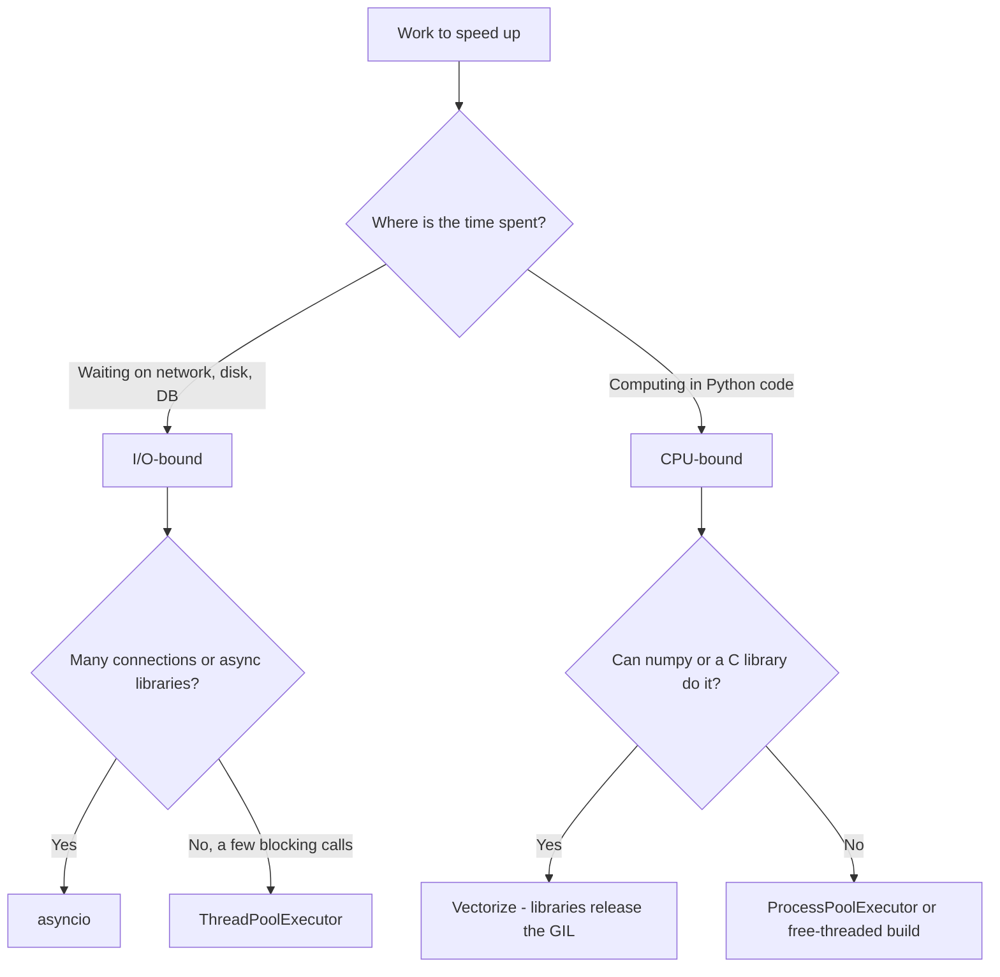
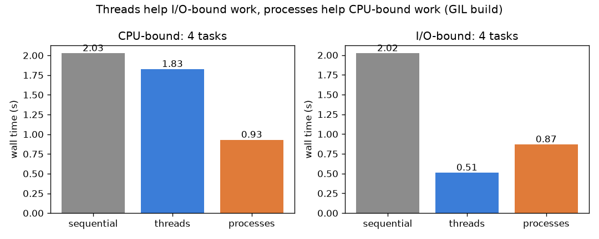
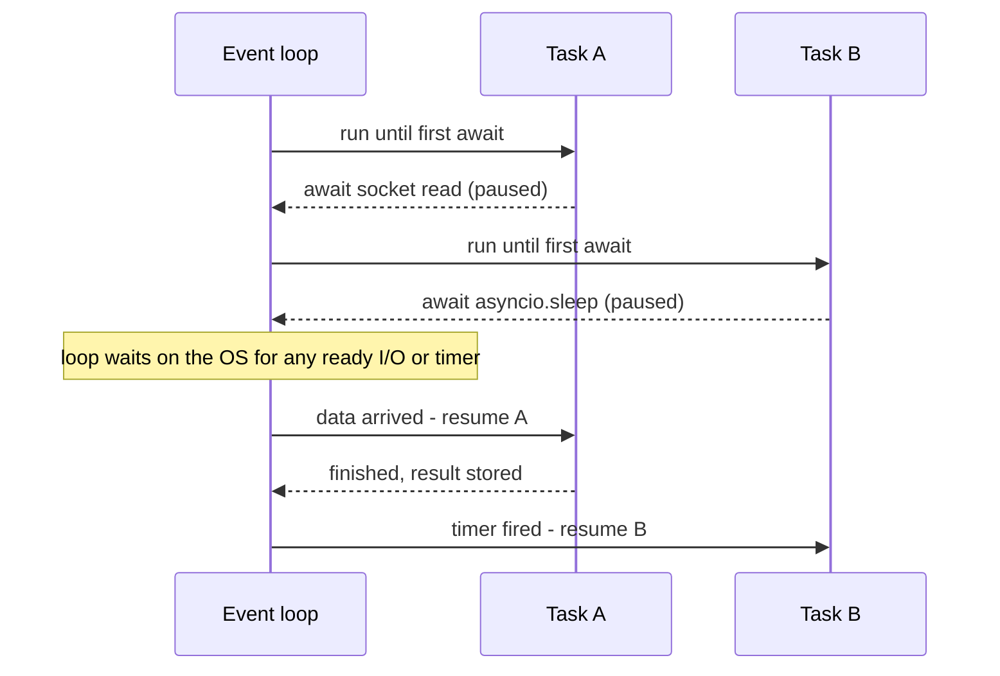

# Chapter 16 — Concurrency and Async

> **What you will learn.** The difference between concurrency and parallelism, how to tell I/O-bound work (time mostly spent waiting on input/output — network, disk, database) from CPU-bound work (time mostly spent computing), and Python's four main tools for doing several things at once: **threads** (`threading`, locks, `queue.Queue`), **processes** (`multiprocessing`), the high-level **executors** (`concurrent.futures`) and **async/await** (`asyncio`: event loop, coroutines, tasks, `gather`, `TaskGroup`, timeouts, async iteration). You will also learn what the **GIL** is, why it exists, and where the **free-threaded** (no-GIL) CPython stands in 3.13 and 3.14. The chapter ends with a "which tool?" table and the common pitfalls: blocking calls inside async code, race conditions and deadlocks.
>
> **Prerequisites.** Functions and closures ([Ch 7](../07-functions/README.md)), generators ([Ch 11](../11-iterators-generators-functional/README.md)), context managers ([Ch 12](../12-decorators-context-managers-metaprogramming/README.md)).
>
> **Code.** `chapters/16-concurrency-and-async/code/` — `threads_basics.py`, `gil_benchmark.py` (makes the plot in `img/`), `multiprocessing_demo.py`, `futures_demo.py`, `asyncio_demo.py`, `pitfalls_demo.py`. All outputs below come from Python 3.14.7 (default build, GIL on) on a 14-core Mac. Timings will differ on your machine; the *shape* of the results will not.
>
> **Java side.** The general theory — memory models (the rules for when one thread's writes become visible to another), `synchronized`, `ReentrantLock`, semaphores, latches, atomics, concurrent collections, deadlock/livelock (threads keep reacting to each other but make no progress)/starvation (a thread never gets its turn) and the classic LLD (low-level design) problems — is in the LLD Handbook, [Chapter 12 — Concurrency concepts](../../../lld/chapters/12-concurrency-concepts/README.md). This chapter covers what is specific to Python.

**Words used everywhere in this chapter (defined once):**

| Term | Meaning |
|---|---|
| **Process** | A running program with its own memory space. Two processes do not see each other's variables. |
| **Thread** | A path of execution *inside* a process. Threads of one process share its memory. |
| **Task (asyncio)** | A coroutine (a function that can pause and resume) scheduled on an event loop (the scheduler that runs whichever task is ready next). Many tasks share one thread. |
| **Blocking call** | A call that makes the caller wait (reading a socket — one end of a network connection, `time.sleep`, a disk read). |
| **Race condition** | A bug where the result depends on the unlucky timing of two threads touching shared data. |
| **Critical section** | Code that must be run by only one thread at a time. |
| **Lock / mutex** | An object that lets only one holder into a critical section ("mutex" = *mut*ual *ex*clusion). |
| **Deadlock** | Two or more threads each waiting forever for a lock the other holds. |
| **GIL** | Global Interpreter Lock: in standard CPython (the usual Python interpreter), only one thread runs Python bytecode (the low-level instructions your source is compiled into before the interpreter executes it) at a time. |



---

## 16.1 Concurrency vs parallelism

### What it is
- **Concurrency** = *dealing with* many things at once: several tasks are in progress and their steps interleave. It can happen on a single CPU core (one independent processing unit inside the processor; a modern chip has several).
- **Parallelism** = *doing* many things at the same instant: tasks literally run simultaneously on different cores.

Analogy: one chef cooking three dishes — putting pasta on to boil, then chopping while it boils — is concurrency. Three chefs each cooking one dish is parallelism. Concurrency is about *structure* (not sitting idle while waiting); parallelism is about *execution* (more hands).

### Why it matters
Picking the wrong model wastes effort. Adding threads to a CPU-heavy pure-Python loop in standard CPython does nothing (the GIL allows one thread at a time), while adding threads to a program that spends 95 % of its time waiting on HTTP responses (replies from web servers) can make it 10–50× faster.

### How it works
| | Concurrency | Parallelism |
|---|---|---|
| Needs multiple cores? | No | Yes |
| Goal | Stay busy while waiting | Finish computation sooner |
| Python tools | threads, asyncio | multiprocessing, free-threaded threads, C extensions that release the GIL |
| Typical workload | Web servers, scrapers, chat apps | Image processing, simulations, number crunching |

### TL;DR
Concurrency overlaps waiting; parallelism overlaps computing. Parallelism is a kind of concurrency, but not the other way round.

---

## 16.2 I/O-bound vs CPU-bound

### What it is
- **I/O-bound**: the program mostly *waits* — for the network, disk, a database, a user. The CPU is idle during the wait. Example: downloading 100 web pages.
- **CPU-bound**: the program mostly *computes*. The CPU is at 100 %. Example: computing SHA-256 of a billion strings in a Python loop, resizing images in pure Python.

### How to tell (3 quick checks)
1. **Watch CPU usage** (`top`, Activity Monitor). ~100 % of one core → CPU-bound. Low CPU but slow → I/O-bound.
2. **Profile** ([Ch 17](../17-performance-memory-internals/README.md)): if the top functions are `socket.recv`, `select`, `read` — I/O. If they are your own loops — CPU.
3. **Compare wall time and CPU time**: `time.perf_counter()` (wall clock) vs `time.process_time()` (CPU time used). If wall ≫ CPU, you are waiting.

### Measured
`gil_benchmark.py` runs 4 CPU tasks (a pure-Python loop of 15 million iterations) and 4 I/O tasks (`time.sleep(0.5)`, standing in for a network wait) three ways:

```python
def cpu_task(n: int = 15_000_000) -> int:
    total = 0
    for i in range(n):                    # pure-Python loop: holds the GIL the whole time
        total += i * i
    return total

def io_task(_: int = 0) -> None:
    time.sleep(0.5)                       # sleeping releases the GIL, like waiting on a socket
```
Output:
```
Python 3.14.7, GIL enabled: True
CPU-bound: sequential 1.94s  threads 1.83s  processes 0.87s
I/O-bound: sequential 2.02s  threads 0.51s  processes 0.92s
saved gil_benchmark.png
```



*Figure — CPU-bound work only speeds up with processes; I/O-bound work speeds up with threads (processes also help but pay ~0.3–0.4 s start-up cost).*

What it shows:
- **CPU-bound + threads ≈ sequential** (1.83 s vs 1.94 s is noise-level): the GIL lets only one thread run Python code at a time.
- **CPU-bound + processes ≈ 2.2× faster**: each process has its own interpreter and its own GIL, so they run on separate cores. It is not 4× because starting processes (the `spawn` method re-imports the module) and sending data back costs time.
- **I/O-bound + threads ≈ 4× faster**: while one thread sleeps (waits) it releases the GIL, so all four waits overlap.

### TL;DR
Measure first. Waiting → threads or asyncio. Computing → processes, vectorized libraries, or (new) the free-threaded build.

---

## 16.3 Threads with `threading`

### What it is
The `threading` module starts extra threads inside your process. All threads share global variables and objects on the heap (the shared memory area where Python objects live). Each thread has its own call stack (its own record of which functions are currently running).

### How it works
1. Create: `t = threading.Thread(target=func, args=(...), name="T1")`.
2. `t.start()` — the OS (operating system) starts a new thread that calls `func(*args)`.
3. `t.join()` — the caller waits until `t` finishes (optionally `join(timeout)`).
4. A **daemon** thread (`daemon=True`) is killed abruptly when the main program exits; a normal thread keeps the program alive until it finishes. Use daemons only for work that can be lost (a heartbeat — a periodic "I'm still alive" signal), never for writing files.

```python
def worker(name: str, delay: float, results: dict) -> None:
    time.sleep(delay)                     # stands in for waiting on I/O
    results[name] = threading.current_thread().name

threads = [threading.Thread(target=worker, args=(f"job{i}", 0.2, results), name=f"T{i}")
           for i in range(3)]
for t in threads: t.start()               # all three begin waiting at once
for t in threads: t.join()                # wait for all to finish
```
Output (`threads_basics.py`, line 1):
```
3 x 0.2 s sleeps in threads took 0.21 s -> {'job0': 'T0', 'job1': 'T1', 'job2': 'T2'}
```
Three 0.2 s waits took 0.21 s in total because they overlapped. Threads return nothing from `target`; to get results, write to a shared structure (as here), use a `queue.Queue`, or — better — use `ThreadPoolExecutor` (16.7), which gives you return values and exceptions.

An alternative style is subclassing `threading.Thread` and overriding `run()`; it works, but passing a `target` function is simpler and more common.

**Per-thread data.** Sometimes each thread needs its *own* copy of a value (a DB connection, the current request ID). `threading.local()` gives an object whose attributes are separate per thread. In asyncio code, where many tasks share one thread, use `contextvars.ContextVar` instead — each task sees its own value (web frameworks store the current request this way).

### TL;DR
`Thread(target=..., args=...)`, `start()`, `join()`. Threads share memory — which is both their convenience and their danger.

---

## 16.4 Race conditions and locks

### What it is
A **race condition** happens when two threads read-modify-write the same data and their steps interleave. Even `counter += 1` is not one step: CPython executes it as *load counter → add 1 → store counter*. If thread A loads 5, then thread B loads 5, both store 6 — one increment is lost.

A **lock** (`threading.Lock`) fixes it: only one thread at a time can hold it, so the read-modify-write becomes a **critical section** that cannot interleave.

### The race, demonstrated
```python
def unsafe_increment(n: int) -> None:
    global counter
    for _ in range(n):
        current = counter                  # read
        time.sleep(0)                      # yield: lets another thread run (widens the window)
        counter = current + 1              # write back a stale value

lock = threading.Lock()

def safe_increment(n: int) -> None:
    global counter
    for _ in range(n):
        with lock:                         # only one thread inside at a time
            current = counter
            time.sleep(0)
            counter = current + 1
```
Output (4 threads × 1,000 increments each):
```
unsafe counter (expected 4000): 1000
safe counter   (expected 4000): 4000
```
The unsafe number changes from run to run (other runs printed 2000 and 1031). The `time.sleep(0)` just makes the bug show up every time; without it the same bug still exists, it only appears rarely — which is worse, because it passes your tests and fails in production.

### How it works — the synchronization toolbox
| Primitive | What it does | Typical use |
|---|---|---|
| `Lock` | One holder at a time. Not re-entrant: the same thread acquiring twice blocks itself. | Protect shared state |
| `RLock` | Re-entrant lock: the owning thread may acquire it again (must release as many times). | Recursive code that re-enters a locked method |
| `Semaphore(n)` | Up to *n* holders at once. | Limit concurrent DB connections to 10 |
| `Event` | A flag threads can `wait()` on until someone calls `set()`. | "Start now" / "shut down" signal |
| `Condition` | Wait until a condition becomes true, woken by `notify()`. | Building your own queues |
| `Barrier(n)` | Blocks until *n* threads arrive, then releases all. | Phased simulations |
| `queue.Queue` | Thread-safe FIFO with blocking `get`/`put`. | Producer–consumer (next section) |

Always use locks through `with lock:` — it releases the lock even if an exception is raised. Manual `acquire()`/`release()` is useful only with a timeout: `if lock.acquire(timeout=1): ...`.

### Common mistakes
- Believing "the GIL makes my code thread-safe" (correct even when several threads run it at once). The GIL protects the *interpreter's* internals (so a `list` is never corrupted), not *your* multi-step logic. `if key not in d: d[key] = compute()` can still run twice.
- Protecting writes but not reads of a multi-field invariant (a rule that must always hold across several fields, e.g. total money is constant) (reading `balance` while another thread is half-way through a transfer).
- Holding a lock while doing slow I/O — other threads queue behind it.

### In the interview
**30-second answer:** "A race condition is when the outcome depends on thread timing, usually from an unprotected read-modify-write. Even `x += 1` is several bytecodes, so it's not atomic (indivisible — guaranteed to happen all at once with nothing in between). I protect shared state with a `threading.Lock` used as a context manager, keep critical sections small, or avoid sharing entirely by passing messages through `queue.Queue`."
- *Is `list.append` thread-safe?* — A single `append` on a built-in list is safe in CPython (with the GIL, and the free-threaded build uses per-object locks for built-ins), but a sequence of operations is not. Don't rely on it for logic.
- *Lock vs RLock?* — RLock lets the same thread re-acquire; Lock would deadlock on itself.

### Self-check
1. Why is `counter += 1` unsafe across threads? → It is load, add, store; another thread can run between them.
2. What does `with lock:` guarantee on an exception? → The lock is released.
3. Which primitive limits concurrency to N? → `Semaphore(N)`.

### TL;DR
Shared mutable state + threads = races. Protect with `Lock` (via `with`), keep critical sections tiny, or share nothing and communicate through queues.

---

## 16.5 Producer–consumer with `queue.Queue`

### What it is
**Producer–consumer** splits work into threads that *make* items and threads that *process* them, connected by a queue. `queue.Queue` is a thread-safe FIFO (first in, first out) with all locking done for you.

### Why it matters
It removes most manual locking: threads never touch each other's data, they only `put` and `get`. A **bounded** queue (`maxsize=N`) also gives **backpressure** (a slow consumer automatically slowing down a fast producer) — a fast producer blocks on `put` instead of filling memory. Queues and backpressure are core system-design ideas too: see [System Design Fundamentals](../../../system-design-patterns/modules/00-system-design-fundamentals/README.md).

### How it works
1. `q = queue.Queue(maxsize=5)`.
2. Producers call `q.put(item)` (blocks while full).
3. Consumers call `q.get()` (blocks while empty), process, then `q.task_done()`.
4. To stop, each producer puts a **sentinel** (a special "no more work" value, here `None`); the consumer stops after seeing one sentinel per producer. (Python 3.13 also added `Queue.shutdown()` for the same purpose.)

```python
SENTINEL = None

def producer(q, items):
    for item in items:
        q.put(item)                        # blocks if the queue is full (backpressure)
    q.put(SENTINEL)

def consumer(q, out, n_producers):
    finished = 0
    while finished < n_producers:
        item = q.get()                     # blocks until an item is available
        if item is SENTINEL:
            finished += 1
        else:
            out.append(item * item)
        q.task_done()
```
Output:
```
consumer squared 10 items, sorted: [0, 1, 4, 9, 16, 25, 36, 49, 64, 81]
```
`q.join()` (not used here) blocks until every item put has been matched by a `task_done()` — handy when the main thread wants to wait for "all work processed" without stopping the workers.

| Queue class | Order |
|---|---|
| `queue.Queue` | FIFO |
| `queue.LifoQueue` | Stack (last in, first out) |
| `queue.PriorityQueue` | Smallest item first (put `(priority, item)` tuples) |
| `queue.SimpleQueue` | Unbounded FIFO, no `task_done`/`join` |
| `multiprocessing.Queue` | Between processes (items are pickled — converted to bytes with `pickle`) |
| `asyncio.Queue` | Between asyncio tasks (not thread-safe) |

### Real-world examples
Web crawlers (fetcher threads → parser threads), logging (`logging.handlers.QueueHandler` + `QueueListener` move slow log I/O off request threads), and PyTorch's `DataLoader`, which uses worker *processes* feeding batches through queues.

### TL;DR
Share a queue, not variables. Bound it for backpressure. Stop with sentinels or `shutdown()`.

---

## 16.6 The GIL (Global Interpreter Lock)

### What it is
In the standard CPython build, the **GIL** is a single lock that a thread must hold to execute Python bytecode. So in one process, **only one thread runs Python code at any instant**, even on a 64-core machine.

### Why it exists
CPython manages memory with **reference counts** (every object counts how many references point to it; [Ch 17](../17-performance-memory-internals/README.md)). Updating those counts from several threads at once would need a lock on every object or atomic operations (special CPU instructions that update a value indivisibly) everywhere, which was slower and much harder to get right. One big lock made the interpreter simple, single-threaded code fast, and C extensions easy to write — which is a big reason numpy, and the rest of the scientific stack, exist.

### How it works
1. A thread holds the GIL while it runs bytecode.
2. It **releases** the GIL when it does blocking I/O (`socket.recv`, file reads, `time.sleep`) and when a C extension explicitly releases it (numpy on large arrays, `hashlib` on big buffers, `zlib`, many image and DB libraries).
3. A thread that wants the GIL waits; after the **switch interval** (`sys.getswitchinterval()`, default 0.005 s = 5 ms) the holder is asked to drop it so others get a turn.

Consequences (the benchmark in 16.2):

| Workload | Threads with the GIL |
|---|---|
| I/O-bound | Scale well — the GIL is released while waiting |
| CPU-bound pure Python | No speed-up; can even be slightly slower (switching overhead — extra cost that does no useful work) |
| CPU-bound in numpy / C that releases the GIL | Can scale across cores |

### Free-threaded CPython (PEP 703) — status
- **Python 3.13 (Oct 2024):** an *optional, experimental* build with the GIL disabled ships (installers call it "free-threaded"; the executable is `python3.13t`). PEP 703 is the design.
- **Python 3.14 (Oct 2025):** per **PEP 779**, the free-threaded build is **officially supported** (no longer experimental) but **still optional — not the default**. `python3.14` still has a GIL; `python3.14t` does not. The docs put the single-threaded slowdown at roughly 5–10 % (depending on platform and compiler), and memory use is higher.
- **Extensions:** a C extension that is not marked free-threading-compatible makes the interpreter **re-enable the GIL** on import (with a warning). You can also force it: `PYTHON_GIL=1` or `python -X gil=1`. Many major packages (numpy among them) now publish free-threaded wheels (a wheel is a pre-built, ready-to-install package file, `.whl`), but check before you rely on it.
- **Check at runtime:**

```python
import sys, sysconfig
sysconfig.get_config_var("Py_GIL_DISABLED")  # 1 on a free-threaded build, else 0/None
sys._is_gil_enabled()                         # False when running without the GIL (3.13+)
```
- **What changes for you:** on a free-threaded build, the CPU-bound thread benchmark above can scale across cores — but races become *more* likely, not less, so all the locking rules of 16.4 still apply. Built-in `list`/`dict`/`set` use internal per-object locks so they are not corrupted, but multi-step logic still needs your locks.

Other ways around the GIL: **processes** (each has its own GIL), **subinterpreters** (several independent Python interpreters inside one process) — since 3.12 each interpreter can have its own GIL (PEP 684) and 3.14 adds the `concurrent.interpreters` module and `InterpreterPoolExecutor` (PEP 734) — and native code (code compiled to machine instructions: numpy, Cython — a Python-like language compiled to C, Rust via PyO3) that releases the GIL.

### Common mistakes
- "Python can't do concurrency." It does I/O concurrency very well; the GIL limits *parallel Python bytecode*.
- "The GIL makes code thread-safe." See 16.4.
- Assuming other implementations behave the same: Jython (Python on the Java virtual machine) and IronPython (Python on .NET) have no GIL; PyPy (a faster Python with a JIT — just-in-time — compiler) has one.

### In the interview
**30-second answer:** "The GIL is a mutex in CPython that allows only one thread to execute Python bytecode at a time. It exists because CPython's reference counting isn't thread-safe without it, and it keeps single-threaded code and C extensions simple. It's released during blocking I/O and by many C extensions, so threads are fine for I/O-bound work; for CPU-bound Python I use multiprocessing or push the work into numpy. Since 3.13 there's an optional free-threaded build, officially supported in 3.14 but not the default."
- *Does the GIL make `x += 1` atomic?* — No. The thread can be switched between the load and the store.
- *Why doesn't numpy suffer from the GIL?* — Its heavy loops run in C and release the GIL.
- *Should I switch to the free-threaded build today?* — Only after checking that all your C-extension dependencies support it and benchmarking; single-threaded code gets a bit slower.

### Self-check
1. Default switch interval? → 5 ms.
2. Name two ways to get CPU parallelism in CPython with a GIL. → Processes; C extensions that release the GIL (numpy).
3. How do you tell if the GIL is on at runtime? → `sys._is_gil_enabled()`.
4. Is the free-threaded build the default in 3.14? → No — supported but optional (`python3.14t`).

### TL;DR
One thread runs Python bytecode at a time in standard CPython. I/O releases it; pure-Python CPU work doesn't. Free-threading: experimental in 3.13, officially supported but optional in 3.14.

---

## 16.7 `multiprocessing`

### What it is
`multiprocessing` runs functions in separate **processes**. Each process has its own interpreter, memory and GIL, so CPU-bound Python code runs truly in parallel. The API mirrors `threading`.

### How it works
1. **Start method** — how the child process is created:

| Method | How | Default on |
|---|---|---|
| `spawn` | Fresh interpreter; re-imports your main module; arguments are pickled | Windows, macOS |
| `fork` | Copies the parent process (fast, but unsafe if the parent has threads) | — (was Linux's default up to 3.13) |
| `forkserver` | Forks from a clean single-threaded server process | Linux and other POSIX (Unix-like) systems except macOS, from **3.14** |

Because `spawn`/`forkserver` re-import your script, **always guard the start-up code with `if __name__ == "__main__":`**, or each child would try to start children of its own.

2. **Pickling** — arguments and return values travel between processes by `pickle` (serialization — turning an object into bytes that can be sent and rebuilt). Each process has its own pid (process ID, the number the OS uses to identify it). Lambdas, nested functions and open sockets can't be pickled; use top-level functions.
3. **No shared memory by default** — each process has its own copy of globals.

```python
counter = 0                               # each process gets its OWN copy

def bump_global(n: int, parent_pid: int) -> None:
    global counter
    for _ in range(n):
        counter += 1
    print(f"  child: different pid from parent={os.getpid() != parent_pid}, sees counter={counter}")

def bump_shared(shared, n: int) -> None:
    for _ in range(n):
        with shared.get_lock():           # Value comes with its own lock
            shared.value += 1

if __name__ == "__main__":
    p = mp.Process(target=bump_global, args=(1000, os.getpid()))
    p.start(); p.join()
    shared = mp.Value("i", 0)             # 'i' = C int in shared memory
    # ... start 4 processes running bump_shared(shared, 1000) ...
    with mp.Pool(processes=4) as pool:
        pool.map(square, range(10))
```
Output (`multiprocessing_demo.py`):
```
start method: spawn, CPUs: 14
  child: different pid from parent=True, sees counter=1000
parent counter after child ran: 0  (not shared!)  exitcode=0
shared Value after 4 x 1000 increments: 4000
pool.map squares: [0, 1, 4, 9, 16, 25, 36, 49, 64, 81]
pool.map chunksize=3: [0, 1, 4, 9, 16] ...
lambda in Pool -> PicklingError
```

### Shared-state options and caveats
| Tool | What it is | Caveat |
|---|---|---|
| Return values / `Queue` / `Pipe` | Message passing (pickled) | Preferred; cost grows with data size |
| `Value`, `Array` | A C number/array in shared memory | Needs `get_lock()` for read-modify-write |
| `multiprocessing.shared_memory.SharedMemory` | Raw shared bytes (wrap in a numpy array) | You manage layout, lifetime and `unlink()` |
| `Manager()` | A server process holding a dict/list that proxies (stand-in objects that forward each operation) talk to | Easy but slow (every access is IPC — inter-process communication, i.e. a message to another process) |

`Pool` methods: `map` (ordered, blocks), `imap`/`imap_unordered` (lazy, stream results), `starmap` (multiple arguments), `apply_async` (one call, returns an `AsyncResult`). The `chunksize` argument batches items per message — large chunks cut overhead for many small tasks.

### When not to use it
- Tiny tasks: pickling and process start-up (tens to hundreds of ms under `spawn`) outweigh the work.
- Huge inputs that must be copied to every worker — use shared memory, or let each worker load its own slice from disk.
- I/O-bound work — threads or asyncio are lighter.

### Common mistakes
- Missing `if __name__ == "__main__":` → `RuntimeError` or runaway process creation under `spawn`.
- Expecting a global modified in a child to change in the parent.
- Passing lambdas/local functions → `PicklingError` / `AttributeError`.
- Mixing `fork` with threads → child can inherit a lock held by a thread that no longer exists, and hang.

### Real-world examples
Gunicorn and uWSGI (production web servers for Python apps) run several **worker processes** of a Django/Flask app to use all cores; Celery's (a background-job system's) default worker pool is "prefork" (processes started in advance); PyTorch `DataLoader(num_workers=4)` loads batches in worker processes.

### TL;DR
Processes = real CPU parallelism at the cost of start-up, pickling and no shared memory. Guard `__main__`, use top-level functions, prefer message passing.

---

## 16.8 `concurrent.futures` — executors

### What it is
A single high-level API for "run these calls in the background and give me the results": **`ThreadPoolExecutor`** (threads) and **`ProcessPoolExecutor`** (processes) share the same interface. You get a **Future** — an object representing a result that will exist later.

### How it works
1. `with ThreadPoolExecutor(max_workers=8) as ex:` — creates a pool; leaving the `with` waits for all work (`shutdown(wait=True)`).
2. `fut = ex.submit(fn, *args)` → a `Future`. `fut.result(timeout=None)` waits and returns the value **or re-raises the exception** from the worker.
3. `ex.map(fn, iterable)` → results in **input order**, lazily.
4. `as_completed(futures)` → yields futures in **completion order**.
5. `wait(futures, return_when=FIRST_COMPLETED | FIRST_EXCEPTION | ALL_COMPLETED)` → `(done, pending)`.
6. `fut.cancel()` works only if the call hasn't started yet.

Default pool sizes (3.13+): threads `min(32, os.process_cpu_count() + 4)`; processes `os.process_cpu_count()`.

```python
with ThreadPoolExecutor(max_workers=3) as ex:
    futures = {ex.submit(fake_download, u): u for u in urls}
    for fut in as_completed(futures):
        try:
            print(f"done {futures[fut]} -> {fut.result()}")
        except ConnectionError as e:
            print(f"failed {futures[fut]} -> {e!r}")

with ThreadPoolExecutor(max_workers=3) as ex:
    it = ex.map(fake_download, urls)
    try:
        for r in it:
            print(f"map result {r}")
    except ConnectionError as e:
        print(f"map raised {e!r}")
```
Output (`futures_demo.py`; delays a=0.3 s, b=0.1 s, c=0.2 s and c fails):
```
done b.com -> ('b.com', 100)
failed c.com -> ConnectionError('c.com timed out')
done a.com -> ('a.com', 300)
map result ('a.com', 300)
map result ('b.com', 100)
map raised ConnectionError('c.com timed out')
first completed: 1 done, 1 cancelled
primes: [True, True, True, False] in 0.32s with processes
```
What it shows: `as_completed` hands back the fastest first; `map` keeps input order and raises when it *reaches* the failed item; with one worker and three 0.2 s jobs, after the first finishes the second is already running (can't be cancelled) and only the third is cancelled; switching to processes for CPU work is a one-word change.

### Trade-offs
| | Raw `threading` / `multiprocessing` | `concurrent.futures` |
|---|---|---|
| Return values & exceptions | Manual (queues, shared dicts) | Built in (`Future.result()`) |
| Thread ↔ process switch | Rewrite | Change the class name |
| Fine control (daemons, custom sync) | Yes | Limited |
| Best for | Long-lived workers, pipelines | "Run N calls, collect results" |

### In the interview
**30-second answer:** "`concurrent.futures` gives one API over thread and process pools. `submit` returns a Future; `result()` returns the value or re-raises the worker's exception. `map` preserves order, `as_completed` yields in finish order. I use `ThreadPoolExecutor` for blocking I/O and `ProcessPoolExecutor` for CPU-bound pure Python."
- *What happens to an exception in a worker?* — Stored in the Future; raised when you call `result()` (or iterate `map`). If you never check, it is silently lost.
- *How do you add a timeout?* — `fut.result(timeout=5)` or `as_completed(fs, timeout=5)` → `TimeoutError`.

### TL;DR
Default choice for simple parallel work. Always call `result()` so exceptions surface.

---

## 16.9 `asyncio` — async/await

### What it is
`asyncio` runs many tasks concurrently in **one thread** using an **event loop**. A **coroutine** (`async def`) is a function that can pause at each `await` and let the loop run something else while it waits for I/O. Nothing runs in parallel; the speed comes from never sitting idle.

Analogy: one waiter serving 20 tables. They take an order, hand it to the kitchen (`await`), and serve other tables instead of standing at the kitchen door.

### Why it matters
A thread costs memory (its stack) and OS scheduling; 10,000 threads is painful. 10,000 asyncio tasks waiting on sockets is normal. Switching only happens at `await`, so there are far fewer race windows than with threads.

### How it works

1. `asyncio.run(main())` creates an event loop, runs `main()` to completion and closes the loop. Call it once, at the top.
2. Calling `fetch()` creates a **coroutine object**; nothing runs until it is awaited or wrapped in a task.
3. `await x` pauses the current coroutine until `x` (a coroutine, Task or Future) is done.
4. `asyncio.create_task(coro)` schedules a coroutine to run **concurrently**, returning a `Task`.
5. The loop uses the OS's readiness APIs (epoll on Linux, kqueue on macOS/BSD — system calls that report which of many connections have data waiting) to know which sockets and timers are ready and resumes the corresponding tasks.

### Core API with real output (`asyncio_demo.py`)
```python
async def fetch(name: str, delay: float) -> str:
    await asyncio.sleep(delay)            # non-blocking wait
    return f"{name}:{delay}"

await fetch("a", 0.2); await fetch("b", 0.2)                        # sequential: 0.4 s
results = await asyncio.gather(fetch("a", 0.2), fetch("b", 0.2), fetch("c", 0.1))  # 0.2 s

task = asyncio.create_task(fetch("bg", 0.2))    # starts running now
await asyncio.sleep(0.1)
print(task.done())                              # False
value = await task
```
```
type before await: coroutine
awaited: x:0
[0.40s] two sequential awaits
[0.20s] gather -> ['a:0.2', 'b:0.2', 'c:0.1']  (order = argument order)
[0.10s] task done yet? False
[0.20s] task result bg:0.2
```
Key lesson: `await a(); await b()` is **sequential**. Concurrency only happens with `gather`, `create_task` or a `TaskGroup`.

### `gather` vs `TaskGroup` (3.11+)
```python
res = await asyncio.gather(fetch("ok", 0.1), failing(0.05), return_exceptions=True)

try:
    async with asyncio.TaskGroup() as tg:
        slow = tg.create_task(fetch("slow", 1.0))
        tg.create_task(failing(0.1))
except* ValueError as eg:                       # except* handles an ExceptionGroup
    print(eg.exceptions, slow.cancelled())
```
(An **`ExceptionGroup`** (3.11+) bundles several exceptions raised together, e.g. by several failed tasks; `except*` lets you handle each kind inside it.)
```
gather with return_exceptions -> ['ok:0.1', ValueError('boom')]
[0.10s] TaskGroup raised (ValueError('boom'),); slow cancelled=True
```
| | `asyncio.gather` | `asyncio.TaskGroup` |
|---|---|---|
| On first failure | Raises it, but the **other tasks keep running** unattended | **Cancels** the siblings, waits for them, raises an `ExceptionGroup` |
| Collect errors as values | `return_exceptions=True` | Catch with `except*` |
| Results | List in argument order | `task.result()` on each task |
| Recommended for new code | Simple fan-out (starting many tasks at once and collecting their results) | Yes — "structured concurrency": no task outlives its block |

### Timeouts, limits and async iteration
```python
async with asyncio.timeout(0.1):               # 3.11+, can wrap several awaits
    await fetch("too-slow", 1.0)
await asyncio.wait_for(fetch("too-slow", 1.0), timeout=0.1)   # one awaitable

sem = asyncio.Semaphore(2)                     # at most 2 at a time
async def limited(i):
    async with sem:
        await asyncio.sleep(0.1)
        return i

async def ticker(n):                           # async generator
    for i in range(n):
        await asyncio.sleep(0.05)
        yield i

async with AsyncResource():                    # __aenter__ / __aexit__
    squares = [i * i async for i in ticker(4)] # async comprehension
```
```
asyncio.timeout -> TimeoutError
wait_for -> TimeoutError
[0.31s] 6 jobs, 2 at a time -> [0, 1, 2, 3, 4, 5]
[0.00s] open resource
[0.20s] close resource
async comprehension -> [0, 1, 4, 9]
```
On timeout the inner task is **cancelled** (a `CancelledError` is raised inside it) and the caller sees the built-in `TimeoutError` (since 3.11, `asyncio.TimeoutError` is the same class). Six jobs with a limit of two took 3 rounds × 0.1 s.

Async protocol summary: `async for` uses `__aiter__`/`__anext__`; `async with` uses `__aenter__`/`__aexit__`. Other useful pieces: `asyncio.Queue` (producer–consumer between tasks), `asyncio.Event`, `asyncio.Lock`, `asyncio.as_completed`.

### Mixing sync and async
```python
def blocking_io() -> str:
    time.sleep(0.3)                  # a sync library call (e.g. requests.get)
    return "sync result"

await asyncio.gather(asyncio.to_thread(blocking_io), asyncio.to_thread(blocking_io))
async def bad():
    return blocking_io()             # time.sleep inside a coroutine blocks EVERYTHING
await asyncio.gather(bad(), bad())
```
```
[0.31s] two blocking calls via to_thread ran together
[0.60s] two blocking calls inside coroutines ran one after another
```
One blocking call inside a coroutine freezes the **entire** loop — every other task, every connection. Use async libraries (`httpx`/`aiohttp` instead of `requests`, `asyncpg` instead of `psycopg2` sync, `asyncio.sleep` instead of `time.sleep`), or push sync calls to a thread with `asyncio.to_thread` (3.9+) / `loop.run_in_executor`. CPU-heavy work goes to a `ProcessPoolExecutor` via `run_in_executor`.

### When to use asyncio
- **Yes:** many simultaneous network connections — web servers/APIs (FastAPI, Starlette, aiohttp), websockets (long-lived two-way browser connections), chat, crawlers, calling many microservices (small independent services that together form one application) or LLM APIs (large-language-model services such as Claude) concurrently.
- **No:** CPU-bound work (single thread!), a script that makes three HTTP calls (threads are simpler), or a codebase whose key libraries are all synchronous.

### Common mistakes
- Forgetting `await`: `fetch()` without `await` just creates a coroutine; Python warns *"coroutine ... was never awaited"*.
- `create_task` and dropping the reference: the loop keeps only a weak reference (a reference that does not keep the object alive), so an unreferenced task can be garbage-collected (freed automatically) mid-run. Keep tasks in a set or use a `TaskGroup`.
- Calling `asyncio.run()` inside an already-running loop (e.g. Jupyter, the interactive notebook tool) → `RuntimeError`; in notebooks just `await main()`.
- Catching `CancelledError` and not re-raising it — breaks timeouts and TaskGroup cancellation.
- Sharing an `asyncio.Queue`/`Lock` with other threads — asyncio objects are not thread-safe; use `loop.call_soon_threadsafe` or `asyncio.run_coroutine_threadsafe`.

### Real-world examples
FastAPI/Starlette serve async endpoints on the uvicorn server (uvloop, a faster event loop written on libuv — the C library behind Node.js's event loop — is optional); Discord bots (`discord.py`), Home Assistant, and the official Anthropic and OpenAI Python SDKs ship `Async...` clients for concurrent requests.

### In the interview
**30-second answer:** "asyncio is single-threaded cooperative concurrency (each task voluntarily gives up control at `await`, instead of being interrupted). Coroutines pause at `await`, and the event loop resumes whichever task's I/O is ready. It scales to thousands of connections cheaply, but anything blocking stalls everything, so I use async libraries or `asyncio.to_thread`. For fan-out I prefer `TaskGroup` over `gather` because a failure cancels the siblings."
- *Is asyncio parallel?* — No, one thread; concurrency only.
- *`gather` vs `TaskGroup`?* — `gather` leaves siblings running on error unless you handle it; `TaskGroup` cancels them and raises an `ExceptionGroup`.
- *How do you call sync code from async?* — `await asyncio.to_thread(fn, *args)`.

### Self-check
1. What runs when you call an `async def` function? → Nothing; you get a coroutine object.
2. Two `await`s in a row — concurrent? → No, sequential.
3. How do you cap concurrency at 10? → `asyncio.Semaphore(10)`.
4. What exception does `asyncio.timeout` raise to the caller? → `TimeoutError`.
5. Why is `time.sleep` in a coroutine bad? → It blocks the whole event loop.

### TL;DR
One thread, one loop, many tasks; switch only at `await`. `asyncio.run` once, `TaskGroup`/`gather` for concurrency, `timeout` for deadlines, `Semaphore` for limits, `to_thread` for sync calls. Never block the loop.

---

## 16.10 Choosing the right tool

| Situation | Use | Why |
|---|---|---|
| A few to hundreds of blocking I/O calls, sync libraries | `ThreadPoolExecutor` | Simple, GIL released during I/O |
| Thousands of concurrent connections, async libraries | `asyncio` | Tasks are cheap, no thread per connection |
| CPU-bound pure Python | `ProcessPoolExecutor` / `multiprocessing.Pool` | Each process has its own GIL |
| CPU-bound numeric work | numpy/pandas (vectorize, Ch 17–18) | C loops, often multi-threaded internally |
| CPU-bound, want shared memory, deps support it | Free-threaded build (3.14t) + threads | Real parallel threads |
| Long-running pipeline stages | Threads/processes + `Queue` | Backpressure, clean shutdown |
| Async app needs a sync library | `asyncio.to_thread` | Keeps the loop responsive |
| Async app needs heavy CPU | `loop.run_in_executor(ProcessPoolExecutor(), ...)` | Moves CPU work off the loop |
| Scale beyond one machine | Celery, RQ, Ray, Dask, Spark | Distributed (spread over many machines) task queues/clusters (groups of machines working as one) |

| | Threads | Processes | asyncio |
|---|---|---|---|
| Parallel CPU (GIL build) | No | Yes | No |
| Memory per unit | ~MB stack (virtual) | Whole interpreter (tens of MB) | ~KB per task |
| Shared memory | Yes (needs locks) | No (pickle/IPC) | Yes (single thread) |
| Switching | Pre-emptive (the OS can interrupt at any time) | OS | Cooperative (at `await`) |
| Race risk | High | Low | Low |
| Works with sync libs | Yes | Yes | Needs `to_thread` |

---

## 16.11 Common pitfalls

### Blocking calls inside async code
Shown in 16.9: `time.sleep`, `requests.get`, a sync DB driver, big file reads, or a long CPU loop in a coroutine halts every other task. Diagnose with **debug mode** (`asyncio.run(main(), debug=True)` or `PYTHONASYNCIODEBUG=1`), which logs callbacks (functions the loop runs for you) slower than 100 ms. Python 3.14 also adds `python -m asyncio ps PID` / `pstree PID` to inspect the tasks of a running process.

### Deadlocks
A **deadlock** happens when thread 1 holds lock A and waits for B, while thread 2 holds B and waits for A. Both wait forever.

```python
def transfer(first, second, name, log):
    with first:
        time.sleep(0.05)                               # make the bad interleaving likely
        if second.acquire(timeout=0.5):                # a real deadlock would wait forever
            second.release()
            log.append(f"{name} ok")
        else:
            log.append(f"{name} gave up: DEADLOCK")

run((lock_a, lock_b), (lock_b, lock_a))   # opposite order
run((lock_a, lock_b), (lock_a, lock_b))   # same order
```
Output (`pitfalls_demo.py`):
```
opposite order : ['T1 gave up: DEADLOCK', 'T2 ok']
same order     : ['T1 ok', 'T2 ok']
RLock re-entered by the same thread: fine
plain Lock re-acquire (timeout 0.1): False
```
The timeout lets the demo finish; without it both threads would hang. Fixes:
1. **Global lock ordering** — always acquire locks in the same order (e.g. by account id).
2. **Fewer locks** — one coarse lock, or no shared state (queues, immutable data).
3. **Timeouts** on `acquire` to detect and back off.
4. **`RLock`** when the same thread legitimately re-enters (a plain `Lock` deadlocks on itself, as the last line shows).
5. In asyncio: a task awaiting something that only it could produce, or a TaskGroup child waiting on its parent — same idea, same cure (clear ownership).

### Other pitfalls
| Pitfall | Symptom | Fix |
|---|---|---|
| Unprotected shared state | Wrong totals, rare | Lock, or message passing |
| Unhandled exception in a `Thread` | Printed to stderr, thread dies silently | Use executors and call `result()`; or set `threading.excepthook` |
| Too many threads | Memory, context-switch overhead (the cost of the CPU saving one thread's state and loading another's) | Bounded pool |
| Missing `__main__` guard | Recursive spawning / `RuntimeError` | Guard the entry point |
| Huge arguments to processes | Slow pickling | Shared memory, or load inside the worker |
| Forgotten `await` / lost task reference | Work silently never runs / vanishes | Linters (code-checking tools such as ruff), `TaskGroup` |
| `fork` after threads started | Random hangs in child | `spawn`/`forkserver` (defaults on macOS/Windows, and Linux from 3.14) |

### In the interview
- *Four conditions for deadlock?* — Mutual exclusion (only one holder per resource), hold-and-wait (holding one lock while waiting for another), no pre-emption (locks can't be taken away), circular wait (A waits for B, B waits for A). Break any one (lock ordering breaks circular wait). Details: [LLD Ch 12](../../../lld/chapters/12-concurrency-concepts/README.md).
- *How would you find a hung thread?* — `faulthandler.dump_traceback_later()` or `py-spy dump --pid` show every thread's stack.

---

## 16.12 Chapter self-check

1. Concurrency vs parallelism in one line each? → Overlapping waits vs simultaneous execution on several cores.
2. Why do threads speed up downloads but not a pure-Python prime search? → I/O releases the GIL; bytecode execution doesn't.
3. What does `q.task_done()` pair with? → `q.join()`, which waits until every item is marked done.
4. Why must `multiprocessing` code have `if __name__ == "__main__":`? → `spawn`/`forkserver` re-import the main module in each child.
5. Which default start method does Linux use from 3.14? → `forkserver`.
6. `ex.map` vs `as_completed` ordering? → Input order vs completion order.
7. What happens to siblings when one TaskGroup task fails? → They are cancelled; an `ExceptionGroup` is raised.
8. How do you run `requests.get` from async code without freezing the loop? → `await asyncio.to_thread(requests.get, url)`.
9. What's the status of free-threaded CPython in 3.14? → Officially supported (PEP 779), optional, not the default.
10. The simplest way to prevent lock-ordering deadlocks? → Always acquire locks in one global order.

## Chapter TL;DR
- **First classify the work**: waiting (I/O-bound) or computing (CPU-bound). Measure.
- **Threads**: cheap concurrency for I/O; share memory → protect with `Lock`, or pass messages through `queue.Queue` (bounded, with sentinels).
- **GIL**: one thread runs Python bytecode at a time in standard CPython; released on I/O and by C extensions. Free-threaded build: experimental in 3.13, supported but optional in 3.14 (`python3.14t`, ~5–10 % single-thread cost).
- **Processes**: real parallelism; no shared globals; arguments are pickled; guard `__main__`; `spawn` on macOS/Windows, `forkserver` on Linux from 3.14.
- **Executors**: `ThreadPoolExecutor`/`ProcessPoolExecutor`, `submit` → `Future.result()`, `map` (ordered), `as_completed` (finish order). The default choice for "run N things".
- **asyncio**: one thread, event loop, coroutines pause at `await`. `gather`/`TaskGroup` for concurrency, `asyncio.timeout`, `Semaphore`, async generators/context managers, `to_thread` for sync code. Never block the loop.
- **Pitfalls**: races, deadlocks (fix with lock ordering), blocking calls in async, lost exceptions, missing `__main__` guard.
