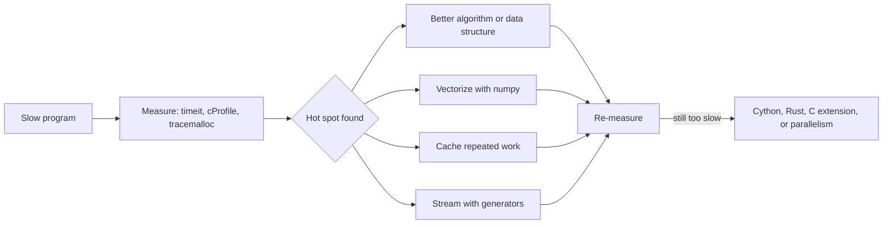
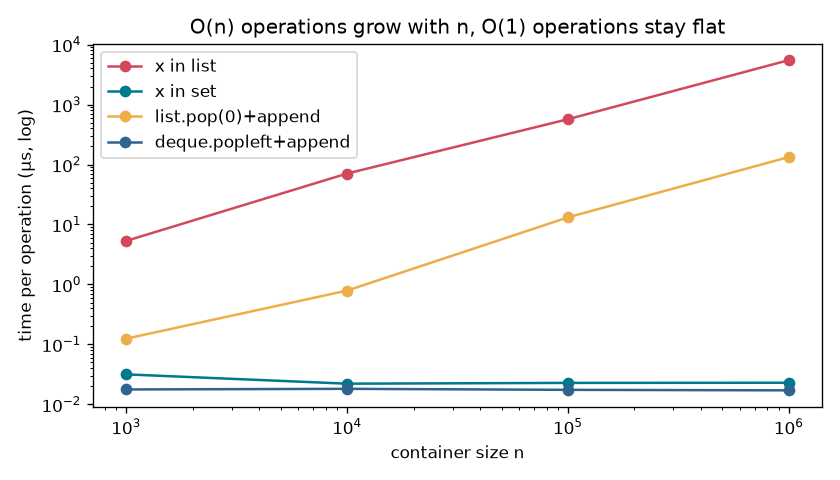
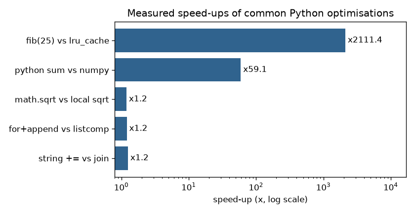

# Chapter 17 — Performance, Memory and CPython Internals

> **What you will learn.** How CPython (the standard Python interpreter, written in C) represents every value as an object (`PyObject`: type + reference count + value), how memory is freed (reference counting plus the cyclic garbage collector — the part of Python that automatically finds and frees memory no longer in use), what weak references are for, why `256 is 256` but maybe not `257 is 257` (small-int cache and string interning — keeping one shared copy of equal values), a recap of mutability and copying, the **big-O cost of built-in operations** (list, dict, set, deque), how to **profile** (measure where a program spends its time and memory: `timeit`, `cProfile`, `tracemalloc`, line-level tools) and the optimisations that actually pay off — the right data structure, numpy vectorisation (replacing a Python loop with one operation on a whole array, run in fast C code), caching (storing results to reuse instead of recomputing), generators, local lookups, `str.join`, `__slots__` — plus when to drop to C/Cython/Rust and what the "Faster CPython" releases (3.11+) changed.
>
> **Prerequisites.** [Ch 2](../02-variables-types-operators/README.md) (names and objects), Ch 5–6 (containers), [Ch 10](../10-oop-in-python/README.md) (classes), [Ch 11](../11-iterators-generators-functional/README.md) (generators), [Ch 16](../16-concurrency-and-async/README.md) (the GIL).
>
> **OS fundamentals.** What sits underneath every Python process — processes vs threads, CPU scheduling (the OS deciding which program runs on which core, and when), virtual memory (each process sees its own private address space, which the OS maps onto real RAM) and page faults (the hardware trap when a program touches memory that isn't currently mapped in), system calls (requests a program makes to the operating system kernel, e.g. "read this file"), file descriptors (the small integers the OS hands out to identify open files and sockets), blocking vs `epoll`/`kqueue` I/O (the mechanism under `asyncio`'s event loop and `selectors`), and the page cache (file data the OS keeps in RAM so repeat reads are fast) — is explained once, language-neutrally, in the Java handbook's [§16.13 Operating-system fundamentals for engineers](../../../java/chapters/16-jvm-internals-and-performance/README.md#1613-operating-system-fundamentals-for-engineers). The Python equivalents: `os.getpid()`/`multiprocessing` (processes), `threading` (threads under the GIL, [Ch 16](../16-concurrency-and-async/README.md)), `mmap`, `os.fsync`, `resource.getrlimit(resource.RLIMIT_NOFILE)` and the `selectors` module.
>
> **Code.** `chapters/17-performance-memory-internals/code/` — `object_model.py`, `gc_weakref.py`, `complexity_bench.py` (plot), `profiling_demo.py`, `optimizations.py` (plot). Output from CPython 3.14.7, 64-bit macOS. Byte sizes and timings are CPython implementation details and can differ between versions and machines.



---

## 17.1 The CPython object model

### What it is
In Python **everything is an object**: numbers, strings, functions, classes, modules, even `None` and types themselves. Every object has three things:

| Part | Meaning | How to see it |
|---|---|---|
| **Identity** | Which object it is; never changes during its life. In CPython it is the memory address. | `id(x)`, `x is y` |
| **Type** | What it can do; also never changes. | `type(x)` |
| **Value** | Its data. Changeable for *mutable* objects (list, dict, set), fixed for *immutable* ones (int, str, tuple, frozenset). | `==` compares values |

Inside CPython (written in C) every object begins with a header struct (a C record of named fields) called **`PyObject`** holding two fields: `ob_refcnt` (the **reference count**, how many references point at it) and `ob_type` (a pointer — a memory address — to its type object). A variable is just a **name** pointing to an object — the object lives on the heap (the big pool of memory where objects are allocated), the name holds a reference.

Analogy: objects are houses, names are address labels written on sticky notes. Several notes can carry the same address; when no note carries it any more, the house is demolished.

### How it works — demo
```python
data = [1, 2, 3]
sys.getrefcount(data)             # 1
alias = data; holder = {"k": data}
sys.getrefcount(data)             # 3  (two more references)
del alias, holder                 # back to 1

x = 10; before = id(x); x += 1    # int is immutable -> x now names a NEW object
lst = [1]; before = id(lst); lst += [2]   # list is mutable -> same object, changed in place
```
Output (`object_model.py`):
```
refcount of new list: 1  (exact numbers are an implementation detail)
after alias + dict entry: 3
after del: 1
refcount of None: 3221225472  (immortal object, 3.12+)
a is b: True, a == c: True, a is c: False
type(a): list, type(type(a)): type, isinstance(len, object): True
int += changes id: True
list += keeps id: True
```
Notes on the output:
- `sys.getrefcount` traditionally reports one extra (the temporary reference held by its own argument), yet here a fresh list shows 1: newer interpreters skip some reference-count updates, so the exact value varies by version. The docs say not to rely on the number beyond 0 or 1 — use it only to watch it go **up and down**.
- `None`'s huge count: since 3.12 (PEP 683), objects like `None`, `True`, small ints and some strings are **immortal** — their refcount is never changed, which avoids cache-line traffic (CPU cores repeatedly invalidating each other's copies of the same small block of memory) and helps the free-threaded build (the optional CPython without the GIL, see [Ch 16](../16-concurrency-and-async/README.md)).
- `type(type(a))` is `type`: classes are objects too, and their type is `type`.

### Object sizes (64-bit CPython 3.14)
```
  getsizeof(int 0       ) =   28 bytes
  getsizeof(int 1       ) =   28 bytes
  getsizeof(int 2**30   ) =   32 bytes
  getsizeof(int 2**100  ) =   40 bytes
  getsizeof(float       ) =   24 bytes
  getsizeof(str ''      ) =   41 bytes
  getsizeof(str 'abc'   ) =   44 bytes
  getsizeof(str 'é'     ) =   61 bytes
  getsizeof(tuple ()    ) =   48 bytes
  getsizeof(list []     ) =   56 bytes
  getsizeof(list 3 items) =   88 bytes
  getsizeof(dict {}     ) =   64 bytes
  getsizeof(set()       ) =  216 bytes
  getsizeof(None        ) =   16 bytes
```
Lessons: a Python `int` costs ~28 bytes versus 8 bytes in a numpy `int64` array; ints grow as needed (arbitrary precision — no fixed maximum size); an ASCII (plain English letters, digits and punctuation) string costs ~41 bytes + 1 byte per char, and one non-ASCII character switches the whole string to a wider storage (PEP 393). `sys.getsizeof` is **shallow**: a list's size counts its pointer array (8 bytes per slot), not the objects inside.

### Common mistakes
- Using `is` to compare values (`if x is 1000`). `is` checks identity; use `==`. Only use `is` for singletons (values of which only one object ever exists): `None`, `True`/`False`, sentinels (unique marker objects).
- Treating `id()` as unique forever: after an object dies, its id (address) can be reused.

### In the interview
**30-second answer:** "In CPython every value is a heap object starting with a `PyObject` header — a reference count and a type pointer. Variables are names bound to objects. Identity is `id`/`is`, type is fixed, and the value may or may not be mutable. Memory is freed when the refcount hits zero, with a cycle collector for reference cycles."
- *Difference between `==` and `is`?* — Value equality (`__eq__`) vs same object.
- *Why is a list of a million ints ~36 MB, but a numpy array ~8 MB?* — The list stores 8-byte pointers to separate ~28-byte int objects; numpy stores raw 8-byte values contiguously (side by side in one unbroken block of memory).

### Self-check
1. Three properties of every object? → Identity, type, value.
2. What two fields start every `PyObject`? → Reference count and type pointer.
3. Does `x += 1` on an int change the object? → No, it rebinds `x` to a new int.
4. Is `sys.getsizeof([big objects])` the total memory? → No, it's shallow.

### TL;DR
Everything is an object with identity, type and value; names are references. CPython tracks each object's references in a refcount; immortal objects (3.12+) skip that.

---

## 17.2 Memory management and garbage collection

### What it is
CPython frees memory in two ways:
1. **Reference counting** — the main mechanism. Each new reference increments the count, each dropped one decrements it; when it hits 0 the object is freed **immediately**.
2. **Cyclic garbage collector (`gc` module)** — a backup that finds groups of objects that reference each other (a **reference cycle**) but that nothing else can reach. Their counts never reach 0 on their own, so refcounting alone would leak them.

Under both sits **pymalloc**, CPython's allocator (the code that hands out and takes back blocks of memory) for small objects (≤ 512 bytes), which carves memory into pools and arenas (big chunks requested from the OS once, then split up) so tiny allocations are fast. (Freed memory usually returns to pymalloc's pools rather than straight to the OS, which is why a process's memory can stay high after you delete data.)

### How it works
- **Refcounting** is deterministic (always happens at the same, predictable moment): files closed by the last reference going away, `__del__` running at a predictable point (in CPython — other implementations differ, so still use `with`).
- **Cyclic GC** groups container objects (lists, dicts, class instances …) into **generations**: new objects start young; survivors get promoted. Young objects are checked often, old ones rarely — "most objects die young". A collection starts when allocations minus deallocations exceed a threshold (`gc.get_threshold()`). It only tracks containers; ints and strings can't form cycles.
- Version note: 3.14.0–3.14.4 shipped an *incremental* collector (it did a slice of the old-generation work at a time to shorten pauses); 3.14.5 (May 2026) reverted to the 3.13-style generational collector because of memory-pressure problems (programs using much more RAM than expected) reported in production. The ideas above hold for both.

```python
class Node:
    def __init__(self, name): self.name, self.other = name, None

n = Node("solo")
weakref.finalize(n, print, "  solo freed as soon as last reference went away")
del n                                     # refcount -> 0 -> freed right here

gc.collect(); gc.disable()
a, b = Node("a"), Node("b")
a.other, b.other = b, a                   # reference cycle
weakref.finalize(a, print, "  cycle freed by gc.collect()")
del a, b                                  # refcounts stay at 1 -> not freed yet
found = gc.collect()
```
Output (`gc_weakref.py`):
```
gc thresholds: (2000, 10, 10), gc enabled: True
  solo freed as soon as last reference went away
  (after del solo)
  (after del a, b: cycle still alive)
  cycle freed by gc.collect()
  gc.collect() found 3 unreachable objects
```
The single node disappears exactly at `del`; the cycle survives `del` and is only reclaimed when the collector runs.

### Weak references
A **weak reference** points to an object *without* increasing its refcount, so it doesn't keep the object alive. `weakref.ref(obj)()` returns the object or `None` once it has died.

```python
r = weakref.ref(obj);  del obj;  r()          # -> None
cache = weakref.WeakValueDictionary()          # entries disappear with their values
```
```
  weakref alive: True
  weakref after del: None
  cache keys while x alive: ['x']
  cache keys after del x: []
```
Uses: caches that shouldn't pin (force to stay in) big objects in memory, parent pointers in trees (child → parent weak, avoiding cycles), observer lists (lists of objects to notify when something changes). `weakref.finalize(obj, fn)` is the safe way to run clean-up when an object dies (better than `__del__`). Not every type can be weakly referenced (`int`, `list`, `tuple` can't; ordinary class instances can).

### Trade-offs
| | Reference counting | Cyclic GC |
|---|---|---|
| When memory is freed | Immediately | Periodically |
| Handles cycles | No | Yes |
| Cost | Small, on every reference change | Pauses proportional to tracked objects |
| Control | — | `gc.collect()`, `gc.disable()`, `gc.freeze()`, `gc.set_threshold()` |

### Common mistakes
- Relying on `__del__` for important clean-up (files, locks) — use `with` or `weakref.finalize`.
- Accidental cycles in long-lived caches or through closures/tracebacks (storing an exception object keeps its frames alive).
- Calling `gc.collect()` in a loop "to be safe" — it costs time and doesn't fix leaks caused by references you still hold.

### Real-world examples
Instagram disabled, and later **froze**, the cyclic GC in its Django worker processes to stop GC touching pre-forked memory pages and destroying copy-on-write sharing (after a `fork`, parent and child processes share the same memory pages until one of them *writes* to a page, which then gets copied — so merely updating GC bookkeeping in every object forced huge copies); that work led to `gc.freeze()` (3.7). ORMs (object-relational mappers, which map database rows to Python objects) like SQLAlchemy use weak references in their identity map (a lookup table of already-loaded rows) so loaded rows can be freed when your code stops using them.

### In the interview
**30-second answer:** "CPython primarily uses reference counting: when an object's count reaches zero it's freed immediately. Reference cycles never reach zero, so a generational cyclic garbage collector periodically finds unreachable groups of container objects. Weak references let you refer to an object without keeping it alive, which is useful for caches and back-pointers."
- *Can Python leak memory?* — Yes: objects still referenced by a global cache, an ever-growing list, or a cycle involving objects the GC can't collect safely.
- *How do you find a leak?* — `tracemalloc` snapshots compared over time; `gc.get_referrers`; tools like `objgraph`.

### Self-check
1. Which mechanism frees most objects? → Reference counting.
2. What does the cyclic GC find? → Unreachable reference cycles among container objects.
3. Does a weak reference keep an object alive? → No.
4. Why do generations exist? → Most objects die young; scan young ones often, old ones rarely.

### TL;DR
Refcount frees most objects immediately; the generational cyclic GC cleans up cycles; `weakref` refers without owning.

---

## 17.3 Small-int caching and string interning

### What it is
Two memory optimisations that make some *different-looking* values share one object:
- **Small-int cache**: CPython pre-creates the ints **−5 to 256**; every result in that range reuses those objects.
- **String interning**: keeping one shared copy of a string so equal strings are the same object. CPython automatically interns identifiers (variable, attribute, function names) and many short, identifier-like literal strings in your code; you can force it with `sys.intern(s)`.

```python
a, b = int("256"), int("256")            # built at run time, not constants
c, d = int("257"), int("257")
s1 = "".join(["hello", "_", "world"])     # built at run time: not interned automatically
s2 = "hello_world"
```
```
256 is 256: True   257 is 257: False   (small ints -5..256 are cached)
runtime str is literal: False, after sys.intern: True
```
(Numbers are built with `int("...")` because equal constants in the same code block may be merged by the compiler, which would hide the effect.)

### Why it matters
- Speed: dict lookups on interned keys can succeed with a pointer comparison.
- Memory: millions of repeated strings (e.g. a "country" column read from a file) can be deduplicated with `sys.intern`.
- Interview trap: `a is b` for ints/strings gives results that depend on the implementation. **Never use `is` for value comparison.**

### TL;DR
Ints −5…256 and many identifier-like strings are shared objects. It's an optimisation, not a language rule — compare with `==`.

---

## 17.4 Mutability and copying (recap)

Chapters 2 and 5 covered this in detail; here is the memory-level view in one example.

```python
grid = [[0, 0], [0, 0]]
alias = grid                     # same object
shallow = grid.copy()            # new outer list, SAME inner lists
deep = copy.deepcopy(grid)       # new everything
grid[0][0] = 99
bad = [[0] * 2] * 2              # two references to ONE inner list
def append_to(item, bucket=[]):  # default evaluated once, shared across calls
```
```
alias [99, 0], shallow [99, 0], deep [0, 0]
[[0]*2]*2 after bad[0][0]=1 -> [[1, 0], [1, 0]]
mutable default after two calls: [1, 2]
```

| Operation | New outer object? | New inner objects? |
|---|---|---|
| `b = a` | No | No |
| `a.copy()`, `list(a)`, `a[:]`, `dict(a)` | Yes | No (shallow) |
| `copy.deepcopy(a)` | Yes | Yes (recursive, handles cycles) |

Performance angle: copying is O(n) — shallow copies copy pointers, deep copies copy everything and are much slower. Immutable objects are safe to share (no copies needed), are hashable (usable as dict keys), and are thread-safe to read. Use `[[0] * cols for _ in range(rows)]` for grids and `None` as the default for mutable parameters.

---

## 17.5 Big-O of built-in operations

### What it is
**Big-O** (notation from computer science for growth rate) describes how an operation's cost grows with the container size *n*: O(1) = constant, O(n) = proportional to n, O(log n) = grows very slowly. "Average" for dict/set assumes a good hash spread; "amortised" means occasional expensive resizes averaged over many cheap calls.

### The table (CPython)
| Operation | list | dict | set | deque |
|---|---|---|---|---|
| Index `x[i]` / key lookup `d[k]` | O(1) | O(1) avg | — | O(1) at ends, O(n) in middle |
| `x in c` | **O(n)** | O(1) avg | O(1) avg | O(n) |
| Append / add at right end | O(1) amortised | O(1) avg | O(1) avg | O(1) |
| Pop from right end | O(1) | `popitem` O(1) | — | O(1) |
| Insert / pop at left end | **O(n)** (`insert(0,x)`, `pop(0)`) | — | — | **O(1)** (`appendleft`, `popleft`) |
| Insert / delete in middle | O(n) | O(1) avg (`del d[k]`) | O(1) avg (`remove`) | O(n) |
| `len` | O(1) | O(1) | O(1) | O(1) |
| Iterate | O(n) | O(n) | O(n) | O(n) |
| Copy | O(n) | O(n) | O(n) | O(n) |
| Sort | O(n log n) (Timsort, Python's built-in hybrid sort algorithm) | — | — | — |
| Slice `x[a:b]` | O(k) (k = slice length) | — | — | — |
| `min` / `max` / `sum` | O(n) | O(n) | O(n) | O(n) |
| Union / intersection | — | `d1 \| d2` O(len d1 + len d2) | `s \| t` O(len s + len t); `s & t` O(min) avg | — |

Others: `heapq.heappush/heappop` O(log n), `heapq.heapify` O(n); `bisect` search O(log n) (but `insort` is O(n) because of the list shift); string concatenation `a + b` O(len a + len b); `str.join` O(total length). Dict/set worst case is O(n) when many keys collide (different keys land in the same hash slot), which is rare with built-in hashes (string hashing is randomised per process to resist deliberate collisions).

### Measured
```python
setup = f"n={n}; L=list(range(n)); S=set(L); D=deque(L)"
per_op_us("(n-1) in L", setup, 200)                # worst case: last item
per_op_us("(n-1) in S", setup, 200_000)
per_op_us("L.append(L.pop(0))", setup, 2_000)
per_op_us("D.append(D.popleft())", setup, 200_000)
```
Output (`complexity_bench.py`, microseconds per operation):
```
         n             x in list              x in set    list.pop(0)+append  deque.popleft+append
     1,000                 5.346                 0.022                 0.098                 0.018
    10,000                54.597                 0.023                 0.788                 0.017
   100,000               541.614                 0.023                13.024                 0.018
 1,000,000              5346.586                 0.022               132.574                 0.017
```


*Figure — each 10× larger list makes `in` ~10× slower; set and deque don't care about n. At a million items, set lookup is ~250,000× faster.*

### Common mistakes
- `if x in some_list` inside a loop → O(n²) (cost grows with the square of n: 10× more data, 100× slower). Build a `set` once.
- Using a list as a queue (`pop(0)`) → use `collections.deque`.
- Repeated `sorted()` inside a loop when you need a running minimum → `heapq`.
- Forgetting that building a set is O(n): for a *single* lookup, the list is fine.

### In the interview
**30-second answer:** "Lists are dynamic arrays (arrays that grow by reallocating a bigger block and copying): O(1) index and append, O(n) insert/pop at the front and O(n) membership. Dicts and sets are hash tables with O(1) average lookup, insert and delete. Deque gives O(1) at both ends. The classic fix for slow code is turning repeated list membership into a set lookup."

> **Key term — hash table:** a structure that stores items in an array of slots. A **hash function** turns each key into a number, and that number picks the slot, so finding a key means computing one hash and looking in one place instead of scanning everything — hence O(1) on average. When two keys pick the same slot (a *collision*) the table probes for another slot; with many collisions lookups degrade toward O(n). Python's `dict` and `set` are hash tables, which is why their keys must be hashable.
- *Why is `list.append` "amortised" O(1)?* — The array over-allocates; occasional resizes copy everything, but averaged over many appends each costs O(1).
- *When is dict lookup O(n)?* — Pathological hash collisions.

### TL;DR
List: fast at the end, slow at the front and for `in`. Dict/set: O(1) average lookups. Deque: O(1) both ends. Pick by the operations you do most.

---

## 17.6 Profiling — measure before you optimise

### What it is
**Profiling** measures where a program spends time or memory. Guessing is usually wrong; the hot spot is often one innocent-looking line.

| Tool | Answers | How |
|---|---|---|
| `timeit` | "How fast is this small snippet?" | `python -m timeit "sum(range(1000))"` or `timeit.repeat(...)`; in Jupyter `%timeit` |
| `cProfile` + `pstats` | "Which *functions* take the time?" (deterministic: every call counted) | `python -m cProfile -s cumtime script.py` |
| `line_profiler` (3rd-party) | "Which *lines* inside a function?" | decorate with `@profile`, run `kernprof -l -v script.py`; Jupyter `%lprun` |
| `py-spy`, `scalene`, `pyinstrument` (3rd-party) | Sampling profilers (they peek at what the program is doing many times a second instead of recording every call): low overhead (little extra slowdown), work on running processes; scalene also profiles memory/CPU vs native time | `py-spy top --pid 1234` |
| `tracemalloc` | "Which lines allocate memory?" | snapshots and `statistics("lineno")` |
| `time.perf_counter()` | Quick wall-clock timing of a block | subtract two readings |

Python 3.15 (release candidates since August 2026; final due October 2026) adds a statistical sampling profiler to the standard library, `profiling.sampling` (PEP 799); on 3.14 and earlier, use the tools above.

### How it works — a real hunt
```python
def is_vip(customer_id: int, vip_ids: list[int]) -> bool:
    return customer_id in vip_ids             # O(len(vip_ids)) per call!

def build_report(n: int = 20_000) -> dict:
    records = load_records(n)
    vip_ids = list(range(0, n, 7))            # a list, not a set
    ...
prof = cProfile.Profile(); prof.enable(); build_report(); prof.disable()
pstats.Stats(prof).strip_dirs().sort_stats("cumulative").print_stats(4)
```
Output (`profiling_demo.py`):
```
timeit sum(range(1000)): 3.79 µs per call
         22861 function calls in 0.287 seconds
   ncalls  tottime  percall  cumtime  percall filename:lineno(function)
        1    0.003    0.003    0.287    0.287 profiling_demo.py:19(build_report)
    20000    0.281    0.000    0.281    0.000 profiling_demo.py:15(is_vip)
        1    0.003    0.003    0.003    0.003 profiling_demo.py:10(load_records)
     2858    0.000    0.000    0.000    0.000 {method 'get' of 'dict' objects}
list lookup: 278 ms  set lookup: 2.8 ms  speed-up x101  same result: True
records: 50,000, current 11.2 MB, peak 11.2 MB
top allocation site: line 11, 9.6 MB
```
How to read the columns: **ncalls** = number of calls; **tottime** = time inside the function itself; **cumtime** = including everything it called; **percall** = per-call averages. Here `is_vip` has 98 % of the time → change `vip_ids` to a `set` → ~100× faster. `tracemalloc` points at line 11 (the list of dicts) as the memory hog.

Steps that work every time:
1. Reproduce with realistic input size.
2. Profile the whole run (`cProfile`, or `py-spy` on a live server).
3. Sort by `cumtime` to find the expensive branch, then `tottime` to find the leaf (the function at the bottom of the call chain that does the actual work).
4. Fix the **algorithm/data structure** first; micro-optimise (small line-level tweaks) last.
5. Re-measure with `timeit` and check the result is unchanged.

### Common mistakes
- Timing with a single run (noise) — use `timeit.repeat` and take the minimum.
- Profiling tiny inputs where start-up dominates.
- Forgetting that `cProfile` adds overhead to every call, so many tiny functions look worse than they are; sampling profilers avoid this.

### TL;DR
`timeit` for snippets, `cProfile` for functions, `line_profiler` for lines, `py-spy`/`scalene` for live/low-overhead, `tracemalloc` for memory. Measure → fix the biggest thing → re-measure.

---

## 17.7 Optimisation techniques

### Measured on 3.14
```python
def concat_plus():               s = ""; for i in range(N): s += str(i)
def concat_join():               return "".join(str(i) for i in range(N))
def global_lookup(): ... total += math.sqrt(i)          # attribute lookup each time
def local_lookup():  sqrt = math.sqrt; ... total += sqrt(i)
def numpy_sum_squares():         a = np.arange(N, dtype=np.int64); return int((a * a).sum())
@lru_cache(maxsize=None)
def fib_cached(n): return n if n < 2 else fib_cached(n - 1) + fib_cached(n - 2)
```
Output (`optimizations.py`, N = 100,000):
```
string += vs join             6.33 ms ->    5.11 ms   x  1.2
for+append vs listcomp        2.45 ms ->    2.15 ms   x  1.1
math.sqrt vs local sqrt       3.27 ms ->    2.83 ms   x  1.2
python sum vs numpy           2.70 ms ->    0.04 ms   x 61.1
fib(25) vs lru_cache          5.85 ms ->   0.002 ms   x 2419   CacheInfo(hits=23, misses=26, maxsize=None, currsize=26)
sum over 1M: list peak 40.4 MB vs generator peak 0.4 KB
100k objects: regular class 12.8 MB vs __slots__ 8.8 MB
__slots__ blocks new attributes: 'PointSlots' object has no attribute 'z' and no __dict__ for setting new attributes
```


*Figure — algorithmic and vectorisation changes win by orders of magnitude; micro-tweaks give 10–20 %.*

### The techniques, ranked by typical pay-off
| # | Technique | Why it helps | Typical gain |
|---|---|---|---|
| 1 | **Better algorithm / data structure** (set for membership, dict for lookup, deque for queues, heapq for top-k — the k largest/smallest items) | Changes the big-O | 10×–100,000× |
| 2 | **Caching** (`functools.lru_cache`/`cache`, memoisation — remembering a function's results by its arguments — dicts) | Don't recompute the same answer | Up to exponential → linear |
| 3 | **Vectorise with numpy/pandas** | One C loop over raw numbers instead of a Python loop over objects | 10×–100× |
| 4 | **Generators / streaming** | Constant memory, earlier results | Memory: GB → KB |
| 5 | **Built-ins and comprehensions** (`sum`, `max`, `sorted`, `"".join`, list comprehensions) | Loops run in C / specialised bytecode (CPython's low-level instructions, tuned for the types seen) | 1.1×–3× |
| 6 | **Local variable lookups** (alias `math.sqrt` before a hot loop) | Local access is an array index; globals/attributes are dict lookups | ~1.1× on 3.11+ |
| 7 | **`__slots__`** on classes with millions of instances | No per-instance `__dict__` | Less memory per object (31 % less total here) |
| 8 | **Parallelism** ([Ch 16](../16-concurrency-and-async/README.md)) | Use more cores | ≤ number of cores |

Details worth knowing:
- **`str.join`**: repeated `s += piece` can be O(n²) in general, because strings are immutable and each `+=` may copy. CPython has a special in-place optimisation when the string has only one reference, which is why the gap above is small — but it's an implementation detail (not on PyPy, and it breaks as soon as another reference exists). `"".join(parts)` is always linear. Same idea for bytes: use `bytearray` or `io.BytesIO`.
- **`lru_cache`**: arguments must be hashable; `maxsize=None` (or `@functools.cache`) means unbounded — a memory leak risk for many distinct inputs. It caches per function, not per instance; on methods it keeps `self` alive (use `functools.cached_property` for per-instance values).
- **Local lookups**: the 3.11+ specialising interpreter already caches global and attribute lookups, so this trick gives little today. Apply it only in measured hot loops.
- **Avoid needless work in loops**: hoist invariant computations (move calculations whose result doesn't change out of the loop), avoid repeated `len()` in conditions you can compute once, avoid exceptions for normal control flow (the order in which statements run) in very hot paths (code that runs extremely often) (though `try` itself is zero-cost in 3.11+ when nothing is raised).

### `__slots__`
Normally each instance stores its attributes in a per-instance dict. `__slots__ = ("x", "y")` replaces it with fixed slots:

```python
class PointSlots:
    __slots__ = ("x", "y")                # fixed attributes, no per-instance __dict__
    def __init__(self, x, y):
        self.x, self.y = x, y
```
Measured: 100,000 points took 12.8 MB vs 8.8 MB (the total includes the list and the int objects, so the per-object saving is larger than the ratio suggests). Also slightly faster attribute access. Costs: you can't add new attributes, no `__dict__` (breaks some tools that expect it), no weak references unless you add `"__weakref__"` to the slots, and each class in an inheritance chain needs its own `__slots__` to get the benefit. `@dataclass(slots=True)` (3.10+) generates them for you. Since 3.11–3.13, CPython also stores ordinary instance attributes more compactly ("inline values"), so the gap is smaller than in old blog posts — measure.

### When to drop to C, Cython or Rust
When profiling shows a hot loop that can't be expressed with numpy/pandas and runs too slow in Python:

| Option | What it is | Good for |
|---|---|---|
| **numba** | JIT-compiles (just-in-time: compiles while the program runs) numeric Python functions (`@njit`) to machine code (instructions the CPU runs directly) | Loops over numpy arrays |
| **Cython** | Python-like language with C types, compiled to a C extension | Gradual speed-up of existing Python; wrapping C libraries |
| **Rust + PyO3/maturin** | Write the extension in Rust | Safe, fast new libraries (pydantic-core, polars, ruff, tokenizers are written this way) |
| **C/C++ + pybind11 / C API** | Classic native extension | Existing C/C++ code |
| **PyPy** | Alternative Python with a tracing JIT (it watches which loops run hot and compiles those) | Pure-Python long-running programs (check C-extension support) |
| **mypyc** | Compiles type-annotated Python to C extensions | Typed codebases (mypy and black — a code formatter — use it) |

Rule: exhaust algorithmic fixes and vectorisation first; native code adds a build step and a second language to maintain.

### Python version performance (Faster CPython)
| Version | What changed (from the official "What's New" notes) |
|---|---|
| **3.11** (2022) | Specialising adaptive interpreter (PEP 659): bytecode rewrites itself for the types it sees. Cheaper frames, inlined Python-to-Python calls, "zero-cost" exceptions. Official figure: **10–60 % faster than 3.10, ~1.25× on average** on the pyperformance suite (the standard set of Python benchmarks). |
| **3.12** (2023) | Inlined comprehensions (PEP 709, up to 2× faster for comprehension-heavy code), immortal objects (PEP 683), per-interpreter GIL (PEP 684). |
| **3.13** (2024) | Experimental JIT compiler (PEP 744, off by default), experimental free-threaded build (PEP 703), improved interactive REPL. |
| **3.14** (2025) | Free-threaded build officially supported (PEP 779); optional tail-calling interpreter (a new internal dispatch technique; ~3–5 % faster when built with recent Clang, a C compiler); experimental JIT included in the Windows and macOS installers, still off by default. |

Simply upgrading from 3.10 to 3.11+ is often the cheapest speed-up you'll ever get.

### When not to optimise
Code that runs once, code that is already I/O-bound (a 1 ms CPU saving next to a 200 ms network call), and anything not shown hot by a profiler. Readability usually wins.

### Common mistakes
- Micro-optimising before fixing an O(n²) algorithm.
- Vectorising by calling numpy element-by-element in a Python loop (slower than plain Python!).
- Unbounded caches that grow forever in long-running services.
- Premature `__slots__` on classes with 50 instances.

### Real-world examples
pandas and scikit-learn are fast because their inner loops are C/Cython; polars and pydantic v2 got large speed-ups by moving their cores to Rust; Django and many web frameworks use `functools.lru_cache`/`cached_property` for settings and URL resolution; mypyc was built by the mypy team (originally at Dropbox) to compile mypy itself, making it several times faster.

### In the interview
**30-second answer:** "First I profile — cProfile or py-spy — to find the hot spot. The biggest wins are algorithmic: the right data structure, avoiding repeated work with caching, and vectorising numeric loops with numpy. Then smaller things: built-ins, comprehensions, `join` instead of `+=`, generators for memory, `__slots__` for many small objects. If that's still not enough, I'd move the hot loop to numba, Cython or Rust, or parallelise."
- *Why is numpy faster than a Python loop?* — Contiguous typed memory, one C loop, no per-element object creation or dispatch (working out which method to call for each item), often SIMD (single instruction, multiple data — CPU instructions that process several numbers at once).
- *What's the downside of `lru_cache`?* — Memory growth and stale results (cached answers that are out of date); arguments must be hashable.

### Self-check
1. Biggest source of speed-ups? → Better algorithms/data structures.
2. Why is `''.join` preferred over `+=`? → Guaranteed linear; `+=` can be quadratic.
3. What does `__slots__` remove? → The per-instance `__dict__`.
4. Name two ways to speed up a numeric loop numpy can't express. → numba, Cython (or Rust/PyO3).
5. Roughly how much faster was 3.11 than 3.10? → ~25 % on average (10–60 %).

### TL;DR
Measure → fix the algorithm → cache → vectorise → stream → micro-tweak → native code/parallelism. Upgrade Python.

---

## 17.8 Chapter self-check

1. What is in every `PyObject` header? → Refcount and type pointer.
2. When is an object freed in CPython? → When its refcount reaches zero, or when the cyclic GC finds it unreachable in a cycle.
3. Which ints are cached? → −5 to 256.
4. What does `weakref.WeakValueDictionary` do when a value dies? → Removes the entry.
5. Cost of `x in list` vs `x in set`? → O(n) vs O(1) average.
6. Best structure for a FIFO queue? → `collections.deque`.
7. `tottime` vs `cumtime`? → Own time vs including callees.
8. Why does `sum(i*i for i in range(10**6))` use almost no memory? → Generator streams values.
9. Downside of `__slots__`? → No new attributes, no `__dict__`, no weakrefs unless listed.
10. First thing to try before rewriting in Rust? → Profile and fix the algorithm / vectorise.

## Chapter TL;DR
- **Objects**: identity (`id`, `is`), type, value; `PyObject` = refcount + type pointer; names are references; immortal objects since 3.12.
- **Memory**: refcounting frees immediately; generational cyclic GC handles cycles; `weakref` refers without owning; `gc.freeze()` helps pre-fork servers.
- **Caching quirks**: small ints −5…256 and interned strings are shared — always compare with `==`.
- **Copying**: assignment shares, `.copy()` is shallow, `deepcopy` is deep; immutables are safe to share.
- **Big-O**: list O(1) end / O(n) front and `in`; dict/set O(1) average; deque O(1) both ends; heapq O(log n).
- **Profile**: `timeit`, `cProfile`/`pstats`, `line_profiler`, `py-spy`/`scalene`, `tracemalloc`.
- **Optimise**: data structure → caching → numpy → generators → built-ins/join/locals → `__slots__` → numba/Cython/Rust → parallelism. Newer CPython (3.11+) is substantially faster for free.
- **OS layer** (processes, threads, paging, syscalls, fds, epoll, page cache): see Java handbook [§16.13](../../../java/chapters/16-jvm-internals-and-performance/README.md#1613-operating-system-fundamentals-for-engineers).
