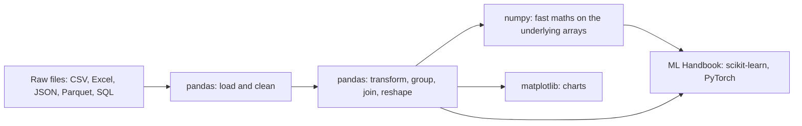
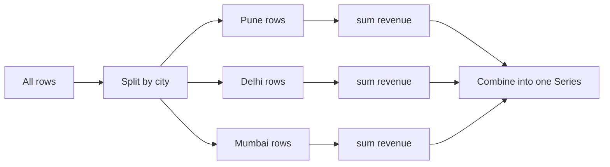
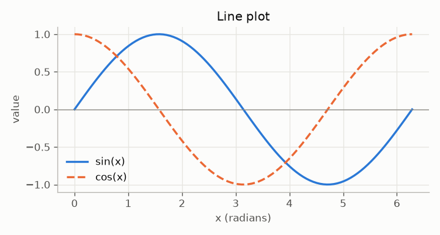
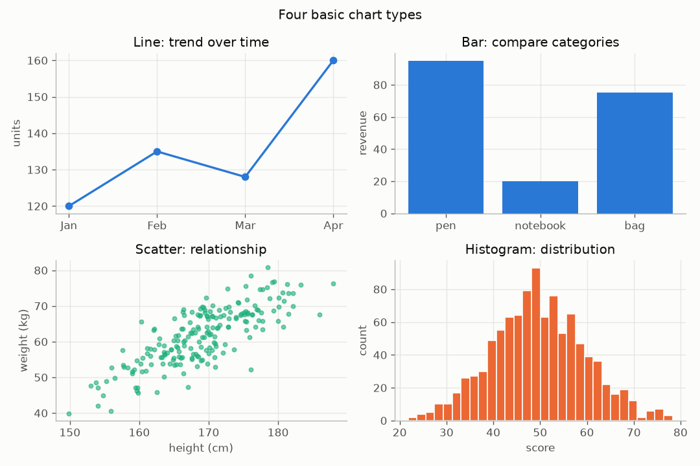
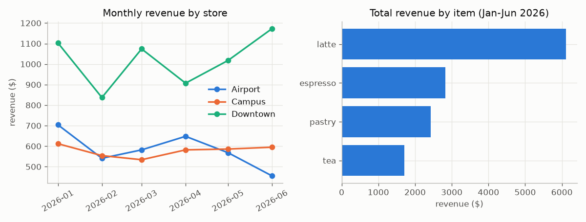

# Chapter 18 — The Data Stack: numpy, pandas, matplotlib

> **What you will learn.** The three libraries almost every Python data, science and ML (machine learning — programs that learn patterns from data rather than hand-written rules) project stands on. **numpy**: fast n-dimensional arrays, dtypes, indexing and views, broadcasting, vectorisation, aggregation along axes, basic linear algebra (vectors and matrices) and the modern random API. **pandas**: `Series` and `DataFrame`, file I/O, `loc`/`iloc`, filtering, `groupby`/`agg`/`transform`, `merge`/`concat`, `pivot_table`/`melt`, missing data, datetimes, why `apply` is slow, performance tips — and what changed in **pandas 3.0** (string dtype, Copy-on-Write). **matplotlib**: Figure and Axes, the four workhorse charts, subplots, labels, saving images. Ends with a small end-to-end analysis: messy CSV → clean → analyse → chart.
>
> **Where this leads.** The ML Handbook, [Chapter 3 — The Python ML stack](../../../ml/chapters/03-python-ml-stack/README.md), takes these tools into ML (feature matrices — numeric inputs, one row per example; scikit-learn pipelines — chained preprocessing + model steps; train/test splits — holding back data to test the model on unseen examples). This chapter stays with general data work, no scikit-learn.
>
> **Code.** `chapters/18-data-stack/code/` — `numpy_basics.py`, `pandas_basics.py`, `matplotlib_demo.py`, `end_to_end.py`, `plot_style.py` (shared chart style). Plots go to `img/`. Versions: Python 3.14.7, numpy 2.5, pandas 3.0.6, matplotlib 3.11.



| Library | Core object | Think of it as |
|---|---|---|
| numpy | `ndarray` | A grid of numbers of one type, stored in one block of memory |
| pandas | `DataFrame` / `Series` | A spreadsheet table with labelled rows and columns; columns can have different types |
| matplotlib | `Figure` / `Axes` | A canvas with one or more plots drawn on it |

---

## 18.1 numpy arrays

### What it is
**numpy** (Numerical Python) provides the `ndarray`: an n-dimensional array whose elements share one **dtype** (`int64`, `float64`, `bool` …) and sit in one contiguous block of memory. **shape** is the tuple of sizes per dimension (`(3, 4)` = 3 rows, 4 columns); `ndim` is the number of dimensions. A list is a shelf of pointers to objects stored elsewhere; an array is an egg carton — uniform slots in one piece, processed all at once.

### Why it matters
- **Speed**: compiled C loops over raw numbers — typically 10–100× faster than Python loops (35× measured below).
- **Memory**: 8 bytes per `float64` vs ~24–32 bytes per Python float plus an 8-byte pointer.
- **Ecosystem**: pandas columns, scikit-learn inputs, OpenCV/Pillow images and PyTorch tensors (which convert to and from numpy) all build on it.

### How it works — creating and inspecting
```python
a = np.array([1, 2, 3])                       # from a list
np.zeros((2, 3)); np.ones(3, dtype=np.int32)  # filled arrays
np.arange(0, 10, 3); np.linspace(0, 1, 5)     # ranges: step-based vs count-based
m = np.arange(12).reshape(3, 4)               # 3 rows x 4 cols
np.array([1, 2.5]).dtype                      # mixed -> upcast to float64
np.array([1.7, -1.7]).astype(int)             # truncates toward zero
```
Output (`numpy_basics.py`):
```
[1 2 3] int64 (3,) 1
[[0. 0. 0.]
 [0. 0. 0.]]
[1 1 1]
[0 3 6 9]
[0.   0.25 0.5  0.75 1.  ]
[[ 0  1  2  3]
 [ 4  5  6  7]
 [ 8  9 10 11]]
m.shape=(3, 4) m.size=12 m.dtype=int64 m.nbytes=96 itemsize=8
mixed ints and floats -> float64; astype -> [ 1 -1]
```
`reshape` needs the same total size (12 = 3 × 4); `-1` lets numpy compute one dimension (`reshape(-1, 2)`). "Upcast" = numpy picks a wider type that holds every value. Other creators: `np.full`, `np.eye` (identity matrix), `np.empty` (uninitialised — fast, contains garbage), `np.zeros_like(m)`.

### Indexing, slicing, views and masks
```python
m[1, 2]; m[0]; m[:, 1]; m[-1, ::2]            # element, row, column, strided
view = m[:2, :2]; view[0, 0] = 100            # slicing returns a VIEW -> m changes too
mask = m % 2 == 0; m[mask]                    # boolean mask selects matching elements
m[[2, 0]]                                     # fancy (list) indexing returns a COPY
np.where(m > 5, m, -1)                        # vectorised if/else
```
```
m[1, 2]=6  m[0]=[0 1 2 3]  m[:, 1]=[1 5 9]  m[-1, ::2]=[ 8 10]
after view[0,0]=100, m[0,0]=100  shares memory: True
even values: [ 0  2  4  6  8 10]
fancy rows [2, 0]:
[[ 8  9 10 11]
 [ 0  1  2  3]]
np.where(m > 5, m, -1):
[[-1 -1 -1 -1]
 [-1 -1  6  7]
 [ 8  9 10 11]]
```

| Indexing kind | Example | Returns |
|---|---|---|
| Basic (ints, slices) | `m[1:, ::2]` | **View** (shares memory) |
| Boolean mask | `m[m > 5]` | Copy (1-D) |
| Fancy (int lists/arrays) | `m[[2, 0]]` | Copy |

Unlike lists, a numpy slice is a **view** — a new array object over the *same* memory, so changing it changes the original ("strided" = every k-th element). Use `.copy()` for independence. Combine masks with `&`, `|`, `~` and parentheses: `m[(m > 2) & (m < 9)]` (`and`/`or` raise on arrays).

### Vectorised maths and aggregation along an axis
```
x*2=[2. 4. 6. 8.]  x**2=[ 1.  4.  9. 16.]  np.sqrt(x)=[1.    1.414 1.732 2.   ]  x>2=[False False  True  True]
m.sum()=66  m.sum(axis=0)=[12 15 18 21]  m.sum(axis=1)=[ 6 22 38]
m.mean()=5.50  m.max(axis=1)=[ 3  7 11]  m.argmax()=11  cumsum=[ 1  3  6 10]
```
Arithmetic and **ufuncs** (universal functions: `np.sqrt`, `np.exp`, `np.log`, `np.abs` …) work element-wise. For reductions (many values → one, like `sum`, `max`), `axis=0` collapses the rows — one result **per column**; `axis=1` — one result **per row**. `argmax` gives the position of the maximum (in the flattened 1-D array unless `axis` is given).

### Vectorisation, measured
```python
[v * 2 + 1 for v in big]      # Python: one bytecode loop, one int object per element
arr * 2 + 1                   # numpy: two C loops over raw int64s
```
```
1M elements: list comprehension 25.8 ms, numpy 0.75 ms, x35
```
**Vectorisation** = whole-array operations instead of a Python loop. If you're writing `for i in range(len(arr))` over an array, look for the array operation (`np.where`, masks, `cumsum`, `np.diff`, `np.clip`, broadcasting).

Everyday array functions: **join** — `np.concatenate([a, b])` (existing axis), `np.stack` / `np.vstack` / `np.hstack` (new or row/column axis); **sort** — `np.sort(a)` (copy), `a.sort()` (in place), `np.argsort(a)` (index order, e.g. to sort one array by another); **deduplicate/count** — `np.unique(a, return_counts=True)`; **reshape views** — `a.T`, `a.ravel()`, `a[:, None]`.

### Common mistakes
- Expecting a slice to be a copy (it's a view) — or the reverse with fancy indexing.
- Integer overflow: fixed-size dtypes wrap (`np.int8(127) + np.int8(1)` → −128 — numpy warns for scalars, arrays wrap silently); Python ints never overflow.
- `==` on floats — use `np.isclose`/`np.allclose`.
- `np.append` in a loop (copies each time, O(n²)) — collect in a list, convert once.
- Mixing up `axis=0` and `axis=1`.

---

## 18.2 Broadcasting

### What it is
**Broadcasting** combines arrays of different shapes without copying: the smaller one is (virtually) stretched to match.

### How it works — the rule
Compare shapes **from the right-most dimension leftwards**:
1. Pad the shorter shape on the left with 1s.
2. Two dimensions are compatible if **equal** or **one is 1**.
3. A size-1 dimension stretches; any other mismatch → `ValueError`.

Worked example: `(3, 1) + (4,)` → `(3, 1)` vs `(1, 4)` → `(3, 4)`.

```python
col = np.array([[10], [20], [30]])                  # shape (3, 1)
row = np.array([1, 2, 3, 4])                        # shape (4,)
col + row                                           # shape (3, 4)
z = (data - data.mean(axis=0)) / data.std(axis=0)   # standardise each column: (3,2) op (2,)
np.ones((3, 2)) + np.ones(3)                        # (3,2) vs (3,) -> last dims 2 vs 3 -> error
```
```
(3,1) + (4,) -> (3, 4)
[[11 12 13 14]
 [21 22 23 24]
 [31 32 33 34]]
column-standardised:
[[-1.225 -1.225]
 [ 0.     0.   ]
 [ 1.225  1.225]]
(3,2) + (3,) -> ValueError: operands could not be broadcast together with shapes (3,2) (3,)
```
To subtract a **per-row** value, make it a column: `data - data.mean(axis=1, keepdims=True)` (or `[:, None]` / `np.newaxis`).

**Real-world:** standardising features (column means/stds), normalising images (`img / 255.0`, or a per-channel `(3,)` mean from an `(H, W, 3)` image), pairwise distances (`a[:, None, :] - b[None, :, :]`).

**Self-check:** `(5, 1, 3) + (4, 1)` → `(5, 4, 3)`. `(3, 2) + (3,)` fails because the right-most dims 2 and 3 differ and neither is 1.

---

## 18.3 Linear algebra and random numbers

### Linear algebra basics
```python
A = np.array([[3.0, 1.0], [1.0, 2.0]]); b = np.array([9.0, 8.0])
A @ A                       # matrix multiplication (same as np.matmul); A * A is element-wise!
np.linalg.solve(A, b)       # solve A x = b
np.linalg.det(A); np.linalg.inv(A); np.linalg.eigh(A); np.linalg.norm(b); A.T
```
```
A @ A =
[[10.  5.]
 [ 5.  5.]]
solve A x = b -> x = [2. 3.], check A @ x = [9. 8.]
det = 5.000, inv =
[[ 0.4 -0.2]
 [-0.2  0.6]]
eigenvalues = [1.382 3.618], norm of b = 12.042, A.T =
[[3. 1.]
 [1. 2.]]
```
Glossary: **determinant** — one number summarising a square matrix (zero → no inverse); **inverse** — the matrix that undoes `A`; **eigenvalues** — factors by which `A` stretches its special directions (eigenvectors); **norm** — a vector's length. Checks: 3·2 + 1·3 = 9, 1·2 + 2·3 = 8 ✓; det = 3·2 − 1·1 = 5 ✓; norm = √(9² + 8²) = √145 ≈ 12.042 ✓.

| Need | Use | Note |
|---|---|---|
| Matrix product | `A @ B` | `*` is element-wise |
| Solve `A x = b` | `np.linalg.solve` | Faster and more accurate than `inv(A) @ b` |
| Least squares | `np.linalg.lstsq` | Over-determined systems (more equations than unknowns) |
| Eigen-decomposition | `np.linalg.eigh` (symmetric), `eig` (general) | With numpy 2.5 here, `eig` returned a complex dtype even for this real-valued case; `eigh` returns real values sorted ascending |
| SVD (singular value decomposition — a matrix split into rotation and scaling parts) | `np.linalg.svd` | Basis of PCA (principal component analysis — compressing data to its most informative directions) |
| Dot product / length | `a @ b`, `np.linalg.norm(a)` | |

The maths (vectors, matrices, eigenvalues) is in the ML Handbook's maths chapter.

### Random numbers
```python
rng = np.random.default_rng(seed=42)        # modern Generator API
rng.integers(0, 10, size=5); rng.normal(0, 1, size=3); rng.choice(["a", "b", "c"], size=4)
rng.shuffle(arr5)                           # in place
```
```
integers: [0 7 6 4 4]
normal:   [ 0.941 -1.951 -1.302]
choice:   ['c' 'c' 'c' 'c']
shuffle:  [1 0 2 4 3]
same seed, same numbers: [0 7 6 4 4]
```
Use `np.random.default_rng(seed)` (same seed → same sequence) and pass the `rng` around. The old global functions (`np.random.seed`, `np.random.rand`) share hidden global state, making reproducibility across modules fragile. `rng.integers(low, high)` excludes `high`. Also: `random`, `uniform`, `permutation`, `binomial`, `poisson`. (Four 'c's is just chance with this seed.)

### In the interview
**30-second answer:** "A numpy array is a typed, contiguous block of memory with a shape, so operations run as C loops — vectorised code is often tens of times faster than Python loops. Slices are views, fancy indexing copies. Broadcasting lines up shapes from the right, and a dimension of 1 stretches. I use `@` for matrix multiply, `linalg.solve` rather than inverting, and `default_rng(seed)` for reproducible randomness."
- *Why is numpy fast?* — Contiguous typed memory, compiled loops, no per-element Python objects, SIMD, and BLAS/LAPACK (decades-old, heavily optimised linear-algebra libraries).
- *`a * b` vs `a @ b`?* — Element-wise vs matrix product.
- *Reproducible results?* — A seeded `Generator` passed explicitly.

---

## 18.4 pandas: Series and DataFrame

### What it is
- **Series** — a 1-D labelled array: values plus an **index** (row labels).
- **DataFrame** — a table: Series (columns) sharing one index, each with its own dtype.

```python
s = pd.Series([10, 20, 30], index=["a", "b", "c"], name="score")
s["b"]; s.iloc[0]; s[s > 15]; s.mean()
```
```
a    10
b    20
c    30
Name: score, dtype: int64
s['b']=20  s.iloc[0]=10  s[s > 15].tolist()=[20, 30]  s.mean()=20.0
```
Operations between Series **align on the index**: `s1 + s2` adds matching labels; labels in only one become `NaN` (missing). This alignment is pandas' biggest difference from numpy.

### Reading data and first look
```python
df = pd.read_csv(io.StringIO(CSV), parse_dates=["date"])   # usually pd.read_csv("orders.csv", ...)
df.head(3); df.dtypes; df.shape; df.describe()
```
```
   order_id       date customer   city   product   qty  price
0         1 2026-01-03      ana   Pune       pen  10.0    1.5
1         2 2026-01-03      ben  Delhi  notebook   2.0    4.0
2         3 2026-01-10      ana   Pune  notebook   NaN    4.0
order_id             int64
date        datetime64[us]
customer               str
city                   str
product                str
qty                float64
price              float64
shape=(8, 7)
       order_id                 date        qty      price
count       8.0                    8   7.000000   7.000000
mean        4.5  2026-02-03 00:00:00   6.142857   5.928571
min         1.0  2026-01-03 00:00:00   1.000000   1.500000
max         8.0  2026-03-05 00:00:00  20.000000  25.000000
```
- `qty` is `float64` because it has a missing value: `NaN` (Not a Number, numpy's missing marker) is a float. The nullable dtype `"Int64"` (capital I) keeps integers with missing values (`<NA>`).
- Text columns are **`str`** — new in pandas 3.0 (earlier: generic `object`). It holds only strings (and missing values), backed by PyArrow (Python library for Apache Arrow, a fast standard columnar in-memory format) when installed, else Python objects.
- Dates parse at **microsecond** resolution (`datetime64[us]`) in pandas 3.0 (earlier: nanoseconds).
- First-look checklist: `head()`, `info()` (dtypes, non-null counts, memory), `describe()` (count, mean, std, min, quartiles — the 25/50/75 % points — max), `value_counts()` on categorical columns, `isna().sum()`.

### Input and output
| Format | Read | Write | Notes |
|---|---|---|---|
| CSV | `pd.read_csv(path, usecols=, dtype=, parse_dates=, chunksize=)` | `df.to_csv(path, index=False)` | Universal, slow, loses dtypes |
| Excel | `pd.read_excel` | `df.to_excel` | Needs `openpyxl` |
| JSON | `pd.read_json(lines=True)` | `df.to_json(orient="records")` | APIs, logs |
| Parquet | `pd.read_parquet` | `df.to_parquet` | Columnar (each column stored together, so reading a few is cheap), compressed, keeps dtypes, fast; needs `pyarrow`. Preferred for anything big. |
| SQL | `pd.read_sql(query, conn)` | `df.to_sql(name, conn)` | Via SQLAlchemy or `sqlite3` |
| Clipboard / HTML | `read_clipboard`, `read_html` | | Quick grabs |

`chunksize=100_000` makes `read_csv` return an iterator of DataFrames — process larger-than-memory files piecewise.

---

## 18.5 Selecting data: `loc`, `iloc` and filters

### What it is
| Accessor | Selects by | Slice end | Example |
|---|---|---|---|
| `df["col"]` / `df[["a", "b"]]` | Column name(s) | — | one Series / a DataFrame |
| `df.loc[rows, cols]` | **Labels** (index values, column names) or boolean masks | **Inclusive** | `df.loc[1:2, ["customer", "qty"]]` → rows labelled 1 **and** 2 |
| `df.iloc[rows, cols]` | **Integer positions** | Exclusive (like Python) | `df.iloc[0, 2]` → first row, third column |
| `df.at[r, c]` / `df.iat[i, j]` | One cell, fast | — | |

```python
df.loc[0, "customer"]; df.iloc[0, 2]; df.loc[1:2, ["customer", "qty"]]
df[(df["city"] == "Pune") & (df["product"] == "pen")]       # boolean mask, parentheses required
df.query("qty >= 5 and price < 2")                          # same idea as a string expression
df[df["product"].isin(["bag", "notebook"])]
```
```
ana | ana | {'customer': ['ben', 'ana'], 'qty': [2.0, nan]}
{'order_id': [1, 8], 'qty': [10.0, 20.0]}
[1, 4, 8]
[2, 3, 5, 6, 7]
```
Other filters: `.between(a, b)`, `.str.contains("x")`, `.str.startswith`, `.isna()`/`.notna()`, `~mask` for NOT.

Sorting and ranking: `df.sort_values("revenue", ascending=False)` (or a list of columns), `df.sort_index()`, `df.nlargest(3, "revenue")`, `df["city"].value_counts()` (most common first; `normalize=True` for shares).

### Setting values and Copy-on-Write
Set with **one** `.loc` call:
```python
df.loc[df["revenue"] >= 20, "tier"] = "big"      # correct
# df["tier"][df["revenue"] >= 20] = "big"       # chained assignment: never modifies df in pandas 3
```
In **pandas 3.0, Copy-on-Write (CoW)** is always on: every indexing result *behaves as a copy*, so changing it never changes the original, and chained assignment (`df[a][b] = v`) does nothing to `df` (pandas warns). `SettingWithCopyWarning` is gone. Memory is still shared until one side is modified, so it stays fast.
```python
sub = df[df["city"] == "Pune"]
sub["qty"] = 0                                    # modifies only `sub`, never df
```
```
df Pune qty still: [10, 0, 2, 20]
```
(The 0 is the order whose missing quantity was filled with 0 earlier.)

### Common mistakes
- `and`/`or` instead of `&`/`|` → `ValueError: The truth value of a Series is ambiguous`.
- Missing parentheses around each condition (`&` binds tighter than `==`).
- Assuming `loc` slices exclude the end label.
- Relying on chained assignment (silently ineffective in pandas 3).

---

## 18.6 Cleaning: missing data and new columns

### Missing data
Missing values are `NaN` (floats), `NaT` (datetimes) or `pd.NA` (nullable dtypes); `None` in input becomes one of these.

| Task | Method |
|---|---|
| Find | `df.isna()`, `df.isna().sum()`, `df.info()` |
| Drop | `df.dropna()` (any NaN in row), `dropna(subset=["qty"])`, `dropna(thresh=5)` |
| Fill with constant | `df["qty"].fillna(0)` |
| Fill with statistic | `fillna(df["price"].median())` or per group with `transform` (below) |
| Fill from neighbours | `ffill()` (copy the previous value down), `bfill()` (backward), `interpolate()` (estimate in-between values; time series) |
| Replace sentinel values (placeholder codes like -1 = "unknown") | `df.replace(-1, np.nan)` |

```python
df["qty"] = df["qty"].fillna(0).astype(int)
df["price"] = df["price"].fillna(df.groupby("product")["price"].transform("median"))
```
```
{'qty': 1, 'price': 1}
after fill: nulls=0, order 6 (missing price, bag) filled with bag median=25.0
```
The missing bag price got the median price of *bags*, not all products — group-aware filling is usually more sensible. Drop vs fill is a modelling decision: drop when few rows are affected at random; fill (maybe with a "was_missing" flag column) when missingness is common or informative. Aggregations skip `NaN` by default, and `NaN != NaN`, so test with `isna()`.

### New columns, vectorised
```python
df = df.assign(revenue=df["qty"] * df["price"], month=df["date"].dt.to_period("M"))
df.loc[df["revenue"] >= 20, "tier"] = "big"
df["tier"] = df["tier"].fillna("small")
```
```
   order_id  revenue    month   tier
0         1     15.0  2026-01  small
1         2      8.0  2026-01  small
2         3      0.0  2026-01  small
3         4      7.5  2026-02  small
```
`assign` returns a new DataFrame, so it chains. Several conditions: `np.select([cond1, cond2], [val1, val2], default=...)`; bins: `pd.cut` (fixed edges) or `pd.qcut` (quantile edges — equal rows per bin). Other tools: `astype`, `pd.to_numeric(errors="coerce")` (bad strings → NaN), `.str.strip().str.lower()`, `rename(columns=...)`, `drop_duplicates()`, `drop(columns=...)`. Never loop row by row.

---

## 18.7 `groupby`: split–apply–combine

### What it is
`groupby` implements **split–apply–combine**: split rows into groups by key(s), apply a function per group, combine the results — SQL's `GROUP BY`.



### How it works
```python
df.groupby("city")["revenue"].sum().sort_values(ascending=False)
df.groupby("customer").agg(orders=("order_id", "count"),          # named aggregation
                           revenue=("revenue", "sum"),
                           avg_qty=("qty", "mean"))
df["share_of_city"] = df["revenue"] / df.groupby("city")["revenue"].transform("sum")
```
```
city
Pune      95.0
Delhi     33.0
Mumbai    19.5
Name: revenue, dtype: float64
          orders  revenue  avg_qty
customer
ana            3     45.0     10.0
ben            2     33.0      1.5
cara           2     19.5      4.0
dev            1     50.0      2.0
   order_id   city  share_of_city
0         1   Pune           0.16
1         2  Delhi           0.24
2         3   Pune           0.00
```

| Method | Output shape | Use |
|---|---|---|
| `agg` / `sum` / `mean` / `size` / `count` | One row **per group** | Summaries |
| `transform` | Same length as the input (group result broadcast back to each row) | Group-relative features: share of total, deviation from group mean, group-wise fill |
| `filter` | Subset of original rows | Keep groups meeting a condition (`lambda g: len(g) > 1`) |
| `apply` | Anything | Flexible but slowest — last resort |

`size()` counts rows including NaN; `count()` counts non-null values. Several keys (`["city", "product"]`) → a MultiIndex (multi-level labels); `.reset_index()` flattens it, or pass `as_index=False`. Categorical keys: `observed=True` skips combinations that never occur.

**Real-world:** revenue per region per month, average session length per user cohort (users sharing a start point, e.g. sign-up month), top product per store, feature engineering such as "user's average order value".

---

## 18.8 Combining tables: `merge`, `join`, `concat`

- **`merge`** joins two tables on key columns (e.g. customer ID), like SQL `JOIN`.
- **`join`** — shortcut for merging on the index.
- **`concat`** stacks tables vertically (more rows) or side by side (`axis=1`).

```python
customers = pd.DataFrame({"customer": ["ana", "ben", "cara", "eve"],
                          "segment": ["retail", "business", "retail", "business"]})
df.merge(customers, on="customer", how="inner")      # only matching keys
df.merge(customers, on="customer", how="left")       # keep all orders
customers.merge(df[["customer"]].drop_duplicates(), on="customer", how="outer", indicator=True)
pd.concat([df, april], ignore_index=True)            # stack rows; missing columns -> NaN
```
```
inner rows=7, left rows=8, dev's segment=nan
  customer   segment      _merge
0      ana    retail        both
1      ben  business        both
2     cara    retail        both
3      dev       NaN  right_only
4      eve  business   left_only
concat rows: 9
```

| `how=` | Keeps | SQL |
|---|---|---|
| `inner` (default) | Keys in both | `INNER JOIN` |
| `left` | All left rows | `LEFT JOIN` |
| `right` | All right rows | `RIGHT JOIN` |
| `outer` | All keys from both | `FULL OUTER JOIN` |
| `cross` | Every pair | `CROSS JOIN` |

`indicator=True` adds `_merge` showing each row's origin — a quick data-quality check ("which orders have no customer?"). `validate="many_to_one"` raises if the right table has duplicate keys, which would otherwise **multiply** rows silently. Different key names: `left_on=` / `right_on=`; overlapping columns get `suffixes=("_x", "_y")`.

**Common mistakes:** row explosion from duplicate keys (compare `len` before/after, or `validate=`); keys with different dtypes (`int` vs `str`) → no matches; `concat` in a loop (quadratic) — collect in a list, concat once.

---

## 18.9 Reshaping: `pivot_table` and `melt`

- **Wide** format: one row per entity, one column per variable (a spreadsheet report).
- **Long** ("tidy") format: one row per observation — `(city, product, revenue)`; plotting and grouping libraries prefer it.
- `pivot_table`: long → wide (aggregating duplicates, like an Excel pivot); `melt`: wide → long (unpivot).

```python
pivot = df.pivot_table(index="city", columns="product", values="revenue",
                       aggfunc="sum", fill_value=0)
long = pivot.reset_index().melt(id_vars="city", var_name="product", value_name="revenue")
```
```
product   bag  notebook   pen
city
Delhi    25.0       8.0   0.0
Mumbai    0.0      12.0   7.5
Pune     50.0       0.0  45.0
     city product  revenue
0   Delhi     bag     25.0
1  Mumbai     bag      0.0
2    Pune     bag     50.0
```
Related: `pivot` (no aggregation — fails on duplicate pairs), `stack`/`unstack` (move a level between index and columns), `pd.crosstab` (frequency tables), `margins=True` for totals.

---

## 18.10 Dates and times

- Parse: `pd.to_datetime(col, format="%Y-%m-%d", errors="coerce")` or `parse_dates=` in `read_csv`; an explicit `format` is faster and avoids day/month ambiguity.
- `.dt` accessor: `.dt.year`, `.dt.month`, `.dt.day_name()`, `.dt.hour`, `.dt.to_period("M")`, `.dt.floor("h")`.
- Arithmetic: `date + pd.Timedelta(days=7)`, `df["end"] - df["start"]` → timedelta, `pd.date_range("2026-01-01", periods=3, freq="D")`.
- Time series: set a `DatetimeIndex`, then `resample("ME")` (month end), `"W"`, `"D"`, `"h"` for calendar buckets, and `rolling(7).mean()` for moving averages.
- Time zones: `tz_localize("Asia/Kolkata")` then `tz_convert("UTC")`; pandas 3 uses stdlib `zoneinfo`.

```python
df["date"].dt.day_name().head(5); df["date"].dt.month.unique()
df.set_index("date")["revenue"].resample("ME").sum()
```
```
['Saturday', 'Saturday', 'Saturday', 'Sunday', 'Saturday'] [1, 2, 3]
date
2026-01-31    23.0
2026-02-28    82.5
2026-03-31    42.0
Freq: ME, Name: revenue, dtype: float64
```
Version note: pandas 3.0 removed the old frequency aliases — month end `"ME"` (not `"M"`), quarter end `"QE"`, year end `"YE"`, hour `"h"`. Old tutorials using `resample("M")` now fail.

---

## 18.11 `apply` vs vectorised, and performance tips

### Measured
```python
big.apply(lambda r: r["qty"] * r["price"], axis=1)   # a Python function call per row
big["qty"] * big["price"]                            # one C loop per column
```
```
100k rows: apply(axis=1) 210 ms, vectorised 0.08 ms, x2523
```
`apply(axis=1)` builds a Series per row and calls your Python function — a loop with extra overhead. `iterrows()` is even slower; if you must loop, `itertuples()` is much faster.

### Performance checklist
| Tip | Why |
|---|---|
| Vectorise: arithmetic on columns, `np.where`/`np.select`, `.str` and `.dt` methods | C loops instead of Python calls |
| Right dtypes: `category` for low-cardinality (few distinct values) text, smaller numeric types (`float32`, `int32`) where precision allows | Less memory, faster group-bys |
| Read less: `usecols=`, `dtype=`, `nrows=`, `chunksize=` | Don't load what you don't need |
| Store as Parquet | Faster reads, keeps dtypes, column pruning (skipping unrequested columns) |
| Use built-in aggregations (`"sum"`, `"mean"`) rather than `lambda` in `agg` | Built-ins run in optimised (Cython) code |
| Avoid growing DataFrames in a loop | Collect rows/frames in a list, build once |
| `merge` on the right keys, with `validate` | Avoid accidental row explosions |
| Check `df.memory_usage(deep=True)` | Find heavy columns |
| When data outgrows pandas | Polars (fast Rust DataFrame library), DuckDB (embedded analytics database), Dask or Spark (spread work over many cores or machines) |

```python
cities = pd.Series(rng.choice(["Pune", "Delhi", "Mumbai"], 100_000))
cities.memory_usage(deep=True); cities.astype("category").memory_usage(deep=True)
```
```
dtype str: 5.40 MB, category: 0.10 MB
```
A **categorical** stores each distinct value once plus a small integer code per row — 54× less memory here. (With PyArrow, the `str` dtype is also far more compact than Python string objects.)

### In the interview
**30-second answer:** "pandas is fast when you stay vectorised: column arithmetic, `np.where`, `.str`/`.dt` accessors and built-in group aggregations run in compiled code. `apply(axis=1)` and `iterrows` are Python loops. For memory I use categoricals and smaller dtypes, read only needed columns and store Parquet. In pandas 3, Copy-on-Write means every indexing result behaves as a copy, so I always assign with a single `.loc`."
- *`loc` vs `iloc`?* — Labels (inclusive end) vs positions (exclusive end).
- *`transform` vs `agg`?* — One value per original row vs one per group.
- *Orders with no matching customer?* — Left merge with `indicator=True`, filter `left_only`.
- *Why does `qty` load as float?* — It contains `NaN`, which is a float.

---

## 18.12 matplotlib: Figure, Axes and the four workhorse charts

### What it is
**matplotlib** is Python's foundational plotting library (pandas' `.plot()` and seaborn, a higher-level statistical charting library, build on it).
- A **Figure** is the whole canvas/image.
- An **Axes** is one plot in it — its own x/y axis, title, labels, legend. A figure can hold many.
- Two styles: the **pyplot state machine** (`plt.plot(...)` acts on a remembered "current" axes — quick in notebooks) and the **object-oriented (OO) API** (`fig, ax = plt.subplots(); ax.plot(...)` — explicit). Use the OO API for scripts and multiple plots.

### How it works
```python
import matplotlib
matplotlib.use("Agg")                         # render to files only (servers, scripts)
import matplotlib.pyplot as plt

fig, ax = plt.subplots(figsize=(6, 3.2))      # Figure = canvas, Axes = one plot
ax.plot(x, np.sin(x), label="sin(x)")
ax.plot(x, np.cos(x), label="cos(x)", linestyle="--")
ax.set(title="Line plot", xlabel="x (radians)", ylabel="value")
ax.legend(frameon=False)
fig.tight_layout()                            # stop labels overlapping
fig.savefig(IMG / "line_plot.png", dpi=120)   # format from the extension: png, svg, pdf
plt.close(fig)                                # free memory in scripts/loops
```


```python
fig, axes = plt.subplots(2, 2, figsize=(9, 6))              # axes is a 2x2 numpy array
axes[0, 0].plot(months, sales, marker="o")                  # line: change over time
axes[0, 1].bar(["pen", "notebook", "bag"], [95, 20, 75])    # bar: compare categories
axes[1, 0].scatter(h, w, s=14, alpha=0.6)                   # scatter: relationship
axes[1, 1].hist(rng.normal(50, 10, 1_000), bins=30)         # histogram: distribution
fig.suptitle("Four basic chart types")
```
Output (`matplotlib_demo.py`):
```
corr(height, weight) = 0.80
saved line_plot.png, four_charts.png
```


| Chart | Answers | Call | Tip |
|---|---|---|---|
| Line | How does it change over an ordered x (time)? | `ax.plot(x, y)` | Don't use for unordered categories |
| Bar | How do categories compare? | `ax.bar` / `ax.barh` | Start the y-axis at 0; horizontal bars for long labels |
| Scatter | Are two numbers related? | `ax.scatter(x, y)` | `alpha` (transparency) against overplotting (points so dense you can't see density) |
| Histogram | How are values distributed? | `ax.hist(values, bins=30)` | Try several `bins` values |
| Box plot | Spread and outliers (values far from the rest) by group | `ax.boxplot` | |

Labelling essentials: `ax.set_title`, `ax.set_xlabel`/`set_ylabel` (with units), `ax.legend()` for two or more series, `ax.tick_params(axis="x", rotation=30)` for crowded dates, `ax.set_xlim`/`set_ylim`, `ax.axhline` for reference lines. `savefig(..., bbox_inches="tight")` trims margins; `dpi=150–300` (dots per inch) for print. From pandas: `df.plot(kind="bar", ax=ax)`.

### Common mistakes
- Mixing pyplot and OO calls, so labels land on the wrong subplot.
- No `plt.close(fig)` in loops → memory grows; matplotlib warns about too many open figures.
- `plt.show()` in a headless script (no screen, e.g. a server) instead of `savefig` with the `Agg` backend (renders straight to files).
- Two y-axes (`twinx`) for unrelated measures — usually misleading; use two panels.
- Rainbow colour maps for ordered data — use a single-hue sequential map (e.g. `viridis`).

---

## 18.13 Mini end-to-end analysis

A coffee chain with three stores asks: which store earns most, how did revenue move monthly, which item matters most? The script generates a realistic messy CSV (6 months, 2,000 orders, 3 % missing quantities, a negative price, 10 duplicated rows), then runs the standard pipeline.


```python
# 1. Load
raw = pd.read_csv(io.StringIO(make_raw_csv()), parse_dates=["date"])
# 2. Clean
df = (raw.drop_duplicates()
         .query("unit_price > 0")
         .assign(qty=lambda d: d["qty"].fillna(d["qty"].median()).astype(int),
                 store=lambda d: d["store"].astype("category"),
                 item=lambda d: d["item"].astype("category")))
# 3. Transform
df["revenue"] = df["qty"] * df["unit_price"]
df["month"] = df["date"].dt.to_period("M")
# 4. Analyse
by_store = df.groupby("store", observed=True).agg(orders=("qty", "size"),
                                                  revenue=("revenue", "sum"),
                                                  avg_ticket=("revenue", "mean")).round(2)
monthly = df.pivot_table(index="month", columns="store", values="revenue",
                         aggfunc="sum", observed=True).round(0)
growth = monthly.sum(axis=1).pct_change().mul(100).round(1)
# 5. Plot  (line per store + horizontal bar per item, saved to img/coffee_analysis.png)
```
Output (`end_to_end.py`):
```
raw: 2010 rows, missing qty=65, duplicates=10, negative prices=2
clean: 1999 rows, nulls=0
          orders  revenue  avg_ticket
store
Downtown    1010   6112.0        6.05
Airport      412   3497.2        8.49
Campus       577   3461.5        6.00
store    Airport  Campus  Downtown
month
2026-01    704.0   612.0    1103.0
2026-02    541.0   554.0     837.0
2026-03    582.0   534.0    1074.0
2026-04    648.0   582.0     907.0
2026-05    568.0   586.0    1018.0
2026-06    455.0   595.0    1173.0
best item per store: {'Airport': 'latte', 'Campus': 'latte', 'Downtown': 'latte'}
month-over-month total revenue change %: {'2026-02': -20.1, '2026-03': 13.4, '2026-04': -2.4, '2026-05': 1.6, '2026-06': 2.3}
saved coffee_analysis.png
```


Reading the results:
1. **Data quality** — 10 duplicates removed (the duplicated block contained the bad row: 2 negative prices before dedup, 1 after); 1 negative price dropped; 65 missing quantities filled with the median. Always report what cleaning did.
2. **Stores** — Downtown has the most orders and revenue; Airport the fewest orders but the highest average ticket (8.49 vs ~6), matching the 40 % airport markup built into the data. (`pct_change` = percentage change from one row to the next.)
3. **Trend** — February dropped 20 % (28 days, and the synthetic data is uniform per day — normalise by days or compare like periods); Airport declines towards June while Downtown grows.
4. **Items** — lattes lead everywhere: highest drink price and most frequent item.

This is most analytics work and the first half of any ML project; ML Handbook [Chapter 3](../../../ml/chapters/03-python-ml-stack/README.md) continues from a clean DataFrame to features, models and evaluation.

---

## 18.14 Chapter self-check

1. Why is `arr * 2` faster than a list comprehension? → One compiled loop over contiguous typed memory, no per-element Python objects.
2. Is `m[:2, :2]` a copy? → No, a view.
3. Result shape of `(4, 1) * (3,)`? → `(4, 3)`. How to subtract each row's mean? → `x - x.mean(axis=1, keepdims=True)`.
4. Better than `inv(A) @ b`? → `np.linalg.solve(A, b)`.
5. Reproducible random numbers? → `rng = np.random.default_rng(seed)`.
6. `df.loc[1:3]` vs `df.iloc[1:3]` with a default index? → Labels 1–3 (3 rows) vs positions 1–2 (2 rows).
7. What changed about chained assignment in pandas 3? → It never updates the original (Copy-on-Write).
8. Each row's share of its group total? → `col / df.groupby(key)[col].transform("sum")`.
9. What does `how="left"` keep, and how to detect keys missing from a lookup table? → Every left row; `indicator=True`, look for `left_only`.
10. Long → wide? Wide → long? → `pivot_table`; `melt`.
11. Month-end alias in pandas 3? Faster than `apply` for `qty * price`? → `"ME"`; `df["qty"] * df["price"]`.
12. Figure vs Axes? → The canvas vs one plot on it.

## Chapter TL;DR
- **numpy**: typed contiguous arrays; shape/dtype; slices are views; masks and fancy indexing copy; vectorise instead of looping (35× here); `axis=0` per column, `axis=1` per row; broadcasting aligns shapes from the right (equal or 1); `@`, `solve`, `eigh`; `default_rng(seed)`.
- **pandas**: Series/DataFrame with label alignment; `read_csv`/`read_parquet`; `loc` (labels, inclusive) vs `iloc` (positions); masks with `&`/`|`; fill missing values thoughtfully; `groupby` + `agg`/`transform`; `merge` with `how`, `indicator`, `validate`; `pivot_table`/`melt`; `.dt` and `resample("ME")`.
- **pandas 3.0**: `str` dtype for text, Copy-on-Write always on (assign with one `.loc`), microsecond datetimes, new frequency aliases.
- **Performance**: vectorise (2,500× over `apply` here), categoricals (54× less memory here), Parquet, read less.
- **matplotlib**: OO API (`fig, ax = plt.subplots()`), line/bar/scatter/hist, label everything, `savefig` + `close`.
- **Workflow**: load → clean → transform → analyse → plot → explain, then hand the clean table to ML.
