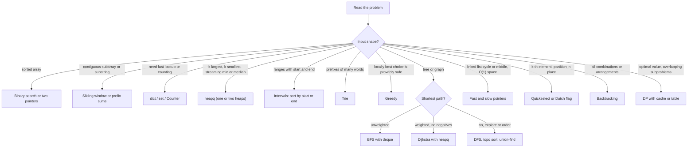
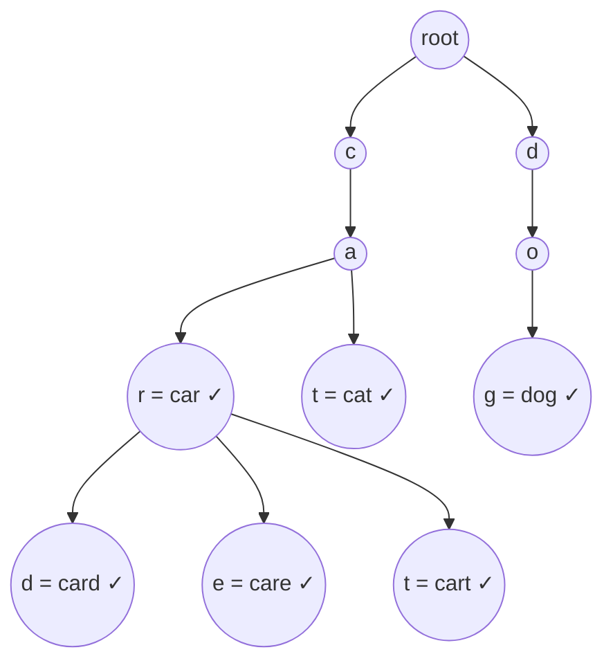

# Chapter 19 — Python for Coding Interviews

Coding interviews (the "LeetCode-style" rounds — LeetCode being the best-known practice site, whose online "judges" run your code against hidden tests) test two things: whether you know the classic **data-structure and algorithm (DSA) patterns**, and whether you express them cleanly. Python is the most popular interview language because it is short: a heap (§19.5), a hash map (`dict`, §19.3), a queue (§19.4) and binary search (§19.6) are each one import away. But the shortness hides costs — `list.pop(0)` looks innocent and is O(n), `[[0]*n]*m` looks like a grid and is a bug.

For each pattern: the idea, the Python tools, a tiny runnable example with `assert` tests, its complexity, and the usual mistakes. Assumes Chapters 5–7 (lists, dicts, functions) and 11 (iterators). Scripts are in [`code/`](code/), run with Python 3.14 (all 3.12-compatible); output shown is real.

**What you'll learn**

| # | Topic | Script |
|---|---|---|
| 19.1 | Big-O refresher and the complexity cheat table for built-ins | `01_builtins_complexity.py` |
| 19.2 | Arrays & strings: two pointers, sliding window, prefix sums | `02_arrays_strings.py` |
| 19.3 | Hashing: `dict`, `set`, `Counter`, `defaultdict` | `03_hashing.py` |
| 19.4 | Stacks and queues: `list`, `deque`, monotonic stack/deque | `04_stacks_queues.py` |
| 19.5 | Heaps: `heapq`, the max-heap trick, top-k, merge k, two heaps (running median, maximise capital) | `05_heaps.py` |
| 19.6 | Sorting with keys; binary search by hand and with `bisect`; weighted random pick | `06_sorting_bisect.py` |
| 19.7 | Linked lists and trees as Python classes; serialize/deserialize a tree | `07_linked_lists_trees.py` |
| 19.8 | Graphs: adjacency lists, BFS/DFS, grids, Dijkstra, topological sort, recursion limit | `08_graphs.py` |
| 19.9 | Union-Find (disjoint sets), Kruskal | `09_union_find.py` |
| 19.10 | Dynamic programming: `@cache` (top-down) and tabulation (bottom-up) | `10_dynamic_programming.py` |
| 19.11 | Backtracking | `11_backtracking.py` |
| 19.12 | Bit tricks and math (`gcd`, `pow(b, e, m)`, `isqrt`, `comb`, sieve) | `12_bits_math.py` |
| 19.13 | Tries: prefix search, autocomplete, wildcard search, word search on a board | `13_tries.py` |
| 19.14 | Greedy: jump game, gas station, candy, interval scheduling | `14_greedy.py` |
| 19.15 | Intervals: merge, insert, intersect, meeting rooms (heap and sweep line) | `15_intervals.py` |
| 19.16 | Fast & slow pointers: cycle start, middle, palindrome list, happy number, find duplicate | `16_fast_slow_pointers.py` |
| 19.17 | Sort & search: merge sort on a list, quicksort, quickselect, Dutch national flag | `17_sort_search.py` |
| 19.18 | Math & geometry: spiral matrix, rotate, reverse a 32-bit int, collinear points, Josephus | `18_math_geometry.py` |
| 19.19 | Common pitfalls | `19_pitfalls.py` |
| 19.20 | How to talk through a solution | — |



---

## 19.1 Big-O and the built-ins cheat table

### What it is
**Big-O notation** describes how time (or memory) grows with input size *n*, ignoring constant factors: O(1) doesn't grow, O(n) grows proportionally, O(n log n) is good sorting, O(n²) is "every pair". An **amortised** O(1) operation is occasionally expensive but constant on average: `list.append` sometimes reallocates and copies, rarely enough that the average stays O(1).

### Why it matters
Interviewers always ask "what's the complexity?", and Python hides loops inside innocent calls: `x in my_list` scans, `my_list.insert(0, x)` shifts every element, `s = s + ch` copies the string.

### How it works — the cheat table
CPython's `list` is a dynamic array of pointers (reallocated bigger when full); `dict` and `set` are hash tables (§19.3); `collections.deque` is a doubly-linked list of fixed-size blocks; `heapq` treats a plain list as a binary heap (§19.5). Costs follow (average case; hash tables degrade to O(n) under pathological collisions — many keys landing in the same slot):

| Structure | Operation | Cost | Note |
|---|---|---|---|
| `list` | `a[i]`, `a[i] = x`, `len(a)` | O(1) | array indexing |
| | `a.append(x)`, `a.pop()` | O(1) amortised | end of the array |
| | `a.insert(i, x)`, `a.pop(i)`, `del a[i]` | O(n) | shifts the tail; `pop(0)` is the trap |
| | `x in a`, `a.index(x)`, `a.count(x)`, `min/max/sum` | O(n) | linear scan |
| | `a[i:j]`, `a.copy()`, `a + b` | O(k) | slicing **copies** k elements |
| | `a.sort()`, `sorted(a)` | O(n log n) | Timsort, stable (equal items keep their order); O(n) if already sorted |
| | `a.reverse()`, `a[::-1]` | O(n) | |
| `deque` | `append`, `appendleft`, `pop`, `popleft` | O(1) | the right queue type |
| | `dq[i]` in the middle | O(n) | O(1) at either end |
| `dict` | `d[k]`, `d[k] = v`, `del d[k]`, `k in d`, `d.get` | O(1) avg | keys must be hashable |
| | iterate over keys/values/items | O(n) | insertion-ordered (3.7+) |
| `set` | `add`, `remove`, `discard`, `x in s` | O(1) avg | |
| | `s \| t`, `s - t` | O(len s + len t) / O(len s) | |
| | `s & t` | O(min(len s, len t)) | |
| `heapq` | `heappush`, `heappop`, `heappushpop` | O(log n) | min-heap on a list |
| | `h[0]` (peek) | O(1) | |
| | `heapify(list)` | O(n) | faster than n pushes |
| | `nlargest(k, it)`, `nsmallest(k, it)` | O(n log k) | |
| `bisect` | `bisect_left/right` | O(log n) | list must be sorted |
| | `insort` | O(n) | search is log n, the insert shifts |
| `str` | `s[i]`, `len(s)` | O(1) | immutable |
| | `s + t`, slicing, `s.replace`, `s.split` | O(n) | always builds a new string |
| | `"".join(parts)` | O(total length) | the right way to build strings |
| `Counter` | `Counter(iterable)` | O(n) | `most_common(k)` O(n log k) |

Python `int`s have **arbitrary precision** (no overflow), so `(lo + hi) // 2` is safe — though arithmetic on huge numbers isn't O(1); treat interview-sized numbers as O(1).

`01_builtins_complexity.py` measures the two most important rows (machine-dependent numbers, same shape; plotted in [§17.5](../17-performance-memory-internals/README.md)):

```
      n |   x in list |  x in set |  pop(0) all | popleft all
   1000 |      5.3 us |   0.03 us |     0.07 ms |     0.02 ms
   5000 |     26.3 us |   0.04 us |     1.06 ms |     0.13 ms
  20000 |    108.3 us |   0.03 us |    24.50 ms |     0.51 ms
  50000 |    321.3 us |   0.18 us |   174.89 ms |     1.47 ms
```
`x in list` grows linearly while `x in set` stays flat; draining a list with `pop(0)` is quadratic, a deque linear.

### Common mistakes
- `x in list` inside a loop (O(n²) total) when a `set` makes it O(n); a list as a queue with `pop(0)`.
- Forgetting slicing copies: `helper(nums[1:])` in recursion adds O(n) per call — pass indices.
- Building a string with `+=` in a loop (CPython sometimes optimises it in place; don't rely on it) — collect pieces, `"".join` once.

### In the interview
**30-second answer:** "Lists are dynamic arrays — O(1) index and append, O(n) insert/delete at the front and membership. Dicts and sets are hash tables with O(1) average lookup. For a queue I use `deque`, for a priority queue `heapq`, and sorting is O(n log n) Timsort."
- *Why is `append` amortised O(1)?* → The array over-allocates; when full it grows by a proportion and copies, so total copying over n appends is O(n).
- *Worst case for a dict lookup?* → O(n) if many keys collide; O(1) in practice.
- *Space of `sorted(a)`?* → O(n) for the new list (Timsort also uses up to n/2 temporary space).

---

## 19.2 Arrays and strings: two pointers, sliding window, prefix sums

These turn many "check every pair/subarray" O(n²) problems into O(n). (A subarray is a contiguous run of elements; a substring the same for strings.)

### What it is
- **Two pointers** — two indices move from both ends inward (sorted pair sum, palindrome check) or both forward at different speeds (a slow "write" and fast "read" pointer for in-place filtering).
- **Sliding window** — `left` and `right` bound a contiguous window: `right` grows it, `left` shrinks it when a rule breaks. Each index only moves forward → O(n) total.
- **Prefix sums** — precompute `prefix[k] = sum of the first k elements`; any range `nums[i:j]` sums to `prefix[j] − prefix[i]` in O(1).

### How it works
**Two pointers on a sorted array (pair sum = target):** start at both ends. Too small → only moving `lo` up can increase it; too big → only moving `hi` down can decrease it. Each step discards one element forever → O(n).

**Variable sliding window (longest substring without repeats):** expand `right`, remembering each character's last index; if the new character was seen inside the window, jump `left` past its earlier copy. Answer = largest `right − left + 1`.

**Prefix sums + hash map (count subarrays summing to k, negatives allowed):** subarray `(i, j]` sums to k exactly when `prefix[i] = prefix[j] − k`. Walk once, count prefix values seen, add `seen[running − k]` each step. For `[1, 1, 1]`, k = 2: running sums 1, 2, 3; at 2 look up 0 (seen once, the empty prefix) → 1; at 3 look up 1 → 1; total 2.

```python
def two_sum_sorted(nums, target):
    lo, hi = 0, len(nums) - 1
    while lo < hi:
        s = nums[lo] + nums[hi]
        if s == target:
            return lo, hi
        if s < target:
            lo += 1          # need a bigger sum -> move the small end up
        else:
            hi -= 1          # need a smaller sum -> move the big end down
    return None

def longest_unique_substring(s):
    last_seen = {}
    left = best = 0
    for right, ch in enumerate(s):
        if ch in last_seen and last_seen[ch] >= left:
            left = last_seen[ch] + 1      # shrink: jump past the earlier copy
        last_seen[ch] = right
        best = max(best, right - left + 1)
    return best

def min_window_at_least(nums, target):   # positive numbers only
    left = total = 0
    best = float("inf")
    for right, x in enumerate(nums):
        total += x
        while total >= target:            # shrink while still valid
            best = min(best, right - left + 1)
            total -= nums[left]
            left += 1
    return 0 if best == float("inf") else int(best)

class RangeSum:
    def __init__(self, nums):
        self.prefix = [0, *accumulate(nums)]   # prefix[k] = sum(nums[:k])
    def query(self, i, j):                     # half-open [i, j)
        return self.prefix[j] - self.prefix[i]

def count_subarrays_sum_k(nums, k):
    seen = defaultdict(int)
    seen[0] = 1           # the empty prefix
    running = count = 0
    for x in nums:
        running += x
        count += seen[running - k]
        seen[running] += 1
    return count

assert two_sum_sorted([1, 3, 4, 6, 9], 10) == (0, 4)
assert longest_unique_substring("pwwkew") == 3
assert min_window_at_least([2, 3, 1, 2, 4, 3], 7) == 2
assert RangeSum([3, -1, 4, 1, 5]).query(1, 4) == 4
assert count_subarrays_sum_k([1, 1, 1], 2) == 2
```

("Half-open `[i, j)`" = i included, j not, like slices.) The script also has `is_palindrome` (two pointers from both ends, skipping non-alphanumerics) and `remove_duplicates_sorted` (slow/fast pointers, in place). Output:

```
prefix: [0, 3, 2, 6, 7, 12]
two_sum_sorted([1,3,4,6,9], 10) -> (0, 4)
longest_unique_substring('pwwkew') -> 3
min_window_at_least([2,3,1,2,4,3], 7) -> 2
count_subarrays_sum_k([3,4,7,-2,2,1,4,2], 7) -> 6
all asserts passed
```

### Python helpers worth knowing
| Need | Python |
|---|---|
| index + value | `for i, x in enumerate(nums)` |
| adjacent pairs | `for a, b in itertools.pairwise(nums)` (3.10+) or `zip(nums, nums[1:])` |
| running totals | `itertools.accumulate(nums)`; `accumulate(nums, max)` for running max |
| reverse | `nums[::-1]` (copy) or `nums.reverse()` (in place) |
| letter → 0..25 | `ord(ch) - ord("a")`; back with `chr(i + ord("a"))` |
| character class | `ch.isalnum()`, `ch.isdigit()`, `ch.isalpha()`, `ch.lower()` |
| strings are immutable | convert to `list(s)`, edit, then `"".join(chars)` |

### Trade-offs
| Pattern | Needs | Time | Space |
|---|---|---|---|
| Two pointers (pair sum) | sorted input | O(n) (+ O(n log n) to sort) | O(1) |
| Hash map (pair sum, 19.3) | nothing | O(n) | O(n) |
| Sliding window | a condition that stays monotonic (moves one way only) as the window grows/shrinks (e.g. positive numbers) | O(n) | O(1)–O(alphabet) |
| Prefix sums | static array | O(n) build, O(1) query | O(n) |

### When not to use it
A shrinking window assumes "adding grows it, removing shrinks it". **Negative numbers** break that — use prefix sums + hash map (`count_subarrays_sum_k`). If the array changes between queries, prefix sums must be rebuilt; use a Fenwick/segment tree (updates and range sums in O(log n)).

### Common mistakes
- Off-by-one window length (it's `right − left + 1`); forgetting `seen[0] = 1` (misses subarrays starting at index 0).
- Moving `left` backwards in the unique-substring problem — the `last_seen[ch] >= left` check prevents it.

### In the interview
**30-second answer:** "Contiguous subarrays or substrings → sliding window: expand right, shrink left while invalid, O(n). Pairs in a sorted array → two pointers from both ends. Range sums or 'subarray sums to k' → prefix sums with a hash map of seen prefixes."
- *Why is the window O(n) with a nested `while`?* → Each index enters and leaves at most once; the inner loop's total iterations are ≤ n.
- *Two-sum on unsorted data?* → Hash map, O(n) time/space; sorting + two pointers is O(n log n) and loses indices unless you sort `(value, index)` pairs.
- *`prefix` for `[2, 4, 1]`, and `sum(nums[1:3])` from it?* → `[0, 2, 6, 7]`; `prefix[3] − prefix[1] = 5`.

---

## 19.3 Hashing: `dict`, `set`, `Counter`, `defaultdict`

### What it is
A **hash table** stores items in buckets chosen by a **hash** of the key: O(1) average insert and lookup. Python's flavours: `dict` (key → value), `set` (keys only), `collections.Counter` (dict subclass that counts; missing keys read as 0) and `collections.defaultdict(factory)` (creates `list()`, `int()`, `set()`… on first access to a missing key). Only **hashable** objects can be keys — `int`, `str`, tuples of hashables, `frozenset`; convert a list to a `tuple` first.

### Why it matters
Many easy/medium problems are "trade O(n) memory for O(1) lookup": two-sum, anagrams (same letters, "listen"/"silent"), duplicates, frequency counts, "seen this before?".

### How it works
```python
def two_sum(nums, target):
    index_of = {}
    for i, x in enumerate(nums):
        if target - x in index_of:        # the complement was seen earlier
            return index_of[target - x], i
        index_of[x] = i
    return None

def is_anagram(a, b):
    return Counter(a) == Counter(b)

def group_anagrams(words):
    groups = defaultdict(list)
    for w in words:
        groups[tuple(sorted(w))].append(w)   # key must be hashable -> tuple
    return list(groups.values())

def longest_consecutive(nums):
    values = set(nums)
    best = 0
    for x in values:
        if x - 1 not in values:           # x starts a run -> count it once
            length = 1
            while x + length in values:
                length += 1
            best = max(best, length)
    return best

assert two_sum([2, 7, 11, 15], 9) == (0, 1)
assert longest_consecutive([100, 4, 200, 1, 3, 2]) == 4

c = Counter("mississippi")
print("Counter:", c)
print("most_common(2):", c.most_common(2))
print("missing key:", c["z"])
print("c - Counter('sip'):", c - Counter("sip"))
```

Output:

```
Counter: Counter({'i': 4, 's': 4, 'p': 2, 'm': 1})
most_common(2): [('i', 4), ('s', 4)]
missing key: 0
c - Counter('sip'): Counter({'i': 3, 's': 3, 'm': 1, 'p': 1})
group_anagrams: [['eat', 'tea', 'ate'], ['tan', 'nat'], ['bat']]
all asserts passed
```

`longest_consecutive` looks nested but is O(n): the inner `while` only runs from the start of each run, so each number is visited by it at most once.

### Handy API
| Want | Code |
|---|---|
| read with default | `d.get(k, 0)` |
| count / group | `Counter`, `defaultdict(int)`, `defaultdict(list)` + `.append` |
| insert if missing, return value | `d.setdefault(k, [])` |
| top k counts | `Counter(xs).most_common(k)` |
| counter arithmetic | `c1 + c2`, `c1 - c2` (drops ≤ 0), `c1 & c2` (min), `c1 \| c2` (max) |
| fixed alphabet count | `[0] * 26` indexed by `ord(ch) - 97` — also hashable as `tuple(...)` |
| set algebra | `a & b`, `a \| b`, `a - b`, `a ^ b` |

### Trade-offs
Hashing costs O(n) memory and loses order-based tricks: on sorted input, two pointers use O(1) space. For keys from a tiny fixed range (26 letters), an array is faster and simpler.

### Common mistakes
- A list as a key (`TypeError: unhashable type: 'list'`) — use `tuple(lst)`.
- Reading a `defaultdict` with `d[k]` just to check it **inserts** the key. Use `k in d`.
- Mutating a dict while iterating (`RuntimeError: dictionary changed size during iteration`) — iterate over `list(d)`.

### In the interview
**30-second answer:** "I use a dict to remember something about values already seen — index, count, group — turning an O(n²) pair search into O(n). Keys must be hashable, so composite keys are tuples. `Counter` and `defaultdict` remove boilerplate."
- *Dict key from a list of counts?* → `tuple(counts)`.
- *`Counter.most_common()` with no argument?* → All items by count, O(n log n); with k it uses a heap, O(n log k).
- *Can a `set` be a dict key?* → No; a `frozenset` can.

---

## 19.4 Stacks and queues: `list` and `deque`

### What it is
- **Stack** — last-in, first-out (LIFO): a `list` with `append` (push) and `pop()`, both O(1) at the end.
- **Queue** — first-in, first-out (FIFO): `collections.deque` with `append` and `popleft`, both O(1). (`queue.Queue` is a slower thread-safe queue for concurrency, Chapter 16 — not for interviews.)
- **Monotonic stack** — keeps elements in increasing (or decreasing) order by popping whatever breaks the order before pushing — "next greater/smaller element" in O(n). A **monotonic deque** also drops elements leaving a window from the front — sliding-window maximum in O(n).

### How it works
**Valid parentheses:** push openers; a closer must match the top; the stack must end empty.

**Next greater element:** walk left to right holding indices still waiting for a bigger value. A new `x` *is* the answer for every smaller value on top — pop them and record `x`. Each index is pushed and popped once → O(n).

```python
def valid_parentheses(s):
    pairs = {")": "(", "]": "[", "}": "{"}
    stack = []
    for ch in s:
        if ch in "([{":
            stack.append(ch)
        elif not stack or stack.pop() != pairs[ch]:
            return False
    return not stack

def next_greater(nums):
    result = [-1] * len(nums)
    stack = []                        # indices, values decreasing
    for i, x in enumerate(nums):
        while stack and nums[stack[-1]] < x:
            result[stack.pop()] = x
        stack.append(i)
    return result

def sliding_window_max(nums, k):
    dq = deque()                      # indices, values decreasing
    out = []
    for i, x in enumerate(nums):
        if dq and dq[0] <= i - k:
            dq.popleft()              # front fell out of the window
        while dq and nums[dq[-1]] <= x:
            dq.pop()                  # smaller values can never be the max
        dq.append(i)
        if i >= k - 1:
            out.append(nums[dq[0]])
    return out

assert valid_parentheses("([]{})") and not valid_parentheses("(]")
assert next_greater([2, 1, 2, 4, 3]) == [4, 2, 4, -1, -1]
assert sliding_window_max([1, 3, -1, -3, 5, 3, 6, 7], 3) == [3, 3, 5, 5, 6, 7]
```

The script also has `daily_temperatures` (same idea, storing distances), a `MinStack` (entries are `(value, min_so_far)` so `get_min` is O(1)), and `eval_rpn` for Reverse Polish Notation (operators after operands, `3 4 +`, evaluated with a stack). Its division uses `int(a / b)`, which truncates toward zero as required, while `a // b` floors (−7 // 2 = −4). Deque tour output:

```
deque: [0, 1, 2, 3, 4]
popleft -> 0 | pop -> 4 | now deque([1, 2, 3])
after rotate(1): deque([3, 1, 2])
deque(maxlen=3) after 0..5: deque([3, 4, 5], maxlen=3)
sliding_window_max: [3, 3, 5, 5, 6, 7]
all asserts passed
```

`deque(maxlen=k)` silently drops from the opposite end when full — a ready-made "last k items" buffer.

### Common mistakes
- `stack.pop()` / `stack[-1]` on an empty list raises `IndexError` — check `if stack` first (the `not stack or ...` short-circuit above never pops an empty stack).
- Storing values instead of indices in a monotonic stack when you later need distances or window positions.

### In the interview
**30-second answer:** "Stack = list with append/pop. Queue = deque with append/popleft, never list.pop(0). For 'next greater/smaller' or 'span' I use a monotonic stack of indices — O(n), each index pushed and popped once."
- *Queue with two stacks?* → Push to `inbox`; to dequeue, if `outbox` is empty move everything from `inbox` (reversing it), then pop `outbox`. Amortised O(1).
- *Why does `sliding_window_max` pop smaller values from the back?* → A smaller value left of a bigger one can never be a future window's max.
- *`deque.append` / `rotate(1)`?* → Adds on the right (`appendleft` on the left); moves the last element to the front.

---

## 19.5 Heaps with `heapq`

### What it is
A **binary heap** is a complete binary tree (every level full except possibly the last, filled from the left) stored in an array where every parent ≤ its children (**min-heap**), so the smallest item is at index 0. `heapq` provides functions over a plain `list` — no heap class. A heap is the standard **priority queue** (serve the most urgent item next).

### How it works
- Children of i are at 2i+1 and 2i+2. `heappush` appends and "sifts up" (swaps with the parent while smaller); `heappop` moves the last item to the root and "sifts down" (swaps with the smaller child while bigger) — both O(log n).
- **Max-heap trick:** push `-x`, negate on the way out. (3.14 adds public `heapq.heappush_max`/`heappop_max`/`heapify_max`, but interview platforms often run older versions, so negation is the portable answer.)
- **Tuples:** `(priority, item)` compares priority first; on ties Python compares the next field — add a unique counter `(priority, count, item)` when items aren't comparable.
- **Top-k:** for the k largest of n, keep a **min-heap of size k**, popping the smallest whenever it exceeds k; the root is then the k-th largest. O(n log k) time, O(k) space.

```python
def kth_largest(nums, k):
    heap = []
    for x in nums:
        heapq.heappush(heap, x)
        if len(heap) > k:
            heapq.heappop(heap)       # drop the smallest
    return heap[0]

def top_k_frequent(words, k):
    counts = Counter(words)
    return heapq.nsmallest(k, counts, key=lambda w: (-counts[w], w))  # ties alphabetical

def merge_k_sorted(lists):
    heap = [(lst[0], i, 0) for i, lst in enumerate(lists) if lst]
    heapq.heapify(heap)
    out = []
    while heap:
        val, i, j = heapq.heappop(heap)       # i breaks ties
        out.append(val)
        if j + 1 < len(lists[i]):
            heapq.heappush(heap, (lists[i][j + 1], i, j + 1))
    return out

class RunningMedian:
    """low = max-heap (negated) of the smaller half, high = min-heap of the larger half."""
    def __init__(self):
        self.low, self.high = [], []
    def add(self, x):
        heapq.heappush(self.low, -x)
        heapq.heappush(self.high, -heapq.heappop(self.low))
        if len(self.high) > len(self.low):
            heapq.heappush(self.low, -heapq.heappop(self.high))
    def median(self):
        if len(self.low) > len(self.high):
            return float(-self.low[0])
        return (-self.low[0] + self.high[0]) / 2
```

Output of the tour in `__main__`:

```
heapified: [1, 2, 8, 3, 5] smallest: 1
pop order: [1, 2, 3, 5, 8]
max via negation: 8
priority queue first: (1, 'fix prod bug')
nlargest(2): [9, 7]
running medians: [5.0, 10.0, 5.0, 4.0]
max capital (k=2): 4
all asserts passed
```

`heapified` is **not** sorted — only `h[0]` is guaranteed smallest. Popping repeatedly yields sorted order (heapsort).

### The two-heaps pattern
Two heaps facing each other split data into a "smaller" and a "larger" group with the boundary available fast.

- **Running (streaming) median** — `RunningMedian` above: `low` (max-heap) holds the smaller half, `high` (min-heap) the larger. Invariants: every value in `low` ≤ every value in `high`; `len(low)` equals `len(high)` or one more. Median = `low`'s top (odd count) or the average of both tops (even). `add` passes each new value through `low` into `high`, then moves one back if `high` grew bigger. Trace for 5, 15, 1, 3:

| add | `low` (max-heap) | `high` (min-heap) | median |
|---|---|---|---|
| 5 | {5} | {} | 5 |
| 15 | {5} | {15} | (5 + 15) / 2 = 10 |
| 1 | {1, 5} | {15} | 5 |
| 3 | {1, 3} | {5, 15} | (3 + 5) / 2 = 4 |

- **Maximise capital** (`max_capital`): at most k projects, each needing `cost` capital and returning `profit`. One min-heap holds **locked** projects by cost; a max-heap holds **affordable** ones by profit. Each round, move every now-affordable project across, then take the most profitable — a greedy choice (19.14) that heaps make O(n log n).
- **Sliding-window median** (hard follow-up): same two heaps, but values also leave; heaps can't delete from the middle cheaply, so use **lazy deletion** — note "remove x later" in a `Counter` and discard x when it reaches a top.

### Trade-offs
| Need | Best tool | Cost |
|---|---|---|
| k largest once, small k | `heapq.nlargest(k, xs)` | O(n log k) |
| k close to n | `sorted(xs)[-k:]` | O(n log n) |
| k-th element, average fast | quickselect (partition-based selection, 19.17) | O(n) average, O(n²) worst |
| repeated "give me the min" with inserts | heap | O(log n) each |
| delete arbitrary item | heap + "lazy deletion" (mark, skip when popped) | amortised |

### Common mistakes
- Assuming the heap list is sorted; negating on push but not on pop in a max-heap.
- Pushing `(priority, dict)` — on a tie Python compares dicts → `TypeError`. Add a tie-breaker counter.
- `heappush` onto a list of unordered items without `heapify` first.

### In the interview
**30-second answer:** "`heapq` is a min-heap on a list: push/pop O(log n), peek `h[0]` O(1), `heapify` O(n). For a max-heap I push negatives. For top-k I keep a size-k min-heap, O(n log k). Dijkstra, merge-k-lists and running median are all heap problems."
- *Why a min-heap for k largest?* → The root is the weakest of the current top k — the one to evict.
- *Running median complexity?* → O(log n) per insert, O(1) per median.
- *Why not a sorted list with `insort`?* → Search is O(log n) but the insert shifts, O(n) per add.

---

## 19.6 Sorting with keys; binary search and `bisect`

### What it is
- `sorted(iterable, key=..., reverse=...)` returns a new list; `list.sort(...)` sorts in place and returns `None`. Both are **Timsort** — O(n log n) worst, O(n) on sorted input, **stable** (equal keys keep their order).
- A **key function** maps each item to what's compared (`key=len`, `key=str.lower`). Tuple keys give multi-level sorting; negate a numeric field for "descending on this field only". `functools.cmp_to_key` adapts a pairwise comparator (`cmp(a, b)` → negative/zero/positive) for problems where order depends on the *pair* (e.g. "largest number").
- **Binary search** halves a sorted range each step: O(log n). `bisect_left(a, x)` = first index with `a[i] >= x`; `bisect_right(a, x)` = first with `a[i] > x`; `insort` inserts in order. Since 3.10 they accept `key=`.

### How it works
**Binary search on the answer** — interviewers' favourite: when a yes/no test `ok(v)` is *monotonic* (false…false, true…true), binary-search the smallest true v. E.g. minimum eating speed to finish banana piles in h hours — if speed s works, any faster one does.

```python
people = [("ana", 31), ("bo", 25), ("cy", 31), ("di", 25)]
print(sorted(people, key=lambda p: (p[1], p[0])))      # age, then name
print(sorted(people, key=lambda p: (-p[1], p[0])))     # age desc, name asc

def merge_intervals(intervals):
    out = []
    for start, end in sorted(intervals):
        if out and start <= out[-1][1]:
            out[-1][1] = max(out[-1][1], end)
        else:
            out.append([start, end])
    return out

def lower_bound(nums, target):        # same as bisect_left
    lo, hi = 0, len(nums)              # half-open [lo, hi)
    while lo < hi:
        mid = (lo + hi) // 2
        if nums[mid] < target:
            lo = mid + 1
        else:
            hi = mid
    return lo

def min_eating_speed(piles, hours):
    def ok(speed):
        return sum(ceil(p / speed) for p in piles) <= hours
    lo, hi = 1, max(piles)
    while lo < hi:
        mid = (lo + hi) // 2
        if ok(mid):
            hi = mid          # mid works -> try smaller
        else:
            lo = mid + 1
    return lo

a = [1, 3, 3, 3, 7, 9]
assert lower_bound(a, 3) == bisect.bisect_left(a, 3) == 1
assert bisect.bisect_right(a, 3) == 4
assert min_eating_speed([3, 6, 7, 11], 8) == 4
```

Output:

```
by age then name: [('bo', 25), ('di', 25), ('ana', 31), ('cy', 31)]
age desc, name asc: [('ana', 31), ('cy', 31), ('bo', 25), ('di', 25)]
itemgetter(1) (stable): [('bo', 25), ('di', 25), ('ana', 31), ('cy', 31)]
case-insensitive: ['Apple', 'banana', 'cherry']
by length desc: ['banana', 'cherry', 'Apple']
count of 3s via bisect: 3
insort 5: [1, 3, 3, 3, 5, 7, 9]
first age>=31 at index 2
weighted pick shares (expect ~0.17, 0.50, 0.33): [0.17, 0.5, 0.33]
all asserts passed
```

The script also has `largest_number` (`cmp_to_key`: put `a` before `b` if `a+b > b+a` as strings) and `search_rotated` (binary search in a rotated sorted array: one half is always sorted; check whether the target lies in it).

### Weighted random selection
**Problem:** given weights `w = [1, 3, 2]`, return index i with probability `w[i] / sum(w)` (1/6, 3/6, 2/6) — used for load balancing across servers of different sizes ([System Design Fundamentals](../../../system-design-patterns/modules/00-system-design-fundamentals/README.md)) and sampling.

**Idea:** lay the weights end to end with **prefix sums**: `[1, 4, 6]` means index 0 owns [0, 1), index 1 owns [1, 4), index 2 owns [4, 6). Draw an integer r in [0, 6) and find the first prefix **greater than** r — exactly `bisect_right`. Build O(n), each pick O(log n).

```python
class WeightedPicker:
    def __init__(self, weights, seed=None):
        self.prefix = list(accumulate(weights))     # [1, 3, 2] -> [1, 4, 6]
        self.rng = random.Random(seed)
    def pick(self):
        r = self.rng.randrange(self.prefix[-1])     # integer in [0, total)
        return bisect.bisect_right(self.prefix, r)
```

60,000 seeded picks gave shares `[0.17, 0.5, 0.33]` (above). `random.choices(range(n), weights=w)` does the same internally — mention it, but interviewers usually want the hand-written version. `bisect_left` here is an off-by-one: r = 1 would map to index 0.

### The two binary-search templates
| Template | Loop | Update | Returns |
|---|---|---|---|
| Exact match | `while lo <= hi` on `[lo, hi]` | `lo = mid + 1` / `hi = mid - 1` | index or −1 |
| Boundary (first true) | `while lo < hi` on `[lo, hi)` | `lo = mid + 1` / `hi = mid` | first position where condition holds |

Pick one and use it every time; most binary-search bugs come from mixing them (infinite loops when `lo = mid`).

### Common mistakes
- `nums = nums.sort()` sets `nums` to `None`; `reverse=True` reverses the whole key, not one field.
- `bisect` on an unsorted list (no error, wrong answers); thinking `insort` is O(log n) — the insertion is O(n).

### In the interview
**30-second answer:** "Python sorts with Timsort, stable, O(n log n). I pass a `key` — tuples for multi-level ordering and negation for descending fields. For binary search I use `bisect_left/right` or a half-open `lo < hi` template, and for 'minimum value that satisfies X' I binary-search the answer space when X is monotonic."
- *Why does stability matter?* → Sort by the secondary key, then the primary; equal primaries keep the secondary order.
- *TreeMap/sorted set in Python?* → Not built in: sorted list + `bisect` (O(n) inserts), a heap, or third-party `sortedcontainers.SortedList` (preinstalled on some platforms such as LeetCode).
- *`bisect_left([1,2,2,3], 2)` and `bisect_right`?* → 1 and 3.
- *Strings by length, ties alphabetical?* → `sorted(ws, key=lambda w: (len(w), w))`.

---

## 19.7 Linked lists and trees in Python

### What it is
No built-in linked list or tree for interviews — you define tiny node classes. A **singly linked list** node has `val` and `next`; a **binary tree** node `val`, `left`, `right`. A **binary search tree (BST)** keeps every left-subtree value < node < every right-subtree value. `@dataclass` (Chapter 10) writes `__init__`; `from __future__ import annotations` lets a class mention itself in hints.

### How it works — linked lists
- **Dummy head:** start with a fake node so "empty list" is never a special case when building or merging.
- **Reversal:** walk with `prev`, pointing each node back. Tuple assignment evaluates the right side first, so `head.next, prev, head = prev, head, head.next` is a correct one-liner.
- **Fast/slow pointers (Floyd, after computer scientist Robert Floyd):** `slow` moves 1, `fast` 2. When `fast` ends, `slow` is at the middle; with a cycle they meet. Compare nodes with `is`.

```python
@dataclass
class ListNode:
    val: int
    next: ListNode | None = None

def reverse(head):
    prev = None
    while head:
        head.next, prev, head = prev, head, head.next
    return prev

def has_cycle(head):
    slow = fast = head
    while fast and fast.next:
        slow, fast = slow.next, fast.next.next
        if slow is fast:
            return True
    return False

def merge_two(a, b):
    dummy = tail = ListNode(0)
    while a and b:
        if a.val <= b.val:
            tail.next, a = a, a.next
        else:
            tail.next, b = b, b.next
        tail = tail.next
    tail.next = a or b
    return dummy.next
```

### How it works — trees
- **DFS traversals:** pre-order (node, left, right), in-order (left, node, right — sorted order for a BST), post-order (left, right, node). Recursive = 3 lines; iterative = explicit stack.
- **BFS / level order:** a `deque`; process `len(q)` nodes per outer loop to separate levels.
- **Validate a BST:** pass down the allowed `(lo, hi)` range — checking only parent vs child is a classic bug.
- **Lowest common ancestor (LCA — the deepest node with both targets below it):** recurse; if both sides return something, the current node is the LCA.

```python
@dataclass
class TreeNode:
    val: int
    left: TreeNode | None = None
    right: TreeNode | None = None

def inorder_iterative(root):
    out, stack, node = [], [], root
    while stack or node:
        while node:                 # go left as far as possible
            stack.append(node)
            node = node.left
        node = stack.pop()
        out.append(node.val)
        node = node.right
    return out

def level_order(root):
    if not root:
        return []
    levels, q = [], deque([root])
    while q:
        levels.append([])
        for _ in range(len(q)):
            node = q.popleft()
            levels[-1].append(node.val)
            q.extend(c for c in (node.left, node.right) if c)
    return levels

def max_depth(root):
    return 0 if not root else 1 + max(max_depth(root.left), max_depth(root.right))

def is_valid_bst(root, lo=float("-inf"), hi=float("inf")):
    if not root:
        return True
    if not lo < root.val < hi:
        return False
    return is_valid_bst(root.left, lo, root.val) and is_valid_bst(root.right, root.val, hi)

def lca(root, p, q):
    if root is None or root.val in (p, q):
        return root
    left, right = lca(root.left, p, q), lca(root.right, p, q)
    return root if left and right else left or right
```

`build_tree([3, 9, 20, None, None, 15, 7])` in the script turns LeetCode's level-order list format into nodes for local testing. Output:

```
reversed list: [5, 4, 3, 2, 1]
inorder: [9, 3, 15, 20, 7] preorder: [3, 9, 20, 15, 7]
levels: [[3], [9, 20], [15, 7]] depth: 3
serialized: 3,9,#,#,20,15,#,#,7,#,#
all asserts passed
```

### Serialize and deserialize a binary tree
**Serialize** = tree → string (to store or send); **deserialize** = rebuild the identical tree. A plain pre-order list is ambiguous (`[1, 2]`: is 2 a left or right child?); writing a `#` for every missing child fixes it — reading pre-order, each value's next tokens are *exactly* its left subtree then its right subtree.

```python
def serialize(root):
    out, stack = [], [root]
    while stack:                       # iterative pre-order
        node = stack.pop()
        if node is None:
            out.append("#"); continue
        out.append(str(node.val))
        stack.append(node.right)       # right first, so left is popped first
        stack.append(node.left)
    return ",".join(out)

def deserialize(data):
    tokens = iter(data.split(","))     # a shared iterator = "read the next token"
    def build():
        tok = next(tokens)
        if tok == "#":
            return None
        node = TreeNode(int(tok))
        node.left = build()
        node.right = build()
        return node
    return build()
```

Both O(n) time and space; n nodes give 2n + 1 tokens (n values + n + 1 `#`). The script checks the round trip `deserialize(serialize(t)) == t`. Recursive `build` has the usual depth limit — for very deep trees use the level-order format `build_tree` reads.

### Complexity
Traversals are O(n) time. Space: O(h) for DFS (h = height: log n if balanced, n for a degenerate "linked-list" tree), O(w) for BFS (w = widest level, up to n/2).

### Common mistakes
- Mutable default `def f(node, path=[])` in tree recursion (19.19).
- `if node.val:` when the value can be `0` — test `if node:` / `is None`.
- Recursing on a 10⁵-deep degenerate tree → `RecursionError`; go iterative.

### In the interview
**30-second answer:** "I define small `ListNode`/`TreeNode` classes. Lists: dummy head, fast/slow pointers, in-place reversal with three pointers. Trees: recursive DFS for clarity, an explicit stack if depth can be large, BFS with a deque for level order. Space is O(height)."
- *Where does a cycle start?* → After slow and fast meet, move one to the head; step both by 1; they meet at the start.
- *Inorder successor in a BST?* → With a right child, its leftmost node; else the nearest ancestor reached via a left edge.

---

## 19.8 Graphs: adjacency lists, BFS, DFS, Dijkstra, topological sort

### What it is
A **graph** is **nodes** (vertices) joined by **edges**, possibly **directed** (one-way) and **weighted** (with a cost). Standard Python form: an **adjacency list**, `defaultdict(list)` of node → neighbours (or `(neighbour, weight)` pairs). A **grid** is an implicit graph of 4 (or 8) adjacent cells.

- **BFS (breadth-first search)** — rings of increasing distance with a queue → shortest paths in **unweighted** graphs.
- **DFS (depth-first search)** — as deep as possible before backtracking (recursion or stack) → connectivity, cycles, topological order, flood fill.
- **Dijkstra's algorithm** — shortest paths with **non-negative** weights via a min-heap of `(distance, node)`.
- **Topological sort** — orders a **DAG** (directed acyclic graph) so every edge goes earlier → later: course prerequisites, build order.

### How it works
**BFS:** start in a deque and in `visited`; pop the front, push unvisited neighbours, **marking them visited when enqueued** (marking on pop lets a node be enqueued many times).

**Dijkstra (lazy version):**
1. `dist = {src: 0}`, heap = `[(0, src)]`.
2. Pop the smallest `(d, u)`; if `d` exceeds the best known `dist[u]`, it's stale — skip.
3. For each edge `u → v` with weight w: if `d + w < dist[v]`, update and push `(d + w, v)`.
4. O((V + E) log V).

**Topological sort, Kahn's algorithm:** count in-degrees (edges pointing *into* each node); start with all in-degree-0 nodes; pop one, append it, decrement its neighbours, enqueue any reaching 0. Fewer than V nodes in the order → a cycle.

**Topological sort, DFS:** three colours — white (unvisited), grey (on the current path), black (finished). Meeting a grey node = a back edge = cycle. Append nodes as they finish (post-order), reverse at the end.

```python
def bfs_shortest_path(g, start, goal):
    parent = {start: None}          # doubles as the visited set
    q = deque([start])
    while q:
        node = q.popleft()
        if node == goal:
            path = []
            while node is not None:
                path.append(node)
                node = parent[node]
            return path[::-1]
        for nxt in g.get(node, []):
            if nxt not in parent:   # mark when ENQUEUED
                parent[nxt] = node
                q.append(nxt)
    return None

def dijkstra(g, src):
    dist = {src: 0}
    heap = [(0, src)]
    while heap:
        d, u = heapq.heappop(heap)
        if d > dist.get(u, float("inf")):
            continue                    # stale entry
        for v, w in g.get(u, []):
            nd = d + w
            if nd < dist.get(v, float("inf")):
                dist[v] = nd
                heapq.heappush(heap, (nd, v))
    return dist

def topo_sort_kahn(n, prereqs):         # (a, b): b before a
    g = defaultdict(list)
    indeg = [0] * n
    for a, b in prereqs:
        g[b].append(a)
        indeg[a] += 1
    q = deque(i for i in range(n) if indeg[i] == 0)
    order = []
    while q:
        u = q.popleft()
        order.append(u)
        for v in g[u]:
            indeg[v] -= 1
            if indeg[v] == 0:
                q.append(v)
    return order if len(order) == n else None   # None -> cycle
```

The script also has `dfs_recursive`, `dfs_iterative` (pushes neighbours in reverse so the order matches), `num_islands` (grid flood fill with a stack and four direction offsets), and `topo_sort_dfs`. Output:

```
adjacency: {'A': ['B', 'C'], 'B': ['A', 'D'], 'C': ['A', 'D'], 'D': ['B', 'C', 'E'], 'E': ['D']}
dfs recursive: ['A', 'B', 'D', 'C', 'E'] | iterative: ['A', 'B', 'D', 'C', 'E']
dijkstra from A: {'A': 0, 'B': 3, 'C': 1, 'D': 4}
course order (Kahn): [0, 1, 2, 3] | DFS: [0, 2, 1, 3]
recursion limit: 1000
depth 5000 -> RecursionError
after setrecursionlimit(10_000): depth 5000
all asserts passed
```

Both topological orders are valid — a DAG usually has several.

### The recursion limit
CPython won't nest calls deeper than `sys.getrecursionlimit()` (1000 by default) — `RecursionError`. Python has **no tail-call optimisation** (reusing the frame when a function's last action is calling itself), so tail-recursive code counts too. Options:
1. Prefer the **iterative** version (explicit stack/deque) for possibly deep graphs/trees — safest.
2. `sys.setrecursionlimit(10**6)` — accepted on many judges, but very deep recursion can still crash the interpreter by exhausting the real C stack; a workaround, not a fix.

### Grid template
```python
for dr, dc in ((1, 0), (-1, 0), (0, 1), (0, -1)):
    nr, nc = r + dr, c + dc
    if 0 <= nr < rows and 0 <= nc < cols and grid[nr][nc] == "1" and (nr, nc) not in seen:
        ...
```
The chained comparison `0 <= nr < rows` keeps bounds checks readable.

### Trade-offs
| Problem | Algorithm | Complexity |
|---|---|---|
| Shortest path, unweighted | BFS | O(V + E) |
| Shortest path, weights 0/1 | 0-1 BFS (deque, `appendleft` for 0-edges) | O(V + E) |
| Shortest path, non-negative weights | Dijkstra | O((V + E) log V) |
| Negative weights | Bellman–Ford (relaxes every edge V−1 times) | O(V·E) |
| All pairs, small V | Floyd–Warshall (DP over intermediate nodes) | O(V³) |
| Order with dependencies | Topological sort | O(V + E) |
| Connected components (groups of mutually reachable nodes), dynamic unions | Union-Find (19.9) | ~O(α(n)) per op (effectively constant, see 19.9) |

### Common mistakes
- Marking visited on pop in BFS (duplicates in the queue, sometimes TLE — "time limit exceeded"); a list instead of a set for `visited`.
- Dijkstra with negative edges (wrong answers).
- Forgetting isolated nodes absent from the edge list (loop over `range(n)`, not `g`).

### In the interview
**30-second answer:** "I store graphs as `defaultdict(list)` adjacency lists. Unweighted shortest path → BFS with a deque, marking visited on enqueue. Weighted non-negative → Dijkstra with heapq, skipping stale entries. Dependencies → Kahn's topological sort, which also detects cycles. For deep graphs, iterative DFS because of the recursion limit."
- *Why not Dijkstra with negative edges?* → It finalises a node when popped, assuming no later path is shorter; a negative edge breaks that.
- *Cycle in an undirected graph?* → DFS ignoring the edge back to the parent, or union-find (an edge joining two nodes already in one set).

---

## 19.9 Union-Find (disjoint set union)

### What it is
**Union-Find** (**DSU**, disjoint set union) tracks which items share a group while groups merge: `find(x)` → the group's representative ("root"); `union(a, b)` → merge two groups. Like asking whether two employees work for the same firm after mergers — follow "who owns whom" to the top parent.

### How it works
1. `parent[i] = i` initially (everyone is their own root).
2. `find` follows parents to the root; **path compression** then points every node on the path straight at the root.
3. `union` finds both roots; if different, attaches the **smaller** tree under the larger (**union by size**) and decrements the component count. Returns `False` if already joined — detecting a cycle-closing edge.
4. With both optimisations each operation is O(α(n)) amortised — α is the inverse Ackermann function, ≤ 4 for any realistic n, "effectively constant".

```python
class DSU:
    def __init__(self, n):
        self.parent = list(range(n))
        self.size = [1] * n
        self.components = n

    def find(self, x):
        root = x
        while self.parent[root] != root:
            root = self.parent[root]
        while self.parent[x] != root:          # path compression (iterative)
            self.parent[x], x = root, self.parent[x]
        return root

    def union(self, a, b):
        ra, rb = self.find(a), self.find(b)
        if ra == rb:
            return False
        if self.size[ra] < self.size[rb]:
            ra, rb = rb, ra
        self.parent[rb] = ra
        self.size[ra] += self.size[rb]
        self.components -= 1
        return True

def kruskal_mst(n, edges):              # edges (weight, u, v)
    dsu, total = DSU(n), 0
    for w, u, v in sorted(edges):
        if dsu.union(u, v):
            total += w
    return total

assert kruskal_mst(4, [(1, 0, 1), (4, 0, 2), (3, 1, 2), (2, 2, 3), (5, 1, 3)]) == 6
```

Output: `parent: [0, 0, 0, 3, 3, 5] components: 3` then `all asserts passed`. The script also solves "number of connected components" and "redundant connection" (the first edge whose `union` returns `False`). The iterative `find` avoids the recursion limit; in `self.parent[x], x = root, self.parent[x]` the right side (old parent) is evaluated before `x` is rebound.

**When not to use it:** it can't **split** groups or give paths — use BFS/DFS. For a one-off component count on a static graph, BFS/DFS is equally good.

### In the interview
**30-second answer:** "Union-Find tracks groups under merging. `find` with path compression and `union` by size give near-constant amortised time. I use it for connected components, cycle detection in undirected graphs, Kruskal's MST (minimum spanning tree — the cheapest edge set connecting every node), and 'accounts merge'-type problems."
- *Why union by size?* → Keeps trees shallow (height O(log n) even without compression).
- *Kruskal's complexity?* → O(E log E) for the sort; the DSU part is near-linear.

---

## 19.10 Dynamic programming: `@cache` and tabulation

### What it is
**Dynamic programming (DP)** combines answers to smaller **overlapping subproblems**, computing each once; it applies when there is **optimal substructure** (the best answer is built from best sub-answers).
- **Top-down (memoisation):** write the natural recursion, cache it with `functools.cache` (3.9+) or `lru_cache(maxsize=None)`.
- **Bottom-up (tabulation):** fill an array from the smallest subproblems with loops; no recursion, often only the last row kept.

### How it works — the recipe
1. **State:** parameters describing a subproblem (`i`, `(i, j)` prefixes of two strings, `(i, capacity)`…).
2. **Transition:** how a state's answer comes from smaller states.
3. **Base cases.**
4. **Order** (bottom-up) or **memoise** (top-down).
5. **Answer location** (`dp[n]`, `dp[m][n]`, `max(dp)`…).

Coin change, coins `[1, 2, 5]`, amount 11: `dp[a] = 1 + min(dp[a − c])` over coins c ≤ a, `dp[0] = 0`. `dp[5] = 1`, `dp[10] = 2`, `dp[11] = 1 + min(dp[10], dp[9], dp[6]) = 3`.

```python
from functools import cache

@cache
def climb(n):                    # 1 or 2 steps at a time
    return 1 if n <= 1 else climb(n - 1) + climb(n - 2)

def coin_change(coins, amount):
    INF = amount + 1
    dp = [0] + [INF] * amount
    for a in range(1, amount + 1):
        for c in coins:
            if c <= a:
                dp[a] = min(dp[a], dp[a - c] + 1)
    return dp[amount] if dp[amount] != INF else -1

def lcs(a, b):
    m, n = len(a), len(b)
    dp = [[0] * (n + 1) for _ in range(m + 1)]    # NOT [[0]*(n+1)]*(m+1)
    for i in range(1, m + 1):
        for j in range(1, n + 1):
            if a[i - 1] == b[j - 1]:
                dp[i][j] = dp[i - 1][j - 1] + 1
            else:
                dp[i][j] = max(dp[i - 1][j], dp[i][j - 1])
    return dp[m][n]

def edit_distance(a, b):
    @cache
    def go(i, j):
        if i == len(a):
            return len(b) - j
        if j == len(b):
            return len(a) - i
        if a[i] == b[j]:
            return go(i + 1, j + 1)
        return 1 + min(go(i + 1, j), go(i, j + 1), go(i + 1, j + 1))
    return go(0, 0)

def knapsack_01(weights, values, cap):
    dp = [0] * (cap + 1)
    for w, v in zip(weights, values):
        for c in range(cap, w - 1, -1):    # backwards: each item used once
            dp[c] = max(dp[c], dp[c - w] + v)
    return dp[cap]
```

Output:

```
climb.cache_info(): CacheInfo(hits=8, misses=11, maxsize=None, currsize=11)
coin_change([1,2,5], 11) = 3
edit_distance('horse','ros') = 3
knapsack = 9
all asserts passed
```

`cache_info()` shows 11 real computations for `climb(10)`; the naive recursion makes 177 calls, growing exponentially with n.

The script also has `house_robber` (O(1)-space DP with two variables), `unique_paths` (one-row grid DP) and `lis_length` — O(n log n) longest increasing subsequence keeping `tails[k]` = smallest tail of an increasing run of length k+1, placing each number with `bisect_left`.

### Common DP families
| Family | State | Examples |
|---|---|---|
| 1-D sequence | `dp[i]` | climbing stairs, house robber, decode ways, LIS (longest increasing subsequence) |
| Unbounded choice | `dp[amount]` | coin change, combination sum count |
| 0/1 knapsack (each item at most once, maximise value within a weight limit) | `dp[capacity]` iterated backwards | subset sum, partition equal subset |
| Two strings | `dp[i][j]` | LCS (longest common subsequence), edit distance (fewest single-letter edits between strings), regex/wildcard matching |
| Grid | `dp[r][c]` | unique paths, minimum path sum |
| Intervals | `dp[i][j]` over lengths | burst balloons, palindrome partitioning |

### Top-down vs bottom-up
| | `@cache` recursion | Tabulation |
|---|---|---|
| Writing it | closest to the recurrence (state in terms of smaller states); quick | must choose iteration order |
| Computes | only reachable states | all states |
| Limits | recursion limit; function-call overhead | none |
| Memory tricks | hard | easy to keep one row (O(n) instead of O(n·m)) |

### Common mistakes
- `@cache` on a function taking a **list** → `TypeError: unhashable type`. Pass tuples or indices.
- A module-level `@cache` reused across test cases with different global data returns stale answers — define the helper **inside** the solving function (as `edit_distance` does) or `.cache_clear()`.
- 2-D tables via `[[0] * n] * m` (all rows are one list — 19.19).
- 0/1 knapsack capacity loop **forwards** (becomes unbounded knapsack).

### In the interview
**30-second answer:** "I first write the state and recurrence, then memoise with `functools.cache` — top-down. If recursion depth or memory matters I convert to a bottom-up table and often compress it to one row. Complexity is states × work per state."
- *Edit distance complexity?* → O(m·n) time; O(m·n) space top-down, O(min(m, n)) with rolling rows.
- *`lru_cache` vs `cache`?* → `cache` is `lru_cache(maxsize=None)`: unbounded, cheaper since it never tracks recency; `lru_cache(maxsize=k)` evicts least-recently-used entries.
- *How many states did `@cache` store?* → `f.cache_info().currsize`.

---

## 19.11 Backtracking

### What it is
**Backtracking** builds candidates step by step and abandons ("prunes") a partial candidate once it can't lead to a valid answer — DFS over a tree of choices. Template: **choose → explore → un-choose**.

### How it works
1. Keep a mutable `path` (partial solution) and maybe `used` arrays/sets for constraints.
2. At each level loop over choices, skipping invalid ones (prune).
3. Append, recurse, pop to restore state.
4. On a complete path, record **a copy** (`path[:]`).

```python
def subsets(nums):
    out, path = [], []
    def go(start):
        out.append(path[:])              # copy! path keeps changing
        for i in range(start, len(nums)):
            path.append(nums[i])         # choose
            go(i + 1)                    # explore
            path.pop()                   # un-choose
    go(0)
    return out

def combination_sum(cands, target):      # reuse allowed
    cands = sorted(cands)
    out, path = [], []
    def go(start, remaining):
        if remaining == 0:
            out.append(path[:])
            return
        for i in range(start, len(cands)):
            if cands[i] > remaining:
                break                    # prune: later ones are bigger
            path.append(cands[i])
            go(i, remaining - cands[i])  # i, not i+1: reuse allowed
            path.pop()
    go(0, target)
    return out

def n_queens(n):
    cols, diag, anti = set(), set(), set()
    def go(r):
        if r == n:
            return 1
        count = 0
        for c in range(n):
            if c in cols or r - c in diag or r + c in anti:
                continue
            cols.add(c); diag.add(r - c); anti.add(r + c)
            count += go(r + 1)
            cols.remove(c); diag.remove(r - c); anti.remove(r + c)
        return count
    return go(0)
```

Output:

```
subsets: [[], [1], [1, 2], [1, 2, 3], [1, 3], [2], [2, 3], [3]]
combination_sum([2,3,6,7], 7): [[2, 2, 3], [7]]
8-queens solutions: 92
all asserts passed
```

The tests check `subsets`/`permute` against `itertools.combinations`/`permutations`; `word_search` marks grid cells visited by overwriting them with `"#"` and restoring afterwards.

**`itertools` shortcuts** (Chapter 11): `permutations(xs, r)`, `combinations(xs, r)`, `combinations_with_replacement`, `product(xs, repeat=k)`. Interviewers usually want the hand-written version when pruning matters, but mentioning these shows fluency.

**Complexity:** exponential — subsets O(2ⁿ·n), permutations O(n!·n). Pruning shrinks real work, not the worst case.

### Common mistakes
- Appending `path` instead of `path[:]` — every stored result is the same (final, usually empty) list.
- Forgetting to undo the choice (sets/`used` flags drift).
- Duplicate inputs (e.g. subsets II): sort, skip `nums[i] == nums[i−1]` when `i > start`.

### In the interview
**30-second answer:** "Backtracking is DFS over choices: choose, recurse, undo. I store a copy of the path at the leaves and prune early — sort candidates so I can break, and use sets for O(1) constraint checks, like columns and diagonals in N-Queens."
- *Why `r − c` and `r + c` for diagonals?* → Cells on one "\" diagonal share r − c; on one "/" diagonal r + c.
- *Subsets of a 4-element set?* → 2⁴ = 16.

---

## 19.12 Bit tricks and math

### What it is
Python `int`s are arbitrary-precision and act like infinite **two's-complement** numbers (−x = flip all bits, add 1) for bitwise operators: `&`, `|`, `^` (xor — 1 when exactly one bit is 1), `~` (`~x == -x - 1`), `<<`, `>>` (arithmetic shift — keeps the sign, floors negatives). `math` and built-in `pow` cover interview number theory (divisibility, primes, remainders).

### Bit cheat table (x = 180 = 0b10110100, from the real output)
| Trick | Expression | Result |
|---|---|---|
| test bit i | `x >> i & 1` | bit 2 → 1 |
| set bit i | `x \| (1 << i)` | set bit 0 → `0b10110101` |
| clear bit i | `x & ~(1 << i)` | |
| toggle bit i | `x ^ (1 << i)` | |
| lowest set bit | `x & -x` | 4 |
| clear lowest set bit | `x & (x - 1)` | `0b10110000` |
| power of two? | `x > 0 and x & (x - 1) == 0` | |
| count 1-bits | `x.bit_count()` (3.10+) or `bin(x).count("1")` | 4 |
| bits needed | `x.bit_length()` | 8 |
| format | `f"{x:08b}"`, `bin(x)`, `int("1011", 2)` | |

XOR identities power "single number": `a ^ a = 0`, `a ^ 0 = a`, order-independent. A **bitmask** (an int whose bits are on/off flags) running `0` … `2ⁿ − 1` enumerates all subsets (bit i set ⇒ item i chosen) — the basis of bitmask DP.

### Math toolkit
| Need | Python |
|---|---|
| gcd / lcm | `math.gcd(a, b)`, `math.lcm(a, b)` (3.9+, both accept many args) |
| modular power | `pow(b, e, m)` — fast square-and-multiply, O(log e) |
| modular inverse (the x with a·x ≡ 1 mod m; m prime or gcd = 1) | `pow(a, -1, m)` (3.8+) |
| integer square root | `math.isqrt(n)` — exact, no float error |
| combinations | `math.comb(n, k)`, `math.perm(n, k)`, `math.factorial(n)` |
| floor/ceil division | `a // b`, `-(-a // b)` or `math.ceil(a / b)` (float — careful with huge ints) |
| quotient and remainder | `divmod(a, b)` |
| infinity | `float("inf")`, `math.inf`; `sys.maxsize` is just a big int |
| big modulus | `MOD = 10**9 + 7` |

Output of the script (excerpt):

```
~5 = -6  (two's complement: -(5+1))
-7 >> 1 = -4  (arithmetic shift floors)
gcd(84, 36) = 12 | lcm(4, 6) = 12
pow(2, 100, MOD) = 976371285
comb(5,2) = 10 | perm(5,2) = 20 | factorial(5) = 120
isqrt(10**20 + 1) = 10000000000
primes <= 30: [2, 3, 5, 7, 11, 13, 17, 19, 23, 29]
2**100 = 1267650600228229401496703205376 (arbitrary precision)
divmod(-7, 2) = (-4, 1) | math.fmod(-7, 2) = -1.0
```

The script also hand-writes `fast_pow` (square-and-multiply: square the base each step, multiply it in when the current exponent bit is 1) and a Sieve of Eratosthenes (list primes ≤ n by crossing out multiples from i², O(n log log n)).

### Common mistakes
- Expecting 32-bit overflow: "return the 32-bit result" needs masking (`x & 0xFFFFFFFF`, converting back if the top bit is set).
- `~x` is not "flip bits of an unsigned number"; it's `-x - 1`.
- `math.sqrt` on big integers (float precision) — use `math.isqrt`.
- `(a ** b) % m` builds a giant number first — use `pow(a, b, m)`.

### In the interview
**30-second answer:** "Python ints never overflow, so I use `pow(b, e, m)` for modular exponentiation, `math.gcd`, `math.isqrt` and `math.comb` instead of hand-rolling. For bits: `x & (x−1)` drops the lowest set bit, `x & -x` isolates it, XOR cancels pairs."
- *Power of four?* → Power of two with the bit at an even position: `n > 0 and n & (n−1) == 0 and n & 0x55555555 != 0` (32-bit), or `n.bit_length() % 2 == 1` for any size. (`&` binds tighter than `==` in Python, unlike C.)
- *`6 & 5`, `6 | 5`, `6 ^ 5`?* → 4, 7, 3.
- *Inverse of 3 mod 7?* → `pow(3, -1, 7) = 5` (3·5 = 15 ≡ 1).

---

## 19.13 Tries (prefix trees)

### What it is
A **trie** ("try", from re*trie*val) stores strings letter by letter. Each node is a **prefix**, each edge adds one letter, and a flag marks "a word ends here". Words starting with "car" share c → a → r, so **"which words start with this prefix?"** is one walk down the prefix — no scan of the word list.



### The problem it solves
With a `set` of words, "is `car` a word?" is O(L) (L = word length), but "does any word start with `ca`?" checks every word — O(n·L). A trie makes both O(L) and lets a search **stop early** once a path is no prefix of anything — what makes board word search fast.

### How it works
A node is a `dict` of children plus the word ending there; `setdefault(ch, TrieNode())` walks or creates in one step.

```python
class TrieNode:
    __slots__ = ("children", "word")        # many small nodes -> save memory
    def __init__(self):
        self.children = {}                   # letter -> TrieNode
        self.word = None                     # full word if one ends here

class Trie:
    def __init__(self):
        self.root = TrieNode()
    def insert(self, word):
        node = self.root
        for ch in word:
            node = node.children.setdefault(ch, TrieNode())
        node.word = word
    def _walk(self, s):
        node = self.root
        for ch in s:
            node = node.children.get(ch)
            if node is None:
                return None
        return node
    def search(self, word):
        node = self._walk(word)
        return node is not None and node.word is not None
    def starts_with(self, prefix):
        return self._walk(prefix) is not None
```

**Problem 1 — autocomplete.** Walk to the prefix node, DFS below it in alphabetical order, collect the first `limit` words (`words_with_prefix`).

**Problem 2 — wildcard search.** `.` matches any one letter: follow one child for a letter, try **every** child for `.` (`any(...)` stops at the first success):

```python
def search_wildcard(self, pattern):
    def dfs(node, i):
        if i == len(pattern):
            return node.word is not None
        if pattern[i] == ".":
            return any(dfs(child, i + 1) for child in node.children.values())
        child = node.children.get(pattern[i])
        return child is not None and dfs(child, i + 1)
    return dfs(self.root, 0)
```

**Problem 3 — word search on a board.** Find every listed word traceable through horizontally/vertically adjacent cells without reusing a cell. Instead of one grid search per word, put all words in one trie and run **one backtracking DFS from each cell that walks the trie simultaneously**; a path leaving the trie is abandoned at once.

```python
def find_words(board, words):
    trie = Trie()
    for w in words:
        trie.insert(w)
    rows, cols, found = len(board), len(board[0]), []

    def dfs(r, c, parent):
        ch = board[r][c]
        node = parent.children.get(ch)
        if node is None:
            return                            # no word continues this way
        if node.word is not None:
            found.append(node.word)
            node.word = None                  # report each word once
        board[r][c] = "#"                     # mark visited in place
        for dr, dc in ((1, 0), (-1, 0), (0, 1), (0, -1)):
            nr, nc = r + dr, c + dc
            if 0 <= nr < rows and 0 <= nc < cols and board[nr][nc] != "#":
                dfs(nr, nc, node)
        board[r][c] = ch                      # undo (backtracking, 19.11)
        if not node.children and node.word is None:
            del parent.children[ch]           # prune a finished branch

    for r in range(rows):
        for c in range(cols):
            dfs(r, c, trie.root)
    return sorted(found)
```

Output of `13_tries.py`:

```
autocomplete 'car': ['car', 'card', 'care']
wildcard 'ca.e': True | '.o': False
words on board: ['eat', 'oat', 'oath']
all asserts passed
```

### Complexity
| Operation | Time | Notes |
|---|---|---|
| insert / search / starts_with | O(L) | L = length of the word or prefix |
| wildcard search | O(L) with no dots; up to O(26^d · L) with d dots | every dot branches |
| build for n words | O(total letters) | space: up to one node per letter |
| word search on an r × c board, max word length L | O(r·c·4·3^(L−1)) worst case | pruning makes it far faster in practice |

**When not to use it:** only exact lookups → a `set` (simpler, less memory); one prefix query on a static list → `sorted` + `bisect`.

### Common mistakes
- "Path exists" ≠ "word exists" — `search("ca")` must be `False` when only "car" was inserted; that's the end-of-word field's job.
- Board search: not restoring the cell, or reporting a word twice when two paths spell it (clear `node.word` after the first find).
- `defaultdict(TrieNode)`-style auto-creation in `search` — every miss grows the trie.

### In the interview
**30-second answer:** "A trie stores words letter by letter; each node is a prefix, so insert, search and prefix checks are O(L). In Python a node is a dict of children plus an end-of-word marker. For a wildcard I branch into every child; for board word search I put all words in one trie and backtrack from every cell while walking it, pruning as soon as the path isn't a prefix."
- *Trie vs a hash set of all prefixes?* → The set costs O(total L²) memory and can't enumerate words under a prefix; a trie shares prefixes.
- *Top 3 suggestions by popularity?* → Store each node's top-3 words (updated on insert) → O(L) lookup.
- *Too much memory?* → A **radix tree** (compress single-child chains into one edge), or 26-slot arrays instead of dicts for lowercase-only input.

---

## 19.14 Greedy

### What it is
A **greedy algorithm** builds the answer step by step, always taking the choice that looks best **now** and never revisiting it. It's correct only if the local best never blocks the global best — typically shown by an **exchange argument**: "take any optimal answer; swapping its first choice for the greedy one keeps it optimal."

### The problem it solves
Optimisation problems that seem to need DP (19.10) over every combination collapse to one pass — O(n), or O(n log n) after sorting, O(1) extra space — when a greedy rule is provably safe.

### How it works
No single template: look for "keep only the best so far" or "sort, then take whatever still fits". Four classics:

**Problem 1 — jump game.** `nums[i]` = max jump from i. *Reachable?* Track `farthest`; standing beyond it means stuck. *Fewest jumps?* BFS levels (19.8) without a queue: indices reachable in j jumps form a range; at the range's end you must jump again, and the new range ends at the farthest point seen.

```python
def can_jump(nums):
    farthest = 0
    for i, n in enumerate(nums):
        if i > farthest:
            return False
        farthest = max(farthest, i + n)
    return True

def min_jumps(nums):
    jumps = end = farthest = 0
    for i in range(len(nums) - 1):
        farthest = max(farthest, i + nums[i])
        if i == end:                  # finished this level -> jump again
            jumps += 1
            end = farthest
    return jumps
```

**Problem 2 — gas station.** Stations on a circle; station i gives `gas[i]`, reaching the next costs `cost[i]`. Find the start that completes the loop (−1 if none). If total gas < total cost, none works. If the tank goes negative at i after starting at s, **no** station between s and i works either: starting there means arriving with an empty tank, whereas the run from s arrived with ≥ 0 and still failed. So jump the start to i + 1.

```python
def gas_station(gas, cost):
    if sum(gas) < sum(cost):
        return -1
    start = tank = 0
    for i, (g, c) in enumerate(zip(gas, cost)):
        tank += g - c
        if tank < 0:
            start, tank = i + 1, 0
    return start
```

**Problem 3 — candy.** Children in a line with ratings; each gets ≥ 1 candy and a higher-rated child gets more than that neighbour. Minimise the total: a left-to-right pass satisfies left neighbours, a right-to-left pass right neighbours, `max` keeps both.

```python
def candy(ratings):
    n = len(ratings)
    c = [1] * n
    for i in range(1, n):
        if ratings[i] > ratings[i - 1]:
            c[i] = c[i - 1] + 1
    for i in range(n - 2, -1, -1):
        if ratings[i] > ratings[i + 1]:
            c[i] = max(c[i], c[i + 1] + 1)
    return sum(c)
```

**Problem 4 — interval scheduling** (`max_non_overlapping`): to fit the most non-overlapping talks in one room, sort by **end** time and take every talk starting after the last taken. The talk ending first leaves the most room — the exchange argument. Sorting by start or by length both fail on small counter-examples.

Output of `14_greedy.py`:

```
can_jump [3,2,1,0,4]: False | min_jumps [2,3,1,1,4]: 2
gas station start: 3
candy [1,3,4,5,2]: 11
max non-overlapping talks: 4
all asserts passed
```

### Trade-offs
| | Greedy | DP |
|---|---|---|
| Speed | usually O(n) or O(n log n) | states × work per state |
| Correctness | needs a proof; a plausible rule is often wrong | follows from the recurrence |
| Example of greedy failing | coins {1, 3, 4}, amount 6: greedy 4+1+1 = 3 coins; best 3+3 = 2 | DP gets 2 |

### Common mistakes
- A greedy rule never checked against a small counter-example (the coin case). Can't justify it in one sentence → consider DP.
- Candy: one pass only, or `c[i] = c[i+1] + 1` in the second pass, breaking the first (use `max`).
- Min jumps: looping to the last index inclusive counts one extra jump.

### In the interview
**30-second answer:** "Greedy takes the locally best choice and never revisits it, usually one pass after a sort. I only use it when I can justify it — typically an exchange argument, like 'the interval that ends first never hurts' — otherwise DP. Jump game tracks the farthest reachable index; gas station resets the start when the tank goes negative; candy is two passes."
- *How do you know greedy is right?* → Exchange argument, or "greedy stays ahead": after every step its partial answer is at least as good as any other.
- *Why is min jumps O(n), not BFS O(n²)?* → Each level is a contiguous range; track only its end and the farthest reach.

---

## 19.15 Intervals

### What it is
An **interval** is `[start, end]` — a meeting, booking, ID range. Problems ask about overlap, merging, or how many are active at once. `[a, b]` and `[c, d]` **overlap** when `max(a, c) <= min(b, d)` (`<` if touching ends don't count — ask).

### The problem it solves
All pairs is O(n²). **Sorting** puts overlapping intervals next to each other, so most problems become one O(n) pass after an O(n log n) sort. The key matters: **start** for merging, **end** for "keep as many as possible" (19.14).

### How it works
**Problem 1 — merge.** Sort by start; each interval extends the last kept one or starts a new one (snippet in 19.6).

**Problem 2 — insert into a sorted, non-overlapping list.** No re-sort: copy intervals ending before the new one, absorb all that overlap it, copy the rest. O(n).

```python
def insert(intervals, new):
    out, i, n = [], 0, len(intervals)
    s, e = new
    while i < n and intervals[i][1] < s:          # entirely before
        out.append(intervals[i]); i += 1
    while i < n and intervals[i][0] <= e:         # overlapping -> absorb
        s, e = min(s, intervals[i][0]), max(e, intervals[i][1]); i += 1
    out.append([s, e])
    out.extend(intervals[i:])                     # entirely after
    return out
```

**Problem 3 — intersection of two sorted lists.** Two pointers (19.2): the current pair's overlap is `[max(starts), min(ends)]` if non-empty; advance whichever **ends first** — it can't overlap anything later in the other list.

**Problem 4 — minimum meeting rooms** (peak simultaneous meetings):

```python
def min_rooms_heap(meetings):          # heap of end times of meetings in progress
    ends = []
    for start, end in sorted(meetings):
        if ends and ends[0] <= start:  # the earliest-ending room is free again
            heapq.heapreplace(ends, end)
        else:
            heapq.heappush(ends, end)
    return len(ends)

def min_rooms_sweep(meetings):         # sweep line: +1 at a start, -1 at an end
    events = sorted([(s, 1) for s, _ in meetings] + [(e, -1) for _, e in meetings])
    return max(accumulate(d for _, d in events), default=0)
```

**Sweep line:** each interval becomes two events walked in time order with a running count. Tuple sorting puts `(t, -1)` before `(t, 1)`, so a meeting ending at 10 frees its room for one starting at 10.

Output of `15_intervals.py`:

```
merged: [[1, 6], [8, 10], [15, 18]]
insert [4,8]: [[1, 2], [3, 10], [12, 16]]
intersection: [[1, 2], [5, 5], [8, 10], [15, 23], [24, 24], [25, 25]]
rooms needed: 2
all asserts passed
```

The script also has `erase_overlaps` (fewest deletions so the rest don't overlap = n − the greedy maximum from 19.14).

### Trade-offs
| Question | Sort by | Technique | Cost |
|---|---|---|---|
| merge / union | start | extend last kept | O(n log n) |
| insert one | already sorted | three phases | O(n) |
| overlap of two lists | already sorted | two pointers | O(m + n) |
| max active at once | start (heap) or event time (sweep) | min-heap of ends / running sum | O(n log n) |
| keep the most / delete the fewest | **end** | greedy | O(n log n) |

### Common mistakes
- Not asking whether `[1, 4]` and `[4, 5]` overlap — `<=` vs `<` changes the answer.
- Merge: `out[-1][1] = end` instead of `max(out[-1][1], end)` — breaks on a nested interval (`[1, 10]`, `[2, 3]`).
- Sweep line: starts sorting before ends at the same time over-counts rooms.

### In the interview
**30-second answer:** "I sort the intervals — by start to merge or count overlaps, by end to keep as many as possible — then make one pass. Two intervals overlap when max of starts ≤ min of ends. For meeting rooms I use a min-heap of end times or a sweep line of +1/−1 events; both O(n log n)."
- *Which room does each meeting get?* → Heap of `(end, room_id)`; reuse the popped room's id.
- *Intervals arrive as a stream?* → Keep them sorted by start (`sortedcontainers.SortedList` or `bisect`) and merge with neighbours on insert.

---

## 19.16 Fast & slow pointers

### What it is
Two pointers walk the **same** sequence at different speeds — `slow` one step, `fast` two: **Floyd's cycle-finding algorithm** ("tortoise and hare"). Works on anything with a "next" — a linked list, or an implicit sequence x → f(x) — in O(1) extra memory. 19.7 used it for the middle and a yes/no cycle check; here is the full set.

### The problem it solves
Loop detection or finding a midpoint otherwise needs a visited `set` (O(n) memory) or a counting pass. Fast/slow does both in one pass with two variables.

### How it works
- **Middle:** when `fast` ends, `slow` has done half the steps (even length → second middle).
- **Cycle start:** inside a loop `fast` gains a step per move, so they must meet. Then reset one pointer to the head and step both by one: they meet at the entry. (Why: with a = head-to-entry distance, meeting point b steps into a loop of length c, `fast` walked twice as far as `slow`, giving a = k·c − b for some whole k — so a steps from the head and a steps from the meeting point land on the entry.)

```python
def cycle_start(head):
    slow = fast = head
    while fast and fast.next:
        slow, fast = slow.next, fast.next.next
        if slow is fast:                     # `is`: same node, not equal values
            slow = head
            while slow is not fast:
                slow, fast = slow.next, fast.next
            return slow
    return None
```

**Problem 1 — palindrome linked list in O(1) space.** Find the middle, reverse the second half in place (19.7), compare halves, reverse it back so the caller's list is unchanged.

**Problem 2 — happy number.** Replace n by the sum of the squares of its digits (19 → 82 → 68 → 100 → 1); **happy** if it reaches 1. The sequence either hits 1 or loops, so treat `f(n)` as "next" and run Floyd:

```python
def is_happy(n):
    def f(x):
        return sum(int(d) ** 2 for d in str(x))
    slow, fast = n, f(n)
    while fast != 1 and slow != fast:
        slow, fast = f(slow), f(f(fast))
    return fast == 1
```

**Problem 3 — find the duplicate number.** n + 1 values in 1..n, one repeated, read-only, O(1) space. Treat index i → `nums[i]` as "next": two indices point at the same value, which is therefore a cycle's entry — `cycle_start` on an array (`find_duplicate`).

Output of `16_fast_slow_pointers.py`:

```
cycle starts at value: 2
palindrome [1,2,3,2,1]: True
happy numbers <= 30: [1, 7, 10, 13, 19, 23, 28]
all asserts passed
```

**Complexity:** all O(n) time, O(1) extra space (n = list length, or distinct values before the sequence repeats).

### Common mistakes
- `while fast.next and fast` checks `fast.next` before knowing `fast` isn't `None`. Always `while fast and fast.next`.
- `==` on `@dataclass` nodes: the generated `__eq__` compares values, so distinct nodes with equal fields are "equal" (and on a cyclic list the comparison may never finish). Use `is`, or `@dataclass(eq=False)` as the script does.
- Leaving the list half-reversed after a palindrome check — "did you modify the input?"

### In the interview
**30-second answer:** "Slow moves one, fast moves two. When fast ends, slow is at the middle; if they meet there's a cycle, and resetting one to the head and stepping both by one finds the entry. O(n) time, O(1) space, and it works on implicit sequences — happy number, or find-the-duplicate with index → value as the next pointer."
- *Cycle length?* → After meeting, hold one still and count steps until the other returns.
- *Why not a visited set?* → Also O(n) time and simpler, but O(n) memory; offer it first, then optimise.

---

## 19.17 Sort & search: quicksort, quickselect, Dutch flag, merge sort on a list

### What it is
You'll normally call `sorted` (19.6), but the ideas inside sorting algorithms solve other problems:
- **Partition** — rearrange around a **pivot** so smaller items come first, larger after. Core of **quicksort** (partition, sort both sides) and **quickselect** (partition, continue into **one** side to find the k-th element).
- **Three-way partition** (Dutch national flag) — sort an array of three distinct values in one pass.
- **Merge sort** — split, sort halves, merge. On a linked list it needs no extra arrays — the list sorting algorithm.

### The problem it solves
k-th largest: sorting O(n log n); a heap (19.5) O(n log k); quickselect **O(n) average**, since each partition discards one side. Sorting 0s/1s/2s by counting takes two passes; the Dutch flag one.

### How it works
**Lomuto partition** with a random pivot (making the O(n²) worst case — always picking the smallest — extremely unlikely):

```python
def partition(nums, lo, hi, rng):
    p = rng.randint(lo, hi)
    nums[p], nums[hi] = nums[hi], nums[p]    # move the pivot to the end
    pivot, store = nums[hi], lo
    for i in range(lo, hi):
        if nums[i] < pivot:                  # grow the "smaller" region [lo, store)
            nums[i], nums[store] = nums[store], nums[i]
            store += 1
    nums[store], nums[hi] = nums[hi], nums[store]
    return store                             # pivot is now in its final sorted place

def kth_largest(nums, k, seed=0):
    nums, rng = nums[:], random.Random(seed)
    target = len(nums) - k                   # k-th largest = index n-k when sorted
    lo, hi = 0, len(nums) - 1
    while True:
        p = partition(nums, lo, hi, rng)
        if p == target:
            return nums[p]
        if p < target:
            lo = p + 1
        else:
            hi = p - 1
```

`quicksort` in the script uses the same `partition` with an explicit stack of `(lo, hi)` ranges instead of recursion.

**Dutch national flag** — three regions grow while "unknown" shrinks. Invariant: `[0, low)` 0s, `[low, mid)` 1s, `(high, end]` 2s, `[mid, high]` unseen.

```python
def sort_colors(nums):
    low, mid, high = 0, 0, len(nums) - 1
    while mid <= high:
        if nums[mid] == 0:
            nums[low], nums[mid] = nums[mid], nums[low]
            low += 1; mid += 1
        elif nums[mid] == 1:
            mid += 1
        else:                                # a 2 goes to the back; the value swapped
            nums[mid], nums[high] = nums[high], nums[mid]   # in is unseen, so mid stays
            high -= 1
```

**Merge sort on a linked list** — find the middle with fast/slow (19.16; start `fast` at `head.next` so `slow` stops at the end of the left half), cut, sort halves recursively, merge with a dummy head (19.7). `sort_list` in the script.

Output of `17_sort_search.py` (also checks `quicksort` and `kth_largest` against `sorted` on 200 random lists):

```
merge-sorted list: [1, 2, 2, 3, 4, 5]
quicksort: [1, 2, 4, 7, 8, 9] | 2nd largest of [3,2,1,5,6,4]: 5
sort colors: [0, 0, 1, 1, 2, 2]
all asserts passed
```

### Trade-offs
| Algorithm | Time (avg / worst) | Extra space | Stable? | Use when |
|---|---|---|---|---|
| `sorted` (Timsort) | O(n log n) / O(n log n) | O(n) | yes | always, in real code |
| quicksort | O(n log n) / O(n²) | O(log n) stack | no | asked to implement in place |
| merge sort | O(n log n) / O(n log n) | O(n) array, O(log n) list | yes | linked lists; external sorting (data too big for memory, sorted in chunks on disk) |
| quickselect | O(n) / O(n²) | O(1) | — | one k-th element, input may be reordered |
| heap top-k | O(n log k) | O(k) | — | streaming data, or k ≪ n |
| Dutch flag | O(n) | O(1) | no | exactly three key values |

### Common mistakes
- Always pivoting on the first/last element — O(n²) on sorted input. Randomise.
- Many equal values: Lomuto puts all equals on one side and degrades; a three-way partition fixes it.
- Dutch flag: advancing `mid` after swapping with `high`.
- Quickselect silently mutating the caller's list — copy, or ask.

### In the interview
**30-second answer:** "Partition puts a pivot in its final place, smaller left, larger right. Quicksort recurses on both sides — O(n log n) average; quickselect follows only the side containing index n−k — O(n) average; random pivots avoid the worst case. Three distinct values: Dutch flag, one pass with low/mid/high. Linked lists: merge sort, splitting with fast/slow pointers."
- *Guaranteed O(n) selection?* → Median of medians (guarantees a reasonably central pivot), O(n) worst case but slower in practice; mention, don't code.
- *Quickselect vs heap for top-k?* → Quickselect is O(n) average but needs all data in memory and reorders it; a size-k heap streams in O(k) memory.

---

## 19.18 Math & geometry

### What it is
Problems where the trick is a small mathematical fact rather than a data structure: walking a matrix in a pattern, integer limits, comparing slopes exactly, replacing a simulation with a formula. Toolkit in 19.12.

### How it works
**Problem 1 — spiral order.** Keep four boundaries — `top`, `bottom`, `left`, `right` — and peel one ring at a time (top row, right column, bottom row, left column), shrinking each boundary after its side. The two `if` checks stop a single remaining row or column being read twice.

```python
def spiral_order(matrix):
    out = []
    if not matrix:
        return out
    top, bottom, left, right = 0, len(matrix) - 1, 0, len(matrix[0]) - 1
    while top <= bottom and left <= right:
        out += [matrix[top][c] for c in range(left, right + 1)];  top += 1
        out += [matrix[r][right] for r in range(top, bottom + 1)]; right -= 1
        if top <= bottom:
            out += [matrix[bottom][c] for c in range(right, left - 1, -1)]; bottom -= 1
        if left <= right:
            out += [matrix[r][left] for r in range(bottom, top - 1, -1)]; left += 1
    return out
```

`rotate` turns an n × n matrix 90° clockwise in place: **transpose** (swap `m[i][j]` and `m[j][i]`), then reverse each row.

**Problem 2 — reverse an integer with 32-bit overflow.** Return 0 if the reversed value leaves [−2³¹, 2³¹ − 1]. Python ints never overflow, so check yourself — interviewers often want the check a 32-bit language needs, **before** multiplying: `res > (INT_MAX - digit) // 10`.

```python
INT_MIN, INT_MAX = -2**31, 2**31 - 1

def reverse_int(x):
    sign = -1 if x < 0 else 1
    x, res = abs(x), 0
    while x:
        x, digit = divmod(x, 10)
        if res > (INT_MAX - digit) // 10:
            return 0
        res = res * 10 + digit
    res *= sign
    return res if INT_MIN <= res <= INT_MAX else 0
```

(`abs(x)` first avoids a trap: `-123 % 10` is 7 in Python, not −3 — `%` follows the divisor's sign, 19.19.)

**Problem 3 — most points on one line.** For each anchor, group the other points by slope through it; the biggest group plus the anchor and its exact duplicates is the best line through that anchor. Store slopes as **reduced fractions** `(dx // g, dy // g)` with `g = gcd(dx, dy)` and one fixed sign — floats can round two slopes together, and vertical lines divide by zero.

**Problem 4 — Josephus.** n people in a circle, every k-th leaves; who survives? Simulating with `list.pop` is O(n²). The recurrence J(1) = 0, J(m) = (J(m−1) + k) mod m (0-based) is O(n): after the first removal the circle is a size m − 1 problem shifted by k.

```python
def josephus(n, k):
    survivor = 0
    for m in range(2, n + 1):
        survivor = (survivor + k) % m
    return survivor
```

Output of `18_math_geometry.py` (checks `josephus` against simulation for all n < 30, k < 8):

```
spiral: [1, 2, 3, 4, 8, 12, 11, 10, 9, 5, 6, 7]
rotated: [[7, 4, 1], [8, 5, 2], [9, 6, 3]]
reverse 1534236469 -> 0 (overflow)
max collinear: 4
Josephus n=7, k=3 survivor index: 3
all asserts passed
```

### Complexity
| Problem | Time | Space |
|---|---|---|
| spiral / rotate | O(r·c) | O(1) extra (rotate in place) |
| reverse integer | O(number of digits) | O(1) |
| max points on a line | O(n²) (the gcd adds a log factor) | O(n) per anchor |
| Josephus | O(n) | O(1) |

### Common mistakes
- Spiral without the two `if` guards — a middle row/column printed twice on non-square matrices.
- Slopes as floats, or unnormalised signs — `(1, -2)` and `(-1, 2)` are the same direction.
- Forgetting the anchor's duplicates in "max points on a line".
- Relying on big ints when told "assume a 32-bit environment".

### In the interview
**30-second answer:** "Matrix walks: explicit boundaries that shrink; rotation is transpose plus reverse rows. Python ints don't overflow, so for 32-bit problems I check the range explicitly before multiplying, as C or Java would. Geometry: slopes as reduced integer fractions via `gcd`, never floats. A slow simulation → look for a recurrence, like Josephus's `(J + k) % m`."
- *Rotate counter-clockwise?* → Transpose, then reverse each column (or reverse rows first, then transpose).
- *Why does Josephus's recurrence work?* → After removing person k−1, renumber the remaining m−1 from the next one; that circle's survivor, shifted back by k (mod m), survives the larger one.

---

## 19.19 Common pitfalls

Each is demonstrated (bug, then fix) in `19_pitfalls.py`. Chapter 20 covers general gotchas in depth; these bite in timed coding.

```
1. [1, 2] [1, 2] <- shared list
   fixed: [1] [2]
2. [[0]*3]*2 -> [[9, 0, 0], [9, 0, 0]] | comprehension -> [[9, 0, 0], [0, 0, 0]]
3. shallow sees change: 99 | deep does not: 1
4. stored references: [[1, 2], [1, 2]] | use path[:] -> [[1], [1, 2]]
5. default limit: 1000
   depth(3000) -> RecursionError; use an explicit stack or raise the limit
6. 7 // 2 = 3 | -7 // 2 = -4 | int(-7 / 2) = -3 | -7 % 3 = 2
   7 / 2 = 3.5 (always float) | round(2.5) = 2 | round(3.5) = 4
7. 0.1 + 0.2 == 0.3: False | isclose: True
8. a == b: True | a is b: False | use `is` only for None/sentinels
9. remove while iterating -> [1, 2, 3] | comprehension -> [1, 3]
10. ''.join(parts) = 01234 (O(n); repeated += can be O(n^2))
11. xs.sort() returns None - xs is now [1, 2, 3] | sorted() returns a new list
12. list still callable: ['a', 'b'] [1, 2]
```

| # | Pitfall | Why | Fix |
|---|---|---|---|
| 1 | Mutable default `def f(x, acc=[])` | defaults are evaluated **once** when `def` runs; every call shares the list | `acc=None`, then `if acc is None: acc = []` |
| 2 | `[[0] * n] * m` | the outer `*` repeats a **reference** to one row | `[[0] * n for _ in range(m)]` |
| 3 | Shallow copy of nested data | `a[:]`, `list(a)`, `a.copy()`, `copy.copy` copy only the outer list | `copy.deepcopy`, or `[row[:] for row in grid]` for 2-D |
| 4 | `res.append(path)` in backtracking | stores the same list object | `res.append(path[:])` |
| 5 | Deep recursion | limit 1000, no tail-call optimisation | iterative stack/deque; `sys.setrecursionlimit` as last resort |
| 6 | Integer division | `//` **floors** (toward −∞); `int(a / b)` truncates toward 0; `%` takes the sign of the divisor; `/` always returns float; `round` uses banker's rounding (ties to even) | choose deliberately; for "truncate toward zero" use `int(a / b)` (small ints) or sign-aware `//` |
| 7 | Float equality | binary floats can't represent 0.1 exactly | `math.isclose`, or stay in integers |
| 8 | `is` vs `==` | `is` compares identity | `==` for values; `is` only for `None` and sentinels |
| 9 | Mutating a list while iterating | the iterator's index skips elements | build a new list, or iterate over a copy |
| 10 | String `+=` in loops | may copy each time → O(n²) | collect parts, `"".join` |
| 11 | `nums = nums.sort()` | in-place methods return `None` | `nums.sort()` alone or `nums = sorted(nums)` |
| 12 | Shadowing built-ins (`list`, `dict`, `sum`, `max`, `input`, `id`) | later calls hit your variable | pick other names (`nums`, `total`, `list_`) |

Also: `float("inf")` compares fine with ints but `int(float("inf"))` raises `OverflowError`; `@cache` on a helper with global state gives stale answers across test cases (19.10).

---

## 19.20 How to talk through a solution

### What it is
Interviewers score **communication and process** as well as code; a predictable structure keeps you calm and shows your thinking.

### How it works — the seven steps
1. **Clarify** (1–2 min): input sizes, ranges (negatives? duplicates? empty?), output format, may you modify the input? Size hints the target: n ≤ 20 → exponential is fine; n ≤ 10³ → O(n²); n ≤ 10⁵–10⁶ → O(n log n) or O(n).
2. **Examples:** one normal and one edge case by hand.
3. **Brute force:** state it and its complexity in one sentence — proof you understand, and a fallback.
4. **Optimise:** name the pattern ("sorted → two pointers", "k-th → heap"), explain *why* it's faster, agree before coding.
5. **Code:** clear names, small helpers, idioms (`enumerate`, `defaultdict`, unpacking); narrate briefly.
6. **Test:** trace your example, then edge cases — empty, single element, all equal, negatives, maximum sizes.
7. **Analyse:** time and space, and what changes for follow-ups (streaming, memory limits).


### Phrases that help
- "Before I optimise, the brute force is O(n²) because we check every pair."
- "Since the array is sorted, I can discard half each step — binary search, O(log n)."
- "I'll use a `deque` here rather than a list because `popleft` is O(1)."
- "Space is O(n) for the hash map; if memory mattered, I could sort and use two pointers at O(1) extra space but O(n log n) time."

### Python-specific tips
- `Counter`, `heapq`, `bisect`, `itertools` are expected — but know each call's complexity and be ready to hand-write it ("without `Counter`?").
- Type hints in the signature (`def solve(nums: list[int]) -> int:`) read well; don't code-golf (squeeze into fewest characters) — a clear four-line loop beats a one-liner you can't explain.
- Know the platform's Python version; newer helpers (`itertools.pairwise`/`math.lcm` need 3.9–3.10, `itertools.batched` 3.12, `heapq.heappush_max` 3.14) may be missing.

---

## Chapter TL;DR

| Pattern | Reach for it when… | Python tool |
|---|---|---|
| Costs | always state them | list = array (O(1) end, O(n) front/search); dict/set O(1) avg; slices and `+` copy |
| Two pointers / window / prefix sums | sorted pairs; contiguous + monotonic rule; range sums or "sum = k" | indices, `accumulate`, dict of prefixes |
| Hashing | seen-before, counts, groups | `set`, `dict`, `Counter`, `defaultdict` (hashable keys) |
| Stack / queue / monotonic | brackets, "next greater", window max | `list`, `deque` |
| Heap | top-k, merge-k, two heaps (running median, capital), Dijkstra | `heapq` (negate for max, tie-breakers) |
| Sort / binary search | ordering, "first position", monotonic feasibility, weighted random | `key=` tuples, `bisect_left/right`, prefix sums |
| Lists / trees / graphs | pointers, traversals, shortest paths, dependencies | node classes, `deque` BFS, `heapq` Dijkstra, Kahn, DSU |
| DP / backtracking | overlapping subproblems; enumerate with pruning | `@cache` or tables; choose → explore → un-choose |
| Bits / math | masks, parity, number theory | `x & (x−1)`, `pow(b, e, m)`, `gcd`, `isqrt`, `comb` |
| Tries | prefix search, autocomplete, wildcard, many words on a grid | dict-of-children nodes + end-of-word field |
| Greedy | a locally best choice is provably safe (exchange argument) | one pass, often after `sorted(key=...)` |
| Intervals | merge, insert, overlap, rooms needed | sort by start (merge) or end (keep most); heap of ends; sweep line |
| Fast & slow pointers | cycle and its entry, middle, O(1)-space list checks, implicit sequences | `slow`, `fast`; compare with `is` |
| Sort & search | k-th element, partition in place, three values, sort a linked list | quickselect, Dutch flag, merge sort |
| Math & geometry | matrix walks, 32-bit limits, collinear points, circle elimination | boundaries, explicit range checks, `gcd` slopes, recurrences |

Avoid the pitfalls of 19.19 (mutable defaults, `[[0]*n]*m`, shallow copies, the 1000-frame recursion limit, `//` flooring), and narrate: clarify → brute force → optimise → code → test → analyse.
