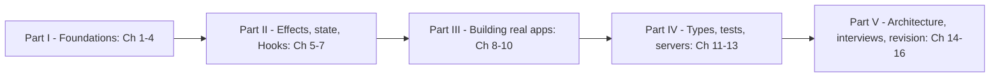

# React Handbook

One place to learn React 19 from your first component to confident intermediate work (forms and Actions, state management, routing and data, performance, TypeScript, testing, server rendering and Server Components), and to prepare for React interviews and machine-coding rounds, without switching between platforms. Each topic combines, in one explanation:
- **official documentation**: react.dev (Learn, Reference and the release blog posts), plus the docs of the libraries real apps use: React Router, TanStack Query, Redux Toolkit, Zustand, Testing Library, Next.js, Vite, Tailwind CSS and TypeScript,
- **classic books**: *Learning React* (Alex Banks and Eve Porcello) and the component-design ideas common in the React community,
- **real-world examples** from shops, dashboards, search boxes, forms and design systems.

There is no DesignGurus course behind this book. Everything is written from the sources above, in my own words.

Every chapter is written for a first-time React learner and defines each term the first time it appears. Every code example is a runnable program (React 19.3 on Node 24, rendered into jsdom and driven with Testing Library; UI pages are also screenshotted in headless Chrome) whose **real output** appears under it. Every chapter was reviewed for accuracy against React 19.3.

> Personal study notes. Not for redistribution.

## Who it's for
| Reader | What you get |
|---|---|
| Beginners who know JavaScript | React taught from zero (Ch 1–7): components, props, state, events, forms, Effects, refs and Hooks, every term defined |
| Working React developers upgrading to React 19 | Actions and `useActionState` / `useFormStatus` / `useOptimistic`, `use()`, `ref` as a prop, `useEffectEvent`, `<Activity>`, the React Compiler, React Router 8 and what changed |
| Full-stack / Next.js developers | SSR, streaming, hydration, SSG and partial prerendering, Server Components, `'use client'` / `'use server'`, Next.js App Router and React Router framework mode (Ch 13) |
| Interview candidates | 53 React interview questions with 30-second answers, 8 machine-coding builds with tests (Ch 15), cheat sheets, a common-errors table and a 222-term glossary (Ch 16) |

## How to use it
Every topic follows the same rhythm: *what it is → why it matters → how it works → code with real output → trade-offs → when not to use it → common mistakes → real-world use → in the interview → self-check → TL;DR*. To review, skim the TL;DRs. To check you really learned a topic, answer the self-check questions without looking back.

**Before you start:** React is JavaScript. If closures, `this`, array methods (`map`, `filter`, spread), modules, promises and `async`/`await` are not comfortable yet, read the [JavaScript Handbook](../javascript/README.md) first — at least its Ch 2, 4, 5, 7, 10 and 12, and Ch 13 (the DOM and events).

**Beginner path (read in order):** 1 → 2 → 3 → 4 → 5 → 6 → 7, then 8 → 9 → 10, then 11 → 12. Chapters 13–14 can wait until you have built one small app. Run the examples, change them, run them again. Keep Chapter 16 open as a quick reference.

**Working React developer upgrading to React 19:**
1. Skim the TL;DRs of Ch 1–3 to check nothing surprises you (keys, snapshots, updaters, batching, state tied to position).
2. **Ch 4** (form Actions, `useActionState`, `useFormStatus`, `useOptimistic`, Server Functions) — the biggest change in how React apps handle writes.
3. **Ch 5** §5.4–5.10 (StrictMode's double run, dependencies, "you might not need an Effect", `ref` as a prop, ref-callback cleanups, Fragment refs) and **Ch 7** §7.7–7.11 (`useEffectEvent`, `useSyncExternalStore`, transitions).
4. **Ch 9** (React Router 8 — one `react-router` package, `RouterProvider` from `react-router/dom`, middleware on by default — plus TanStack Query and `use()` with Suspense) and **Ch 10** §10.7 (the React Compiler).
5. **Ch 11** for `@types/react` 19 changes (`useRef` needs an argument, `SubmitEvent`), then scan the §16.18 errors table.

**Full-stack / Next.js path:**
1. Ch 1 §1.4 (SPA vs MPA vs SSR vs SSG), Ch 4 §4.8 (Server Functions and progressive enhancement), Ch 9 §9.5–9.7 and §9.11 (loaders, actions, Suspense).
2. **Ch 13** end to end: rendering strategies, the server APIs, streaming, hydration and mismatches (including `use(browser())`, new in 19.3), partial prerendering, Server Components, directives, the Next.js App Router, React Router framework mode and choosing a framework.
3. Ch 14 §14.9 (error boundaries and root error options) and Ch 12 §12.8 (testing with providers and routers).

**Interview and machine-coding path (you already write some React):**
1. Skim the TL;DRs of Ch 2, 3, 5, 6, 7 and 10 (rendering and keys, snapshots and batching, Effects and cleanups, Context re-renders, Hook rules, `memo`).
2. Read the 53 questions in **Ch 15** §15.2–15.9 and practise saying the 30-second answers out loud.
3. Rebuild the machine-coding builds in §15.10–15.17 (todo list, autocomplete, infinite scroll, modal, tabs, star rating, pagination, form wizard) from a blank file, with a Testing Library test, following the method in §15.1.
4. The night before, review with **Ch 16** (cheat sheets, the common-errors table, the question index).



## What's in here
| Path | Purpose |
|---|---|
| `React-Handbook.pdf` | The whole book as one PDF, with a cover and a table of contents. |
| `interview/React-Interview-Edition.pdf` (source `interview/INTERVIEW.md`) | Small night-before revision book (~15k words, 34 pages): every chapter as must-know facts, tables, top questions and gotchas, the 8 machine-coding builds as requirements → state → key idea → edge cases, a Top 25 list and a last-minute checklist. |
| `chapters/NN-name/README.md` + `ChapterNN-Notes.pdf` | One chapter (Markdown source and its PDF). |
| `chapters/NN-name/code/` | Runnable examples (`.jsx`, `.tsx`, `.mjs`, `*.test.jsx`), the component modules they import, and for UI chapters a small `.html` page with its esbuild browser bundle. |
| `chapters/NN-name/img/` | Screenshots of those pages rendered in headless Chrome (Ch 1–10, 13–15). |
| `tools/` | `regen_pdfs.sh` (rebuild all PDFs) and `md2pdf.mjs` (Markdown → PDF). See [tools/README.md](tools/README.md). |

## Chapters
| # | Chapter | In one line | PDF |
|---|---|---|---|
| **Part I — Foundations** | | | |
| 01 | [Why React, and Setting Up](chapters/01-why-react-and-setup/README.md) | What React is, declarative UI, rendering and reconciliation, SPA vs MPA vs SSR/SSG, creating a project (frameworks or Vite), project structure, the first component, JSX | `Chapter01-Notes.pdf` |
| 02 | [Components and Props](chapters/02-components-and-props/README.md) | Function components, props and defaults, `children`, composition and slots, purity, keeping components small, conditional rendering, lists and keys | `Chapter02-Notes.pdf` |
| 03 | [State and Events](chapters/03-state-and-events/README.md) | Event handlers, `useState`, state as a snapshot, batching, updater functions, immutable updates, lifting state up, derived state, controlled inputs, state tied to position and `key` | `Chapter03-Notes.pdf` |
| 04 | [Forms and Actions](chapters/04-forms-and-actions/README.md) | How submission works, controlled vs uncontrolled, validation, form Actions, `useActionState`, `useFormStatus`, `useOptimistic`, Server Functions, React Hook Form + Zod | `Chapter04-Notes.pdf` |
| **Part II — Effects, state and Hooks** | | | |
| 05 | [Effects and Refs](chapters/05-effects-and-refs/README.md) | Where side effects belong, `useEffect`, cleanup, StrictMode's double run, dependencies, "you might not need an Effect", fetch races, `useRef`, DOM refs, `ref` as a prop, `useLayoutEffect` | `Chapter05-Notes.pdf` |
| 06 | [State Management](chapters/06-state-management/README.md) | Kinds of state and where each lives, `useReducer`, Context and its performance, reducer + context, Redux Toolkit, Zustand, TanStack Query for server state, choosing | `Chapter06-Notes.pdf` |
| 07 | [Custom Hooks and the Rules of Hooks](chapters/07-custom-hooks-and-hook-rules/README.md) | What a Hook is, the Rules of Hooks, custom Hooks (`useLocalStorage`, `useDebounce`, `useFetch`), `useEffectEvent`, `useId`, `useSyncExternalStore`, `useTransition`, `useDeferredValue` | `Chapter07-Notes.pdf` |
| **Part III — Building real apps** | | | |
| 08 | [Styling React Apps](chapters/08-styling/README.md) | Plain CSS, inline styles, CSS Modules, composing class names, Tailwind CSS v4, CSS-in-JS, theming and dark mode, component libraries, choosing an approach | `Chapter08-Notes.pdf` |
| 09 | [Routing and Data Fetching](chapters/09-routing-and-data-fetching/README.md) | Client-side routing, React Router 8 (declarative, data and framework modes), layouts, loaders, actions, fetchers, middleware, TanStack Query, mutations, Suspense and `use()`, loading UX | `Chapter09-Notes.pdf` |
| 10 | [Performance](chapters/10-performance/README.md) | The render cycle, what triggers re-renders, the Profiler, `memo`, `useCallback`/`useMemo`, the React Compiler, code splitting with `lazy`, virtualization, common bugs, a checklist | `Chapter10-Notes.pdf` |
| **Part IV — Types, tests and servers** | | | |
| 11 | [TypeScript with React](chapters/11-typescript-with-react/README.md) | Setup and `tsc --noEmit`, typing props, children, native element props, events, state, reducers, refs, Hooks and Context, generic components, discriminated-union props, reading type errors | `Chapter11-Notes.pdf` |
| 12 | [Testing React](chapters/12-testing-react/README.md) | The Testing Library philosophy, query priority, `user-event`, async tests, mocking `fetch` and MSW, testing Hooks, providers and routers, Vitest/Jest setup, good vs bad tests | `Chapter12-Notes.pdf` |
| 13 | [Server Rendering and Frameworks](chapters/13-server-rendering-and-frameworks/README.md) | CSR/SSR/SSG/ISR/streaming/PPR, the server APIs, streaming with `<Suspense>`, hydration and mismatches, partial prerendering, Server Components, directives, Next.js App Router, React Router framework mode, choosing a framework | `Chapter13-Notes.pdf` |
| **Part V — Architecture, interviews and revision** | | | |
| 14 | [Patterns and Architecture](chapters/14-patterns-and-architecture/README.md) | Composition, container/presentational, custom Hooks, compound components, render props, HOCs, portals, error boundaries, accessibility, folder structure, design systems | `Chapter14-Notes.pdf` |
| 15 | [React Interview and Machine Coding](chapters/15-react-interview-and-machine-coding/README.md) | How interviews are run, 53 questions with 30-second answers, 8 machine-coding builds (todo, autocomplete, infinite scroll, modal, tabs, star rating, pagination, wizard) with tests and screenshots | `Chapter15-Notes.pdf` |
| 16 | [Cheat Sheets and Glossary](chapters/16-cheatsheet-and-glossary/README.md) | One sheet per area (behaviour machine-checked against React 19.3), every Hook in one table, common errors and fixes, question index, where to go next, 222-term glossary | `Chapter16-Notes.pdf` |

Each chapter's PDF sits next to its README: `chapters/NN-name/ChapterNN-Notes.pdf`.

## Colour code (in the PDFs)
Section headings are coloured by their role, so you can scan a page for the part you need:

| Colour | Headings |
|---|---|
| Green | **What it is**, analogies, overviews |
| Red / coral | **The problem it solves** |
| Blue | **How it works**, walkthroughs |
| Amber | **Trade-offs**, comparisons, **When not to use it** |
| Bright red | **Common mistakes**, pitfalls |
| Violet | **Real-world examples** |
| Pink | **In the interview**, 30-second answers (boxed), follow-ups |
| Teal | **Self-check** |
| Yellow | **TL;DR** (boxed) |

Code blocks are syntax-highlighted, and Mermaid diagrams are rendered as images.

## Running the code
The examples need Node 24 (written and checked on v24.11). Shared helpers live one level up, in the notes root: `tools_run_js.sh`, `tools_dom.mjs`, `tools_web_shot.mjs`, and the npm packages in `.web-books/` (React, React Router, TanStack Query, Redux Toolkit, Zustand, jsdom, Testing Library, esbuild, TypeScript, Tailwind). No example needs internet access or API keys: examples that fetch data start a tiny `node:http` server on `127.0.0.1` inside the same script.

```bash
# from react/ — run every example in the book (prints OK / FAIL / SKIP per file)
bash ../tools_run_js.sh react

# run one example exactly as the runner does: bundle it with esbuild, then run it with Node
cd chapters/03-state-and-events/code
NODE_PATH=../../../../.web-books/node_modules ../../../../.web-books/node_modules/.bin/esbuild 04_batching_and_updaters.jsx \
  --bundle --platform=node --format=esm --jsx=automatic --packages=external '--external:*tools_dom.mjs' --outfile=.run.mjs
NODE_PATH=../../../../.web-books/node_modules node .run.mjs; rm .run.mjs
```
- **What the runner does:** it bundles every `code/*.{jsx,tsx,ts}` file with esbuild (automatic JSX runtime) and runs it, and runs `.js`/`.mjs` files directly. Files marked `// tools_run: skip` are not standalone programs (component modules imported by tests, browser entry files, the deliberately broken `bad_types.tsx`) and are reported as SKIP. At the last full run: 130 OK, 60 SKIP, 0 FAIL.
- **Components under Node — `tools_dom.mjs` + Testing Library:** files whose first line is `import '../../../../tools_dom.mjs';` get a browser-like `document`, `window`, events and `localStorage` from jsdom. They render components with `@testing-library/react` (`render`, `screen`), act like a user with `@testing-library/user-event` or `fireEvent`, and `console.log` what the user would see. Chapter 12 and the Chapter 15 builds are real test files using Node's built-in runner (`node:test` + `node:assert/strict`).
- **Screenshots — esbuild browser bundles + `tools_web_shot.mjs`:** UI chapters have a small `code/*.html` page that loads a browser bundle of the same components. Rebuild a bundle and re-shoot it from `react/`, for example:
  ```bash
  cd chapters/03-state-and-events/code
  ../../../../.web-books/node_modules/.bin/esbuild todo-main.jsx --bundle --format=iife --jsx=automatic --outfile=todo.bundle.js
  cd ../../..
  node ../tools_web_shot.mjs chapters/03-state-and-events/code/todo.html chapters/03-state-and-events/img/todo.png 600
  ```
  The third argument is the viewport width in CSS pixels (the PNG is twice that, at 2× scale); an optional fourth fixes the height. Pages are shot in the light colour scheme unless you add `--dark` (Chapter 8's theme figure uses both); `--wait=ms` waits for timers before the shot.
- **Type-checking (Chapter 11):** every `.tsx` example also passes the TypeScript compiler in `strict` mode, and `bad_types.tsx` shows the real error messages:
  ```bash
  cd chapters/11-typescript-with-react/code
  ../../../../.web-books/node_modules/.bin/tsc --noEmit -p tsconfig.check.json && echo "0 type errors"
  ../../../../.web-books/node_modules/.bin/tsc --noEmit -p tsconfig.bad.json     # the deliberate errors
  ```
- **Chapter 16's checks:** `chapters/16-cheatsheet-and-glossary/code/01_cheatsheet_checks.jsx` asserts every concrete behaviour quoted on the cheat sheets (batching, updater queues, Effect order, StrictMode double calls, default values, the exact error messages) and fails loudly if a React upgrade changes one.

Next.js and React Router framework-mode snippets in Chapter 13 (and a few config files elsewhere) are marked "not run": they need a full framework project. Everything else was run and its output pasted as is.

### Installed versions (September 2026)
| Package | Version | Used in |
|---|---|---|
| `react`, `react-dom` | 19.3 | every chapter |
| `react-router` | 8.4 | Ch 9, 12, 16 |
| `@tanstack/react-query` | 5.104 | Ch 6, 9, 16 |
| `@reduxjs/toolkit` + `react-redux` / `zustand` | 2.12 + 9.3 / 5.0 | Ch 6 |
| `tailwindcss` | 4.3 | Ch 8 |
| `typescript` (`tsc`) + `@types/react` | 7.0 + 19.3 | Ch 11 |
| `@testing-library/react` / `user-event` + `jsdom` | 16.3 / 14.6 | Ch 12 and most examples |
| Node.js | 24.11 | runner, SSR examples |

## Rebuilding the PDFs
Requires Node 18+ and Google Chrome (the path is set in `tools/md2pdf.mjs`). The script installs `tools/node_modules` on its first run.

```bash
bash tools/regen_pdfs.sh      # every ChapterNN-Notes.pdf + React-Handbook.pdf (cover title "React Handbook")

# one chapter only
node tools/md2pdf.mjs chapters/05-effects-and-refs/Chapter05-Notes.pdf chapters/05-effects-and-refs/README.md
```
`md2pdf.mjs` reports any Mermaid errors or broken images.

## Sources
- **Documentation:** react.dev — Learn, API Reference and the release blog posts (for what shipped in which React version); the React Compiler docs; the docs of React Router, TanStack Query, Redux Toolkit, Zustand, Testing Library (`@testing-library/react`, `user-event`, `jest-dom`), MSW, Vitest, Next.js (App Router, Cache Components), Vite, Tailwind CSS and TypeScript; MDN Web Docs and the WAI-ARIA Authoring Practices Guide for the DOM and accessibility parts.
- **Books:** Alex Banks and Eve Porcello, *Learning React*; used for ordering and for cross-checking explanations.
- **Web:** used to check facts and version details (what shipped in which React, React Router or Next.js release, library defaults).
- **No course:** unlike the SQL and JavaScript handbooks, there is no DesignGurus course behind this book.

## Companion books
| Book | Read it for |
|---|---|
| [JavaScript Handbook](../javascript/README.md) | The language under React: closures, objects and copying, array methods, modules, promises and the event loop, the DOM and events — read it first if JavaScript is new |
| [HTML & CSS Handbook](../html-css/chapters/01-how-the-web-works/README.md) | Semantic HTML, accessibility, forms, layout (flexbox, grid), responsive design, modern CSS architecture and Core Web Vitals — the markup and styles your components render |
| [LLD Handbook](../lld/README.md) | Object-oriented design and machine-coding case studies, including [UI components](../lld/chapters/20-case-components/README.md) and [front-end machine coding](../lld/chapters/21-case-machine-coding/README.md) |
