# React — Capstone Projects

## How to use this book

A **capstone** is a project big enough to pull several chapters together into one working app. Reading about `useEffect` or Server Components teaches you the words; building something that has to load data, survive a slow network, stay accessible and pass its tests teaches you the judgement. Each of the 40 briefs below is a design brief: it tells you **what** to build and **why** it is shaped that way. It does not give you the code. You write the code — that is the point.

**The baseline stack.** Unless a brief says otherwise, every project uses **React 19** (the book was checked against 19.3), **TypeScript**, **Vite** as the dev server and bundler, **Vitest** as the test runner, **React Testing Library** (RTL) for component tests, and **Playwright** for end-to-end (E2E) tests that drive a real browser. Node 24 runs the tooling. Where a project needs a framework (Next.js App Router, React Router framework mode) the brief says so.

**How to pick one.**
- New to React: start at Project 1 and do at least four beginner briefs in order. Each one adds one or two ideas on top of the last.
- You already ship React: skim the beginner list, then pick an intermediate brief that uses something you have *not* done yet (drag and drop, an accessible combobox, a WebSocket stream).
- Preparing for a senior interview: do two advanced briefs end to end, including the testing strategy and the "In the interview" questions, and write a one-page design doc for each before you start.

**How to use a brief.**
1. Read *What it is*, *The problem it solves* and *Requirements*. Write down, in your own words, what "done" means.
2. Study *The architecture* and *Data model* diagrams. Sketch your own component tree before you open the editor.
3. Build the **milestones in order**. Each milestone has a *done when* check — do not move on until it passes, ideally as an automated test.
4. Read *Deep dive: the hard parts* before the milestone that needs it, not after you are stuck.
5. Only then attempt the **stretch goals**. They turn a portfolio piece into an interview story.
6. Finish by answering the *In the interview* questions out loud, without notes.

**Colour code.** In the PDF, section headings are coloured by role so you can scan a page: green for **What it is**, coral for **The problem it solves**, violet for **Real-world examples**, amber for **Trade-offs**, pink for **In the interview**, teal for **Self-check**, yellow (boxed) for **TL;DR**. Requirements, architecture and deep-dive headings use the "how it works" blue.

**Level legend.**

| Level | You should already know | Typical size |
|---|---|---|
| Beginner | Ch 1–5: components, props, state, events, forms, Effects | 1–2 weekends, one screen or a few |
| Intermediate | Ch 6–12: state libraries, custom Hooks, routing, data fetching, styling, TypeScript, testing | 1–3 weeks, several routes, a fake or real API |
| Advanced | Ch 13–14 plus real performance and architecture judgement | 3–6 weeks, servers, real-time, scale or tooling |

**React 19 features you will meet.** Actions and `<form action={fn}>`, `useActionState`, `useFormStatus` and `useOptimistic` (all React 19.0); `use()` for reading promises and Context in render (19.0); `ref` as an ordinary prop, so `forwardRef` is no longer needed (19.0); `<Activity>` and `useEffectEvent` (19.2); `<ViewTransition>` and Fragment refs (stable in 19.3). The **React Compiler** reached 1.0 in October 2025; it is a build-time plugin that adds memoization for you. The facts were checked against the [React 19 release post](https://react.dev/blog/2024/12/05/react-19), the [React 19.2 post](https://react.dev/blog/2025/10/01/react-19-2), the [React 19.3 post](https://react.dev/blog/2026/09/09/react-19-3) and the [React Compiler 1.0 post](https://react.dev/blog/2025/10/07/react-compiler-1).

**A note on honesty.** The briefs describe what to build and why; the real-world examples link to the engineering posts, docs or open-source projects they come from. Numbers in the non-functional requirements are targets for *your* build, not claims about anyone else's system.

## Project map

| # | Project | Level | Time | Prerequisites (chapters) |
|---|---|---|---|---|
| 1 | Team profile card list | Beginner | 1 weekend | Ch 1, 2 |
| 2 | Counter and to-do app | Beginner | 1 weekend | Ch 2, 3 |
| 3 | Tip calculator | Beginner | 1 weekend | Ch 3, 4 |
| 4 | Weather widget | Beginner | 1–2 weekends | Ch 3, 5, 7 |
| 5 | Quiz game | Beginner | 1–2 weekends | Ch 3, 6 |
| 6 | Image gallery with lightbox | Beginner | 1–2 weekends | Ch 2, 5, 14 |
| 7 | Sign-up form with Actions | Beginner | 1 weekend | Ch 4, 11 |
| 8 | Pomodoro focus timer | Beginner | 1 weekend | Ch 5, 7 |
| 9 | Expense tracker with local storage | Beginner | 1–2 weekends | Ch 3, 6, 7 |
| 10 | Filterable product catalogue | Beginner | 1–2 weekends | Ch 2, 3, 7 |
| 11 | Kanban board with drag and drop | Intermediate | 2 weeks | Ch 6, 11, 12, 14 |
| 12 | Infinite social feed | Intermediate | 1–2 weeks | Ch 6, 9, 10 |
| 13 | E-commerce cart with context and reducer | Intermediate | 1–2 weeks | Ch 4, 6, 9 |
| 14 | Analytics dashboard with charts | Intermediate | 2 weeks | Ch 6, 7, 9, 10 |
| 15 | Markdown notes app with routing | Intermediate | 2 weeks | Ch 7, 9, 11 |
| 16 | Accessible autocomplete combobox | Intermediate | 1 week | Ch 5, 7, 14, 15 |
| 17 | Multi-step form wizard | Intermediate | 1–2 weeks | Ch 4, 6, 11 |
| 18 | Theme system and dark mode | Intermediate | 1 week | Ch 6, 8, 13 |
| 19 | Auth flow with protected routes | Intermediate | 2 weeks | Ch 4, 6, 9, 12 |
| 20 | Music player with Zustand | Intermediate | 1–2 weeks | Ch 5, 6, 7 |
| 21 | Calendar and booking scheduler | Intermediate | 2–3 weeks | Ch 3, 6, 11, 14 |
| 22 | Live price ticker with WebSockets | Intermediate | 1–2 weeks | Ch 5, 7, 10 |
| 23 | Resumable file uploader | Intermediate | 1–2 weeks | Ch 4, 5, 7 |
| 24 | Multilingual recipe site | Intermediate | 2 weeks | Ch 8, 9, 14 |
| 25 | Admin table with server-side sorting | Intermediate | 2 weeks | Ch 9, 11, 14 |
| 26 | Next.js blog platform with RSC | Advanced | 3–4 weeks | Ch 4, 9, 13 |
| 27 | Real-time collaborative whiteboard | Advanced | 4 weeks | Ch 5, 6, 7, 10 |
| 28 | Virtualized data grid | Advanced | 3 weeks | Ch 10, 11, 14 |
| 29 | Design system with Storybook | Advanced | 3–4 weeks | Ch 8, 11, 12, 14 |
| 30 | Micro-frontend shell | Advanced | 3 weeks | Ch 9, 13, 14 |
| 31 | Offline-first field notes PWA | Advanced | 3 weeks | Ch 6, 7, 9 |
| 32 | Performance lab: Compiler and Profiler | Advanced | 2–3 weeks | Ch 10, 12 |
| 33 | Figma-like vector editor | Advanced | 4–6 weeks | Ch 5, 6, 10, 14 |
| 34 | Chat app with optimistic updates | Advanced | 3 weeks | Ch 4, 7, 13 |
| 35 | SSR streaming server from scratch | Advanced | 2–3 weeks | Ch 13 |
| 36 | React Native companion app (optional) | Advanced | 3 weeks | Ch 6, 9, 11 |
| 37 | Video meeting UI with WebRTC | Advanced | 3–4 weeks | Ch 5, 7, 14 |
| 38 | In-browser code playground | Advanced | 3–4 weeks | Ch 5, 10, 14 |
| 39 | Error monitoring and feature-flag console | Advanced | 3 weeks | Ch 12, 13, 14 |
| 40 | Production storefront on React Router | Advanced | 4–6 weeks | Ch 9, 10, 13 |

## 1. Team profile card list

**Level:** Beginner · **Time:** 1 weekend · **Prerequisites:** Ch 1, Ch 2

### What it is
A single page that shows a grid of people — photo, name, role, location and a few skill tags — rendered from an array of data. Each person is a `ProfileCard` **component** (a function that returns UI). Clicking a tag highlights every card that shares it. It is the "hello world" of thinking in components: break the page into boxes, pass data down as **props** (the inputs a parent hands to a child), and render a list with stable **keys** (the identity React uses to match list items between renders).

### The problem it solves
Every product has a list of things shown as cards: team pages, search results, product tiles. Writing them by hand in HTML means copy-paste and drift. A component turns "one card" into a reusable function, so ten or ten thousand cards stay identical and a design change happens in one place.

### Real-world examples
- The react.dev tutorial [Thinking in React](https://react.dev/learn/thinking-in-react) walks through exactly this decomposition: mock-up → component hierarchy → static version → state.
- [Rendering Lists](https://react.dev/learn/rendering-lists) on react.dev explains why keys must be stable and unique among siblings.
- The free [Random User Generator API](https://randomuser.me/documentation) returns realistic fake people (name, picture, location) — ideal seed data.

### Requirements
**Functional**
- Render at least 12 profiles from a local `people.ts` file (later, from Random User).
- Each card shows avatar, name, role, city and 1–5 skill tags.
- Clicking a tag selects it, every card with that tag is highlighted, and clicking again clears it.
- A summary line reads "Showing 12 people · 4 know TypeScript".

**Non-functional**
- First render under 100 ms on a mid-range laptop for 200 cards.
- Images have `alt` text and fixed `width`/`height` so the layout does not jump (no **cumulative layout shift**).
- Works from 320 px to 1440 px wide with CSS grid.

### The architecture
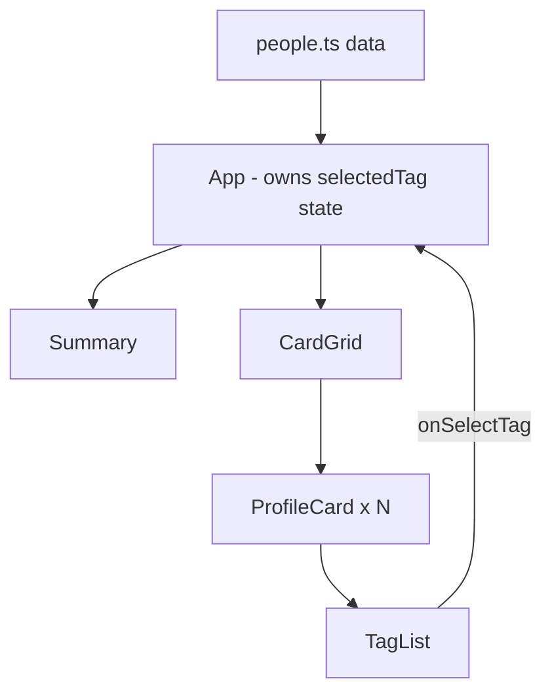
- **App** owns the only piece of state, `selectedTag`, because both the summary and the cards need it.
- **Summary** derives its counts from the data and the tag — nothing stored twice.
- **CardGrid** maps the array to cards with `key={person.id}`.
- **ProfileCard** is a pure component: same props, same output.
- **TagList** calls the `onSelectTag` callback prop; it never changes state itself.

### Data model
| Type | Fields | Notes |
|---|---|---|
| `Person` | `id: string`, `name`, `role`, `city`, `avatarUrl`, `skills: string[]` | `id` is the key |
| App state | `selectedTag: string \| null` | the only state |
| Derived | `matches = people.filter(p => p.skills.includes(tag))` | computed every render |

### Tech stack
| Component | Choice | Why |
|---|---|---|
| Build | Vite + React 19 + TypeScript | instant dev server, typed props |
| Styling | CSS Modules | scoped class names with no runtime |
| Tests | Vitest + RTL | fast, user-centred queries |

### Milestones
1. **Static card.** Hard-code one `ProfileCard`. *Done when* it matches your sketch and has no TypeScript errors.
2. **List from data.** Map `people` to cards with keys. *Done when* there are no key warnings in the console.
3. **Tag selection.** Lift `selectedTag` to `App`. *Done when* clicking a tag highlights the right cards and a second click clears it.
4. **Summary and polish.** Derived counts, responsive grid, focus styles. *Done when* an RTL test clicks "TypeScript" and sees the correct count.

### Deep dive: the hard parts
- **Where state lives.** Beginners put `isHighlighted` inside each card. That breaks as soon as the summary needs the same fact. The rule from Chapter 3 is: put state in the closest common parent of everything that reads it, and pass it down.
- **Keys are identity, not decoration.** Using the array index as the key works until you sort or filter; then React reuses the wrong DOM node and, for example, an image or an expanded panel "sticks" to the wrong person. Use the person's `id`.
- **Derived vs stored.** "Number of matches" is a function of data you already have. Storing it in state invites the two to disagree. Compute it during render; it costs microseconds.
- **Accessible tags.** A tag you can click is a `<button>` with `aria-pressed`, not a `<span onClick>`. That gives keyboard focus and announces the toggle state to screen readers for free.

### Testing strategy
Render `App` with RTL, `getAllByRole('article')` for the cards, `getByRole('button', { name: 'TypeScript' })` for a tag, click it with `user-event`, and assert the summary text and the highlighted cards. One Playwright smoke test opens the page at 375 px and checks that nothing scrolls horizontally.

### Trade-offs, scaling and failure modes
Two hundred cards are trivial; 20,000 are not — at that size you need pagination or virtualization (Project 28). Remote avatars can be slow or broken: give the `` a fallback (initials) on `onError`. Hard-coded data is fine for now; Project 4 adds fetching.

### Stretch goals
- Load people from Random User with a loading skeleton.
- Multi-select tags with AND/OR mode.
- A `layout` prop (`grid | list`) that changes the card's markup — practice for discriminated-union props.

### Skills practised
- [Ch 1 — Why React and setup](../chapters/01-why-react-and-setup/README.md): Vite, JSX
- [Ch 2 — Components and props](../chapters/02-components-and-props/README.md): props, composition, lists and keys
- [Ch 3 — State and events](../chapters/03-state-and-events/README.md): lifting state, derived state

### In the interview
**Q:** Why not use the array index as a key?

**A:** The key tells React which item is which between renders. If the list is reordered or filtered, index keys point at different items and React keeps the wrong component state and DOM. A stable id avoids that.

**Q:** Where should `selectedTag` live?

**A:** In the closest common parent of every component that reads it — here `App` — and be passed down with a callback to change it.

**Q:** Why is the match count not state?

**A:** It can be computed from existing state and props, so storing it creates two sources of truth that can disagree.

### TL;DR
Turn one card into a pure component, render a list with stable keys, keep the single piece of state in the common parent and derive everything else.

## 2. Counter and to-do app

**Level:** Beginner · **Time:** 1 weekend · **Prerequisites:** Ch 2, Ch 3

### What it is
Two tiny apps on one page. The **counter** has +1, −1, +5 and reset buttons and a step input. The **to-do list** lets you add, tick, edit, delete and filter (All / Active / Done) tasks. Together they cover every basic state rule: state as a snapshot, batching, updater functions and immutable updates of arrays and objects.

### The problem it solves
Almost every bug a React beginner hits comes from mutating state or reading a stale value: `count + 1` three times only adds one; `todos.push()` changes nothing on screen. These two apps make you hit those bugs on purpose, then fix them the right way.

### Real-world examples
- [TodoMVC](https://todomvc.com/) has implemented the same to-do spec in dozens of frameworks for years — a great reference for the feature list and keyboard behaviour.
- react.dev's [Updating Arrays in State](https://react.dev/learn/updating-arrays-in-state) is the canonical guide to add, remove and replace without mutation.

### Requirements
**Functional**
- Counter: +1, −1, +step, reset. "+3 quickly" (three updates in one handler) must add 3.
- To-do: add by pressing Enter, toggle done, double-click to edit, delete, filter, "clear completed", "N items left".
- The filter choice is reflected in the URL hash (`#/active`) so refresh keeps it.

**Non-functional**
- No state mutation anywhere (enforce with `readonly` types).
- Every control reachable and usable by keyboard.
- 1,000 to-dos still type without lag (under 16 ms per keystroke).

### The architecture
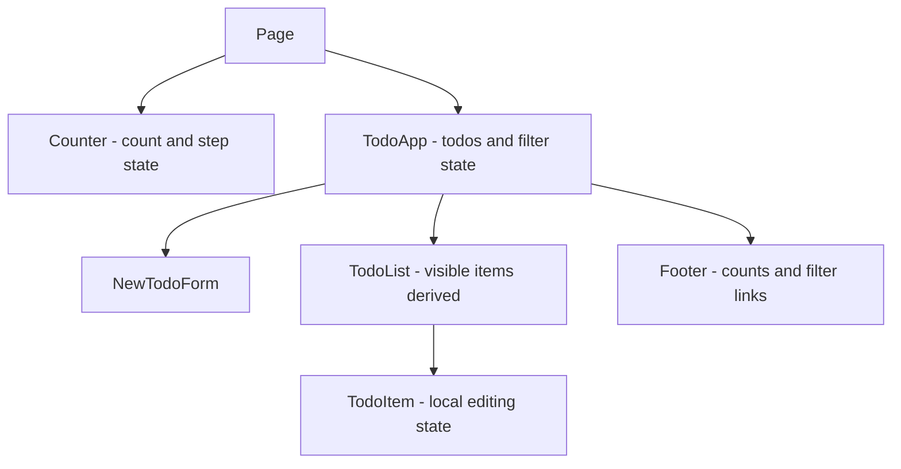
- **Counter** owns `count` and `step`; uses updater functions `setCount(c => c + step)`.
- **TodoApp** owns `todos` and `filter`; passes handlers down.
- **TodoItem** owns only `isEditing` and the draft text — local UI state that nobody else needs.
- **Footer** derives "items left" from `todos`.

### Data model
| Type | Fields |
|---|---|
| `Todo` | `id: string` (from `crypto.randomUUID()`), `title: string`, `done: boolean` |
| `Filter` | `'all' \| 'active' \| 'done'` |
| TodoApp state | `todos: readonly Todo[]`, `filter: Filter` |

### Tech stack
| Component | Choice | Why |
|---|---|---|
| UI | React 19 + TypeScript | `readonly` arrays catch mutation at compile time |
| IDs | `crypto.randomUUID()` | built into browsers and Node |
| Tests | Vitest + RTL + `user-event` | type and click like a user |

### Milestones
1. **Counter.** *Done when* a test clicks "+3 quickly" and sees 3, not 1.
2. **Add and list to-dos.** *Done when* Enter adds an item and clears the input.
3. **Toggle, delete, edit.** Immutable updates with `map` and `filter`. *Done when* editing one item never changes another.
4. **Filters and footer.** *Done when* the hash route survives a reload and counts are always right.

### Deep dive: the hard parts
- **State is a snapshot.** Inside one click handler, `count` is a constant captured when the component rendered. Calling `setCount(count + 1)` three times queues "set to 1" three times. `setCount(c => c + 1)` queues "add one" three times. React **batches** the queued updates and re-renders once.
- **Immutable updates.** React compares the old and new array by reference. `todos.push(x)` keeps the same reference, so React skips the render. Create a new array: `[...todos, x]`, `todos.map(t => t.id === id ? { ...t, done: !t.done } : t)`.
- **Editing state and keys.** If `TodoItem` holds a draft and you key items by index, deleting item 2 makes item 3 inherit item 2's draft. Key by `id`.
- **Escape cancels, blur saves.** Decide the edit rules up front, as TodoMVC does, and test them; they are where users notice sloppiness.

### Testing strategy
RTL tests for each rule: add, toggle, filter, edit-cancel with Escape, "clear completed". A test that renders 1,000 items and types into the new-todo box is a cheap performance guard. Playwright checks the hash route after a reload.

### Trade-offs, scaling and failure modes
`useState` with an array is perfect here. Once handlers multiply, move the logic into a `useReducer` (Project 5) so every transition is in one testable function. Losing data on refresh is the obvious failure; Project 9 adds persistence.

### Stretch goals
- Undo the last delete for 5 seconds (a toast with "Undo").
- Drag to reorder (preview of Project 11).
- Convert the to-do logic to `useReducer` and compare the two versions.

### Skills practised
- [Ch 2 — Components and props](../chapters/02-components-and-props/README.md): lists, keys, conditional rendering
- [Ch 3 — State and events](../chapters/03-state-and-events/README.md): snapshots, batching, updater functions, immutable updates
- [Ch 15 — Interview and machine coding](../chapters/15-react-interview-and-machine-coding/README.md): the to-do build

### In the interview
**Q:** Why does calling `setCount(count + 1)` three times add only one?

**A:** `count` is the value from the current render. All three calls ask for the same next value. Use the updater form so each call builds on the queued result.

**Q:** Why must you not `push` into state?

**A:** React detects changes by reference. Mutation keeps the reference, so React may skip the render, and other code holding the old array sees it change underneath.

**Q:** What is batching?

**A:** React groups all state updates from one event (and since React 18, from timeouts and promises too) into a single re-render.

### TL;DR
Use updater functions when the next state depends on the previous one, never mutate arrays or objects, and key list items by a stable id.

## 3. Tip calculator

**Level:** Beginner · **Time:** 1 weekend · **Prerequisites:** Ch 3, Ch 4

### What it is
A small form: bill amount, tip percentage (preset buttons 5/10/15/25 % plus "custom"), number of people. It shows tip per person and total per person, updating as you type, with a reset button. The focus is **controlled inputs** (inputs whose value comes from React state), validation messages and computing results from the minimal state.

### The problem it solves
Number inputs are surprisingly tricky: users type "12.", "0", "", or "abc"; money must not show floating-point noise like 14.999999. This project teaches you to keep raw text in state, parse it, validate it and format money correctly — skills every checkout or settings form needs.

### Real-world examples
- Frontend Mentor's [Tip calculator app challenge](https://www.frontendmentor.io/challenges/tip-calculator-app-ugJNGbJUX) provides a professional design to build against.
- react.dev's [Choosing the State Structure](https://react.dev/learn/choosing-the-state-structure) explains why results like "total per person" should not be stored.

### Requirements
**Functional**
- Bill and people inputs, tip presets and a custom percentage.
- Live results: tip/person and total/person, formatted in the user's currency.
- Error "Can't be zero" when people is 0, shown next to the field.
- Reset returns everything to empty and disables itself when already empty.

**Non-functional**
- Results never show more than two decimals, and never `NaN` or `Infinity`.
- Inputs have visible labels and use `inputMode="decimal"` so phones show a number keypad.
- Lighthouse accessibility score 100.

### The architecture
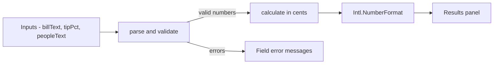
- **Inputs** hold raw strings exactly as typed.
- **parse and validate** is a pure function returning `{ values, errors }`.
- **calculate** works in integer cents to avoid floating-point rounding errors.
- **Intl.NumberFormat** formats currency for the user's locale.

### Data model
| Type | Fields |
|---|---|
| Form state | `billText: string`, `tip: { kind: 'preset', pct: number } \| { kind: 'custom', text: string }`, `peopleText: string` |
| Derived | `errors: Partial<Record<'bill' \| 'people' \| 'tip', string>>`, `tipPerPersonCents`, `totalPerPersonCents` |

### Tech stack
| Component | Choice | Why |
|---|---|---|
| UI | React 19 + TypeScript | discriminated union for the tip choice |
| Formatting | `Intl.NumberFormat` | built in, locale aware |
| Tests | Vitest for the pure calc, RTL for the form | logic tested without a DOM |

### Milestones
1. **Pure calculator.** `calculate(billCents, pct, people)`. *Done when* unit tests cover zero, rounding and large bills.
2. **Controlled form.** *Done when* typing updates results on every keystroke.
3. **Validation.** *Done when* invalid input shows a message and hides results instead of `NaN`.
4. **Presets, custom and reset.** *Done when* choosing a preset clears the custom field and vice versa.

### Deep dive: the hard parts
- **Store text, not numbers.** If state is a number, typing "12." becomes 12 and the dot vanishes. Keep the string; parse on render.
- **Money in cents.** `0.1 + 0.2` is not `0.3` in binary floating point. Convert to integer cents, divide, and round once at the end. Decide where the leftover cent goes when splitting.
- **Minimal state.** Results are derived. The only state is what the user typed. This removes a whole class of "the total didn't update" bugs.
- **Controlled vs uncontrolled.** Here controlled inputs make sense because every keystroke changes the output. Chapter 4 shows when an uncontrolled form with `FormData` is simpler.

### Testing strategy
Table-driven unit tests for `calculate` and `parse`. RTL tests: type "142.55", choose 15 %, type "5", expect the formatted results. Test the error message is linked with `aria-describedby` by querying `getByRole('spinbutton', { description: /can't be zero/i })` or by checking the attribute.

### Trade-offs, scaling and failure modes
Controlled inputs re-render on every keystroke; for a form this small that is free. Locale formatting can surprise (comma decimals in many countries), so parse with care or restrict input. A failure mode is silent rounding — show the per-person amounts that actually add up to the bill.

### Stretch goals
- Remember the last tip percentage with `localStorage`.
- Split unevenly ("Alice had the steak").
- Currency selector using `Intl.supportedValuesOf('currency')`.

### Skills practised
- [Ch 3 — State and events](../chapters/03-state-and-events/README.md): controlled inputs, derived state
- [Ch 4 — Forms and Actions](../chapters/04-forms-and-actions/README.md): validation, controlled vs uncontrolled
- [Ch 11 — TypeScript with React](../chapters/11-typescript-with-react/README.md): discriminated unions

### In the interview
**Q:** Why keep the bill as a string in state?

**A:** So partial input like "12." is preserved. Parse it during render and show an error if it is not a valid number.

**Q:** How do you avoid floating-point errors with money?

**A:** Work in integer minor units (cents), round once, and format with `Intl.NumberFormat`.

**Q:** What is derived state and why avoid storing it?

**A:** Values computable from other state; storing them creates two sources of truth.

### TL;DR
Keep raw input as state, derive results with a pure function in cents, and format with `Intl` — no `NaN`, no stored totals.

## 4. Weather widget

**Level:** Beginner · **Time:** 1–2 weekends · **Prerequisites:** Ch 3, Ch 5, Ch 7

### What it is
A card that shows current weather and a 5-day forecast for a city the user searches for or for their current location. It is your first app that talks to a server: you fetch data in an **Effect** (code that runs after React updates the screen, to synchronize with something outside React), handle loading and errors, and cancel stale requests.

### The problem it solves
Fetching looks easy until the user types "Par", "Pari", "Paris" quickly and the slowest response wins, showing the wrong city. The widget teaches the three data states (loading, error, success), **race conditions** (two requests finishing in the wrong order) and how to clean up.

### Real-world examples
- [Open-Meteo](https://open-meteo.com/en/docs) offers a free weather forecast API and a geocoding API with no key required for non-commercial use — perfect for this build.
- react.dev's [Synchronizing with Effects](https://react.dev/learn/synchronizing-with-effects) shows the `ignore` flag pattern for fetch races.
- [You Might Not Need an Effect](https://react.dev/learn/you-might-not-need-an-effect) explains what should *not* go in an Effect.

### Requirements
**Functional**
- Search a city (geocoding) and pick from the results, or use the browser's geolocation.
- Show temperature, condition icon, wind and a 5-day forecast.
- Toggle °C/°F without refetching.
- Remember the last city.

**Non-functional**
- Show a skeleton within 100 ms of a search. Never show data for a city that is not the selected one.
- Cache responses for 10 minutes per city to avoid repeat calls.
- The widget must still render (with an error state and "Retry") if the API is down.

### The architecture
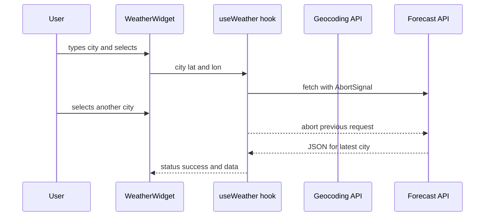
- **WeatherWidget** holds the selected place and the unit toggle.
- **useWeather** is a custom Hook returning `{ status, data, error, retry }`; it owns the Effect, the `AbortController` and the cache.
- **APIs** are called directly from the browser; there is no server of your own.

### Data model
| Type | Fields |
|---|---|
| `Place` | `name`, `country`, `lat`, `lon` |
| `Forecast` | `current: { tempC, code, windKph }`, `daily: { date, minC, maxC, code }[]` |
| Hook state | `{ status: 'idle' \| 'loading' \| 'error' \| 'success', data?, error? }` |
| Cache | `Map<string, { at: number, data: Forecast }>` keyed by `lat,lon` |

### Tech stack
| Component | Choice | Why |
|---|---|---|
| Data | `fetch` + `AbortController` in a custom Hook | learn the mechanics before using a library |
| Units | derived on render | no refetch |
| Tests | Vitest + RTL + MSW | mock the network at the request level |

### Milestones
1. **Hard-coded fetch.** Fetch one city's forecast in an Effect. *Done when* loading, success and error all render.
2. **City search.** Geocoding with results list. *Done when* selecting a result loads its weather.
3. **Race-proof.** Abort the previous request in the Effect cleanup. *Done when* a test with delayed mocked responses never shows the stale city.
4. **Cache, units, persistence.** *Done when* switching back to a city within 10 minutes makes no network call.

### Deep dive: the hard parts
- **Cleanup cancels races.** The Effect for city B runs only after the cleanup for city A. Calling `controller.abort()` in cleanup stops A's request, and an aborted fetch rejects with an `AbortError` you must ignore, not show.
- **StrictMode's double run.** In development React mounts, unmounts and remounts once to prove your cleanup works. You will see two requests; the first is aborted. That is expected, not a bug.
- **Status as one value.** `isLoading` + `error` + `data` as three booleans allow impossible combinations. A single `status` union makes the UI a simple switch.
- **What not to put in an Effect.** Converting °C to °F is derived during render. Reacting to the "Search" click is an event handler. Only the "keep data in sync with the selected place" part is an Effect.

### Testing strategy
Use MSW (Mock Service Worker) to answer `/forecast` with fixtures and delays. Test: shows skeleton, shows data, shows error with Retry, and the race test (A delayed 300 ms, B 50 ms, select A then B, assert B). Unit-test the weather-code-to-icon mapping.

### Trade-offs, scaling and failure modes
Hand-rolled fetching teaches the mechanics but you will rewrite caching, retries and refetch-on-focus badly. Project 12 swaps in TanStack Query. Geolocation can be denied — fall back to search. Rate limits: debounce search input (Project 16).

### Stretch goals
- Replace the Hook with TanStack Query and compare the code.
- Hourly chart with an accessible table fallback.
- Read the promise with `use()` inside `<Suspense>` instead of status flags.

### Skills practised
- [Ch 5 — Effects and refs](../chapters/05-effects-and-refs/README.md): Effects, cleanup, fetch races, StrictMode
- [Ch 7 — Custom Hooks](../chapters/07-custom-hooks-and-hook-rules/README.md): `useFetch`-style Hook
- [Ch 12 — Testing React](../chapters/12-testing-react/README.md): mocking `fetch` and MSW

### In the interview
**Q:** How do you prevent a slow old response from overwriting a new one?

**A:** Abort the previous request (or set an ignore flag) in the Effect's cleanup, which runs before the next Effect.

**Q:** Why does my Effect fetch twice in development?

**A:** StrictMode mounts, unmounts and remounts to surface missing cleanup. Production runs it once.

**Q:** Should the °C/°F conversion be in an Effect?

**A:** No. It is derived from data you already have; compute it during render.

### TL;DR
Fetch in an Effect with an `AbortController` cleaned up on change, model status as one union, and derive everything else during render.

## 5. Quiz game

**Level:** Beginner · **Time:** 1–2 weekends · **Prerequisites:** Ch 3, Ch 6

### What it is
A timed multiple-choice quiz: choose a category and difficulty, answer 10 questions with a 20-second timer each, see right/wrong feedback, and get a results screen with a review of every answer. The whole game is driven by a **reducer** — a pure function `(state, action) => newState` used with `useReducer` — modelled as a small **state machine** (a fixed set of screens with allowed moves between them).

### The problem it solves
Games, checkouts and onboarding flows have many states and rules ("can't answer twice", "timer stops on answer", "results only after the last question"). Scattering these across `useState` calls produces impossible states. A reducer centralizes the rules so they can be unit-tested without rendering anything.

### Real-world examples
- The [Open Trivia Database](https://opentdb.com/api_config.php) provides a free JSON API of categorized questions with a session token to avoid repeats.
- react.dev's [Extracting State Logic into a Reducer](https://react.dev/learn/extracting-state-logic-into-a-reducer) introduces the exact pattern.

### Requirements
**Functional**
- Setup screen: category, difficulty, number of questions.
- Question screen: shuffled answers, 20 s countdown, lock-in on click, feedback, "Next".
- Timeout counts as wrong and reveals the answer.
- Results: score, time taken, list of questions with your answer and the correct one. "Play again".

**Non-functional**
- The reducer has 100 % branch coverage.
- The timer drifts by less than 1 s over 20 s (do not count ticks — compare timestamps).
- HTML entities in API text (`&quot;`) are decoded safely without `dangerouslySetInnerHTML`.

### The architecture
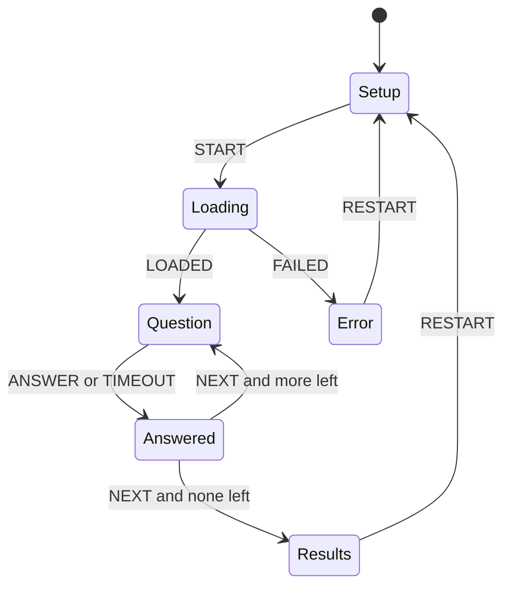
- **Setup / Loading / Question / Answered / Results / Error** are the only allowed `phase` values.
- Each arrow is an **action** the reducer accepts in that phase; anything else is ignored.
- The **QuizScreen** component renders a different child per phase.

### Data model
| Type | Fields |
|---|---|
| `Question` | `id`, `text`, `choices: string[]` (shuffled once), `correct: string` |
| `State` | `phase`, `questions`, `index`, `answers: { questionId, choice \| null, ms }[]`, `startedAt` |
| `Action` | `START`, `LOADED`, `FAILED`, `ANSWER`, `TIMEOUT`, `NEXT`, `RESTART` |

### Tech stack
| Component | Choice | Why |
|---|---|---|
| Logic | `useReducer` + TypeScript unions | exhaustive, testable transitions |
| Timer | `useEffect` + `setInterval` reading `Date.now()` | accurate, cleaned up |
| Tests | Vitest for the reducer, RTL with fake timers | fast and deterministic |

### Milestones
1. **Reducer first.** Write and unit-test every transition with fixture questions. *Done when* invalid actions leave state unchanged.
2. **Screens.** Render each phase. *Done when* you can play a full fixture game by clicking.
3. **Timer.** *Done when* a fake-timer test advances 20 s and sees the TIMEOUT feedback.
4. **API.** Fetch from Open Trivia DB, decode entities, shuffle. *Done when* errors show the Error screen with "Try again".

### Deep dive: the hard parts
- **Shuffle once.** Shuffling choices during render reorders them on every re-render (every timer tick). Shuffle when the questions load and store the result.
- **Timer accuracy.** `setInterval` callbacks can be delayed, especially in background tabs. Store the deadline (`startedAt + 20000`) and compute remaining time from `Date.now()` on each tick.
- **Timer cleanup.** The interval must stop on answer and on unmount. Start it in an Effect keyed on the question index and clear it in cleanup.
- **Decoding entities safely.** Parsing with `new DOMParser().parseFromString(text, 'text/html').documentElement.textContent` decodes without injecting HTML into the page.

### Testing strategy
Reducer tests are plain function calls: given state + action, expect state. RTL with `vi.useFakeTimers()` for the countdown. MSW for the API, including a response code that means "no results".

### Trade-offs, scaling and failure modes
A reducer adds ceremony for a two-field form but pays off here. For very complex flows, a state-machine library (such as XState) adds visualization and guards; for 7 states, a typed reducer is enough. The API rate-limits rapid calls — show a friendly error.

### Stretch goals
- Keyboard shortcuts 1–4 to answer.
- Persist high scores per category.
- Two-player hot-seat mode.

### Skills practised
- [Ch 3 — State and events](../chapters/03-state-and-events/README.md): state shape
- [Ch 5 — Effects and refs](../chapters/05-effects-and-refs/README.md): interval cleanup
- [Ch 6 — State management](../chapters/06-state-management/README.md): `useReducer`

### In the interview
**Q:** When do you prefer `useReducer` over `useState`?

**A:** When several values change together or the next state depends on rules; the reducer puts all transitions in one pure, testable function.

**Q:** Why not shuffle answers in render?

**A:** Render must be pure; shuffling there gives a different order on every re-render.

**Q:** How do you make a countdown accurate?

**A:** Store a deadline and compute remaining time from the clock each tick, rather than decrementing a counter.

### TL;DR
Model the game as a typed state machine in a reducer, test it without the DOM, and drive an accurate, cleaned-up timer from timestamps.

## 6. Image gallery with lightbox

**Level:** Beginner · **Time:** 1–2 weekends · **Prerequisites:** Ch 2, Ch 5, Ch 14

### What it is
A responsive grid of photos. Clicking one opens a **lightbox** — a full-screen **modal dialog** (a window that blocks the page behind it until closed) — with next/previous, keyboard arrows, swipe on touch, a caption and a close button. Images load lazily. You learn DOM refs, focus management, **portals** (rendering a child into a different DOM node, such as `document.body`) and accessibility of dialogs.

### The problem it solves
Modals are where accessibility usually breaks: focus escapes behind the overlay, Escape does nothing, the screen reader reads the page underneath, and the page scrolls behind. Large image grids also waste bandwidth if every image loads at once.

### Real-world examples
- The W3C [WAI-ARIA dialog (modal) pattern](https://www.w3.org/WAI/ARIA/apg/patterns/dialog-modal/) defines the required keyboard and focus behaviour.
- MDN's [`<dialog>` element reference](https://developer.mozilla.org/en-US/docs/Web/API/HTMLDialogElement) — `showModal()` gives you a top layer, inert background and Escape handling natively.
- The [Unsplash API](https://unsplash.com/documentation) supplies photos with sizes, author credits and blur hashes.

### Requirements
**Functional**
- Grid of 30+ thumbnails with lazy loading; open any in the lightbox.
- Lightbox: next/prev buttons, ← → keys, Escape closes, swipe on touch, counter "7 / 30".
- On close, focus returns to the thumbnail that opened it.
- The URL updates (`?photo=7`) so a lightbox view is shareable.

**Non-functional**
- Thumbnails use `srcset` and `loading="lazy"`; initial page transfer under 1 MB.
- Zero layout shift: every image has an aspect ratio.
- Passes axe-core with zero violations.

### The architecture
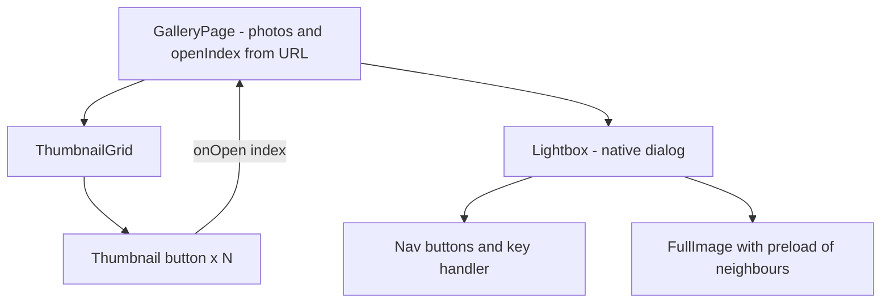
- **GalleryPage** reads `openIndex` from the URL search params — the URL is the state.
- **Thumbnail** is a `<button>` wrapping an ``, with a ref so focus can return.
- **Lightbox** wraps a native `<dialog>` and calls `showModal()` in an Effect; it preloads the next and previous image.

### Data model
| Type | Fields |
|---|---|
| `Photo` | `id`, `thumbUrl`, `fullUrl`, `width`, `height`, `alt`, `author` |
| URL state | `photo: number \| null` |
| Refs | `thumbRefs: Map<id, HTMLButtonElement>`, `dialogRef` |

### Tech stack
| Component | Choice | Why |
|---|---|---|
| Modal | native `<dialog>` + `showModal()` | top layer, Escape, inert background for free |
| Images | `srcset`, `loading="lazy"`, `decoding="async"` | bandwidth and smooth scroll |
| Tests | RTL + Playwright + axe | keyboard and a11y in a real browser |

### Milestones
1. **Grid.** *Done when* the grid is responsive and shows no layout shift.
2. **Lightbox open/close.** *Done when* Escape closes it and focus returns to the right thumbnail.
3. **Navigation.** *Done when* arrows, buttons and swipe move through photos and wrap around.
4. **URL state.** *Done when* reloading `?photo=7` opens the lightbox on photo 7 and Back closes it.

### Deep dive: the hard parts
- **Refs to many items.** In React 19 a ref callback can return a cleanup function, so `ref={el => { map.set(id, el); return () => map.delete(id); }}` keeps a tidy map of thumbnail nodes.
- **Focus return.** Remember which thumbnail opened the dialog (the index is enough) and call `.focus()` on its node after close.
- **`<dialog>` vs portal.** A native modal dialog solves stacking and inertness. If you build a custom overlay instead, you need `createPortal` to escape `overflow: hidden` parents, a focus trap and `inert` on the background.
- **Preloading.** Create `new Image()` for neighbours so "next" feels instant, but cap it at one each way to save data.

### Testing strategy
RTL: open via click, assert `getByRole('dialog')`, press Escape, assert focus on the thumbnail. Playwright: keyboard-only walk through, swipe with touch emulation, axe scan with `@axe-core/playwright`.

### Trade-offs, scaling and failure modes
URL state makes views shareable but means every navigation is a history entry — use `replace` for next/prev so Back closes the lightbox in one step. Thousands of photos need virtualization. Broken images need a placeholder.

### Stretch goals
- Animate open/close with `<ViewTransition>` (stable in React 19.3).
- Pinch-to-zoom.
- Masonry layout with CSS grid.

### Skills practised
- [Ch 5 — Effects and refs](../chapters/05-effects-and-refs/README.md): DOM refs, ref cleanups
- [Ch 9 — Routing and data fetching](../chapters/09-routing-and-data-fetching/README.md): URL search params
- [Ch 14 — Patterns and architecture](../chapters/14-patterns-and-architecture/README.md): portals, accessibility

### In the interview
**Q:** What must an accessible modal do?

**A:** Move focus inside on open, keep it there, close on Escape, hide the background from assistive tech, and return focus to the opener.

**Q:** Why use a portal for a custom modal?

**A:** To render outside parents whose `overflow` or `z-index` would clip or bury it, while keeping React's event bubbling and context.

**Q:** What changed for refs in React 19?

**A:** `ref` is a normal prop on function components, and ref callbacks can return a cleanup function.

### TL;DR
Use a native dialog (or a portal plus focus trap), return focus on close, keep the open photo in the URL and load images lazily with fixed aspect ratios.

## 7. Sign-up form with Actions

**Level:** Beginner · **Time:** 1 weekend · **Prerequisites:** Ch 4, Ch 11

### What it is
A sign-up form (name, email, password, plan, terms checkbox) built the React 19 way: `<form action={signUp}>` where `signUp` is an **Action** — an async function React runs inside a **transition** (a non-urgent update that tracks pending state). `useActionState` returns the result of the last submission (errors or success), and a `SubmitButton` uses `useFormStatus` to show "Creating account…" while pending.

### The problem it solves
Before React 19, every form re-implemented the same plumbing: `preventDefault`, `isSubmitting`, `try/catch`, error state, disabling the button. Actions move that plumbing into React, and the same form can later post to a **Server Function** and work before JavaScript loads (progressive enhancement).

### Real-world examples
- react.dev's [`useActionState` reference](https://react.dev/reference/react/useActionState) and [`useFormStatus` reference](https://react.dev/reference/react-dom/hooks/useFormStatus) describe the exact APIs.
- The [React 19 release post](https://react.dev/blog/2024/12/05/react-19) explains why Actions were added.

### Requirements
**Functional**
- Fields with labels; server-style validation returns field errors and a form error.
- Submitted values are kept on error. React resets uncontrolled fields whenever the Action finishes without throwing — even when it returns an error state — so you must restore them yourself.
- Button shows pending text and is disabled while submitting.
- Success screen with the new user's name.

**Non-functional**
- The fake API takes 800 ms and fails 20 % of the time with "email taken" — your UI must handle both.
- Errors are announced to screen readers (`aria-live` or `aria-describedby`).
- No `useState` for pending or errors — only Action hooks.

### The architecture
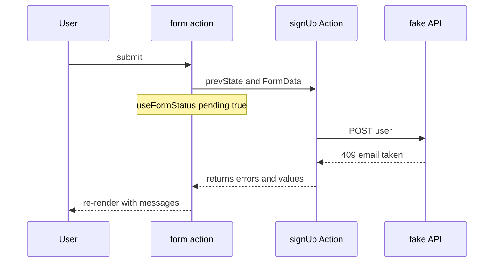
- **SignUpForm** calls `useActionState(signUp, initialState)` and gets `[state, formAction, isPending]`.
- **signUp** validates with a schema, calls the API and *returns* the next state — no setters.
- **SubmitButton** is a child component, because `useFormStatus` reads the status of its *parent* form.

### Data model
| Type | Fields |
|---|---|
| `SignUpState` | `{ status: 'idle' \| 'error' \| 'success', fieldErrors?: Record<string, string>, formError?: string, values?: Record<string, string>, user? }` |
| Input | `FormData` with `name`, `email`, `password`, `plan`, `terms` |

### Tech stack
| Component | Choice | Why |
|---|---|---|
| Form | React 19 form Actions | built-in pending, errors, reset |
| Validation | Zod schema | one source for rules and types |
| Tests | RTL + `user-event` + fake API | test what the user sees |

### Milestones
1. **Plain form + Action.** *Done when* submit logs the `FormData` and the form resets.
2. **Validation errors.** *Done when* bad input shows per-field messages and keeps what was typed (use `defaultValue={state.values?.email}`).
3. **Pending UI.** *Done when* the button reads "Creating account…" during the 800 ms delay.
4. **API errors and success.** *Done when* "email taken" appears under the email field and success shows the welcome screen.

### Deep dive: the hard parts
- **The Action signature.** With `useActionState`, the function receives `(previousState, formData)` — easy to miss and get `formData` in the wrong slot.
- **Automatic reset.** React resets uncontrolled fields once the Action completes without throwing — and returning an error object still counts as completing. So on a validation error, return the submitted values and feed them back as `defaultValue`, or the user retypes everything.
- **`useFormStatus` placement.** It only works in a component rendered *inside* the `<form>`; calling it in the form's own component returns not pending.
- **Accessibility.** Each error gets an id; the input has `aria-invalid` and `aria-describedby`. Move focus to the first invalid field after a failed submit.

### Testing strategy
RTL: submit empty, expect messages; fill valid values with the API mocked to fail, expect "email taken" and preserved values; mock success, expect welcome text. Assert the button is disabled while pending with `findByRole('button', { name: /creating/i })`.

### Trade-offs, scaling and failure modes
Actions shine for submit-and-show-result forms. For live per-keystroke validation on huge forms, a library such as React Hook Form (Chapter 4 §4.9) may be more ergonomic. Never trust client validation alone — a real server must validate again.

### Stretch goals
- Move `signUp` to a Server Function in a framework (see Project 26) and test with JavaScript disabled.
- Password-strength meter derived from the field.
- `useOptimistic` to show the avatar before the server confirms.

### Skills practised
- [Ch 4 — Forms and Actions](../chapters/04-forms-and-actions/README.md): form Actions, `useActionState`, `useFormStatus`, Zod
- [Ch 11 — TypeScript with React](../chapters/11-typescript-with-react/README.md): typing state unions
- [Ch 14 — Patterns and architecture](../chapters/14-patterns-and-architecture/README.md): accessible errors

### In the interview
**Q:** What does `useActionState` return?

**A:** The current state (the last value the Action returned), a wrapped action to pass to the form, and an `isPending` flag.

**Q:** Why must `useFormStatus` be in a child component?

**A:** It reads the status of the nearest parent `<form>`, so the calling component must render inside that form.

**Q:** Does the form reset after an Action?

**A:** Yes. Uncontrolled fields reset once the Action completes without throwing, even if it returned validation errors, so return the submitted values and use them as `defaultValue` to restore them.

### TL;DR
Let the form's Action return the next state, render errors from it, show pending with `useFormStatus` in a child, and keep values on failure.

## 8. Pomodoro focus timer

**Level:** Beginner · **Time:** 1 weekend · **Prerequisites:** Ch 5, Ch 7

### What it is
A focus timer: 25 minutes work, 5 minutes break, a long break every fourth round. Start, pause, skip and reset; the tab title shows the remaining time; a sound and an optional browser notification play when a phase ends. You will write a custom `useInterval`-style Hook, use refs for values that must not trigger renders, and learn `useEffectEvent` (stable in React 19.2) for reading the latest settings inside an Effect.

### The problem it solves
Intervals in React are a classic trap: an interval set up once captures stale state; an interval re-created every render drifts and flickers. Timers also keep running when you navigate away unless cleaned up.

### Real-world examples
- Dan Abramov's [Making setInterval Declarative with React Hooks](https://overreacted.io/making-setinterval-declarative-with-react-hooks/) explains the stale-closure problem and the `useInterval` solution.
- react.dev's [`useEffectEvent` reference](https://react.dev/reference/react/useEffectEvent) shows reading the latest values from an Effect without re-running it.

### Requirements
**Functional**
- Work, short break, long break phases with configurable lengths.
- Start, pause, resume, skip, reset. Round counter.
- Document title `12:34 · Focus`. Sound at phase end; notification if permission granted.
- Settings persist.

**Non-functional**
- Accurate to within 1 s per 25 minutes even when the tab is in the background.
- No more than one render per second while running.
- Works offline once loaded.

### The architecture
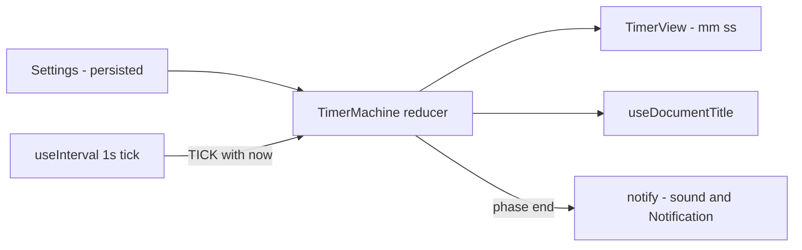
- **TimerMachine** is a reducer with `idle / running / paused` and the current phase.
- **useInterval** ticks once a second only while running and dispatches `TICK` with `Date.now()`.
- **notify** is an event, not state — triggered from the reducer's output in an Effect.

### Data model
| Type | Fields |
|---|---|
| `Settings` | `workMin`, `shortMin`, `longMin`, `roundsBeforeLong`, `sound: boolean` |
| `TimerState` | `status`, `phase: 'work' \| 'short' \| 'long'`, `endsAt: number \| null`, `remainingMs`, `round` |

### Tech stack
| Component | Choice | Why |
|---|---|---|
| Timing | `setInterval` + timestamps | accurate across throttled tabs |
| Hooks | custom `useInterval`, `useDocumentTitle`, `useLocalStorage` | reusable, testable |
| Tests | Vitest fake timers + RTL | control time |

### Milestones
1. **Reducer with timestamps.** *Done when* unit tests prove pause/resume keeps the right remaining time.
2. **`useInterval`.** *Done when* changing the delay does not reset or duplicate the interval.
3. **Title, sound, notification.** *Done when* phase end plays once, not twice in StrictMode.
4. **Settings.** *Done when* changed lengths survive a reload.

### Deep dive: the hard parts
- **Stale closures.** An Effect with `[]` dependencies that calls `setInterval(() => setSeconds(seconds - 1))` always sees the first `seconds`. Either use the updater form, or keep the latest callback in a ref, or wrap it with `useEffectEvent` so the Effect stays subscribed once while reading current values.
- **Background throttling.** Browsers slow timers in hidden tabs to save power. Never count ticks; compute `endsAt - Date.now()`.
- **Side effects at phase end.** Playing a sound inside the reducer breaks purity (and plays twice in StrictMode). Let the reducer record "phase ended" and react to it in an Effect, or trigger it from the tick handler.
- **Notification permission.** Ask only after a user gesture (clicking "Enable notifications"), never on page load.

### Testing strategy
Fake timers: start, advance 25 minutes, expect the phase to switch and the round to increment. Test pause by advancing time while paused. Test `useInterval` with `renderHook`.

### Trade-offs, scaling and failure modes
A Web Worker or the Page Visibility API can make timing even more robust, but timestamps already solve accuracy. If the computer sleeps, the timer will jump to "done" on wake — decide whether that is acceptable.

### Stretch goals
- Task list: pick the task you are focusing on; log completed pomodoros.
- Ring progress indicator in SVG.
- Make it an installable PWA (preview of Project 31).

### Skills practised
- [Ch 5 — Effects and refs](../chapters/05-effects-and-refs/README.md): cleanup, `useRef` for values
- [Ch 7 — Custom Hooks](../chapters/07-custom-hooks-and-hook-rules/README.md): custom Hooks, `useEffectEvent`
- [Ch 6 — State management](../chapters/06-state-management/README.md): reducers

### In the interview
**Q:** Why does my interval always see the initial state?

**A:** The callback closed over the state from the render when the Effect ran. Use an updater, a ref to the latest callback, or `useEffectEvent`.

**Q:** How do you keep a timer accurate in a background tab?

**A:** Store an end timestamp and compute the remaining time from the clock, because intervals get throttled.

**Q:** What is `useEffectEvent` for?

**A:** To read the latest props or state inside an Effect's callback without making them dependencies that restart the Effect.

### TL;DR
Drive the timer from timestamps, wrap `setInterval` in a declarative Hook, keep side effects out of the reducer and read fresh values with `useEffectEvent`.

## 9. Expense tracker with local storage

**Level:** Beginner · **Time:** 1–2 weekends · **Prerequisites:** Ch 3, Ch 6, Ch 7

### What it is
A personal budget app: add expenses (amount, category, date, note), see a monthly total, per-category breakdown and a simple bar chart, filter by month, and edit or delete entries. Everything persists in the browser with a `useLocalStorage` custom Hook built on `useSyncExternalStore` (a Hook for subscribing to data that lives outside React) so two open tabs stay in sync.

### The problem it solves
Most beginner apps lose data on refresh. Persisting naively (an Effect that writes on every change) works until you open two tabs and they overwrite each other, or the stored JSON is corrupted. This project teaches reliable persistence and clean derived data.

### Real-world examples
- MDN's [Web Storage API](https://developer.mozilla.org/en-US/docs/Web/API/Web_Storage_API) explains `localStorage`, the `storage` event between tabs, and the quota limits.
- react.dev's [`useSyncExternalStore` reference](https://react.dev/reference/react/useSyncExternalStore) uses browser APIs as the example external store.

### Requirements
**Functional**
- CRUD expenses; categories with colours.
- Month picker; totals per month and per category; bar chart.
- Export and import JSON.
- Data shared live across tabs.

**Non-functional**
- Stored data is versioned (`{ version: 1, items }`) and validated on load.
- Corrupted storage never crashes the app — show a recovery banner.
- 5,000 expenses filter in under 50 ms.

### The architecture
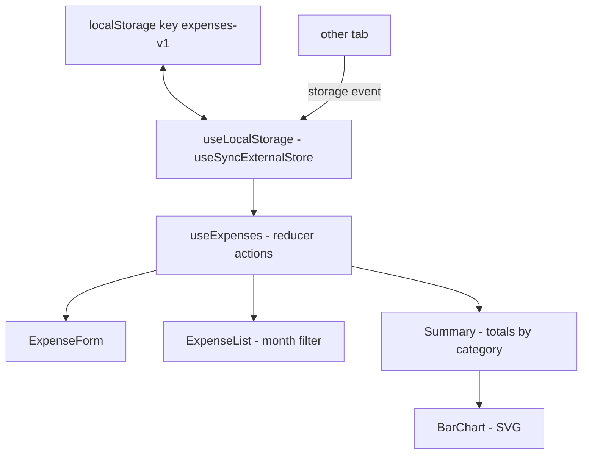
- **useLocalStorage** reads, validates and parses the key, subscribes to the `storage` event, and exposes a setter.
- **useExpenses** wraps it with domain actions: add, update, remove, import.
- **Summary** and **BarChart** only receive derived numbers.

### Data model
| Type | Fields |
|---|---|
| `Expense` | `id`, `amountCents: number`, `category: CategoryId`, `date: 'YYYY-MM-DD'`, `note` |
| `Stored` | `{ version: 1, items: Expense[] }` |
| Derived | `byMonth: Map<'YYYY-MM', Expense[]>`, `totalsByCategory` |

### Tech stack
| Component | Choice | Why |
|---|---|---|
| Persistence | `localStorage` + `useSyncExternalStore` | cross-tab sync, no tearing |
| Validation | Zod | reject bad imports |
| Chart | hand-written SVG | learn the basics before a library |
| Tests | Vitest + RTL with jsdom storage | unit, component and real-browser layers

### Milestones
1. **In-memory CRUD.** *Done when* add, edit and delete work with a reducer.
2. **Persistence Hook.** *Done when* refresh keeps data and a second tab updates live.
3. **Summaries and chart.** *Done when* totals match a hand-calculated fixture.
4. **Import/export and recovery.** *Done when* importing malformed JSON shows an error and changes nothing.

### Deep dive: the hard parts
- **Why `useSyncExternalStore`.** It gives React a `subscribe` function and a `getSnapshot` function. React re-reads the snapshot when notified and guarantees all components see the same value in one render. The snapshot must be cached: return the same parsed object until the raw string changes, or React re-renders forever.
- **The `storage` event fires only in *other* tabs.** For the current tab, your setter must notify subscribers itself.
- **Dates.** A `YYYY-MM-DD` string has no time zone; `new Date('2026-10-01')` is parsed as UTC midnight and may show as 30 September locally. Keep dates as strings for grouping.
- **Schema versioning.** When you add a field later, a `migrate(stored)` function upgrades version 1 to 2 on load.

### Testing strategy
Unit-test the reducer and the migrations. Test the Hook with `renderHook`: set a value, dispatch a synthetic `storage` event, expect the new value. RTL test for the totals view with a fixture.

### Trade-offs, scaling and failure modes
`localStorage` is synchronous and limited (commonly about 5 MB per origin); for bigger data use IndexedDB (Project 31). It is per-device — no sync. Private browsing may throw on write; catch and warn.

### Stretch goals
- Budgets per category with warnings.
- Recurring expenses.
- Replace the SVG with a chart library and compare bundle size.

### Skills practised
- [Ch 3 — State and events](../chapters/03-state-and-events/README.md): immutable updates
- [Ch 6 — State management](../chapters/06-state-management/README.md): reducer + context
- [Ch 7 — Custom Hooks](../chapters/07-custom-hooks-and-hook-rules/README.md): `useLocalStorage`, `useSyncExternalStore`

### In the interview
**Q:** Why not just write to `localStorage` in a `useEffect`?

**A:** It works for one tab, but other tabs won't update and components can read different values. `useSyncExternalStore` subscribes properly and keeps reads consistent.

**Q:** What must `getSnapshot` guarantee?

**A:** It returns the same value (by reference) when nothing changed; otherwise React thinks the store changed every render.

**Q:** How do you evolve stored data safely?

**A:** Version it, validate on load and run migrations.

### TL;DR
Treat `localStorage` as an external store, subscribe with `useSyncExternalStore`, version and validate what you store, and derive every summary.

## 10. Filterable product catalogue

**Level:** Beginner · **Time:** 1–2 weekends · **Prerequisites:** Ch 2, Ch 3, Ch 7

### What it is
A shop catalogue page with 2,000 products: a search box, category checkboxes, price range, "in stock only" toggle and a sort menu. Filters live in the URL so a filtered view can be bookmarked and shared. Typing stays smooth thanks to `useDeferredValue` (lets part of the UI lag behind urgent input). It is the classic "Thinking in React" exercise scaled up to a realistic size.

### The problem it solves
Filtering a big list on every keystroke can make typing laggy. Filters held only in component state are lost on refresh and can't be shared. This project teaches URL state, derived lists and React's concurrent features for responsiveness.

### Real-world examples
- react.dev's [Thinking in React](https://react.dev/learn/thinking-in-react) builds a `FilterableProductTable` — this brief extends it.
- react.dev's [`useDeferredValue` reference](https://react.dev/reference/react/useDeferredValue) shows keeping input responsive while a slow list re-renders.

### Requirements
**Functional**
- Text search over name and brand; category multi-select; min/max price; in-stock toggle; sort by price, rating, newest.
- "N results" and a "Clear filters" button. Empty-state message with suggestions.
- All filters encoded in the URL search params; Back/Forward restore them.

**Non-functional**
- Each keystroke in search renders in under 16 ms of main-thread work for the input itself.
- Filtering 2,000 items in under 20 ms.
- Results list uses semantic markup (`<ul>`, headings) and announces the result count politely.

### The architecture
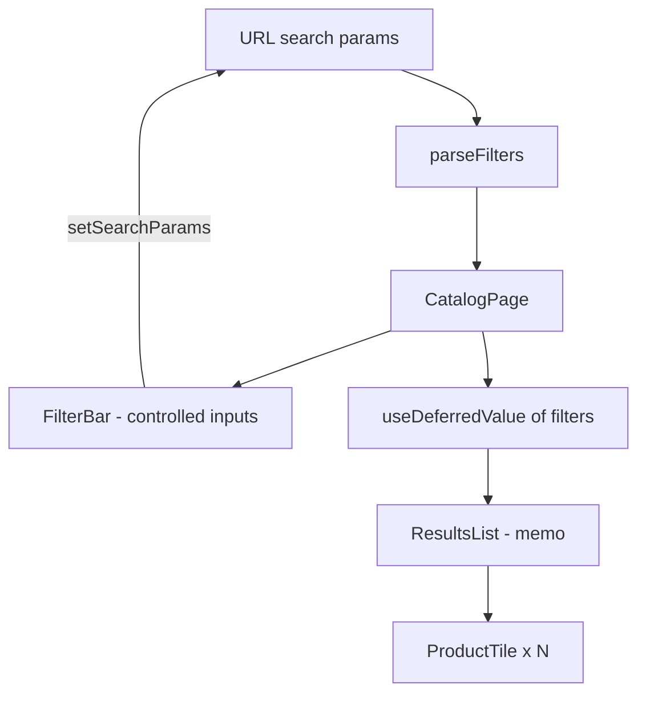
- **URL** is the single source of truth for filters.
- **parseFilters** converts strings to a typed object with defaults and rejects garbage.
- **useDeferredValue** gives `ResultsList` a lagging copy so the input repaints first.
- **ResultsList** is wrapped in `memo` so it only re-renders when the deferred filters change.

### Data model
| Type | Fields |
|---|---|
| `Product` | `id`, `name`, `brand`, `category`, `priceCents`, `rating`, `inStock`, `addedAt` |
| `Filters` | `q`, `categories: string[]`, `min?`, `max?`, `inStock: boolean`, `sort` |

### Tech stack
| Component | Choice | Why |
|---|---|---|
| URL state | `URLSearchParams` (or React Router's `useSearchParams`) | shareable, Back works |
| Responsiveness | `useDeferredValue` + `memo` | keep typing smooth |
| Tests | Vitest + RTL + Playwright | unit, component and real-browser layers

### Milestones
1. **Static list + search.** *Done when* typing filters the list.
2. **All filters and sort.** *Done when* a pure `applyFilters(products, filters)` passes table tests.
3. **URL state.** *Done when* reload and Back restore filters.
4. **Smooth typing.** Add an artificial slowdown to tiles, then `useDeferredValue`. *Done when* the input stays responsive under the slowdown.

### Deep dive: the hard parts
- **URL as state.** Parsing and serializing must round-trip: `parse(serialize(f))` equals `f`. Omit defaults from the URL to keep it clean.
- **Deferred rendering.** `useDeferredValue` first re-renders with the old value (cheap — `memo` skips the list), then tries the new value in the background and abandons it if you type again. Show a subtle "updating" opacity when `filters !== deferredFilters`.
- **Debounce vs defer.** Debouncing waits a fixed time; deferring renders as soon as the CPU allows. For local filtering, defer. For network calls, debounce (Project 16).
- **Text search.** Lower-case and normalize accents (`normalize('NFD')`) once per product, not per keystroke.

### Testing strategy
Table-driven tests for `applyFilters` and the URL round-trip. RTL: type, check count and first result. Playwright: apply filters, copy URL, open in new page, expect same results.

### Trade-offs, scaling and failure modes
Client-side filtering is fine to a few thousand items. Beyond that, filter on the server (Project 25) and paginate. URL length has practical limits; keep param names short.

### Stretch goals
- Facet counts next to each category ("Shoes (124)").
- Virtualize the results (Project 28).
- Compare with the React Compiler enabled and `memo` removed.

### Skills practised
- [Ch 2 — Components and props](../chapters/02-components-and-props/README.md): composition
- [Ch 7 — Custom Hooks](../chapters/07-custom-hooks-and-hook-rules/README.md): `useDeferredValue`, `useTransition`
- [Ch 9 — Routing and data fetching](../chapters/09-routing-and-data-fetching/README.md): search params
- [Ch 10 — Performance](../chapters/10-performance/README.md): `memo`

### In the interview
**Q:** `useDeferredValue` or debounce?

**A:** Defer when the work is local rendering — it adapts to the device. Debounce when you want to limit network calls.

**Q:** Why keep filters in the URL?

**A:** Shareable links, Back/Forward, and refresh all work, and there is one source of truth.

**Q:** Why does `useDeferredValue` need `memo` on the slow child?

**A:** The urgent render passes the old deferred value; `memo` lets React skip the slow list in that render.

### TL;DR
Make the URL the source of truth for filters, compute results with a pure function, and keep typing smooth with `useDeferredValue` plus `memo`.

## 11. Kanban board with drag and drop

**Level:** Intermediate · **Time:** 2 weeks · **Prerequisites:** Ch 6, Ch 11, Ch 12, Ch 14

### What it is
A Trello-style board: columns (To do, Doing, Done, plus custom ones) holding cards. Drag cards within and between columns, drag columns to reorder, open a card to edit its title, description, labels and due date. Drag and drop must work with mouse, touch **and keyboard**, and the board persists to a small REST API. You use **dnd-kit**, a modular drag-and-drop toolkit for React, a normalized reducer store and optimistic saves.

### The problem it solves
Drag and drop is where UIs become inaccessible and buggy: no keyboard support, lost drops when the network fails, and ordering that breaks when two people move cards. A kanban board forces you to design ordering, persistence and accessibility properly.

### Real-world examples
- [dnd-kit](https://dndkit.com/) and its [accessibility guide](https://dndkit.com/legacy/guides/accessibility/) describe keyboard sensors, screen-reader announcements and live regions for drag operations.
- dnd-kit's [Sortable preset](https://dndkit.com/legacy/presets/sortable/overview/) handles reordering within and across lists.
- Figma's post [How Figma's multiplayer technology works](https://www.figma.com/blog/how-figmas-multiplayer-technology-works/) describes **fractional indexing** — the ordering trick used below.

### Requirements
**Functional**
- CRUD columns and cards; reorder cards within and across columns; reorder columns.
- Keyboard: focus a card, press Space to pick up, arrows to move, Space to drop, Escape to cancel.
- Card detail dialog; labels and due dates; filter by label.
- Persist every move to the API; roll back with a toast on failure.

**Non-functional**
- Dragging stays at 60 frames per second with 300 cards.
- A move sends one small request (not the whole board).
- Screen readers announce "Picked up card X. Over column Doing, position 2 of 5."

### The architecture
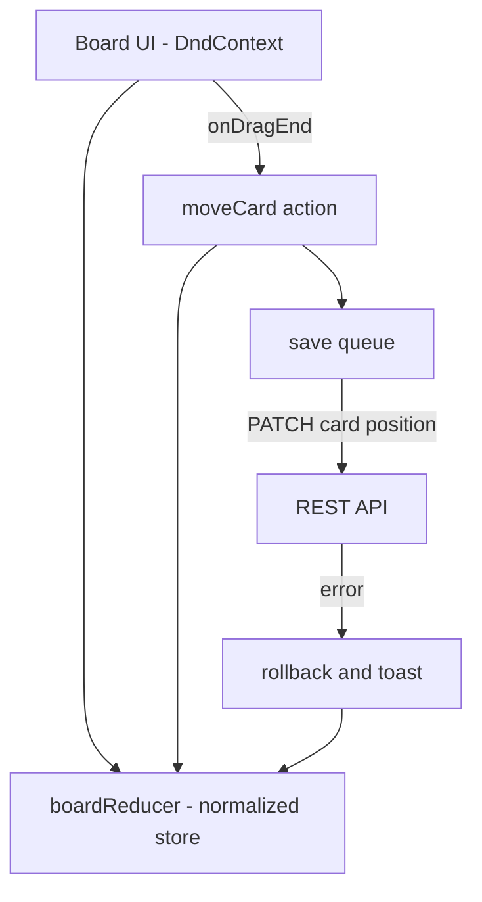
- **DndContext** (dnd-kit) provides sensors (pointer, touch, keyboard) and collision detection.
- **boardReducer** stores entities by id plus ordered id lists; every move is one action.
- **save queue** sends moves in order so a fast second move cannot overtake the first.
- **REST API** (a small Node 24 server or MSW in dev) stores cards with a sortable `rank`.

### Data model
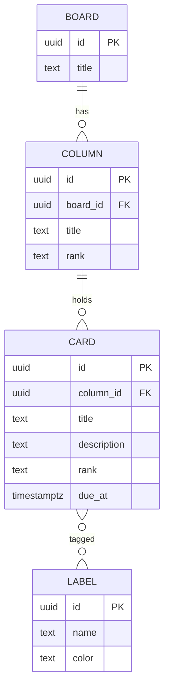
`rank` is a **fractional index** string: to insert between "a" and "b" you generate "an". Moving a card changes only its own `column_id` and `rank`.

### Tech stack
| Component | Choice | Why |
|---|---|---|
| Drag and drop | dnd-kit core + sortable | keyboard sensor, a11y announcements |
| State | `useReducer` + context, normalized | O(1) lookups, one action per move |
| Ordering | fractional-index strings | one-row updates |
| Tests | Vitest, RTL, Playwright | reducer, UI, real drag |

### Milestones
1. **Static board from fixtures** with a normalized store. *Done when* reducer tests cover add, rename, delete.
2. **Drag within a column, then across columns.** *Done when* Playwright drags a card and the order survives reload.
3. **Keyboard drag and announcements.** *Done when* you can move a card with keyboard only and hear the announcements in a screen reader.
4. **Persistence with rollback.** *Done when* an injected 500 error returns the card to where it was and shows a toast.
5. **Card dialog and labels.** *Done when* label filter hides non-matching cards but keeps drag working.

### Deep dive: the hard parts
- **Normalized state.** Store `cards: Record<id, Card>` and `column.cardIds: id[]`. A move edits two arrays and one card — not a deep nested copy of the board.
- **Fractional indexing.** Integer positions need renumbering every card after the insert point. String ranks let you compute a key strictly between two neighbours, so one row changes. Occasionally keys grow long; rebalance in the background.
- **Optimistic moves with rollback.** Apply the move locally, remember the previous position, send the request. On failure, dispatch a reverse move. Because moves are queued, a later move is based on the optimistic state; if an earlier one fails, either replay or refetch the board.
- **Drag overlays.** Render the dragged card in a `DragOverlay` (portal) so it is not clipped by the column's scroll container and the original slot shows a placeholder.

### Testing strategy
Reducer and rank-generation unit tests (including "insert between two equal ranks" never happens). RTL for dialogs and filters. Playwright for mouse drags and a keyboard drag. MSW for the failure path.

### Trade-offs, scaling and failure modes
Context + reducer re-renders every consumer on any change; with hundreds of cards, split contexts or move to Zustand with selectors (Project 20). Two users moving the same card need real-time sync and last-writer-wins per field — see Project 27. Very long columns need virtualization, which conflicts with drag; dnd-kit supports it with care.

### Stretch goals
- Real-time updates via WebSocket.
- Undo/redo with a history stack.
- WIP limits per column that block a drop.

### Skills practised
- [Ch 6 — State management](../chapters/06-state-management/README.md): reducer + context, normalized state
- [Ch 11 — TypeScript with React](../chapters/11-typescript-with-react/README.md): typed actions
- [Ch 12 — Testing React](../chapters/12-testing-react/README.md): user-event, MSW
- [Ch 14 — Patterns and architecture](../chapters/14-patterns-and-architecture/README.md): portals, accessibility

### In the interview
**Q:** How do you store order so that a move updates one row?

**A:** Use a fractional index — a sortable string between the neighbours' keys — instead of integer positions.

**Q:** How do you make drag and drop accessible?

**A:** Provide a keyboard sensor (pick up, move, drop, cancel), visible focus, and live-region announcements of the item and its position.

**Q:** What happens if the save fails?

**A:** Roll back to the remembered position, tell the user, and keep later queued moves consistent by replaying or refetching.

### TL;DR
Normalize the board, order with fractional indexes, apply moves optimistically with rollback, and make drag work by keyboard with announcements.

## 12. Infinite social feed

**Level:** Intermediate · **Time:** 1–2 weeks · **Prerequisites:** Ch 6, Ch 9, Ch 10

### What it is
A Twitter-like home feed: posts with author, text, images and like counts that load page by page as you scroll, with pull-to-refresh, a "New posts" pill, liking with instant feedback, and scroll position restored when you come back from a post's detail page. **TanStack Query** (a library for fetching, caching and updating **server state** — data owned by a server that your UI only borrows) does the heavy lifting with `useInfiniteQuery`.

### The problem it solves
Feeds combine every hard data problem: pagination that must not skip or duplicate items when new posts arrive, cache invalidation, optimistic updates, memory growth and scroll restoration. Hand-rolled solutions usually fail one of these.

### Real-world examples
- TanStack Query's [Infinite Queries guide](https://tanstack.com/query/latest/docs/framework/react/guides/infinite-queries) and [`useInfiniteQuery` reference](https://tanstack.com/query/latest/docs/framework/react/reference/functions/useInfiniteQuery) define `getNextPageParam` and `maxPages`.
- MDN's [Intersection Observer API](https://developer.mozilla.org/en-US/docs/Web/API/Intersection_Observer_API) is the standard way to detect a "load more" sentinel coming into view.
- TanStack Query's [Optimistic Updates guide](https://tanstack.com/query/latest/docs/framework/react/guides/optimistic-updates) covers the like button.

### Requirements
**Functional**
- Cursor-paginated feed, 20 posts per page, auto-loads near the bottom.
- Like/unlike with instant count change and rollback on failure.
- "N new posts" pill when fresh posts exist; clicking it scrolls to top and merges them.
- Post detail route; Back restores the exact scroll position.

**Non-functional**
- Next page starts loading at least one screen before the user reaches the end.
- Memory bounded: keep at most 10 pages in the cache (`maxPages`) or virtualize.
- Interaction to Next Paint (INP, the delay from a tap to the next frame) under 200 ms on a mid-range phone.

### The architecture
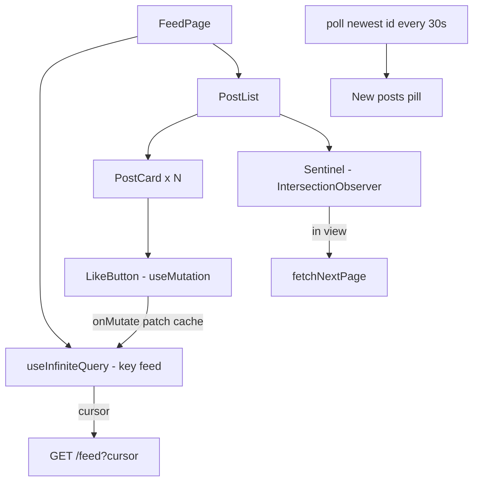
- **useInfiniteQuery** stores `pages[]` and `pageParams[]` under the key `['feed']`.
- **Sentinel** is an empty element observed with `IntersectionObserver` and a `rootMargin` of one screen.
- **LikeButton** uses `useMutation`; `onMutate` patches the post inside the cached pages and returns a snapshot for rollback.
- **Poll** asks "is there anything newer than my first id?" without disturbing the list.

### Data model
| Type | Fields |
|---|---|
| `Post` | `id`, `author: { id, name, avatarUrl }`, `text`, `images[]`, `likeCount`, `likedByMe`, `createdAt` |
| `FeedPage` | `{ items: Post[], nextCursor: string \| null }` |
| Cache | `InfiniteData<FeedPage, string \| null>` |

### Tech stack
| Component | Choice | Why |
|---|---|---|
| Server state | TanStack Query v5 | caching, dedupe, retries, infinite pages |
| Routing | React Router | detail route, scroll restoration |
| Mock API | MSW or a Node 24 server | deterministic pages |
| Tests | Vitest + RTL + Playwright | unit, component and real-browser layers

### Milestones
1. **First page** with loading and error states. *Done when* refetch-on-focus works.
2. **Infinite scroll** with the sentinel. *Done when* no duplicate or missing posts across 10 pages.
3. **Optimistic like.** *Done when* a forced failure restores the count and shows a toast.
4. **New-posts pill and pull-to-refresh.** *Done when* new posts appear only after clicking the pill.
5. **Scroll restoration and memory cap.** *Done when* Back from a detail page lands on the same post.

### Deep dive: the hard parts
- **Cursor, not offset.** With `?page=3`, a new post at the top shifts everything down and you see a duplicate. A cursor ("posts older than id X") is stable under inserts.
- **Updating one post in nested pages.** `setQueryData(['feed'], old => ({ ...old, pages: old.pages.map(p => ({ ...p, items: p.items.map(...) })) }))`. Cancel in-flight feed queries first (`cancelQueries`) so a refetch doesn't overwrite your optimistic change.
- **Bounded memory.** `maxPages` drops old pages; if users scroll back up, they refetch. Alternatively virtualize the list (Project 28) so the DOM stays small even if data is large.
- **Scroll restoration.** Keep the query cached (it is, for `gcTime`) and restore the scroll offset after the list renders — React Router's `<ScrollRestoration />` does this for data routers.

### Testing strategy
MSW handlers return deterministic pages. RTL: mock `IntersectionObserver`, trigger it, expect page 2. Test the like rollback by making the handler return 500. Playwright: scroll to page 5, open a post, go Back, assert the same post is in view.

### Trade-offs, scaling and failure modes
Polling is simple and cheap at 30 s; real-time push (WebSocket or Server-Sent Events) is better at scale but more infrastructure. Optimistic likes can briefly show wrong counts if two devices like at once — refetch on settle. Images dominate bandwidth: use responsive sizes.

### Stretch goals
- Virtualize with TanStack Virtual.
- Prefetch a post's detail on hover (`queryClient.prefetchQuery`).
- Use `<Activity>` to keep the feed mounted but hidden while a detail page is shown.

### Skills practised
- [Ch 6 — State management](../chapters/06-state-management/README.md): server state with TanStack Query
- [Ch 9 — Routing and data fetching](../chapters/09-routing-and-data-fetching/README.md): mutations, invalidation, optimistic updates
- [Ch 10 — Performance](../chapters/10-performance/README.md): virtualization
- [Ch 15 — Interview and machine coding](../chapters/15-react-interview-and-machine-coding/README.md): infinite scroll build

### In the interview
**Q:** Why cursor pagination for feeds?

**A:** New items shift offsets and cause duplicates or gaps; a cursor anchors to a specific item.

**Q:** How does an optimistic update roll back in TanStack Query?

**A:** `onMutate` cancels queries, snapshots the cache, writes the optimistic value and returns the snapshot; `onError` restores it; `onSettled` invalidates.

**Q:** How do you trigger loading the next page?

**A:** Observe a sentinel element with `IntersectionObserver` using a generous `rootMargin`.

### TL;DR
Use cursor-based `useInfiniteQuery`, an observed sentinel, cache-patching optimistic likes with rollback, and bound memory with `maxPages` or virtualization.

## 13. E-commerce cart with context and reducer

**Level:** Intermediate · **Time:** 1–2 weeks · **Prerequisites:** Ch 4, Ch 6, Ch 9

### What it is
A small shop: product list, product page with size/colour variants, a cart drawer, and a checkout form with shipping, promo codes and an order summary. The cart is a **reducer + context** store (React's built-in way to share state without a library) that persists across reloads, merges with a server cart when you sign in, and recalculates totals with tax and discounts.

### The problem it solves
Carts look simple but contain real business logic: variants with separate stock, quantity limits, promo rules, prices that change between add and checkout, and a guest cart that must merge with an account cart. Putting this logic in a reducer makes it testable and keeps components dumb.

### Real-world examples
- react.dev's [Scaling Up with Reducer and Context](https://react.dev/learn/scaling-up-with-reducer-and-context) is the pattern used here.
- react.dev's [`createContext` reference](https://react.dev/reference/react/createContext) — in React 19 you can render `<CartContext value={...}>` directly instead of `.Provider`.

### Requirements
**Functional**
- Add to cart with variant; change quantity; remove; save for later.
- Cart drawer opens on add; badge in header shows item count.
- Promo codes (percentage, fixed, free shipping) validated by an API.
- Checkout form using a form Action; on success, clear the cart and show the order number.

**Non-functional**
- All money math in integer cents; totals match the server's within 0 cents.
- Cart survives reload and syncs across tabs.
- Header badge must not re-render the whole product list when the cart changes.

### The architecture
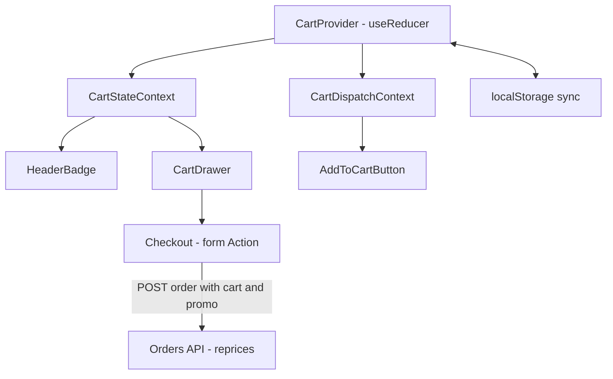
- **CartProvider** owns the reducer and exposes state and dispatch in **two contexts**, so buttons that only dispatch never re-render on cart changes.
- **Checkout** submits with `useActionState`; the server reprices and may return "price changed" errors.
- **localStorage sync** persists the cart (reuse your Project 9 Hook).

### Data model
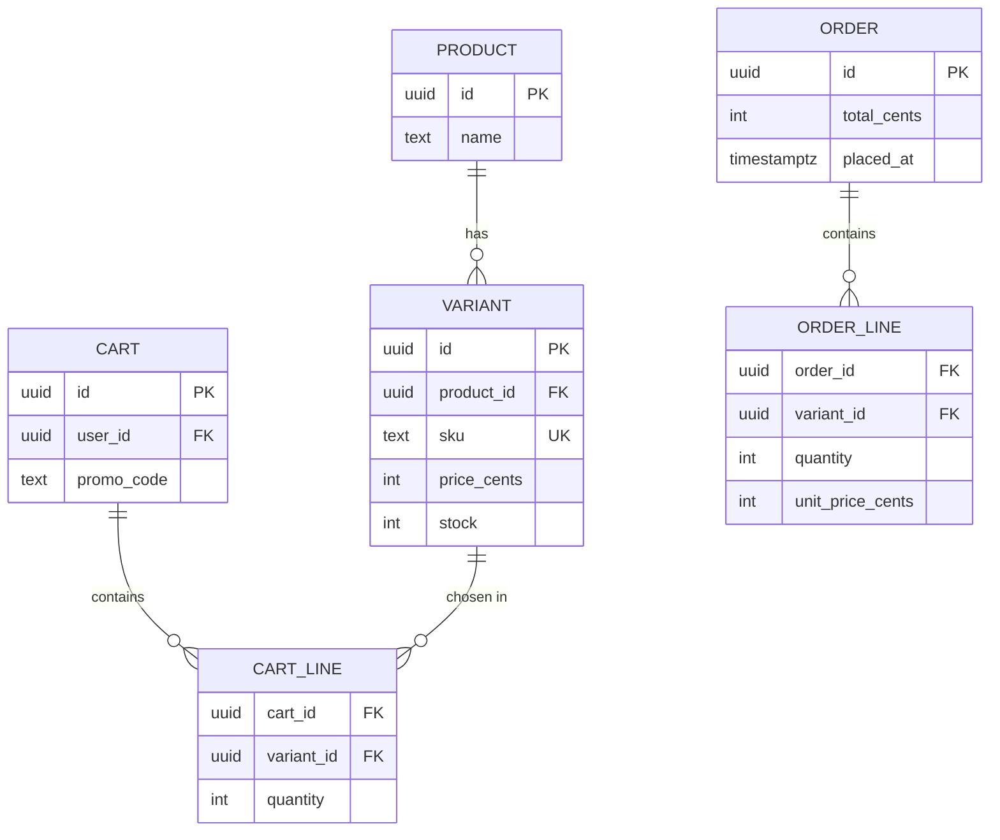
Order lines copy the unit price at purchase time, so later price changes don't alter history.

### Tech stack
| Component | Choice | Why |
|---|---|---|
| Cart state | `useReducer` + split contexts | no library, testable, minimal re-renders |
| Routing | React Router (data mode) | product loaders, checkout action |
| Forms | form Actions + Zod | pending/error state built in |
| Tests | Vitest, RTL, Playwright | unit, component and real-browser layers

### Milestones
1. **Catalogue and product page** with loaders. *Done when* variants show stock.
2. **Cart reducer** with add/update/remove and totals. *Done when* unit tests cover limits and promo rules.
3. **Provider, drawer, badge.** *Done when* the React DevTools Profiler shows add-to-cart buttons don't re-render on quantity changes.
4. **Checkout Action** with server repricing. *Done when* a changed price shows an inline warning and requires confirmation.
5. **Persistence and merge.** *Done when* a guest cart merges into a signed-in cart without duplicates.

### Deep dive: the hard parts
- **Split state and dispatch contexts.** Any component that reads a context re-renders when its value changes. `dispatch` never changes, so a dispatch-only context keeps buttons quiet.
- **The server is the source of truth for prices.** The client cart stores variant ids and quantities; display prices come from the catalogue and the order is repriced on submit. Never send a total and trust it.
- **Merging carts.** On sign-in: for each guest line, add to the account cart, capping at stock. Decide whether quantities add or take the max, and test it.
- **Rounding discounts.** A 15 % code on three lines: discount per line or on the subtotal? Pick one rule, round once and document it.

### Testing strategy
Pure reducer and pricing tests (table-driven). RTL: add to cart, open drawer, change quantity, apply promo. Playwright: full checkout happy path and "price changed" path with MSW.

### Trade-offs, scaling and failure modes
Context is fine for one cart. With many independent slices (wishlist, recently viewed, compare), a store with selectors (Zustand, Redux Toolkit) avoids re-render storms. Stock can sell out between add and checkout — handle it at submit. Never store card numbers; use a payment provider's hosted fields.

### Stretch goals
- Optimistic quantity changes with `useOptimistic` against a server cart.
- Recommendations ("customers also bought").
- Server-side cart in a framework (Project 40).

### Skills practised
- [Ch 4 — Forms and Actions](../chapters/04-forms-and-actions/README.md): checkout Action
- [Ch 6 — State management](../chapters/06-state-management/README.md): reducer + context, context performance
- [Ch 9 — Routing and data fetching](../chapters/09-routing-and-data-fetching/README.md): loaders and actions

### In the interview
**Q:** Why two contexts for one store?

**A:** Consumers re-render when the context value changes; dispatch is stable, so components that only dispatch avoid re-rendering on state changes.

**Q:** Should the client calculate the order total?

**A:** For display only. The server reprices from its catalogue and validates promos when the order is placed.

**Q:** What changed for context in React 19?

**A:** You can render the context object directly as a provider and read context with `use()`, even conditionally.

### TL;DR
Keep cart rules in a pure reducer, share it with split state/dispatch contexts, compute money in cents, and let the server reprice at checkout.

## 14. Analytics dashboard with charts

**Level:** Intermediate · **Time:** 2 weeks · **Prerequisites:** Ch 6, Ch 7, Ch 9, Ch 10

### What it is
An admin dashboard for a fictional SaaS: KPI tiles (revenue, active users, churn), a line chart over time, a bar chart by plan, a table of top customers, a date-range picker and segment filters. Widgets load independently with their own skeletons and error states, filters live in the URL, and the dashboard auto-refreshes every minute. You use **Recharts** (a React charting library built on SVG) and TanStack Query.

### The problem it solves
Dashboards are where pages get slow and fragile: one failing widget blanks the page, re-renders cascade on every filter change, charts are unreadable to screen-reader users, and refresh logic hammers the API. Designing independent widgets with shared filters solves all of these.

### Real-world examples
- [Recharts](https://recharts.org/) documents responsive containers, tooltips and composable chart components.
- TanStack Query's [`useQuery` reference](https://tanstack.com/query/latest/docs/framework/react/reference/functions/useQuery) documents the `refetchInterval` and `refetchIntervalInBackground` options that drive auto-refresh.
- web.dev's [Interaction to Next Paint article](https://web.dev/articles/inp) explains the responsiveness metric your filter changes must respect.

### Requirements
**Functional**
- Date range presets (7/30/90 days, custom) and segment filters (plan, region).
- 4 KPI tiles with change vs previous period; line chart; bar chart; top-customers table.
- Each widget has skeleton, error with retry and empty states.
- Auto-refresh every 60 s while the tab is visible; "Last updated" time.

**Non-functional**
- Changing a filter keeps the UI responsive (INP under 200 ms) while charts update.
- One failing widget never breaks others.
- Every chart has a text alternative (a summary or a data table toggle).

### The architecture
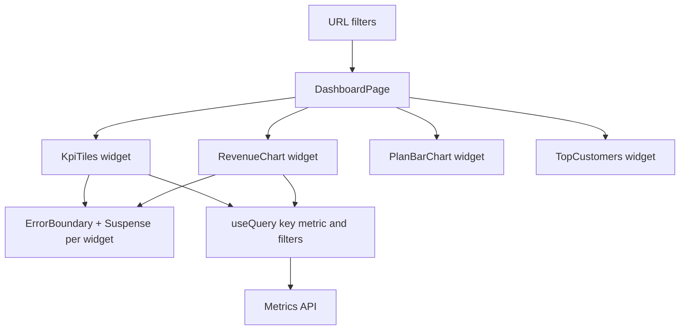
- **URL filters** are parsed once and passed to every widget.
- **Each widget** owns its query (key includes the filters), its `Suspense` fallback and its **error boundary** (a component that catches render errors in its subtree and shows a fallback).
- **Metrics API** returns pre-aggregated series; the browser never aggregates raw events.

### Data model
| Type | Fields |
|---|---|
| `Filters` | `from`, `to`, `plan?`, `region?` |
| `Kpi` | `name`, `value`, `previous`, `unit` |
| `Series` | `{ t: string, value: number }[]` |
| Query keys | `['metric', name, filters]` |

### Tech stack
| Component | Choice | Why |
|---|---|---|
| Charts | Recharts | declarative SVG, React-friendly |
| Data | TanStack Query with `useSuspenseQuery` | per-widget loading via Suspense |
| Filters | URL + `useTransition` | non-blocking filter changes |
| Tests | Vitest, RTL, Playwright screenshots | unit, component and real-browser layers

### Milestones
1. **Layout and one widget** with skeleton/error/empty. *Done when* forcing a 500 shows only that widget's error.
2. **All widgets** with shared URL filters. *Done when* filters round-trip through the URL.
3. **Transitions.** Wrap filter navigation in `startTransition`. *Done when* old charts stay visible (dimmed) while new data loads instead of flashing skeletons.
4. **Auto-refresh and visibility.** *Done when* no requests fire while the tab is hidden.
5. **Accessibility.** *Done when* each chart has a "View as table" toggle and a text summary.

### Deep dive: the hard parts
- **Suspense + transitions.** If a filter change suspends a widget, React would normally show the fallback again. Wrapping the URL update in a transition tells React to keep showing the old content until the new data is ready.
- **Isolated failures.** One error boundary per widget, with a reset that calls `queryClient.resetQueries` for that key, gives "Retry" without a page reload.
- **Avoiding chart re-renders.** Recharts re-renders on new props. Pass stable data references (TanStack Query's structural sharing keeps unchanged data identical) and memoize derived series or let the React Compiler do it.
- **Time zones and buckets.** Ask the API for buckets in the user's time zone; daylight-saving days have 23 or 25 hours. Label axes accordingly.

### Testing strategy
RTL per widget with MSW: loading, data, error, empty. Test the URL ↔ filters round-trip. Playwright visual snapshots of the dashboard with fixed data. An axe scan.

### Trade-offs, scaling and failure modes
Many parallel queries are fine over HTTP/2; batching them into one request saves round-trips but couples failures. SVG charts slow down past a few thousand points — downsample on the server or switch to canvas. Auto-refresh multiplies load by the number of open dashboards; back off when idle.

### Stretch goals
- Drag-and-drop widget layout saved per user.
- CSV export of any widget.
- Compare two periods on the same chart.

### Skills practised
- [Ch 6 — State management](../chapters/06-state-management/README.md): server vs URL state
- [Ch 7 — Custom Hooks](../chapters/07-custom-hooks-and-hook-rules/README.md): `useTransition`
- [Ch 9 — Routing and data fetching](../chapters/09-routing-and-data-fetching/README.md): Suspense, TanStack Query
- [Ch 10 — Performance](../chapters/10-performance/README.md): profiling re-renders
- [Ch 14 — Patterns and architecture](../chapters/14-patterns-and-architecture/README.md): error boundaries

### In the interview
**Q:** How do you stop one widget's error from breaking the page?

**A:** Wrap each widget in its own error boundary and Suspense boundary, with a retry that resets that widget's query.

**Q:** Why wrap filter changes in a transition?

**A:** So React keeps the current UI visible while the new data loads instead of falling back to skeletons.

**Q:** How do you make charts accessible?

**A:** Provide a text summary and a data-table alternative, label axes, and don't rely on colour alone.

### TL;DR
Give every widget its own query, Suspense and error boundary, keep filters in the URL, change them in transitions, and offer tables for charts.

## 15. Markdown notes app with routing

**Level:** Intermediate · **Time:** 2 weeks · **Prerequisites:** Ch 7, Ch 9, Ch 11

### What it is
A note-taking app in the spirit of Bear or Obsidian: a sidebar of notes and folders, an editor with live Markdown preview, tags, full-text search and `[[wiki links]]` between notes. Each note has a URL (`/notes/:id`), and the app uses **React Router** in data mode — **loaders** (functions that fetch data before a route renders) and **actions** (functions that handle form submissions for a route).

### The problem it solves
Notes apps test routing design: nested layouts (sidebar stays, editor changes), data loading before render, saving without losing keystrokes, and rendering user-written Markdown safely. They also expose the cost of re-rendering a large preview on every keystroke.

### Real-world examples
- [React Router](https://reactrouter.com/) and its [modes overview](https://reactrouter.com/start/modes) (declarative, data, framework) — this project uses data mode.
- [react-markdown](https://github.com/remarkjs/react-markdown) renders Markdown to React elements without `dangerouslySetInnerHTML`, using the remark/rehype plugin ecosystem.

### Requirements
**Functional**
- Routes: `/` (list), `/notes/:id` (editor), `/tags/:tag`, `/search?q=`.
- Create, rename, delete, move to folder; autosave while typing.
- Live preview; `[[Note title]]` links navigate; backlinks panel.
- Search over titles and bodies with highlighted matches.

**Non-functional**
- Autosave at most once per second per note; never lose the last keystroke on navigation.
- Rendering Markdown cannot execute scripts (XSS-safe).
- 1,000 notes load the sidebar in under 300 ms.

### The architecture
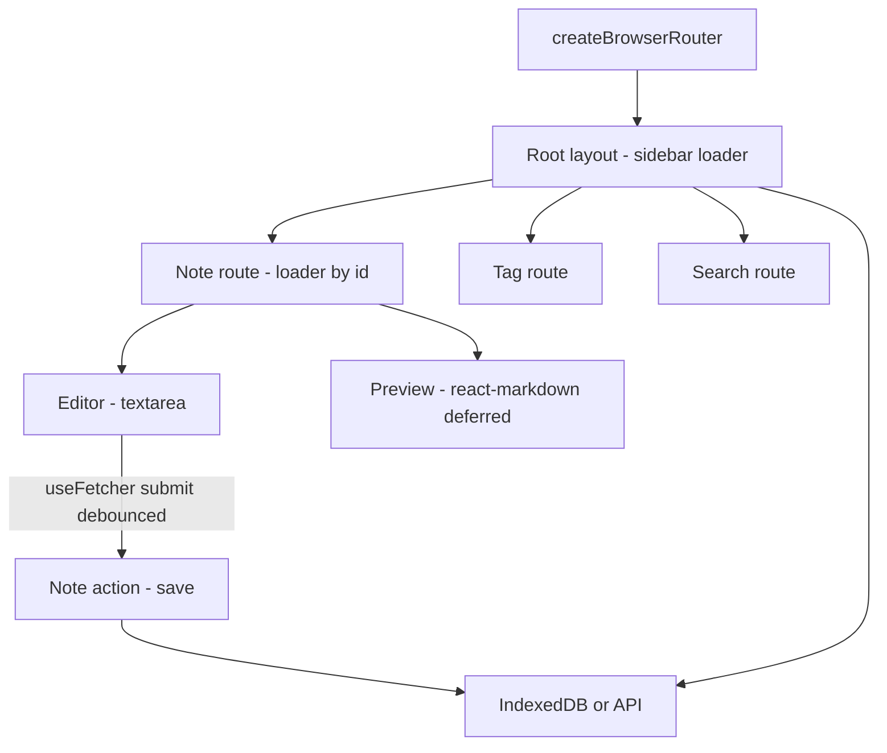
- **Root layout** loads the note list once; child routes render in its `<Outlet>`.
- **Note loader** fetches one note; a missing id throws a 404 response handled by the route's error element.
- **Editor** saves via a **fetcher** (`useFetcher`) so saving does not navigate; after the action, React Router revalidates the sidebar automatically.
- **Preview** receives a deferred copy of the text (`useDeferredValue`).

### Data model
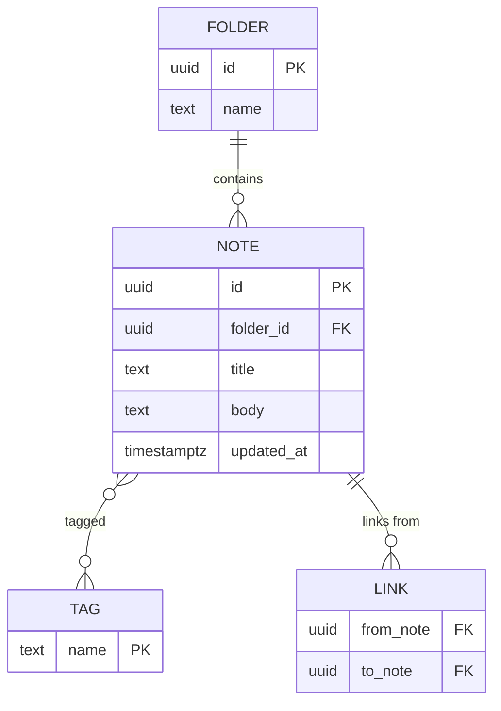
Links and tags are re-extracted from the body on every save, so they never drift.

### Tech stack
| Component | Choice | Why |
|---|---|---|
| Routing | React Router (data mode) | loaders, actions, fetchers, revalidation |
| Markdown | react-markdown + remark-gfm | safe by default, plugins |
| Storage | IndexedDB (via a tiny wrapper) or a REST API | room for thousands of notes |
| Tests | Vitest + RTL with `createMemoryRouter`, Playwright | unit, component and real-browser layers

### Milestones
1. **Routes and layouts** with fixture data. *Done when* the sidebar persists while the editor changes.
2. **Loaders and 404s.** *Done when* `/notes/unknown` shows a friendly not-found inside the layout.
3. **Editing with fetcher autosave.** *Done when* a test types, waits 1 s and sees one save.
4. **Preview, wiki links, backlinks.** *Done when* clicking `[[Ideas]]` navigates and the backlinks panel updates.
5. **Search route.** *Done when* `/search?q=react` highlights matches and is bookmarkable.

### Deep dive: the hard parts
- **Never lose keystrokes.** Keep the draft in local state; debounce the save; flush on route change and on `pagehide`. Use React Router's `useBlocker` to warn if a save is pending.
- **Safe Markdown.** react-markdown does not render raw HTML unless you add a plugin. If you enable HTML, sanitize with rehype-sanitize. Custom link components route `[[...]]` through `<Link>`.
- **Revalidation cost.** After every action, loaders revalidate. Autosaving each second would reload the sidebar each second. Implement `shouldRevalidate` to skip the list reload unless the title changed.
- **Typing performance.** Markdown parsing of a long note on each keystroke is heavy. Defer the preview so the textarea stays responsive.

### Testing strategy
Route tests with `createMemoryRouter` and fixture loaders. Unit-test link/tag extraction. Playwright: create a note, type, navigate away immediately, return — text is intact.

### Trade-offs, scaling and failure modes
Local IndexedDB means no sync; adding a server introduces conflicts (two devices editing the same note) — last-writer-wins per note is simple, CRDTs (Project 27) are robust. Full-text search in the browser works for thousands of notes; beyond that, index on a server.

### Stretch goals
- Graph view of links.
- Offline sync with a server (Project 31 techniques).
- Code-split the editor with `lazy`.

### Skills practised
- [Ch 7 — Custom Hooks](../chapters/07-custom-hooks-and-hook-rules/README.md): `useDebounce`, `useDeferredValue`
- [Ch 9 — Routing and data fetching](../chapters/09-routing-and-data-fetching/README.md): layouts, loaders, actions, fetchers
- [Ch 11 — TypeScript with React](../chapters/11-typescript-with-react/README.md): typed loaders
- [Ch 12 — Testing React](../chapters/12-testing-react/README.md): testing routers

### In the interview
**Q:** Why a fetcher instead of a `<Form>` for autosave?

**A:** A fetcher calls the route action without navigating or adding history entries, which suits background saves.

**Q:** How do you render user Markdown safely?

**A:** Render to React elements, keep raw HTML disabled or sanitized, and never use `dangerouslySetInnerHTML` on unsanitized input.

**Q:** What is a loader?

**A:** A function attached to a route that fetches its data before the route renders, so components receive ready data.

### TL;DR
Nest routes under a sidebar layout, load notes with loaders, autosave with debounced fetchers, defer the preview and render Markdown safely.

## 16. Accessible autocomplete combobox

**Level:** Intermediate · **Time:** 1 week · **Prerequisites:** Ch 5, Ch 7, Ch 14, Ch 15

### What it is
A reusable `<Autocomplete>` component — think a city or user search box — that suggests results as you type from a remote API, with **debouncing** (waiting until the user pauses before sending a request), request cancellation, keyboard navigation, highlighting and full **WAI-ARIA combobox** semantics (the roles and attributes that make a text box with a pop-up list understandable to screen readers). It is the most common front-end machine-coding question, built to production quality.

### The problem it solves
A naive autocomplete fires a request per keystroke, shows results for an old query, cannot be used with a keyboard and says nothing to screen readers. Each of these is a real complaint in real products.

### Real-world examples
- The W3C [Combobox pattern](https://www.w3.org/WAI/ARIA/apg/patterns/combobox/) specifies roles, `aria-expanded`, `aria-controls`, `aria-activedescendant` and keyboard behaviour.
- MDN's [AbortController](https://developer.mozilla.org/en-US/docs/Web/API/AbortController) is how you cancel outdated requests.
- Chapter 15 §15.11 of this book builds a minimal version — this brief hardens it into a library component.

### Requirements
**Functional**
- Debounced search (250 ms), minimum 2 characters, cancel outdated requests.
- Up/Down move the active option, Enter selects, Escape closes then clears, Home/End jump, Tab accepts the active option per your design decision.
- Highlight matched text; show "No results", loading and error states inside the pop-up.
- Generic: `Autocomplete<T>` with `getLabel`, `renderOption`, `fetchOptions`.

**Non-functional**
- At most one request in flight; at most 4 requests per second while typing.
- Screen readers announce the number of results and the active option.
- Zero axe violations; works in NVDA, VoiceOver and JAWS (test at least one).

### The architecture
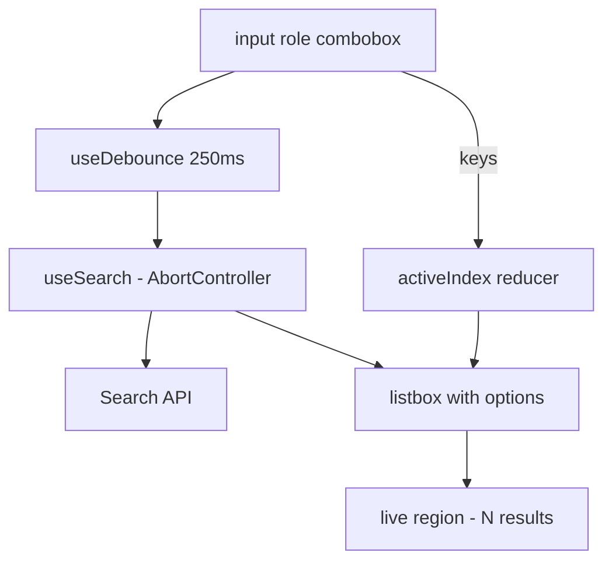
- **input** keeps focus at all times; options are never focused directly — `aria-activedescendant` points at the active option's id.
- **useDebounce** delays the query; **useSearch** aborts the previous request when the query changes.
- **activeIndex reducer** handles all keys in one place.
- **live region** (`role="status"`) announces result counts.

### Data model
| Type | Fields |
|---|---|
| Props | `fetchOptions(q, signal): Promise<T[]>`, `getLabel(t)`, `getKey(t)`, `onSelect(t)`, `renderOption?` |
| State | `query`, `isOpen`, `activeIndex: number \| -1`, `status`, `options: T[]` |
| IDs | from `useId()` for listbox and options |

### Tech stack
| Component | Choice | Why |
|---|---|---|
| Component | React 19 + TypeScript generics | reusable for any item type |
| IDs | `useId` | stable, SSR-safe ids for ARIA |
| Tests | RTL + `user-event` + fake timers, Playwright + axe | unit, component and real-browser layers

### Milestones
1. **Static listbox** with keyboard navigation over fixed options. *Done when* all APG keys work.
2. **Remote search** with debounce and abort. *Done when* a test with out-of-order responses always shows the latest query's results.
3. **ARIA wiring.** *Done when* a screen reader announces the active option while you arrow through.
4. **Generic API, highlighting, states.** *Done when* the same component powers a city search and a user search.

### Deep dive: the hard parts
- **`aria-activedescendant` vs moving focus.** Moving DOM focus into the list would steal the caret from the input. Instead, the input stays focused and its `aria-activedescendant` names the active option; you also scroll it into view.
- **Mouse and keyboard together.** Hover should set the active index, but mouse-down on an option blurs the input before the click fires. Use `onMouseDown={e => e.preventDefault()}` on options.
- **Debounce + abort.** Debounce reduces requests; abort guarantees correctness when responses arrive out of order. You need both.
- **Highlighting safely.** Split the label on the query (escape regex characters!) and wrap matches in `<mark>`; no HTML strings.

### Testing strategy
RTL: type with fake timers, assert one request after 250 ms; arrow down, assert `aria-activedescendant`; Enter selects. Out-of-order MSW responses for the race. Playwright + axe on a demo page.

### Trade-offs, scaling and failure modes
Client-side filtering is better for small static lists (no network). For huge result sets, cap results and virtualize. Rate limiting by the API needs graceful errors. Headless libraries (Downshift, React Aria) exist — building it once teaches you what they solve.

### Stretch goals
- Multi-select with token chips.
- Recent searches when the input is empty.
- Server-side caching with TanStack Query (query key per term).

### Skills practised
- [Ch 5 — Effects and refs](../chapters/05-effects-and-refs/README.md): fetch races
- [Ch 7 — Custom Hooks](../chapters/07-custom-hooks-and-hook-rules/README.md): `useDebounce`, `useId`
- [Ch 14 — Patterns and architecture](../chapters/14-patterns-and-architecture/README.md): accessibility
- [Ch 15 — Interview and machine coding](../chapters/15-react-interview-and-machine-coding/README.md): autocomplete build

### In the interview
**Q:** Debounce or throttle for search-as-you-type?

**A:** Debounce: you want the request after the user pauses, not at regular intervals during typing.

**Q:** Why is debouncing not enough?

**A:** Responses can still arrive out of order; abort the previous request or ignore stale responses.

**Q:** How does a screen reader know which option is active?

**A:** The focused input's `aria-activedescendant` holds the active option's id; the listbox and options have proper roles.

### TL;DR
Debounce the query, abort stale requests, keep focus in the input with `aria-activedescendant`, and handle every APG key in one reducer.

## 17. Multi-step form wizard

**Level:** Intermediate · **Time:** 1–2 weeks · **Prerequisites:** Ch 4, Ch 6, Ch 11

### What it is
An insurance-quote or job-application style wizard: five steps (personal details, address, employment, documents, review), a progress indicator, per-step validation, conditional steps ("self-employed" adds a step), draft saving, and a final review page where each section has an "Edit" link. Built with **React Hook Form** (a form library that keeps inputs mostly uncontrolled for performance) and **Zod** schemas (runtime validation that also produces TypeScript types).

### The problem it solves
Long forms lose users. Splitting them into steps helps only if validation is per step, data is not lost when going back, the URL reflects the step, and branching rules don't leave stale answers. These are hard to get right with ad-hoc `useState`.

### Real-world examples
- The GOV.UK Design System's [Question pages pattern](https://design-system.service.gov.uk/patterns/question-pages/) recommends one thing per page, clear back links and error summaries — a well-researched standard for public-service forms.
- [React Hook Form](https://react-hook-form.com/) and [Zod](https://zod.dev/) document schema resolvers and typed form values.

### Requirements
**Functional**
- 5–6 steps with Back/Next; Next validates only the current step.
- Branching: answers can add or remove steps; removed steps' data is cleared.
- Draft autosave and resume ("Continue where you left off").
- Review page with edit links back to each step; final submit via an Action.
- Error summary at the top of a step linking to each invalid field.

**Non-functional**
- Typing in a field re-renders only that field (React Hook Form's uncontrolled model).
- Each step has a URL; Back button works.
- WCAG: errors announced, focus moves to the error summary on failed Next.

### The architecture
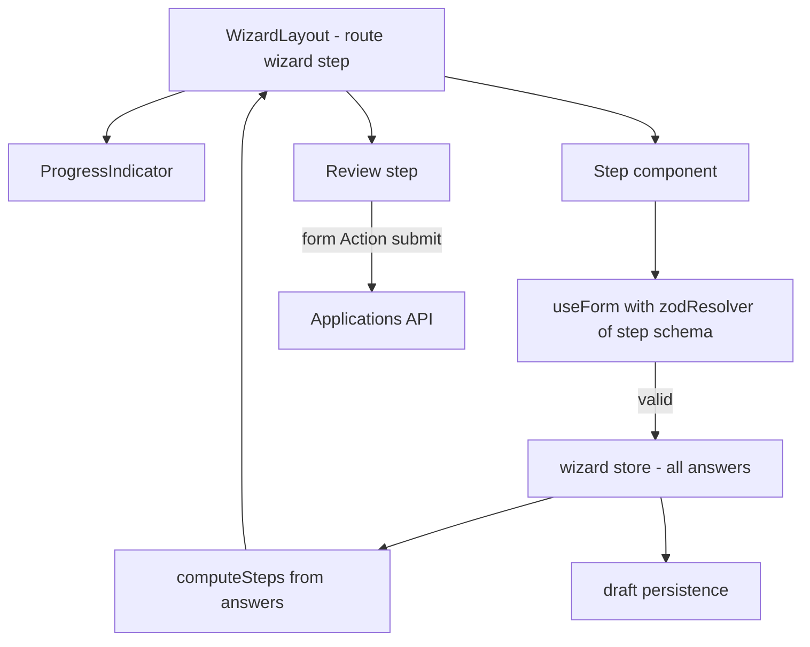
- **computeSteps** is a pure function: given answers, which steps apply, in which order.
- **Step components** each own a `useForm` with that step's schema; on valid Next they write to the store and navigate.
- **wizard store** (reducer + context or Zustand) holds all answers and persists drafts.
- **Review** submits all data; the server validates the complete schema again.

### Data model
| Type | Fields |
|---|---|
| `Answers` | `personal`, `address`, `employment: { kind: 'employed' \| 'self' \| 'none', ... }`, `selfEmployment?`, `documents` |
| Schemas | one Zod schema per step + `fullSchema` = their combination |
| `StepId` | `'personal' \| 'address' \| 'employment' \| 'self-employment' \| 'documents' \| 'review'` |

### Tech stack
| Component | Choice | Why |
|---|---|---|
| Forms | React Hook Form + `@hookform/resolvers/zod` | fast, typed |
| Schemas | Zod | shared by client and server |
| Routing | React Router | URL per step |
| Tests | Vitest, RTL, Playwright | unit, component and real-browser layers

### Milestones
1. **Linear wizard** with routes and progress. *Done when* Back/Next and browser Back agree.
2. **Per-step validation and error summary.** *Done when* failed Next focuses the summary.
3. **Branching.** *Done when* changing "self-employed" to "employed" removes the step and its data.
4. **Drafts and review.** *Done when* closing the tab and returning resumes at the last step with data.
5. **Submit.** *Done when* server-side errors map back to the right step and field.

### Deep dive: the hard parts
- **Deep-linking guard.** If someone opens `/wizard/documents` directly, previous steps may be invalid. On entry, validate earlier steps with their schemas and redirect to the first invalid one.
- **Branching and stale data.** When a step disappears, its answers must be deleted or the server receives contradictory data. Do it in the same reducer action that changes the branching answer.
- **Mapping server errors.** The server returns errors by path (`address.postcode`); map the path to a step and navigate there with the error set.
- **Uncontrolled performance.** React Hook Form registers inputs with refs and reads values on submit, so typing doesn't re-render the form. Use `watch` sparingly, only for fields that drive UI.

### Testing strategy
Unit-test `computeSteps` and each schema. RTL: fill step, Next, Back, values intact. Playwright: full run, branching, refresh-resume, keyboard only.

### Trade-offs, scaling and failure modes
Drafts in `localStorage` are device-bound and may contain personal data — encrypt or store server-side with expiry. Very long wizards benefit from a server-driven step definition. Validation drift between client and server is avoided by sharing schemas.

### Stretch goals
- File uploads in the documents step (Project 23).
- Save-and-email a resume link.
- Server-driven form definition (JSON schema → steps).

### Skills practised
- [Ch 4 — Forms and Actions](../chapters/04-forms-and-actions/README.md): validation, React Hook Form + Zod, Actions
- [Ch 6 — State management](../chapters/06-state-management/README.md): shared wizard store
- [Ch 11 — TypeScript with React](../chapters/11-typescript-with-react/README.md): inferred types from schemas
- [Ch 15 — Interview and machine coding](../chapters/15-react-interview-and-machine-coding/README.md): wizard build

### In the interview
**Q:** How do you validate only the current step?

**A:** Give each step its own schema and form instance; Next runs that step's validation and only then saves to the shared store.

**Q:** What happens to answers in a step that no longer applies?

**A:** Delete them in the same update that removes the step, so the final submission is consistent.

**Q:** Why React Hook Form for big forms?

**A:** It keeps inputs uncontrolled and subscribes narrowly, so typing doesn't re-render the whole form.

### TL;DR
One schema and form per step, a pure function deciding the step list, URLs per step, cleared data for removed branches, and server-side validation of the whole.

## 18. Theme system and dark mode

**Level:** Intermediate · **Time:** 1 week · **Prerequisites:** Ch 6, Ch 8, Ch 13

### What it is
A theming layer for an app: **design tokens** (named values like `--color-surface` or `--space-3` that components use instead of raw colours and sizes), light and dark themes, a "system" option that follows the operating system, a high-contrast theme and per-brand accent colours. The user's choice persists, and — the hard part — the correct theme is applied **before the first paint**, even with server rendering, so there is no flash of the wrong theme.

### The problem it solves
Bolted-on dark mode leads to hard-coded colours everywhere, poor contrast, and the infamous flash of a white page before dark styles load. A token-based system lets designers change the look in one place and lets the app respect user preferences.

### Real-world examples
- Josh Comeau's [The Quest for the Perfect Dark Mode](https://www.joshwcomeau.com/react/dark-mode/) explains the flash problem in server-rendered React and the blocking-script fix.
- Tailwind CSS's [dark mode docs](https://tailwindcss.com/docs/dark-mode) show class-based and media-query strategies.
- MDN's [`prefers-color-scheme`](https://developer.mozilla.org/en-US/docs/Web/CSS/Reference/At-rules/@media/prefers-color-scheme) media feature.

### Requirements
**Functional**
- Themes: light, dark, high-contrast; mode: light / dark / system.
- Accent colour picker that generates a palette.
- Choice persists (cookie for SSR, `localStorage` for SPA) and syncs across tabs.
- A demo page with buttons, forms, cards, code blocks and charts using only tokens.

**Non-functional**
- No flash of incorrect theme on load or hydration.
- All text meets WCAG AA contrast (4.5:1 normal text) in every theme.
- Switching theme does not re-render the React tree (CSS variables do the work).

### The architecture
```mermaid
flowchart TD
    T["tokens.json"] --> B["build step - CSS variables per theme"]
    B --> CSS["themes.css"]
    S["inline head script"] -->|"read cookie or media query"| H["html data-theme"]
    H --> CSS
    P["ThemeProvider - context with mode"] --> SW["ThemeSwitcher"]
    SW -->|"set attribute and persist"| H
    MQ["matchMedia change"] --> P
```
- **tokens.json** is the single source of design decisions; a small build script emits CSS custom properties per theme.
- **inline head script** runs before the body paints and sets `data-theme` on `<html>`.
- **ThemeProvider** exposes `mode` and `setMode` to React; it changes the attribute, not every component.
- **matchMedia** listener updates the effective theme when the OS switches.

### Data model
| Type | Fields |
|---|---|
| Token | `name: 'color.surface'`, `values: { light, dark, contrast }` |
| Context | `{ mode: 'light' \| 'dark' \| 'system', resolved: 'light' \| 'dark', theme, setMode }` |
| Persistence | cookie `theme=dark` (readable by the server) |

### Tech stack
| Component | Choice | Why |
|---|---|---|
| Styling | CSS custom properties (+ Tailwind v4 `@theme` optionally) | runtime switch without re-render |
| State | Context for mode | few consumers, rare changes |
| SSR | framework of choice or a small Node 24 server | prove no flash |
| Tests | Vitest, Playwright screenshots in both colour schemes | unit, component and real-browser layers

### Milestones
1. **Tokens to CSS variables.** *Done when* changing one token updates every component.
2. **Switcher with persistence.** *Done when* reload keeps the choice.
3. **System mode.** *Done when* toggling OS dark mode updates the page live.
4. **No flash with SSR.** *Done when* a throttled-network Playwright run never captures a frame in the wrong theme.
5. **Contrast audit.** *Done when* an automated script checks every foreground/background pair.

### Deep dive: the hard parts
- **Why the flash happens.** The server doesn't know the user's preference (unless it is in a cookie), so it renders a default. React hydrates later. A tiny synchronous script in `<head>` sets the attribute before the first paint; it must not wait for React.
- **Hydration mismatch.** If React renders "Dark" in the switcher on the client but the server rendered "Light", React warns. Render the switcher's label from a value both agree on (the cookie), or mark the small differing node with `suppressHydrationWarning`, or render it only on the client.
- **Variables vs context re-render.** Putting colours in context re-renders every consumer on switch. Variables change the look with zero React work.
- **Generating accents.** Use a perceptual colour space such as OKLCH (CSS `oklch()`) to create shades with predictable lightness and contrast.

### Testing strategy
Playwright with `colorScheme: 'dark'` and `'light'`; screenshot comparisons per theme. Unit-test the token build and the contrast checker. RTL for the switcher.

### Trade-offs, scaling and failure modes
Cookie-based preference makes SSR correct but adds a cookie to every request. CSS-in-JS runtime theming is flexible but costs render time. Third-party widgets (maps, embeds) may ignore your theme.

### Stretch goals
- Theme preview without committing (scoped `data-theme` on a container).
- Animate the switch with `<ViewTransition>`.
- Export tokens to Figma variables JSON.

### Skills practised
- [Ch 6 — State management](../chapters/06-state-management/README.md): context for rarely changing values
- [Ch 8 — Styling](../chapters/08-styling/README.md): theming, dark mode, Tailwind v4
- [Ch 13 — Server rendering](../chapters/13-server-rendering-and-frameworks/README.md): hydration mismatches

### In the interview
**Q:** How do you avoid the dark-mode flash with SSR?

**A:** Store the preference where the server can read it (a cookie) or run a tiny blocking script in `<head>` that sets the theme attribute before paint.

**Q:** Why CSS variables instead of a theme object in context?

**A:** Switching variables restyles everything without re-rendering React components.

**Q:** What is a design token?

**A:** A named design decision (colour, spacing, radius) used by components instead of raw values, so themes can swap them.

### TL;DR
Define tokens, emit CSS variables per theme, set the theme attribute before paint, keep only the mode in context, and audit contrast automatically.

## 19. Auth flow with protected routes

**Level:** Intermediate · **Time:** 2 weeks · **Prerequisites:** Ch 4, Ch 6, Ch 9, Ch 12

### What it is
A complete sign-in experience for a single-page app: email/password login, sign-up, logout, "remember me", password reset by email link, session expiry handling, role-based access (user/admin) and **protected routes** that redirect unauthenticated users to `/login?next=/settings` and back after login. You build a small Node 24 API that issues an **HTTP-only session cookie** (a cookie JavaScript cannot read, which limits damage from XSS).

### The problem it solves
Auth is where front-end mistakes become security holes: tokens in `localStorage` stolen by XSS, routes that briefly flash private content, open redirects through `?next=`, and logout that leaves cached data visible. You learn the safe defaults and what the client can and cannot guarantee.

### Real-world examples
- The OWASP [Session Management Cheat Sheet](https://cheatsheetseries.owasp.org/cheatsheets/Session_Management_Cheat_Sheet.html) lists cookie attributes (`HttpOnly`, `Secure`, `SameSite`) and session-expiry practices.
- React Router's [middleware guide](https://reactrouter.com/how-to/middleware) shows running auth checks before loaders for a group of routes.
- [RFC 7636 (PKCE)](https://datatracker.ietf.org/doc/html/rfc7636) — the standard for OAuth in public clients like SPAs, for the "Sign in with…" stretch goal.

### Requirements
**Functional**
- Login, sign-up, logout, forgot/reset password, email verification.
- Protected routes for `/app/*`, admin-only `/admin/*`.
- Redirect to the originally requested page after login (same-origin paths only).
- Session expiry: on a 401, show "Session expired — sign in again" and preserve unsaved form input.

**Non-functional**
- No token is readable from JavaScript; cookies are `HttpOnly; Secure; SameSite=Lax`.
- Private content never renders, even for one frame, before auth is known.
- Login form rate-limited server-side (e.g. 5 attempts per minute per IP and account).

### The architecture
```mermaid
sequenceDiagram
    participant B as Browser
    participant R as Router middleware
    participant API as Auth API
    B->>R: navigate to app settings
    R->>API: GET me with cookie
    API-->>R: 401
    R-->>B: redirect to login with next
    B->>API: POST login form Action
    API-->>B: Set-Cookie session HttpOnly
    B->>R: navigate to next path
    R->>API: GET me
    API-->>R: 200 user and roles
    R-->>B: render settings
```
- **Router middleware** (or a parent loader) on `/app` calls `/me` before any child loader runs; it redirects or puts the user into router context.
- **Auth API** validates credentials, hashes passwords (Argon2 or bcrypt), creates server-side sessions and sets the cookie.
- **Login page** uses a form Action with `useActionState` for errors.

### Data model
```mermaid
erDiagram
    USERS ||--o{ SESSIONS : "has"
    USERS ||--o{ USER_ROLES : "granted"
    USERS ||--o{ RESET_TOKENS : "requests"
    USERS {
        uuid id PK
        text email UK
        text password_hash
        boolean email_verified
    }
    SESSIONS {
        text id PK
        uuid user_id FK
        timestamptz expires_at
    }
    USER_ROLES {
        uuid user_id FK
        text role
    }
    RESET_TOKENS {
        text token_hash PK
        uuid user_id FK
        timestamptz expires_at
    }
```
Reset tokens are stored hashed and expire quickly; sessions are revocable rows, so logout everywhere is one delete.

### Tech stack
| Component | Choice | Why |
|---|---|---|
| Client routing | React Router (data mode) with middleware | auth before loaders |
| Server | Node 24 + a minimal HTTP framework | cookies, sessions |
| Forms | form Actions + Zod | pending and errors built in, shared rules
| Tests | Vitest, RTL, Playwright with storage state | unit, component and real-browser layers

### Milestones
1. **API with sessions.** *Done when* curl can log in and `/me` returns the user with the cookie.
2. **Login page and protected layout.** *Done when* `/app` redirects and returns after login with no flash.
3. **Roles.** *Done when* a user gets a 403 page at `/admin`, and the API also rejects the calls.
4. **Expiry and logout.** *Done when* logout clears the query cache and Back does not show private data.
5. **Reset flow.** *Done when* a reset link works once and expires.

### Deep dive: the hard parts
- **Client checks are UX, not security.** Hiding a route stops honest users seeing it; the API must authorize every request. Write API tests for that.
- **No flash.** Decide auth *before* rendering protected routes — in middleware or loaders — rather than in a `useEffect` after the first render.
- **Open redirect.** `?next=https://evil.example` must be rejected: accept only paths starting with a single `/`.
- **Cookies and CSRF.** Cookies are sent automatically, which enables **CSRF** (a malicious site causing your browser to make a request). `SameSite=Lax` blocks most cross-site POSTs; add a CSRF token or check the `Origin` header for state-changing requests.
- **Logout hygiene.** Clear TanStack Query caches, in-memory stores and drafts that contain personal data.

### Testing strategy
API tests for every endpoint and permission. RTL with a custom render that injects an auth state. Playwright saves a logged-in storage state for speed; separate tests for expiry and admin.

### Trade-offs, scaling and failure modes
Server sessions need a lookup per request (cache them); stateless JWTs avoid that but are hard to revoke. Third-party identity providers save work and add MFA, but you depend on their uptime. Session fixation: issue a new session id at login.

### Stretch goals
- "Sign in with GitHub" via OAuth authorization code + PKCE.
- Passkeys (WebAuthn).
- Multi-factor with time-based one-time passwords.

### Skills practised
- [Ch 4 — Forms and Actions](../chapters/04-forms-and-actions/README.md): login Action
- [Ch 6 — State management](../chapters/06-state-management/README.md): user in context, cache clearing
- [Ch 9 — Routing and data fetching](../chapters/09-routing-and-data-fetching/README.md): middleware, loaders, redirects
- [Ch 12 — Testing React](../chapters/12-testing-react/README.md): providers and routers

### In the interview
**Q:** Where should an SPA keep its session token?

**A:** Preferably in an `HttpOnly`, `Secure`, `SameSite` cookie, so JavaScript (and XSS) cannot read it.

**Q:** Is a protected route enough to secure data?

**A:** No. It is a UX guard; the server must check authorization on every request.

**Q:** How do you avoid flashing private content?

**A:** Resolve the session before rendering protected routes — in router middleware or loaders — not in an Effect after render.

### TL;DR
Use server sessions in HttpOnly cookies, check auth before protected routes render, validate redirects, and remember the server is the real gate.

## 20. Music player with Zustand

**Level:** Intermediate · **Time:** 1–2 weeks · **Prerequisites:** Ch 5, Ch 6, Ch 7

### What it is
A Spotify-like web player: browse albums, a play queue, a persistent bottom player bar with play/pause, seek, volume, shuffle and repeat, plus a "now playing" page. Playback continues while you navigate. Global player state lives in a **Zustand** store (a small state library where components subscribe to just the slice they select), and a single `<audio>` element is the real source of playback truth.

### The problem it solves
A player is shared state touched by many distant components (album page "Play", queue drawer, bar, keyboard shortcuts, OS media keys) and an imperative browser API (`HTMLMediaElement`) that changes on its own (time updates, buffering, ended). Context would re-render everything four times a second; you need selective subscriptions and a clean bridge to the imperative world.

### Real-world examples
- [Zustand](https://zustand.docs.pmnd.rs/) documents selectors, the [slices pattern](https://zustand.docs.pmnd.rs/learn/guides/slices-pattern) and [persist middleware](https://zustand.docs.pmnd.rs/reference/middlewares/persist).
- MDN's [HTMLMediaElement](https://developer.mozilla.org/en-US/docs/Web/API/HTMLMediaElement) and [Media Session API](https://developer.mozilla.org/en-US/docs/Web/API/Media_Session_API) cover playback events and lock-screen controls.

### Requirements
**Functional**
- Play an album or track; queue: add, remove, reorder, play next.
- Bar: play/pause, previous/next, seek, volume, mute, shuffle, repeat (off/all/one).
- Keyboard shortcuts (Space, arrows) and OS media keys via Media Session.
- Persist queue, position and volume across reloads.

**Non-functional**
- The time display updates smoothly but the rest of the app does not re-render on `timeupdate`.
- Navigation never interrupts playback.
- Gapless-ish: next track starts within 300 ms on a fast connection (preload the next track).

### The architecture
```mermaid
flowchart TD
    ST["Zustand store - queue, index, status, volume"] --> BAR["PlayerBar"]
    ST --> QD["QueueDrawer"]
    ST --> AP["AlbumPage Play button"]
    ST --> ENG["AudioEngine - one audio element"]
    ENG -->|"ended, error, buffering"| ST
    ENG --> T["time store - useSyncExternalStore"]
    T --> SK["SeekBar and clock"]
    MS["Media Session handlers"] --> ST
```
- **Zustand store** holds intent: what should play and how. Actions like `playAlbum`, `next`, `toggleShuffle`.
- **AudioEngine** is a component mounted once at the root; it subscribes to the store and drives the `<audio>` element in Effects.
- **time store** is a separate tiny store for `currentTime`, so only the seek bar re-renders four times a second.
- **Media Session** maps OS controls to store actions.

### Data model
| Type | Fields |
|---|---|
| `Track` | `id`, `title`, `artist`, `album`, `durationS`, `src`, `artworkUrl` |
| Player store | `queue: Track[]`, `order: number[]` (for shuffle), `index`, `status: 'idle' \| 'loading' \| 'playing' \| 'paused'`, `repeat`, `volume`, `muted` |
| Time store | `currentTime`, `buffered` |

### Tech stack
| Component | Choice | Why |
|---|---|---|
| Global state | Zustand v5 with selectors and `persist` | no provider, fine-grained subscriptions |
| Audio | native `<audio>` + Media Session API | browser-native playback |
| Routing | React Router | player lives above routes |
| Tests | Vitest (store), RTL, Playwright | unit, component and real-browser layers

### Milestones
1. **Store and actions** tested without React. *Done when* shuffle/repeat logic is covered by unit tests.
2. **AudioEngine bridge.** *Done when* play/pause/next work and `ended` advances correctly with repeat modes.
3. **Separate time store.** *Done when* the Profiler shows only the seek bar re-rendering during playback.
4. **Queue UI and persistence.** *Done when* reload restores queue and position (paused).
5. **Media Session and shortcuts.** *Done when* hardware media keys work.

### Deep dive: the hard parts
- **Who owns the truth?** The store holds *intent* ("should be playing track 3"); the audio element reports *reality* ("buffering", "ended", "play() rejected"). The engine reconciles them and writes status back. Never let two places both decide.
- **Autoplay policies.** Browsers block `play()` without a user gesture; `play()` returns a promise that may reject. Catch it and set status to paused with a hint.
- **Selectors.** `useStore(s => s.queue[s.index])` re-renders only when that track changes. Selecting a new object each time (`s => ({ a: s.a, b: s.b })`) re-renders always — use `useShallow` or separate selectors.
- **Shuffle that keeps history.** Store a shuffled `order` array instead of shuffling the queue itself, so turning shuffle off returns to the original order and "previous" works.

### Testing strategy
Unit tests on the store (call actions, assert state). Mock `HTMLMediaElement.prototype.play` in jsdom to test the engine. Playwright with a short real audio file to verify `ended` advances.

### Trade-offs, scaling and failure modes
Zustand is minimal; Redux Toolkit adds devtools time-travel and stricter structure for big teams. Persisting `currentTime` every update is too frequent — throttle to every few seconds. Streaming protocols (HLS) need a library and add complexity.

### Stretch goals
- Crossfade with the Web Audio API.
- Lyrics synced to time.
- Waveform seek bar rendered on canvas.

### Skills practised
- [Ch 5 — Effects and refs](../chapters/05-effects-and-refs/README.md): bridging imperative APIs
- [Ch 6 — State management](../chapters/06-state-management/README.md): Zustand, choosing a library
- [Ch 7 — Custom Hooks](../chapters/07-custom-hooks-and-hook-rules/README.md): `useSyncExternalStore`
- [Ch 10 — Performance](../chapters/10-performance/README.md): avoiding re-renders

### In the interview
**Q:** Why Zustand instead of context here?

**A:** Components subscribe to selected slices, so high-frequency updates re-render only the components that read them, and no provider is needed.

**Q:** How do you keep `timeupdate` from re-rendering the app?

**A:** Put the current time in its own small store and subscribe only the seek bar and clock to it.

**Q:** What if `audio.play()` is blocked?

**A:** It returns a rejected promise; catch it, show paused, and ask for a user gesture.

### TL;DR
Store intent in Zustand, let one engine component reconcile it with the audio element, isolate high-frequency time updates, and handle autoplay rejections.

## 21. Calendar and booking scheduler

**Level:** Intermediate · **Time:** 2–3 weeks · **Prerequisites:** Ch 3, Ch 6, Ch 11, Ch 14

### What it is
A Calendly-style booking app: a host sets weekly availability and meeting types (30-minute call, 60-minute demo); guests pick a day on a month calendar, see free slots **in their own time zone**, and book. The host sees a week view with drag-to-create and drag-to-resize events. Time-zone handling uses **Temporal**, the modern JavaScript date-time API, where available (with a polyfill otherwise).

### The problem it solves
Dates are the most bug-prone domain in front-end work: daylight-saving gaps, time zones, "all day" events, overlapping events and locale formats. Calendar UIs are also layout puzzles (overlapping events side by side) and accessibility puzzles (a grid of days navigable by keyboard).

### Real-world examples
- [Cal.com](https://github.com/calcom/cal.com) is an open-source scheduling platform whose codebase shows availability rules and time-zone handling at scale.
- MDN's [Temporal reference](https://developer.mozilla.org/en-US/docs/Web/JavaScript/Reference/Global_Objects/Temporal) explains `ZonedDateTime`, `PlainDate` and `Instant`.
- The W3C [Grid pattern](https://www.w3.org/WAI/ARIA/apg/patterns/grid/) defines keyboard navigation for a month grid.

### Requirements
**Functional**
- Host: weekly availability per weekday, date overrides (holidays), buffer between meetings, meeting types.
- Guest: month view, available days highlighted, slot list in guest's zone, book with name/email, confirmation.
- Host week view: events laid out side by side when overlapping; drag to move, resize to change duration.
- Cancel and reschedule links.

**Non-functional**
- Slot computation for a month in under 50 ms in the browser (or done on the server).
- Correct across DST changes in both host and guest zones (tests for both March and October/November transitions).
- Keyboard: arrow keys move day focus in the month grid; Enter selects.

### The architecture
```mermaid
flowchart TD
    AV["Availability rules"] --> SL["computeSlots - pure, Temporal"]
    BK["Existing bookings"] --> SL
    SL --> API["GET slots for month and zone"]
    API --> MV["MonthGrid - role grid"]
    MV --> SV["SlotList - guest zone"]
    SV -->|"form Action"| BOOK["POST booking - recheck conflicts"]
    BK --> WV["WeekView - overlap layout"]
    WV -->|"drag and resize"| UPD["PATCH booking"]
```
- **computeSlots** turns rules + bookings into free instants; run it on the server so all guests agree.
- **MonthGrid** is an accessible grid with roving `tabIndex` (only the focused day is tabbable).
- **BOOK** re-checks conflicts inside a transaction — two guests may pick the same slot.
- **WeekView** positions events by minutes from midnight and assigns overlap columns.

### Data model
```mermaid
erDiagram
    HOST ||--o{ MEETING_TYPE : "offers"
    HOST ||--o{ AVAILABILITY_RULE : "sets"
    HOST ||--o{ DATE_OVERRIDE : "sets"
    MEETING_TYPE ||--o{ BOOKING : "booked as"
    HOST {
        uuid id PK
        text name
        text time_zone
    }
    MEETING_TYPE {
        uuid id PK
        uuid host_id FK
        int minutes
        int buffer_minutes
    }
    AVAILABILITY_RULE {
        uuid id PK
        uuid host_id FK
        int weekday
        text start_local
        text end_local
    }
    DATE_OVERRIDE {
        uuid id PK
        uuid host_id FK
        text date
        boolean unavailable
    }
    BOOKING {
        uuid id PK
        uuid meeting_type_id FK
        timestamptz starts_at
        timestamptz ends_at
        text guest_email
    }
```
Rules are stored as *local wall-clock times in the host's zone*; bookings as absolute instants (`timestamptz`).

### Tech stack
| Component | Choice | Why |
|---|---|---|
| Dates | Temporal (native or polyfill) | explicit zones, DST-safe arithmetic |
| State | TanStack Query + local reducer for drag | server state vs UI state |
| Drag | pointer events or dnd-kit | resize handles |
| Tests | Vitest with fixed zones, RTL, Playwright with `timezoneId` | unit, component and real-browser layers

### Milestones
1. **computeSlots** with unit tests across DST. *Done when* a host in Europe/London and a guest in America/New_York see correct slots on both DST weekends.
2. **Month grid + slot list.** *Done when* keyboard navigation follows the grid pattern.
3. **Booking with conflict check.** *Done when* two simultaneous bookings for one slot produce one success and one "slot taken".
4. **Week view with overlap layout.** *Done when* three overlapping events render side by side without covering each other.
5. **Drag/resize.** *Done when* changes snap to 15 minutes and persist.

### Deep dive: the hard parts
- **Wall time vs instant.** "Every Monday 09:00–17:00" is wall time in the host's zone. After a DST change the same wall time maps to a different UTC instant (London 09:00 is 08:00 UTC in summer, 09:00 UTC in winter), and a range that crosses the switch itself (say 00:00–06:00 on the change night) lasts 5 or 7 real hours. Convert per date with `PlainDate.toZonedDateTime`, never by adding 24 hours to the previous day's instant.
- **Nonexistent and repeated times.** 02:30 may not exist on the spring-forward day and happens twice in autumn. Temporal's `disambiguation` option makes you choose.
- **Overlap layout.** Sort events by start; group into clusters that overlap transitively; within a cluster, assign each event the first free column. Width = 1 / columns in cluster.
- **Race-free booking.** The client's slot list is a hint. The server inserts inside a transaction with an exclusion check (PostgreSQL's exclusion constraints can enforce non-overlapping ranges).

### Testing strategy
Unit tests with explicit zones and fixed "now". Playwright projects with different `timezoneId` and `locale`. Concurrency test on the booking endpoint.

### Trade-offs, scaling and failure modes
Client-side slot computation is fast but risks disagreement if the client's zone database is old; compute on the server. Calendar sync with Google/Outlook adds external availability and webhooks. Recurring events (RRULE) are a project of their own.

### Stretch goals
- iCalendar (`.ics`) attachments in confirmations.
- Team round-robin scheduling.
- Drag across days in the week view.

### Skills practised
- [Ch 3 — State and events](../chapters/03-state-and-events/README.md): pointer events
- [Ch 6 — State management](../chapters/06-state-management/README.md): server vs UI state
- [Ch 11 — TypeScript with React](../chapters/11-typescript-with-react/README.md): typed date models
- [Ch 14 — Patterns and architecture](../chapters/14-patterns-and-architecture/README.md): accessible grids

### In the interview
**Q:** How do you store weekly availability?

**A:** As wall-clock times plus the host's IANA time zone, converted to instants per specific date.

**Q:** Why not add 24 hours to get "tomorrow at 9"?

**A:** DST days are 23 or 25 hours long; use calendar arithmetic in a zone-aware API.

**Q:** How do you prevent double bookings?

**A:** Re-check on the server inside a transaction or with a database constraint; the client's slot list is only a hint.

### TL;DR
Store rules as wall time plus zone and bookings as instants, compute slots on the server with Temporal, lay out overlaps by columns, and enforce conflicts in the database.

## 22. Live price ticker with WebSockets

**Level:** Intermediate · **Time:** 1–2 weeks · **Prerequisites:** Ch 5, Ch 7, Ch 10

### What it is
A real-time market watchlist: a table of 50 symbols whose prices, change percentages and sparklines update many times per second over a **WebSocket** (a long-lived two-way connection between browser and server). Rows flash green or red on change, you can add or remove symbols, and the connection recovers on its own after network drops. A small Node 24 server simulates the feed.

### The problem it solves
High-frequency data breaks naive React code: setting state on every message causes hundreds of renders per second, the main thread chokes, and reconnect logic leaks sockets. You learn to buffer, batch and subscribe precisely.

### Real-world examples
- MDN's [WebSocket API](https://developer.mozilla.org/en-US/docs/Web/API/WebSocket) covers the browser side: open, message, close, error and close codes.
- react.dev's [`useSyncExternalStore`](https://react.dev/reference/react/useSyncExternalStore) is the recommended way to subscribe React to an external, frequently changing store.
- Slack's [Real-time Messaging](https://slack.engineering/real-time-messaging/) post describes long-lived WebSocket connections to edge gateway servers — the same client model at a far larger scale.

### Requirements
**Functional**
- Subscribe/unsubscribe per symbol by sending messages over one socket.
- Table with price, change, % change, sparkline of the last 60 ticks; flash on change.
- Connection indicator (connected / reconnecting / offline) and "stale" marking after 5 s without data.
- Sort by any column without breaking updates.

**Non-functional**
- Handles 1,000 messages per second while keeping 60 fps scrolling.
- At most one render per animation frame for the table.
- Reconnect with exponential backoff and jitter (1 s, 2 s, 4 s… capped at 30 s), resubscribing automatically.

### The architecture
```mermaid
flowchart TD
    WS["WebSocket client"] -->|"messages"| BUF["buffer - latest per symbol"]
    BUF -->|"flush on requestAnimationFrame"| STORE["quote store"]
    STORE --> H["useQuote symbol - useSyncExternalStore"]
    H --> ROW["Row - memo"]
    ROW --> SP["Sparkline - canvas"]
    CON["connection manager - backoff"] --> WS
    UI["Watchlist controls"] -->|"subscribe or unsubscribe"| CON
```
- **WebSocket client** parses messages and writes into a buffer, not into React.
- **buffer** keeps only the latest quote per symbol; on each animation frame it flushes into the store and notifies only changed symbols.
- **useQuote(symbol)** subscribes a row to its own symbol, so one tick re-renders one row.
- **connection manager** owns the socket lifecycle, heartbeats and resubscription.

### Data model
| Type | Fields |
|---|---|
| Message | `{ type: 'quote', s: 'AAPL', p: number, t: number }` or `{ type: 'heartbeat' }` |
| Store | `Map<symbol, { price, prevClose, history: Float64Array(60), updatedAt }>` plus per-symbol listener sets |
| Connection | `status: 'connecting' \| 'open' \| 'reconnecting' \| 'offline'`, `attempt` |

### Tech stack
| Component | Choice | Why |
|---|---|---|
| Transport | native WebSocket | low overhead, two-way |
| Store | hand-written store + `useSyncExternalStore` | per-key subscriptions |
| Sparklines | `<canvas>` drawn in an Effect | cheaper than SVG for constant redraws |
| Server | Node 24 with a WebSocket library | simulated feed |
| Tests | Vitest with a fake socket, Playwright | unit, component and real-browser layers

### Milestones
1. **Socket + naive state.** Render every message with `useState`. *Done when* you can measure the jank in the Profiler (keep this as a baseline).
2. **External store with per-symbol subscriptions.** *Done when* the Profiler shows only changed rows rendering.
3. **Frame batching.** *Done when* renders per second stay at or below the display refresh rate under 1,000 msg/s.
4. **Reconnect and resubscribe.** *Done when* killing the server and restarting it recovers within the backoff window with no duplicate sockets.
5. **Sorting, flashing, staleness.** *Done when* sorted order updates at most once a second (to keep rows readable).

### Deep dive: the hard parts
- **Coalescing.** If AAPL ticks 30 times in a frame, only the last matters for display. Keep a "dirty" set and flush once per `requestAnimationFrame`.
- **Per-key subscription.** A global store that notifies every component on every tick makes each row compare and bail out — still expensive. Keep listeners per symbol.
- **Socket lifecycle in StrictMode.** An Effect that opens a socket will open, close and reopen in development. Put the socket in a module-level manager with reference counting, or make the Effect's cleanup close it cleanly.
- **Flash animation without state.** Toggle a CSS class through a ref and remove it on `animationend` — no React render needed for a 300 ms flash.

### Testing strategy
A fake WebSocket class injected into the manager to emit scripted messages. Unit-test backoff timing with fake timers. Playwright with the simulated server, measuring frame times with the Performance API.

### Trade-offs, scaling and failure modes
Server-Sent Events are simpler for one-way streams and reconnect automatically; WebSockets are needed for client-to-server subscribe messages on the same connection. Sorting a live table makes rows jump; throttle re-sorting. Mobile networks drop often — show staleness honestly.

### Stretch goals
- Move parsing into a Web Worker.
- Price alerts with notifications.
- Binary messages (ArrayBuffer) to cut bandwidth.

### Skills practised
- [Ch 5 — Effects and refs](../chapters/05-effects-and-refs/README.md): subscriptions, cleanup, refs
- [Ch 7 — Custom Hooks](../chapters/07-custom-hooks-and-hook-rules/README.md): `useSyncExternalStore`
- [Ch 10 — Performance](../chapters/10-performance/README.md): Profiler, `memo`, re-render triggers

### In the interview
**Q:** How do you render 1,000 updates per second?

**A:** Buffer messages outside React, flush once per frame, and subscribe each row only to its own key.

**Q:** WebSocket or Server-Sent Events?

**A:** SSE for simple server-to-client streams over HTTP; WebSocket when the client also sends messages, such as subscriptions.

**Q:** How should reconnection work?

**A:** Exponential backoff with jitter, a cap, heartbeats to detect dead connections, and automatic resubscription.

### TL;DR
Keep high-frequency data outside React, coalesce per frame, subscribe per symbol with `useSyncExternalStore`, and reconnect with jittered backoff.

## 23. Resumable file uploader

**Level:** Intermediate · **Time:** 1–2 weeks · **Prerequisites:** Ch 4, Ch 5, Ch 7

### What it is
A drag-and-drop uploader for large files (videos, datasets): pick or drop multiple files, see thumbnails and per-file progress, pause, resume and cancel, retry failures automatically, and survive a page reload mid-upload. Files are split into chunks and sent with the **tus** resumable-upload protocol (an open HTTP-based standard where the server remembers how many bytes it has).

### The problem it solves
A 2 GB upload over Wi-Fi that fails at 95 % and restarts from zero is a terrible experience. Resumable uploads fix it, but the UI must manage queues, concurrency, progress from many sources, cancellation and validation.

### Real-world examples
- [tus.io](https://tus.io/) specifies the resumable upload protocol and lists client and server implementations.
- MDN's [AbortController](https://developer.mozilla.org/en-US/docs/Web/API/AbortController) is how you cancel in-flight requests from the UI.

### Requirements
**Functional**
- Drop zone and file picker; accept by type and size; reject with clear messages.
- Per-file progress, speed and remaining time; overall progress.
- Pause/resume/cancel per file; retry with backoff on network errors.
- Resume after reload (pick the same file again; the client matches it by fingerprint).

**Non-functional**
- At most 3 files uploading concurrently; chunks of 5–10 MB.
- Progress updates the UI at most 10 times per second per file.
- Uploading never blocks typing elsewhere on the page.

### The architecture
```mermaid
flowchart TD
    DZ["DropZone - validation"] --> Q["upload queue - reducer"]
    Q --> SCH["scheduler - max 3 active"]
    SCH --> UP["Uploader per file - tus client"]
    UP -->|"PATCH chunk with offset"| SRV["tus server"]
    UP -->|"progress throttled"| Q
    UP --> FP["fingerprint to upload URL in localStorage"]
    Q --> UI["FileList - progress bars"]
```
- **DropZone** handles drag events and the hidden `<input type="file">`, validates and enqueues.
- **upload queue** is a reducer of file records and statuses; **scheduler** starts the next file when one finishes.
- **Uploader** wraps a tus client: create upload, send chunks, ask the server for its offset after errors.
- **fingerprint store** remembers each file's upload URL so a reload can resume.

### Data model
| Type | Fields |
|---|---|
| `UploadItem` | `id`, `file: File`, `fingerprint`, `status: 'queued' \| 'uploading' \| 'paused' \| 'error' \| 'done' \| 'cancelled'`, `bytesSent`, `uploadUrl?`, `error?`, `attempt` |
| Saved | `localStorage['tus::' + fingerprint] = uploadUrl` |

### Tech stack
| Component | Choice | Why |
|---|---|---|
| Protocol | tus (tus-js-client in the browser, a tus server in Node 24) | resume after failure or reload |
| State | `useReducer` + a scheduler outside React | queue logic testable |
| Thumbnails | `URL.createObjectURL` with cleanup | no upload needed to preview |
| Tests | Vitest, RTL, Playwright with network throttling | unit, component and real-browser layers

### Milestones
1. **Drop zone + validation.** *Done when* invalid files show reasons and valid ones appear queued with thumbnails.
2. **Single upload with progress and cancel.** *Done when* cancel aborts the request and the server discards the partial upload.
3. **Queue with concurrency 3.** *Done when* 10 files upload three at a time.
4. **Pause/resume and retries.** *Done when* Playwright toggles offline mid-upload and the file completes after going online.
5. **Resume after reload.** *Done when* re-adding the same file continues from the server's offset.

### Deep dive: the hard parts
- **Object URL leaks.** `URL.createObjectURL(file)` holds memory until revoked. Create it in an Effect and revoke it in cleanup.
- **Progress throttling.** Upload progress events fire very frequently; write them into a ref and push to state on an interval or animation frame.
- **Drag events.** `dragenter`/`dragleave` fire for every child element; track a counter or use the drop zone's bounding box to avoid flicker. Call `preventDefault` in `dragover`, or `drop` never fires.
- **Resume semantics.** After an error, never assume how much arrived; ask the server for the current offset (`HEAD` in tus) and continue from there.

### Testing strategy
Reducer and scheduler unit tests. RTL for the drop zone using `fireEvent.drop` with a `DataTransfer`. Playwright with a real tus server, `context.setOffline(true)` mid-upload.

### Trade-offs, scaling and failure modes
Direct-to-storage uploads (pre-signed URLs to object storage) remove your server from the data path but need multipart APIs for resumability. Fingerprints based on name + size + modified time can collide; that is acceptable for resume, not for deduplication. Very large files may need hashing in a Worker.

### Stretch goals
- Client-side image resizing before upload.
- Folder drops with directory structure.
- Upload in a Service Worker so it survives closing the tab (Background Fetch where supported).

### Skills practised
- [Ch 4 — Forms and Actions](../chapters/04-forms-and-actions/README.md): file inputs, validation
- [Ch 5 — Effects and refs](../chapters/05-effects-and-refs/README.md): cleanup, refs for high-frequency values
- [Ch 7 — Custom Hooks](../chapters/07-custom-hooks-and-hook-rules/README.md): `useUploadQueue`

### In the interview
**Q:** How does a resumable upload know where to continue?

**A:** The server tracks the received offset; the client asks for it and sends the remaining bytes from there.

**Q:** Why throttle progress updates?

**A:** Progress events fire far more often than the screen can show; updating state each time wastes renders.

**Q:** What must you clean up when previewing files?

**A:** Revoke object URLs created with `URL.createObjectURL`.

### TL;DR
Queue files in a reducer, upload in resumable chunks with limited concurrency, throttle progress, ask the server for offsets after failures, and revoke object URLs.

## 24. Multilingual recipe site

**Level:** Intermediate · **Time:** 2 weeks · **Prerequisites:** Ch 8, Ch 9, Ch 14

### What it is
A recipe website available in English, Spanish, German and Arabic: language in the URL (`/es/recetas/...`), translated UI strings with plurals ("1 ingredient / 5 ingredients"), localized numbers, units (metric/US) and dates, **right-to-left** (RTL) layout for Arabic, a serving-size scaler, and a print-friendly view. It is also an **accessibility** exercise: headings, landmarks, alt text, keyboard support and reduced motion.

### The problem it solves
Most apps add translation late and discover hard-coded strings, concatenated sentences that can't be translated, plural rules that only work in English, and layouts that break in RTL. Building i18n from the start shows what "international" really requires.

### Real-world examples
- [FormatJS](https://formatjs.github.io/) (react-intl) implements ICU message syntax for plurals and selects on top of the browser's `Intl` APIs.
- The [WAI-ARIA Authoring Practices](https://www.w3.org/WAI/ARIA/apg/patterns/dialog-modal/) and MDN document accessible patterns used here (dialogs for the unit picker).

### Requirements
**Functional**
- Locale routes with a switcher that keeps you on the same recipe.
- ICU messages for plurals and gender-neutral phrasing; number, date and unit formatting per locale.
- Serving scaler that converts quantities and units; fractions shown nicely (½ cup).
- RTL layout for Arabic with mirrored icons where meaningful.
- Search and tag filtering in each language.

**Non-functional**
- Only the active locale's messages are downloaded (code-split per locale).
- `<html lang>` and `dir` set correctly on every page; `hreflang` alternate links for SEO.
- Lighthouse accessibility 100; respects `prefers-reduced-motion`.

### The architecture
```mermaid
flowchart TD
    URL["route with locale param"] --> L["locale loader - lazy import messages"]
    L --> P["IntlProvider"]
    P --> PG["RecipePage"]
    PG --> ING["IngredientList - scaler and units"]
    PG --> ST["Steps"]
    ING --> FMT["Intl.NumberFormat and unit conversion"]
    P --> HD["document lang and dir"]
    CMS["recipes per locale JSON or CMS"] --> PG
```
- **locale loader** validates the URL locale and lazy-loads its message bundle.
- **IntlProvider** gives every component formatting functions.
- **IngredientList** stores quantities as numbers in a base unit and formats them per locale and unit system.
- **CMS** holds translated recipe content separately from UI strings.

### Data model
| Type | Fields |
|---|---|
| `Recipe` | `id`, `slug: Record<Locale, string>`, `title: Record<Locale, string>`, `servings`, `ingredients: Ingredient[]`, `steps: Record<Locale, string[]>` |
| `Ingredient` | `name: Record<Locale, string>`, `quantity: number`, `unit: 'g' \| 'ml' \| 'piece'` |
| Messages | `Record<Locale, Record<messageId, ICUString>>` |

### Tech stack
| Component | Choice | Why |
|---|---|---|
| i18n | react-intl (FormatJS) | ICU plurals, `Intl` based |
| Routing | React Router with `:locale` segment | per-locale URLs and code splitting |
| Styling | CSS logical properties (`margin-inline-start`) | RTL for free |
| Tests | Vitest, RTL per locale, Playwright + axe | unit, component and real-browser layers

### Milestones
1. **One locale, all strings extracted** into messages. *Done when* a lint rule finds no raw strings in JSX.
2. **Locale routing and lazy messages.** *Done when* switching locale keeps the recipe and loads one bundle.
3. **Plurals and formatting.** *Done when* Arabic plural forms (it has six categories) render correctly for 0, 1, 2, 3, 11 and 100.
4. **RTL.** *Done when* Arabic pages mirror correctly with no physical `left`/`right` CSS left.
5. **Scaler and units.** *Done when* 4→6 servings converts and formats per locale.

### Deep dive: the hard parts
- **Never concatenate sentences.** `"You have " + n + " recipes"` cannot be translated; word order and plurals differ. Use one message with placeholders and plural branches.
- **Logical CSS.** Replace `left/right` with `inline-start/end`; flexbox and grid follow `dir`. Only mirror icons that imply direction (arrows), not, say, a clock.
- **Lazy messages and Suspense.** Load messages in the route loader so the page never renders with missing strings; show the previous locale until the new one is ready.
- **Units are not translation.** Convert in a pure function in base units; format the result with `Intl.NumberFormat` (`style: 'unit'`).

### Testing strategy
RTL render per locale with snapshot-free assertions on key strings. Unit tests for plural messages and conversions. Playwright: switch to Arabic, assert `dir="rtl"` and visual snapshot; axe on each locale.

### Trade-offs, scaling and failure modes
Bundling all locales is simpler but grows linearly; lazy per-locale loading adds a request. Machine translation is fast but needs review for recipes (measurements, safety). Missing translations should fall back to the default locale and be logged, not crash.

### Stretch goals
- Server-render per locale (Project 40 techniques) for SEO.
- Translation workflow with extraction and a TMS export.
- Voice-friendly cooking mode with large text and step-by-step navigation.

### Skills practised
- [Ch 8 — Styling](../chapters/08-styling/README.md): logical properties, print styles
- [Ch 9 — Routing and data fetching](../chapters/09-routing-and-data-fetching/README.md): locale segments, lazy routes
- [Ch 10 — Performance](../chapters/10-performance/README.md): code splitting
- [Ch 14 — Patterns and architecture](../chapters/14-patterns-and-architecture/README.md): accessibility

### In the interview
**Q:** Why are concatenated strings bad for i18n?

**A:** Languages differ in word order and plural rules; a single message with placeholders and plural branches lets translators produce correct sentences.

**Q:** How do you support RTL without a second stylesheet?

**A:** Set `dir` on `<html>` and use logical CSS properties so layout mirrors automatically.

**Q:** How do you avoid shipping every language?

**A:** Lazy-load the message bundle for the active locale, typically in the route loader.

### TL;DR
Put the locale in the URL, lazy-load ICU messages, format with `Intl`, use logical CSS for RTL, and never concatenate translatable sentences.

## 25. Admin table with server-side sorting

**Level:** Intermediate · **Time:** 2 weeks · **Prerequisites:** Ch 9, Ch 11, Ch 14

### What it is
An internal admin screen over 500,000 orders: a table with server-side **pagination**, sorting by any column, column filters (status, date range, amount range), global search, column visibility and resizing, row selection with bulk actions (export, mark shipped), and a detail side panel. Built with **TanStack Table** (a "headless" table library: it manages table logic and state but renders no markup, so you own the HTML) and TanStack Query.

### The problem it solves
Every company has admin tables, and they are usually slow, inaccessible and full of state bugs: selection lost on page change, filters not in the URL, bulk actions applied to the wrong rows. Doing it properly teaches state ownership between client and server.

### Real-world examples
- [TanStack Table](https://tanstack.com/table/latest) and its [pagination guide](https://tanstack.com/table/v8/docs/guide/pagination) document manual (server-side) pagination, sorting and filtering.
- The W3C [Table pattern](https://www.w3.org/WAI/ARIA/apg/patterns/table/) and `aria-sort` guidance cover accessible sortable headers.

### Requirements
**Functional**
- Server-side pagination (page size 25/50/100), multi-column sort, filters and search — all in the URL.
- Column visibility, order and widths saved per user.
- Row selection across pages; "select all 12,345 matching" for bulk actions.
- Bulk actions with confirmation and progress; detail panel opens on row click.

**Non-functional**
- Page change shows the previous page dimmed (no empty flash) until the new one arrives.
- API p95 latency under 300 ms using indexed queries (keyset pagination for deep pages).
- Sortable headers are buttons with `aria-sort`; the table is navigable by keyboard.

### The architecture
```mermaid
flowchart TD
    URL["URL state - page, sort, filters"] --> T["useReactTable - manual mode"]
    URL --> Q["useQuery key orders and params"]
    Q -->|"placeholderData keep previous"| T
    Q --> API["GET orders - SQL with indexes"]
    T --> TB["Table markup - headless render"]
    TB --> SEL["selection state - ids or all matching"]
    SEL -->|"bulk action"| BULK["POST bulk job"]
    BULK --> JOB["job status polling"]
```
- **URL state** holds everything that defines the query, so links are shareable.
- **useReactTable** in manual mode receives rows and page count from the server; it does not sort or filter itself.
- **placeholderData: keepPreviousData** keeps the old page visible while loading.
- **selection** is either an explicit id set or "all matching filter X except these ids".
- **bulk job** runs server-side; the UI polls progress.

### Data model
```mermaid
erDiagram
    CUSTOMERS ||--o{ ORDERS : "places"
    ORDERS ||--o{ BULK_JOB_ITEMS : "affected by"
    BULK_JOBS ||--o{ BULK_JOB_ITEMS : "contains"
    CUSTOMERS {
        uuid id PK
        text name
        text email
    }
    ORDERS {
        uuid id PK
        uuid customer_id FK
        text status
        int total_cents
        timestamptz created_at
    }
    BULK_JOBS {
        uuid id PK
        text action
        jsonb filter
        text state
        int done_count
    }
    BULK_JOB_ITEMS {
        uuid job_id FK
        uuid order_id FK
    }
```
Indexes on `(status, created_at)` and `(created_at, id)` support the common filters and keyset pagination.

### Tech stack
| Component | Choice | Why |
|---|---|---|
| Table logic | TanStack Table (headless) | full control of markup and a11y |
| Data | TanStack Query with `placeholderData` | smooth paging, caching |
| Server | Node 24 + PostgreSQL | real sorting and indexes |
| Tests | Vitest, RTL, Playwright | unit, component and real-browser layers

### Milestones
1. **API with paging, sort, filter** and indexes. *Done when* `EXPLAIN` shows index use for the main queries.
2. **Headless table + URL state.** *Done when* every control round-trips through the URL.
3. **Smooth paging.** *Done when* changing page never flashes an empty table.
4. **Selection across pages and bulk actions.** *Done when* "select all matching" applies to exactly the filtered set, even if rows change meanwhile (the server uses the saved filter).
5. **Column preferences and detail panel.** *Done when* preferences persist per user.

### Deep dive: the hard parts
- **Offset vs keyset pagination.** `OFFSET 400000` makes the database scan and discard 400,000 rows. Keyset ("created_at, id after X") stays fast but cannot jump to page 8,000 directly — offer next/prev for deep pages and offsets for the first few.
- **Selection semantics.** Ids work for "these 30 rows". "All 12,345 matching" must be sent as the filter plus exclusions, not as 12,345 ids.
- **Headless means you own accessibility.** Render real `<table>`, `<th scope="col">`, `aria-sort` on the sorted header, and buttons inside headers.
- **Generic types.** `ColumnDef<Order>` with accessor functions gives typed cells; a generic `DataTable<T>` component reuses it across admin screens.

### Testing strategy
API tests for sort/filter correctness and pagination edges. RTL: click header, expect URL and request params. Playwright: select across pages, bulk action, confirm counts.

### Trade-offs, scaling and failure modes
Server-side everything scales but costs a round-trip per interaction; for under ~5,000 rows, client-side tables are snappier. Count queries on huge tables are slow — use estimates or cap ("10,000+"). Bulk jobs must be idempotent and resumable.

### Stretch goals
- Saved views ("Unshipped this week").
- Inline cell editing with optimistic updates.
- Infinite scrolling variant with virtualization (Project 28).

### Skills practised
- [Ch 9 — Routing and data fetching](../chapters/09-routing-and-data-fetching/README.md): query keys, pagination, mutations
- [Ch 11 — TypeScript with React](../chapters/11-typescript-with-react/README.md): generic components
- [Ch 14 — Patterns and architecture](../chapters/14-patterns-and-architecture/README.md): headless components, accessibility

### In the interview
**Q:** What does "headless" mean for a table library?

**A:** It manages state and logic (sorting, pagination, selection) but renders nothing; you write the markup and styles.

**Q:** How do you avoid empty flashes when paging?

**A:** Keep the previous page's data as placeholder while the next page loads, and dim it.

**Q:** How do you implement "select all matching"?

**A:** Send the filter and an exclusion list to the server, which applies the action to the current matching set.

### TL;DR
Keep table state in the URL, let the server page/sort/filter with indexes, render headless tables with real semantics, and express bulk selection as filters.

## 26. Next.js blog platform with Server Components

**Level:** Advanced · **Time:** 3–4 weeks · **Prerequisites:** Ch 4, Ch 9, Ch 13

### What it is
A multi-author publishing platform built with the **Next.js App Router**: public pages (home, post, author, tag) rendered as **React Server Components** (RSC — components that run only on the server, can read the database directly and send no JavaScript for themselves), an editor for authors, comments, likes and an admin area. Writes use **Server Functions** (`'use server'` functions, called Server Actions when used for mutations) with `useActionState` and `useOptimistic` in the few **Client Components** (`'use client'` — components that hydrate and run in the browser).

### The problem it solves
Content sites need fast first loads and good SEO, yet authors need rich interactivity. Traditional SPAs ship the whole app as JavaScript; traditional server apps make interactivity awkward. RSC let you keep most of the tree on the server and add islands of client interactivity, with mutations that work even before JavaScript loads.

### Real-world examples
- The [Next.js App Router docs](https://nextjs.org/docs/app) cover layouts, Server and Client Components, caching and Server Actions.
- react.dev's [Server Components reference](https://react.dev/reference/rsc/server-components) explains what can and cannot run on the server.
- Next.js's [Forms guide](https://nextjs.org/docs/app/guides/forms) shows Server Actions with validation and pending states.

### Requirements
**Functional**
- Public: home with latest posts, post page with Markdown/MDX body, author and tag pages, RSS feed, sitemap.
- Authoring: sign in, draft/edit/publish posts with a Markdown editor and image upload, preview.
- Comments with moderation; likes with instant feedback.
- Admin: users and roles, moderation queue.

**Non-functional**
- Post pages: Largest Contentful Paint (LCP — time until the main content is visible) under 2.5 s on a mid-range phone, with little client JavaScript on the page.
- Publishing a post updates the public page within seconds (on-demand revalidation, not a full rebuild).
- All mutations authorize on the server; forms work with JavaScript disabled.

### The architecture
```mermaid
flowchart TD
    REQ["Request"] --> LAY["app layout - Server Component"]
    LAY --> PP["post page - Server Component reads DB"]
    PP --> BODY["MDX body - server rendered"]
    PP --> CMT["Comments - Server Component list"]
    CMT --> CF["CommentForm - Client Component"]
    PP --> LB["LikeButton - Client Component useOptimistic"]
    CF -->|"Server Action addComment"| SA["actions.ts - use server"]
    LB -->|"Server Action toggleLike"| SA
    SA --> DB["PostgreSQL"]
    SA -->|"revalidatePath or revalidateTag"| CACHE["Next cache"]
```
- **Layouts and pages** are Server Components that query the database (through a data-access layer) and stream HTML.
- **Client Components** are small leaves: forms, like buttons, the editor.
- **Server Actions** validate input with Zod, check the session, write, and revalidate cached pages.
- **Cache** stores rendered output and fetch results; tags tie a post's pages together for precise invalidation.

### Data model
```mermaid
erDiagram
    USERS ||--o{ POSTS : "writes"
    POSTS ||--o{ COMMENTS : "has"
    USERS ||--o{ COMMENTS : "writes"
    POSTS }o--o{ TAGS : "tagged"
    USERS ||--o{ LIKES : "gives"
    POSTS ||--o{ LIKES : "receives"
    USERS {
        uuid id PK
        text email UK
        text role
    }
    POSTS {
        uuid id PK
        uuid author_id FK
        text slug UK
        text title
        text body_md
        text status
        timestamptz published_at
    }
    COMMENTS {
        uuid id PK
        uuid post_id FK
        uuid user_id FK
        text body
        text state
    }
    TAGS {
        text name PK
    }
    LIKES {
        uuid user_id FK
        uuid post_id FK
    }
```

### Tech stack
| Component | Choice | Why |
|---|---|---|
| Framework | Next.js App Router (current version) | RSC, Server Actions, streaming, caching |
| Data | PostgreSQL + a query builder or ORM | server-only data access |
| Validation | Zod in every action | never trust the client |
| Compiler | React Compiler enabled | memoization in client islands |
| Tests | Vitest for data/actions, RTL for client islands, Playwright E2E | unit, component and real-browser layers

### Milestones
1. **Read-only site** from seeded data with Server Components. *Done when* the post page ships no JavaScript for the body.
2. **Auth and editor.** *Done when* drafts save via a Server Action and only authors can edit their posts (server-checked).
3. **Publishing and revalidation.** *Done when* publishing updates the home and tag pages within seconds.
4. **Comments and likes.** *Done when* likes update instantly with `useOptimistic` and comments work with JavaScript disabled.
5. **SEO and performance.** *Done when* sitemap, RSS and metadata exist and Lighthouse meets the LCP target.

### Deep dive: the hard parts
- **The server/client boundary.** Props passed from a Server to a Client Component must be serializable (no functions, except Server Actions). Keep `'use client'` at the leaves; importing a big library into a Client Component ships it to every visitor.
- **Server Actions are public endpoints.** Anyone can call them with any arguments. Validate, authenticate and authorize inside every action; don't rely on the button being hidden.
- **Caching and revalidation.** Decide which pages are static, which are dynamic and how they invalidate. Tag reads by post id; in the publish action, revalidate those tags. Check the current Next.js docs — caching defaults have changed across versions.
- **Optimistic likes.** `useOptimistic(likes, reducer)` shows the new count during the action; when the action finishes and the server re-renders, the real value replaces it — or the optimistic value is dropped on error.

### Testing strategy
Unit-test the data-access layer and actions (call them as functions with a test database). RTL for Client Components with actions mocked. Playwright E2E: publish flow, comment with JavaScript disabled (`javaScriptEnabled: false`), permission checks.

### Trade-offs, scaling and failure modes
RSC reduce client JavaScript but tie you to a framework and its caching model; a mistake can serve stale or, worse, user-specific content from a shared cache. Keep personalized parts dynamic. Server Actions run on your servers — rate-limit them.

### Stretch goals
- Partial prerendering: static shell with a streamed, personalized "recommended posts" hole.
- Full-text search with PostgreSQL `tsvector`.
- Scheduled publishing.

### Skills practised
- [Ch 4 — Forms and Actions](../chapters/04-forms-and-actions/README.md): Server Functions, `useActionState`, `useOptimistic`
- [Ch 9 — Routing and data fetching](../chapters/09-routing-and-data-fetching/README.md): Suspense
- [Ch 13 — Server rendering](../chapters/13-server-rendering-and-frameworks/README.md): RSC, directives, App Router, PPR
- [Ch 10 — Performance](../chapters/10-performance/README.md): React Compiler

### In the interview
**Q:** What can a Server Component do that a Client Component can't?

**A:** Run only on the server, read databases and secrets directly, use `async`/`await` in render, and contribute no JavaScript to the bundle. It can't use state, Effects or browser APIs.

**Q:** Is a Server Action secure because it runs on the server?

**A:** No. It is an HTTP endpoint anyone can call; validate and authorize inside it.

**Q:** Where does `'use client'` go?

**A:** At the top of the module that starts a client subtree, as low in the tree as possible.

### TL;DR
Render content with Server Components, keep client islands small, mutate with validated and authorized Server Actions, revalidate by tag and use `useOptimistic` for instant feedback.

## 27. Real-time collaborative whiteboard

**Level:** Advanced · **Time:** 4 weeks · **Prerequisites:** Ch 5, Ch 6, Ch 7, Ch 10

### What it is
A multiplayer whiteboard like Excalidraw or Miro: infinite canvas with pan and zoom, freehand pen, shapes, sticky notes, text, arrows and selection. Several users edit the same board at once, see each other's cursors and selections live, and can keep drawing offline and sync later. Shared state is a **CRDT** (Conflict-free Replicated Data Type — a data structure whose copies can be edited independently and always merge to the same result) via **Yjs**.

### The problem it solves
Real-time collaboration needs conflict resolution, presence, offline support and a renderer that stays fast with thousands of objects — none of which React gives you. The challenge is to keep React for the UI chrome while the canvas and sync engine run efficiently.

### Real-world examples
- [Excalidraw](https://github.com/excalidraw/excalidraw) is an open-source React whiteboard with collaboration — a reference for UX and canvas rendering.
- Figma's [How Figma's multiplayer technology works](https://www.figma.com/blog/how-figmas-multiplayer-technology-works/) explains a server-authoritative, CRDT-inspired design with last-writer-wins per property and fractional indexing for order.
- The [Yjs docs](https://docs.yjs.dev/) cover shared types, providers and the awareness protocol for presence.

### Requirements
**Functional**
- Tools: select, pen, rectangle, ellipse, arrow, text, sticky note; move, resize, rotate, delete, z-order.
- Pan (space+drag, trackpad) and zoom (pinch, Ctrl+wheel) around the pointer.
- Live presence: cursors with names, selections, "who's here" list.
- Undo/redo per user (undo my changes, not yours). Offline edits merge on reconnect.

**Non-functional**
- 60 fps while panning a board with 5,000 shapes.
- Remote changes visible within 150 ms on a good connection.
- No lost edits when two users move the same shape (deterministic merge).

### The architecture
```mermaid
flowchart TD
    subgraph Client
        UI["React chrome - toolbar, panels"] --> ST["tool state - Zustand"]
        CV["Canvas renderer - imperative"] --> YD["Y.Doc - shapes map"]
        ST --> CV
        YD --> CV
        AW["Awareness - cursors"] --> CV
        IDB["IndexedDB persistence"] <--> YD
    end
    YD <-->|"sync updates over WebSocket"| SRV["Sync server - y-websocket"]
    AW <--> SRV
    SRV --> STORE["Snapshot store"]
```
- **React chrome** renders toolbars, menus and panels — low-frequency UI.
- **Canvas renderer** draws shapes with the Canvas 2D API on `requestAnimationFrame`; it subscribes to Yjs changes directly, bypassing React for hot paths.
- **Y.Doc** holds `shapes: Y.Map<id, Y.Map>` and an order structure; edits are local transactions that sync automatically.
- **Awareness** carries ephemeral presence (cursor, selection, name) that is not persisted.
- **Sync server** relays updates and stores periodic snapshots.

### Data model
| Type | Fields |
|---|---|
| Shape (Y.Map) | `id`, `type`, `x`, `y`, `w`, `h`, `rotation`, `style`, `points?`, `text?`, `rank` (fractional index) |
| Doc | `shapes: Y.Map<Y.Map>` |
| Awareness state | `{ user: { name, color }, cursor: { x, y }, selection: id[] }` |
| Local UI | `tool`, `camera: { x, y, zoom }`, `hover`, `dragState` |

### Tech stack
| Component | Choice | Why |
|---|---|---|
| Sync | Yjs + y-websocket + y-indexeddb | proven CRDT, offline |
| Rendering | Canvas 2D with a spatial index | fast with many shapes |
| UI state | Zustand | tool/camera without re-rendering canvas |
| Tests | Vitest for geometry and merge, Playwright with two browser contexts | unit, component and real-browser layers

### Milestones
1. **Single-user canvas** with camera, pen and shapes. *Done when* 5,000 shapes pan at 60 fps (measure with Performance panel).
2. **Selection and transforms.** *Done when* move/resize/rotate work with snapping and multi-select.
3. **Yjs sync.** *Done when* two Playwright contexts see each other's edits within 150 ms.
4. **Presence.** *Done when* cursors and selections show with names and fade after inactivity.
5. **Undo and offline.** *Done when* each user undoes only their own changes, and offline edits merge after reconnect.

### Deep dive: the hard parts
- **Keep React off the hot path.** Re-rendering a component per shape on every pointer move is too slow. React renders the chrome; the canvas subscribes to the Y.Doc and camera store and redraws only dirty regions or the visible viewport.
- **Coordinate systems.** Screen pixels vs world coordinates: `world = (screen - camera.offset) / zoom`. Zoom around the pointer by adjusting the offset so the point under the cursor stays fixed.
- **Granular CRDT updates.** Store each shape as its own nested map so concurrent edits to different properties (one user moves, another recolours) both survive. Group a drag into one transaction to keep undo sane — Yjs's `UndoManager` with tracked origins gives per-user undo.
- **Hit testing at scale.** A spatial index (a grid or R-tree) finds shapes under the pointer and in the viewport without scanning all 5,000.

### Testing strategy
Unit tests: geometry (hit tests, transforms), coordinate maths, merge scenarios with two Y.Docs exchanging updates in different orders. Playwright with two contexts for presence and conflict. Performance budget test that fails if a scripted pan drops below a frame-time threshold.

### Trade-offs, scaling and failure modes
CRDTs guarantee convergence but documents grow with history; compact snapshots. A server-authoritative model (as Figma describes) is simpler to reason about and lets the server validate. SVG rendering is easier to make accessible but slower at scale; provide an accessible outline view of shapes.

### Stretch goals
- Collaborative text inside shapes using Y.Text.
- Export to PNG/SVG.
- Comments pinned to the canvas.

### Skills practised
- [Ch 5 — Effects and refs](../chapters/05-effects-and-refs/README.md): imperative canvas, subscriptions
- [Ch 6 — State management](../chapters/06-state-management/README.md): Zustand for UI state
- [Ch 7 — Custom Hooks](../chapters/07-custom-hooks-and-hook-rules/README.md): `useSyncExternalStore` for Yjs
- [Ch 10 — Performance](../chapters/10-performance/README.md): avoiding renders on hot paths

### In the interview
**Q:** CRDT or operational transformation?

**A:** CRDTs merge without a central transform server and support offline well; OT needs a server to order operations. For shape boards, CRDTs or Figma-style last-writer-wins per property are simpler.

**Q:** How do you keep drawing at 60 fps in React?

**A:** Draw on a canvas outside React's render, subscribe the renderer to the data store directly, and keep React for low-frequency UI.

**Q:** How does per-user undo work?

**A:** Track the origin of each transaction and undo only the current user's transactions.

### TL;DR
Put shared state in a CRDT, draw on a canvas outside React's hot path, carry presence separately, and give each user their own undo stack.

## 28. Virtualized data grid

**Level:** Advanced · **Time:** 3 weeks · **Prerequisites:** Ch 10, Ch 11, Ch 14

### What it is
A spreadsheet-like grid component that displays 1,000,000 rows × 50 columns smoothly: **virtualization** (rendering only the rows and columns visible in the viewport plus a small buffer), fixed header and pinned columns, variable row heights, cell selection with keyboard (arrows, Shift-select, Home/End, Page Up/Down), copy/paste ranges, inline editing and column resize. It is a reusable, typed, accessible component.

### The problem it solves
Rendering a million rows into the DOM crashes the tab. Virtualization fixes that but breaks things browsers do for free: find-in-page, scroll position with variable heights, focus on off-screen cells, and screen-reader navigation. Building a grid shows how to bring those back.

### Real-world examples
- [TanStack Virtual](https://tanstack.com/virtual/latest) is a headless virtualizer supporting dynamic measurement, used for lists and grids.
- [react-window](https://github.com/bvaughn/react-window) by Brian Vaughn is a small, widely used virtualization library — compare its fixed-size approach.
- The W3C [Grid pattern](https://www.w3.org/WAI/ARIA/apg/patterns/grid/) defines roles (`grid`, `row`, `gridcell`), `aria-rowcount`/`aria-rowindex` and keyboard navigation.

### Requirements
**Functional**
- Row and column virtualization; pinned left columns and sticky header.
- Variable row heights measured on render.
- Active cell + range selection by keyboard and mouse; copy as TSV, paste a range.
- Edit cell on Enter/typing; Escape cancels; Tab moves.
- Sorting and filtering via a data-source interface (client or server).

**Non-functional**
- Scrolling at 60 fps on a mid-range laptop; at most about 1,500 cells in the DOM.
- Memory stays flat while scrolling through the full dataset.
- Screen readers announce row and column position (`aria-rowindex`, `aria-colindex`).

### The architecture
```mermaid
flowchart TD
    DS["DataSource interface - getRows range"] --> GR["Grid component"]
    GR --> VR["row virtualizer"]
    GR --> VC["column virtualizer"]
    VR --> VP["Viewport - absolute positioned cells"]
    VC --> VP
    GR --> SEL["selection reducer - active cell and ranges"]
    SEL --> VP
    GR --> KB["keyboard handler"]
    KB --> SEL
    KB -->|"scrollToIndex"| VR
    VP --> ED["CellEditor - portal"]
```
- **DataSource** abstracts where rows come from; for a million rows, it fetches blocks on demand and caches them.
- **Virtualizers** convert scroll offset into visible index ranges and total size; rows are measured and cached for variable heights.
- **selection reducer** tracks the active cell and ranges independently of what is rendered.
- **keyboard handler** moves selection and scrolls the target into view before focusing it.

### Data model
| Type | Fields |
|---|---|
| `Column<T>` | `id`, `header`, `width`, `pinned?`, `accessor(row: T)`, `editor?`, `format?` |
| `DataSource<T>` | `rowCount`, `getRows(start, end): Promise<T[]>`, `sort?`, `filter?` |
| Selection | `active: { row, col }`, `ranges: { r1, c1, r2, c2 }[]`, `anchor` |
| Measurements | `Map<rowIndex, height>` with an estimated default |

### Tech stack
| Component | Choice | Why |
|---|---|---|
| Virtualization | TanStack Virtual (rows and columns) or hand-written | dynamic measurement |
| Types | generic `Grid<T>` | reusable across datasets |
| Clipboard | Async Clipboard API | copy/paste ranges |
| Tests | Vitest, RTL, Playwright with performance traces | unit, component and real-browser layers

### Milestones
1. **Row virtualization with fixed heights** over 1,000,000 generated rows. *Done when* DOM node count stays constant while scrolling.
2. **Columns, pinned columns, sticky header.** *Done when* horizontal scroll keeps pinned columns aligned.
3. **Keyboard selection and scrolling.** *Done when* Page Down and Ctrl+End reach the last row and focus the right cell.
4. **Variable heights and editing.** *Done when* editing a cell that wraps text adjusts the row without jumping the scroll.
5. **Copy/paste and accessibility.** *Done when* pasting a 10×3 range fills the right cells and a screen reader announces positions.

### Deep dive: the hard parts
- **Variable heights.** You don't know a row's height until it renders. Use an estimate for unmeasured rows, measure rendered rows (ResizeObserver), and correct the scroll offset when measurements above the viewport change so content doesn't jump.
- **Browser scroll height limits.** Browsers cap element heights (in the tens of millions of pixels). A million 30 px rows (30,000,000 px) may hit it — scale the scroll space and map offsets, or page the data.
- **Focus on virtual cells.** The focused cell may scroll out and be unmounted, losing focus. Keep focus on the grid container with `aria-activedescendant`, or re-focus after scrolling the target into view.
- **Stable callbacks.** Each visible cell re-rendering on every scroll event is costly. Memoize cell components by row/column and data identity, or rely on the React Compiler and measure.

### Testing strategy
Unit tests for range maths and selection reducer. RTL with a mocked viewport size. Playwright: scroll to end, keyboard navigation, clipboard permissions, and a trace asserting frame times while scrolling.

### Trade-offs, scaling and failure modes
Virtualization breaks Ctrl+F; provide your own search. Canvas-based grids scale further but lose native text selection and accessibility. Server-side data sources need block caching and cancellation as the user scrolls quickly.

### Stretch goals
- Formulas with a dependency graph.
- Column grouping and aggregation.
- Real-time updates (Project 22) into visible cells.

### Skills practised
- [Ch 10 — Performance](../chapters/10-performance/README.md): list virtualization, memoization, Profiler
- [Ch 11 — TypeScript with React](../chapters/11-typescript-with-react/README.md): generic components
- [Ch 14 — Patterns and architecture](../chapters/14-patterns-and-architecture/README.md): accessibility, portals

### In the interview
**Q:** How does virtualization work?

**A:** Compute which items intersect the viewport from the scroll offset and item sizes, render only those (plus overscan), and position them inside a spacer with the full height.

**Q:** How do you handle variable row heights?

**A:** Estimate, measure rendered rows, cache measurements and adjust scroll offset when heights above the viewport change.

**Q:** What accessibility problems does virtualization cause?

**A:** Off-screen rows don't exist in the DOM, so you must expose total counts and indices with ARIA and manage focus explicitly.

### TL;DR
Render only visible cells, measure and cache variable heights, keep selection independent of rendering, manage focus explicitly and expose positions with ARIA.

## 29. Design system with Storybook

**Level:** Advanced · **Time:** 3–4 weeks · **Prerequisites:** Ch 8, Ch 11, Ch 12, Ch 14

### What it is
A published component library for a fictional company: design tokens, primitives (Button, Input, Select, Checkbox, Dialog, Tooltip, Tabs, Toast, Menu), layout helpers, and documentation in **Storybook** (a workshop app where each component is shown in isolated **stories** — rendered examples of its states). It ships as an npm package with types, tree-shakeable ESM, a changelog and automated visual and accessibility tests.

### The problem it solves
Without a design system, every team rebuilds buttons and modals slightly differently, with inconsistent accessibility. A good system provides accessible, themeable building blocks with clear APIs — but it must be versioned, documented and tested like a product.

### Real-world examples
- [Storybook docs](https://storybook.js.org/docs) cover stories, controls, interaction tests and accessibility checks.
- [Radix UI](https://www.radix-ui.com/) Primitives are unstyled, accessible components — a model for API design (compound components, `asChild`).
- GitHub's [Primer](https://primer.style/) is a public design system with React components, tokens and guidelines.

### Requirements
**Functional**
- 12+ components with variants, sizes and states; compound APIs where natural (`<Tabs><Tabs.List>…`).
- Tokens → CSS variables; light/dark themes (reuse Project 18).
- Storybook with docs pages, controls, and usage guidelines ("do / don't").
- Package build with types; semantic versioning and changelog.

**Non-functional**
- Every interactive component meets its WAI-ARIA pattern; zero axe violations in all stories.
- Visual regressions caught automatically on every pull request.
- Importing one component adds only that component's code (tree-shaking); Button under 3 KB gzipped.

### The architecture
```mermaid
flowchart TD
    TK["tokens package"] --> CSS["CSS variables"]
    CSS --> CMP["components package"]
    CMP --> SB["Storybook docs site"]
    SB --> VT["visual tests - screenshots"]
    SB --> AT["a11y tests - axe per story"]
    SB --> IT["interaction tests - play functions"]
    CMP --> PKG["npm publish - ESM and d.ts"]
    PKG --> APP["consumer apps"]
```
- **tokens package** is the source of truth for colours, spacing, typography and motion.
- **components package** builds on tokens; each component has its own stories, tests and docs.
- **Storybook** doubles as the test harness: each story is rendered for screenshots, axe checks and scripted interactions.
- **consumer apps** install a version and upgrade deliberately.

### Data model
| Item | Shape |
|---|---|
| Component props | typed with discriminated unions for variants, extend native element props (`ComponentPropsWithRef<'button'>`) |
| Story | `{ args, play?, parameters }` per state |
| Token | `{ name, value per theme, description }` |
| Release | semver version, changeset entries |

### Tech stack
| Component | Choice | Why |
|---|---|---|
| Build | Vite library mode or a bundler that emits ESM + types | tree-shakeable output |
| Docs | Storybook (current version) | stories, docs, tests in one place |
| Styling | CSS Modules or vanilla CSS with tokens | no runtime cost |
| Tests | Vitest + RTL unit tests, Storybook test runner, Playwright screenshots | unit, component and real-browser layers
| Releases | Changesets | versioning and changelog |

### Milestones
1. **Tokens and Button** with stories and tests. *Done when* Button supports variants, sizes, loading, icon and `asChild`-style polymorphism, and `ref` works as a plain prop.
2. **Form controls.** *Done when* Input, Select, Checkbox integrate with React Hook Form and native forms.
3. **Overlay components.** *Done when* Dialog, Tooltip and Menu pass keyboard and focus tests.
4. **Testing pipeline.** *Done when* a pull request with a CSS change shows a visual diff.
5. **Publishing.** *Done when* a sample app installs the package and tree-shaking is verified by bundle analysis.

### Deep dive: the hard parts
- **API design.** Prefer composition over boolean-prop explosions (`<Card><Card.Header/>…` beats `showHeader`, `headerIcon`, …). Spread remaining props to the root element and merge `className` so consumers can extend.
- **`ref` as a prop.** In React 19, function components receive `ref` like any other prop, so `forwardRef` is unnecessary; type props with `ComponentPropsWithRef<'button'>`.
- **Accessibility contracts.** Dialog: focus trap, Escape, return focus, `aria-labelledby`. Tooltip: shown on focus and hover, not the only way to get information. Write these as interaction tests per story.
- **Versioning.** Changing a prop name is a breaking change. Deprecate first (console warning in development), provide a codemod for big changes, and bump major versions deliberately.

### Testing strategy
Unit tests (RTL) for behaviour, Storybook interaction tests (`play` functions) for flows, axe checks for every story, screenshot diffs for visuals in both themes. A consumer smoke test that installs the built package.

### Trade-offs, scaling and failure modes
Building on headless primitives (Radix, React Aria) saves months of accessibility work at the cost of a dependency. CSS-in-JS gives dynamic styling but hurts server rendering and performance. A design system without adoption support (docs, office hours, migration guides) fails no matter how good the code is.

### Stretch goals
- A codemod for a breaking prop rename.
- Figma token sync.
- A `DataTable` built on Project 25's headless table.

### Skills practised
- [Ch 8 — Styling](../chapters/08-styling/README.md): CSS Modules, theming, component libraries
- [Ch 11 — TypeScript with React](../chapters/11-typescript-with-react/README.md): native element props, discriminated unions
- [Ch 12 — Testing React](../chapters/12-testing-react/README.md): RTL, user-event
- [Ch 14 — Patterns and architecture](../chapters/14-patterns-and-architecture/README.md): compound components, design systems, accessibility

### In the interview
**Q:** How do you decide a component's API?

**A:** Mirror native elements where possible, compose with children and compound components, spread remaining props, and avoid many booleans.

**Q:** How do you prevent visual regressions?

**A:** Screenshot every story in CI and review diffs on pull requests.

**Q:** Do you still need `forwardRef` in React 19?

**A:** No. `ref` is passed as a regular prop to function components.

### TL;DR
Build on tokens, design composable typed APIs, document and test every state in Storybook (visual, a11y, interaction), and version releases carefully.

## 30. Micro-frontend shell

**Level:** Advanced · **Time:** 3 weeks · **Prerequisites:** Ch 9, Ch 13, Ch 14

### What it is
A company portal split into independently deployed front-ends: a **shell** (host) app owns the layout, navigation and authentication, and loads **remotes** — separately built and deployed apps for Billing, Support and Analytics — at runtime with **Module Federation** (a bundler feature that lets one build load modules from another build over the network and share libraries like React). Each team can deploy without coordinating a release.

### The problem it solves
Large organizations with many teams on one front-end codebase hit slow builds, tangled ownership and release trains. Micro-frontends split ownership along business lines. The cost is real: duplicated dependencies, version skew, cross-app communication and inconsistent UX. This project lets you feel both sides.

### Real-world examples
- Cam Jackson's article [Micro Frontends](https://martinfowler.com/articles/micro-frontends.html) on martinfowler.com describes integration approaches and their trade-offs.
- [Module Federation](https://module-federation.io/) documents the runtime, shared dependencies and type hints; webpack's [Module Federation concept page](https://webpack.js.org/concepts/module-federation/) explains the original design.

### Requirements
**Functional**
- Shell with header, side navigation, auth and routing; routes `/billing/*`, `/support/*`, `/analytics/*` loaded from remotes.
- Shared design system (Project 29) and one shared React instance.
- Cross-app events (e.g. "invoice paid" shows a toast in the shell) without direct imports.
- Fallback UI if a remote fails to load; remote version pinning per environment.

**Non-functional**
- Each remote deploys independently; the shell needs no redeploy to pick up a new remote version.
- Exactly one copy of React and React DOM at runtime.
- Initial shell load under 150 KB of JavaScript (compressed); remotes load on navigation.

### The architecture
```mermaid
flowchart TD
    SH["Shell host - layout, auth, router"] -->|"lazy import billing app"| RB["Billing remote"]
    SH -->|"lazy import support app"| RS["Support remote"]
    SH -->|"lazy import analytics app"| RA["Analytics remote"]
    MAN["remotes manifest JSON per environment"] --> SH
    SH --> SHARED["shared singletons - react, react-dom, design system"]
    RB --> SHARED
    RS --> SHARED
    BUS["event bus - CustomEvent on window"] <--> SH
    BUS <--> RB
```
- **Shell** reads a manifest that maps each remote to a URL and version, so ops can roll forward or back without rebuilding the shell.
- **Remotes** expose one entry (`./App`) that receives a small, versioned contract of props (user, base path, navigate function).
- **shared singletons** are negotiated by Module Federation so one React instance is used.
- **event bus** carries typed, versioned events; no remote imports another's code.

### Data model
| Item | Shape |
|---|---|
| Manifest | `{ billing: { url: '.../remoteEntry.js', version: '3.4.1' }, ... }` per environment |
| Remote contract | `{ basePath, user: { id, roles }, navigate(to), onError }` |
| Events | `{ type: 'billing/invoice-paid', version: 1, payload }` |

### Tech stack
| Component | Choice | Why |
|---|---|---|
| Federation | Module Federation (with Rspack, webpack or the Vite plugin) | runtime loading, shared deps |
| Routing | React Router in the shell; remotes own nested routes | each team controls its own URLs
| Communication | `CustomEvent` bus with typed contracts | loose coupling |
| Tests | contract tests per remote, Playwright across the composed app | unit, component and real-browser layers

### Milestones
1. **Shell + one remote** with shared React. *Done when* React DevTools shows one React root and one React copy.
2. **Manifest-driven loading.** *Done when* changing the manifest switches a remote version without redeploying the shell.
3. **Error isolation.** *Done when* a broken remote shows a fallback with retry and the rest of the shell works.
4. **Event bus and shared auth.** *Done when* a billing event shows a toast in the shell.
5. **Independent deploys.** *Done when* each remote has its own CI pipeline and contract test.

### Deep dive: the hard parts
- **Shared dependency negotiation.** Mark React as a singleton with a compatible version range. If a remote needs an incompatible major version, it must not share — and two Reacts in one tree break Hooks.
- **Contracts, not imports.** A remote that imports the shell's internals couples deploys again. Expose a small typed contract and version it; test it in both directions.
- **Error boundaries and Suspense at the seam.** Wrap each remote in `<Suspense>` and an error boundary; a failed `import()` of a remote rejects, which the boundary catches.
- **CSS isolation.** Use the shared design system's tokens and scoped styles (CSS Modules), or style leakage between teams becomes a daily bug.

### Testing strategy
Each remote runs standalone with a mock shell for its own tests. Contract tests check the shell's props and the event payloads against shared types. Playwright composes the real deployed versions and checks navigation and failure fallbacks.

### Trade-offs, scaling and failure modes
The payoff of micro-frontends is team independence, not faster code; with only a few teams, a well-structured monorepo costs far less. Risks: version skew, duplicated libraries, slower first navigation, harder debugging. Server-side composition (assembling fragments on the server or edge) and build-time packages in a monorepo are the main alternatives.

### Stretch goals
- Server-side rendering of remotes.
- Per-remote feature flags (Project 39).
- A monorepo comparison: same app with build-time packages, measuring build time and bundle size.

### Skills practised
- [Ch 9 — Routing and data fetching](../chapters/09-routing-and-data-fetching/README.md): nested routes, lazy routes
- [Ch 10 — Performance](../chapters/10-performance/README.md): code splitting
- [Ch 13 — Server rendering](../chapters/13-server-rendering-and-frameworks/README.md): choosing an architecture
- [Ch 14 — Patterns and architecture](../chapters/14-patterns-and-architecture/README.md): error boundaries, folder structure, design systems

### In the interview
**Q:** When are micro-frontends worth it?

**A:** When many independent teams need to deploy separately and the organizational cost of a shared release outweighs the runtime and complexity costs.

**Q:** What breaks if two React copies load?

**A:** Hooks and context fail across the boundary ("invalid hook call"); share React as a singleton.

**Q:** How should micro-frontends communicate?

**A:** Through small, versioned contracts — props from the shell and typed events — not by importing each other.

### TL;DR
A shell loads independently deployed remotes via Module Federation with React shared as a singleton, isolates failures with boundaries and talks through versioned contracts.

## 31. Offline-first field notes PWA

**Level:** Advanced · **Time:** 3 weeks · **Prerequisites:** Ch 6, Ch 7, Ch 9

### What it is
An installable **Progressive Web App** (PWA — a website with a manifest and a service worker so it can be installed and work offline) for field inspectors: create inspection reports with checklists, notes, photos and GPS location while offline in a basement or a field, then sync automatically when the connection returns. Data lives first in **IndexedDB** (the browser's built-in transactional database), and a sync engine reconciles with the server.

### The problem it solves
"Works offline" usually means "shows a cached error page". Truly offline-first apps treat the local database as the primary source, sync in the background, survive app restarts mid-sync, and resolve conflicts when two devices edited the same record. This is distributed systems in the browser.

### Real-world examples
- The Chrome team's [Workbox docs](https://developer.chrome.com/docs/workbox) cover precaching, runtime caching strategies and background sync.
- web.dev's [The Offline Cookbook](https://web.dev/articles/offline-cookbook) describes caching strategies (cache first, network first, stale-while-revalidate) and when each fits.
- MDN's [Background Synchronization API](https://developer.mozilla.org/en-US/docs/Web/API/Background_Synchronization_API) — supported in some browsers only, so you need a fallback.

### Requirements
**Functional**
- Installable; app shell loads offline.
- Create/edit reports with checklist items, notes, photos (compressed), location.
- Outbox of pending changes with status; automatic sync on reconnect and on app start; manual "Sync now".
- Conflict UI when the server version changed since your edit.

**Non-functional**
- Zero data loss across app kills, reloads and storage pressure (request persistent storage).
- App shell loads in under 1 s from cache on repeat visits.
- Photos compressed to under 500 KB each before storage.

### The architecture
```mermaid
flowchart TD
    UI["React UI"] --> REPO["repository - IndexedDB"]
    REPO --> Q["useLiveQuery - useSyncExternalStore"]
    Q --> UI
    REPO --> OB["outbox table - pending mutations"]
    SE["sync engine"] --> OB
    SE -->|"push mutations with base version"| API["Sync API"]
    API -->|"pull changes since cursor"| SE
    SE --> REPO
    SW["service worker - Workbox precache"] --> SHELL["app shell assets"]
    NET["online and visibility events"] --> SE
```
- **repository** wraps IndexedDB; every write updates the record *and* appends to the outbox in one transaction.
- **useLiveQuery** re-renders components when the tables they read change.
- **sync engine** pushes outbox entries in order, then pulls server changes since its last cursor; it runs on reconnect, on start and periodically.
- **service worker** precaches the app shell so the UI opens offline.

### Data model
```mermaid
erDiagram
    REPORTS ||--o{ CHECK_ITEMS : "contains"
    REPORTS ||--o{ PHOTOS : "has"
    OUTBOX }o--|| REPORTS : "targets"
    REPORTS {
        uuid id PK
        text title
        text status
        int version
        timestamptz updated_at
        boolean dirty
    }
    CHECK_ITEMS {
        uuid id PK
        uuid report_id FK
        text label
        boolean passed
    }
    PHOTOS {
        uuid id PK
        uuid report_id FK
        text blob_key
        boolean uploaded
    }
    OUTBOX {
        int seq PK
        uuid entity_id FK
        text op
        jsonb payload
        int base_version
    }
    SYNC_STATE {
        text key PK
        text cursor
    }
```
IDs are UUIDs generated on the device so records can be created offline. `base_version` is the server version the edit was based on — the key to detecting conflicts.

### Tech stack
| Component | Choice | Why |
|---|---|---|
| Local DB | IndexedDB via a small wrapper (e.g. Dexie or idb) | transactions, large storage, blobs |
| Service worker | Workbox | precache and runtime caching |
| Server | Node 24 + PostgreSQL with version columns | change feed by cursor |
| Tests | Vitest with fake IndexedDB, Playwright offline mode | unit, component and real-browser layers

### Milestones
1. **Local-only app** on IndexedDB with live queries. *Done when* everything works with the network disabled from the start.
2. **App shell and install.** *Done when* the Application panel in Chrome DevTools shows a valid manifest and an active service worker, the browser offers to install the app, and it opens offline after the first visit. (Lighthouse dropped its separate PWA category in version 12, so check these directly.)
3. **Outbox push.** *Done when* edits made offline reach the server in order after reconnect, even if the tab was closed in between.
4. **Pull and conflicts.** *Done when* editing the same report on two devices produces a conflict screen with both versions.
5. **Photos.** *Done when* photos compress, store as blobs and upload in the background with retry.

### Deep dive: the hard parts
- **Atomic write + outbox.** If the record write succeeds but the outbox write fails, the change never syncs. Do both in one IndexedDB transaction.
- **Ordering and idempotency.** Push outbox entries in sequence; give each a client-generated mutation id so the server can ignore duplicates when a response was lost.
- **Conflict detection.** The server rejects an update whose `base_version` is not the current version. The client then shows both versions; for simple fields you can merge automatically (field-level last-writer-wins), for notes ask the user.
- **Service worker updates.** A new deployment installs a new worker that waits until all tabs close. Show "Update available — reload" and call `skipWaiting` only when the user agrees, or old pages may run with new assets.

### Testing strategy
Unit tests for the sync engine with a fake server (lost responses, duplicates, conflicts). Playwright: `context.setOffline(true)`, create data, close the page, reopen online, assert server state. Test storage eviction handling by clearing storage mid-test.

### Trade-offs, scaling and failure modes
Last-writer-wins is simple but silently drops edits; versioned conflict handling is safer; CRDTs (Project 27) avoid conflicts for rich text. Browsers may evict storage under pressure unless persistent storage is granted. Background Sync isn't universal — sync on app open and when online events fire.

### Stretch goals
- End-to-end encryption of local data.
- Sync with a CRDT for the notes field.
- Share reports via the Web Share API.

### Skills practised
- [Ch 6 — State management](../chapters/06-state-management/README.md): server vs client state, choosing stores
- [Ch 7 — Custom Hooks](../chapters/07-custom-hooks-and-hook-rules/README.md): `useSyncExternalStore`, `useLiveQuery`
- [Ch 9 — Routing and data fetching](../chapters/09-routing-and-data-fetching/README.md): loading and error UX

### In the interview
**Q:** What does offline-first mean?

**A:** The app reads and writes a local database as its primary source and syncs with the server in the background, rather than treating the network as required.

**Q:** How do you avoid losing or duplicating offline edits?

**A:** Write the record and an outbox entry in one transaction, push in order with idempotent mutation ids, and retry until acknowledged.

**Q:** How do you detect conflicts?

**A:** Send the base version with each edit; the server rejects it if the record changed meanwhile, and the client resolves.

### TL;DR
Make IndexedDB the source of truth, pair every write with an outbox entry, sync idempotently with versions, precache the shell and handle conflicts explicitly.

## 32. Performance lab: Compiler and Profiler

**Level:** Advanced · **Time:** 2–3 weeks · **Prerequisites:** Ch 10, Ch 12

### What it is
A deliberately slow React app — a product dashboard with a big filterable list, a chart, a form and a modal — plus a **benchmark harness** that measures it. You fix it in stages: first by measuring with the React DevTools **Profiler** and the `<Profiler>` component, then by applying fixes (state colocation, `memo`, transitions, virtualization, code splitting), and finally by enabling the **React Compiler** (a build-time plugin, stable at 1.0 since October 2025, that inserts memoization automatically) and comparing results. The deliverable is a report backed by numbers.

### The problem it solves
Performance advice is often cargo cult: `useMemo` everywhere, or nowhere. Without measurement, you can't tell whether a change helped. This lab teaches a repeatable method — measure, hypothesize, change one thing, measure again — and shows what the Compiler can and cannot fix.

### Real-world examples
- react.dev's [React Compiler docs](https://react.dev/learn/react-compiler) and the [React Compiler 1.0 announcement](https://react.dev/blog/2025/10/07/react-compiler-1) explain installation, the ESLint rules in `eslint-plugin-react-hooks`, and incremental adoption.
- react.dev's [`<Profiler>` reference](https://react.dev/reference/react/Profiler) shows measuring render time programmatically.
- Google's [web-vitals library](https://github.com/GoogleChrome/web-vitals) measures LCP, INP and CLS in real browsers.

### Requirements
**Functional**
- The slow app with at least five planted problems: state too high, unstable props into memoized children, an expensive calculation in render, a 5,000-row unvirtualized list, a heavy library loaded up front, and a context value recreated every render.
- A harness that runs scripted interactions (type in filter, open modal, switch tab) and records render counts, commit durations and INP.
- Variants: baseline, manual fixes, Compiler only, Compiler + structural fixes.

**Non-functional**
- Each measurement repeated at least 5 times with median and spread reported.
- CPU throttling fixed (e.g. 4× slowdown) to simulate a mid-range phone.
- Target: typing in the filter has INP under 200 ms on the throttled profile.

### The architecture
```mermaid
flowchart TD
    APP["Slow app - variants via build flag"] --> PR["Profiler onRender - commit timings"]
    APP --> WV["web-vitals - INP and LCP"]
    PR --> COL["collector"]
    WV --> COL
    PW["Playwright scripts - throttled CPU"] --> APP
    COL --> JSON["results JSON"]
    JSON --> REP["report page - tables and charts"]
```
- **variants** are built from the same source with different flags (Compiler on/off, fixes on/off).
- **Profiler onRender** records `actualDuration` and `baseDuration` per commit; **web-vitals** records user-centric metrics.
- **Playwright** drives identical interactions with CPU throttling via the DevTools protocol.
- **report** compares variants with medians and charts.

### Data model
| Type | Fields |
|---|---|
| `RenderSample` | `variant`, `scenario`, `id`, `phase`, `actualDuration`, `baseDuration`, `commitTime` |
| `VitalSample` | `variant`, `scenario`, `name: 'INP' \| 'LCP' \| 'CLS'`, `value` |
| `Summary` | per variant × scenario: `median`, `p75`, `min`, `max`, `renders` |

### Tech stack
| Component | Choice | Why |
|---|---|---|
| App | React 19 + Vite | Compiler via Babel plugin |
| Compiler | `babel-plugin-react-compiler` + `eslint-plugin-react-hooks` | automatic memoization, rule checks |
| Measurement | `<Profiler>`, web-vitals, Performance panel | render cost and user metrics |
| Automation | Playwright with CDP CPU throttling | repeatable runs |

### Milestones
1. **Baseline numbers.** *Done when* the harness produces stable medians (spread under 15 %) for all scenarios.
2. **Diagnose.** *Done when* each planted problem is identified from Profiler flame graphs, with a screenshot and explanation.
3. **Manual fixes, one at a time.** *Done when* each fix has a before/after measurement.
4. **Compiler variant.** *Done when* you report which problems the Compiler fixed automatically and which needed structural changes (virtualization, code splitting, state colocation).
5. **Report.** *Done when* a reader can reproduce your results from the README.

### Deep dive: the hard parts
- **What the Compiler does.** It analyses components and Hooks at build time and caches JSX, values and callbacks so they are recomputed only when their inputs change — like writing `useMemo`/`useCallback`/`memo` precisely everywhere. It skips code that breaks the Rules of React, so lint first.
- **What it can't do.** It does not virtualize lists, split bundles, move state down, or make an O(n²) algorithm fast. It reduces unnecessary re-renders; it does not make necessary work cheaper.
- **Reading the Profiler.** `actualDuration` is time spent rendering the committed subtree this time; `baseDuration` estimates the cost of rendering it without memoization. A big gap means memoization is working.
- **Benchmark hygiene.** Development builds are much slower and include StrictMode double renders; always measure production builds. Warm up, repeat, report the median.

### Testing strategy
The harness is itself tested: a known slow component must be measured slower than a known fast one. Keep RTL tests passing across all variants to prove optimizations didn't change behaviour.

### Trade-offs, scaling and failure modes
The Compiler removes most manual memoization but can make debugging slightly less direct; opt out per component with the `"use no memo"` directive if needed. Lab measurements differ from real users — add field data (web-vitals sent to an endpoint) for production.

### Stretch goals
- Use `<Activity>` to pre-render a hidden tab and measure navigation.
- React Performance Tracks in Chrome DevTools (added in 19.2) for a scheduler view.
- Measure memory with heap snapshots across variants.

### Skills practised
- [Ch 10 — Performance](../chapters/10-performance/README.md): render cycle, Profiler, `memo`, React Compiler, code splitting, virtualization
- [Ch 12 — Testing React](../chapters/12-testing-react/README.md): behaviour tests as a safety net
- [Ch 7 — Custom Hooks](../chapters/07-custom-hooks-and-hook-rules/README.md): transitions and deferred values

### In the interview
**Q:** Does the React Compiler make `useMemo` obsolete?

**A:** Mostly for performance memoization; it inserts it automatically. You may still use it for semantic reasons, and the Compiler does not replace virtualization or code splitting.

**Q:** How do you find what is slow?

**A:** Profile a production build with a throttled CPU, look at commits and flame graphs, find components rendering too often or too slowly, and fix one cause at a time.

**Q:** What's the difference between `actualDuration` and `baseDuration`?

**A:** Actual is the time rendering this commit; base is the estimated time to render the whole subtree without memoization.

### TL;DR
Measure production builds repeatably, fix structure first, let the React Compiler handle memoization, and prove every change with numbers.

## 33. Figma-like vector editor

**Level:** Advanced · **Time:** 4–6 weeks · **Prerequisites:** Ch 5, Ch 6, Ch 10, Ch 14

### What it is
A single-user design editor: frames (artboards), rectangles, ellipses, vector paths with Bézier handles, text and images; a **scene graph** (a tree of nodes with transforms, like the DOM for a drawing); a layers panel; a properties panel; snapping and smart guides; grouping; undo/redo; copy/paste; export to SVG/PNG. Unlike Project 27 (a collaborative whiteboard), the focus here is **editor architecture**: commands, selection, transforms and rendering a deep scene graph fast.

### The problem it solves
Professional editors are some of the hardest front-end apps: many tools with modal interactions, precise geometry, a document model edited from several panels, and undo that must capture every change. Getting the architecture right (commands, single document store, tool state machines) is what makes them maintainable.

### Real-world examples
- Figma's [Building a professional design tool on the web](https://www.figma.com/blog/building-a-professional-design-tool-on-the-web/) explains why they wrote their own WebGL renderer in C++ compiled for the browser instead of using the DOM or SVG.
- [tldraw](https://github.com/tldraw/tldraw) is an open-source infinite-canvas SDK built with React — a good reference for tools, state machines and shapes.

### Requirements
**Functional**
- Tools: select, frame, rectangle, ellipse, pen (paths), text, hand; each tool a state machine.
- Transform handles (move, resize with aspect lock, rotate), multi-select, group/ungroup, reorder layers.
- Layers panel with drag reorder and visibility/lock toggles; properties panel bound to selection (mixed values shown as "Mixed").
- Undo/redo for every operation; copy/paste between documents; export selection to SVG and PNG.

**Non-functional**
- 60 fps while dragging with 2,000 nodes on canvas.
- Undo history of at least 500 steps with bounded memory (store patches, not full copies).
- Document saved as versioned JSON; loading a 2,000-node document in under 500 ms.

### The architecture
```mermaid
flowchart TD
    IN["pointer and keyboard input"] --> TM["active tool - state machine"]
    TM -->|"commands"| CMD["command bus"]
    CMD --> DOC["document store - scene graph"]
    CMD --> HIST["history - patches for undo and redo"]
    DOC --> RND["renderer - canvas or WebGL"]
    DOC --> LP["LayersPanel - React"]
    DOC --> PP["PropertiesPanel - React"]
    PP -->|"commands"| CMD
    LP -->|"commands"| CMD
    SEL["selection store"] --> RND
    SEL --> PP
```
- **tools** translate raw input into intentions; the select tool has states like idle, pointing, dragging, resizing, rotating, marquee.
- **command bus** is the only way to change the document; every command produces forward and inverse patches.
- **document store** holds nodes by id plus parent/children links; it notifies subscribers of changed node ids.
- **renderer** draws the scene graph imperatively; React renders the panels.

### Data model
| Type | Fields |
|---|---|
| `Node` | `id`, `type: 'frame' \| 'rect' \| 'ellipse' \| 'path' \| 'text' \| 'image' \| 'group'`, `parentId`, `children: id[]`, `transform: [a,b,c,d,e,f]`, `size`, `style`, `visible`, `locked` |
| `PathData` | `segments: { point, handleIn?, handleOut? }[]`, `closed` |
| `Command` | `{ label, apply(doc), patches, inversePatches }` |
| Selection | `ids: Set<id>`, `hover?` |

### Tech stack
| Component | Choice | Why |
|---|---|---|
| Document | immutable updates with patches (e.g. Immer's patches) | cheap undo |
| Rendering | Canvas 2D first, WebGL as a stretch | control and speed |
| Panels | React + `useSyncExternalStore` per selected node | precise subscriptions |
| Tests | Vitest for geometry and commands, Playwright for tools | unit, component and real-browser layers

### Milestones
1. **Scene graph + renderer** with pan/zoom. *Done when* a 2,000-node fixture renders at 60 fps while panning.
2. **Select tool state machine** with move/resize/rotate. *Done when* nested transforms (rotated group inside a frame) resize correctly.
3. **Commands and undo.** *Done when* every action, including a long drag, undoes as one step.
4. **Panels.** *Done when* editing width in the properties panel updates the canvas and history, and multi-selection shows "Mixed".
5. **Pen tool and export.** *Done when* exported SVG matches the canvas rendering.

### Deep dive: the hard parts
- **Transforms and coordinate spaces.** Each node has a local transform matrix; world = parent world × local. Resizing a rotated node from a corner means working in its local space and converting the pointer delta with the inverse matrix.
- **Commands with coalescing.** A drag emits hundreds of moves; apply them live but record a single history entry on pointer-up (or coalesce consecutive commands with the same key).
- **Tools as state machines.** Ad-hoc booleans (`isDragging && !isResizing`) explode. A typed state machine per tool makes Escape, pointer-cancel and modifier keys predictable.
- **Panels without re-render storms.** During a drag, only the X/Y fields should update; subscribe each field to its node's property.

### Testing strategy
Unit tests for matrix maths, hit testing and every command's inverse (apply then undo equals original). Tool state machines tested with scripted pointer events. Playwright for real interactions and an export snapshot comparison.

### Trade-offs, scaling and failure modes
SVG rendering via React is simplest and accessible but slows with many nodes; canvas is fast but you rebuild hit testing and text layout; WebGL is fastest and hardest. Text editing on canvas is notoriously difficult — use a positioned HTML `<textarea>` overlay while editing.

### Stretch goals
- Auto layout (flexbox-like frames).
- Components and instances with overrides.
- Collaboration by adding Project 27's sync layer.

### Skills practised
- [Ch 5 — Effects and refs](../chapters/05-effects-and-refs/README.md): imperative rendering, refs
- [Ch 6 — State management](../chapters/06-state-management/README.md): external stores, reducers
- [Ch 10 — Performance](../chapters/10-performance/README.md): avoiding renders
- [Ch 14 — Patterns and architecture](../chapters/14-patterns-and-architecture/README.md): architecture patterns

### In the interview
**Q:** How do you implement undo/redo in an editor?

**A:** Route every change through commands that record forward and inverse patches; undo applies the inverse, redo the forward, and drags are coalesced into one entry.

**Q:** Why not render the canvas with React components per shape?

**A:** It works for small scenes, but reconciling thousands of nodes on every pointer move is too slow; render imperatively and keep React for panels.

**Q:** How do you handle tools?

**A:** One state machine per tool that turns input events into commands, so modes, cancellation and modifiers are explicit.

### TL;DR
A scene graph changed only by commands with inverse patches, tools as state machines, imperative rendering for the canvas and precise subscriptions for React panels.

## 34. Chat app with optimistic updates

**Level:** Advanced · **Time:** 3 weeks · **Prerequisites:** Ch 4, Ch 7, Ch 13

### What it is
A Slack-like team chat: channels and direct messages, real-time delivery over WebSocket, typing indicators, read receipts, reactions, message editing and deletion, and infinite scroll back through history. Sending is instant thanks to `useOptimistic` (a React 19 Hook that shows a temporary state while an Action is in progress and automatically falls back to the real state when it finishes), with "sending…" and "failed — retry" states.

### The problem it solves
Chat feels broken if a sent message takes a round-trip to appear, if messages arrive out of order or twice, or if scrolling up through history jumps around. You combine optimistic UI, real-time events, pagination and deduplication — the core of any collaborative app.

### Real-world examples
- react.dev's [`useOptimistic` reference](https://react.dev/reference/react/useOptimistic) uses a message thread as its main example.
- Slack Engineering's [Real-time Messaging](https://slack.engineering/real-time-messaging/) describes gateway servers holding WebSocket connections and channel servers fanning out messages, with global delivery in roughly half a second.

### Requirements
**Functional**
- Channels list with unread counts; message list with grouped messages by author and day.
- Send with optimistic display; failed sends show retry; edits and deletes propagate live.
- Typing indicators, reactions, read receipts.
- Scroll up to load older messages without jumping; "jump to latest" button; new-message divider.

**Non-functional**
- Own message appears in under 16 ms after pressing Enter.
- No duplicates when the optimistic message and the server echo both arrive.
- Reconnect and catch up on missed messages without a full reload.

### The architecture
```mermaid
sequenceDiagram
    participant U as User
    participant C as Composer
    participant L as MessageList
    participant A as sendMessage Action
    participant WS as WebSocket server
    U->>C: Enter
    C->>L: addOptimistic with clientId pending
    C->>A: send text and clientId
    A->>WS: POST message
    WS-->>A: 201 with id and seq
    WS-->>L: broadcast message with clientId
    L->>L: replace pending by clientId
    Note over L: on failure keep a failed entry with Retry
```
- **Composer** submits via a form Action; inside it, `addOptimistic` inserts a pending message with a client-generated id.
- **MessageList** renders confirmed messages from the store merged with optimistic ones.
- **WebSocket** pushes new, edited and deleted messages, typing and receipts; each message carries a per-channel sequence number.
- **Catch-up** on reconnect asks for messages after the last sequence number seen.

### Data model
```mermaid
erDiagram
    USERS ||--o{ MEMBERSHIPS : "joins"
    CHANNELS ||--o{ MEMBERSHIPS : "has"
    CHANNELS ||--o{ MESSAGES : "contains"
    USERS ||--o{ MESSAGES : "sends"
    MESSAGES ||--o{ REACTIONS : "gets"
    USERS {
        uuid id PK
        text name
    }
    CHANNELS {
        uuid id PK
        text name
        bigint last_seq
    }
    MEMBERSHIPS {
        uuid user_id FK
        uuid channel_id FK
        bigint last_read_seq
    }
    MESSAGES {
        uuid id PK
        uuid channel_id FK
        uuid author_id FK
        uuid client_id UK
        bigint seq
        text body
        timestamptz edited_at
        boolean deleted
    }
    REACTIONS {
        uuid message_id FK
        uuid user_id FK
        text emoji
    }
```
`client_id` makes sends idempotent; `seq` gives a total order per channel and powers unread counts (`last_seq - last_read_seq`).

### Tech stack
| Component | Choice | Why |
|---|---|---|
| Optimistic UI | `useOptimistic` + form Actions | built-in pending and rollback |
| Real-time | WebSocket with a reconnecting client | push both ways |
| History | TanStack Query infinite query (reverse) | cached pages |
| Server | Node 24 + PostgreSQL | sequences per channel |
| Tests | Vitest, RTL, Playwright with two users | unit, component and real-browser layers

### Milestones
1. **Static channel with history paging.** *Done when* scrolling up loads older messages and the view doesn't jump.
2. **Send with `useOptimistic`.** *Done when* messages appear instantly and failures show Retry.
3. **Real-time receive and dedupe.** *Done when* two Playwright users chat and no message appears twice.
4. **Typing, reactions, receipts.** *Done when* typing indicators expire after 5 s of silence.
5. **Reconnect and catch-up.** *Done when* killing the socket for 30 s loses no messages.

### Deep dive: the hard parts
- **How `useOptimistic` settles.** The optimistic list exists only while the Action runs. When it finishes, React renders the real state — so the confirmed message must already be in that state (from the response or the socket), or it flickers away. Failed messages need to be stored in real state as "failed" to stay visible.
- **Deduplication by client id.** The socket broadcast may arrive before or after the POST response. Index messages by `clientId` and `id`; whichever arrives first wins and the other merges.
- **Scroll anchoring.** Prepending older messages shifts content down. Measure the scroll height before and after and adjust `scrollTop`, or use CSS `overflow-anchor` and a reversed flex column.
- **Ordering.** Clocks differ; order by server `seq`, not timestamps. Pending messages sort at the end.

### Testing strategy
RTL with a mocked Action (success, delay, failure) to test optimistic states. Unit tests for the merge/dedupe function with all arrival orders. Playwright with two browser contexts for real-time, plus an offline/online cycle.

### Trade-offs, scaling and failure modes
Optimistic UI can lie briefly; show subtle "sending" state. A single WebSocket server is fine for a capstone; at scale you need fan-out via pub/sub and sticky routing, as Slack's post describes. Large channels need virtualization of the message list.

### Stretch goals
- Threads and mentions with notifications.
- End-to-end encrypted direct messages.
- Message search with server-side full-text indexes.

### Skills practised
- [Ch 4 — Forms and Actions](../chapters/04-forms-and-actions/README.md): `useOptimistic`, form Actions
- [Ch 7 — Custom Hooks](../chapters/07-custom-hooks-and-hook-rules/README.md): socket Hooks, `useEffectEvent`
- [Ch 9 — Routing and data fetching](../chapters/09-routing-and-data-fetching/README.md): infinite queries
- [Ch 13 — Server rendering](../chapters/13-server-rendering-and-frameworks/README.md): Server Functions (optional framework variant)

### In the interview
**Q:** How does `useOptimistic` roll back?

**A:** It doesn't need explicit rollback: the optimistic value is shown only while the Action is pending, and afterwards React renders the real state passed to the Hook.

**Q:** How do you avoid duplicate messages?

**A:** Generate a client id for each send; the server stores it uniquely and echoes it, and the client merges by that id.

**Q:** How do you keep scroll position when loading history?

**A:** Record the distance from the bottom before prepending and restore it after, or rely on scroll anchoring.

### TL;DR
Show sends instantly with `useOptimistic`, persist failures in real state, dedupe by client id, order by server sequence and anchor scroll when loading history.

## 35. SSR streaming server from scratch

**Level:** Advanced · **Time:** 2–3 weeks · **Prerequisites:** Ch 13

### What it is
A hand-built server-rendering setup without a framework: a Node 24 HTTP server that renders a React app with `renderToPipeableStream`, streams HTML as soon as the shell is ready, fills in slow sections later through `<Suspense>` boundaries, and **hydrates** (attaches React's event handlers to the server HTML) in the browser with `hydrateRoot`. A product page has a fast header, a slow reviews section and a slower recommendations section, so you can watch streaming happen.

### The problem it solves
Frameworks hide how SSR works, which makes hydration errors and slow pages hard to debug. Building it yourself shows what the shell is, why Suspense boundaries matter for streaming, how data gets to the client for hydration, and what causes mismatches.

### Real-world examples
- react.dev's [`renderToPipeableStream` reference](https://react.dev/reference/react-dom/server/renderToPipeableStream) documents `onShellReady`, `onAllReady`, `onError` and bootstrap scripts.
- The React 18 working group's [New Suspense SSR Architecture in React 18](https://github.com/reactwg/react-18/discussions/37) explains streaming HTML and selective hydration.
- The [React 19.2 post](https://react.dev/blog/2025/10/01/react-19-2) describes batching of streamed Suspense reveals and the partial prerendering APIs (`prerender`, `resume`).

### Requirements
**Functional**
- Routes `/` and `/product/:id` rendered on the server with streaming.
- Product page: shell (header, title, price) immediately; reviews (1 s) and recommendations (3 s) streamed into Suspense boundaries.
- Hydration with `hydrateRoot`; interactive "Add to cart" before slow sections finish.
- Bots (by user agent) get the full HTML with `onAllReady` for SEO.
- Error in a slow section shows its fallback without breaking the page.

**Non-functional**
- Time to First Byte under 100 ms locally; shell visible before slow data resolves.
- Zero hydration mismatch warnings.
- Server render errors logged with the route and a request id.

### The architecture
```mermaid
sequenceDiagram
    participant B as Browser
    participant S as Node server
    participant D as Data sources
    B->>S: GET product 42
    S->>D: start product, reviews and recs fetches
    D-->>S: product ready
    S-->>B: shell HTML with fallbacks streamed
    B->>B: paint shell and load client bundle
    D-->>S: reviews ready
    S-->>B: reviews HTML chunk and inline swap script
    B->>B: hydrateRoot hydrates shell then sections
    D-->>S: recommendations ready
    S-->>B: recs chunk then end of stream
```
- **Node server** matches the route, starts all data fetches in parallel and renders the app with promises passed down.
- **Components** read promises with `use()` inside `<Suspense>` boundaries.
- **Stream** sends the shell first, then each boundary's HTML plus a tiny script that swaps it into place.
- **Client** hydrates the same tree with the same data, which must be serialized into the page.

### Data model
| Item | Shape |
|---|---|
| Route match | `{ route: 'product', params: { id } }` |
| Server data | `{ product: Promise<Product>, reviews: Promise<Review[]>, recs: Promise<Product[]> }` |
| Serialized for client | inline JSON script with resolved values per boundary, or re-fetch on the client |
| Manifest | client entry and CSS asset paths from the Vite build |

### Tech stack
| Component | Choice | Why |
|---|---|---|
| Server | Node 24 `http` (or a minimal framework) | see every step |
| Rendering | `renderToPipeableStream` + `hydrateRoot` | streaming SSR |
| Build | Vite in SSR mode (client and server builds) | dev server with SSR middleware |
| Tests | Vitest for server output, Playwright for timing and hydration | unit, component and real-browser layers

### Milestones
1. **Non-streaming SSR** with `renderToString` and hydration. *Done when* the page is interactive and there are no mismatch warnings.
2. **Streaming shell.** *Done when* `curl --no-buffer` shows the shell before the slow sections.
3. **Suspense sections with `use()`.** *Done when* reviews and recommendations stream in order of readiness.
4. **Data handoff and hydration.** *Done when* the client does not refetch data the server already sent.
5. **Errors, bots and timeouts.** *Done when* a failing section shows its fallback, bots get complete HTML, and the render aborts after a deadline.

### Deep dive: the hard parts
- **Shell vs boundaries.** Everything outside any `<Suspense>` is the shell; `onShellReady` fires when it can render. Put slow data inside boundaries or the whole page waits.
- **Getting data to the client.** The client must render the same output during hydration. Either serialize resolved data into the HTML (escaping `</script>` and similar sequences) or use a cache the client can read. Mismatched data → mismatch errors.
- **Hydration mismatches.** `Date.now()`, `Math.random()`, `window` checks and locale formatting during render produce different output on server and client. Move them to Effects, pass them as data, or (React 19.3) mark browser-only parts with `use(browser())` inside a Suspense boundary.
- **Status codes and errors.** Once streaming starts, headers are sent — you can't change a 200 to a 404 later. Decide status in `onShellReady` (or before rendering for known 404s); use `onShellError` for a fallback page.

### Testing strategy
Server tests that read the stream and assert the order of chunks. Playwright: record when shell and sections become visible; listen for console hydration errors and fail the test if any appear; click "Add to cart" before recommendations arrive.

### Trade-offs, scaling and failure modes
Streaming improves perceived speed but complicates caching (CDNs cache whole responses) and status codes. Server rendering costs CPU per request; static prerendering or partial prerendering (static shell plus dynamic holes) reduce it. A slow data source without a timeout holds connections open — set `abort` deadlines.

### Stretch goals
- Partial prerendering with `prerender` and `resume` APIs.
- React Server Components with a minimal RSC setup (compare with Project 26).
- Early hints / preload headers for critical assets.

### Skills practised
- [Ch 13 — Server rendering](../chapters/13-server-rendering-and-frameworks/README.md): server APIs, streaming, hydration and mismatches, partial prerendering
- [Ch 9 — Routing and data fetching](../chapters/09-routing-and-data-fetching/README.md): Suspense and `use()`
- [Ch 14 — Patterns and architecture](../chapters/14-patterns-and-architecture/README.md): error boundaries

### In the interview
**Q:** What does streaming SSR improve?

**A:** The browser gets and paints the shell before slow data resolves; slow sections arrive later and hydrate independently.

**Q:** What causes hydration mismatches?

**A:** Server and client rendering different output — time, randomness, browser-only checks, locale differences or different data.

**Q:** Why can't you send a 404 after streaming starts?

**A:** Headers, including the status code, are sent with the first chunk; decide the status before or at shell readiness.

### TL;DR
Render the shell first, put slow data in Suspense boundaries read with `use()`, hand the same data to the client, avoid render-time nondeterminism, and decide status codes early.

## 36. React Native companion app (optional)

**Level:** Advanced · **Time:** 3 weeks · **Prerequisites:** Ch 6, Ch 9, Ch 11

### What it is
A mobile companion for one of your earlier projects — for example the expense tracker (Project 9) or the field notes PWA (Project 31) — built with **React Native** (React rendering to native iOS and Android views instead of the DOM) using **Expo** (a framework and toolchain that simplifies building, running and shipping React Native apps). It shares TypeScript types, validation schemas and API client code with the web app through a monorepo. This brief is optional: do it if mobile is relevant to you.

### The problem it solves
Teams often want web and mobile apps with the same logic. React Native reuses React knowledge and some code, but not the DOM: different components, navigation, gestures, storage, permissions and release process. This project shows what transfers and what doesn't.

### Real-world examples
- React Native's [architecture overview](https://reactnative.dev/architecture/landing-page) explains the New Architecture (Fabric renderer, TurboModules, JSI).
- The [Expo docs](https://docs.expo.dev/) cover Expo Router (file-based navigation), development builds and over-the-air updates.

### Requirements
**Functional**
- Sign in (reuse Project 19's API), list and detail screens, create/edit with native inputs.
- Camera or photo picker, push notifications for reminders, offline cache.
- Pull-to-refresh, swipe-to-delete, native share sheet.

**Non-functional**
- Smooth 60 fps lists with 1,000 items (use a virtualized list component).
- Cold start under 2 s on a mid-range Android device in a release build.
- Shared packages (types, Zod schemas, API client) have zero DOM or React Native imports.

### The architecture
```mermaid
flowchart TD
    subgraph Monorepo
        SH["packages shared - types, zod schemas, api client"]
        WEB["apps web - React DOM"]
        MOB["apps mobile - Expo and React Native"]
    end
    SH --> WEB
    SH --> MOB
    MOB --> NAV["Expo Router - stack and tabs"]
    MOB --> TQ["TanStack Query - persisted cache"]
    MOB --> NAT["native modules - camera, notifications, secure storage"]
    TQ --> API["Backend API"]
    WEB --> API
```
- **shared package** holds pure TypeScript: schemas, types, API calls with `fetch`.
- **mobile app** uses native components (`View`, `Text`, `FlatList`), Expo Router screens and native modules through Expo libraries.
- **TanStack Query** works the same as on web; its cache persists to device storage for offline reads.
- **secure storage** keeps the session token (mobile apps can't use HttpOnly cookies the same way).

### Data model
| Item | Shape |
|---|---|
| Shared entities | the same `Expense` or `Report` types and Zod schemas as the web app |
| Auth | token in secure storage, refresh flow |
| Persisted cache | dehydrated TanStack Query state in async storage |

### Tech stack
| Component | Choice | Why |
|---|---|---|
| Framework | Expo (current SDK) with Expo Router | fast setup, file-based navigation |
| Data | TanStack Query + persister | same mental model as web |
| Lists | `FlatList` or a faster list library | virtualization on native |
| Tests | Jest/Vitest for shared code, React Native Testing Library, Maestro or Detox for E2E | unit, component and real-browser layers

### Milestones
1. **Monorepo with shared package** used by the web app. *Done when* web still builds and tests pass.
2. **Expo app with navigation** and read-only screens. *Done when* list and detail work on both platforms.
3. **Auth and mutations.** *Done when* creating an item on mobile appears on web.
4. **Native features.** *Done when* camera capture and a scheduled notification work in a development build.
5. **Offline and release.** *Done when* the app shows cached data in airplane mode and a release build meets the start-up target.

### Deep dive: the hard parts
- **What transfers.** Components, props, state, Hooks, context, TanStack Query, Zod, TypeScript — all the same. **What doesn't:** DOM elements, CSS (React Native uses a subset of flexbox via style objects), browser APIs, routing libraries, many web-only packages.
- **Lists.** Rendering 1,000 items with `map` in a `ScrollView` creates all of them. `FlatList` virtualizes; give it stable `keyExtractor`, fixed item heights when possible, and memoized rows.
- **Auth storage.** No HttpOnly cookies in the same sense; store tokens in the platform's secure storage (Keychain/Keystore via an Expo library) and refresh them.
- **Release process.** App store review delays fixes; over-the-air updates can ship JavaScript changes but not native code changes.

### Testing strategy
Unit tests for the shared package run once for both apps. Component tests with React Native Testing Library (same query philosophy as RTL). A small E2E flow on an emulator.

### Trade-offs, scaling and failure modes
React Native shares skills and some code; fully native apps can deliver deeper platform integration. A PWA (Project 31) may be enough for internal tools. Code sharing of UI components between web and native is possible (React Native Web) but often not worth the compromises.

### Stretch goals
- Biometric unlock.
- Home-screen widget (native module).
- Share UI components with React Native Web and measure the trade-offs.

### Skills practised
- [Ch 6 — State management](../chapters/06-state-management/README.md): TanStack Query, stores
- [Ch 9 — Routing and data fetching](../chapters/09-routing-and-data-fetching/README.md): routing concepts, mutations
- [Ch 11 — TypeScript with React](../chapters/11-typescript-with-react/README.md): shared types
- [Ch 12 — Testing React](../chapters/12-testing-react/README.md): Testing Library philosophy

### In the interview
**Q:** What can you share between React web and React Native?

**A:** Logic, types, validation, data fetching and Hooks; usually not UI components, styling or routing.

**Q:** Why `FlatList` instead of mapping in a `ScrollView`?

**A:** `FlatList` virtualizes, rendering only visible rows, which keeps memory and frame times low.

**Q:** Where do you store auth tokens on mobile?

**A:** In platform secure storage (Keychain or Keystore), not plain async storage.

### TL;DR
Share pure TypeScript logic in a monorepo, rebuild the UI with native components and virtualized lists, store tokens securely, and respect app-store release realities.

## 37. Video meeting UI with WebRTC

**Level:** Advanced · **Time:** 3–4 weeks · **Prerequisites:** Ch 5, Ch 7, Ch 14

### What it is
A small Google-Meet-style app: a pre-join screen with camera/mic preview and device selection, a call grid that adapts to 1–8 participants, mute/camera toggles, screen sharing, active-speaker highlighting, chat side panel, and network-quality indicators. Media flows peer-to-peer or through a media server using **WebRTC** (the browser's real-time audio/video API); a small WebSocket **signalling** server helps peers find each other.

### The problem it solves
Media apps mix React's declarative world with very imperative, event-heavy browser APIs (`RTCPeerConnection`, `MediaStream`, device changes, permissions) whose resources must be released precisely. Leaks mean the camera light stays on; races mean frozen video. It is the ultimate test of Effects and refs.

### Real-world examples
- MDN's [WebRTC API guide](https://developer.mozilla.org/en-US/docs/Web/API/WebRTC_API) covers peer connections, ICE, STUN/TURN and media streams.
- [LiveKit](https://github.com/livekit/livekit) is an open-source WebRTC SFU (Selective Forwarding Unit — a server that receives each participant's stream once and forwards it to others) with React components, useful once you exceed a few peers.

### Requirements
**Functional**
- Pre-join: permissions prompt, preview, choose camera/mic/speaker, name.
- Join a room; see and hear others; mute, camera off, screen share, leave.
- Adaptive grid; active speaker highlight; pin a participant.
- Handle devices plugged/unplugged, permission denial and reconnection.

**Non-functional**
- Camera and microphone released (indicator light off) within 1 s of leaving.
- Grid layout changes without remounting video elements (no black flashes).
- Keyboard shortcuts and screen-reader labels for all controls; captions panel as a stretch.

### The architecture
```mermaid
flowchart TD
    UI["React UI - grid, controls"] --> RS["room store - participants and tracks"]
    MM["media manager - getUserMedia and devices"] --> RS
    PC["peer manager - RTCPeerConnection per peer"] --> RS
    PC <-->|"offer, answer, ICE"| SIG["signalling server - WebSocket"]
    PC <-->|"media"| PEERS["other participants"]
    UI -->|"toggle mic"| MM
    VT["VideoTile - ref sets srcObject"] --> RS
```
- **media manager** owns local streams and devices; it listens for `devicechange` and exposes tracks.
- **peer manager** creates one connection per peer (mesh) and handles offers, answers and ICE candidates from the signalling server.
- **room store** (external store) holds participants, their tracks and stats; React subscribes.
- **VideoTile** attaches a `MediaStream` to a `<video>` element via a ref — streams can't be set through JSX attributes.

### Data model
| Type | Fields |
|---|---|
| `Participant` | `id`, `name`, `audioTrack?`, `videoTrack?`, `screenTrack?`, `muted`, `speaking`, `quality` |
| Signal message | `{ type: 'offer' \| 'answer' \| 'ice' \| 'join' \| 'leave', from, to, payload }` |
| Local state | `devices`, `selected: { camera, mic, speaker }`, `permission` |

### Tech stack
| Component | Choice | Why |
|---|---|---|
| Media | WebRTC (`RTCPeerConnection`, `getUserMedia`, `getDisplayMedia`) | browser native |
| Signalling | Node 24 WebSocket server | exchange offers and ICE |
| NAT traversal | public STUN for dev; a TURN server for real networks | connectivity |
| Store | external store + `useSyncExternalStore` | events outside React |
| Tests | Vitest for stores, Playwright with fake media devices | unit, component and real-browser layers

### Milestones
1. **Pre-join screen.** *Done when* preview works, device switching works, and leaving the page turns the camera off.
2. **Two-peer call** via signalling. *Done when* two Playwright browsers (with fake media flags) see each other's streams.
3. **Mesh up to 4 peers and controls.** *Done when* mute and camera toggles reflect for everyone.
4. **Screen share and active speaker.** *Done when* sharing replaces or adds a track without renegotiation glitches.
5. **Resilience.** *Done when* unplugging a camera, denying permission and a network drop all show clear UI and recover.

### Deep dive: the hard parts
- **Resource cleanup.** Every `getUserMedia` track must be `stop()`ped and every peer connection `close()`d in cleanup. StrictMode's double mount will expose leaks — the camera light is your test.
- **Attaching streams.** Set `videoEl.srcObject = stream` in a ref callback or Effect; React 19 ref callbacks can return cleanup to detach. Keep tiles keyed by participant id so layout changes move, not remount, them.
- **Perfect negotiation.** Both peers may send offers at once ("glare"). The standard "perfect negotiation" pattern assigns polite/impolite roles to resolve it.
- **Mesh doesn't scale.** Each peer uploads its stream to every other peer; beyond 4–5 participants, bandwidth collapses. An SFU solves it.

### Testing strategy
Unit tests for signalling and room store reducers. Playwright with Chromium's fake device flags (`--use-fake-device-for-media-stream`, `--use-fake-ui-for-media-stream`) and two contexts. Manual tests on real networks with a TURN server.

### Trade-offs, scaling and failure modes
Mesh is simplest and has no media server cost but caps at a few users; SFUs scale but need infrastructure. Many corporate networks block UDP — TURN over TCP/TLS is required for reliability. Browsers differ in codec and device support — test across them.

### Stretch goals
- Swap mesh for LiveKit and compare code and bandwidth.
- Background blur with a canvas pipeline or insertable streams.
- Live captions panel.

### Skills practised
- [Ch 5 — Effects and refs](../chapters/05-effects-and-refs/README.md): cleanup, DOM refs, StrictMode
- [Ch 7 — Custom Hooks](../chapters/07-custom-hooks-and-hook-rules/README.md): `useSyncExternalStore`, `useEffectEvent`
- [Ch 14 — Patterns and architecture](../chapters/14-patterns-and-architecture/README.md): accessibility, architecture

### In the interview
**Q:** Why does the camera stay on after leaving?

**A:** A track wasn't stopped. Stop every `MediaStreamTrack` and close peer connections in cleanup.

**Q:** How do you show a `MediaStream` in React?

**A:** Use a ref to the `<video>` element and set `srcObject`; it's not a JSX attribute.

**Q:** Mesh or SFU?

**A:** Mesh for 2–4 participants with no server cost; SFU beyond that, because each client uploads once.

### TL;DR
Keep WebRTC objects in an external store, attach streams via refs, stop every track on cleanup, key tiles by participant, and switch to an SFU beyond a handful of peers.

## 38. In-browser code playground

**Level:** Advanced · **Time:** 3–4 weeks · **Prerequisites:** Ch 5, Ch 10, Ch 14

### What it is
A CodeSandbox-style playground for React snippets: a multi-file editor (with syntax highlighting, autocomplete and errors), a live preview that rebuilds on change, a console panel that shows logs from the preview, shareable URLs that encode the files, and templates. Code is bundled in the browser (in a Web Worker) and run in a **sandboxed iframe** (an iframe with restricted permissions on a separate origin) so user code can't touch the host page.

### The problem it solves
Docs, tutorials and interview platforms all need live code. Running untrusted code safely, bundling without a server, keeping the editor responsive while compiling, and streaming console output across frames are hard problems that combine security, performance and architecture.

### Real-world examples
- CodeSandbox's [Sandpack](https://sandpack.codesandbox.io/) is an open-source toolkit for embedding live code editors and previews; its architecture (bundler in an iframe on a separate origin) is a reference.
- [CodeMirror](https://codemirror.net/) is a modular, extensible code editor for the web widely used in playgrounds.

### Requirements
**Functional**
- File tree; add, rename, delete files; tabs; editor with TypeScript/JSX highlighting.
- Live preview updates within 500 ms after typing stops; error overlay with file and line.
- Console panel: `log`, `warn`, `error` and uncaught errors from the preview.
- Share: files compressed into the URL hash; fork; templates (React, React + TypeScript).

**Non-functional**
- Typing latency unaffected by compilation (compile off the main thread).
- Preview isolated: separate origin, `sandbox` attribute, no access to host cookies or storage.
- Infinite loops in user code don't freeze the editor.

### The architecture
```mermaid
flowchart TD
    ED["Editor - CodeMirror"] --> FS["files store"]
    FS -->|"debounced"| W["bundler Web Worker - esbuild-wasm or sucrase"]
    W -->|"bundle code"| H["host page"]
    H -->|"postMessage code"| IF["sandboxed iframe - separate origin"]
    IF -->|"postMessage logs and errors"| CON["Console panel"]
    IF -->|"error with location"| OV["Error overlay"]
    FS --> URL["URL hash - compressed files"]
```
- **Editor** is an imperative library wrapped in a React component with a ref; React doesn't re-render it on each keystroke.
- **bundler Worker** transforms TypeScript/JSX and resolves imports (local files, and npm packages from a CDN).
- **iframe** on a different origin receives code via `postMessage`, runs it, and forwards console calls and errors back.
- **URL hash** stores compressed files so links need no server.

### Data model
| Type | Fields |
|---|---|
| `Files` | `Record<path, { code: string }>`, `entry: string` |
| Worker messages | `{ type: 'bundle', files }` → `{ type: 'result', code } \| { type: 'error', file, line, message }` |
| Iframe messages | `{ type: 'run', code }`, `{ type: 'console', level, args }`, `{ type: 'error', ... }` with an origin check |

### Tech stack
| Component | Choice | Why |
|---|---|---|
| Editor | CodeMirror | modular, fast, accessible |
| Transform | esbuild-wasm or a lightweight transform in a Worker | off-main-thread compile |
| Isolation | iframe on a separate origin with `sandbox="allow-scripts"` | security boundary |
| Sharing | compression (e.g. lz-string) in the hash | serverless links |
| Tests | Vitest for message protocol, Playwright for end-to-end | unit, component and real-browser layers

### Milestones
1. **Editor + iframe preview** for a single file. *Done when* editing updates the preview.
2. **Worker bundling with multiple files.** *Done when* typing stays smooth while a large file compiles.
3. **Console and error overlay.** *Done when* an error shows the right file and line.
4. **Isolation hardening.** *Done when* user code can't read the host's `localStorage` or cookies and an infinite loop can be stopped by reloading the iframe.
5. **Sharing and templates.** *Done when* a shared URL reproduces the exact files.

### Deep dive: the hard parts
- **Security model.** `sandbox="allow-scripts"` without `allow-same-origin` gives the iframe an opaque origin; serving it from a separate domain is stronger. Always check `event.origin` and message shape on both sides of `postMessage`.
- **Integrating an imperative editor.** Create the editor once in an Effect with a ref, keep its state as the source of truth, and push changes outward through a listener — don't make it a controlled component that React rewrites on each keystroke.
- **Infinite loops.** You can't interrupt synchronous JavaScript in another frame. Detect unresponsiveness with heartbeats and recreate the iframe; optionally instrument loops with a time guard during transformation.
- **Bare imports.** `import confetti from 'canvas-confetti'` must be resolved — rewrite to an ESM CDN URL in the bundler, with a cache.

### Testing strategy
Unit tests for the message protocol and the file-to-URL encoding. Playwright: type, see preview change; console output; error overlay; security tests asserting the iframe cannot read host storage.

### Trade-offs, scaling and failure modes
Browser bundling avoids servers but is limited (no native modules, slower cold start for WASM). Server-side containers support any stack but cost money and add latency. CDN-resolved packages depend on third-party availability — cache and pin versions.

### Stretch goals
- TypeScript type-checking in a second Worker with inline diagnostics.
- Collaborative editing (Yjs bindings for CodeMirror).
- Embeddable `<Playground>` component for docs sites.

### Skills practised
- [Ch 5 — Effects and refs](../chapters/05-effects-and-refs/README.md): wrapping imperative libraries
- [Ch 10 — Performance](../chapters/10-performance/README.md): keeping the main thread free
- [Ch 14 — Patterns and architecture](../chapters/14-patterns-and-architecture/README.md): architecture, error boundaries
- [Ch 11 — TypeScript with React](../chapters/11-typescript-with-react/README.md): typed message protocols

### In the interview
**Q:** How do you run untrusted code safely in the browser?

**A:** In a sandboxed iframe on a separate origin, communicating only via `postMessage` with origin and schema checks.

**Q:** How do you keep the editor responsive while compiling?

**A:** Debounce changes and compile in a Web Worker, so the main thread only handles typing and rendering.

**Q:** How do you integrate a non-React editor?

**A:** Mount it once into a ref'd element in an Effect, destroy it in cleanup, and sync changes through its event API rather than re-rendering it.

### TL;DR
Wrap an imperative editor with refs, bundle in a Worker, run code in a cross-origin sandboxed iframe, talk only through validated `postMessage`, and encode files in the URL.

## 39. Error monitoring and feature-flag console

**Level:** Advanced · **Time:** 3 weeks · **Prerequisites:** Ch 12, Ch 13, Ch 14

### What it is
Two connected internal tools for running React apps in production. **Error monitoring**: an SDK that captures render errors (via error boundaries and React 19's root error callbacks), unhandled promise rejections and Web Vitals, uploads them with source-map support, groups them into issues and shows them in a dashboard. **Feature flags**: a console where you create flags with targeting rules (percentage rollouts, user segments), and an SDK that evaluates them in React without flicker — so you can roll out risky changes gradually and turn them off when errors spike.

### The problem it solves
Shipping is only half the job; you also need to know when things break and limit the blast radius. Teams usually buy these tools, and that is often the right call — but building small versions teaches you error boundaries, source maps, sampling, client SDK design and safe rollout patterns.

### Real-world examples
- Sentry's [React SDK docs](https://docs.sentry.io/platforms/javascript/guides/react/) show integration with error boundaries and React 19's `onCaughtError`/`onUncaughtError` root options.
- [OpenFeature](https://openfeature.dev/) is a vendor-neutral specification and SDKs for feature flagging, including a React SDK — model your SDK's API on it.

### Requirements
**Functional**
- SDK: capture errors with component stack, breadcrumbs (recent clicks, navigations, requests), release and user context; sampling; offline queue.
- Ingest API that groups events by fingerprint (error type + top stack frames after source-map resolution).
- Dashboard: issues list with counts, first/last seen, affected users, stack trace view, release comparison.
- Flags: boolean and multivariate flags, targeting rules, percentage rollout with sticky bucketing, kill switch, audit log.
- Link: issues show which flags were active; a flag's page shows error rate per variant.

**Non-functional**
- SDK adds under 10 KB gzipped to the app and never throws into the host app.
- Flags evaluate locally in under 1 ms after the initial fetch; no flash of the wrong variant.
- Ingest handles bursts by rate limiting and sampling per issue.

### The architecture
```mermaid
flowchart TD
    APP["React app"] --> EB["ErrorBoundary and root error callbacks"]
    APP --> FP["FlagProvider - evaluated flags"]
    EB --> SDK["monitor SDK - queue and sampling"]
    SDK -->|"batched events"| ING["ingest API"]
    ING --> SM["source map resolver"]
    SM --> GRP["grouping into issues"]
    GRP --> DB["PostgreSQL"]
    DB --> DASH["dashboard - React"]
    CON["flag console - React"] --> FAPI["flags API"]
    FAPI -->|"rules for this user"| FP
    FAPI --> DB
```
- **Error boundaries** catch render errors per region; `createRoot` options `onCaughtError` and `onUncaughtError` report everything React sees.
- **SDK** buffers events, attaches breadcrumbs and active flags, samples and sends with `navigator.sendBeacon` on page hide.
- **source map resolver** maps minified stack frames back to source files; maps are uploaded at build time and never served publicly.
- **FlagProvider** fetches rules once (or receives them from the server render), evaluates locally and exposes `useFlag(key)`.

### Data model
```mermaid
erDiagram
    RELEASES ||--o{ EVENTS : "reported in"
    ISSUES ||--o{ EVENTS : "groups"
    FLAGS ||--o{ FLAG_RULES : "has"
    FLAGS ||--o{ FLAG_AUDIT : "changes"
    RELEASES {
        text version PK
        timestamptz deployed_at
    }
    ISSUES {
        uuid id PK
        text fingerprint UK
        text title
        int event_count
        timestamptz last_seen
    }
    EVENTS {
        uuid id PK
        uuid issue_id FK
        text release_version FK
        text user_hash
        jsonb flags
        jsonb payload
        timestamptz at
    }
    FLAGS {
        text key PK
        text kind
        boolean enabled
    }
    FLAG_RULES {
        uuid id PK
        text flag_key FK
        int priority
        jsonb condition
        text variant
        int percent
    }
    FLAG_AUDIT {
        uuid id PK
        text flag_key FK
        text actor
        jsonb change
        timestamptz at
    }
```

### Tech stack
| Component | Choice | Why |
|---|---|---|
| SDK | plain TypeScript + a thin React layer | framework-agnostic core |
| Server | Node 24 + PostgreSQL | ingest, grouping, flags |
| Source maps | a source-map parsing library on the server | readable stacks |
| Dashboards | React + TanStack Query + charts | cached, auto-refreshing views
| Tests | Vitest, RTL, Playwright | unit, component and real-browser layers

### Milestones
1. **Capture.** Error boundary + root callbacks + unhandled rejections sent to a stub endpoint. *Done when* a thrown render error arrives with component stack and release.
2. **Ingest and grouping.** *Done when* the same bug from 100 users shows as one issue with count 100.
3. **Source maps.** *Done when* the stack trace shows original file names and lines.
4. **Flags SDK and console.** *Done when* a 10 % rollout puts the same user in the same bucket every time and SSR renders the right variant with no flicker.
5. **Correlation.** *Done when* a flag page shows error rate per variant and the kill switch turns a feature off within a minute.

### Deep dive: the hard parts
- **What error boundaries don't catch.** Errors in event handlers, async code (timeouts, promises) and the boundary itself. Catch those with `window.onerror`/`unhandledrejection` and in your data-fetching layer.
- **Grouping.** Messages contain variable data ("id 123 not found"). Fingerprint on error type plus normalized top frames of *your* code, not on the message.
- **Sticky bucketing.** Hash `flagKey + userId` to a number 0–99; compare with the rollout percent. Same inputs, same bucket, on server and client — no flicker and stable experiences.
- **Never break the host.** Wrap every SDK call in try/catch, cap queue size, back off on ingest errors, and keep the SDK free of heavy dependencies.

### Testing strategy
SDK unit tests (sampling, queueing, never throws). RTL: a component that throws inside a boundary reports exactly one event. Grouping tests with fixture stacks. Flag evaluation property tests: distribution close to the target percentage over 100,000 ids.

### Trade-offs, scaling and failure modes
Hosted tools (Sentry, LaunchDarkly and similar) give mature grouping, alerting and compliance; building is for learning or special needs. Collecting user data has privacy obligations — hash ids, scrub PII, set retention. Flags left in code become debt; add expiry dates and cleanup reminders.

### Stretch goals
- Session replay of DOM events (privacy-masked).
- Alerting on error-rate spikes per release.
- Automatic rollback: kill switch triggered by an error threshold.

### Skills practised
- [Ch 12 — Testing React](../chapters/12-testing-react/README.md): testing error paths and providers
- [Ch 13 — Server rendering](../chapters/13-server-rendering-and-frameworks/README.md): avoiding flicker with server-evaluated flags
- [Ch 14 — Patterns and architecture](../chapters/14-patterns-and-architecture/README.md): error boundaries, root error options
- [Ch 6 — State management](../chapters/06-state-management/README.md): context providers

### In the interview
**Q:** What do error boundaries not catch?

**A:** Errors in event handlers, asynchronous callbacks, server rendering and in the boundary itself; handle those separately.

**Q:** How do you roll out a feature to 10 % of users consistently?

**A:** Hash the flag key with a stable user id into 0–99 and enable when the bucket is below 10, on both server and client.

**Q:** How do you make minified stack traces readable?

**A:** Upload source maps at build time to the monitoring backend (not to the public site) and resolve frames on ingest.

### TL;DR
Capture errors from boundaries, root callbacks and global handlers, group by normalized stack, resolve with private source maps, and roll out features with sticky, server-consistent flags.

## 40. Production storefront on React Router

**Level:** Advanced · **Time:** 4–6 weeks · **Prerequisites:** Ch 9, Ch 10, Ch 13

### What it is
The capstone of capstones: a production-grade online shop using **React Router framework mode** (React Router acting as a full-stack framework with server rendering, file-based route modules, loaders and actions running on the server). It includes home, category listing with filters, product pages, cart, checkout, account pages and search — with server rendering, streaming of slow parts, caching at the edge, SEO, analytics, and Core Web Vitals budgets. It pulls together lessons from Projects 10, 13, 19, 24, 25, 32 and 35.

### The problem it solves
Commerce sites are judged on speed (slow pages lose sales), SEO (pages must be crawlable), correctness (prices, stock, payments) and resilience (sales spikes). Building one end to end forces real trade-offs: what to cache, what to stream, where to put state, how to keep JavaScript small.

### Real-world examples
- Shopify's [Hydrogen](https://hydrogen.shopify.dev/) is a headless commerce framework that began on Remix and, since its May 2025 release, runs on React Router framework mode (where Remix's server features now live) — a close reference for this architecture.
- React Router's [modes overview](https://reactrouter.com/start/modes) explains framework mode versus data and declarative modes.
- web.dev's [INP article](https://web.dev/articles/inp) explains the responsiveness metric you must keep in budget.

### Requirements
**Functional**
- Category pages with server-side filtering, sorting and pagination; URLs are canonical and indexable.
- Product pages with variants, stock, reviews (streamed), recommendations (streamed).
- Cart stored server-side (cookie-identified), works without JavaScript; checkout through a payment provider's hosted page or elements.
- Account: orders, addresses (protected routes); search with suggestions.
- SEO: metadata, structured data (JSON-LD for products), sitemap, `hreflang` if multilingual.

**Non-functional**
- At the 75th percentile of page loads: LCP under 2.5 s, INP under 200 ms, CLS under 0.1 (the Core Web Vitals "good" thresholds).
- Category and product HTML cacheable at a CDN with short TTL and stale-while-revalidate; cart and account never cached publicly.
- Handles 10× normal traffic during a sale with graceful degradation (recommendations can fail, checkout cannot).

### The architecture
```mermaid
flowchart TD
    U["Shopper"] --> CDN["CDN - cache public HTML and assets"]
    CDN --> SRV["React Router server - SSR and streaming"]
    SRV --> LD["route loaders - catalogue, cart, user"]
    SRV --> AC["route actions - add to cart, checkout"]
    LD --> CAT["catalogue API and search"]
    LD --> CART["cart service"]
    AC --> CART
    AC --> PAY["payment provider"]
    SRV --> STR["Suspense streaming - reviews and recs"]
    U --> CL["client - hydration, prefetch on hover"]
    CL --> SRV
```
- **CDN** caches public pages keyed by URL (and locale), with `Cache-Control` set per route; personalized fragments are excluded.
- **Route loaders** fetch in parallel on the server; slow, non-critical data is returned as promises and streamed into Suspense boundaries.
- **Route actions** handle cart and checkout forms; forms work without JavaScript and enhance with fetchers.
- **client** hydrates, prefetches links on hover/viewport and keeps JavaScript small (code split per route).

### Data model
```mermaid
erDiagram
    CATEGORIES ||--o{ PRODUCTS : "lists"
    PRODUCTS ||--o{ VARIANTS : "has"
    CARTS ||--o{ CART_LINES : "holds"
    VARIANTS ||--o{ CART_LINES : "in"
    CUSTOMERS ||--o{ ORDERS : "places"
    ORDERS ||--o{ ORDER_LINES : "contains"
    CATEGORIES {
        uuid id PK
        text slug UK
        text name
    }
    PRODUCTS {
        uuid id PK
        uuid category_id FK
        text slug UK
        text title
    }
    VARIANTS {
        uuid id PK
        uuid product_id FK
        text sku UK
        int price_cents
        int stock
    }
    CARTS {
        uuid id PK
        uuid customer_id FK
        timestamptz updated_at
    }
    CART_LINES {
        uuid cart_id FK
        uuid variant_id FK
        int quantity
    }
    CUSTOMERS {
        uuid id PK
        text email UK
    }
    ORDERS {
        uuid id PK
        uuid customer_id FK
        text payment_ref UK
        int total_cents
        text status
    }
    ORDER_LINES {
        uuid order_id FK
        uuid variant_id FK
        int quantity
        int unit_price_cents
    }
```

### Tech stack
| Component | Choice | Why |
|---|---|---|
| Framework | React Router 8 framework mode, as in the book | SSR, loaders/actions, streaming, progressive enhancement |
| Data | PostgreSQL + search service, or a headless commerce API | catalogue and orders |
| Payments | payment provider's hosted checkout or elements | PCI scope stays with them |
| Observability | Project 39's tools or a hosted service, web-vitals field data | real-user metrics |
| Tests | Vitest, RTL, Playwright, load tests | unit, component and real-browser layers

### Milestones
1. **SSR category and product pages** with loaders. *Done when* pages render with JavaScript disabled and pass SEO checks.
2. **Streaming non-critical data.** *Done when* reviews and recommendations stream and their failures don't break the page.
3. **Cart and checkout** with actions and progressive enhancement. *Done when* a full purchase works with JavaScript off and on, and payment webhooks mark orders paid idempotently.
4. **Caching.** *Done when* public pages are served from the CDN with correct headers, and cart/account never are (verified by tests on headers).
5. **Performance budget and load test.** *Done when* lab and field Core Web Vitals meet targets and a 10× load test degrades only optional features.

### Deep dive: the hard parts
- **Cache what's public, stream what's personal.** If a cached page includes the cart count, everyone sees someone's cart. Keep cached HTML anonymous; load personal bits (cart badge, "Hi Sam") from uncached endpoints or after hydration.
- **Critical vs optional data.** Product title, price and stock must be in the shell (they are the LCP and the SEO content). Reviews and recommendations go in Suspense boundaries with timeouts and fallbacks.
- **Payments are asynchronous.** The redirect back from the payment page is not proof of payment; the provider's signed webhook is. Make order creation idempotent with the payment reference.
- **JavaScript budget.** Every client component costs INP and download time. Audit bundles per route, lazy-load heavy widgets (zoom, reviews editor), and let the React Compiler handle memoization in what remains.

### Testing strategy
Loader/action unit tests with a test database. Playwright E2E for browse → cart → checkout (with the payment provider's test mode), with and without JavaScript. Header assertions for caching. Lighthouse CI budgets on key pages. A load test on category and product routes.

### Trade-offs, scaling and failure modes
Framework mode gives SSR and progressive enhancement but you must operate servers (or edge functions). Static generation of the whole catalogue is fastest but slow to rebuild for large catalogues and stale on stock; ISR-like caching with revalidation is the middle ground. Third-party scripts (analytics, chat, A/B testing) are the most common cause of poor INP — load them late and audit them.

### Stretch goals
- Partial prerendering of product pages (static shell + dynamic stock and cart holes).
- Multi-currency and multi-locale (Project 24).
- A/B test a product page layout with flags (Project 39) and measure conversion.

### Skills practised
- [Ch 9 — Routing and data fetching](../chapters/09-routing-and-data-fetching/README.md): loaders, actions, fetchers, middleware
- [Ch 10 — Performance](../chapters/10-performance/README.md): code splitting, React Compiler, checklist
- [Ch 13 — Server rendering](../chapters/13-server-rendering-and-frameworks/README.md): SSR, streaming, React Router framework mode, choosing a framework
- [Ch 4 — Forms and Actions](../chapters/04-forms-and-actions/README.md): progressive enhancement

### In the interview
**Q:** How do you cache an e-commerce page without leaking personal data?

**A:** Cache only anonymous HTML at the CDN and fetch personal parts separately, uncached, or after hydration.

**Q:** What goes in the shell and what gets streamed?

**A:** Content that defines the page and its SEO (title, price, main image) is in the shell; optional, slow content (reviews, recommendations) is streamed behind Suspense.

**Q:** How do you know an order is paid?

**A:** From the payment provider's signed webhook, handled idempotently — not from the browser redirect.

### TL;DR
Server-render anonymous, cacheable pages with critical data in the shell, stream optional parts, keep personal data uncached, make checkout progressive and idempotent, and hold Core Web Vitals to a budget.
