# React — Capstone Projects

## How to use this book

A **capstone** is a project big enough to pull several chapters together into one working app. Reading about `useEffect` or Server Components teaches you the words; building something that has to load data, survive a slow network, stay accessible and pass its tests teaches you the judgement. Each of the 40 briefs below is a design brief: it tells you **what** to build and **why** it is shaped that way. It does not give you the code. You write the code — that is the point.

**The baseline stack.** Unless a brief says otherwise, every project uses **React 19** (the book was checked against 19.3), **TypeScript**, **Vite** as the dev server and bundler, **Vitest** as the test runner, **React Testing Library** (RTL) for component tests, and **Playwright** for end-to-end (E2E) tests that drive a real browser. Node 24 runs the tooling. Where a project needs a framework (Next.js App Router, React Router framework mode) the brief says so.

**How to pick one.**
- New to React: start at Project 1 and do at least four beginner briefs in order. Each one adds one or two ideas on top of the last.
- You already ship React: skim the beginner list, then pick an intermediate brief that uses something you have *not* done yet (drag and drop, an accessible combobox, a WebSocket stream).
- Preparing for a senior interview: do two advanced briefs end to end, including the testing strategy and the "In the interview" questions, and write a one-page design doc for each before you start.

**How to use a brief.**
1. Read *What it is*, *The problem it solves* and *Requirements*. Write down, in your own words, what "done" means.
2. Study *The architecture* and *Data model* diagrams. Sketch your own component tree before you open the editor.
3. Build the **milestones in order**. Each milestone has a *done when* check — do not move on until it passes, ideally as an automated test.
4. Read *Deep dive: the hard parts* before the milestone that needs it, not after you are stuck.
5. Only then attempt the **stretch goals**. They turn a portfolio piece into an interview story.
6. Finish by answering the *In the interview* questions out loud, without notes.

**Using these projects in interviews.** Each *In the interview* section is built so you can talk about the project with confidence. Lead with the **30-second answer**: what you built, the one design decision that mattered, the hardest problem and how you solved it. Then make sure you can explain every entry in **Key terms to know** in plain words, because interviewers probe those first. Practise the Q&As out loud until the answers come without notes, and swap in your own numbers from the build: render times, INP, bundle size, row counts, test counts. Finally, prepare two follow-ups that come up in almost every interview: "what would you change at 10x scale?" and "what breaks first?"

**Colour code.** In the PDF, section headings are coloured by role so you can scan a page: green for **What it is**, coral for **The problem it solves**, violet for **Real-world examples**, amber for **Trade-offs**, pink for **In the interview**, teal for **Self-check**, yellow (boxed) for **TL;DR**. Requirements, architecture and deep-dive headings use the "how it works" blue.

**Level legend.**

| Level | You should already know | Typical size |
|---|---|---|
| Beginner | Ch 1–5: components, props, state, events, forms, Effects | 1–2 weekends, one screen or a few |
| Intermediate | Ch 6–12: state libraries, custom Hooks, routing, data fetching, styling, TypeScript, testing | 1–3 weeks, several routes, a fake or real API |
| Advanced | Ch 13–14 plus real performance and architecture judgement | 3–6 weeks, servers, real-time, scale or tooling |

**React 19 features you will meet.** Actions and `<form action={fn}>`, `useActionState`, `useFormStatus` and `useOptimistic` (all React 19.0); `use()` for reading promises and Context in render (19.0); `ref` as an ordinary prop, so `forwardRef` is no longer needed (19.0); `<Activity>` and `useEffectEvent` (19.2); `<ViewTransition>` and Fragment refs (stable in 19.3). The **React Compiler** reached 1.0 in October 2025; it is a build-time plugin that adds memoization for you. The facts were checked against the [React 19 release post](https://react.dev/blog/2024/12/05/react-19), the [React 19.2 post](https://react.dev/blog/2025/10/01/react-19-2), the [React 19.3 post](https://react.dev/blog/2026/09/09/react-19-3) and the [React Compiler 1.0 post](https://react.dev/blog/2025/10/07/react-compiler-1).

**A note on honesty.** The briefs describe what to build and why; the real-world examples link to the engineering posts, docs or open-source projects they come from. Numbers in the non-functional requirements are targets for *your* build, not claims about anyone else's system.

## Project map

| # | Project | Level | Time | Prerequisites (chapters) |
|---|---|---|---|---|
| 1 | Team profile card list | Beginner | 1 weekend | Ch 1, 2 |
| 2 | Counter and to-do app | Beginner | 1 weekend | Ch 2, 3 |
| 3 | Tip calculator | Beginner | 1 weekend | Ch 3, 4 |
| 4 | Weather widget | Beginner | 1–2 weekends | Ch 3, 5, 7 |
| 5 | Quiz game | Beginner | 1–2 weekends | Ch 3, 6 |
| 6 | Image gallery with lightbox | Beginner | 1–2 weekends | Ch 2, 5, 14 |
| 7 | Sign-up form with Actions | Beginner | 1 weekend | Ch 4, 11 |
| 8 | Pomodoro focus timer | Beginner | 1 weekend | Ch 5, 7 |
| 9 | Expense tracker with local storage | Beginner | 1–2 weekends | Ch 3, 6, 7 |
| 10 | Filterable product catalogue | Beginner | 1–2 weekends | Ch 2, 3, 7 |
| 11 | Kanban board with drag and drop | Intermediate | 2 weeks | Ch 6, 11, 12, 14 |
| 12 | Infinite social feed | Intermediate | 1–2 weeks | Ch 6, 9, 10 |
| 13 | E-commerce cart with context and reducer | Intermediate | 1–2 weeks | Ch 4, 6, 9 |
| 14 | Analytics dashboard with charts | Intermediate | 2 weeks | Ch 6, 7, 9, 10 |
| 15 | Markdown notes app with routing | Intermediate | 2 weeks | Ch 7, 9, 11 |
| 16 | Accessible autocomplete combobox | Intermediate | 1 week | Ch 5, 7, 14, 15 |
| 17 | Multi-step form wizard | Intermediate | 1–2 weeks | Ch 4, 6, 11 |
| 18 | Theme system and dark mode | Intermediate | 1 week | Ch 6, 8, 13 |
| 19 | Auth flow with protected routes | Intermediate | 2 weeks | Ch 4, 6, 9, 12 |
| 20 | Music player with Zustand | Intermediate | 1–2 weeks | Ch 5, 6, 7 |
| 21 | Calendar and booking scheduler | Intermediate | 2–3 weeks | Ch 3, 6, 11, 14 |
| 22 | Live price ticker with WebSockets | Intermediate | 1–2 weeks | Ch 5, 7, 10 |
| 23 | Resumable file uploader | Intermediate | 1–2 weeks | Ch 4, 5, 7 |
| 24 | Multilingual recipe site | Intermediate | 2 weeks | Ch 8, 9, 14 |
| 25 | Admin table with server-side sorting | Intermediate | 2 weeks | Ch 9, 11, 14 |
| 26 | Next.js blog platform with RSC | Advanced | 3–4 weeks | Ch 4, 9, 13 |
| 27 | Real-time collaborative whiteboard | Advanced | 4 weeks | Ch 5, 6, 7, 10 |
| 28 | Virtualized data grid | Advanced | 3 weeks | Ch 10, 11, 14 |
| 29 | Design system with Storybook | Advanced | 3–4 weeks | Ch 8, 11, 12, 14 |
| 30 | Micro-frontend shell | Advanced | 3 weeks | Ch 9, 13, 14 |
| 31 | Offline-first field notes PWA | Advanced | 3 weeks | Ch 6, 7, 9 |
| 32 | Performance lab: Compiler and Profiler | Advanced | 2–3 weeks | Ch 10, 12 |
| 33 | Figma-like vector editor | Advanced | 4–6 weeks | Ch 5, 6, 10, 14 |
| 34 | Chat app with optimistic updates | Advanced | 3 weeks | Ch 4, 7, 13 |
| 35 | SSR streaming server from scratch | Advanced | 2–3 weeks | Ch 13 |
| 36 | React Native companion app (optional) | Advanced | 3 weeks | Ch 6, 9, 11 |
| 37 | Video meeting UI with WebRTC | Advanced | 3–4 weeks | Ch 5, 7, 14 |
| 38 | In-browser code playground | Advanced | 3–4 weeks | Ch 5, 10, 14 |
| 39 | Error monitoring and feature-flag console | Advanced | 3 weeks | Ch 12, 13, 14 |
| 40 | Production storefront on React Router | Advanced | 4–6 weeks | Ch 9, 10, 13 |

## 1. Team profile card list

**Level:** Beginner · **Time:** 1 weekend · **Prerequisites:** Ch 1, Ch 2

### What it is
A single page that shows a grid of people — photo, name, role, location and a few skill tags — rendered from an array of data. Each person is a `ProfileCard` **component** (a function that returns UI). Clicking a tag highlights every card that shares it. It is the "hello world" of thinking in components: break the page into boxes, pass data down as **props** (the inputs a parent hands to a child), and render a list with stable **keys** (the identity React uses to match list items between renders).

### The problem it solves
Every product has a list of things shown as cards: team pages, search results, product tiles. Writing them by hand in HTML means copy-paste and drift. A component turns "one card" into a reusable function, so ten or ten thousand cards stay identical and a design change happens in one place.

### Real-world examples
- The react.dev tutorial [Thinking in React](https://react.dev/learn/thinking-in-react) walks through exactly this decomposition: mock-up → component hierarchy → static version → state.
- [Rendering Lists](https://react.dev/learn/rendering-lists) on react.dev explains why keys must be stable and unique among siblings.
- The free [Random User Generator API](https://randomuser.me/documentation) returns realistic fake people (name, picture, location) — ideal seed data.

### Requirements
**Functional**
- Render at least 12 profiles from a local `people.ts` file (later, from Random User).
- Each card shows avatar, name, role, city and 1–5 skill tags.
- Clicking a tag selects it, every card with that tag is highlighted, and clicking again clears it.
- A summary line reads "Showing 12 people · 4 know TypeScript".

**Non-functional**
- First render under 100 ms on a mid-range laptop for 200 cards.
- Images have `alt` text and fixed `width`/`height` so the layout does not jump (no **cumulative layout shift**).
- Works from 320 px to 1440 px wide with CSS grid.

### The architecture
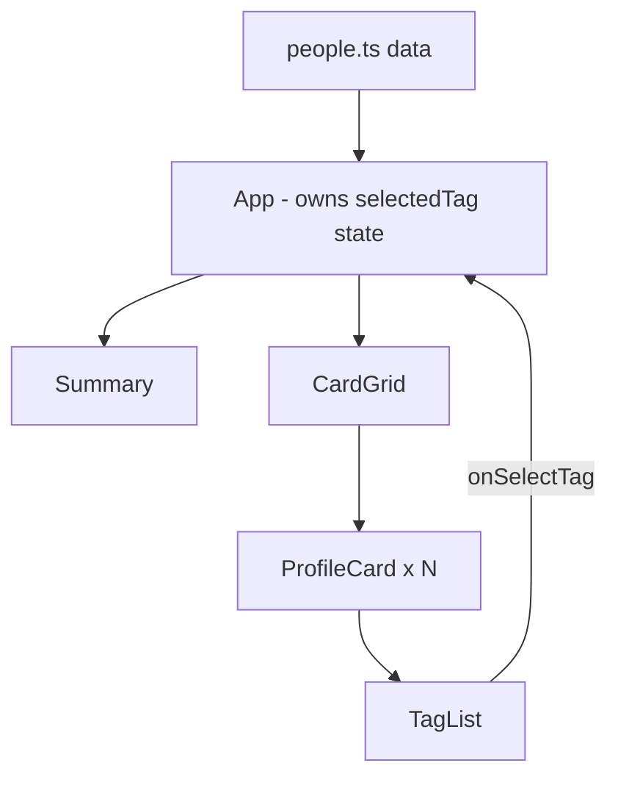
- **App** owns the only piece of state, `selectedTag`, because both the summary and the cards need it.
- **Summary** derives its counts from the data and the tag — nothing stored twice.
- **CardGrid** maps the array to cards with `key={person.id}`.
- **ProfileCard** is a pure component: same props, same output.
- **TagList** calls the `onSelectTag` callback prop; it never changes state itself.

### Data model
| Type | Fields | Notes |
|---|---|---|
| `Person` | `id: string`, `name`, `role`, `city`, `avatarUrl`, `skills: string[]` | `id` is the key |
| App state | `selectedTag: string \| null` | the only state |
| Derived | `matches = people.filter(p => p.skills.includes(tag))` | computed every render |

### Tech stack
| Component | Choice | Why |
|---|---|---|
| Build | Vite + React 19 + TypeScript | instant dev server, typed props |
| Styling | CSS Modules | scoped class names with no runtime |
| Tests | Vitest + RTL | fast, user-centred queries |

### Milestones
1. **Static card.** Hard-code one `ProfileCard`. *Done when* it matches your sketch and has no TypeScript errors.
2. **List from data.** Map `people` to cards with keys. *Done when* there are no key warnings in the console.
3. **Tag selection.** Lift `selectedTag` to `App`. *Done when* clicking a tag highlights the right cards and a second click clears it.
4. **Summary and polish.** Derived counts, responsive grid, focus styles. *Done when* an RTL test clicks "TypeScript" and sees the correct count.

### Deep dive: the hard parts
- **Where state lives.** Beginners put `isHighlighted` inside each card. That breaks as soon as the summary needs the same fact. The rule from Chapter 3 is: put state in the closest common parent of everything that reads it, and pass it down.
- **Keys are identity, not decoration.** Using the array index as the key works until you sort or filter; then React reuses the wrong DOM node and, for example, an image or an expanded panel "sticks" to the wrong person. Use the person's `id`.
- **Derived vs stored.** "Number of matches" is a function of data you already have. Storing it in state invites the two to disagree. Compute it during render; it costs microseconds.
- **Accessible tags.** A tag you can click is a `<button>` with `aria-pressed`, not a `<span onClick>`. That gives keyboard focus and announces the toggle state to screen readers for free.

### Testing strategy
Render `App` with RTL, `getAllByRole('article')` for the cards, `getByRole('button', { name: 'TypeScript' })` for a tag, click it with `user-event`, and assert the summary text and the highlighted cards. One Playwright smoke test opens the page at 375 px and checks that nothing scrolls horizontally.

### Trade-offs, scaling and failure modes
Two hundred cards are trivial; 20,000 are not — at that size you need pagination or virtualization (Project 28). Remote avatars can be slow or broken: give the `` a fallback (initials) on `onError`. Hard-coded data is fine for now; Project 4 adds fetching.

### Stretch goals
- Load people from Random User with a loading skeleton.
- Multi-select tags with AND/OR mode.
- A `layout` prop (`grid | list`) that changes the card's markup — practice for discriminated-union props.

### Skills practised
- [Ch 1 — Why React and setup](../chapters/01-why-react-and-setup/README.md): Vite, JSX
- [Ch 2 — Components and props](../chapters/02-components-and-props/README.md): props, composition, lists and keys
- [Ch 3 — State and events](../chapters/03-state-and-events/README.md): lifting state, derived state

### In the interview
**30-second answer:** I built a team directory that renders a responsive grid of profile cards from a typed data array, where clicking a skill tag highlights everyone who shares it. The key decision was keeping exactly one piece of state, `selectedTag`, in `App` (the closest common parent of the summary and the cards) and deriving everything else, such as the match count, during render. The subtle problem was list identity: I key every card by `person.id`, never by index, so sorting or filtering never moves an avatar or open panel onto the wrong person. 200 cards render in well under 100 ms, and an RTL test clicks "TypeScript" and checks the count.

**Key terms to know:**
- **Component** — a function that takes props and returns UI. `ProfileCard`, `TagList` and `CardGrid` are components.
- **Props** — read-only inputs a parent passes to a child. Each card receives a `person` and an `isHighlighted` flag.
- **Pure component** — same props in, same output out, no side effects during render. `ProfileCard` is pure, so React can re-render it safely at any time.
- **Key** — the identity React uses to match list items between renders. `key={person.id}` on each card.
- **Reconciliation** — React comparing the new element tree with the previous one to work out the smallest DOM change. Keys guide it for lists.
- **Lifting state up** — moving state to the closest common parent of everything that reads it. `selectedTag` lives in `App`.
- **Derived state** — values computed from existing state or props instead of stored. The match count and highlight flags.
- **Callback prop** — a function passed down so a child can ask the parent to change state. `onSelectTag`.
- **`aria-pressed`** — tells assistive tech that a button is a toggle and whether it is on. Used on each tag button.
- **Cumulative layout shift (CLS)** — content jumping as images load. Prevented with fixed `width`/`height` on avatars.

**Q:** Why not use the array index as a key?

**A:** The key tells React which item is which between renders. If the list is reordered or filtered, an index key now points at a different person, so React reuses the wrong component state and DOM node (an expanded panel or a loading image "sticks" to the wrong card). A stable, unique id such as `person.id` keeps identity attached to the data. Index keys are only safe for a static list that never reorders, filters or inserts.

**Q:** Where should `selectedTag` live, and how does a deeply nested tag change it?

**A:** In the closest common parent of every component that reads it, which is `App`, because both `Summary` and the cards need it. `App` passes the value down as a prop and passes `onSelectTag` down as a callback. The `TagList` calls the callback; it never owns or mutates the state itself, so there is one source of truth.

**Q:** Why is the match count not stored in state?

**A:** It can be computed from `people` and `selectedTag`, which you already have. Storing it creates two sources of truth that can disagree, for example after the data changes but the count is not updated. Filtering 200 items costs microseconds, so computing it on every render is the simpler and safer choice.

**Q:** What actually happens when I click a tag?

**A:** The click handler calls `setSelectedTag`, which schedules a re-render of `App`. React calls `App` and its children again to produce a new element tree, reconciles it against the previous tree using component types and keys, and commits only the changed DOM attributes (the highlight class and `aria-pressed`). The cards are not destroyed and recreated.

**Q:** Why is a clickable tag a `<button>` and not a `<span onClick>`?

**A:** A button is focusable, works with Enter and Space, and is announced as a button by screen readers, all for free. Adding `aria-pressed={isSelected}` announces it as a toggle with its on/off state. A `span` needs `tabIndex`, a role and key handlers just to reach the same baseline.

**Q:** What changes at 20,000 profiles? What breaks first?

**A:** Rendering 20,000 DOM nodes is what breaks first: the initial render and every highlight change get slow and memory grows. The fix is pagination or virtualization (render only the visible rows, Project 28). Wrapping `ProfileCard` in `memo` helps only re-renders, not the cost of mounting thousands of nodes.

**Q:** An avatar URL is broken. What happens and how do you handle it?

**A:** The browser shows a broken-image icon and the alt text. I add an `onError` handler that switches the card to an initials fallback, kept in that card's local state because nobody else cares about it. The fixed width and height mean the layout does not jump either way.

**Q:** How do you prove the highlighting works?

**A:** An RTL test renders `App`, clicks `getByRole('button', { name: 'TypeScript' })` with `user-event`, then asserts the summary text ("4 know TypeScript") and that the right `article` elements have the highlighted state. Querying by role tests what a user perceives, not internal class names, so refactors do not break the test.

**Q:** Hands-on: what is wrong with this code?

**A:** The key is on the inner element instead of the element returned from `map`, so React still warns and uses index order. The key must sit on the outermost element in the callback.

```tsx
// wrong
people.map(p => <div><ProfileCard key={p.id} person={p} /></div>)
// right
people.map(p => <ProfileCard key={p.id} person={p} />)
```

**Common mistakes in answers:**
- Saying keys are "for performance". They are for identity and correctness; wrong keys cause wrong state, not just slow renders.
- Putting `isHighlighted` in each card's own state. The summary also needs it, so it must be derived from state in the common parent.
- Claiming `Math.random()` or `crypto.randomUUID()` called during render makes a good key. A new key every render remounts every card.

### TL;DR
Turn one card into a pure component, render a list with stable keys, keep the single piece of state in the common parent and derive everything else.

## 2. Counter and to-do app

**Level:** Beginner · **Time:** 1 weekend · **Prerequisites:** Ch 2, Ch 3

### What it is
Two tiny apps on one page. The **counter** has +1, −1, +5 and reset buttons and a step input. The **to-do list** lets you add, tick, edit, delete and filter (All / Active / Done) tasks. Together they cover every basic state rule: state as a snapshot, batching, updater functions and immutable updates of arrays and objects.

### The problem it solves
Almost every bug a React beginner hits comes from mutating state or reading a stale value: `count + 1` three times only adds one; `todos.push()` changes nothing on screen. These two apps make you hit those bugs on purpose, then fix them the right way.

### Real-world examples
- [TodoMVC](https://todomvc.com/) has implemented the same to-do spec in dozens of frameworks for years — a great reference for the feature list and keyboard behaviour.
- react.dev's [Updating Arrays in State](https://react.dev/learn/updating-arrays-in-state) is the canonical guide to add, remove and replace without mutation.

### Requirements
**Functional**
- Counter: +1, −1, +step, reset. "+3 quickly" (three updates in one handler) must add 3.
- To-do: add by pressing Enter, toggle done, double-click to edit, delete, filter, "clear completed", "N items left".
- The filter choice is reflected in the URL hash (`#/active`) so refresh keeps it.

**Non-functional**
- No state mutation anywhere (enforce with `readonly` types).
- Every control reachable and usable by keyboard.
- 1,000 to-dos still type without lag (under 16 ms per keystroke).

### The architecture
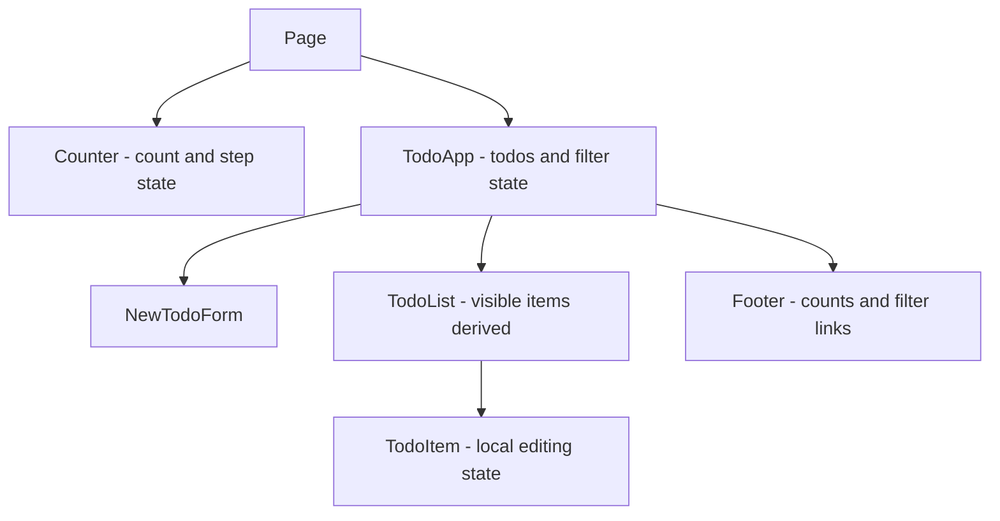
- **Counter** owns `count` and `step`; uses updater functions `setCount(c => c + step)`.
- **TodoApp** owns `todos` and `filter`; passes handlers down.
- **TodoItem** owns only `isEditing` and the draft text — local UI state that nobody else needs.
- **Footer** derives "items left" from `todos`.

### Data model
| Type | Fields |
|---|---|
| `Todo` | `id: string` (from `crypto.randomUUID()`), `title: string`, `done: boolean` |
| `Filter` | `'all' \| 'active' \| 'done'` |
| TodoApp state | `todos: readonly Todo[]`, `filter: Filter` |

### Tech stack
| Component | Choice | Why |
|---|---|---|
| UI | React 19 + TypeScript | `readonly` arrays catch mutation at compile time |
| IDs | `crypto.randomUUID()` | built into browsers and Node |
| Tests | Vitest + RTL + `user-event` | type and click like a user |

### Milestones
1. **Counter.** *Done when* a test clicks "+3 quickly" and sees 3, not 1.
2. **Add and list to-dos.** *Done when* Enter adds an item and clears the input.
3. **Toggle, delete, edit.** Immutable updates with `map` and `filter`. *Done when* editing one item never changes another.
4. **Filters and footer.** *Done when* the hash route survives a reload and counts are always right.

### Deep dive: the hard parts
- **State is a snapshot.** Inside one click handler, `count` is a constant captured when the component rendered. Calling `setCount(count + 1)` three times queues "set to 1" three times. `setCount(c => c + 1)` queues "add one" three times. React **batches** the queued updates and re-renders once.
- **Immutable updates.** React compares the old and new array by reference. `todos.push(x)` keeps the same reference, so React skips the render. Create a new array: `[...todos, x]`, `todos.map(t => t.id === id ? { ...t, done: !t.done } : t)`.
- **Editing state and keys.** If `TodoItem` holds a draft and you key items by index, deleting item 2 makes item 3 inherit item 2's draft. Key by `id`.
- **Escape cancels, blur saves.** Decide the edit rules up front, as TodoMVC does, and test them; they are where users notice sloppiness.

### Testing strategy
RTL tests for each rule: add, toggle, filter, edit-cancel with Escape, "clear completed". A test that renders 1,000 items and types into the new-todo box is a cheap performance guard. Playwright checks the hash route after a reload.

### Trade-offs, scaling and failure modes
`useState` with an array is perfect here. Once handlers multiply, move the logic into a `useReducer` (Project 5) so every transition is in one testable function. Losing data on refresh is the obvious failure; Project 9 adds persistence.

### Stretch goals
- Undo the last delete for 5 seconds (a toast with "Undo").
- Drag to reorder (preview of Project 11).
- Convert the to-do logic to `useReducer` and compare the two versions.

### Skills practised
- [Ch 2 — Components and props](../chapters/02-components-and-props/README.md): lists, keys, conditional rendering
- [Ch 3 — State and events](../chapters/03-state-and-events/README.md): snapshots, batching, updater functions, immutable updates
- [Ch 15 — Interview and machine coding](../chapters/15-react-interview-and-machine-coding/README.md): the to-do build

### In the interview
**30-second answer:** I built a counter and a TodoMVC-style to-do list to drill React's core state rules. The key decision was treating state as an immutable snapshot: every update creates a new array or object (`map`, `filter`, spread), enforced by `readonly` types, and any update that depends on the previous value uses the updater form `setCount(c => c + step)`. The trap I designed around was "+3 quickly" adding only 1, which the updater form fixes because React batches the three queued updates into one render. The filter lives in the URL hash so it survives refresh, and 1,000 to-dos still type in under 16 ms per keystroke.

**Key terms to know:**
- **State snapshot** — during one render, state values are constants. `count` inside a click handler does not change after `setCount`.
- **Updater function** — `setX(prev => next)`, which React applies to the latest queued value. Used for +1, +step and "+3 quickly".
- **Batching** — React groups state updates and re-renders once. Three `setCount` calls in one click cause one render.
- **Immutable update** — creating a new array or object instead of changing the old one. `[...todos, t]`, `todos.map(...)`.
- **Referential equality** — React decides whether state changed with `Object.is` on the reference. A pushed array is the same reference.
- **Local UI state** — state only one component needs. `isEditing` and the draft text in `TodoItem`.
- **Derived state** — "N items left" and the visible list are computed from `todos` and `filter`.
- **Controlled input** — an input whose `value` comes from state. The new-todo box and the edit field.
- **Hash routing** — keeping a small piece of state in `location.hash` (`#/active`) so it survives reloads.

**Q:** Why does calling `setCount(count + 1)` three times add only one?

**A:** `count` is the value from the current render, say 0, so all three calls ask React to "set to 1". React batches them and the final value is 1. The updater form `setCount(c => c + 1)` queues "add one" three times, and React applies each to the previous result, giving 3.

**Q:** Why must you not `push` into state?

**A:** React compares old and new state by reference with `Object.is`. `todos.push(x)` keeps the same array reference, so React may bail out of the render and the screen does not change. Mutation also breaks anything holding the old array, such as a memoized child or an undo history. Create a new array: `setTodos(t => [...t, x])`.

**Q:** What is batching, and when does it apply?

**A:** Batching means React collects all state updates made in the same tick and re-renders once. Since React 18 this is automatic everywhere: in event handlers, timeouts, promises and native event listeners. If you truly need the DOM updated synchronously in the middle of a handler, `flushSync` opts out, but that is rare.

**Q:** How do you toggle one to-do immutably?

**A:** Map over the array and replace only the matching item with a new object; every other item keeps its reference, so memoized rows can skip re-rendering.

```ts
setTodos(ts => ts.map(t =>
  t.id === id ? { ...t, done: !t.done } : t
));
```

**Q:** Why does `isEditing` live in `TodoItem` and not in `TodoApp`?

**A:** Only that one row needs it, so keeping it local avoids re-rendering the whole list on every keystroke of an edit. State should live as low as possible and only be lifted when a sibling or parent needs to read it. The trade-off is that "only one item editable at a time" would require lifting it as `editingId`.

**Q:** Why not store `itemsLeft` and `visibleTodos` in state?

**A:** Both are pure functions of `todos` and `filter`. Storing them means every handler must remember to update them too, and the first time one forgets, the footer lies. Computing them during render keeps one source of truth.

**Q:** What happens with 10,000 to-dos? What breaks first?

**A:** Typing in the new-todo input is what slows first, because every keystroke re-renders `TodoApp` and therefore the whole list. Fixes in order: keep the draft text in the form component so typing does not re-render the list, wrap `TodoItem` in `memo` (or enable the React Compiler), and virtualize if the DOM itself is too large.

**Q:** Index keys and editing: what bug appears?

**A:** If rows are keyed by index and you delete item 2 while item 3 has an open draft, React keeps the component at position 2 and gives it item 3's data, so the draft and `isEditing` appear on the wrong row. Keying by `todo.id` moves the component state with the item.

**Q:** How do you test the batching rule?

**A:** An RTL test clicks "+3 quickly" with `user-event` and asserts the display reads 3, not 1. Because it fails with the naive `setCount(count + 1)` version, the test proves the updater form is actually needed and guards against a regression.

**Common mistakes in answers:**
- Saying `setState` is "async" as the explanation. The real reason is that state is a per-render snapshot and updates are queued, not that the setter returns a promise (it does not).
- Thinking batching only happens in React event handlers. Since React 18 it is automatic in timeouts, promises and native handlers too.
- Using `todos.splice` or `sort()` directly on state. Both mutate; copy first (`toSorted()`, `toSpliced()` or spread).

### TL;DR
Use updater functions when the next state depends on the previous one, never mutate arrays or objects, and key list items by a stable id.

## 3. Tip calculator

**Level:** Beginner · **Time:** 1 weekend · **Prerequisites:** Ch 3, Ch 4

### What it is
A small form: bill amount, tip percentage (preset buttons 5/10/15/25 % plus "custom"), number of people. It shows tip per person and total per person, updating as you type, with a reset button. The focus is **controlled inputs** (inputs whose value comes from React state), validation messages and computing results from the minimal state.

### The problem it solves
Number inputs are surprisingly tricky: users type "12.", "0", "", or "abc"; money must not show floating-point noise like 14.999999. This project teaches you to keep raw text in state, parse it, validate it and format money correctly — skills every checkout or settings form needs.

### Real-world examples
- Frontend Mentor's [Tip calculator app challenge](https://www.frontendmentor.io/challenges/tip-calculator-app-ugJNGbJUX) provides a professional design to build against.
- react.dev's [Choosing the State Structure](https://react.dev/learn/choosing-the-state-structure) explains why results like "total per person" should not be stored.

### Requirements
**Functional**
- Bill and people inputs, tip presets and a custom percentage.
- Live results: tip/person and total/person, formatted in the user's currency.
- Error "Can't be zero" when people is 0, shown next to the field.
- Reset returns everything to empty and disables itself when already empty.

**Non-functional**
- Results never show more than two decimals, and never `NaN` or `Infinity`.
- Inputs have visible labels and use `inputMode="decimal"` so phones show a number keypad.
- Lighthouse accessibility score 100.

### The architecture
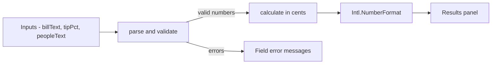
- **Inputs** hold raw strings exactly as typed.
- **parse and validate** is a pure function returning `{ values, errors }`.
- **calculate** works in integer cents to avoid floating-point rounding errors.
- **Intl.NumberFormat** formats currency for the user's locale.

### Data model
| Type | Fields |
|---|---|
| Form state | `billText: string`, `tip: { kind: 'preset', pct: number } \| { kind: 'custom', text: string }`, `peopleText: string` |
| Derived | `errors: Partial<Record<'bill' \| 'people' \| 'tip', string>>`, `tipPerPersonCents`, `totalPerPersonCents` |

### Tech stack
| Component | Choice | Why |
|---|---|---|
| UI | React 19 + TypeScript | discriminated union for the tip choice |
| Formatting | `Intl.NumberFormat` | built in, locale aware |
| Tests | Vitest for the pure calc, RTL for the form | logic tested without a DOM |

### Milestones
1. **Pure calculator.** `calculate(billCents, pct, people)`. *Done when* unit tests cover zero, rounding and large bills.
2. **Controlled form.** *Done when* typing updates results on every keystroke.
3. **Validation.** *Done when* invalid input shows a message and hides results instead of `NaN`.
4. **Presets, custom and reset.** *Done when* choosing a preset clears the custom field and vice versa.

### Deep dive: the hard parts
- **Store text, not numbers.** If state is a number, typing "12." becomes 12 and the dot vanishes. Keep the string; parse on render.
- **Money in cents.** `0.1 + 0.2` is not `0.3` in binary floating point. Convert to integer cents, divide, and round once at the end. Decide where the leftover cent goes when splitting.
- **Minimal state.** Results are derived. The only state is what the user typed. This removes a whole class of "the total didn't update" bugs.
- **Controlled vs uncontrolled.** Here controlled inputs make sense because every keystroke changes the output. Chapter 4 shows when an uncontrolled form with `FormData` is simpler.

### Testing strategy
Table-driven unit tests for `calculate` and `parse`. RTL tests: type "142.55", choose 15 %, type "5", expect the formatted results. Test the error message is linked with `aria-describedby` by querying `getByRole('spinbutton', { description: /can't be zero/i })` or by checking the attribute.

### Trade-offs, scaling and failure modes
Controlled inputs re-render on every keystroke; for a form this small that is free. Locale formatting can surprise (comma decimals in many countries), so parse with care or restrict input. A failure mode is silent rounding — show the per-person amounts that actually add up to the bill.

### Stretch goals
- Remember the last tip percentage with `localStorage`.
- Split unevenly ("Alice had the steak").
- Currency selector using `Intl.supportedValuesOf('currency')`.

### Skills practised
- [Ch 3 — State and events](../chapters/03-state-and-events/README.md): controlled inputs, derived state
- [Ch 4 — Forms and Actions](../chapters/04-forms-and-actions/README.md): validation, controlled vs uncontrolled
- [Ch 11 — TypeScript with React](../chapters/11-typescript-with-react/README.md): discriminated unions

### In the interview
**30-second answer:** I built a tip calculator where results update live as you type and never show `NaN`, `Infinity` or floating-point noise. The key design decision is minimal state: I store only the raw strings the user typed plus the tip choice as a discriminated union, and derive validation errors and results with a pure function during render. Money is calculated in integer cents and formatted once with `Intl.NumberFormat`, and I decided explicitly where the leftover cent goes when the bill does not divide evenly. The calculator is covered by table-driven unit tests and the form scores 100 on Lighthouse accessibility.

**Key terms to know:**
- **Controlled input** — an input whose `value` comes from React state and changes through `onChange`. Bill, custom tip and people fields.
- **Uncontrolled input** — the DOM keeps the value and you read it on submit (`FormData`, `defaultValue`). Not used here because every keystroke changes the output.
- **Minimal state** — store only what cannot be computed. Here: `billText`, `tip`, `peopleText`.
- **Derived state** — values computed from state during render. `errors`, tip per person, total per person.
- **Discriminated union** — a TypeScript union tagged by a field such as `kind: 'preset' | 'custom'`, so impossible combinations cannot be typed.
- **Integer minor units** — doing money maths in cents to avoid binary floating-point error (`0.1 + 0.2 !== 0.3`).
- **`Intl.NumberFormat`** — built-in, locale-aware number and currency formatting.
- **`inputMode="decimal"`** — tells phones to show a numeric keypad with a decimal point.
- **`aria-describedby` / `aria-invalid`** — link an error message to its input and mark the input invalid for screen readers.

**Q:** Why keep the bill as a string in state?

**A:** If state is a number, typing "12." is parsed to 12 and the dot disappears, and clearing the field becomes 0 instead of empty. Keeping the raw string preserves exactly what the user typed. I parse it during render and show an error if it is not a valid number.

**Q:** How do you avoid floating-point errors with money?

**A:** Convert input to integer cents once, do all arithmetic in integers, round once at the end, and format with `Intl.NumberFormat`. JavaScript numbers are binary floating point, so decimals like 0.1 cannot be represented exactly and errors pile up if you round at every step.

**Q:** What is derived state and why avoid storing it?

**A:** Derived state is any value you can compute from other state or props, like the total per person. Storing it means every change must update two things, and a missed update shows a stale total. Computing it on render costs nothing here and removes that whole class of bugs.

**Q:** Why model the tip as `{ kind: 'preset', pct } | { kind: 'custom', text }` instead of two fields?

**A:** With two independent fields (`presetPct` and `customText`) you can accidentally have both set, and the UI must guess which wins. The union makes "exactly one tip source" a type rule, so choosing a preset automatically discards the custom text. TypeScript then forces the calculation to handle both cases.

**Q:** Controlled or uncontrolled inputs here, and what is the trade-off?

**A:** Controlled, because results must update on every keystroke and reset must clear everything. The cost is a re-render per keystroke, which is free for a form this small. For a large submit-only form, uncontrolled inputs read with `FormData` (Project 7) are simpler and re-render less.

**Q:** A $100 bill split three ways: how do the per-person amounts add up?

**A:** 10,000 cents divided by 3 is 3,333 with 1 cent left over. If I show $33.33 three times, the group pays $99.99. I compute the remainder with `%` and either assign the extra cent to the first person or show "one person pays $33.34", so the parts always sum to the bill.

**Q:** What happens if the user types "abc", "0" or pastes "1,234.50"?

**A:** "abc" fails parsing and shows a field error, and the results panel shows a placeholder rather than `NaN`. "0" people shows "Can't be zero" because dividing by zero would give `Infinity`. Thousands separators and comma decimals vary by locale, so I either strip known group separators or restrict input; the parse function is the single place where that rule lives and is unit-tested.

**Q:** How do you test it?

**A:** Table-driven Vitest tests for `parse` and `calculate` (zero, rounding, huge bills, remainder cents) need no DOM. Then one RTL test types "142.55", picks 15 %, types "5", and asserts the formatted results. A second checks the error is linked to the input via `aria-describedby`.

**Q:** Hands-on: what does this print, and how do you fix it?

**A:** It prints `0.30000000000000004`, because 0.1 and 0.2 have no exact binary representation. Work in cents and format at the end.

```ts
console.log(0.1 + 0.2);           // 0.30000000000000004
const cents = 10 + 20;            // 30
new Intl.NumberFormat('en-US', { style: 'currency', currency: 'USD' })
  .format(cents / 100);           // "$0.30"
```

**Common mistakes in answers:**
- "Just use `toFixed(2)`." That only formats; it does not fix accumulated errors, and it returns a string that people then do maths on.
- Storing `tipPerPerson` in state and updating it in a `useEffect`. That adds an extra render and a window where the result is stale; derive it instead.
- Assuming `type="number"` solves parsing. Its `value` is `""` whenever the browser considers the text invalid (such as "1e" or "--"), and browsers differ on intermediate input, which is why a text input with `inputMode="decimal"` plus your own parser is more predictable.

### TL;DR
Keep raw input as state, derive results with a pure function in cents, and format with `Intl` — no `NaN`, no stored totals.

## 4. Weather widget

**Level:** Beginner · **Time:** 1–2 weekends · **Prerequisites:** Ch 3, Ch 5, Ch 7

### What it is
A card that shows current weather and a 5-day forecast for a city the user searches for or for their current location. It is your first app that talks to a server: you fetch data in an **Effect** (code that runs after React updates the screen, to synchronize with something outside React), handle loading and errors, and cancel stale requests.

### The problem it solves
Fetching looks easy until the user types "Par", "Pari", "Paris" quickly and the slowest response wins, showing the wrong city. The widget teaches the three data states (loading, error, success), **race conditions** (two requests finishing in the wrong order) and how to clean up.

### Real-world examples
- [Open-Meteo](https://open-meteo.com/en/docs) offers a free weather forecast API and a geocoding API with no key required for non-commercial use — perfect for this build.
- react.dev's [Synchronizing with Effects](https://react.dev/learn/synchronizing-with-effects) shows the `ignore` flag pattern for fetch races.
- [You Might Not Need an Effect](https://react.dev/learn/you-might-not-need-an-effect) explains what should *not* go in an Effect.

### Requirements
**Functional**
- Search a city (geocoding) and pick from the results, or use the browser's geolocation.
- Show temperature, condition icon, wind and a 5-day forecast.
- Toggle °C/°F without refetching.
- Remember the last city.

**Non-functional**
- Show a skeleton within 100 ms of a search. Never show data for a city that is not the selected one.
- Cache responses for 10 minutes per city to avoid repeat calls.
- The widget must still render (with an error state and "Retry") if the API is down.

### The architecture
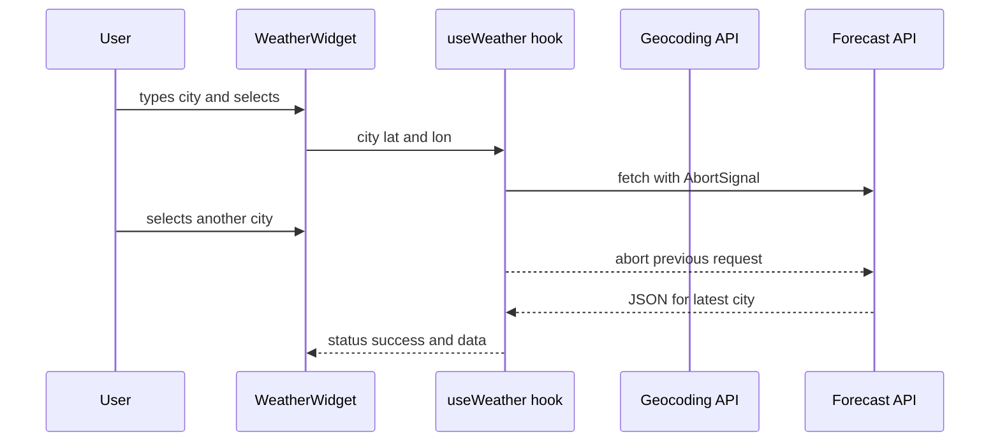
- **WeatherWidget** holds the selected place and the unit toggle.
- **useWeather** is a custom Hook returning `{ status, data, error, retry }`; it owns the Effect, the `AbortController` and the cache.
- **APIs** are called directly from the browser; there is no server of your own.

### Data model
| Type | Fields |
|---|---|
| `Place` | `name`, `country`, `lat`, `lon` |
| `Forecast` | `current: { tempC, code, windKph }`, `daily: { date, minC, maxC, code }[]` |
| Hook state | `{ status: 'idle' \| 'loading' \| 'error' \| 'success', data?, error? }` |
| Cache | `Map<string, { at: number, data: Forecast }>` keyed by `lat,lon` |

### Tech stack
| Component | Choice | Why |
|---|---|---|
| Data | `fetch` + `AbortController` in a custom Hook | learn the mechanics before using a library |
| Units | derived on render | no refetch |
| Tests | Vitest + RTL + MSW | mock the network at the request level |

### Milestones
1. **Hard-coded fetch.** Fetch one city's forecast in an Effect. *Done when* loading, success and error all render.
2. **City search.** Geocoding with results list. *Done when* selecting a result loads its weather.
3. **Race-proof.** Abort the previous request in the Effect cleanup. *Done when* a test with delayed mocked responses never shows the stale city.
4. **Cache, units, persistence.** *Done when* switching back to a city within 10 minutes makes no network call.

### Deep dive: the hard parts
- **Cleanup cancels races.** The Effect for city B runs only after the cleanup for city A. Calling `controller.abort()` in cleanup stops A's request, and an aborted fetch rejects with an `AbortError` you must ignore, not show.
- **StrictMode's double run.** In development React mounts, unmounts and remounts once to prove your cleanup works. You will see two requests; the first is aborted. That is expected, not a bug.
- **Status as one value.** `isLoading` + `error` + `data` as three booleans allow impossible combinations. A single `status` union makes the UI a simple switch.
- **What not to put in an Effect.** Converting °C to °F is derived during render. Reacting to the "Search" click is an event handler. Only the "keep data in sync with the selected place" part is an Effect.

### Testing strategy
Use MSW (Mock Service Worker) to answer `/forecast` with fixtures and delays. Test: shows skeleton, shows data, shows error with Retry, and the race test (A delayed 300 ms, B 50 ms, select A then B, assert B). Unit-test the weather-code-to-icon mapping.

### Trade-offs, scaling and failure modes
Hand-rolled fetching teaches the mechanics but you will rewrite caching, retries and refetch-on-focus badly. Project 12 swaps in TanStack Query. Geolocation can be denied — fall back to search. Rate limits: debounce search input (Project 16).

### Stretch goals
- Replace the Hook with TanStack Query and compare the code.
- Hourly chart with an accessible table fallback.
- Read the promise with `use()` inside `<Suspense>` instead of status flags.

### Skills practised
- [Ch 5 — Effects and refs](../chapters/05-effects-and-refs/README.md): Effects, cleanup, fetch races, StrictMode
- [Ch 7 — Custom Hooks](../chapters/07-custom-hooks-and-hook-rules/README.md): `useFetch`-style Hook
- [Ch 12 — Testing React](../chapters/12-testing-react/README.md): mocking `fetch` and MSW

### In the interview
**30-second answer:** I built a weather widget that searches a city, fetches a forecast from Open-Meteo and never shows data for a city that is not the one selected. The key decision was a `useWeather` custom Hook that owns one Effect: it fetches with an `AbortController`, aborts the previous request in cleanup, and exposes a single `status` union instead of separate loading and error flags. The hardest part was the race where a slow response for an old city arrives last; a test with mocked 300 ms and 50 ms responses proves it can no longer win. Responses are cached for 10 minutes, and °C/°F is derived on render with no refetch.

**Key terms to know:**
- **Effect** — code that runs after React commits, to synchronize with something outside React (here, the network). The fetch in `useWeather`.
- **Effect cleanup** — the function an Effect returns, run before the next Effect and on unmount. It calls `controller.abort()`.
- **Race condition** — two async operations finishing in an unexpected order. City A's slow response overwriting city B.
- **`AbortController` / `AbortSignal`** — browser API to cancel a `fetch`; an aborted fetch rejects with an `AbortError`.
- **StrictMode double-invoke** — in development React mounts, unmounts and remounts components to expose missing cleanup.
- **Status union** — `'idle' | 'loading' | 'error' | 'success'` as one value, so impossible combinations cannot exist.
- **Custom Hook** — a function starting with `use` that bundles Hooks into reusable logic. `useWeather`.
- **Dependency array** — the values an Effect re-runs on. Here `[lat, lon]`.
- **TTL cache** — cached data with a time-to-live. A `Map` keyed by `lat,lon` with a 10-minute expiry.
- **MSW (Mock Service Worker)** — intercepts network requests in tests so the real `fetch` code runs against fixtures.

**Q:** How do you prevent a slow old response from overwriting a new one?

**A:** In the Effect I create an `AbortController`, pass its signal to `fetch`, and call `abort()` in the cleanup. When the selected city changes, React runs the old Effect's cleanup before the new Effect, so the old request is cancelled. I catch and ignore `AbortError`. An `ignore` boolean flag set in cleanup works too, but abort also saves bandwidth.

**Q:** Why does my Effect fetch twice in development?

**A:** StrictMode deliberately mounts, unmounts and remounts each component once in development to prove your cleanup works. You see two requests and the first is aborted, which is correct behaviour. Production runs the Effect once; you should fix the cleanup, not remove StrictMode.

**Q:** Should the °C/°F conversion be in an Effect?

**A:** No. It is a pure calculation from data you already have, so compute it during render. Putting it in an Effect that sets state adds a second render with a stale value in between. Effects are only for synchronizing with external systems.

**Q:** Why one `status` field instead of `isLoading`, `error` and `data`?

**A:** Three independent fields allow nonsense combinations like loading and error at the same time, and every render must guess priority. A tagged union makes the UI a simple `switch` and lets TypeScript check that each branch has what it needs, for example `data` only exists when `status === 'success'`.

**Q:** Why hand-roll fetching instead of using TanStack Query?

**A:** To learn the mechanics: cleanup, races and caching. The trade-off is that a hand-rolled Hook will lack deduplication, retries, refetch-on-focus and garbage collection that a library has solved. For production I would switch (Project 12); the stretch goal is to compare both versions.

**Q:** What happens if the API is down, or geolocation is denied?

**A:** The fetch rejects or returns a non-OK status, so the Hook sets `status: 'error'` and the widget shows a message and a "Retry" button that bumps a counter in the dependency array to re-run the Effect. Note that `fetch` does not reject on HTTP 500, so I check `response.ok` myself. Denied geolocation falls back to the search box.

**Q:** What changes at 10x the users, or if search hits the API on every keystroke?

**A:** The geocoding API would be hammered and rate-limited first. I debounce the search input (around 300 ms) and abort superseded requests, and the 10-minute cache absorbs repeats. With many users the next step is a small proxy or edge cache so all clients share cached forecasts and the API key stays server-side.

**Q:** How do you test the race condition?

**A:** With MSW, I make city A respond after 300 ms and city B after 50 ms, select A then B, wait, and assert that only B's data is on screen and A's never appears. Without the abort in cleanup the test fails, which proves the guard works.

**Q:** Hands-on: write the Effect.

**A:** The cleanup aborts the request for the previous coordinates.

```ts
useEffect(() => {
  const c = new AbortController();
  setState({ status: 'loading' });
  fetchForecast(lat, lon, c.signal)
    .then(data => setState({ status: 'success', data }))
    .catch(e => { if (e.name !== 'AbortError') setState({ status: 'error', error: e }); });
  return () => c.abort();
}, [lat, lon]);
```

**Common mistakes in answers:**
- "Use an empty dependency array so it only fetches once." Then changing city does nothing; the dependencies must include `lat` and `lon`.
- "Make the Effect callback `async`." An Effect must return a cleanup function or nothing, not a promise; define an async function inside instead.
- Treating the double fetch in development as a bug to suppress with a ref guard, instead of writing correct cleanup.

### TL;DR
Fetch in an Effect with an `AbortController` cleaned up on change, model status as one union, and derive everything else during render.

## 5. Quiz game

**Level:** Beginner · **Time:** 1–2 weekends · **Prerequisites:** Ch 3, Ch 6

### What it is
A timed multiple-choice quiz: choose a category and difficulty, answer 10 questions with a 20-second timer each, see right/wrong feedback, and get a results screen with a review of every answer. The whole game is driven by a **reducer** — a pure function `(state, action) => newState` used with `useReducer` — modelled as a small **state machine** (a fixed set of screens with allowed moves between them).

### The problem it solves
Games, checkouts and onboarding flows have many states and rules ("can't answer twice", "timer stops on answer", "results only after the last question"). Scattering these across `useState` calls produces impossible states. A reducer centralizes the rules so they can be unit-tested without rendering anything.

### Real-world examples
- The [Open Trivia Database](https://opentdb.com/api_config.php) provides a free JSON API of categorized questions with a session token to avoid repeats.
- react.dev's [Extracting State Logic into a Reducer](https://react.dev/learn/extracting-state-logic-into-a-reducer) introduces the exact pattern.

### Requirements
**Functional**
- Setup screen: category, difficulty, number of questions.
- Question screen: shuffled answers, 20 s countdown, lock-in on click, feedback, "Next".
- Timeout counts as wrong and reveals the answer.
- Results: score, time taken, list of questions with your answer and the correct one. "Play again".

**Non-functional**
- The reducer has 100 % branch coverage.
- The timer drifts by less than 1 s over 20 s (do not count ticks — compare timestamps).
- HTML entities in API text (`&quot;`) are decoded safely without `dangerouslySetInnerHTML`.

### The architecture
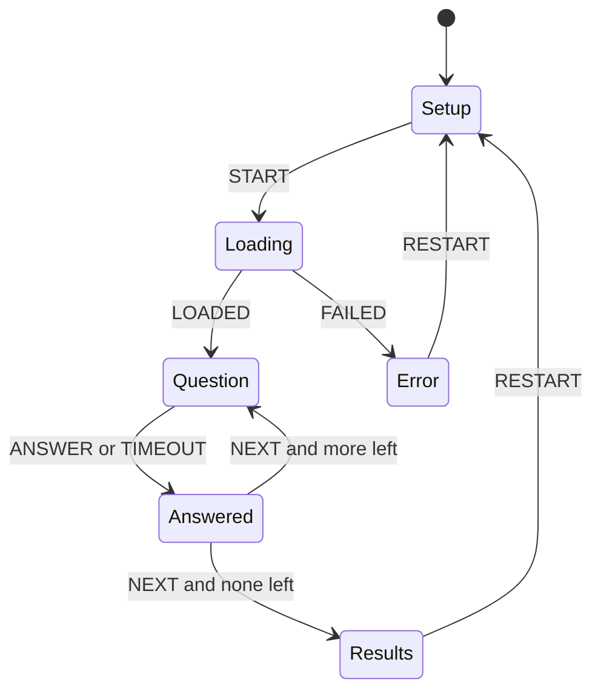
- **Setup / Loading / Question / Answered / Results / Error** are the only allowed `phase` values.
- Each arrow is an **action** the reducer accepts in that phase; anything else is ignored.
- The **QuizScreen** component renders a different child per phase.

### Data model
| Type | Fields |
|---|---|
| `Question` | `id`, `text`, `choices: string[]` (shuffled once), `correct: string` |
| `State` | `phase`, `questions`, `index`, `answers: { questionId, choice \| null, ms }[]`, `startedAt` |
| `Action` | `START`, `LOADED`, `FAILED`, `ANSWER`, `TIMEOUT`, `NEXT`, `RESTART` |

### Tech stack
| Component | Choice | Why |
|---|---|---|
| Logic | `useReducer` + TypeScript unions | exhaustive, testable transitions |
| Timer | `useEffect` + `setInterval` reading `Date.now()` | accurate, cleaned up |
| Tests | Vitest for the reducer, RTL with fake timers | fast and deterministic |

### Milestones
1. **Reducer first.** Write and unit-test every transition with fixture questions. *Done when* invalid actions leave state unchanged.
2. **Screens.** Render each phase. *Done when* you can play a full fixture game by clicking.
3. **Timer.** *Done when* a fake-timer test advances 20 s and sees the TIMEOUT feedback.
4. **API.** Fetch from Open Trivia DB, decode entities, shuffle. *Done when* errors show the Error screen with "Try again".

### Deep dive: the hard parts
- **Shuffle once.** Shuffling choices during render reorders them on every re-render (every timer tick). Shuffle when the questions load and store the result.
- **Timer accuracy.** `setInterval` callbacks can be delayed, especially in background tabs. Store the deadline (`startedAt + 20000`) and compute remaining time from `Date.now()` on each tick.
- **Timer cleanup.** The interval must stop on answer and on unmount. Start it in an Effect keyed on the question index and clear it in cleanup.
- **Decoding entities safely.** Parsing with `new DOMParser().parseFromString(text, 'text/html').documentElement.textContent` decodes without injecting HTML into the page.

### Testing strategy
Reducer tests are plain function calls: given state + action, expect state. RTL with `vi.useFakeTimers()` for the countdown. MSW for the API, including a response code that means "no results".

### Trade-offs, scaling and failure modes
A reducer adds ceremony for a two-field form but pays off here. For very complex flows, a state-machine library (such as XState) adds visualization and guards; for 7 states, a typed reducer is enough. The API rate-limits rapid calls — show a friendly error.

### Stretch goals
- Keyboard shortcuts 1–4 to answer.
- Persist high scores per category.
- Two-player hot-seat mode.

### Skills practised
- [Ch 3 — State and events](../chapters/03-state-and-events/README.md): state shape
- [Ch 5 — Effects and refs](../chapters/05-effects-and-refs/README.md): interval cleanup
- [Ch 6 — State management](../chapters/06-state-management/README.md): `useReducer`

### In the interview
**30-second answer:** I built a timed quiz on the Open Trivia DB where the whole game is a typed state machine inside a `useReducer` reducer. Phases are Setup, Loading, Question, Answered, Results and Error, and the reducer ignores any action that is not allowed in the current phase, so "answer twice" or "results before the last question" cannot happen. The hard parts were a 20-second timer that stays accurate in background tabs, which I solved by storing a deadline and computing remaining time from `Date.now()`, and shuffling answers once on load instead of in render. The reducer has 100 % branch coverage from plain function tests with no DOM.

**Key terms to know:**
- **Reducer** — a pure function `(state, action) => newState`. All quiz rules live in one.
- **`useReducer`** — the Hook that holds reducer state and gives you `dispatch`.
- **Action** — a plain object describing what happened, such as `{ type: 'ANSWER', choice }`.
- **Finite state machine** — a fixed set of states (phases) with allowed transitions. The `stateDiagram` of the quiz.
- **Impossible state** — a combination of values that should never exist, such as "answered" with no current question. A phase union prevents it.
- **Render purity** — rendering must not have side effects or randomness. Why shuffling happens on load, not in render.
- **Effect cleanup for intervals** — `clearInterval` in the Effect's cleanup, keyed on the question index.
- **Timer drift** — `setInterval` callbacks fire late, especially in background tabs. Fixed by using a stored deadline.
- **Exhaustive check** — a TypeScript `never` check in the `switch` so a new action type that is not handled fails to compile.
- **Fake timers** — Vitest's `vi.useFakeTimers()` to advance time deterministically in tests.

**Q:** When do you prefer `useReducer` over `useState`?

**A:** When several values change together or the next state depends on rules about the current state. A reducer puts every transition in one pure function, so the rules can be unit-tested without rendering, and components just dispatch intents. For one or two independent values, `useState` is simpler.

**Q:** Why not shuffle answers in render?

**A:** Render must be pure: same inputs, same output. Shuffling in render gives a new order on every re-render, and the timer re-renders every second, so answers would jump around. I shuffle once when the questions load and store the shuffled `choices` in state.

**Q:** How do you make a countdown accurate?

**A:** Store a deadline (`startedAt + 20000`) and on every tick compute `deadline - Date.now()`. Counting ticks drifts because interval callbacks can be delayed, and browsers throttle timers in hidden tabs to about once a second or less. The timestamp approach is correct no matter how late a tick arrives.

**Q:** What does the reducer do with an action that is not valid in the current phase?

**A:** It returns the current state unchanged. For example, `ANSWER` during `Answered` is ignored, which naturally prevents double-answering from a double click or a timeout landing at the same moment as a click. Returning the same reference also lets React skip the re-render.

**Q:** Why a typed reducer and not XState?

**A:** Seven phases and seven actions fit comfortably in a `switch` with TypeScript unions, and that adds no dependency. XState pays off when you need nested or parallel states, guards, delayed transitions and a visualizer. The trade-off is ceremony versus power; I would switch if the flow grew multiplayer or branching rules.

**Q:** Where do side effects like the timer and fetching go if the reducer must be pure?

**A:** In Effects outside the reducer. One Effect keyed on `phase` and `index` starts the interval and clears it in cleanup, dispatching `TICK` or `TIMEOUT`. Another fetches questions when the phase becomes Loading and dispatches `LOADED` or `FAILED`. The reducer only describes the new state.

**Q:** What happens if the API fails, returns no results or rate-limits?

**A:** The fetch dispatches `FAILED`, moving to the Error phase with "Try again". Open Trivia DB returns a `response_code` in the JSON body (for example 1 for "not enough questions" and 5 for rate limiting) even with HTTP 200, so I check it and map each code to a friendly message.

**Q:** How do you decode `&quot;` in question text safely?

**A:** Parse it with `DOMParser` and read `textContent`, then render the result as plain text. Setting it with `dangerouslySetInnerHTML` would execute any injected markup. `DOMParser` creates an inert document, so scripts do not run.

**Q:** How do you test the timeout?

**A:** Reducer tests call the function directly: given Question state plus `TIMEOUT`, expect Answered with `choice: null`. For the UI, an RTL test with `vi.useFakeTimers()` advances 20 seconds and asserts the correct answer is revealed and marked wrong.

**Q:** Hands-on: write the guard pattern in the reducer.

**A:** Switch on the action, and check the phase before changing anything.

```ts
case 'ANSWER':
  if (state.phase !== 'question') return state;
  return { ...state, phase: 'answered',
    answers: [...state.answers, { questionId: q.id, choice: action.choice, ms: action.now - state.startedAt }] };
```

**Common mistakes in answers:**
- Calling `Date.now()` or `Math.random()` inside the reducer. That makes it impure; pass `now` in the action payload instead.
- Using one `useState` per field (`isAnswered`, `showResults`, `currentIndex`) and claiming it is simpler. It allows impossible states the machine rules out.
- Forgetting to clear the interval on answer, so the timer keeps dispatching and a TIMEOUT overrides a correct answer.

### TL;DR
Model the game as a typed state machine in a reducer, test it without the DOM, and drive an accurate, cleaned-up timer from timestamps.

## 6. Image gallery with lightbox

**Level:** Beginner · **Time:** 1–2 weekends · **Prerequisites:** Ch 2, Ch 5, Ch 14

### What it is
A responsive grid of photos. Clicking one opens a **lightbox** — a full-screen **modal dialog** (a window that blocks the page behind it until closed) — with next/previous, keyboard arrows, swipe on touch, a caption and a close button. Images load lazily. You learn DOM refs, focus management, **portals** (rendering a child into a different DOM node, such as `document.body`) and accessibility of dialogs.

### The problem it solves
Modals are where accessibility usually breaks: focus escapes behind the overlay, Escape does nothing, the screen reader reads the page underneath, and the page scrolls behind. Large image grids also waste bandwidth if every image loads at once.

### Real-world examples
- The W3C [WAI-ARIA dialog (modal) pattern](https://www.w3.org/WAI/ARIA/apg/patterns/dialog-modal/) defines the required keyboard and focus behaviour.
- MDN's [`<dialog>` element reference](https://developer.mozilla.org/en-US/docs/Web/API/HTMLDialogElement) — `showModal()` gives you a top layer, inert background and Escape handling natively.
- The [Unsplash API](https://unsplash.com/documentation) supplies photos with sizes, author credits and blur hashes.

### Requirements
**Functional**
- Grid of 30+ thumbnails with lazy loading; open any in the lightbox.
- Lightbox: next/prev buttons, ← → keys, Escape closes, swipe on touch, counter "7 / 30".
- On close, focus returns to the thumbnail that opened it.
- The URL updates (`?photo=7`) so a lightbox view is shareable.

**Non-functional**
- Thumbnails use `srcset` and `loading="lazy"`; initial page transfer under 1 MB.
- Zero layout shift: every image has an aspect ratio.
- Passes axe-core with zero violations.

### The architecture
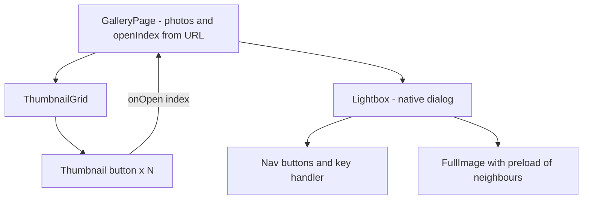
- **GalleryPage** reads `openIndex` from the URL search params — the URL is the state.
- **Thumbnail** is a `<button>` wrapping an ``, with a ref so focus can return.
- **Lightbox** wraps a native `<dialog>` and calls `showModal()` in an Effect; it preloads the next and previous image.

### Data model
| Type | Fields |
|---|---|
| `Photo` | `id`, `thumbUrl`, `fullUrl`, `width`, `height`, `alt`, `author` |
| URL state | `photo: number \| null` |
| Refs | `thumbRefs: Map<id, HTMLButtonElement>`, `dialogRef` |

### Tech stack
| Component | Choice | Why |
|---|---|---|
| Modal | native `<dialog>` + `showModal()` | top layer, Escape, inert background for free |
| Images | `srcset`, `loading="lazy"`, `decoding="async"` | bandwidth and smooth scroll |
| Tests | RTL + Playwright + axe | keyboard and a11y in a real browser |

### Milestones
1. **Grid.** *Done when* the grid is responsive and shows no layout shift.
2. **Lightbox open/close.** *Done when* Escape closes it and focus returns to the right thumbnail.
3. **Navigation.** *Done when* arrows, buttons and swipe move through photos and wrap around.
4. **URL state.** *Done when* reloading `?photo=7` opens the lightbox on photo 7 and Back closes it.

### Deep dive: the hard parts
- **Refs to many items.** In React 19 a ref callback can return a cleanup function, so `ref={el => { map.set(id, el); return () => map.delete(id); }}` keeps a tidy map of thumbnail nodes.
- **Focus return.** Remember which thumbnail opened the dialog (the index is enough) and call `.focus()` on its node after close.
- **`<dialog>` vs portal.** A native modal dialog solves stacking and inertness. If you build a custom overlay instead, you need `createPortal` to escape `overflow: hidden` parents, a focus trap and `inert` on the background.
- **Preloading.** Create `new Image()` for neighbours so "next" feels instant, but cap it at one each way to save data.

### Testing strategy
RTL: open via click, assert `getByRole('dialog')`, press Escape, assert focus on the thumbnail. Playwright: keyboard-only walk through, swipe with touch emulation, axe scan with `@axe-core/playwright`.

### Trade-offs, scaling and failure modes
URL state makes views shareable but means every navigation is a history entry — use `replace` for next/prev so Back closes the lightbox in one step. Thousands of photos need virtualization. Broken images need a placeholder.

### Stretch goals
- Animate open/close with `<ViewTransition>` (stable in React 19.3).
- Pinch-to-zoom.
- Masonry layout with CSS grid.

### Skills practised
- [Ch 5 — Effects and refs](../chapters/05-effects-and-refs/README.md): DOM refs, ref cleanups
- [Ch 9 — Routing and data fetching](../chapters/09-routing-and-data-fetching/README.md): URL search params
- [Ch 14 — Patterns and architecture](../chapters/14-patterns-and-architecture/README.md): portals, accessibility

### In the interview
**30-second answer:** I built a responsive photo gallery with a lightbox that is fully keyboard- and screen-reader-accessible and shareable by URL (`?photo=7`). The key decision was using the native `<dialog>` element with `showModal()`, which gives me the top layer, an inert background and Escape-to-close for free, instead of a hand-made overlay with a portal and focus trap. The fiddly part was returning focus to the exact thumbnail that opened it, which I solved with a map of thumbnail refs kept tidy by React 19 ref-callback cleanups. Thumbnails use `srcset` and `loading="lazy"`, the first load is under 1 MB, and axe-core reports zero violations.

**Key terms to know:**
- **Modal dialog** — a window that blocks interaction with the page behind it until closed. The lightbox.
- **`<dialog>` + `showModal()`** — native modal: rendered in the browser's top layer, background made inert, Escape fires `cancel`.
- **Focus management** — moving focus into the dialog on open and back to the opener on close.
- **Ref** — a handle to a DOM node. Thumbnail buttons are stored in a `Map` of refs so `.focus()` can be called.
- **Ref callback cleanup (React 19)** — a ref callback may return a function that runs when the node is detached.
- **Portal (`createPortal`)** — renders children into another DOM node (such as `document.body`) while keeping React context and event bubbling.
- **`inert`** — HTML attribute that makes a subtree unfocusable and hidden from assistive tech.
- **URL search params as state** — `?photo=7` is the source of truth for which photo is open.
- **Lazy loading / `srcset`** — load images only near the viewport and let the browser pick the right size.
- **Layout shift** — avoided by giving each image an aspect ratio or width and height.

**Q:** What must an accessible modal do?

**A:** Move focus inside on open, keep Tab cycling inside it, close on Escape, hide the background from assistive tech, have an accessible name (via `aria-labelledby` or `aria-label`), and return focus to the element that opened it. `showModal()` covers the top layer, inertness and Escape; I still handle the label and the focus return.

**Q:** Why use a portal for a custom modal?

**A:** To render outside ancestors whose `overflow: hidden`, `transform` or `z-index` would clip or bury the overlay. A portal moves the DOM node but keeps the React tree, so context still works and synthetic events still bubble to React parents. With a native modal `<dialog>`, the top layer solves stacking, so the portal is optional.

**Q:** What changed for refs in React 19?

**A:** `ref` is now an ordinary prop on function components, so `forwardRef` is no longer needed. Ref callbacks can return a cleanup function, which React calls when the element is removed, instead of calling the callback again with `null`. That makes a `Map` of many refs easy to keep accurate.

**Q:** Why native `<dialog>` instead of a library or a div overlay?

**A:** The platform already implements the hard parts correctly: top-layer stacking, inert background, Escape and the `::backdrop`. A div overlay needs a portal, a focus trap, `inert` on siblings and scroll locking, each a source of bugs. The trade-off is less control over animations and older-browser quirks, which a mature library like Radix handles.

**Q:** Why is the open photo in the URL, and why use `replace` for next/previous?

**A:** The URL makes a view shareable and reload-safe, and Back closes the lightbox, which is what users expect on mobile. If every "next" pushed a history entry, Back would step through 20 photos before closing. So opening pushes one entry and next/previous use `replace`.

**Q:** What happens when an image fails to load or the user is on a slow connection?

**A:** `onError` swaps in a placeholder with the alt text so the grid never shows a broken icon. Because every image has a fixed aspect ratio, the layout does not shift while images arrive. I preload only one neighbour in each direction to make "next" instant without wasting data.

**Q:** What changes at 5,000 photos?

**A:** Mounting 5,000 image nodes is what breaks first: memory and scroll performance degrade even with lazy loading. I would paginate or virtualize the grid (Project 28) and fetch photo metadata in pages. The lightbox itself is fine because it shows one image.

**Q:** How do you test focus return?

**A:** RTL: click a thumbnail, assert `getByRole('dialog')` is present, press Escape with `user-event`, then assert `document.activeElement` is that thumbnail button (`toHaveFocus()`). jsdom's `<dialog>` support is incomplete, so I also run a Playwright test in a real browser, plus an `@axe-core/playwright` scan.

**Q:** Hands-on: keep a map of thumbnail refs.

**A:** A ref callback adds the node and returns a cleanup that removes it when the thumbnail unmounts.

```tsx
const refs = useRef(new Map<string, HTMLButtonElement>());
<button ref={el => { refs.current.set(p.id, el!);
  return () => { refs.current.delete(p.id); }; }} />
```

**Common mistakes in answers:**
- Saying `aria-modal="true"` alone makes a modal accessible. It is a hint; you still need focus containment and an inert background.
- Using `<div onClick>` thumbnails. They are not focusable or announced as buttons; wrap the image in a `<button>`.
- Claiming portals change event bubbling to follow the DOM. React events bubble through the React tree, not the DOM position.

### TL;DR
Use a native dialog (or a portal plus focus trap), return focus on close, keep the open photo in the URL and load images lazily with fixed aspect ratios.

## 7. Sign-up form with Actions

**Level:** Beginner · **Time:** 1 weekend · **Prerequisites:** Ch 4, Ch 11

### What it is
A sign-up form (name, email, password, plan, terms checkbox) built the React 19 way: `<form action={signUp}>` where `signUp` is an **Action** — an async function React runs inside a **transition** (a non-urgent update that tracks pending state). `useActionState` returns the result of the last submission (errors or success), and a `SubmitButton` uses `useFormStatus` to show "Creating account…" while pending.

### The problem it solves
Before React 19, every form re-implemented the same plumbing: `preventDefault`, `isSubmitting`, `try/catch`, error state, disabling the button. Actions move that plumbing into React, and the same form can later post to a **Server Function** and work before JavaScript loads (progressive enhancement).

### Real-world examples
- react.dev's [`useActionState` reference](https://react.dev/reference/react/useActionState) and [`useFormStatus` reference](https://react.dev/reference/react-dom/hooks/useFormStatus) describe the exact APIs.
- The [React 19 release post](https://react.dev/blog/2024/12/05/react-19) explains why Actions were added.

### Requirements
**Functional**
- Fields with labels; server-style validation returns field errors and a form error.
- Submitted values are kept on error. React resets uncontrolled fields whenever the Action finishes without throwing — even when it returns an error state — so you must restore them yourself.
- Button shows pending text and is disabled while submitting.
- Success screen with the new user's name.

**Non-functional**
- The fake API takes 800 ms and fails 20 % of the time with "email taken" — your UI must handle both.
- Errors are announced to screen readers (`aria-live` or `aria-describedby`).
- No `useState` for pending or errors — only Action hooks.

### The architecture
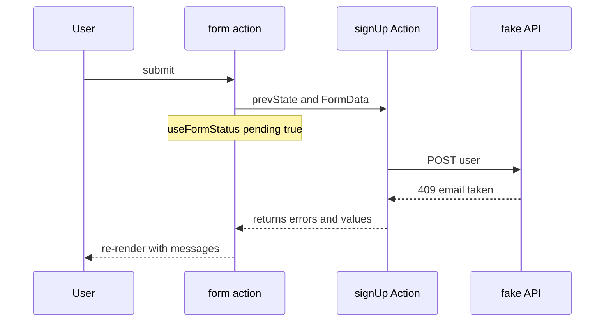
- **SignUpForm** calls `useActionState(signUp, initialState)` and gets `[state, formAction, isPending]`.
- **signUp** validates with a schema, calls the API and *returns* the next state — no setters.
- **SubmitButton** is a child component, because `useFormStatus` reads the status of its *parent* form.

### Data model
| Type | Fields |
|---|---|
| `SignUpState` | `{ status: 'idle' \| 'error' \| 'success', fieldErrors?: Record<string, string>, formError?: string, values?: Record<string, string>, user? }` |
| Input | `FormData` with `name`, `email`, `password`, `plan`, `terms` |

### Tech stack
| Component | Choice | Why |
|---|---|---|
| Form | React 19 form Actions | built-in pending, errors, reset |
| Validation | Zod schema | one source for rules and types |
| Tests | RTL + `user-event` + fake API | test what the user sees |

### Milestones
1. **Plain form + Action.** *Done when* submit logs the `FormData` and the form resets.
2. **Validation errors.** *Done when* bad input shows per-field messages and keeps what was typed (use `defaultValue={state.values?.email}`).
3. **Pending UI.** *Done when* the button reads "Creating account…" during the 800 ms delay.
4. **API errors and success.** *Done when* "email taken" appears under the email field and success shows the welcome screen.

### Deep dive: the hard parts
- **The Action signature.** With `useActionState`, the function receives `(previousState, formData)` — easy to miss and get `formData` in the wrong slot.
- **Automatic reset.** React resets uncontrolled fields once the Action completes without throwing — and returning an error object still counts as completing. So on a validation error, return the submitted values and feed them back as `defaultValue`, or the user retypes everything.
- **`useFormStatus` placement.** It only works in a component rendered *inside* the `<form>`; calling it in the form's own component returns not pending.
- **Accessibility.** Each error gets an id; the input has `aria-invalid` and `aria-describedby`. Move focus to the first invalid field after a failed submit.

### Testing strategy
RTL: submit empty, expect messages; fill valid values with the API mocked to fail, expect "email taken" and preserved values; mock success, expect welcome text. Assert the button is disabled while pending with `findByRole('button', { name: /creating/i })`.

### Trade-offs, scaling and failure modes
Actions shine for submit-and-show-result forms. For live per-keystroke validation on huge forms, a library such as React Hook Form (Chapter 4 §4.9) may be more ergonomic. Never trust client validation alone — a real server must validate again.

### Stretch goals
- Move `signUp` to a Server Function in a framework (see Project 26) and test with JavaScript disabled.
- Password-strength meter derived from the field.
- `useOptimistic` to show the avatar before the server confirms.

### Skills practised
- [Ch 4 — Forms and Actions](../chapters/04-forms-and-actions/README.md): form Actions, `useActionState`, `useFormStatus`, Zod
- [Ch 11 — TypeScript with React](../chapters/11-typescript-with-react/README.md): typing state unions
- [Ch 14 — Patterns and architecture](../chapters/14-patterns-and-architecture/README.md): accessible errors

### In the interview
**30-second answer:** I built a sign-up form the React 19 way: `<form action={formAction}>` where the Action is wrapped by `useActionState`, so the Action receives the previous state and the `FormData` and returns the next state, including field errors. There is no `useState` for pending or errors: the submit button uses `useFormStatus` from a child component, and errors are announced with `aria-describedby`. The trickiest behaviour was that React resets uncontrolled fields after the Action finishes even when it returns errors, so I return the submitted values and feed them back as `defaultValue`. The fake API is slow (800 ms) and fails 20 % of the time, and the UI handles both paths.

**Key terms to know:**
- **Action** — a function passed to `<form action>` or run in a transition; React tracks its pending state. `signUp` is an Action.
- **Transition** — a non-urgent update React can keep pending without blocking input.
- **`useActionState(fn, initial)`** — returns `[state, formAction, isPending]`; `fn` gets `(prevState, formData)` and returns the next state.
- **`useFormStatus`** — returns `{ pending, data, method, action }` for the parent `<form>`; must be called in a component rendered inside the form.
- **`FormData`** — the browser's key/value snapshot of a form's named fields.
- **Uncontrolled input** — the DOM holds the value; React only sets `defaultValue`. All fields here.
- **Automatic form reset** — after an Action passed to `<form action>` completes, React resets uncontrolled fields.
- **Server Function** — a function marked `'use server'` that a framework lets the client call; the same form can post to one.
- **Progressive enhancement** — the form works before JavaScript loads when its action is a Server Function.
- **Schema validation (Zod)** — one schema defines rules and TypeScript types.

**Q:** What does `useActionState` return?

**A:** A tuple: the current state (the initial state, then whatever the Action last returned), a wrapped action to pass to `<form action>` or `formAction`, and an `isPending` boolean. Calls are queued, so each Action receives the state returned by the previous one.

**Q:** Why must `useFormStatus` be in a child component?

**A:** It reads the status of the nearest parent `<form>`, like a context provided by the form. The component that renders the `<form>` is not inside it, so calling the Hook there always reports not pending. Putting it in a `SubmitButton` rendered inside the form fixes that.

**Q:** Does the form reset after an Action?

**A:** Yes. Uncontrolled fields reset once the Action completes without throwing, and returning an error object still counts as completing. So on validation failure I return the submitted values in the state and use them as `defaultValue`, or the user retypes everything. Passwords I deliberately do not echo back.

**Q:** Why Actions instead of `onSubmit` with `useState`?

**A:** Actions remove the plumbing: no `preventDefault`, no manual `isSubmitting`, and errors come from the returned state. The same form can later point at a Server Function and work without JavaScript. The trade-off is less fine-grained control for live per-keystroke validation, where React Hook Form is more ergonomic.

**Q:** What is the order of arguments in the Action, and what bug comes from getting it wrong?

**A:** With `useActionState` the Action is `(previousState, formData)`. A plain `<form action={fn}>` without the Hook calls `fn(formData)`. If you wrap an existing `(formData)` function with `useActionState`, it receives the state object as `formData`, and `formData.get` is undefined.

**Q:** What happens if the Action throws instead of returning an error?

**A:** The error propagates to the nearest error boundary, replacing the UI with the fallback, and the form is not reset. That is right for unexpected bugs, but expected failures such as "email taken" should be returned as state so they render inline.

**Q:** Is client validation enough?

**A:** No. Anything in the browser can be bypassed, so the server must validate again with the same rules. Sharing the Zod schema between client and server keeps them in sync. Client validation is only for quick feedback.

**Q:** How do you make errors accessible?

**A:** Each error message gets an id, and its input gets `aria-invalid="true"` and `aria-describedby` pointing at that id, so screen readers read the error when the field is focused. After a failed submit I move focus to the first invalid field. A form-level error lives in a `role="alert"` region.

**Q:** How do you test the pending and failure paths?

**A:** With the fake API mocked to fail, RTL fills valid values, clicks submit, and asserts the button shows "Creating account…" and is disabled (via `findByRole`), then that "email taken" appears and the email field still holds its value. A second test mocks success and asserts the welcome screen.

**Q:** Hands-on: write the submit button.

**A:** The Hook must be in a component inside the `<form>`.

```tsx
function SubmitButton() {
  const { pending } = useFormStatus();
  return <button disabled={pending}>{pending ? 'Creating account…' : 'Sign up'}</button>;
}
```

**Common mistakes in answers:**
- Saying the form only resets on success. It resets whenever the Action completes without throwing, including when it returns errors.
- Calling `useFormStatus` in the same component that renders the `<form>` and wondering why `pending` is always false.
- Claiming Actions replace server validation. They change client plumbing; trust still requires server checks.

### TL;DR
Let the form's Action return the next state, render errors from it, show pending with `useFormStatus` in a child, and keep values on failure.

## 8. Pomodoro focus timer

**Level:** Beginner · **Time:** 1 weekend · **Prerequisites:** Ch 5, Ch 7

### What it is
A focus timer: 25 minutes work, 5 minutes break, a long break every fourth round. Start, pause, skip and reset; the tab title shows the remaining time; a sound and an optional browser notification play when a phase ends. You will write a custom `useInterval`-style Hook, use refs for values that must not trigger renders, and learn `useEffectEvent` (stable in React 19.2) for reading the latest settings inside an Effect.

### The problem it solves
Intervals in React are a classic trap: an interval set up once captures stale state; an interval re-created every render drifts and flickers. Timers also keep running when you navigate away unless cleaned up.

### Real-world examples
- Dan Abramov's [Making setInterval Declarative with React Hooks](https://overreacted.io/making-setinterval-declarative-with-react-hooks/) explains the stale-closure problem and the `useInterval` solution.
- react.dev's [`useEffectEvent` reference](https://react.dev/reference/react/useEffectEvent) shows reading the latest values from an Effect without re-running it.

### Requirements
**Functional**
- Work, short break, long break phases with configurable lengths.
- Start, pause, resume, skip, reset. Round counter.
- Document title `12:34 · Focus`. Sound at phase end; notification if permission granted.
- Settings persist.

**Non-functional**
- Accurate to within 1 s per 25 minutes even when the tab is in the background.
- No more than one render per second while running.
- Works offline once loaded.

### The architecture
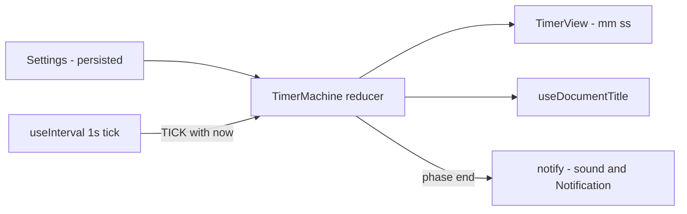
- **TimerMachine** is a reducer with `idle / running / paused` and the current phase.
- **useInterval** ticks once a second only while running and dispatches `TICK` with `Date.now()`.
- **notify** is an event, not state — triggered from the reducer's output in an Effect.

### Data model
| Type | Fields |
|---|---|
| `Settings` | `workMin`, `shortMin`, `longMin`, `roundsBeforeLong`, `sound: boolean` |
| `TimerState` | `status`, `phase: 'work' \| 'short' \| 'long'`, `endsAt: number \| null`, `remainingMs`, `round` |

### Tech stack
| Component | Choice | Why |
|---|---|---|
| Timing | `setInterval` + timestamps | accurate across throttled tabs |
| Hooks | custom `useInterval`, `useDocumentTitle`, `useLocalStorage` | reusable, testable |
| Tests | Vitest fake timers + RTL | control time |

### Milestones
1. **Reducer with timestamps.** *Done when* unit tests prove pause/resume keeps the right remaining time.
2. **`useInterval`.** *Done when* changing the delay does not reset or duplicate the interval.
3. **Title, sound, notification.** *Done when* phase end plays once, not twice in StrictMode.
4. **Settings.** *Done when* changed lengths survive a reload.

### Deep dive: the hard parts
- **Stale closures.** An Effect with `[]` dependencies that calls `setInterval(() => setSeconds(seconds - 1))` always sees the first `seconds`. Either use the updater form, or keep the latest callback in a ref, or wrap it with `useEffectEvent` so the Effect stays subscribed once while reading current values.
- **Background throttling.** Browsers slow timers in hidden tabs to save power. Never count ticks; compute `endsAt - Date.now()`.
- **Side effects at phase end.** Playing a sound inside the reducer breaks purity (and plays twice in StrictMode). Let the reducer record "phase ended" and react to it in an Effect, or trigger it from the tick handler.
- **Notification permission.** Ask only after a user gesture (clicking "Enable notifications"), never on page load.

### Testing strategy
Fake timers: start, advance 25 minutes, expect the phase to switch and the round to increment. Test pause by advancing time while paused. Test `useInterval` with `renderHook`.

### Trade-offs, scaling and failure modes
A Web Worker or the Page Visibility API can make timing even more robust, but timestamps already solve accuracy. If the computer sleeps, the timer will jump to "done" on wake — decide whether that is acceptable.

### Stretch goals
- Task list: pick the task you are focusing on; log completed pomodoros.
- Ring progress indicator in SVG.
- Make it an installable PWA (preview of Project 31).

### Skills practised
- [Ch 5 — Effects and refs](../chapters/05-effects-and-refs/README.md): cleanup, `useRef` for values
- [Ch 7 — Custom Hooks](../chapters/07-custom-hooks-and-hook-rules/README.md): custom Hooks, `useEffectEvent`
- [Ch 6 — State management](../chapters/06-state-management/README.md): reducers

### In the interview
**30-second answer:** I built a Pomodoro timer with work, short-break and long-break phases that stays accurate to within a second over 25 minutes, even in a background tab. The key decision was storing `endsAt` as a timestamp in a reducer and computing remaining time from `Date.now()` on each tick, rather than counting ticks, because browsers throttle timers in hidden tabs. The classic bug I solved was the stale closure in `setInterval`: my `useInterval` Hook subscribes once and reads the latest callback through `useEffectEvent`, so changing settings neither resets nor duplicates the interval. Side effects like the end-of-phase sound happen outside the reducer, so they play exactly once even in StrictMode.

**Key terms to know:**
- **Stale closure** — a function that captured state from an old render. An interval set up once sees the first `seconds` forever.
- **`useEffectEvent`** — (stable in 19.2) wraps a function so an Effect can call it and always see the latest props and state without listing them as dependencies.
- **`useRef`** — a mutable box that survives renders and does not trigger a render when changed. The classic way to store the latest callback.
- **Custom Hook** — `useInterval`, `useDocumentTitle`, `useLocalStorage` package reusable Effect logic.
- **Timer throttling** — browsers delay timers in hidden tabs to save power.
- **Timestamp-based timing** — store a deadline and compute remaining time, so late ticks do not cause drift.
- **Reducer purity** — the reducer only computes state; sounds and notifications run elsewhere.
- **Notification permission** — must be requested after a user gesture.
- **Effect cleanup** — `clearInterval` when stopped, paused or unmounted.

**Q:** Why does my interval always see the initial state?

**A:** The Effect ran once with `[]` dependencies, so the interval callback closed over the state from that first render. Fix it with the updater form (`setSeconds(s => s - 1)`), a ref holding the latest callback, or `useEffectEvent`, which gives the Effect a stable function that reads current values.

**Q:** How do you keep a timer accurate in a background tab?

**A:** Store an end timestamp and compute the remaining time from the clock on every tick. Browsers throttle hidden-tab timers (to once per second or even less often after a while), so counting ticks drifts. With timestamps, a late tick just shows the correct, smaller number.

**Q:** What is `useEffectEvent` for?

**A:** To read the latest props or state inside an Effect's callback without adding them as dependencies that would restart the Effect. Here the interval Effect depends only on whether the timer is running, while the tick function reads the current settings. Effect Events should only be called from inside Effects, not passed to children or called during render.

**Q:** Why not just put `callback` in the dependency array?

**A:** If the parent creates a new callback every render, the interval would be torn down and re-created every second, which drifts and can skip ticks. Separating "when to subscribe" (running and delay) from "what to do on tick" (the latest callback) is the whole point of `useInterval`.

**Q:** Why can't the reducer play the sound?

**A:** Reducers must be pure; React may call them more than once (StrictMode does in development) and the sound would play twice. The reducer records that the phase ended, and the tick handler or an Effect that sees the change plays the sound and shows the notification.

**Q:** Why keep `endsAt` in state but the interval id in a ref?

**A:** `endsAt` affects what is rendered, so it is state. The interval id is bookkeeping that never appears on screen, and changing it should not cause a render, so a ref or a local variable inside the Effect fits.

**Q:** What happens if the laptop sleeps for 10 minutes during a work phase?

**A:** On wake, the next tick computes `endsAt - Date.now()` as negative, so the reducer moves to the next phase immediately. That is honest about elapsed time. A stricter design could pause on `visibilitychange` or ask "you were away, count it?"; I chose the honest behaviour and documented it.

**Q:** How do you test 25 minutes without waiting?

**A:** Vitest fake timers: `vi.useFakeTimers()`, start the timer, then `vi.advanceTimersByTime(25 * 60_000)`, which also advances the mocked `Date.now()`. Assert the phase switched to a break and the round incremented. Pause tests advance time while paused and assert the remaining time did not change.

**Q:** Hands-on: write `useInterval` with `useEffectEvent`.

**A:** The Effect re-subscribes only when the delay changes; `null` pauses it.

```ts
function useInterval(cb: () => void, delay: number | null) {
  const onTick = useEffectEvent(cb);
  useEffect(() => {
    if (delay === null) return;
    const id = setInterval(() => onTick(), delay);
    return () => clearInterval(id);
  }, [delay]);
}
```

**Common mistakes in answers:**
- "Use `setTimeout` recursively and it will be accurate." It still drifts and is throttled; only timestamps fix accuracy.
- Listing the Effect Event function in the dependency array or passing it as a prop. It is not meant to be a dependency and must be called only from Effects.
- Asking for notification permission on page load. Browsers may block or auto-deny prompts without a user gesture.

### TL;DR
Drive the timer from timestamps, wrap `setInterval` in a declarative Hook, keep side effects out of the reducer and read fresh values with `useEffectEvent`.

## 9. Expense tracker with local storage

**Level:** Beginner · **Time:** 1–2 weekends · **Prerequisites:** Ch 3, Ch 6, Ch 7

### What it is
A personal budget app: add expenses (amount, category, date, note), see a monthly total, per-category breakdown and a simple bar chart, filter by month, and edit or delete entries. Everything persists in the browser with a `useLocalStorage` custom Hook built on `useSyncExternalStore` (a Hook for subscribing to data that lives outside React) so two open tabs stay in sync.

### The problem it solves
Most beginner apps lose data on refresh. Persisting naively (an Effect that writes on every change) works until you open two tabs and they overwrite each other, or the stored JSON is corrupted. This project teaches reliable persistence and clean derived data.

### Real-world examples
- MDN's [Web Storage API](https://developer.mozilla.org/en-US/docs/Web/API/Web_Storage_API) explains `localStorage`, the `storage` event between tabs, and the quota limits.
- react.dev's [`useSyncExternalStore` reference](https://react.dev/reference/react/useSyncExternalStore) uses browser APIs as the example external store.

### Requirements
**Functional**
- CRUD expenses; categories with colours.
- Month picker; totals per month and per category; bar chart.
- Export and import JSON.
- Data shared live across tabs.

**Non-functional**
- Stored data is versioned (`{ version: 1, items }`) and validated on load.
- Corrupted storage never crashes the app — show a recovery banner.
- 5,000 expenses filter in under 50 ms.

### The architecture
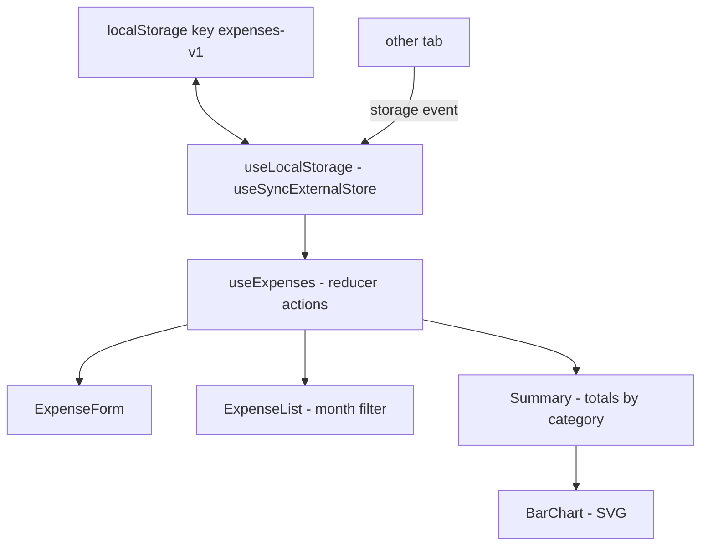
- **useLocalStorage** reads, validates and parses the key, subscribes to the `storage` event, and exposes a setter.
- **useExpenses** wraps it with domain actions: add, update, remove, import.
- **Summary** and **BarChart** only receive derived numbers.

### Data model
| Type | Fields |
|---|---|
| `Expense` | `id`, `amountCents: number`, `category: CategoryId`, `date: 'YYYY-MM-DD'`, `note` |
| `Stored` | `{ version: 1, items: Expense[] }` |
| Derived | `byMonth: Map<'YYYY-MM', Expense[]>`, `totalsByCategory` |

### Tech stack
| Component | Choice | Why |
|---|---|---|
| Persistence | `localStorage` + `useSyncExternalStore` | cross-tab sync, no tearing |
| Validation | Zod | reject bad imports |
| Chart | hand-written SVG | learn the basics before a library |
| Tests | Vitest + RTL with jsdom storage | unit, component and real-browser layers

### Milestones
1. **In-memory CRUD.** *Done when* add, edit and delete work with a reducer.
2. **Persistence Hook.** *Done when* refresh keeps data and a second tab updates live.
3. **Summaries and chart.** *Done when* totals match a hand-calculated fixture.
4. **Import/export and recovery.** *Done when* importing malformed JSON shows an error and changes nothing.

### Deep dive: the hard parts
- **Why `useSyncExternalStore`.** It gives React a `subscribe` function and a `getSnapshot` function. React re-reads the snapshot when notified and guarantees all components see the same value in one render. The snapshot must be cached: return the same parsed object until the raw string changes, or React re-renders forever.
- **The `storage` event fires only in *other* tabs.** For the current tab, your setter must notify subscribers itself.
- **Dates.** A `YYYY-MM-DD` string has no time zone; `new Date('2026-10-01')` is parsed as UTC midnight and may show as 30 September locally. Keep dates as strings for grouping.
- **Schema versioning.** When you add a field later, a `migrate(stored)` function upgrades version 1 to 2 on load.

### Testing strategy
Unit-test the reducer and the migrations. Test the Hook with `renderHook`: set a value, dispatch a synthetic `storage` event, expect the new value. RTL test for the totals view with a fixture.

### Trade-offs, scaling and failure modes
`localStorage` is synchronous and limited (commonly about 5 MB per origin); for bigger data use IndexedDB (Project 31). It is per-device — no sync. Private browsing may throw on write; catch and warn.

### Stretch goals
- Budgets per category with warnings.
- Recurring expenses.
- Replace the SVG with a chart library and compare bundle size.

### Skills practised
- [Ch 3 — State and events](../chapters/03-state-and-events/README.md): immutable updates
- [Ch 6 — State management](../chapters/06-state-management/README.md): reducer + context
- [Ch 7 — Custom Hooks](../chapters/07-custom-hooks-and-hook-rules/README.md): `useLocalStorage`, `useSyncExternalStore`

### In the interview
**30-second answer:** I built an expense tracker that persists in `localStorage`, stays in sync live across browser tabs, and never crashes on corrupted data. The key decision was treating `localStorage` as an external store and reading it through a `useLocalStorage` Hook built on `useSyncExternalStore`, which subscribes to the `storage` event and guarantees every component sees the same value in a render. The subtle bug was that `getSnapshot` must return a cached object until the raw string changes, otherwise React re-renders forever. Stored data is versioned and validated with Zod on load, and 5,000 expenses filter in under 50 ms.

**Key terms to know:**
- **External store** — data that lives outside React (here `localStorage`) and can change without React knowing.
- **`useSyncExternalStore(subscribe, getSnapshot)`** — Hook that subscribes a component to an external store and re-renders on change.
- **Snapshot caching** — `getSnapshot` must return the same reference when the data has not changed.
- **Tearing** — different components showing different values of the same data during one render. `useSyncExternalStore` prevents it.
- **`storage` event** — fired in *other* tabs of the same origin when `localStorage` changes.
- **Schema versioning and migration** — `{ version: 1, items }` plus a `migrate()` function to upgrade old shapes.
- **Runtime validation** — checking unknown JSON with Zod before trusting it. Used for loading and imports.
- **Derived data** — monthly totals and per-category sums computed from `items`, never stored.
- **Quota** — `localStorage` is commonly limited to about 5 MB per origin and writes can throw.

**Q:** Why not just write to `localStorage` in a `useEffect`?

**A:** It works for one tab, but other tabs never hear about the change, and components reading storage directly can see different values. You also get an extra render and a moment where state and storage disagree. `useSyncExternalStore` subscribes to changes and keeps every reader consistent.

**Q:** What must `getSnapshot` guarantee?

**A:** It must return the same value, compared with `Object.is`, when nothing has changed. If it parses JSON into a new object every call, React sees a "change" on each check and re-renders in a loop (React warns about this). I cache the last raw string and its parsed value and only re-parse when the string differs.

**Q:** How do you evolve stored data safely?

**A:** Store a version number with the data, validate with a schema on load, and run migrations step by step (v1 to v2 to v3). If validation fails, I keep the raw string, show a recovery banner and offer export, instead of crashing or silently overwriting the user's data.

**Q:** The `storage` event: when does it fire and what does that mean for the current tab?

**A:** It fires only in other tabs of the same origin, never in the tab that made the change. So my setter writes to storage and then notifies the current tab's subscribers itself. Without that, the tab you typed in would not update.

**Q:** Why keep dates as `YYYY-MM-DD` strings?

**A:** A date-only string has no time zone, but `new Date('2026-10-01')` is parsed as UTC midnight, which shows as 30 September in time zones west of UTC. Grouping by month on the string prefix (`date.slice(0, 7)`) avoids that bug entirely.

**Q:** `localStorage` vs IndexedDB: when would you switch?

**A:** `localStorage` is synchronous, string-only and roughly 5 MB, which is fine for thousands of small expenses. Above that, or with attachments, the synchronous JSON parse blocks the main thread and the quota fills. IndexedDB is asynchronous, stores structured data and has much larger quotas, so Project 31 uses it.

**Q:** What happens if a write fails, for example in private browsing or when the quota is full?

**A:** `setItem` throws a `QuotaExceededError` (or a security error when storage is disabled). I wrap writes in try/catch, keep the in-memory state so the user does not lose the current session, and show a warning that changes are not being saved.

**Q:** How do you test cross-tab sync?

**A:** With `renderHook`, I render the Hook, write a new value to `localStorage` directly, then dispatch `new StorageEvent('storage', { key, newValue })` on `window` and assert the Hook returns the new value. Separate unit tests cover the migrations and the "corrupt JSON shows the banner" path.

**Q:** Hands-on: what is wrong with this snapshot?

**A:** It returns a new object every call, so React loops. Cache by raw string.

```ts
// wrong
const getSnapshot = () => JSON.parse(localStorage.getItem(KEY) ?? '[]');
// right
let lastRaw: string | null = null, last: Stored = EMPTY;
const getSnapshot = () => { const raw = localStorage.getItem(KEY);
  if (raw !== lastRaw) { lastRaw = raw; last = parse(raw); } return last; };
```

**Common mistakes in answers:**
- Saying the `storage` event keeps the current tab in sync. It only fires in other tabs.
- Storing monthly totals alongside items. They drift; derive them.
- Trusting imported JSON because "the app exported it". Users edit files; always validate.

### TL;DR
Treat `localStorage` as an external store, subscribe with `useSyncExternalStore`, version and validate what you store, and derive every summary.

## 10. Filterable product catalogue

**Level:** Beginner · **Time:** 1–2 weekends · **Prerequisites:** Ch 2, Ch 3, Ch 7

### What it is
A shop catalogue page with 2,000 products: a search box, category checkboxes, price range, "in stock only" toggle and a sort menu. Filters live in the URL so a filtered view can be bookmarked and shared. Typing stays smooth thanks to `useDeferredValue` (lets part of the UI lag behind urgent input). It is the classic "Thinking in React" exercise scaled up to a realistic size.

### The problem it solves
Filtering a big list on every keystroke can make typing laggy. Filters held only in component state are lost on refresh and can't be shared. This project teaches URL state, derived lists and React's concurrent features for responsiveness.

### Real-world examples
- react.dev's [Thinking in React](https://react.dev/learn/thinking-in-react) builds a `FilterableProductTable` — this brief extends it.
- react.dev's [`useDeferredValue` reference](https://react.dev/reference/react/useDeferredValue) shows keeping input responsive while a slow list re-renders.

### Requirements
**Functional**
- Text search over name and brand; category multi-select; min/max price; in-stock toggle; sort by price, rating, newest.
- "N results" and a "Clear filters" button. Empty-state message with suggestions.
- All filters encoded in the URL search params; Back/Forward restore them.

**Non-functional**
- Each keystroke in search renders in under 16 ms of main-thread work for the input itself.
- Filtering 2,000 items in under 20 ms.
- Results list uses semantic markup (`<ul>`, headings) and announces the result count politely.

### The architecture
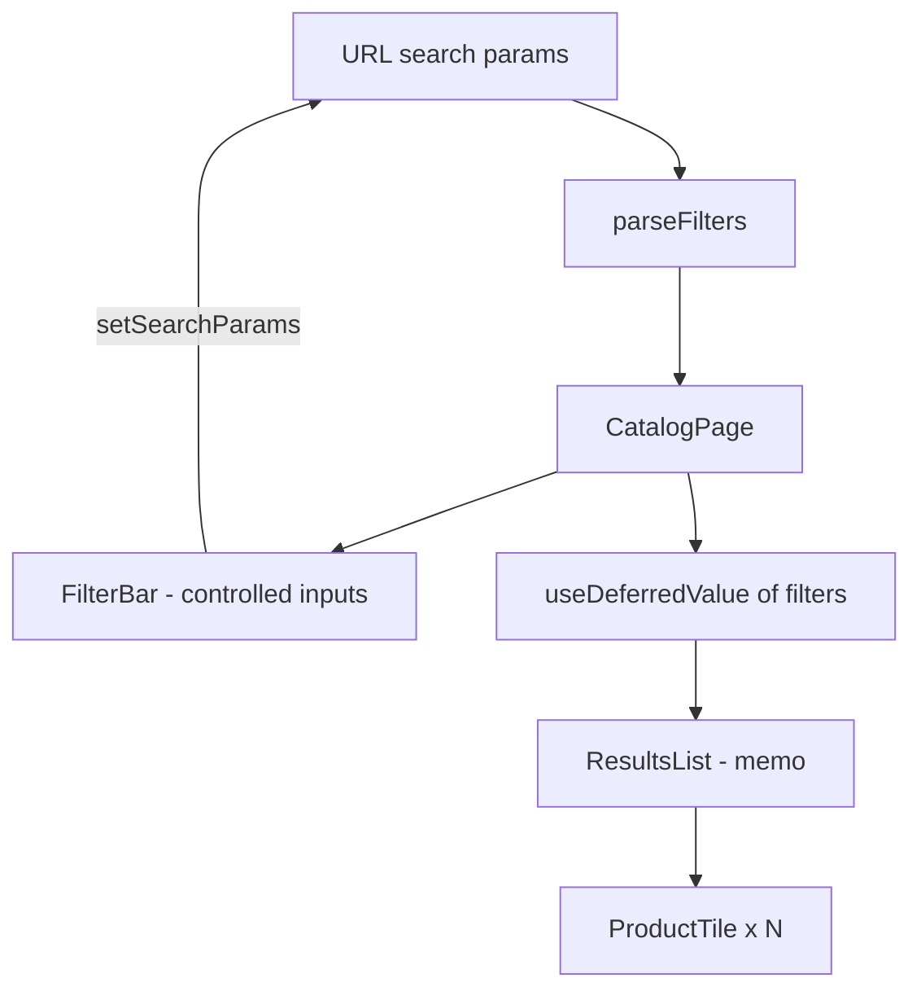
- **URL** is the single source of truth for filters.
- **parseFilters** converts strings to a typed object with defaults and rejects garbage.
- **useDeferredValue** gives `ResultsList` a lagging copy so the input repaints first.
- **ResultsList** is wrapped in `memo` so it only re-renders when the deferred filters change.

### Data model
| Type | Fields |
|---|---|
| `Product` | `id`, `name`, `brand`, `category`, `priceCents`, `rating`, `inStock`, `addedAt` |
| `Filters` | `q`, `categories: string[]`, `min?`, `max?`, `inStock: boolean`, `sort` |

### Tech stack
| Component | Choice | Why |
|---|---|---|
| URL state | `URLSearchParams` (or React Router's `useSearchParams`) | shareable, Back works |
| Responsiveness | `useDeferredValue` + `memo` | keep typing smooth |
| Tests | Vitest + RTL + Playwright | unit, component and real-browser layers

### Milestones
1. **Static list + search.** *Done when* typing filters the list.
2. **All filters and sort.** *Done when* a pure `applyFilters(products, filters)` passes table tests.
3. **URL state.** *Done when* reload and Back restore filters.
4. **Smooth typing.** Add an artificial slowdown to tiles, then `useDeferredValue`. *Done when* the input stays responsive under the slowdown.

### Deep dive: the hard parts
- **URL as state.** Parsing and serializing must round-trip: `parse(serialize(f))` equals `f`. Omit defaults from the URL to keep it clean.
- **Deferred rendering.** `useDeferredValue` first re-renders with the old value (cheap — `memo` skips the list), then tries the new value in the background and abandons it if you type again. Show a subtle "updating" opacity when `filters !== deferredFilters`.
- **Debounce vs defer.** Debouncing waits a fixed time; deferring renders as soon as the CPU allows. For local filtering, defer. For network calls, debounce (Project 16).
- **Text search.** Lower-case and normalize accents (`normalize('NFD')`) once per product, not per keystroke.

### Testing strategy
Table-driven tests for `applyFilters` and the URL round-trip. RTL: type, check count and first result. Playwright: apply filters, copy URL, open in new page, expect same results.

### Trade-offs, scaling and failure modes
Client-side filtering is fine to a few thousand items. Beyond that, filter on the server (Project 25) and paginate. URL length has practical limits; keep param names short.

### Stretch goals
- Facet counts next to each category ("Shoes (124)").
- Virtualize the results (Project 28).
- Compare with the React Compiler enabled and `memo` removed.

### Skills practised
- [Ch 2 — Components and props](../chapters/02-components-and-props/README.md): composition
- [Ch 7 — Custom Hooks](../chapters/07-custom-hooks-and-hook-rules/README.md): `useDeferredValue`, `useTransition`
- [Ch 9 — Routing and data fetching](../chapters/09-routing-and-data-fetching/README.md): search params
- [Ch 10 — Performance](../chapters/10-performance/README.md): `memo`

### In the interview
**30-second answer:** I built a 2,000-product catalogue with search, category, price, stock and sort filters, where the URL is the single source of truth so every view is bookmarkable and Back/Forward work. The key decisions were a pure `applyFilters` function with a URL parse/serialize pair that round-trips, and `useDeferredValue` plus `memo` on the results list so typing stays smooth even when rendering results is slow. The hardest part was understanding why deferral needs `memo`: the urgent render passes the old deferred value, and `memo` lets React skip the expensive list in that render. Filtering 2,000 items takes under 20 ms and keystrokes stay under 16 ms.

**Key terms to know:**
- **URL state** — filters stored in search params (`?q=shoe&min=20`) via `URLSearchParams` or `useSearchParams`.
- **Round-trip serialization** — `parse(serialize(f))` equals `f`, so URLs and state never disagree.
- **`useDeferredValue`** — returns a value that may lag behind; React renders urgent updates first, then the deferred one in the background.
- **Concurrent rendering** — React can prepare a render, interrupt it for more urgent input, and throw it away.
- **`memo`** — skips re-rendering a component when its props are shallowly equal to last time.
- **Debounce** — wait until input pauses for N ms before acting. Used for network calls, not here.
- **Pure filter function** — `applyFilters(products, filters)` with no side effects, table-tested.
- **Stale indicator** — dim results while `filters !== deferredFilters`.
- **`aria-live="polite"`** — announces the result count without interrupting the user.
- **Text normalization** — lower-casing and stripping accents with `normalize('NFD')` once per product.

**Q:** `useDeferredValue` or debounce?

**A:** Defer when the slow part is local rendering: it renders as soon as the CPU allows, adapts to fast and slow devices, and abandons outdated work if you keep typing. Debounce when you want to limit how often something expensive and external happens, such as network calls, because deferral does not reduce the number of requests.

**Q:** Why keep filters in the URL?

**A:** Shareable links, Back/Forward and refresh all work, and there is exactly one source of truth instead of state that must be synced to the URL. The trade-off is that every filter must be serializable and parsed defensively, because users can edit the URL by hand.

**Q:** Why does `useDeferredValue` need `memo` on the slow child?

**A:** On a keystroke React first does an urgent render where the deferred value is still the old one. Without `memo`, the slow list re-renders anyway in that urgent render, so the input still lags. With `memo`, its props are unchanged and React skips it; the real update happens in the background render.

**Q:** What does `useDeferredValue` actually do step by step?

**A:** When the source value changes, React re-renders immediately with the old deferred value, then schedules a low-priority re-render with the new one. If another keystroke arrives during that background render, React throws the work away and starts again with the latest value. Nothing is delayed by a fixed time.

**Q:** How do you handle a garbage URL like `?min=abc&sort=evil`?

**A:** `parseFilters` validates each param, falls back to defaults for anything invalid, and ignores unknown keys. Defaults are omitted when serializing, so the URL stays short and canonical. The page never throws on a hand-edited link.

**Q:** What changes at 200,000 products? What breaks first?

**A:** Shipping and filtering the whole dataset in the browser breaks first: download size, memory and filter time all grow linearly. I would move filtering, sorting and pagination to the server (Project 25), debounce requests, and keep the URL as the query. Rendering also needs virtualization (Project 28).

**Q:** Why not store `filteredProducts` in state and update it in an Effect?

**A:** It is derived from products and filters, so an Effect would cause an extra render with stale results in between, and two sources of truth. Computing it during render, optionally wrapped in `useMemo` or left to the React Compiler, is simpler and correct.

**Q:** How do you prove typing stays smooth?

**A:** I add an artificial slowdown to each tile, record with the React Profiler and Chrome Performance panel, and check keystroke tasks stay under about 16 ms. Functional tests: table tests for `applyFilters` and the URL round-trip, RTL for counts, and Playwright to copy the URL into a new page and expect the same results.

**Q:** Hands-on: write the deferred list.

**A:** The list is memoized and the stale state is shown by comparing the two values.

```tsx
const deferred = useDeferredValue(filters);
const isStale = filters !== deferred;
<div style={{ opacity: isStale ? 0.6 : 1 }}>
  <ResultsList filters={deferred} />   {/* ResultsList = memo(...) */}
</div>
```

**Common mistakes in answers:**
- Saying `useDeferredValue` is a debounce with a built-in delay. It has no fixed delay and does not reduce the number of renders or requests.
- Using `useDeferredValue` without `memo` (or the React Compiler) and expecting a speed-up.
- Creating a new `filters` object every render from the URL without memoizing it, so `memo` always sees new props. Parse with `useMemo` keyed on the search string.

### TL;DR
Make the URL the source of truth for filters, compute results with a pure function, and keep typing smooth with `useDeferredValue` plus `memo`.

## 11. Kanban board with drag and drop

**Level:** Intermediate · **Time:** 2 weeks · **Prerequisites:** Ch 6, Ch 11, Ch 12, Ch 14

### What it is
A Trello-style board: columns (To do, Doing, Done, plus custom ones) holding cards. Drag cards within and between columns, drag columns to reorder, open a card to edit its title, description, labels and due date. Drag and drop must work with mouse, touch **and keyboard**, and the board persists to a small REST API. You use **dnd-kit**, a modular drag-and-drop toolkit for React, a normalized reducer store and optimistic saves.

### The problem it solves
Drag and drop is where UIs become inaccessible and buggy: no keyboard support, lost drops when the network fails, and ordering that breaks when two people move cards. A kanban board forces you to design ordering, persistence and accessibility properly.

### Real-world examples
- [dnd-kit](https://dndkit.com/) and its [accessibility guide](https://dndkit.com/legacy/guides/accessibility/) describe keyboard sensors, screen-reader announcements and live regions for drag operations.
- dnd-kit's [Sortable preset](https://dndkit.com/legacy/presets/sortable/overview/) handles reordering within and across lists.
- Figma's post [How Figma's multiplayer technology works](https://www.figma.com/blog/how-figmas-multiplayer-technology-works/) describes **fractional indexing** — the ordering trick used below.

### Requirements
**Functional**
- CRUD columns and cards; reorder cards within and across columns; reorder columns.
- Keyboard: focus a card, press Space to pick up, arrows to move, Space to drop, Escape to cancel.
- Card detail dialog; labels and due dates; filter by label.
- Persist every move to the API; roll back with a toast on failure.

**Non-functional**
- Dragging stays at 60 frames per second with 300 cards.
- A move sends one small request (not the whole board).
- Screen readers announce "Picked up card X. Over column Doing, position 2 of 5."

### The architecture
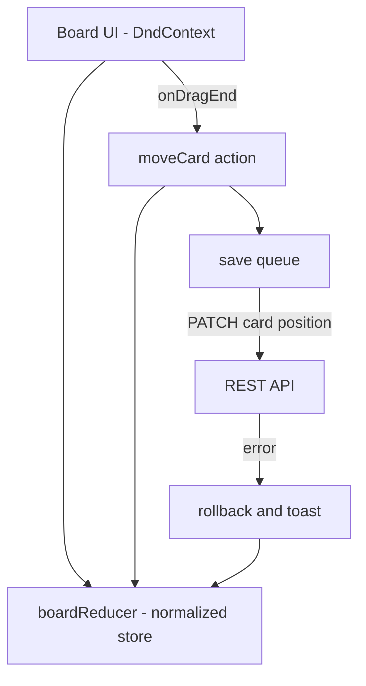
- **DndContext** (dnd-kit) provides sensors (pointer, touch, keyboard) and collision detection.
- **boardReducer** stores entities by id plus ordered id lists; every move is one action.
- **save queue** sends moves in order so a fast second move cannot overtake the first.
- **REST API** (a small Node 24 server or MSW in dev) stores cards with a sortable `rank`.

### Data model
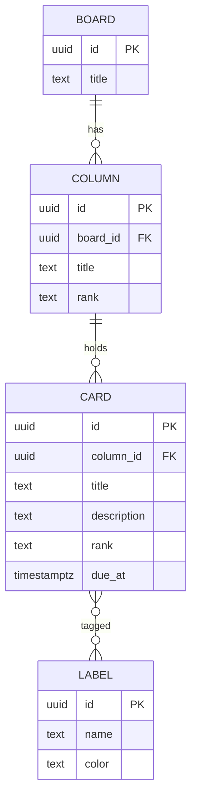
`rank` is a **fractional index** string: to insert between "a" and "b" you generate "an". Moving a card changes only its own `column_id` and `rank`.

### Tech stack
| Component | Choice | Why |
|---|---|---|
| Drag and drop | dnd-kit core + sortable | keyboard sensor, a11y announcements |
| State | `useReducer` + context, normalized | O(1) lookups, one action per move |
| Ordering | fractional-index strings | one-row updates |
| Tests | Vitest, RTL, Playwright | reducer, UI, real drag |

### Milestones
1. **Static board from fixtures** with a normalized store. *Done when* reducer tests cover add, rename, delete.
2. **Drag within a column, then across columns.** *Done when* Playwright drags a card and the order survives reload.
3. **Keyboard drag and announcements.** *Done when* you can move a card with keyboard only and hear the announcements in a screen reader.
4. **Persistence with rollback.** *Done when* an injected 500 error returns the card to where it was and shows a toast.
5. **Card dialog and labels.** *Done when* label filter hides non-matching cards but keeps drag working.

### Deep dive: the hard parts
- **Normalized state.** Store `cards: Record<id, Card>` and `column.cardIds: id[]`. A move edits two arrays and one card — not a deep nested copy of the board.
- **Fractional indexing.** Integer positions need renumbering every card after the insert point. String ranks let you compute a key strictly between two neighbours, so one row changes. Occasionally keys grow long; rebalance in the background.
- **Optimistic moves with rollback.** Apply the move locally, remember the previous position, send the request. On failure, dispatch a reverse move. Because moves are queued, a later move is based on the optimistic state; if an earlier one fails, either replay or refetch the board.
- **Drag overlays.** Render the dragged card in a `DragOverlay` (portal) so it is not clipped by the column's scroll container and the original slot shows a placeholder.

### Testing strategy
Reducer and rank-generation unit tests (including "insert between two equal ranks" never happens). RTL for dialogs and filters. Playwright for mouse drags and a keyboard drag. MSW for the failure path.

### Trade-offs, scaling and failure modes
Context + reducer re-renders every consumer on any change; with hundreds of cards, split contexts or move to Zustand with selectors (Project 20). Two users moving the same card need real-time sync and last-writer-wins per field — see Project 27. Very long columns need virtualization, which conflicts with drag; dnd-kit supports it with care.

### Stretch goals
- Real-time updates via WebSocket.
- Undo/redo with a history stack.
- WIP limits per column that block a drop.

### Skills practised
- [Ch 6 — State management](../chapters/06-state-management/README.md): reducer + context, normalized state
- [Ch 11 — TypeScript with React](../chapters/11-typescript-with-react/README.md): typed actions
- [Ch 12 — Testing React](../chapters/12-testing-react/README.md): user-event, MSW
- [Ch 14 — Patterns and architecture](../chapters/14-patterns-and-architecture/README.md): portals, accessibility

### In the interview
**30-second answer:** I built a Trello-style kanban board where cards and columns can be reordered by mouse, touch and keyboard, and every move persists to a REST API. The key design decisions were a normalized reducer store (cards by id plus ordered id lists per column) and fractional-index string ranks, so a move updates one card's `column_id` and `rank` and sends one small PATCH. The hardest part was optimistic saving: moves apply instantly, go through an ordered save queue, and on failure roll back with a toast while later queued moves are replayed or the board is refetched. Drag stays at 60 fps with 300 cards and screen readers announce "Over column Doing, position 2 of 5".

**Key terms to know:**
- **Normalized state** — entities stored once by id (`cards: Record<id, Card>`) and referenced by id lists (`column.cardIds`). A move edits two arrays and one card.
- **Fractional indexing** — order stored as a sortable string; a new key is generated strictly between two neighbours so no other rows change.
- **Optimistic update** — apply the change locally before the server confirms, then roll back on failure.
- **Rollback** — restoring the remembered previous position when the save fails.
- **Save queue** — sends moves one at a time in order so a later move cannot overtake an earlier one.
- **dnd-kit sensors** — pluggable input sources (pointer, touch, keyboard) that start and drive a drag.
- **Collision detection** — the algorithm that decides which droppable is "over" during a drag.
- **`DragOverlay`** — renders the dragged card in a portal so scroll containers do not clip it.
- **Live region announcements** — `aria-live` text describing pick-up, position and drop for screen readers.
- **Rebalancing** — rewriting ranks in the background when fractional keys grow long.

**Q:** How do you store order so that a move updates one row?

**A:** Use a fractional index: each card's `rank` is a sortable string, and inserting between "a" and "b" generates something like "an". Only the moved card's `rank` and `column_id` change. Integer positions would force renumbering every card after the insert point, which means more writes and more conflicts.

**Q:** How do you make drag and drop accessible?

**A:** Provide a keyboard sensor (Space to pick up, arrows to move, Space to drop, Escape to cancel), visible focus on the card, and live-region announcements of the item and its position on pick-up, move and drop. dnd-kit supplies the keyboard sensor and an announcements API; I write human-friendly messages that include column names and "position 2 of 5".

**Q:** What happens if the save fails?

**A:** The reducer dispatches a reverse move to the remembered position and a toast tells the user. Because later moves in the queue were computed on top of the optimistic state, I either replay the remaining queued moves on the restored state or simply refetch the board from the server, which is simpler and always correct.

**Q:** Why normalize the board instead of nesting cards inside columns?

**A:** With nesting, moving a card means deep-copying two columns' card arrays inside the board object, and finding a card by id means searching every column. Normalized, a card is updated in one place, lookups are O(1), and memoized card components keep their references when unrelated cards change.

**Q:** Why a save queue rather than firing requests in parallel?

**A:** If move 1 and move 2 race and the server applies 2 before 1, the final order on the server differs from the screen. A queue serializes requests so the server sees moves in the same order the user made them. The trade-off is latency under bursts, which is fine for drag-and-drop frequency.

**Q:** What changes with 5,000 cards or many users? What breaks first?

**A:** A single context-plus-reducer store breaks first, because every change re-renders every consumer. I would move to Zustand with selectors so a card subscribes only to itself, and virtualize long columns, which needs care with dnd-kit. With many concurrent users, I need real-time sync over WebSocket and a conflict rule such as last-writer-wins per card (Project 27).

**Q:** Two users move the same card at once. What happens?

**A:** Without real-time sync, each sees their own move until refresh, and the server keeps whichever PATCH arrived last. Ranks cannot become invalid, but one user's move is silently overwritten. Pushing server events to clients and rebasing local optimistic moves on top of them fixes the visibility problem.

**Q:** How do you test drag and drop?

**A:** Unit-test the reducer and rank generation, including that generated ranks always sort strictly between neighbours. Playwright performs real mouse drags and a keyboard-only drag, then reloads to check persistence. MSW returns a 500 for the failure path to prove rollback and the toast.

**Q:** Hands-on: what is the reducer for a move?

**A:** Remove the id from the source list, insert it into the target list, and update the card's column, without touching other cards.

```ts
case 'MOVE': {
  const { id, from, to, index } = action;
  const src = state.columns[from].cardIds.filter(c => c !== id);
  const dst = from === to ? src : [...state.columns[to].cardIds];
  dst.splice(index, 0, id);
  return { ...state, columns: { ...state.columns, [from]: { ...state.columns[from], cardIds: src }, [to]: { ...state.columns[to], cardIds: dst } } };
}
```

**Common mistakes in answers:**
- Using float positions (1.5, 1.25 …) and calling it fractional indexing. Floats run out of precision after a few dozen inserts; string keys can always grow.
- Saying accessibility is handled because the cards are focusable. Drag needs a keyboard alternative and spoken position updates.
- Rolling back with "undo the last move" when several moves are queued; you must handle the moves made after the failed one.

### TL;DR
Normalize the board, order with fractional indexes, apply moves optimistically with rollback, and make drag work by keyboard with announcements.

## 12. Infinite social feed

**Level:** Intermediate · **Time:** 1–2 weeks · **Prerequisites:** Ch 6, Ch 9, Ch 10

### What it is
A Twitter-like home feed: posts with author, text, images and like counts that load page by page as you scroll, with pull-to-refresh, a "New posts" pill, liking with instant feedback, and scroll position restored when you come back from a post's detail page. **TanStack Query** (a library for fetching, caching and updating **server state** — data owned by a server that your UI only borrows) does the heavy lifting with `useInfiniteQuery`.

### The problem it solves
Feeds combine every hard data problem: pagination that must not skip or duplicate items when new posts arrive, cache invalidation, optimistic updates, memory growth and scroll restoration. Hand-rolled solutions usually fail one of these.

### Real-world examples
- TanStack Query's [Infinite Queries guide](https://tanstack.com/query/latest/docs/framework/react/guides/infinite-queries) and [`useInfiniteQuery` reference](https://tanstack.com/query/latest/docs/framework/react/reference/functions/useInfiniteQuery) define `getNextPageParam` and `maxPages`.
- MDN's [Intersection Observer API](https://developer.mozilla.org/en-US/docs/Web/API/Intersection_Observer_API) is the standard way to detect a "load more" sentinel coming into view.
- TanStack Query's [Optimistic Updates guide](https://tanstack.com/query/latest/docs/framework/react/guides/optimistic-updates) covers the like button.

### Requirements
**Functional**
- Cursor-paginated feed, 20 posts per page, auto-loads near the bottom.
- Like/unlike with instant count change and rollback on failure.
- "N new posts" pill when fresh posts exist; clicking it scrolls to top and merges them.
- Post detail route; Back restores the exact scroll position.

**Non-functional**
- Next page starts loading at least one screen before the user reaches the end.
- Memory bounded: keep at most 10 pages in the cache (`maxPages`) or virtualize.
- Interaction to Next Paint (INP, the delay from a tap to the next frame) under 200 ms on a mid-range phone.

### The architecture
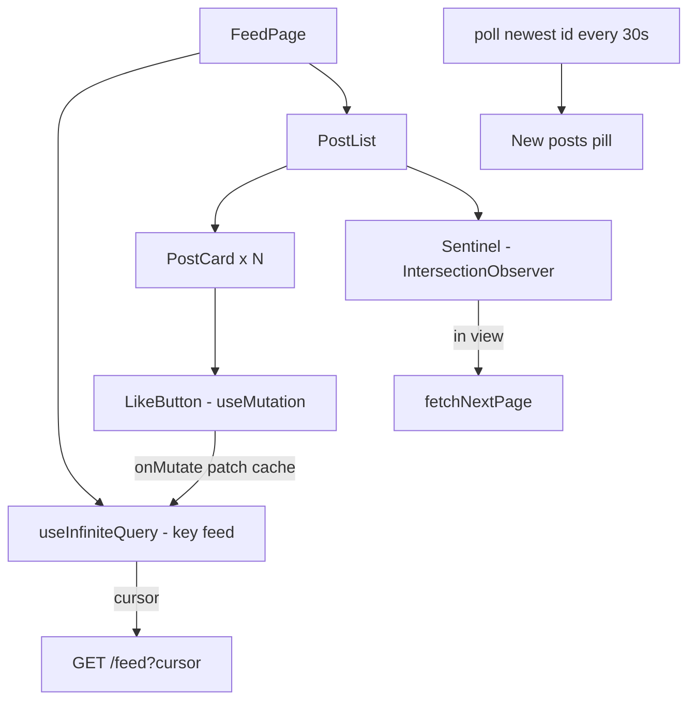
- **useInfiniteQuery** stores `pages[]` and `pageParams[]` under the key `['feed']`.
- **Sentinel** is an empty element observed with `IntersectionObserver` and a `rootMargin` of one screen.
- **LikeButton** uses `useMutation`; `onMutate` patches the post inside the cached pages and returns a snapshot for rollback.
- **Poll** asks "is there anything newer than my first id?" without disturbing the list.

### Data model
| Type | Fields |
|---|---|
| `Post` | `id`, `author: { id, name, avatarUrl }`, `text`, `images[]`, `likeCount`, `likedByMe`, `createdAt` |
| `FeedPage` | `{ items: Post[], nextCursor: string \| null }` |
| Cache | `InfiniteData<FeedPage, string \| null>` |

### Tech stack
| Component | Choice | Why |
|---|---|---|
| Server state | TanStack Query v5 | caching, dedupe, retries, infinite pages |
| Routing | React Router | detail route, scroll restoration |
| Mock API | MSW or a Node 24 server | deterministic pages |
| Tests | Vitest + RTL + Playwright | unit, component and real-browser layers

### Milestones
1. **First page** with loading and error states. *Done when* refetch-on-focus works.
2. **Infinite scroll** with the sentinel. *Done when* no duplicate or missing posts across 10 pages.
3. **Optimistic like.** *Done when* a forced failure restores the count and shows a toast.
4. **New-posts pill and pull-to-refresh.** *Done when* new posts appear only after clicking the pill.
5. **Scroll restoration and memory cap.** *Done when* Back from a detail page lands on the same post.

### Deep dive: the hard parts
- **Cursor, not offset.** With `?page=3`, a new post at the top shifts everything down and you see a duplicate. A cursor ("posts older than id X") is stable under inserts.
- **Updating one post in nested pages.** `setQueryData(['feed'], old => ({ ...old, pages: old.pages.map(p => ({ ...p, items: p.items.map(...) })) }))`. Cancel in-flight feed queries first (`cancelQueries`) so a refetch doesn't overwrite your optimistic change.
- **Bounded memory.** `maxPages` drops old pages; if users scroll back up, they refetch. Alternatively virtualize the list (Project 28) so the DOM stays small even if data is large.
- **Scroll restoration.** Keep the query cached (it is, for `gcTime`) and restore the scroll offset after the list renders — React Router's `<ScrollRestoration />` does this for data routers.

### Testing strategy
MSW handlers return deterministic pages. RTL: mock `IntersectionObserver`, trigger it, expect page 2. Test the like rollback by making the handler return 500. Playwright: scroll to page 5, open a post, go Back, assert the same post is in view.

### Trade-offs, scaling and failure modes
Polling is simple and cheap at 30 s; real-time push (WebSocket or Server-Sent Events) is better at scale but more infrastructure. Optimistic likes can briefly show wrong counts if two devices like at once — refetch on settle. Images dominate bandwidth: use responsive sizes.

### Stretch goals
- Virtualize with TanStack Virtual.
- Prefetch a post's detail on hover (`queryClient.prefetchQuery`).
- Use `<Activity>` to keep the feed mounted but hidden while a detail page is shown.

### Skills practised
- [Ch 6 — State management](../chapters/06-state-management/README.md): server state with TanStack Query
- [Ch 9 — Routing and data fetching](../chapters/09-routing-and-data-fetching/README.md): mutations, invalidation, optimistic updates
- [Ch 10 — Performance](../chapters/10-performance/README.md): virtualization
- [Ch 15 — Interview and machine coding](../chapters/15-react-interview-and-machine-coding/README.md): infinite scroll build

### In the interview
**30-second answer:** I built a Twitter-like infinite feed with TanStack Query's `useInfiniteQuery`: cursor-paginated pages, auto-loading through an `IntersectionObserver` sentinel, optimistic likes with rollback, a "N new posts" pill and exact scroll restoration when coming back from a post. The key decision was cursor pagination ("posts older than id X") instead of page numbers, because new posts at the top shift offsets and cause duplicates. The trickiest part was patching one post inside nested cached pages during an optimistic like and cancelling in-flight refetches so they do not overwrite it. Memory is bounded with `maxPages`, and taps respond within the 200 ms INP target.

**Key terms to know:**
- **Server state** — data owned by the server that the UI caches temporarily; it can go stale. Managed by TanStack Query.
- **`useInfiniteQuery`** — stores `pages[]` and `pageParams[]` under one key and exposes `fetchNextPage` and `hasNextPage`.
- **Cursor pagination** — each request asks for items after a stable anchor, not "page 3".
- **Sentinel + `IntersectionObserver`** — an empty element near the end of the list; when it comes within `rootMargin`, load the next page.
- **Optimistic mutation** — `onMutate` writes the expected result to the cache before the server replies.
- **`cancelQueries` / `setQueryData` / `invalidateQueries`** — stop in-flight fetches, write to the cache, mark data stale to refetch.
- **`staleTime` vs `gcTime`** — how long data counts as fresh vs how long unused cache entries are kept.
- **`maxPages`** — caps how many pages an infinite query keeps.
- **Scroll restoration** — returning the user to the same scroll position after Back.
- **INP (Interaction to Next Paint)** — the delay from a user interaction to the next frame.

**Q:** Why cursor pagination for feeds?

**A:** With offsets, a new post at the top pushes every item down by one, so page 2 repeats the last item of page 1 (and deletions cause gaps). A cursor anchors to a specific item ("older than id X"), so inserts at the top do not affect the next page. It is also cheaper for the database, which can seek on an index instead of skipping rows.

**Q:** How does an optimistic update roll back in TanStack Query?

**A:** `onMutate` cancels in-flight queries for the key, snapshots the current cache, writes the optimistic value and returns the snapshot as context. `onError` restores the snapshot from context. `onSettled` invalidates the key so the cache is reconciled with the server either way.

**Q:** How do you trigger loading the next page?

**A:** Observe a sentinel element at the end of the list with `IntersectionObserver` using a generous `rootMargin` (about one screen), and call `fetchNextPage()` when it intersects, guarded by `hasNextPage && !isFetchingNextPage`. This starts loading before the user reaches the bottom without listening to scroll events.

**Q:** Why TanStack Query instead of `useEffect` plus `useState`?

**A:** Feeds need caching, deduplication, background refetch, retries, pagination state and optimistic updates. Hand-rolling these in Effects (Project 4) gets several wrong. The trade-off is a dependency and learning its cache model, which pays off as soon as more than one component reads the same server data.

**Q:** Why cancel queries in `onMutate`?

**A:** If a background refetch of the feed is in flight when the user taps like, it may resolve after the optimistic write and replace the cache with the server's old count. Cancelling first guarantees the optimistic value stays until `onSettled` triggers a fresh fetch.

**Q:** How does the "N new posts" pill work without disturbing the list?

**A:** A small query polls every 30 seconds for "anything newer than my first post id" and shows a count. New posts are not merged automatically, because content jumping under the user's thumb is a bad experience. Clicking the pill scrolls to the top and refetches the first page.

**Q:** What happens to memory after 100 pages, and what changes at scale?

**A:** Without limits, both cached data and DOM nodes grow without bound, and the DOM is what hurts first. `maxPages` drops old pages (they refetch on scroll back) and virtualization keeps only visible posts mounted. At server scale, 30-second polling from millions of clients is expensive, so push (WebSocket or Server-Sent Events) becomes worth its infrastructure.

**Q:** Two devices like the same post at the same time. What do users see?

**A:** Each device shows its own optimistic count, which may be off by one briefly. `onSettled` invalidates and refetches, so both converge on the server's count. Likes should be idempotent on the server (a user can like a post once), so a retry cannot double-count.

**Q:** How do you test infinite scroll?

**A:** MSW returns deterministic pages. In RTL I mock `IntersectionObserver`, trigger the callback manually and assert page 2 renders with no duplicate ids. The like rollback test makes the handler return 500 and asserts the count goes back. Playwright scrolls to page 5, opens a post, goes Back and checks the same post is in view.

**Q:** Hands-on: what does the optimistic like look like?

**A:**

```ts
useMutation({ mutationFn: likePost,
  onMutate: async id => { await qc.cancelQueries({ queryKey: ['feed'] });
    const prev = qc.getQueryData(['feed']);
    qc.setQueryData(['feed'], (old: Feed) => toggleLikeIn(old, id));
    return { prev }; },
  onError: (_e, _id, ctx) => qc.setQueryData(['feed'], ctx?.prev),
  onSettled: () => qc.invalidateQueries({ queryKey: ['feed'] }) });
```

**Common mistakes in answers:**
- Listening to `scroll` events and measuring offsets on every frame. `IntersectionObserver` is cheaper and simpler.
- Confusing `staleTime` with `gcTime`: stale data is still shown and refetched in the background; `gcTime` controls when unused data is removed.
- Mutating the cached page objects in place inside `setQueryData`. The updater must return new objects or components will not re-render.

### TL;DR
Use cursor-based `useInfiniteQuery`, an observed sentinel, cache-patching optimistic likes with rollback, and bound memory with `maxPages` or virtualization.

## 13. E-commerce cart with context and reducer

**Level:** Intermediate · **Time:** 1–2 weeks · **Prerequisites:** Ch 4, Ch 6, Ch 9

### What it is
A small shop: product list, product page with size/colour variants, a cart drawer, and a checkout form with shipping, promo codes and an order summary. The cart is a **reducer + context** store (React's built-in way to share state without a library) that persists across reloads, merges with a server cart when you sign in, and recalculates totals with tax and discounts.

### The problem it solves
Carts look simple but contain real business logic: variants with separate stock, quantity limits, promo rules, prices that change between add and checkout, and a guest cart that must merge with an account cart. Putting this logic in a reducer makes it testable and keeps components dumb.

### Real-world examples
- react.dev's [Scaling Up with Reducer and Context](https://react.dev/learn/scaling-up-with-reducer-and-context) is the pattern used here.
- react.dev's [`createContext` reference](https://react.dev/reference/react/createContext) — in React 19 you can render `<CartContext value={...}>` directly instead of `.Provider`.

### Requirements
**Functional**
- Add to cart with variant; change quantity; remove; save for later.
- Cart drawer opens on add; badge in header shows item count.
- Promo codes (percentage, fixed, free shipping) validated by an API.
- Checkout form using a form Action; on success, clear the cart and show the order number.

**Non-functional**
- All money math in integer cents; totals match the server's within 0 cents.
- Cart survives reload and syncs across tabs.
- Header badge must not re-render the whole product list when the cart changes.

### The architecture
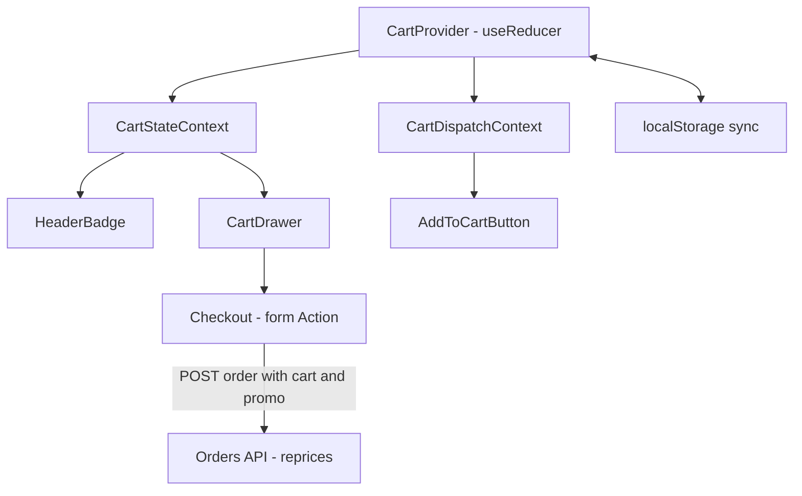
- **CartProvider** owns the reducer and exposes state and dispatch in **two contexts**, so buttons that only dispatch never re-render on cart changes.
- **Checkout** submits with `useActionState`; the server reprices and may return "price changed" errors.
- **localStorage sync** persists the cart (reuse your Project 9 Hook).

### Data model
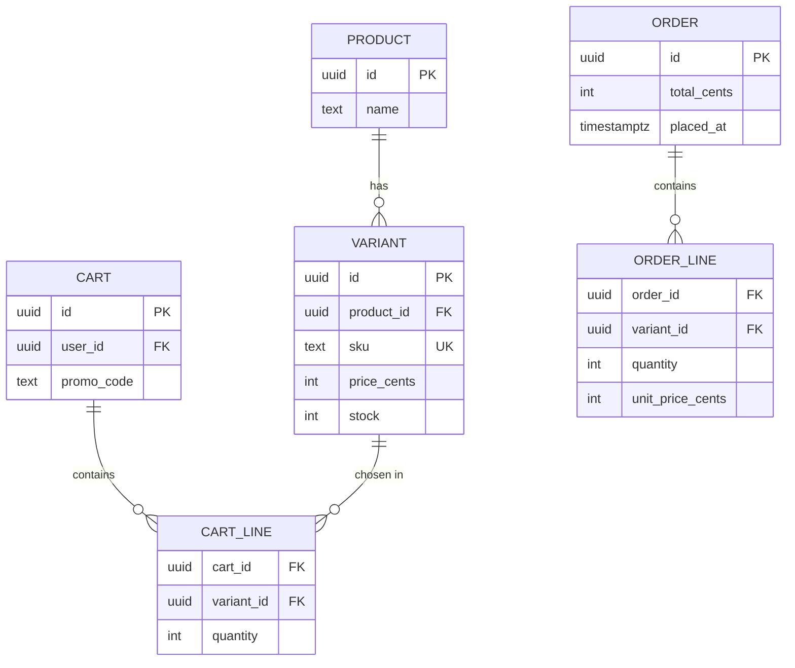
Order lines copy the unit price at purchase time, so later price changes don't alter history.

### Tech stack
| Component | Choice | Why |
|---|---|---|
| Cart state | `useReducer` + split contexts | no library, testable, minimal re-renders |
| Routing | React Router (data mode) | product loaders, checkout action |
| Forms | form Actions + Zod | pending/error state built in |
| Tests | Vitest, RTL, Playwright | unit, component and real-browser layers

### Milestones
1. **Catalogue and product page** with loaders. *Done when* variants show stock.
2. **Cart reducer** with add/update/remove and totals. *Done when* unit tests cover limits and promo rules.
3. **Provider, drawer, badge.** *Done when* the React DevTools Profiler shows add-to-cart buttons don't re-render on quantity changes.
4. **Checkout Action** with server repricing. *Done when* a changed price shows an inline warning and requires confirmation.
5. **Persistence and merge.** *Done when* a guest cart merges into a signed-in cart without duplicates.

### Deep dive: the hard parts
- **Split state and dispatch contexts.** Any component that reads a context re-renders when its value changes. `dispatch` never changes, so a dispatch-only context keeps buttons quiet.
- **The server is the source of truth for prices.** The client cart stores variant ids and quantities; display prices come from the catalogue and the order is repriced on submit. Never send a total and trust it.
- **Merging carts.** On sign-in: for each guest line, add to the account cart, capping at stock. Decide whether quantities add or take the max, and test it.
- **Rounding discounts.** A 15 % code on three lines: discount per line or on the subtotal? Pick one rule, round once and document it.

### Testing strategy
Pure reducer and pricing tests (table-driven). RTL: add to cart, open drawer, change quantity, apply promo. Playwright: full checkout happy path and "price changed" path with MSW.

### Trade-offs, scaling and failure modes
Context is fine for one cart. With many independent slices (wishlist, recently viewed, compare), a store with selectors (Zustand, Redux Toolkit) avoids re-render storms. Stock can sell out between add and checkout — handle it at submit. Never store card numbers; use a payment provider's hosted fields.

### Stretch goals
- Optimistic quantity changes with `useOptimistic` against a server cart.
- Recommendations ("customers also bought").
- Server-side cart in a framework (Project 40).

### Skills practised
- [Ch 4 — Forms and Actions](../chapters/04-forms-and-actions/README.md): checkout Action
- [Ch 6 — State management](../chapters/06-state-management/README.md): reducer + context, context performance
- [Ch 9 — Routing and data fetching](../chapters/09-routing-and-data-fetching/README.md): loaders and actions

### In the interview
**30-second answer:** I built a small shop whose cart is a pure reducer shared through context, with variants, quantity limits, promo codes, persistence across reloads and tabs, and a guest-to-account cart merge on sign-in. The key decision was splitting state and dispatch into two contexts, so the many "Add to cart" buttons, which only dispatch, never re-render when the cart changes. The rule I held to is that the server is the source of truth for prices: the client stores variant ids and quantities, and the checkout Action is repriced on the server, which can return a "price changed" error. All money maths is in integer cents and matches the server to the cent.

**Key terms to know:**
- **Context** — React's built-in way to pass a value down the tree without props. Two contexts here: state and dispatch.
- **Context re-render rule** — every component that reads a context re-renders when its value changes (compared with `Object.is`).
- **Reducer** — pure `(state, action) => state` holding cart rules: add, update quantity, remove, apply promo.
- **Stable `dispatch`** — the function from `useReducer` never changes identity, which makes a dispatch-only context free.
- **`use(Context)` (React 19)** — reads context like `useContext`, but can be called conditionally.
- **Server repricing** — the server recalculates totals from its catalogue on checkout; client totals are display only.
- **Cart merge** — combining a guest cart with an account cart on sign-in under a defined rule (add or max, capped at stock).
- **Price snapshot** — order lines copy the unit price at purchase so history never changes.
- **Integer cents** — all money in integer minor units to avoid floating-point error.
- **Hosted payment fields** — the payment provider's iframes collect card data so your app never touches it.

**Q:** Why two contexts for one store?

**A:** Every consumer of a context re-renders when its value changes. If one context held `{ state, dispatch }`, the value object would change on every cart update and every "Add" button would re-render. `dispatch` is stable, so putting it in its own context means dispatch-only components never re-render from cart changes.

**Q:** Should the client calculate the order total?

**A:** Only for display. Anyone can modify client code or requests, so the server reprices from its catalogue, validates promos and stock, and computes the charged total when the order is placed. If the price changed since the item was added, the Action returns an error and the UI asks the user to confirm.

**Q:** What changed for context in React 19?

**A:** You can render the context object itself as the provider (`<CartContext value={...}>` instead of `<CartContext.Provider>`), and you can read context with `use()`, which, unlike `useContext`, may be called inside conditions and loops. Re-render behaviour is unchanged.

**Q:** Context + reducer or Zustand/Redux here?

**A:** One cart with a handful of consumers is a good fit for built-in context; there is no dependency and the reducer is easy to test. With many independent slices (wishlist, compare, recently viewed) and components that need tiny pieces, a store with selectors avoids re-render storms because components subscribe to just what they read. Context has no selectors.

**Q:** How do you merge a guest cart into an account cart?

**A:** On sign-in, for each guest line I add it to the account cart, keyed by variant id, using an agreed rule: either sum quantities or take the larger, and always cap at available stock and per-item limits. It runs on the server so two devices cannot double-merge, then the client replaces its cart with the server's result and clears the guest copy.

**Q:** An item sells out between "add" and "checkout". What happens?

**A:** The checkout Action sends variant ids and quantities; the server checks stock, finds it insufficient and returns a field-level error for that line. The cart shows "Only 1 left" or "Sold out" with an option to adjust. I never reserve stock on add-to-cart, because abandoned carts would lock inventory.

**Q:** How do you apply a 15 % promo across three lines without rounding errors?

**A:** Pick one rule and apply it everywhere, client and server. I compute the discount on the subtotal in cents, round once, and, if per-line discounts are needed for receipts, distribute the rounded total across lines so they sum exactly. Rounding each line separately can be a cent off from the subtotal method.

**Q:** How do you prove buttons don't re-render?

**A:** Record a quantity change in the React DevTools Profiler and check that `AddToCartButton` does not appear in the commit. Functional tests: table-driven reducer and pricing tests, an RTL flow (add, open drawer, change quantity, apply promo) and a Playwright checkout with MSW returning "price changed".

**Q:** Hands-on: write the provider.

**A:** React 19 lets you render the context directly as the provider.

```tsx
function CartProvider({ children }: { children: React.ReactNode }) {
  const [state, dispatch] = useReducer(cartReducer, initialCart);
  return <CartDispatch value={dispatch}>
    <CartState value={state}>{children}</CartState>
  </CartDispatch>;
}
```

**Common mistakes in answers:**
- Passing `value={{ state, dispatch }}` and wondering why everything re-renders. A new object every render changes the context value.
- Trusting a total sent from the client. The server must recompute it.
- Saying `memo` stops context re-renders. `memo` only compares props; a component that reads a context still re-renders when that context changes.

### TL;DR
Keep cart rules in a pure reducer, share it with split state/dispatch contexts, compute money in cents, and let the server reprice at checkout.

## 14. Analytics dashboard with charts

**Level:** Intermediate · **Time:** 2 weeks · **Prerequisites:** Ch 6, Ch 7, Ch 9, Ch 10

### What it is
An admin dashboard for a fictional SaaS: KPI tiles (revenue, active users, churn), a line chart over time, a bar chart by plan, a table of top customers, a date-range picker and segment filters. Widgets load independently with their own skeletons and error states, filters live in the URL, and the dashboard auto-refreshes every minute. You use **Recharts** (a React charting library built on SVG) and TanStack Query.

### The problem it solves
Dashboards are where pages get slow and fragile: one failing widget blanks the page, re-renders cascade on every filter change, charts are unreadable to screen-reader users, and refresh logic hammers the API. Designing independent widgets with shared filters solves all of these.

### Real-world examples
- [Recharts](https://recharts.org/) documents responsive containers, tooltips and composable chart components.
- TanStack Query's [`useQuery` reference](https://tanstack.com/query/latest/docs/framework/react/reference/functions/useQuery) documents the `refetchInterval` and `refetchIntervalInBackground` options that drive auto-refresh.
- web.dev's [Interaction to Next Paint article](https://web.dev/articles/inp) explains the responsiveness metric your filter changes must respect.

### Requirements
**Functional**
- Date range presets (7/30/90 days, custom) and segment filters (plan, region).
- 4 KPI tiles with change vs previous period; line chart; bar chart; top-customers table.
- Each widget has skeleton, error with retry and empty states.
- Auto-refresh every 60 s while the tab is visible; "Last updated" time.

**Non-functional**
- Changing a filter keeps the UI responsive (INP under 200 ms) while charts update.
- One failing widget never breaks others.
- Every chart has a text alternative (a summary or a data table toggle).

### The architecture
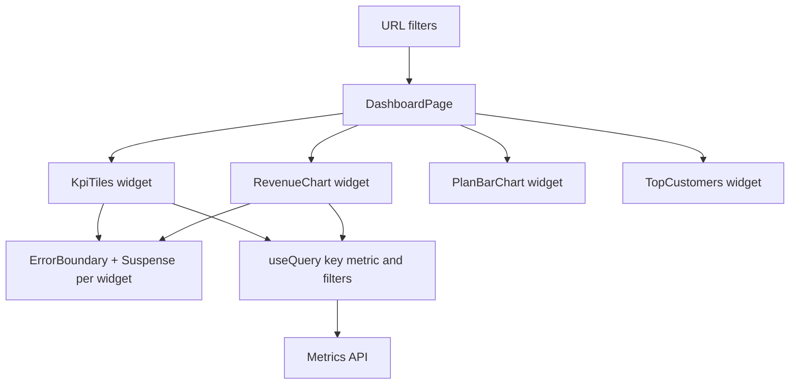
- **URL filters** are parsed once and passed to every widget.
- **Each widget** owns its query (key includes the filters), its `Suspense` fallback and its **error boundary** (a component that catches render errors in its subtree and shows a fallback).
- **Metrics API** returns pre-aggregated series; the browser never aggregates raw events.

### Data model
| Type | Fields |
|---|---|
| `Filters` | `from`, `to`, `plan?`, `region?` |
| `Kpi` | `name`, `value`, `previous`, `unit` |
| `Series` | `{ t: string, value: number }[]` |
| Query keys | `['metric', name, filters]` |

### Tech stack
| Component | Choice | Why |
|---|---|---|
| Charts | Recharts | declarative SVG, React-friendly |
| Data | TanStack Query with `useSuspenseQuery` | per-widget loading via Suspense |
| Filters | URL + `useTransition` | non-blocking filter changes |
| Tests | Vitest, RTL, Playwright screenshots | unit, component and real-browser layers

### Milestones
1. **Layout and one widget** with skeleton/error/empty. *Done when* forcing a 500 shows only that widget's error.
2. **All widgets** with shared URL filters. *Done when* filters round-trip through the URL.
3. **Transitions.** Wrap filter navigation in `startTransition`. *Done when* old charts stay visible (dimmed) while new data loads instead of flashing skeletons.
4. **Auto-refresh and visibility.** *Done when* no requests fire while the tab is hidden.
5. **Accessibility.** *Done when* each chart has a "View as table" toggle and a text summary.

### Deep dive: the hard parts
- **Suspense + transitions.** If a filter change suspends a widget, React would normally show the fallback again. Wrapping the URL update in a transition tells React to keep showing the old content until the new data is ready.
- **Isolated failures.** One error boundary per widget, with a reset that calls `queryClient.resetQueries` for that key, gives "Retry" without a page reload.
- **Avoiding chart re-renders.** Recharts re-renders on new props. Pass stable data references (TanStack Query's structural sharing keeps unchanged data identical) and memoize derived series or let the React Compiler do it.
- **Time zones and buckets.** Ask the API for buckets in the user's time zone; daylight-saving days have 23 or 25 hours. Label axes accordingly.

### Testing strategy
RTL per widget with MSW: loading, data, error, empty. Test the URL ↔ filters round-trip. Playwright visual snapshots of the dashboard with fixed data. An axe scan.

### Trade-offs, scaling and failure modes
Many parallel queries are fine over HTTP/2; batching them into one request saves round-trips but couples failures. SVG charts slow down past a few thousand points — downsample on the server or switch to canvas. Auto-refresh multiplies load by the number of open dashboards; back off when idle.

### Stretch goals
- Drag-and-drop widget layout saved per user.
- CSV export of any widget.
- Compare two periods on the same chart.

### Skills practised
- [Ch 6 — State management](../chapters/06-state-management/README.md): server vs URL state
- [Ch 7 — Custom Hooks](../chapters/07-custom-hooks-and-hook-rules/README.md): `useTransition`
- [Ch 9 — Routing and data fetching](../chapters/09-routing-and-data-fetching/README.md): Suspense, TanStack Query
- [Ch 10 — Performance](../chapters/10-performance/README.md): profiling re-renders
- [Ch 14 — Patterns and architecture](../chapters/14-patterns-and-architecture/README.md): error boundaries

### In the interview
**30-second answer:** I built a SaaS analytics dashboard with KPI tiles, Recharts line and bar charts and a top-customers table, all driven by filters in the URL and auto-refreshing every minute while the tab is visible. The key decision was making each widget independent: its own TanStack Query, its own Suspense boundary and its own error boundary with a retry, so one failing endpoint shows one error card instead of a blank page. The hardest part was keeping the UI calm on filter changes; wrapping the URL update in `startTransition` keeps the old charts visible (dimmed) until new data is ready instead of flashing skeletons. Every chart has a text summary and a "View as table" toggle.

**Key terms to know:**
- **Error boundary** — a component that catches errors thrown while rendering its subtree and shows a fallback. One per widget.
- **Suspense boundary** — shows a fallback while something inside is waiting (suspended) for data or code.
- **Transition (`startTransition`)** — marks an update as non-urgent so React keeps showing current UI instead of falling back to a loading state.
- **Query key** — the cache identity of a request in TanStack Query; includes metric and filters.
- **Structural sharing** — TanStack Query keeps unchanged parts of new data referentially identical, so memoized charts skip re-rendering.
- **Refetch interval and visibility** — polling every 60 s, paused while the tab is hidden.
- **Pre-aggregation** — the API returns ready-made series; the browser never crunches raw events.
- **Downsampling** — reducing thousands of points to a few hundred for SVG charts.
- **Accessible chart** — a text summary, a data table alternative, labelled axes and not relying on colour alone.
- **Time-zone buckets** — daily buckets computed in the user's zone; DST days have 23 or 25 hours.

**Q:** How do you stop one widget's error from breaking the page?

**A:** Wrap each widget in its own error boundary (with Suspense inside it). An error thrown in that widget is caught by the nearest boundary, so only that card shows "Couldn't load revenue — Retry". The retry resets the boundary and that widget's query key. Without boundaries, an uncaught render error unmounts the whole app.

**Q:** Why wrap filter changes in a transition?

**A:** Changing filters gives each query a new key, and suspending components would normally show their Suspense fallbacks again, making the page flash skeletons. Inside a transition, React keeps showing the already-revealed content until the new data is ready, and `isPending` lets me dim it. Skeletons appear only on first load.

**Q:** How do you make charts accessible?

**A:** Give each chart a one-sentence text summary ("Revenue up 12 % vs previous 30 days"), a "View as table" toggle with a real `<table>`, labelled axes and units, and distinguish series by shape or pattern as well as colour. SVG charts are otherwise read as a pile of unlabelled shapes.

**Q:** Why do error boundaries not catch every error?

**A:** They catch errors during rendering, lifecycle methods and in children's constructors. They do not catch errors in event handlers, in async code like a `setTimeout`, or in the boundary itself. TanStack Query rethrows query errors during render when you opt in (for example with `useSuspenseQuery` or `throwOnError`), which is how fetch failures reach the boundary.

**Q:** Many small requests or one batched dashboard request?

**A:** Separate queries load and fail independently, cache per widget and parallelize well over HTTP/2. One batched request saves round-trips but couples failures (one slow metric delays all) and invalidation. I chose per-widget queries; a backend-for-frontend endpoint is the next step if round-trip latency dominates.

**Q:** What changes at 10x users or 10x data points?

**A:** Auto-refresh load scales with open dashboards, so the API breaks first: I would cache aggregates server-side, increase the interval or back off when idle, and pause hidden tabs (already done). On the client, SVG charts slow past a few thousand points, so the server downsamples or I switch the busiest chart to canvas.

**Q:** Why does a daily chart look wrong around daylight-saving changes?

**A:** If the server buckets by UTC and the client labels in local time, a "day" can contain 23 or 25 hours, or bars can shift to the wrong date. I ask the API to bucket in the user's IANA time zone and label from the bucket's own date string.

**Q:** How do you test the dashboard?

**A:** RTL per widget with MSW for loading, data, error and empty states, including "one widget 500s, others render". A round-trip test for URL filters. Playwright visual snapshots with fixed data catch chart regressions, and an axe scan checks accessibility.

**Q:** Hands-on: make a filter change a transition.

**A:** Update the URL inside `startTransition` and dim the content while pending.

```tsx
const [isPending, startTransition] = useTransition();
const setRange = (r: Range) =>
  startTransition(() => setSearchParams(p => { p.set('range', r); return p; }));
<section style={{ opacity: isPending ? 0.6 : 1 }}>{widgets}</section>
```

**Common mistakes in answers:**
- One error boundary around the whole page. It contains the crash but still blanks every widget.
- Claiming error boundaries catch `fetch` failures automatically. Only errors thrown during render reach them.
- Aggregating raw events in the browser "to save backend work". It moves heavy computation and huge payloads to the weakest machine.

### TL;DR
Give every widget its own query, Suspense and error boundary, keep filters in the URL, change them in transitions, and offer tables for charts.

## 15. Markdown notes app with routing

**Level:** Intermediate · **Time:** 2 weeks · **Prerequisites:** Ch 7, Ch 9, Ch 11

### What it is
A note-taking app in the spirit of Bear or Obsidian: a sidebar of notes and folders, an editor with live Markdown preview, tags, full-text search and `[[wiki links]]` between notes. Each note has a URL (`/notes/:id`), and the app uses **React Router** in data mode — **loaders** (functions that fetch data before a route renders) and **actions** (functions that handle form submissions for a route).

### The problem it solves
Notes apps test routing design: nested layouts (sidebar stays, editor changes), data loading before render, saving without losing keystrokes, and rendering user-written Markdown safely. They also expose the cost of re-rendering a large preview on every keystroke.

### Real-world examples
- [React Router](https://reactrouter.com/) and its [modes overview](https://reactrouter.com/start/modes) (declarative, data, framework) — this project uses data mode.
- [react-markdown](https://github.com/remarkjs/react-markdown) renders Markdown to React elements without `dangerouslySetInnerHTML`, using the remark/rehype plugin ecosystem.

### Requirements
**Functional**
- Routes: `/` (list), `/notes/:id` (editor), `/tags/:tag`, `/search?q=`.
- Create, rename, delete, move to folder; autosave while typing.
- Live preview; `[[Note title]]` links navigate; backlinks panel.
- Search over titles and bodies with highlighted matches.

**Non-functional**
- Autosave at most once per second per note; never lose the last keystroke on navigation.
- Rendering Markdown cannot execute scripts (XSS-safe).
- 1,000 notes load the sidebar in under 300 ms.

### The architecture
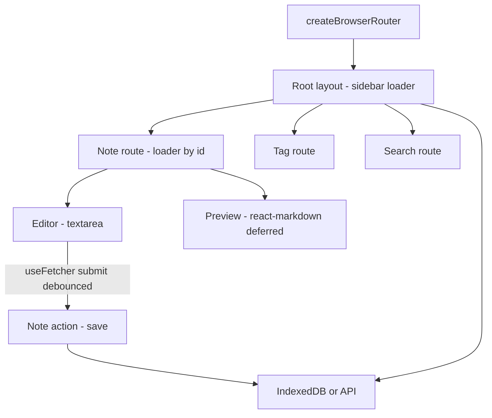
- **Root layout** loads the note list once; child routes render in its `<Outlet>`.
- **Note loader** fetches one note; a missing id throws a 404 response handled by the route's error element.
- **Editor** saves via a **fetcher** (`useFetcher`) so saving does not navigate; after the action, React Router revalidates the sidebar automatically.
- **Preview** receives a deferred copy of the text (`useDeferredValue`).

### Data model
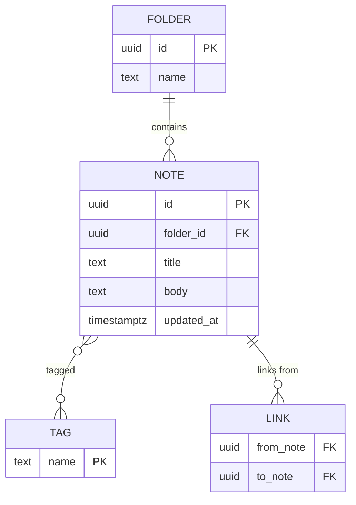
Links and tags are re-extracted from the body on every save, so they never drift.

### Tech stack
| Component | Choice | Why |
|---|---|---|
| Routing | React Router (data mode) | loaders, actions, fetchers, revalidation |
| Markdown | react-markdown + remark-gfm | safe by default, plugins |
| Storage | IndexedDB (via a tiny wrapper) or a REST API | room for thousands of notes |
| Tests | Vitest + RTL with `createMemoryRouter`, Playwright | unit, component and real-browser layers

### Milestones
1. **Routes and layouts** with fixture data. *Done when* the sidebar persists while the editor changes.
2. **Loaders and 404s.** *Done when* `/notes/unknown` shows a friendly not-found inside the layout.
3. **Editing with fetcher autosave.** *Done when* a test types, waits 1 s and sees one save.
4. **Preview, wiki links, backlinks.** *Done when* clicking `[[Ideas]]` navigates and the backlinks panel updates.
5. **Search route.** *Done when* `/search?q=react` highlights matches and is bookmarkable.

### Deep dive: the hard parts
- **Never lose keystrokes.** Keep the draft in local state; debounce the save; flush on route change and on `pagehide`. Use React Router's `useBlocker` to warn if a save is pending.
- **Safe Markdown.** react-markdown does not render raw HTML unless you add a plugin. If you enable HTML, sanitize with rehype-sanitize. Custom link components route `[[...]]` through `<Link>`.
- **Revalidation cost.** After every action, loaders revalidate. Autosaving each second would reload the sidebar each second. Implement `shouldRevalidate` to skip the list reload unless the title changed.
- **Typing performance.** Markdown parsing of a long note on each keystroke is heavy. Defer the preview so the textarea stays responsive.

### Testing strategy
Route tests with `createMemoryRouter` and fixture loaders. Unit-test link/tag extraction. Playwright: create a note, type, navigate away immediately, return — text is intact.

### Trade-offs, scaling and failure modes
Local IndexedDB means no sync; adding a server introduces conflicts (two devices editing the same note) — last-writer-wins per note is simple, CRDTs (Project 27) are robust. Full-text search in the browser works for thousands of notes; beyond that, index on a server.

### Stretch goals
- Graph view of links.
- Offline sync with a server (Project 31 techniques).
- Code-split the editor with `lazy`.

### Skills practised
- [Ch 7 — Custom Hooks](../chapters/07-custom-hooks-and-hook-rules/README.md): `useDebounce`, `useDeferredValue`
- [Ch 9 — Routing and data fetching](../chapters/09-routing-and-data-fetching/README.md): layouts, loaders, actions, fetchers
- [Ch 11 — TypeScript with React](../chapters/11-typescript-with-react/README.md): typed loaders
- [Ch 12 — Testing React](../chapters/12-testing-react/README.md): testing routers

### In the interview
**30-second answer:** I built a Markdown notes app with nested routes on React Router in data mode: a sidebar layout that persists while the editor route changes, loaders that fetch a note before it renders, and a route action that saves it. The key decision was autosaving through a fetcher (`useFetcher`), so saves run in the background without navigation or history entries, debounced to at most once per second and flushed on navigation and `pagehide`. Two subtle problems were revalidation cost, since every action reloads loaders, which I cut with `shouldRevalidate`, and safety, since user Markdown is rendered to React elements with raw HTML disabled. 1,000 notes load in under 300 ms.

**Key terms to know:**
- **Nested routes / layout route** — a parent route renders shared UI (the sidebar) and an `<Outlet>` where child routes appear.
- **Loader** — a function on a route that fetches its data before the route renders; read with `useLoaderData`.
- **Action** — a function on a route that handles a form submission (POST, PUT, DELETE); loaders revalidate afterwards.
- **Fetcher (`useFetcher`)** — calls a loader or action without navigating, with its own pending state.
- **Revalidation / `shouldRevalidate`** — re-running loaders after an action; `shouldRevalidate` lets a route opt out.
- **Route error element** — the UI shown when a loader throws, such as a 404 response.
- **Debounced autosave** — wait for a pause before saving, and flush on route change and `pagehide`.
- **XSS** — cross-site scripting: user content executing script. Prevented by not rendering raw HTML.
- **`useDeferredValue`** — keeps the textarea responsive while the preview renders.
- **Derived index** — links and tags re-extracted from the body on every save so they never drift.

**Q:** Why a fetcher instead of a `<Form>` for autosave?

**A:** A `<Form>` submission is a navigation: it changes the location state and can add history entries. A fetcher calls the route action without navigating, keeps its own `state` ('idle', 'submitting', 'loading'), and can run alongside typing. That suits background saves where the user should not notice anything.

**Q:** How do you render user Markdown safely?

**A:** Parse it to React elements with react-markdown, which ignores raw HTML by default, so `<script>` or `onerror` attributes become text. If I enable HTML I add rehype-sanitize with an allow-list. I never pass unsanitized output to `dangerouslySetInnerHTML`, and I check link protocols so `javascript:` URLs are dropped.

**Q:** What is a loader?

**A:** A function attached to a route that fetches its data before the route renders, so the component receives ready data from `useLoaderData` and never renders a half-loaded state. Loaders for nested routes run in parallel, which avoids the request waterfall you get when each component fetches in its own Effect.

**Q:** How do you guarantee the last keystroke is never lost?

**A:** The draft lives in local state and is saved by a debounced fetcher submit. On route change I flush the pending save immediately, and `useBlocker` warns if a save is still in flight. On `pagehide` (tab close or mobile background) I flush with `navigator.sendBeacon` or a write to IndexedDB, because normal requests may be cancelled.

**Q:** Why add `shouldRevalidate`, and what is the trade-off?

**A:** After every action React Router re-runs active loaders, so autosaving every second would refetch the 1,000-note sidebar every second. `shouldRevalidate` on the sidebar route returns false unless the title or folder changed. The trade-off is that I must be sure no other sidebar data depends on the body, or it will go stale.

**Q:** What happens on `/notes/unknown-id`?

**A:** The loader throws a 404 `Response` (or `data(null, { status: 404 })`), React Router renders the nearest route error element, and because that element belongs to the note route, the sidebar layout stays visible with a friendly "Note not found". `useRouteError` and `isRouteErrorResponse` distinguish 404s from crashes.

**Q:** What changes with 50,000 notes or sync across devices?

**A:** Browser full-text search and loading the whole list break first; I would paginate or virtualize the sidebar and index search on a server. Syncing devices introduces conflicts when two edit the same note: last-writer-wins per note is simple but loses edits, while CRDTs (Project 27) merge concurrent edits safely.

**Q:** Why is typing slow in a long note, and how do you fix it?

**A:** Parsing and rendering Markdown for a 20,000-word note on every keystroke takes longer than a frame. Passing `useDeferredValue(text)` to a memoized preview lets the textarea update first and the preview catch up in an interruptible background render. Splitting the preview by block and memoizing unchanged blocks helps further.

**Q:** How do you test routes?

**A:** `createMemoryRouter` with fixture loaders renders real route trees in RTL, including the 404 path. Link and tag extraction is unit-tested. A Playwright test types, navigates away immediately, comes back and asserts the text is intact.

**Q:** Hands-on: a debounced fetcher save.

**A:**

```tsx
const fetcher = useFetcher();
useEffect(() => {
  const t = setTimeout(() =>
    fetcher.submit({ body: draft }, { method: 'post' }), 1000);
  return () => clearTimeout(t);
}, [draft]);
```

**Common mistakes in answers:**
- Saying `react-markdown` is unsafe "because it renders HTML". It does not render raw HTML unless you add a plugin like rehype-raw.
- Fetching each note in a `useEffect` inside the component. That shows a loading flash and creates waterfalls that loaders avoid.
- Forgetting that saves on unload need `pagehide` plus `sendBeacon` or local persistence; `beforeunload` is unreliable on mobile.

### TL;DR
Nest routes under a sidebar layout, load notes with loaders, autosave with debounced fetchers, defer the preview and render Markdown safely.

## 16. Accessible autocomplete combobox

**Level:** Intermediate · **Time:** 1 week · **Prerequisites:** Ch 5, Ch 7, Ch 14, Ch 15

### What it is
A reusable `<Autocomplete>` component — think a city or user search box — that suggests results as you type from a remote API, with **debouncing** (waiting until the user pauses before sending a request), request cancellation, keyboard navigation, highlighting and full **WAI-ARIA combobox** semantics (the roles and attributes that make a text box with a pop-up list understandable to screen readers). It is the most common front-end machine-coding question, built to production quality.

### The problem it solves
A naive autocomplete fires a request per keystroke, shows results for an old query, cannot be used with a keyboard and says nothing to screen readers. Each of these is a real complaint in real products.

### Real-world examples
- The W3C [Combobox pattern](https://www.w3.org/WAI/ARIA/apg/patterns/combobox/) specifies roles, `aria-expanded`, `aria-controls`, `aria-activedescendant` and keyboard behaviour.
- MDN's [AbortController](https://developer.mozilla.org/en-US/docs/Web/API/AbortController) is how you cancel outdated requests.
- Chapter 15 §15.11 of this book builds a minimal version — this brief hardens it into a library component.

### Requirements
**Functional**
- Debounced search (250 ms), minimum 2 characters, cancel outdated requests.
- Up/Down move the active option, Enter selects, Escape closes then clears, Home/End jump, Tab accepts the active option per your design decision.
- Highlight matched text; show "No results", loading and error states inside the pop-up.
- Generic: `Autocomplete<T>` with `getLabel`, `renderOption`, `fetchOptions`.

**Non-functional**
- At most one request in flight; at most 4 requests per second while typing.
- Screen readers announce the number of results and the active option.
- Zero axe violations; works in NVDA, VoiceOver and JAWS (test at least one).

### The architecture
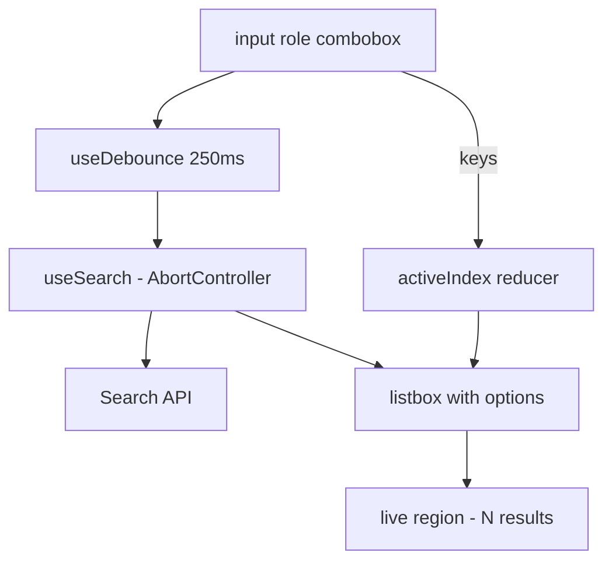
- **input** keeps focus at all times; options are never focused directly — `aria-activedescendant` points at the active option's id.
- **useDebounce** delays the query; **useSearch** aborts the previous request when the query changes.
- **activeIndex reducer** handles all keys in one place.
- **live region** (`role="status"`) announces result counts.

### Data model
| Type | Fields |
|---|---|
| Props | `fetchOptions(q, signal): Promise<T[]>`, `getLabel(t)`, `getKey(t)`, `onSelect(t)`, `renderOption?` |
| State | `query`, `isOpen`, `activeIndex: number \| -1`, `status`, `options: T[]` |
| IDs | from `useId()` for listbox and options |

### Tech stack
| Component | Choice | Why |
|---|---|---|
| Component | React 19 + TypeScript generics | reusable for any item type |
| IDs | `useId` | stable, SSR-safe ids for ARIA |
| Tests | RTL + `user-event` + fake timers, Playwright + axe | unit, component and real-browser layers

### Milestones
1. **Static listbox** with keyboard navigation over fixed options. *Done when* all APG keys work.
2. **Remote search** with debounce and abort. *Done when* a test with out-of-order responses always shows the latest query's results.
3. **ARIA wiring.** *Done when* a screen reader announces the active option while you arrow through.
4. **Generic API, highlighting, states.** *Done when* the same component powers a city search and a user search.

### Deep dive: the hard parts
- **`aria-activedescendant` vs moving focus.** Moving DOM focus into the list would steal the caret from the input. Instead, the input stays focused and its `aria-activedescendant` names the active option; you also scroll it into view.
- **Mouse and keyboard together.** Hover should set the active index, but mouse-down on an option blurs the input before the click fires. Use `onMouseDown={e => e.preventDefault()}` on options.
- **Debounce + abort.** Debounce reduces requests; abort guarantees correctness when responses arrive out of order. You need both.
- **Highlighting safely.** Split the label on the query (escape regex characters!) and wrap matches in `<mark>`; no HTML strings.

### Testing strategy
RTL: type with fake timers, assert one request after 250 ms; arrow down, assert `aria-activedescendant`; Enter selects. Out-of-order MSW responses for the race. Playwright + axe on a demo page.

### Trade-offs, scaling and failure modes
Client-side filtering is better for small static lists (no network). For huge result sets, cap results and virtualize. Rate limiting by the API needs graceful errors. Headless libraries (Downshift, React Aria) exist — building it once teaches you what they solve.

### Stretch goals
- Multi-select with token chips.
- Recent searches when the input is empty.
- Server-side caching with TanStack Query (query key per term).

### Skills practised
- [Ch 5 — Effects and refs](../chapters/05-effects-and-refs/README.md): fetch races
- [Ch 7 — Custom Hooks](../chapters/07-custom-hooks-and-hook-rules/README.md): `useDebounce`, `useId`
- [Ch 14 — Patterns and architecture](../chapters/14-patterns-and-architecture/README.md): accessibility
- [Ch 15 — Interview and machine coding](../chapters/15-react-interview-and-machine-coding/README.md): autocomplete build

### In the interview
**30-second answer:** I built a reusable, generic `Autocomplete<T>` that searches a remote API as you type and follows the WAI-ARIA combobox pattern. The key decisions were combining a 250 ms debounce (to cut requests) with aborting the previous request (to guarantee correctness when responses arrive out of order), and keeping DOM focus in the input while `aria-activedescendant` points at the active option. All key handling lives in one reducer, so Up, Down, Home, End, Enter and Escape are tested as pure transitions. It sends at most one request in flight, has zero axe violations, and the same component powers both a city search and a user search.

**Key terms to know:**
- **Combobox pattern** — an input with `role="combobox"` that controls a pop-up `role="listbox"` of `role="option"` items.
- **`aria-activedescendant`** — on the focused input, the id of the visually active option, so screen readers announce it without moving focus.
- **`aria-expanded` / `aria-controls`** — tell assistive tech whether the pop-up is open and which element it is.
- **Debounce** — run the search only after the user pauses typing for 250 ms.
- **Throttle** — run at most once per interval while events continue. Not the right fit for search-as-you-type.
- **Request cancellation** — `AbortController` aborts the previous fetch when the query changes.
- **Live region (`role="status"`)** — politely announces "5 results available".
- **Generic component** — `Autocomplete<T>` with `getLabel`, `renderOption` and `fetchOptions`, typed by the caller.
- **Regex escaping** — escaping user text before building a highlight regex.
- **Headless component** — logic and ARIA without styling, the model used by Downshift and React Aria.

**Q:** Debounce or throttle for search-as-you-type?

**A:** Debounce: you want one request after the user pauses, with the final query, not requests at regular intervals during typing. Throttle fits continuous signals where you want periodic updates, such as scroll position or resize. A combined "debounce with max wait" is a reasonable refinement for very long typing bursts.

**Q:** Why is debouncing not enough?

**A:** Debouncing reduces how many requests you send, but responses can still arrive out of order: the request for "par" may finish after "paris". Aborting the previous request (or ignoring responses whose query is no longer current) guarantees the list always matches the latest input. You need both.

**Q:** How does a screen reader know which option is active?

**A:** The input keeps focus, and its `aria-activedescendant` is set to the active option's id. The listbox has `role="listbox"` and each item `role="option"` with `aria-selected` on the active one. The screen reader announces that option as you arrow, while the caret stays in the input so typing continues to work.

**Q:** Why not move real DOM focus into the list?

**A:** Moving focus would take the caret out of the input, so typing another letter would go nowhere and the user would have to tab back. `aria-activedescendant` gives the announcement of a focused option while keeping focus in the input. I also call `scrollIntoView({ block: 'nearest' })` on the active option so it stays visible.

**Q:** Clicking an option closes the list before the click registers. Why, and how do you fix it?

**A:** `mousedown` on the option blurs the input first, and my blur handler closes the pop-up, so the option is gone before `click` fires. Calling `preventDefault()` in the option's `onMouseDown` stops the blur, and the click then selects normally.

**Q:** Why build it instead of using Downshift or React Aria?

**A:** In production I would usually use a headless library, because they are tested across screen readers and edge cases. Building one once teaches what they solve, which is a very common machine-coding question. The trade-off is maintenance: every browser and screen-reader quirk becomes mine.

**Q:** What happens if the API is slow, errors or rate-limits?

**A:** The pop-up shows a loading row after a short delay, an inline error with a retry on failure, and "No results" for an empty list, each announced through the live region. A 429 response shows "Too many searches, try again" and I can increase the debounce. The previous valid results stay visible while loading so the list does not flicker.

**Q:** What changes for 10x traffic or huge result sets?

**A:** Request volume to the search API breaks first, so I cache results per term (TanStack Query with the term in the key) so backspacing does not refetch, and enforce the minimum two characters. For huge result sets, cap the server response at maybe 20 items and virtualize the list if more must be shown.

**Q:** How do you test it?

**A:** RTL with fake timers: type "par", advance 250 ms, assert exactly one request. Arrow down and assert `aria-activedescendant` equals the first option's id, press Enter and assert the selection. MSW returns out-of-order responses to prove the latest query wins. Playwright plus axe covers the real browser and a manual screen-reader check covers announcements.

**Q:** Hands-on: highlight the match safely.

**A:** Escape regex characters, split with a capturing group, and wrap matches in `<mark>` as React elements, never as an HTML string.

```tsx
const esc = q.replace(/[.*+?^${}()|[\]\\]/g, '\\$&');
const parts = label.split(new RegExp(`(${esc})`, 'ig'));
return parts.map((p, i) =>
  p.toLowerCase() === q.toLowerCase() ? <mark key={i}>{p}</mark> : p);
```

**Common mistakes in answers:**
- Saying "debounce solves the race condition". It reduces requests; only cancellation or stale-response checks fix ordering.
- Using `role="menu"` for suggestions. Menus are for actions; the combobox pattern uses `listbox` and `option`.
- Building the highlight with `dangerouslySetInnerHTML` and a string replace, which turns search results into an XSS hole.

### TL;DR
Debounce the query, abort stale requests, keep focus in the input with `aria-activedescendant`, and handle every APG key in one reducer.

## 17. Multi-step form wizard

**Level:** Intermediate · **Time:** 1–2 weeks · **Prerequisites:** Ch 4, Ch 6, Ch 11

### What it is
An insurance-quote or job-application style wizard: five steps (personal details, address, employment, documents, review), a progress indicator, per-step validation, conditional steps ("self-employed" adds a step), draft saving, and a final review page where each section has an "Edit" link. Built with **React Hook Form** (a form library that keeps inputs mostly uncontrolled for performance) and **Zod** schemas (runtime validation that also produces TypeScript types).

### The problem it solves
Long forms lose users. Splitting them into steps helps only if validation is per step, data is not lost when going back, the URL reflects the step, and branching rules don't leave stale answers. These are hard to get right with ad-hoc `useState`.

### Real-world examples
- The GOV.UK Design System's [Question pages pattern](https://design-system.service.gov.uk/patterns/question-pages/) recommends one thing per page, clear back links and error summaries — a well-researched standard for public-service forms.
- [React Hook Form](https://react-hook-form.com/) and [Zod](https://zod.dev/) document schema resolvers and typed form values.

### Requirements
**Functional**
- 5–6 steps with Back/Next; Next validates only the current step.
- Branching: answers can add or remove steps; removed steps' data is cleared.
- Draft autosave and resume ("Continue where you left off").
- Review page with edit links back to each step; final submit via an Action.
- Error summary at the top of a step linking to each invalid field.

**Non-functional**
- Typing in a field re-renders only that field (React Hook Form's uncontrolled model).
- Each step has a URL; Back button works.
- WCAG: errors announced, focus moves to the error summary on failed Next.

### The architecture
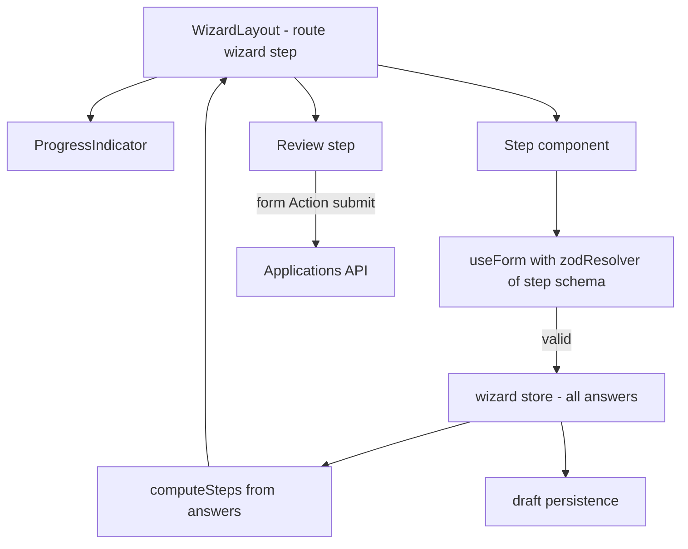
- **computeSteps** is a pure function: given answers, which steps apply, in which order.
- **Step components** each own a `useForm` with that step's schema; on valid Next they write to the store and navigate.
- **wizard store** (reducer + context or Zustand) holds all answers and persists drafts.
- **Review** submits all data; the server validates the complete schema again.

### Data model
| Type | Fields |
|---|---|
| `Answers` | `personal`, `address`, `employment: { kind: 'employed' \| 'self' \| 'none', ... }`, `selfEmployment?`, `documents` |
| Schemas | one Zod schema per step + `fullSchema` = their combination |
| `StepId` | `'personal' \| 'address' \| 'employment' \| 'self-employment' \| 'documents' \| 'review'` |

### Tech stack
| Component | Choice | Why |
|---|---|---|
| Forms | React Hook Form + `@hookform/resolvers/zod` | fast, typed |
| Schemas | Zod | shared by client and server |
| Routing | React Router | URL per step |
| Tests | Vitest, RTL, Playwright | unit, component and real-browser layers

### Milestones
1. **Linear wizard** with routes and progress. *Done when* Back/Next and browser Back agree.
2. **Per-step validation and error summary.** *Done when* failed Next focuses the summary.
3. **Branching.** *Done when* changing "self-employed" to "employed" removes the step and its data.
4. **Drafts and review.** *Done when* closing the tab and returning resumes at the last step with data.
5. **Submit.** *Done when* server-side errors map back to the right step and field.

### Deep dive: the hard parts
- **Deep-linking guard.** If someone opens `/wizard/documents` directly, previous steps may be invalid. On entry, validate earlier steps with their schemas and redirect to the first invalid one.
- **Branching and stale data.** When a step disappears, its answers must be deleted or the server receives contradictory data. Do it in the same reducer action that changes the branching answer.
- **Mapping server errors.** The server returns errors by path (`address.postcode`); map the path to a step and navigate there with the error set.
- **Uncontrolled performance.** React Hook Form registers inputs with refs and reads values on submit, so typing doesn't re-render the form. Use `watch` sparingly, only for fields that drive UI.

### Testing strategy
Unit-test `computeSteps` and each schema. RTL: fill step, Next, Back, values intact. Playwright: full run, branching, refresh-resume, keyboard only.

### Trade-offs, scaling and failure modes
Drafts in `localStorage` are device-bound and may contain personal data — encrypt or store server-side with expiry. Very long wizards benefit from a server-driven step definition. Validation drift between client and server is avoided by sharing schemas.

### Stretch goals
- File uploads in the documents step (Project 23).
- Save-and-email a resume link.
- Server-driven form definition (JSON schema → steps).

### Skills practised
- [Ch 4 — Forms and Actions](../chapters/04-forms-and-actions/README.md): validation, React Hook Form + Zod, Actions
- [Ch 6 — State management](../chapters/06-state-management/README.md): shared wizard store
- [Ch 11 — TypeScript with React](../chapters/11-typescript-with-react/README.md): inferred types from schemas
- [Ch 15 — Interview and machine coding](../chapters/15-react-interview-and-machine-coding/README.md): wizard build

### In the interview
**30-second answer:** I built a five-to-six-step application wizard with a URL per step, per-step validation, branching steps, draft resume, a review page with edit links and a final submit through a form Action. The key decision was one Zod schema and one React Hook Form instance per step, plus a pure `computeSteps(answers)` function that decides which steps apply. The hardest part was branching: when an answer removes a step, the same reducer action deletes that step's data so the server never receives contradictory answers. Typing re-renders only the field being typed in, failed Next moves focus to an error summary, and the server validates the whole schema again on submit.

**Key terms to know:**
- **React Hook Form (RHF)** — a form library that registers mostly uncontrolled inputs with refs, so typing does not re-render the form.
- **Zod schema / `zodResolver`** — runtime validation rules that also produce TypeScript types, plugged into RHF.
- **Per-step validation** — Next validates only the current step's schema.
- **`computeSteps`** — a pure function from answers to the ordered list of steps that apply.
- **Branching** — answers that add or remove steps, such as "self-employed".
- **Stale branch data** — answers from a step that no longer applies; deleted in the same update.
- **Deep-link guard** — on entering a step URL directly, validate earlier steps and redirect to the first invalid one.
- **Error summary** — a list at the top of a step linking to each invalid field; receives focus on failed Next.
- **Server error mapping** — mapping error paths like `address.postcode` back to a step and field.
- **`watch`** — RHF API to subscribe to a value; causes re-renders, so used only for fields that drive UI.

**Q:** How do you validate only the current step?

**A:** Each step has its own schema and its own `useForm` with `zodResolver(stepSchema)`. Clicking Next runs `handleSubmit`, which validates only that step; if valid, it writes the step's values to the shared wizard store and navigates to the next step's URL. The full schema runs again on the review page and on the server.

**Q:** What happens to answers in a step that no longer applies?

**A:** They are deleted in the same reducer action that changes the branching answer, so the store can never hold "employed" plus self-employment details. Doing it later, for example in an Effect, leaves a window where the data is inconsistent, and a submit in that window would send contradictory data.

**Q:** Why React Hook Form for big forms?

**A:** It registers inputs as uncontrolled and reads values from the DOM through refs, so typing in one field does not re-render the whole form. It subscribes components narrowly (`useWatch`, `useFormState`) so only what depends on a value updates. With dozens of controlled fields, every keystroke would re-render everything.

**Q:** Why give each step its own URL?

**A:** The browser Back button, refresh and analytics all work, and users can be sent a link to resume. The trade-off is that someone can open `/wizard/documents` directly, so each step must guard: validate previous steps from the store and redirect to the first invalid one.

**Q:** Where should the wizard's shared answers live?

**A:** In a reducer-plus-context or a small Zustand store above the step routes, because every step and the review page read it and it must survive step navigation. Each step's `useForm` holds only the in-progress values for that step. Drafts are persisted from the store.

**Q:** The server rejects `address.postcode` on final submit. What happens?

**A:** The Action returns errors keyed by path. I map the path's first segment to the step that owns it, navigate there, and set the error on the field with RHF's `setError`, so the user lands exactly where the problem is. Unknown paths go to a form-level error on the review page.

**Q:** Is storing drafts in `localStorage` acceptable?

**A:** It is convenient but the data is device-bound, readable by any script on the origin, and these forms often contain personal data. For sensitive data, store drafts server-side tied to the session with an expiry, or at least avoid saving fields like ID numbers locally.

**Q:** What changes if the business needs 50 different wizards?

**A:** Hand-coding steps stops scaling first. I would move to a server-driven definition: a JSON description of steps, fields, conditions and schemas that a generic renderer turns into steps. Sharing schemas between client and server prevents validation drift.

**Q:** How do you test branching?

**A:** Unit-test `computeSteps` with a table of answers to step lists, and the reducer to prove switching the branch deletes the removed step's data. RTL fills a step, goes Next then Back and checks values are intact. Playwright runs the full flow, refreshes mid-way to test resume, and does a keyboard-only pass.

**Q:** Hands-on: what does `computeSteps` look like?

**A:** A pure function of the answers.

```ts
const computeSteps = (a: Answers): StepId[] => [
  'personal', 'address', 'employment',
  ...(a.employment?.type === 'self-employed' ? ['business' as const] : []),
  'documents', 'review',
];
```

**Common mistakes in answers:**
- Validating the entire final schema on every Next, which shows errors for steps the user has not reached.
- Hiding removed steps in the UI but keeping their data, so the server receives answers for questions that no longer apply.
- Calling `watch()` with no arguments at the top of a step, which subscribes to every field and re-renders on every keystroke.

### TL;DR
One schema and form per step, a pure function deciding the step list, URLs per step, cleared data for removed branches, and server-side validation of the whole.

## 18. Theme system and dark mode

**Level:** Intermediate · **Time:** 1 week · **Prerequisites:** Ch 6, Ch 8, Ch 13

### What it is
A theming layer for an app: **design tokens** (named values like `--color-surface` or `--space-3` that components use instead of raw colours and sizes), light and dark themes, a "system" option that follows the operating system, a high-contrast theme and per-brand accent colours. The user's choice persists, and — the hard part — the correct theme is applied **before the first paint**, even with server rendering, so there is no flash of the wrong theme.

### The problem it solves
Bolted-on dark mode leads to hard-coded colours everywhere, poor contrast, and the infamous flash of a white page before dark styles load. A token-based system lets designers change the look in one place and lets the app respect user preferences.

### Real-world examples
- Josh Comeau's [The Quest for the Perfect Dark Mode](https://www.joshwcomeau.com/react/dark-mode/) explains the flash problem in server-rendered React and the blocking-script fix.
- Tailwind CSS's [dark mode docs](https://tailwindcss.com/docs/dark-mode) show class-based and media-query strategies.
- MDN's [`prefers-color-scheme`](https://developer.mozilla.org/en-US/docs/Web/CSS/Reference/At-rules/@media/prefers-color-scheme) media feature.

### Requirements
**Functional**
- Themes: light, dark, high-contrast; mode: light / dark / system.
- Accent colour picker that generates a palette.
- Choice persists (cookie for SSR, `localStorage` for SPA) and syncs across tabs.
- A demo page with buttons, forms, cards, code blocks and charts using only tokens.

**Non-functional**
- No flash of incorrect theme on load or hydration.
- All text meets WCAG AA contrast (4.5:1 normal text) in every theme.
- Switching theme does not re-render the React tree (CSS variables do the work).

### The architecture
```mermaid
flowchart TD
    T["tokens.json"] --> B["build step - CSS variables per theme"]
    B --> CSS["themes.css"]
    S["inline head script"] -->|"read cookie or media query"| H["html data-theme"]
    H --> CSS
    P["ThemeProvider - context with mode"] --> SW["ThemeSwitcher"]
    SW -->|"set attribute and persist"| H
    MQ["matchMedia change"] --> P
```
- **tokens.json** is the single source of design decisions; a small build script emits CSS custom properties per theme.
- **inline head script** runs before the body paints and sets `data-theme` on `<html>`.
- **ThemeProvider** exposes `mode` and `setMode` to React; it changes the attribute, not every component.
- **matchMedia** listener updates the effective theme when the OS switches.

### Data model
| Type | Fields |
|---|---|
| Token | `name: 'color.surface'`, `values: { light, dark, contrast }` |
| Context | `{ mode: 'light' \| 'dark' \| 'system', resolved: 'light' \| 'dark', theme, setMode }` |
| Persistence | cookie `theme=dark` (readable by the server) |

### Tech stack
| Component | Choice | Why |
|---|---|---|
| Styling | CSS custom properties (+ Tailwind v4 `@theme` optionally) | runtime switch without re-render |
| State | Context for mode | few consumers, rare changes |
| SSR | framework of choice or a small Node 24 server | prove no flash |
| Tests | Vitest, Playwright screenshots in both colour schemes | unit, component and real-browser layers

### Milestones
1. **Tokens to CSS variables.** *Done when* changing one token updates every component.
2. **Switcher with persistence.** *Done when* reload keeps the choice.
3. **System mode.** *Done when* toggling OS dark mode updates the page live.
4. **No flash with SSR.** *Done when* a throttled-network Playwright run never captures a frame in the wrong theme.
5. **Contrast audit.** *Done when* an automated script checks every foreground/background pair.

### Deep dive: the hard parts
- **Why the flash happens.** The server doesn't know the user's preference (unless it is in a cookie), so it renders a default. React hydrates later. A tiny synchronous script in `<head>` sets the attribute before the first paint; it must not wait for React.
- **Hydration mismatch.** If React renders "Dark" in the switcher on the client but the server rendered "Light", React warns. Render the switcher's label from a value both agree on (the cookie), or mark the small differing node with `suppressHydrationWarning`, or render it only on the client.
- **Variables vs context re-render.** Putting colours in context re-renders every consumer on switch. Variables change the look with zero React work.
- **Generating accents.** Use a perceptual colour space such as OKLCH (CSS `oklch()`) to create shades with predictable lightness and contrast.

### Testing strategy
Playwright with `colorScheme: 'dark'` and `'light'`; screenshot comparisons per theme. Unit-test the token build and the contrast checker. RTL for the switcher.

### Trade-offs, scaling and failure modes
Cookie-based preference makes SSR correct but adds a cookie to every request. CSS-in-JS runtime theming is flexible but costs render time. Third-party widgets (maps, embeds) may ignore your theme.

### Stretch goals
- Theme preview without committing (scoped `data-theme` on a container).
- Animate the switch with `<ViewTransition>`.
- Export tokens to Figma variables JSON.

### Skills practised
- [Ch 6 — State management](../chapters/06-state-management/README.md): context for rarely changing values
- [Ch 8 — Styling](../chapters/08-styling/README.md): theming, dark mode, Tailwind v4
- [Ch 13 — Server rendering](../chapters/13-server-rendering-and-frameworks/README.md): hydration mismatches

### In the interview
**30-second answer:** I built a theming system with design tokens compiled to CSS custom properties for light, dark and high-contrast themes, a "system" mode that follows the operating system, and generated brand accents. The key decision was that switching themes changes one `data-theme` attribute on `<html>` and React holds only the mode, so a switch restyles the page with zero component re-renders. The hardest problem was the flash of the wrong theme with server rendering, which I solved with the preference in a cookie the server can read plus a tiny blocking script in `<head>` that sets the attribute before first paint. An automated script checks every text pair meets WCAG AA 4.5:1.

**Key terms to know:**
- **Design token** — a named design decision (`--color-surface`, `--space-3`) used instead of raw values.
- **CSS custom properties** — CSS variables that cascade and can be changed at runtime without JavaScript re-rendering.
- **`data-theme` attribute** — the single switch on `<html>` that selects a set of token values.
- **`prefers-color-scheme` / `matchMedia`** — the media query reporting the OS theme, and its JavaScript listener for live changes.
- **FOUC / theme flash** — a frame painted in the wrong theme before scripts run.
- **Blocking head script** — a small inline script in `<head>` that runs before the body paints.
- **Hydration mismatch** — server HTML and the first client render disagree; React warns and patches.
- **`suppressHydrationWarning`** — silences the mismatch warning for one element's attributes or text, one level deep.
- **WCAG AA contrast** — at least 4.5:1 for normal text and 3:1 for large text.
- **OKLCH** — a perceptual colour space used to generate accent shades with predictable lightness.

**Q:** How do you avoid the dark-mode flash with SSR?

**A:** Put the preference where the server can read it, a cookie, so the server renders the right `data-theme` immediately. For "system" mode the server cannot know the OS setting, so a tiny synchronous script in `<head>` reads the cookie and `matchMedia('(prefers-color-scheme: dark)')` and sets the attribute before the first paint. It must not wait for React or a bundle.

**Q:** Why CSS variables instead of a theme object in context?

**A:** Changing variables restyles everything through the cascade with no React work. A theme object in context re-renders every consumer on switch, and components that style with inline values from context must re-run. Context still holds the mode so the switcher can show it, but colours never pass through React.

**Q:** What is a design token?

**A:** A named design decision, such as a colour, spacing step or radius, used by components instead of raw values. Components say `var(--color-text-muted)`, and each theme supplies a value, so designers change the look in one place and themes swap values without touching components.

**Q:** Why do you get a hydration mismatch with the theme switcher, and how do you fix it?

**A:** If the server rendered "Light" but the client reads "Dark" from `localStorage` during the first render, the HTML differs and React warns. Fixes: render from a value both sides share (the cookie), render the label only after mount, or put `suppressHydrationWarning` on that one element (it applies one level deep). The head script handles the attribute on `<html>`, which React does not manage.

**Q:** How does "system" mode stay live when the OS switches?

**A:** I subscribe to `matchMedia('(prefers-color-scheme: dark)')` with a `change` listener (ideally via `useSyncExternalStore`) and update the effective theme attribute. The user's stored choice is still "system", so the next OS change is followed too.

**Q:** Cookie or `localStorage` for the preference?

**A:** With SSR, a cookie, because the server sees it on the request and renders the correct theme. The cost is a few bytes on every request and it cannot be read by a CDN cache key without care. For a pure SPA, `localStorage` plus the head script is enough.

**Q:** What happens with third-party widgets or a JavaScript failure?

**A:** If the head script fails, the page falls back to the CSS default plus a `@media (prefers-color-scheme: dark)` rule, so system dark still works. Third-party embeds such as maps often ignore your tokens, so I pass them a theme option where they have one or frame them in a neutral surface.

**Q:** What changes at 10x scale, with many brands or apps?

**A:** Hand-written theme CSS breaks first. Tokens become a package with a build step emitting CSS per brand and theme, versioned and consumed by every app (Project 29). Accents are generated in OKLCH and automatically checked for contrast so a new brand cannot ship unreadable text.

**Q:** How do you test it?

**A:** Playwright with `colorScheme: 'dark'` and `'light'` takes screenshots per theme, and a throttled-network run checks that no frame is captured in the wrong theme. The token build and contrast checker are unit-tested, and an RTL test checks the switcher sets the attribute and persists.

**Q:** Hands-on: what is the head script?

**A:** It runs before paint and touches only the attribute.

```html
<script>
  const m = document.cookie.match(/theme=(\w+)/)?.[1] ?? 'system';
  const dark = matchMedia('(prefers-color-scheme: dark)').matches;
  document.documentElement.dataset.theme =
    m === 'system' ? (dark ? 'dark' : 'light') : m;
</script>
```

**Common mistakes in answers:**
- Setting the theme in a `useEffect`. Effects run after paint, so the wrong theme is always visible for at least one frame.
- Inverting colours for dark mode. Dark themes need their own tokens and contrast checks, not `filter: invert()`.
- Saying `suppressHydrationWarning` fixes mismatches. It only hides the warning for one element; it does not make the values agree.

### TL;DR
Define tokens, emit CSS variables per theme, set the theme attribute before paint, keep only the mode in context, and audit contrast automatically.

## 19. Auth flow with protected routes

**Level:** Intermediate · **Time:** 2 weeks · **Prerequisites:** Ch 4, Ch 6, Ch 9, Ch 12

### What it is
A complete sign-in experience for a single-page app: email/password login, sign-up, logout, "remember me", password reset by email link, session expiry handling, role-based access (user/admin) and **protected routes** that redirect unauthenticated users to `/login?next=/settings` and back after login. You build a small Node 24 API that issues an **HTTP-only session cookie** (a cookie JavaScript cannot read, which limits damage from XSS).

### The problem it solves
Auth is where front-end mistakes become security holes: tokens in `localStorage` stolen by XSS, routes that briefly flash private content, open redirects through `?next=`, and logout that leaves cached data visible. You learn the safe defaults and what the client can and cannot guarantee.

### Real-world examples
- The OWASP [Session Management Cheat Sheet](https://cheatsheetseries.owasp.org/cheatsheets/Session_Management_Cheat_Sheet.html) lists cookie attributes (`HttpOnly`, `Secure`, `SameSite`) and session-expiry practices.
- React Router's [middleware guide](https://reactrouter.com/how-to/middleware) shows running auth checks before loaders for a group of routes.
- [RFC 7636 (PKCE)](https://datatracker.ietf.org/doc/html/rfc7636) — the standard for OAuth in public clients like SPAs, for the "Sign in with…" stretch goal.

### Requirements
**Functional**
- Login, sign-up, logout, forgot/reset password, email verification.
- Protected routes for `/app/*`, admin-only `/admin/*`.
- Redirect to the originally requested page after login (same-origin paths only).
- Session expiry: on a 401, show "Session expired — sign in again" and preserve unsaved form input.

**Non-functional**
- No token is readable from JavaScript; cookies are `HttpOnly; Secure; SameSite=Lax`.
- Private content never renders, even for one frame, before auth is known.
- Login form rate-limited server-side (e.g. 5 attempts per minute per IP and account).

### The architecture
```mermaid
sequenceDiagram
    participant B as Browser
    participant R as Router middleware
    participant API as Auth API
    B->>R: navigate to app settings
    R->>API: GET me with cookie
    API-->>R: 401
    R-->>B: redirect to login with next
    B->>API: POST login form Action
    API-->>B: Set-Cookie session HttpOnly
    B->>R: navigate to next path
    R->>API: GET me
    API-->>R: 200 user and roles
    R-->>B: render settings
```
- **Router middleware** (or a parent loader) on `/app` calls `/me` before any child loader runs; it redirects or puts the user into router context.
- **Auth API** validates credentials, hashes passwords (Argon2 or bcrypt), creates server-side sessions and sets the cookie.
- **Login page** uses a form Action with `useActionState` for errors.

### Data model
```mermaid
erDiagram
    USERS ||--o{ SESSIONS : "has"
    USERS ||--o{ USER_ROLES : "granted"
    USERS ||--o{ RESET_TOKENS : "requests"
    USERS {
        uuid id PK
        text email UK
        text password_hash
        boolean email_verified
    }
    SESSIONS {
        text id PK
        uuid user_id FK
        timestamptz expires_at
    }
    USER_ROLES {
        uuid user_id FK
        text role
    }
    RESET_TOKENS {
        text token_hash PK
        uuid user_id FK
        timestamptz expires_at
    }
```
Reset tokens are stored hashed and expire quickly; sessions are revocable rows, so logout everywhere is one delete.

### Tech stack
| Component | Choice | Why |
|---|---|---|
| Client routing | React Router (data mode) with middleware | auth before loaders |
| Server | Node 24 + a minimal HTTP framework | cookies, sessions |
| Forms | form Actions + Zod | pending and errors built in, shared rules
| Tests | Vitest, RTL, Playwright with storage state | unit, component and real-browser layers

### Milestones
1. **API with sessions.** *Done when* curl can log in and `/me` returns the user with the cookie.
2. **Login page and protected layout.** *Done when* `/app` redirects and returns after login with no flash.
3. **Roles.** *Done when* a user gets a 403 page at `/admin`, and the API also rejects the calls.
4. **Expiry and logout.** *Done when* logout clears the query cache and Back does not show private data.
5. **Reset flow.** *Done when* a reset link works once and expires.

### Deep dive: the hard parts
- **Client checks are UX, not security.** Hiding a route stops honest users seeing it; the API must authorize every request. Write API tests for that.
- **No flash.** Decide auth *before* rendering protected routes — in middleware or loaders — rather than in a `useEffect` after the first render.
- **Open redirect.** `?next=https://evil.example` must be rejected: accept only paths starting with a single `/`.
- **Cookies and CSRF.** Cookies are sent automatically, which enables **CSRF** (a malicious site causing your browser to make a request). `SameSite=Lax` blocks most cross-site POSTs; add a CSRF token or check the `Origin` header for state-changing requests.
- **Logout hygiene.** Clear TanStack Query caches, in-memory stores and drafts that contain personal data.

### Testing strategy
API tests for every endpoint and permission. RTL with a custom render that injects an auth state. Playwright saves a logged-in storage state for speed; separate tests for expiry and admin.

### Trade-offs, scaling and failure modes
Server sessions need a lookup per request (cache them); stateless JWTs avoid that but are hard to revoke. Third-party identity providers save work and add MFA, but you depend on their uptime. Session fixation: issue a new session id at login.

### Stretch goals
- "Sign in with GitHub" via OAuth authorization code + PKCE.
- Passkeys (WebAuthn).
- Multi-factor with time-based one-time passwords.

### Skills practised
- [Ch 4 — Forms and Actions](../chapters/04-forms-and-actions/README.md): login Action
- [Ch 6 — State management](../chapters/06-state-management/README.md): user in context, cache clearing
- [Ch 9 — Routing and data fetching](../chapters/09-routing-and-data-fetching/README.md): middleware, loaders, redirects
- [Ch 12 — Testing React](../chapters/12-testing-react/README.md): providers and routers

### In the interview
**30-second answer:** I built a complete auth flow for a single-page app: login, sign-up, logout, password reset, session expiry, roles and protected routes that redirect to `/login?next=…` and back. The key decision was server-side sessions in an `HttpOnly; Secure; SameSite=Lax` cookie, so no token is ever readable by JavaScript or stolen through XSS, with the session check done in router middleware before any protected route renders, so private content never flashes. The point I always stress is that client route guards are UX; the API authorizes every request, and I have API tests proving a normal user gets 403 on admin endpoints. Logout clears every cache so Back shows nothing private.

**Key terms to know:**
- **Authentication vs authorization** — who you are vs what you may do. Login vs role checks.
- **Session cookie** — a random session id the server maps to a user; revocable by deleting the row.
- **`HttpOnly` / `Secure` / `SameSite`** — cookie flags: no JS access, HTTPS only, and limits on cross-site sending.
- **XSS** — cross-site scripting: injected script running in your origin. `HttpOnly` stops it reading the cookie.
- **CSRF** — cross-site request forgery: another site makes the browser send a request with your cookie. Mitigated by `SameSite`, CSRF tokens or `Origin` checks.
- **Protected route** — a route that resolves auth before rendering and redirects if unauthenticated.
- **Router middleware / loader** — code that runs before route components render; where the `/me` check lives.
- **Open redirect** — a `?next=` parameter that can send users to another site. Only same-origin paths are allowed.
- **Session fixation** — reusing a pre-login session id; prevented by issuing a new id at login.
- **Password hashing (Argon2/bcrypt)** — slow, salted one-way hashes so a leaked table is hard to crack.

**Q:** Where should an SPA keep its session token?

**A:** Preferably in an `HttpOnly`, `Secure`, `SameSite` cookie set by the server, so JavaScript, and therefore any XSS payload, cannot read it. `localStorage` is readable by any script on the page, so one XSS bug leaks the token. The cookie approach then requires CSRF protection, which `SameSite=Lax` plus an `Origin` check largely provides.

**Q:** Is a protected route enough to secure data?

**A:** No. It is a UX guard that stops honest users seeing pages they cannot use; anyone can call the API directly or edit the JavaScript. The server must authenticate and authorize every request, and I test that at the API level, including role checks.

**Q:** How do you avoid flashing private content?

**A:** Resolve the session before rendering protected routes, in router middleware or a parent loader that calls `/me` and redirects on 401. If you check in a `useEffect`, the protected component has already rendered once with no user, so private UI or a loading flash appears.

**Q:** How do you validate the `?next=` redirect?

**A:** Accept only relative paths on the same origin: it must start with a single `/`, not `//` or `/\`, and not contain a scheme. The safest approach is to parse it with `new URL(next, location.origin)` and check that the resulting origin equals `location.origin`, otherwise fall back to `/app`.

**Q:** Server sessions or JWTs?

**A:** Server sessions need a lookup per request, but are instantly revocable ("log out everywhere" is one delete) and the cookie is small. Stateless JWTs avoid the lookup but cannot be revoked before they expire without adding a deny-list, which reintroduces state. For a typical web app I prefer sessions with a cache in front of the session store.

**Q:** The session expires while the user is filling a form. What happens?

**A:** The next API call returns 401. A central fetch wrapper catches it, keeps the unsaved input (in memory or a local draft), and shows "Session expired — sign in again" with a login dialog or a redirect carrying `next`. After login, the draft is restored and the user retries.

**Q:** What must logout clear on the client?

**A:** Call the logout endpoint so the server deletes the session, then clear the TanStack Query cache, in-memory stores and drafts with personal data, and replace the history entry so Back does not show cached private pages. Pages should be served with `Cache-Control: no-store` for the same reason.

**Q:** What breaks first at 10x users, and under attack?

**A:** The per-request session lookup becomes the hot path, so I put sessions in a fast store such as Redis or cache them briefly. Under credential-stuffing attacks, login is the target: rate limits per IP and per account, slow password hashing, and later MFA or passkeys.

**Q:** How do you test auth?

**A:** API tests for every endpoint with no session, a user session and an admin session, asserting 401 and 403 where expected. RTL uses a custom render that injects auth state. Playwright saves a logged-in storage state for speed, with separate tests for expiry, admin access and "Back after logout shows nothing".

**Q:** Hands-on: what cookie does the server set at login?

**A:**

```http
Set-Cookie: sid=3f9c…; HttpOnly; Secure; SameSite=Lax; Path=/; Max-Age=1209600
```

`HttpOnly` blocks JavaScript access, `Secure` sends it only over HTTPS, `SameSite=Lax` stops it on most cross-site POSTs, and `Max-Age` sets "remember me" (here 14 days).

**Common mistakes in answers:**
- "We store the JWT in `localStorage` and it's fine because we sanitize input." One missed XSS leaks every session.
- Treating hidden admin links as access control. Authorization must be enforced by the API.
- Forgetting CSRF once you use cookies. Cookies are attached automatically, so state-changing requests need `SameSite` plus a token or `Origin` check.

### TL;DR
Use server sessions in HttpOnly cookies, check auth before protected routes render, validate redirects, and remember the server is the real gate.

## 20. Music player with Zustand

**Level:** Intermediate · **Time:** 1–2 weeks · **Prerequisites:** Ch 5, Ch 6, Ch 7

### What it is
A Spotify-like web player: browse albums, a play queue, a persistent bottom player bar with play/pause, seek, volume, shuffle and repeat, plus a "now playing" page. Playback continues while you navigate. Global player state lives in a **Zustand** store (a small state library where components subscribe to just the slice they select), and a single `<audio>` element is the real source of playback truth.

### The problem it solves
A player is shared state touched by many distant components (album page "Play", queue drawer, bar, keyboard shortcuts, OS media keys) and an imperative browser API (`HTMLMediaElement`) that changes on its own (time updates, buffering, ended). Context would re-render everything four times a second; you need selective subscriptions and a clean bridge to the imperative world.

### Real-world examples
- [Zustand](https://zustand.docs.pmnd.rs/) documents selectors, the [slices pattern](https://zustand.docs.pmnd.rs/learn/guides/slices-pattern) and [persist middleware](https://zustand.docs.pmnd.rs/reference/middlewares/persist).
- MDN's [HTMLMediaElement](https://developer.mozilla.org/en-US/docs/Web/API/HTMLMediaElement) and [Media Session API](https://developer.mozilla.org/en-US/docs/Web/API/Media_Session_API) cover playback events and lock-screen controls.

### Requirements
**Functional**
- Play an album or track; queue: add, remove, reorder, play next.
- Bar: play/pause, previous/next, seek, volume, mute, shuffle, repeat (off/all/one).
- Keyboard shortcuts (Space, arrows) and OS media keys via Media Session.
- Persist queue, position and volume across reloads.

**Non-functional**
- The time display updates smoothly but the rest of the app does not re-render on `timeupdate`.
- Navigation never interrupts playback.
- Gapless-ish: next track starts within 300 ms on a fast connection (preload the next track).

### The architecture
```mermaid
flowchart TD
    ST["Zustand store - queue, index, status, volume"] --> BAR["PlayerBar"]
    ST --> QD["QueueDrawer"]
    ST --> AP["AlbumPage Play button"]
    ST --> ENG["AudioEngine - one audio element"]
    ENG -->|"ended, error, buffering"| ST
    ENG --> T["time store - useSyncExternalStore"]
    T --> SK["SeekBar and clock"]
    MS["Media Session handlers"] --> ST
```
- **Zustand store** holds intent: what should play and how. Actions like `playAlbum`, `next`, `toggleShuffle`.
- **AudioEngine** is a component mounted once at the root; it subscribes to the store and drives the `<audio>` element in Effects.
- **time store** is a separate tiny store for `currentTime`, so only the seek bar re-renders four times a second.
- **Media Session** maps OS controls to store actions.

### Data model
| Type | Fields |
|---|---|
| `Track` | `id`, `title`, `artist`, `album`, `durationS`, `src`, `artworkUrl` |
| Player store | `queue: Track[]`, `order: number[]` (for shuffle), `index`, `status: 'idle' \| 'loading' \| 'playing' \| 'paused'`, `repeat`, `volume`, `muted` |
| Time store | `currentTime`, `buffered` |

### Tech stack
| Component | Choice | Why |
|---|---|---|
| Global state | Zustand v5 with selectors and `persist` | no provider, fine-grained subscriptions |
| Audio | native `<audio>` + Media Session API | browser-native playback |
| Routing | React Router | player lives above routes |
| Tests | Vitest (store), RTL, Playwright | unit, component and real-browser layers

### Milestones
1. **Store and actions** tested without React. *Done when* shuffle/repeat logic is covered by unit tests.
2. **AudioEngine bridge.** *Done when* play/pause/next work and `ended` advances correctly with repeat modes.
3. **Separate time store.** *Done when* the Profiler shows only the seek bar re-rendering during playback.
4. **Queue UI and persistence.** *Done when* reload restores queue and position (paused).
5. **Media Session and shortcuts.** *Done when* hardware media keys work.

### Deep dive: the hard parts
- **Who owns the truth?** The store holds *intent* ("should be playing track 3"); the audio element reports *reality* ("buffering", "ended", "play() rejected"). The engine reconciles them and writes status back. Never let two places both decide.
- **Autoplay policies.** Browsers block `play()` without a user gesture; `play()` returns a promise that may reject. Catch it and set status to paused with a hint.
- **Selectors.** `useStore(s => s.queue[s.index])` re-renders only when that track changes. Selecting a new object each time (`s => ({ a: s.a, b: s.b })`) re-renders always — use `useShallow` or separate selectors.
- **Shuffle that keeps history.** Store a shuffled `order` array instead of shuffling the queue itself, so turning shuffle off returns to the original order and "previous" works.

### Testing strategy
Unit tests on the store (call actions, assert state). Mock `HTMLMediaElement.prototype.play` in jsdom to test the engine. Playwright with a short real audio file to verify `ended` advances.

### Trade-offs, scaling and failure modes
Zustand is minimal; Redux Toolkit adds devtools time-travel and stricter structure for big teams. Persisting `currentTime` every update is too frequent — throttle to every few seconds. Streaming protocols (HLS) need a library and add complexity.

### Stretch goals
- Crossfade with the Web Audio API.
- Lyrics synced to time.
- Waveform seek bar rendered on canvas.

### Skills practised
- [Ch 5 — Effects and refs](../chapters/05-effects-and-refs/README.md): bridging imperative APIs
- [Ch 6 — State management](../chapters/06-state-management/README.md): Zustand, choosing a library
- [Ch 7 — Custom Hooks](../chapters/07-custom-hooks-and-hook-rules/README.md): `useSyncExternalStore`
- [Ch 10 — Performance](../chapters/10-performance/README.md): avoiding re-renders

### In the interview
**30-second answer:** I built a Spotify-style web player where playback continues while you navigate, with a queue, shuffle, repeat, seek, keyboard shortcuts and OS media keys. The key decision was splitting responsibilities: a Zustand store holds intent (what should play), one `AudioEngine` component mounted at the root reconciles that intent with the single `<audio>` element, and the element's reported reality (buffering, ended, play rejected) is written back. The performance trick was putting `currentTime` in its own tiny store, so only the seek bar and clock re-render four times a second while the rest of the app stays still, which I verified in the Profiler. Autoplay rejections from `play()` are caught and shown as paused.

**Key terms to know:**
- **Zustand** — a small store where components subscribe with a selector and re-render only when the selected value changes.
- **Selector** — a function picking a slice of the store, such as `s => s.queue[s.index]`.
- **`useShallow`** — compares selected objects or arrays shallowly so a selector returning `{ a, b }` does not re-render every time.
- **Intent vs reality** — the store says what should happen; the `HTMLMediaElement` reports what is happening.
- **Imperative bridge** — a component whose Effects call DOM APIs like `audio.play()` in response to state.
- **High-frequency updates** — `timeupdate` fires several times per second; isolated in a separate store.
- **Autoplay policy** — browsers block `play()` without a user gesture; it returns a rejecting promise.
- **Media Session API** — connects OS media keys and lock-screen controls to your actions.
- **Shuffle order** — a separate shuffled index array so turning shuffle off restores the original order.
- **Persist with throttle** — saving position every few seconds instead of on every update.

**Q:** Why Zustand instead of context here?

**A:** Context re-renders every consumer when its value changes and has no selectors. Zustand lets each component subscribe to just the slice it reads, so a volume change re-renders the volume slider only. It also needs no provider, so the store can be used from non-React code like the Media Session handlers and keyboard shortcut module.

**Q:** How do you keep `timeupdate` from re-rendering the app?

**A:** Put the current time in its own small store, written by the engine on `timeupdate`, and subscribe only the seek bar and clock to it (via `useSyncExternalStore` or a second Zustand store). Everything else subscribes to the main store, which does not change during normal playback.

**Q:** What if `audio.play()` is blocked?

**A:** It returns a promise that rejects with `NotAllowedError` when there has been no user gesture. I catch it, set the store status to paused and show "Press play to start", which is common after a reload restores a queue. Calling `play()` directly inside a click handler satisfies the gesture rule.

**Q:** Why is the audio element the source of truth for playback status?

**A:** The element changes on its own: it buffers, stalls, ends or errors without your code asking. If the store also decided "playing", the two could disagree. So the store holds the user's intent, the engine issues commands, and status comes back from media events. Exactly one place decides each fact.

**Q:** Why does a selector like `s => ({ a: s.a, b: s.b })` re-render on every store change?

**A:** It builds a new object every time, and Zustand compares selector results with `Object.is`, so the result always looks different. Use two separate selectors or wrap it with `useShallow`, which compares the object's keys one by one.

**Q:** How does shuffle work without losing "previous"?

**A:** I keep the queue in its original order and store a separate shuffled `order` array of indices. Next and previous walk `order`; turning shuffle off maps the current track back to its original position. Shuffling the queue itself would destroy the original order.

**Q:** What happens if the next track 404s or the network drops mid-song?

**A:** The element fires `error` or stalls with `waiting`. The engine writes "error" or "buffering" status, shows it in the bar, and on error skips to the next track after a short notice rather than stopping the queue. If every track fails, it stops and shows a connection message.

**Q:** What would change with HLS streaming or a much larger app?

**A:** Native `<audio>` cannot play HLS everywhere, so I would add a library like hls.js inside the engine; the store API stays the same, which is the benefit of the intent/engine split. For a large team, Redux Toolkit offers stricter structure and time-travel devtools, at the cost of more boilerplate.

**Q:** How do you test the player?

**A:** Unit-test the store directly by calling actions and asserting state, which covers shuffle and repeat. In jsdom, `HTMLMediaElement.prototype.play` is not implemented, so I mock it to resolve or reject. Playwright plays a short real audio file to verify `ended` advances with each repeat mode.

**Q:** Hands-on: create the store and a selective subscription.

**A:**

```ts
const usePlayer = create<Player>()(set => ({
  queue: [], index: 0, intent: 'paused',
  playAt: i => set({ index: i, intent: 'playing' }),
}));
const track = usePlayer(s => s.queue[s.index]);   // re-renders only when the track changes
```

**Common mistakes in answers:**
- Rendering an `<audio>` element inside each page. Navigating unmounts it and stops playback; mount one at the root.
- Saving `currentTime` to `localStorage` on every `timeupdate`. Throttle to every few seconds.
- Claiming Zustand avoids all re-renders. It only re-renders subscribers whose selected value changed; bad selectors still re-render everything.

### TL;DR
Store intent in Zustand, let one engine component reconcile it with the audio element, isolate high-frequency time updates, and handle autoplay rejections.

## 21. Calendar and booking scheduler

**Level:** Intermediate · **Time:** 2–3 weeks · **Prerequisites:** Ch 3, Ch 6, Ch 11, Ch 14

### What it is
A Calendly-style booking app: a host sets weekly availability and meeting types (30-minute call, 60-minute demo); guests pick a day on a month calendar, see free slots **in their own time zone**, and book. The host sees a week view with drag-to-create and drag-to-resize events. Time-zone handling uses **Temporal**, the modern JavaScript date-time API, where available (with a polyfill otherwise).

### The problem it solves
Dates are the most bug-prone domain in front-end work: daylight-saving gaps, time zones, "all day" events, overlapping events and locale formats. Calendar UIs are also layout puzzles (overlapping events side by side) and accessibility puzzles (a grid of days navigable by keyboard).

### Real-world examples
- [Cal.com](https://github.com/calcom/cal.com) is an open-source scheduling platform whose codebase shows availability rules and time-zone handling at scale.
- MDN's [Temporal reference](https://developer.mozilla.org/en-US/docs/Web/JavaScript/Reference/Global_Objects/Temporal) explains `ZonedDateTime`, `PlainDate` and `Instant`.
- The W3C [Grid pattern](https://www.w3.org/WAI/ARIA/apg/patterns/grid/) defines keyboard navigation for a month grid.

### Requirements
**Functional**
- Host: weekly availability per weekday, date overrides (holidays), buffer between meetings, meeting types.
- Guest: month view, available days highlighted, slot list in guest's zone, book with name/email, confirmation.
- Host week view: events laid out side by side when overlapping; drag to move, resize to change duration.
- Cancel and reschedule links.

**Non-functional**
- Slot computation for a month in under 50 ms in the browser (or done on the server).
- Correct across DST changes in both host and guest zones (tests for both March and October/November transitions).
- Keyboard: arrow keys move day focus in the month grid; Enter selects.

### The architecture
```mermaid
flowchart TD
    AV["Availability rules"] --> SL["computeSlots - pure, Temporal"]
    BK["Existing bookings"] --> SL
    SL --> API["GET slots for month and zone"]
    API --> MV["MonthGrid - role grid"]
    MV --> SV["SlotList - guest zone"]
    SV -->|"form Action"| BOOK["POST booking - recheck conflicts"]
    BK --> WV["WeekView - overlap layout"]
    WV -->|"drag and resize"| UPD["PATCH booking"]
```
- **computeSlots** turns rules + bookings into free instants; run it on the server so all guests agree.
- **MonthGrid** is an accessible grid with roving `tabIndex` (only the focused day is tabbable).
- **BOOK** re-checks conflicts inside a transaction — two guests may pick the same slot.
- **WeekView** positions events by minutes from midnight and assigns overlap columns.

### Data model
```mermaid
erDiagram
    HOST ||--o{ MEETING_TYPE : "offers"
    HOST ||--o{ AVAILABILITY_RULE : "sets"
    HOST ||--o{ DATE_OVERRIDE : "sets"
    MEETING_TYPE ||--o{ BOOKING : "booked as"
    HOST {
        uuid id PK
        text name
        text time_zone
    }
    MEETING_TYPE {
        uuid id PK
        uuid host_id FK
        int minutes
        int buffer_minutes
    }
    AVAILABILITY_RULE {
        uuid id PK
        uuid host_id FK
        int weekday
        text start_local
        text end_local
    }
    DATE_OVERRIDE {
        uuid id PK
        uuid host_id FK
        text date
        boolean unavailable
    }
    BOOKING {
        uuid id PK
        uuid meeting_type_id FK
        timestamptz starts_at
        timestamptz ends_at
        text guest_email
    }
```
Rules are stored as *local wall-clock times in the host's zone*; bookings as absolute instants (`timestamptz`).

### Tech stack
| Component | Choice | Why |
|---|---|---|
| Dates | Temporal (native or polyfill) | explicit zones, DST-safe arithmetic |
| State | TanStack Query + local reducer for drag | server state vs UI state |
| Drag | pointer events or dnd-kit | resize handles |
| Tests | Vitest with fixed zones, RTL, Playwright with `timezoneId` | unit, component and real-browser layers

### Milestones
1. **computeSlots** with unit tests across DST. *Done when* a host in Europe/London and a guest in America/New_York see correct slots on both DST weekends.
2. **Month grid + slot list.** *Done when* keyboard navigation follows the grid pattern.
3. **Booking with conflict check.** *Done when* two simultaneous bookings for one slot produce one success and one "slot taken".
4. **Week view with overlap layout.** *Done when* three overlapping events render side by side without covering each other.
5. **Drag/resize.** *Done when* changes snap to 15 minutes and persist.

### Deep dive: the hard parts
- **Wall time vs instant.** "Every Monday 09:00–17:00" is wall time in the host's zone. After a DST change the same wall time maps to a different UTC instant (London 09:00 is 08:00 UTC in summer, 09:00 UTC in winter), and a range that crosses the switch itself (say 00:00–06:00 on the change night) lasts 5 or 7 real hours. Convert per date with `PlainDate.toZonedDateTime`, never by adding 24 hours to the previous day's instant.
- **Nonexistent and repeated times.** 02:30 may not exist on the spring-forward day and happens twice in autumn. Temporal's `disambiguation` option makes you choose.
- **Overlap layout.** Sort events by start; group into clusters that overlap transitively; within a cluster, assign each event the first free column. Width = 1 / columns in cluster.
- **Race-free booking.** The client's slot list is a hint. The server inserts inside a transaction with an exclusion check (PostgreSQL's exclusion constraints can enforce non-overlapping ranges).

### Testing strategy
Unit tests with explicit zones and fixed "now". Playwright projects with different `timezoneId` and `locale`. Concurrency test on the booking endpoint.

### Trade-offs, scaling and failure modes
Client-side slot computation is fast but risks disagreement if the client's zone database is old; compute on the server. Calendar sync with Google/Outlook adds external availability and webhooks. Recurring events (RRULE) are a project of their own.

### Stretch goals
- iCalendar (`.ics`) attachments in confirmations.
- Team round-robin scheduling.
- Drag across days in the week view.

### Skills practised
- [Ch 3 — State and events](../chapters/03-state-and-events/README.md): pointer events
- [Ch 6 — State management](../chapters/06-state-management/README.md): server vs UI state
- [Ch 11 — TypeScript with React](../chapters/11-typescript-with-react/README.md): typed date models
- [Ch 14 — Patterns and architecture](../chapters/14-patterns-and-architecture/README.md): accessible grids

### In the interview
**30-second answer:** I built a Calendly-style scheduler: hosts define weekly availability and meeting types, guests see free slots in their own time zone and book, and hosts manage a week view with drag-to-move and resize. The key decision was storing availability rules as wall-clock times plus the host's IANA time zone, and bookings as absolute instants, then converting per date with Temporal so daylight-saving changes are handled correctly. The hardest problem was double booking: the guest's slot list is only a hint, so the server re-checks inside a transaction backed by a PostgreSQL exclusion constraint, and a concurrency test proves two simultaneous bookings yield one success and one "slot taken". Overlapping events in the week view are laid out side by side with a column algorithm.

**Key terms to know:**
- **Wall-clock time** — a local time like "Monday 09:00" with no fixed UTC meaning until combined with a date and zone. Availability rules.
- **Instant** — an exact point on the global timeline (stored as `timestamptz`). Bookings.
- **IANA time zone** — a named zone such as `Europe/London` that encodes DST rules; not the same as a fixed offset like +01:00.
- **DST gap and overlap** — on spring-forward some local times do not exist; on fall-back some happen twice.
- **Temporal** — the modern JavaScript date-time API (`PlainDate`, `ZonedDateTime`, `Instant`) with explicit zones and a `disambiguation` option.
- **Exclusion constraint** — a PostgreSQL constraint that rejects overlapping ranges, used to forbid double bookings.
- **Transaction** — a group of database operations that succeed or fail together.
- **Overlap layout** — clustering events that overlap transitively and assigning each a column.
- **Roving `tabIndex`** — only one cell in a grid is tabbable; arrow keys move focus between cells.
- **Server-side slot computation** — computing free slots on the server so every guest sees the same result.

**Q:** How do you store weekly availability?

**A:** As wall-clock times (Monday 09:00–17:00) plus the host's IANA time zone. For each specific date I combine the date, the wall time and the zone into a `ZonedDateTime`, then into an instant. That way 09:00 London stays 09:00 London all year even though its UTC offset changes with DST.

**Q:** Why not add 24 hours to get "tomorrow at 9"?

**A:** DST days are 23 or 25 hours long, so adding 24 hours to an instant lands at 08:00 or 10:00 local time across a transition. Calendar arithmetic in a zone-aware API (`zdt.add({ days: 1 })` in Temporal) keeps the wall time fixed and adjusts the instant.

**Q:** How do you prevent double bookings?

**A:** The client's slot list can be stale the moment it renders, so the server re-checks inside a transaction, and an exclusion constraint on the host's booked time ranges makes the database itself reject an overlap. The losing request gets a "slot taken" error and the UI refreshes the slots.

**Q:** What happens to a booking at 02:30 on the spring-forward night?

**A:** 02:30 does not exist that night in zones that jump from 02:00 to 03:00. Temporal's `disambiguation` option forces a choice: 'compatible' moves it forward to 03:30, 'reject' throws. For availability, I prefer generating slots only from times that exist, so guests never see a nonexistent slot.

**Q:** Why compute slots on the server instead of the browser?

**A:** All guests then see the same answer, the server's time-zone database is up to date, and the server already has the bookings. Computing in the browser is fast but risks disagreement if a device's zone data is old or its clock is wrong. The browser only formats instants in the guest's zone.

**Q:** How do you lay out three overlapping meetings in the week view?

**A:** Sort by start time, group events into clusters that overlap transitively, and within each cluster give each event the first column that is free at its start. Each event's width is 1 divided by the cluster's column count, and its top and height come from minutes since midnight.

**Q:** What changes at 100x hosts or with Google Calendar sync?

**A:** Slot computation per request becomes the hot path, so I cache computed availability per host and day and invalidate on booking or rule change. External calendar sync adds busy times from webhooks, which must be merged into the same conflict check and can arrive late, so the transactional check remains the final authority.

**Q:** How do you make the month grid accessible?

**A:** It follows the grid pattern: `role="grid"` with rows and `gridcell`s, roving `tabIndex` so Tab enters the grid once, arrow keys move by day and week, Home/End and Page Up/Down jump, and Enter selects. Each day has an accessible label with the full date and availability.

**Q:** How do you test time-zone logic?

**A:** Unit tests use explicit zones and a fixed "now", covering both DST weekends for a London host and a New York guest. Playwright projects run with different `timezoneId` and `locale` settings, and a concurrency test fires two simultaneous booking requests and expects exactly one success.

**Q:** Hands-on: turn a rule into an instant for a date.

**A:**

```ts
const start = Temporal.PlainDate.from('2026-10-25')
  .toZonedDateTime({ timeZone: 'Europe/London', plainTime: '09:00' });
start.toInstant();            // the exact moment, DST-correct
start.withTimeZone('America/New_York').toLocaleString(); // what the guest sees
```

**Common mistakes in answers:**
- Storing availability in UTC. "09:00–17:00" then drifts by an hour twice a year.
- Treating an offset like `+02:00` as a time zone. Offsets do not know DST rules; IANA names do.
- Trusting the client's slot list. Two guests can see the same free slot; only the server check is authoritative.

### TL;DR
Store rules as wall time plus zone and bookings as instants, compute slots on the server with Temporal, lay out overlaps by columns, and enforce conflicts in the database.

## 22. Live price ticker with WebSockets

**Level:** Intermediate · **Time:** 1–2 weeks · **Prerequisites:** Ch 5, Ch 7, Ch 10

### What it is
A real-time market watchlist: a table of 50 symbols whose prices, change percentages and sparklines update many times per second over a **WebSocket** (a long-lived two-way connection between browser and server). Rows flash green or red on change, you can add or remove symbols, and the connection recovers on its own after network drops. A small Node 24 server simulates the feed.

### The problem it solves
High-frequency data breaks naive React code: setting state on every message causes hundreds of renders per second, the main thread chokes, and reconnect logic leaks sockets. You learn to buffer, batch and subscribe precisely.

### Real-world examples
- MDN's [WebSocket API](https://developer.mozilla.org/en-US/docs/Web/API/WebSocket) covers the browser side: open, message, close, error and close codes.
- react.dev's [`useSyncExternalStore`](https://react.dev/reference/react/useSyncExternalStore) is the recommended way to subscribe React to an external, frequently changing store.
- Slack's [Real-time Messaging](https://slack.engineering/real-time-messaging/) post describes long-lived WebSocket connections to edge gateway servers — the same client model at a far larger scale.

### Requirements
**Functional**
- Subscribe/unsubscribe per symbol by sending messages over one socket.
- Table with price, change, % change, sparkline of the last 60 ticks; flash on change.
- Connection indicator (connected / reconnecting / offline) and "stale" marking after 5 s without data.
- Sort by any column without breaking updates.

**Non-functional**
- Handles 1,000 messages per second while keeping 60 fps scrolling.
- At most one render per animation frame for the table.
- Reconnect with exponential backoff and jitter (1 s, 2 s, 4 s… capped at 30 s), resubscribing automatically.

### The architecture
```mermaid
flowchart TD
    WS["WebSocket client"] -->|"messages"| BUF["buffer - latest per symbol"]
    BUF -->|"flush on requestAnimationFrame"| STORE["quote store"]
    STORE --> H["useQuote symbol - useSyncExternalStore"]
    H --> ROW["Row - memo"]
    ROW --> SP["Sparkline - canvas"]
    CON["connection manager - backoff"] --> WS
    UI["Watchlist controls"] -->|"subscribe or unsubscribe"| CON
```
- **WebSocket client** parses messages and writes into a buffer, not into React.
- **buffer** keeps only the latest quote per symbol; on each animation frame it flushes into the store and notifies only changed symbols.
- **useQuote(symbol)** subscribes a row to its own symbol, so one tick re-renders one row.
- **connection manager** owns the socket lifecycle, heartbeats and resubscription.

### Data model
| Type | Fields |
|---|---|
| Message | `{ type: 'quote', s: 'AAPL', p: number, t: number }` or `{ type: 'heartbeat' }` |
| Store | `Map<symbol, { price, prevClose, history: Float64Array(60), updatedAt }>` plus per-symbol listener sets |
| Connection | `status: 'connecting' \| 'open' \| 'reconnecting' \| 'offline'`, `attempt` |

### Tech stack
| Component | Choice | Why |
|---|---|---|
| Transport | native WebSocket | low overhead, two-way |
| Store | hand-written store + `useSyncExternalStore` | per-key subscriptions |
| Sparklines | `<canvas>` drawn in an Effect | cheaper than SVG for constant redraws |
| Server | Node 24 with a WebSocket library | simulated feed |
| Tests | Vitest with a fake socket, Playwright | unit, component and real-browser layers

### Milestones
1. **Socket + naive state.** Render every message with `useState`. *Done when* you can measure the jank in the Profiler (keep this as a baseline).
2. **External store with per-symbol subscriptions.** *Done when* the Profiler shows only changed rows rendering.
3. **Frame batching.** *Done when* renders per second stay at or below the display refresh rate under 1,000 msg/s.
4. **Reconnect and resubscribe.** *Done when* killing the server and restarting it recovers within the backoff window with no duplicate sockets.
5. **Sorting, flashing, staleness.** *Done when* sorted order updates at most once a second (to keep rows readable).

### Deep dive: the hard parts
- **Coalescing.** If AAPL ticks 30 times in a frame, only the last matters for display. Keep a "dirty" set and flush once per `requestAnimationFrame`.
- **Per-key subscription.** A global store that notifies every component on every tick makes each row compare and bail out — still expensive. Keep listeners per symbol.
- **Socket lifecycle in StrictMode.** An Effect that opens a socket will open, close and reopen in development. Put the socket in a module-level manager with reference counting, or make the Effect's cleanup close it cleanly.
- **Flash animation without state.** Toggle a CSS class through a ref and remove it on `animationend` — no React render needed for a 300 ms flash.

### Testing strategy
A fake WebSocket class injected into the manager to emit scripted messages. Unit-test backoff timing with fake timers. Playwright with the simulated server, measuring frame times with the Performance API.

### Trade-offs, scaling and failure modes
Server-Sent Events are simpler for one-way streams and reconnect automatically; WebSockets are needed for client-to-server subscribe messages on the same connection. Sorting a live table makes rows jump; throttle re-sorting. Mobile networks drop often — show staleness honestly.

### Stretch goals
- Move parsing into a Web Worker.
- Price alerts with notifications.
- Binary messages (ArrayBuffer) to cut bandwidth.

### Skills practised
- [Ch 5 — Effects and refs](../chapters/05-effects-and-refs/README.md): subscriptions, cleanup, refs
- [Ch 7 — Custom Hooks](../chapters/07-custom-hooks-and-hook-rules/README.md): `useSyncExternalStore`
- [Ch 10 — Performance](../chapters/10-performance/README.md): Profiler, `memo`, re-render triggers

### In the interview
**30-second answer:** I built a live watchlist of 50 symbols updating over one WebSocket at up to 1,000 messages per second while scrolling stays at 60 fps. The key decision was keeping the high-frequency data outside React: messages go into a buffer that keeps only the latest quote per symbol, the buffer flushes once per animation frame into an external store, and each row subscribes to its own symbol with `useSyncExternalStore`, so one tick re-renders one row. The connection manager reconnects with exponential backoff plus jitter, detects dead sockets with heartbeats and resubscribes automatically. Price flashes use a CSS class toggled through a ref, so they cost no renders.

**Key terms to know:**
- **WebSocket** — a long-lived, two-way connection between browser and server.
- **Server-Sent Events (SSE)** — a one-way server-to-client stream over HTTP with built-in reconnection.
- **Coalescing** — keeping only the latest value per key within a window, here one animation frame.
- **`requestAnimationFrame` batching** — flushing buffered updates once per frame, matching the display refresh.
- **External store + `useSyncExternalStore`** — data outside React that components subscribe to with a consistent snapshot.
- **Per-key subscription** — listeners stored per symbol so only that row is notified.
- **Exponential backoff with jitter** — reconnect delays that double up to a cap, randomized so clients do not reconnect in lockstep.
- **Heartbeat** — periodic ping/pong to detect a connection that is open but dead.
- **Staleness indicator** — marking data that has not updated within 5 seconds.
- **Reference counting** — opening a shared socket once and closing it only when the last user unsubscribes.

**Q:** How do you render 1,000 updates per second?

**A:** Do not call `setState` per message. Buffer messages outside React and keep only the latest per symbol, flush once per animation frame, and notify only the symbols that changed. Each row subscribes to its own key, so per frame React renders at most the rows that actually changed, and never more than the display can show.

**Q:** WebSocket or Server-Sent Events?

**A:** SSE is simpler for one-way streams: plain HTTP, automatic reconnection, works through most proxies. WebSocket is needed when the client also sends messages on the same connection, such as subscribe and unsubscribe per symbol. Here the client changes subscriptions often, so WebSocket fits; for a fixed feed I would pick SSE.

**Q:** How should reconnection work?

**A:** Exponential backoff with jitter and a cap (1 s, 2 s, 4 s … up to 30 s), heartbeats to detect dead connections quickly, and automatic resubscription to the current symbol set after reconnecting. The UI shows "reconnecting" and marks rows stale rather than pretending prices are live.

**Q:** Why a per-symbol subscription instead of one store that notifies everyone?

**A:** With a global notification, every row runs its selector and bails out on each flush. That is 50 comparisons per frame here, but with 5,000 rows the bookkeeping alone becomes the bottleneck. Per-key listener sets make the work proportional to what changed.

**Q:** Why does my socket open twice in development, and how do you avoid leaks?

**A:** StrictMode mounts, unmounts and remounts components in development, so an Effect that opens a socket opens, closes and reopens it. The fix is correct cleanup or a module-level connection manager with reference counting, so components subscribe to the manager, and the single socket outlives any one component.

**Q:** What happens on a flaky mobile network?

**A:** The heartbeat misses, the manager closes the socket and starts backoff, the indicator shows "reconnecting", and rows not updated for 5 seconds are marked stale. After reconnecting it resubscribes and the next snapshot overwrites stale values. Showing staleness honestly matters more than hiding the gap.

**Q:** What breaks first at 10x symbols or 10x message rate?

**A:** First, JSON parsing on the main thread: at tens of thousands of messages per second, parsing alone eats the frame budget. I would move parsing and coalescing into a Web Worker, switch to binary messages, and virtualize the table so only visible rows subscribe. On the server, fan-out to many clients needs a pub/sub layer.

**Q:** Why does sorting a live table need throttling?

**A:** If the table re-sorts every frame by price change, rows jump constantly and become unreadable and unclickable. I re-sort at most once a second while values keep updating in place.

**Q:** How do you test this without a real market feed?

**A:** Inject a fake WebSocket class into the manager that emits scripted messages, and assert that only the changed row re-renders. Backoff timing is unit-tested with fake timers and a seeded random for jitter. Playwright runs against the simulated server and measures frame times with the Performance API.

**Q:** Hands-on: the row's subscription.

**A:**

```ts
function useQuote(symbol: string) {
  return useSyncExternalStore(
    cb => quotes.subscribe(symbol, cb),
    () => quotes.get(symbol));        // same object until it changes
}
```

**Common mistakes in answers:**
- "Use `useDeferredValue` to handle the stream." Deferral does not reduce the number of updates; coalescing does.
- Backoff without jitter. Thousands of clients then reconnect at the same moment and knock the server over again.
- Assuming `onclose` fires promptly when the network dies. It may not; heartbeats are needed to detect half-open connections.

### TL;DR
Keep high-frequency data outside React, coalesce per frame, subscribe per symbol with `useSyncExternalStore`, and reconnect with jittered backoff.

## 23. Resumable file uploader

**Level:** Intermediate · **Time:** 1–2 weeks · **Prerequisites:** Ch 4, Ch 5, Ch 7

### What it is
A drag-and-drop uploader for large files (videos, datasets): pick or drop multiple files, see thumbnails and per-file progress, pause, resume and cancel, retry failures automatically, and survive a page reload mid-upload. Files are split into chunks and sent with the **tus** resumable-upload protocol (an open HTTP-based standard where the server remembers how many bytes it has).

### The problem it solves
A 2 GB upload over Wi-Fi that fails at 95 % and restarts from zero is a terrible experience. Resumable uploads fix it, but the UI must manage queues, concurrency, progress from many sources, cancellation and validation.

### Real-world examples
- [tus.io](https://tus.io/) specifies the resumable upload protocol and lists client and server implementations.
- MDN's [AbortController](https://developer.mozilla.org/en-US/docs/Web/API/AbortController) is how you cancel in-flight requests from the UI.

### Requirements
**Functional**
- Drop zone and file picker; accept by type and size; reject with clear messages.
- Per-file progress, speed and remaining time; overall progress.
- Pause/resume/cancel per file; retry with backoff on network errors.
- Resume after reload (pick the same file again; the client matches it by fingerprint).

**Non-functional**
- At most 3 files uploading concurrently; chunks of 5–10 MB.
- Progress updates the UI at most 10 times per second per file.
- Uploading never blocks typing elsewhere on the page.

### The architecture
```mermaid
flowchart TD
    DZ["DropZone - validation"] --> Q["upload queue - reducer"]
    Q --> SCH["scheduler - max 3 active"]
    SCH --> UP["Uploader per file - tus client"]
    UP -->|"PATCH chunk with offset"| SRV["tus server"]
    UP -->|"progress throttled"| Q
    UP --> FP["fingerprint to upload URL in localStorage"]
    Q --> UI["FileList - progress bars"]
```
- **DropZone** handles drag events and the hidden `<input type="file">`, validates and enqueues.
- **upload queue** is a reducer of file records and statuses; **scheduler** starts the next file when one finishes.
- **Uploader** wraps a tus client: create upload, send chunks, ask the server for its offset after errors.
- **fingerprint store** remembers each file's upload URL so a reload can resume.

### Data model
| Type | Fields |
|---|---|
| `UploadItem` | `id`, `file: File`, `fingerprint`, `status: 'queued' \| 'uploading' \| 'paused' \| 'error' \| 'done' \| 'cancelled'`, `bytesSent`, `uploadUrl?`, `error?`, `attempt` |
| Saved | `localStorage['tus::' + fingerprint] = uploadUrl` |

### Tech stack
| Component | Choice | Why |
|---|---|---|
| Protocol | tus (tus-js-client in the browser, a tus server in Node 24) | resume after failure or reload |
| State | `useReducer` + a scheduler outside React | queue logic testable |
| Thumbnails | `URL.createObjectURL` with cleanup | no upload needed to preview |
| Tests | Vitest, RTL, Playwright with network throttling | unit, component and real-browser layers

### Milestones
1. **Drop zone + validation.** *Done when* invalid files show reasons and valid ones appear queued with thumbnails.
2. **Single upload with progress and cancel.** *Done when* cancel aborts the request and the server discards the partial upload.
3. **Queue with concurrency 3.** *Done when* 10 files upload three at a time.
4. **Pause/resume and retries.** *Done when* Playwright toggles offline mid-upload and the file completes after going online.
5. **Resume after reload.** *Done when* re-adding the same file continues from the server's offset.

### Deep dive: the hard parts
- **Object URL leaks.** `URL.createObjectURL(file)` holds memory until revoked. Create it in an Effect and revoke it in cleanup.
- **Progress throttling.** Upload progress events fire very frequently; write them into a ref and push to state on an interval or animation frame.
- **Drag events.** `dragenter`/`dragleave` fire for every child element; track a counter or use the drop zone's bounding box to avoid flicker. Call `preventDefault` in `dragover`, or `drop` never fires.
- **Resume semantics.** After an error, never assume how much arrived; ask the server for the current offset (`HEAD` in tus) and continue from there.

### Testing strategy
Reducer and scheduler unit tests. RTL for the drop zone using `fireEvent.drop` with a `DataTransfer`. Playwright with a real tus server, `context.setOffline(true)` mid-upload.

### Trade-offs, scaling and failure modes
Direct-to-storage uploads (pre-signed URLs to object storage) remove your server from the data path but need multipart APIs for resumability. Fingerprints based on name + size + modified time can collide; that is acceptable for resume, not for deduplication. Very large files may need hashing in a Worker.

### Stretch goals
- Client-side image resizing before upload.
- Folder drops with directory structure.
- Upload in a Service Worker so it survives closing the tab (Background Fetch where supported).

### Skills practised
- [Ch 4 — Forms and Actions](../chapters/04-forms-and-actions/README.md): file inputs, validation
- [Ch 5 — Effects and refs](../chapters/05-effects-and-refs/README.md): cleanup, refs for high-frequency values
- [Ch 7 — Custom Hooks](../chapters/07-custom-hooks-and-hook-rules/README.md): `useUploadQueue`

### In the interview
**30-second answer:** I built a drag-and-drop uploader for large files with per-file progress, pause, resume, cancel, automatic retries and resume after a page reload, using the tus resumable-upload protocol. The key decision was letting the server be the source of truth for progress: after any error the client asks the server for its current offset with a HEAD request and continues from there, instead of guessing. The queue is a reducer with a scheduler that runs at most three uploads at once, and progress events are buffered in a ref and pushed to state at most ten times a second, so typing elsewhere never stutters. Object URLs for thumbnails are revoked in Effect cleanup to avoid memory leaks.

**Key terms to know:**
- **Resumable upload (tus)** — an HTTP protocol where the server tracks received bytes so the client can continue after failure.
- **Chunking** — sending a file in 5–10 MB pieces so a failure loses one chunk, not the whole file.
- **Offset** — how many bytes the server has stored; read with a `HEAD` request in tus.
- **Fingerprint** — an identifier for a local file (name, size, modified time) used to find its upload URL after reload.
- **Concurrency limit** — at most three files uploading at once, managed by a scheduler.
- **Throttled progress** — writing progress to a ref and committing to state on an interval.
- **Object URL** — `URL.createObjectURL(file)` gives a temporary URL for previews; must be revoked.
- **Drag-and-drop events** — `dragenter`, `dragover`, `dragleave`, `drop`; `dragover` must call `preventDefault`.
- **Pre-signed URL** — a time-limited URL that lets the browser upload directly to object storage.
- **Backoff retry** — retrying after increasing delays on network errors.

**Q:** How does a resumable upload know where to continue?

**A:** The server records how many bytes it has received for that upload. After an error or reload, the client sends a HEAD request to the upload URL, reads the `Upload-Offset` header, and sends the remaining bytes from that offset with `file.slice(offset)`. It never assumes how much arrived.

**Q:** Why throttle progress updates?

**A:** Upload progress events can fire many times per second per file; with three files that is far more renders than the screen can show, and it competes with typing for the main thread. Writing the latest numbers to a ref and committing them at most ten times a second gives smooth bars at a fraction of the cost.

**Q:** What must you clean up when previewing files?

**A:** Revoke object URLs created with `URL.createObjectURL`, because each one keeps the file's data reachable in memory until revoked or the page unloads. I create the URL in an Effect and call `URL.revokeObjectURL` in its cleanup, so removing a file or unmounting frees it.

**Q:** Why limit concurrency to three?

**A:** More parallel uploads do not make a single connection faster; they split the same bandwidth and increase the chance of timeouts, and browsers limit connections per host on HTTP/1.1. Three keeps the pipe full while letting each file finish in a reasonable time, and the user sees steady progress.

**Q:** Why does `drop` never fire, and why does the highlight flicker?

**A:** The browser only allows a drop if `dragover` calls `preventDefault()`. Flicker happens because `dragenter` and `dragleave` fire every time the pointer crosses a child element. I keep a counter (increment on enter, decrement on leave, highlight while above zero) or check the zone's bounding box.

**Q:** Upload through your server or directly to object storage?

**A:** Direct to storage with pre-signed URLs removes your server from the data path, which saves bandwidth and scales better. The cost is that resumability then depends on the storage provider's multipart API, and validation happens after upload. A tus server is simpler to reason about and gives a standard resume protocol.

**Q:** What happens if the user goes offline mid-upload or closes the tab?

**A:** Offline: the chunk request fails, the uploader retries with backoff, and when `online` fires it asks the server for the offset and continues. Closing the tab stops the upload, but the fingerprint store keeps the upload URL, so re-adding the same file resumes from the server's offset.

**Q:** What changes at 100x users or 50 GB files?

**A:** Server bandwidth and storage I/O break first, so I would move to direct-to-storage uploads and keep my server only for authorization and metadata. For very large files, hashing for integrity or deduplication must run in a Web Worker to avoid freezing the page.

**Q:** How do you test pause, resume and reload?

**A:** Reducer and scheduler unit tests prove only three uploads run and the next starts when one finishes. RTL drops files with `fireEvent.drop` and a synthetic `DataTransfer`. Playwright against a real tus server calls `context.setOffline(true)` mid-upload, then back online, and asserts completion; another test reloads and re-adds the file.

**Q:** Hands-on: a thumbnail without leaks.

**A:**

```tsx
function Thumb({ file }: { file: File }) {
  const [url, setUrl] = useState<string>();
  useEffect(() => { const u = URL.createObjectURL(file); setUrl(u);
    return () => URL.revokeObjectURL(u); }, [file]);
  return url ?  : null;
}
```

**Common mistakes in answers:**
- Creating the object URL during render. Every render leaks a new URL; create and revoke it in an Effect.
- Resuming from the client's last known progress. Bytes in flight may or may not have arrived; always ask the server.
- Using name plus size as a deduplication key. It is fine for finding a resumable upload, not for deciding two files are identical.

### TL;DR
Queue files in a reducer, upload in resumable chunks with limited concurrency, throttle progress, ask the server for offsets after failures, and revoke object URLs.

## 24. Multilingual recipe site

**Level:** Intermediate · **Time:** 2 weeks · **Prerequisites:** Ch 8, Ch 9, Ch 14

### What it is
A recipe website available in English, Spanish, German and Arabic: language in the URL (`/es/recetas/...`), translated UI strings with plurals ("1 ingredient / 5 ingredients"), localized numbers, units (metric/US) and dates, **right-to-left** (RTL) layout for Arabic, a serving-size scaler, and a print-friendly view. It is also an **accessibility** exercise: headings, landmarks, alt text, keyboard support and reduced motion.

### The problem it solves
Most apps add translation late and discover hard-coded strings, concatenated sentences that can't be translated, plural rules that only work in English, and layouts that break in RTL. Building i18n from the start shows what "international" really requires.

### Real-world examples
- [FormatJS](https://formatjs.github.io/) (react-intl) implements ICU message syntax for plurals and selects on top of the browser's `Intl` APIs.
- The [WAI-ARIA Authoring Practices](https://www.w3.org/WAI/ARIA/apg/patterns/dialog-modal/) and MDN document accessible patterns used here (dialogs for the unit picker).

### Requirements
**Functional**
- Locale routes with a switcher that keeps you on the same recipe.
- ICU messages for plurals and gender-neutral phrasing; number, date and unit formatting per locale.
- Serving scaler that converts quantities and units; fractions shown nicely (½ cup).
- RTL layout for Arabic with mirrored icons where meaningful.
- Search and tag filtering in each language.

**Non-functional**
- Only the active locale's messages are downloaded (code-split per locale).
- `<html lang>` and `dir` set correctly on every page; `hreflang` alternate links for SEO.
- Lighthouse accessibility 100; respects `prefers-reduced-motion`.

### The architecture
```mermaid
flowchart TD
    URL["route with locale param"] --> L["locale loader - lazy import messages"]
    L --> P["IntlProvider"]
    P --> PG["RecipePage"]
    PG --> ING["IngredientList - scaler and units"]
    PG --> ST["Steps"]
    ING --> FMT["Intl.NumberFormat and unit conversion"]
    P --> HD["document lang and dir"]
    CMS["recipes per locale JSON or CMS"] --> PG
```
- **locale loader** validates the URL locale and lazy-loads its message bundle.
- **IntlProvider** gives every component formatting functions.
- **IngredientList** stores quantities as numbers in a base unit and formats them per locale and unit system.
- **CMS** holds translated recipe content separately from UI strings.

### Data model
| Type | Fields |
|---|---|
| `Recipe` | `id`, `slug: Record<Locale, string>`, `title: Record<Locale, string>`, `servings`, `ingredients: Ingredient[]`, `steps: Record<Locale, string[]>` |
| `Ingredient` | `name: Record<Locale, string>`, `quantity: number`, `unit: 'g' \| 'ml' \| 'piece'` |
| Messages | `Record<Locale, Record<messageId, ICUString>>` |

### Tech stack
| Component | Choice | Why |
|---|---|---|
| i18n | react-intl (FormatJS) | ICU plurals, `Intl` based |
| Routing | React Router with `:locale` segment | per-locale URLs and code splitting |
| Styling | CSS logical properties (`margin-inline-start`) | RTL for free |
| Tests | Vitest, RTL per locale, Playwright + axe | unit, component and real-browser layers

### Milestones
1. **One locale, all strings extracted** into messages. *Done when* a lint rule finds no raw strings in JSX.
2. **Locale routing and lazy messages.** *Done when* switching locale keeps the recipe and loads one bundle.
3. **Plurals and formatting.** *Done when* Arabic plural forms (it has six categories) render correctly for 0, 1, 2, 3, 11 and 100.
4. **RTL.** *Done when* Arabic pages mirror correctly with no physical `left`/`right` CSS left.
5. **Scaler and units.** *Done when* 4→6 servings converts and formats per locale.

### Deep dive: the hard parts
- **Never concatenate sentences.** `"You have " + n + " recipes"` cannot be translated; word order and plurals differ. Use one message with placeholders and plural branches.
- **Logical CSS.** Replace `left/right` with `inline-start/end`; flexbox and grid follow `dir`. Only mirror icons that imply direction (arrows), not, say, a clock.
- **Lazy messages and Suspense.** Load messages in the route loader so the page never renders with missing strings; show the previous locale until the new one is ready.
- **Units are not translation.** Convert in a pure function in base units; format the result with `Intl.NumberFormat` (`style: 'unit'`).

### Testing strategy
RTL render per locale with snapshot-free assertions on key strings. Unit tests for plural messages and conversions. Playwright: switch to Arabic, assert `dir="rtl"` and visual snapshot; axe on each locale.

### Trade-offs, scaling and failure modes
Bundling all locales is simpler but grows linearly; lazy per-locale loading adds a request. Machine translation is fast but needs review for recipes (measurements, safety). Missing translations should fall back to the default locale and be logged, not crash.

### Stretch goals
- Server-render per locale (Project 40 techniques) for SEO.
- Translation workflow with extraction and a TMS export.
- Voice-friendly cooking mode with large text and step-by-step navigation.

### Skills practised
- [Ch 8 — Styling](../chapters/08-styling/README.md): logical properties, print styles
- [Ch 9 — Routing and data fetching](../chapters/09-routing-and-data-fetching/README.md): locale segments, lazy routes
- [Ch 10 — Performance](../chapters/10-performance/README.md): code splitting
- [Ch 14 — Patterns and architecture](../chapters/14-patterns-and-architecture/README.md): accessibility

### In the interview
**30-second answer:** I built a recipe site in English, Spanish, German and Arabic with the locale in the URL, ICU messages for plurals, `Intl` formatting for numbers, dates and units, a serving scaler, and a proper right-to-left layout for Arabic. The key decisions were never concatenating translatable sentences, lazy-loading only the active locale's messages in the route loader so a page never renders with missing strings, and using logical CSS properties so layout mirrors automatically when `dir="rtl"`. Units are converted in a pure function in base units and only then formatted, because unit conversion is maths, not translation. Every locale scores 100 on Lighthouse accessibility.

**Key terms to know:**
- **i18n / l10n** — internationalization (making the app translatable) vs localization (the translated, formatted result).
- **Locale** — a language plus region code such as `es-ES` or `ar-EG`, driving text and formatting.
- **ICU MessageFormat** — a message syntax with placeholders, plural and select branches.
- **Plural categories** — CLDR categories (zero, one, two, few, many, other); English uses two, Arabic all six.
- **`Intl` APIs** — `NumberFormat`, `DateTimeFormat`, `PluralRules`, `RelativeTimeFormat` built into JavaScript.
- **RTL (right-to-left)** — scripts like Arabic; set with `dir="rtl"` on `<html>`.
- **Logical CSS properties** — `margin-inline-start`, `inset-inline-end` instead of left and right, so layout follows `dir`.
- **Lazy-loaded messages** — code-splitting translation bundles per locale.
- **`hreflang`** — alternate links telling search engines which URL serves which language.
- **`prefers-reduced-motion`** — the user setting to reduce animation.

**Q:** Why are concatenated strings bad for i18n?

**A:** `"You have " + n + " recipes"` hard-codes English word order and English plurals. Other languages put the number elsewhere, inflect nouns differently, and have more plural forms. One message with a placeholder and plural branches, like `{count, plural, one {# recipe} other {# recipes}}`, lets translators write a correct full sentence.

**Q:** How do you support RTL without a second stylesheet?

**A:** Set `dir="rtl"` on `<html>` for Arabic and write all spacing and positioning with logical properties (`padding-inline-start`, `text-align: start`). Flexbox and grid already follow the writing direction. Only icons that imply direction, like arrows, are mirrored; a clock or a check mark is not.

**Q:** How do you avoid shipping every language?

**A:** Lazy-load the message bundle for the active locale with a dynamic `import()`, typically in the route loader, so the page renders only once its strings are ready. During a language switch, the previous locale stays on screen until the new bundle loads, instead of flashing message keys.

**Q:** How do plurals work in Arabic, and how do you test them?

**A:** Arabic uses all six CLDR plural categories: zero, one, two, few (3–10), many (11–99) and other (for example 100–102 and fractions); the rules look at `n % 100`, so 103 is "few" again. `Intl.PluralRules('ar').select(n)` picks the category, and ICU messages provide a branch for each. I test 0, 1, 2, 3, 11 and 100 to hit every branch.

**Q:** Why are units not translation?

**A:** Converting 250 g to cups or 4 to 6 servings is arithmetic that must be identical in every language. I store quantities in base units, scale and convert in a pure function, then format the result with `Intl.NumberFormat` using `style: 'unit'` for the locale. Mixing conversion into translation files leads to inconsistent maths.

**Q:** Locale in the URL or in a cookie?

**A:** In the URL (`/es/recetas/...`), because each language version is then a separate, shareable, cacheable and indexable page, and `hreflang` can link them. A cookie or `Accept-Language` is only used to pick a default on the first visit, followed by a redirect to the locale URL.

**Q:** What happens when a translation is missing?

**A:** The message function falls back to the default locale's string and logs the missing key, so the page never crashes or shows a raw key. CI can also fail the build if the default locale has keys that another locale lacks, with an allow-list during translation.

**Q:** What changes with 30 locales and 10x content?

**A:** Manual handling of message files breaks first. I would add an extraction step that pulls messages from code into a translation management system, and server-render each locale for SEO. Bundle size stays flat because each visitor downloads only one locale.

**Q:** How do you test i18n?

**A:** Unit tests for plural messages and unit conversion. RTL renders key pages in each locale and asserts specific strings. Playwright switches to Arabic, asserts `dir="rtl"` and `lang="ar"`, takes a visual snapshot, and runs axe on every locale.

**Q:** Hands-on: format a quantity per locale.

**A:**

```ts
new Intl.NumberFormat('de-DE', { style: 'unit', unit: 'gram' }).format(1250.5);
// "1.250,5 g"
new Intl.PluralRules('ar').select(11);   // "many"
```

**Common mistakes in answers:**
- "Just translate the strings at the end." Concatenation, physical CSS and hard-coded formats then need rewriting everywhere.
- Mirroring every icon in RTL, including media play buttons or clocks that should not flip.
- Assuming every language has singular and plural only. Many have more categories; use `Intl.PluralRules`.

### TL;DR
Put the locale in the URL, lazy-load ICU messages, format with `Intl`, use logical CSS for RTL, and never concatenate translatable sentences.

## 25. Admin table with server-side sorting

**Level:** Intermediate · **Time:** 2 weeks · **Prerequisites:** Ch 9, Ch 11, Ch 14

### What it is
An internal admin screen over 500,000 orders: a table with server-side **pagination**, sorting by any column, column filters (status, date range, amount range), global search, column visibility and resizing, row selection with bulk actions (export, mark shipped), and a detail side panel. Built with **TanStack Table** (a "headless" table library: it manages table logic and state but renders no markup, so you own the HTML) and TanStack Query.

### The problem it solves
Every company has admin tables, and they are usually slow, inaccessible and full of state bugs: selection lost on page change, filters not in the URL, bulk actions applied to the wrong rows. Doing it properly teaches state ownership between client and server.

### Real-world examples
- [TanStack Table](https://tanstack.com/table/latest) and its [pagination guide](https://tanstack.com/table/v8/docs/guide/pagination) document manual (server-side) pagination, sorting and filtering.
- The W3C [Table pattern](https://www.w3.org/WAI/ARIA/apg/patterns/table/) and `aria-sort` guidance cover accessible sortable headers.

### Requirements
**Functional**
- Server-side pagination (page size 25/50/100), multi-column sort, filters and search — all in the URL.
- Column visibility, order and widths saved per user.
- Row selection across pages; "select all 12,345 matching" for bulk actions.
- Bulk actions with confirmation and progress; detail panel opens on row click.

**Non-functional**
- Page change shows the previous page dimmed (no empty flash) until the new one arrives.
- API p95 latency under 300 ms using indexed queries (keyset pagination for deep pages).
- Sortable headers are buttons with `aria-sort`; the table is navigable by keyboard.

### The architecture
```mermaid
flowchart TD
    URL["URL state - page, sort, filters"] --> T["useReactTable - manual mode"]
    URL --> Q["useQuery key orders and params"]
    Q -->|"placeholderData keep previous"| T
    Q --> API["GET orders - SQL with indexes"]
    T --> TB["Table markup - headless render"]
    TB --> SEL["selection state - ids or all matching"]
    SEL -->|"bulk action"| BULK["POST bulk job"]
    BULK --> JOB["job status polling"]
```
- **URL state** holds everything that defines the query, so links are shareable.
- **useReactTable** in manual mode receives rows and page count from the server; it does not sort or filter itself.
- **placeholderData: keepPreviousData** keeps the old page visible while loading.
- **selection** is either an explicit id set or "all matching filter X except these ids".
- **bulk job** runs server-side; the UI polls progress.

### Data model
```mermaid
erDiagram
    CUSTOMERS ||--o{ ORDERS : "places"
    ORDERS ||--o{ BULK_JOB_ITEMS : "affected by"
    BULK_JOBS ||--o{ BULK_JOB_ITEMS : "contains"
    CUSTOMERS {
        uuid id PK
        text name
        text email
    }
    ORDERS {
        uuid id PK
        uuid customer_id FK
        text status
        int total_cents
        timestamptz created_at
    }
    BULK_JOBS {
        uuid id PK
        text action
        jsonb filter
        text state
        int done_count
    }
    BULK_JOB_ITEMS {
        uuid job_id FK
        uuid order_id FK
    }
```
Indexes on `(status, created_at)` and `(created_at, id)` support the common filters and keyset pagination.

### Tech stack
| Component | Choice | Why |
|---|---|---|
| Table logic | TanStack Table (headless) | full control of markup and a11y |
| Data | TanStack Query with `placeholderData` | smooth paging, caching |
| Server | Node 24 + PostgreSQL | real sorting and indexes |
| Tests | Vitest, RTL, Playwright | unit, component and real-browser layers

### Milestones
1. **API with paging, sort, filter** and indexes. *Done when* `EXPLAIN` shows index use for the main queries.
2. **Headless table + URL state.** *Done when* every control round-trips through the URL.
3. **Smooth paging.** *Done when* changing page never flashes an empty table.
4. **Selection across pages and bulk actions.** *Done when* "select all matching" applies to exactly the filtered set, even if rows change meanwhile (the server uses the saved filter).
5. **Column preferences and detail panel.** *Done when* preferences persist per user.

### Deep dive: the hard parts
- **Offset vs keyset pagination.** `OFFSET 400000` makes the database scan and discard 400,000 rows. Keyset ("created_at, id after X") stays fast but cannot jump to page 8,000 directly — offer next/prev for deep pages and offsets for the first few.
- **Selection semantics.** Ids work for "these 30 rows". "All 12,345 matching" must be sent as the filter plus exclusions, not as 12,345 ids.
- **Headless means you own accessibility.** Render real `<table>`, `<th scope="col">`, `aria-sort` on the sorted header, and buttons inside headers.
- **Generic types.** `ColumnDef<Order>` with accessor functions gives typed cells; a generic `DataTable<T>` component reuses it across admin screens.

### Testing strategy
API tests for sort/filter correctness and pagination edges. RTL: click header, expect URL and request params. Playwright: select across pages, bulk action, confirm counts.

### Trade-offs, scaling and failure modes
Server-side everything scales but costs a round-trip per interaction; for under ~5,000 rows, client-side tables are snappier. Count queries on huge tables are slow — use estimates or cap ("10,000+"). Bulk jobs must be idempotent and resumable.

### Stretch goals
- Saved views ("Unshipped this week").
- Inline cell editing with optimistic updates.
- Infinite scrolling variant with virtualization (Project 28).

### Skills practised
- [Ch 9 — Routing and data fetching](../chapters/09-routing-and-data-fetching/README.md): query keys, pagination, mutations
- [Ch 11 — TypeScript with React](../chapters/11-typescript-with-react/README.md): generic components
- [Ch 14 — Patterns and architecture](../chapters/14-patterns-and-architecture/README.md): headless components, accessibility

### In the interview
**30-second answer:** I built an admin table over 500,000 orders with server-side pagination, multi-column sorting, filters and search, column preferences, cross-page selection and bulk actions. TanStack Table runs in manual mode as a headless engine, so the server does all sorting and filtering against indexed queries, and the whole query lives in the URL. The two hardest parts were deep pagination, where `OFFSET 400000` is slow, so I use keyset pagination for deep pages, and "select all 12,345 matching", which I send as the filter plus an exclusion list rather than thousands of ids. Page changes keep the previous page visible and dimmed with `keepPreviousData`, and the API p95 is under 300 ms.

**Key terms to know:**
- **Headless table library** — manages table state and logic but renders no markup. TanStack Table.
- **Manual mode** — the table does not sort, filter or paginate data itself; it reports state and the server does the work.
- **Offset pagination** — `LIMIT 25 OFFSET N`; simple but slow for large N because skipped rows are still read.
- **Keyset (cursor) pagination** — `WHERE (created_at, id) < (x, y) ORDER BY ... LIMIT 25`; fast at any depth using an index.
- **Composite index** — an index on several columns such as `(status, created_at)` that matches common filters and sorts.
- **`placeholderData: keepPreviousData`** — TanStack Query shows the old page while the next one loads.
- **Selection semantics** — explicit id set vs "all matching filter except these ids".
- **`aria-sort`** — announces the sort direction on the sorted column header.
- **Idempotent bulk job** — a server job safe to retry without applying twice.
- **`ColumnDef<T>`** — typed column definitions that give typed cell renderers.

**Q:** What does "headless" mean for a table library?

**A:** It manages state and logic (sorting state, pagination, selection, column visibility) but renders nothing, so you write the `<table>` markup and styles. The benefit is full control over semantics and design; the cost is that accessibility is your job.

**Q:** How do you avoid empty flashes when paging?

**A:** Set `placeholderData: keepPreviousData` on the query, so when the page number in the key changes, the previous page's rows stay on screen while the new one loads. `isPlaceholderData` lets me dim the table and disable "Next" until the real data arrives.

**Q:** How do you implement "select all matching"?

**A:** Send the current filter plus a list of excluded ids to the server, which applies the action to whatever matches at execution time. Sending 12,345 ids is slow, may hit request limits, and would miss or wrongly include rows that changed since the page loaded.

**Q:** Offset or keyset pagination?

**A:** Offset is simple and allows jumping to page N, but the database must scan and discard all skipped rows, so deep pages get slower. Keyset seeks directly via an index and stays fast at any depth, and it is stable when rows are inserted, but it cannot jump to an arbitrary page. I use offset for the first few pages and next/previous with keyset for deep browsing.

**Q:** Why keep everything in the URL?

**A:** The URL fully defines the query, so links can be shared ("unshipped orders this week, sorted by amount"), refresh keeps the view, and Back works. It also makes the TanStack Query key a direct function of the URL.

**Q:** Server-side or client-side table?

**A:** Under about 5,000 rows, load everything and sort and filter in the browser: interactions are instant and there is no round-trip. At 500,000 rows, the data cannot be shipped to the browser, so the server must do the work. The cost is latency per interaction, which indexes and `keepPreviousData` hide.

**Q:** What happens if a bulk "mark shipped" fails halfway?

**A:** It runs as a server-side job with progress, processing in batches and recording which ids are done. It is idempotent, since marking a shipped order as shipped again changes nothing, so a retry continues safely. The UI polls progress and reports successes and failures separately.

**Q:** What breaks first at 50 million rows?

**A:** `COUNT(*)` for "page 1 of N" becomes slow, and unindexed filter combinations do full scans. I would show estimated counts or cap at "10,000+", restrict sortable and filterable columns to indexed ones, and move free-text search to a dedicated search index.

**Q:** How do you test it?

**A:** API tests for sort and filter correctness and pagination edges (empty pages, last page, ties in sort keys), with `EXPLAIN` checks for index use. RTL clicks a header and asserts the URL and request parameters. Playwright selects across pages, runs a bulk action and checks the counts.

**Q:** Hands-on: write a keyset query.

**A:** Sort by a unique tie-breaker so no row is skipped or repeated.

```sql
SELECT * FROM orders
WHERE status = $1 AND (created_at, id) < ($2, $3)
ORDER BY created_at DESC, id DESC
LIMIT 25;
```

**Common mistakes in answers:**
- Sorting by a non-unique column only. Rows with equal values can repeat or vanish between pages; add the id as a tie-breaker.
- Letting TanStack Table sort the 25 rows on the client while the server sends unsorted pages. Use manual mode.
- Rendering the table as `div`s with no `<th>` or `aria-sort`, because "headless" does not provide semantics.

### TL;DR
Keep table state in the URL, let the server page/sort/filter with indexes, render headless tables with real semantics, and express bulk selection as filters.

## 26. Next.js blog platform with Server Components

**Level:** Advanced · **Time:** 3–4 weeks · **Prerequisites:** Ch 4, Ch 9, Ch 13

### What it is
A multi-author publishing platform built with the **Next.js App Router**: public pages (home, post, author, tag) rendered as **React Server Components** (RSC — components that run only on the server, can read the database directly and send no JavaScript for themselves), an editor for authors, comments, likes and an admin area. Writes use **Server Functions** (`'use server'` functions, called Server Actions when used for mutations) with `useActionState` and `useOptimistic` in the few **Client Components** (`'use client'` — components that hydrate and run in the browser).

### The problem it solves
Content sites need fast first loads and good SEO, yet authors need rich interactivity. Traditional SPAs ship the whole app as JavaScript; traditional server apps make interactivity awkward. RSC let you keep most of the tree on the server and add islands of client interactivity, with mutations that work even before JavaScript loads.

### Real-world examples
- The [Next.js App Router docs](https://nextjs.org/docs/app) cover layouts, Server and Client Components, caching and Server Actions.
- react.dev's [Server Components reference](https://react.dev/reference/rsc/server-components) explains what can and cannot run on the server.
- Next.js's [Forms guide](https://nextjs.org/docs/app/guides/forms) shows Server Actions with validation and pending states.

### Requirements
**Functional**
- Public: home with latest posts, post page with Markdown/MDX body, author and tag pages, RSS feed, sitemap.
- Authoring: sign in, draft/edit/publish posts with a Markdown editor and image upload, preview.
- Comments with moderation; likes with instant feedback.
- Admin: users and roles, moderation queue.

**Non-functional**
- Post pages: Largest Contentful Paint (LCP — time until the main content is visible) under 2.5 s on a mid-range phone, with little client JavaScript on the page.
- Publishing a post updates the public page within seconds (on-demand revalidation, not a full rebuild).
- All mutations authorize on the server; forms work with JavaScript disabled.

### The architecture
```mermaid
flowchart TD
    REQ["Request"] --> LAY["app layout - Server Component"]
    LAY --> PP["post page - Server Component reads DB"]
    PP --> BODY["MDX body - server rendered"]
    PP --> CMT["Comments - Server Component list"]
    CMT --> CF["CommentForm - Client Component"]
    PP --> LB["LikeButton - Client Component useOptimistic"]
    CF -->|"Server Action addComment"| SA["actions.ts - use server"]
    LB -->|"Server Action toggleLike"| SA
    SA --> DB["PostgreSQL"]
    SA -->|"revalidatePath or revalidateTag"| CACHE["Next cache"]
```
- **Layouts and pages** are Server Components that query the database (through a data-access layer) and stream HTML.
- **Client Components** are small leaves: forms, like buttons, the editor.
- **Server Actions** validate input with Zod, check the session, write, and revalidate cached pages.
- **Cache** stores rendered output and fetch results; tags tie a post's pages together for precise invalidation.

### Data model
```mermaid
erDiagram
    USERS ||--o{ POSTS : "writes"
    POSTS ||--o{ COMMENTS : "has"
    USERS ||--o{ COMMENTS : "writes"
    POSTS }o--o{ TAGS : "tagged"
    USERS ||--o{ LIKES : "gives"
    POSTS ||--o{ LIKES : "receives"
    USERS {
        uuid id PK
        text email UK
        text role
    }
    POSTS {
        uuid id PK
        uuid author_id FK
        text slug UK
        text title
        text body_md
        text status
        timestamptz published_at
    }
    COMMENTS {
        uuid id PK
        uuid post_id FK
        uuid user_id FK
        text body
        text state
    }
    TAGS {
        text name PK
    }
    LIKES {
        uuid user_id FK
        uuid post_id FK
    }
```

### Tech stack
| Component | Choice | Why |
|---|---|---|
| Framework | Next.js App Router (current version) | RSC, Server Actions, streaming, caching |
| Data | PostgreSQL + a query builder or ORM | server-only data access |
| Validation | Zod in every action | never trust the client |
| Compiler | React Compiler enabled | memoization in client islands |
| Tests | Vitest for data/actions, RTL for client islands, Playwright E2E | unit, component and real-browser layers

### Milestones
1. **Read-only site** from seeded data with Server Components. *Done when* the post page ships no JavaScript for the body.
2. **Auth and editor.** *Done when* drafts save via a Server Action and only authors can edit their posts (server-checked).
3. **Publishing and revalidation.** *Done when* publishing updates the home and tag pages within seconds.
4. **Comments and likes.** *Done when* likes update instantly with `useOptimistic` and comments work with JavaScript disabled.
5. **SEO and performance.** *Done when* sitemap, RSS and metadata exist and Lighthouse meets the LCP target.

### Deep dive: the hard parts
- **The server/client boundary.** Props passed from a Server to a Client Component must be serializable (no functions, except Server Actions). Keep `'use client'` at the leaves; importing a big library into a Client Component ships it to every visitor.
- **Server Actions are public endpoints.** Anyone can call them with any arguments. Validate, authenticate and authorize inside every action; don't rely on the button being hidden.
- **Caching and revalidation.** Decide which pages are static, which are dynamic and how they invalidate. Tag reads by post id; in the publish action, revalidate those tags. Check the current Next.js docs — caching defaults have changed across versions.
- **Optimistic likes.** `useOptimistic(likes, reducer)` shows the new count during the action; when the action finishes and the server re-renders, the real value replaces it — or the optimistic value is dropped on error.

### Testing strategy
Unit-test the data-access layer and actions (call them as functions with a test database). RTL for Client Components with actions mocked. Playwright E2E: publish flow, comment with JavaScript disabled (`javaScriptEnabled: false`), permission checks.

### Trade-offs, scaling and failure modes
RSC reduce client JavaScript but tie you to a framework and its caching model; a mistake can serve stale or, worse, user-specific content from a shared cache. Keep personalized parts dynamic. Server Actions run on your servers — rate-limit them.

### Stretch goals
- Partial prerendering: static shell with a streamed, personalized "recommended posts" hole.
- Full-text search with PostgreSQL `tsvector`.
- Scheduled publishing.

### Skills practised
- [Ch 4 — Forms and Actions](../chapters/04-forms-and-actions/README.md): Server Functions, `useActionState`, `useOptimistic`
- [Ch 9 — Routing and data fetching](../chapters/09-routing-and-data-fetching/README.md): Suspense
- [Ch 13 — Server rendering](../chapters/13-server-rendering-and-frameworks/README.md): RSC, directives, App Router, PPR
- [Ch 10 — Performance](../chapters/10-performance/README.md): React Compiler

### In the interview
**30-second answer:** I built a multi-author blog on the Next.js App Router where public pages are React Server Components that query the database directly, stream HTML and ship no JavaScript for the post body. Interactivity lives in small Client Component leaves: the editor, comment form and like button, with writes going through Server Actions validated by Zod and authorized against the session inside every action. Likes use `useOptimistic` so they update instantly, and comments work with JavaScript disabled. Publishing revalidates the post's cache tags so the home and tag pages update within seconds without a rebuild, and post pages hit an LCP under 2.5 s on a mid-range phone.

**Key terms to know:**
- **React Server Component (RSC)** — a component that runs only on the server, can be `async`, reads data and secrets directly, and adds no JavaScript to the bundle.
- **Client Component (`'use client'`)** — a component that is server-rendered to HTML and also hydrates and runs in the browser; can use state, Effects and browser APIs.
- **Server/client boundary** — the point where a Server Component renders a Client Component; props crossing it must be serializable.
- **Server Function / Server Action** — an async function marked `'use server'` that the client can call over HTTP; called a Server Action when used for mutations such as form actions.
- **`useOptimistic`** — shows a temporary value while an Action is in progress; it reverts to the real state when the Action finishes.
- **Streaming** — sending HTML in chunks as Suspense boundaries resolve, so the shell appears first.
- **Revalidation by tag** — cached reads are tagged (for example `post:42`), and a mutation invalidates those tags.
- **Data-access layer** — server-only functions that query the database and perform authorization checks.
- **LCP** — Largest Contentful Paint, the time until the main content is visible.
- **Progressive enhancement** — forms posting to Server Actions work before JavaScript loads.

**Q:** What can a Server Component do that a Client Component can't?

**A:** It runs only on the server, so it can read databases and secrets directly, `await` data in render, and import heavy libraries (like a Markdown parser) without shipping them to the browser. It cannot use state, Effects, event handlers or browser APIs; anything interactive goes in a Client Component.

**Q:** Is a Server Action secure because it runs on the server?

**A:** No. Every Server Action is a public HTTP endpoint that anyone can call with any arguments, not just from your button. Inside each action I validate input with Zod, read the session, and check that this user may perform this change, for example that they own the post.

**Q:** Where does `'use client'` go?

**A:** At the top of the module that starts a client subtree, and as low in the tree as possible. Everything that module imports also becomes client code, so marking a layout as client would ship the whole page's code. Server Components can still be passed as `children` into a Client Component.

**Q:** What can and cannot be passed as props from a Server to a Client Component?

**A:** Props must be serializable by React: strings, numbers, plain objects, arrays, Dates, Maps, Sets, promises, JSX and Server Functions. Regular functions, class instances and things like database connections cannot cross the boundary. Passing a promise lets the client component unwrap it with `use()` inside Suspense.

**Q:** How does `useOptimistic` work for likes?

**A:** `useOptimistic(likes, (state, delta) => state + delta)` returns an optimistic value and a setter. Inside the Action I call the setter, so the count updates immediately, then await the Server Action. When the Action finishes, the optimistic value is discarded and the component shows the real value from the server's re-render; on error it simply reverts.

**Q:** How do you make publishing show up within seconds without rebuilding?

**A:** Reads for a post and its listings are cached and tagged by post id, author and tag. The publish Server Action writes to the database, then invalidates those tags (in Next.js 16, `updateTag` for read-your-own-writes inside an action, or `revalidateTag` for stale-while-revalidate). Caching APIs have changed across Next.js versions, so I check the current docs.

**Q:** What is the biggest risk with caching here?

**A:** Serving user-specific content from a shared cache, for example caching a page that includes "Edit" buttons for the logged-in author and showing it to everyone. Personalized parts must stay dynamic (read cookies at request time) or live in Client Components, and only public data is cached.

**Q:** What happens if the database is slow for one section?

**A:** That section is wrapped in Suspense, so the shell and the post body stream immediately and the slow part (say, related posts) streams in later with a fallback. An error boundary (`error.tsx`) around it shows a fallback instead of failing the whole page.

**Q:** What changes at 100x traffic?

**A:** Public pages are cached at the CDN and served from cache, so the database sees mostly writes and revalidation. Server Actions and dynamic parts run on my servers, so they need rate limiting and connection pooling. Comments become the hot write path, so I would queue moderation and paginate comment loading.

**Q:** How do you test it?

**A:** Unit-test the data-access layer and Server Actions by calling them as functions against a test database, including permission failures. RTL tests Client Components with actions mocked. Playwright runs the publish flow and posts a comment with `javaScriptEnabled: false` to prove progressive enhancement.

**Q:** Hands-on: an async Server Component.

**A:**

```tsx
export default async function PostPage({ params }: { params: Promise<{ slug: string }> }) {
  const { slug } = await params;
  const post = await getPublishedPost(slug);     // server-only data layer
  if (!post) notFound();
  return <article><h1>{post.title}</h1><Markdown source={post.body} /><LikeButton id={post.id} /></article>;
}
```

**Common mistakes in answers:**
- "Server Components are just SSR." SSR renders Client Components to HTML too; RSC are components that never run in the browser and send no code.
- Putting `'use client'` at the root layout "to make Hooks work", which turns the whole app back into a client bundle.
- Skipping authorization in a Server Action because the button is only shown to admins.

### TL;DR
Render content with Server Components, keep client islands small, mutate with validated and authorized Server Actions, revalidate by tag and use `useOptimistic` for instant feedback.

## 27. Real-time collaborative whiteboard

**Level:** Advanced · **Time:** 4 weeks · **Prerequisites:** Ch 5, Ch 6, Ch 7, Ch 10

### What it is
A multiplayer whiteboard like Excalidraw or Miro: infinite canvas with pan and zoom, freehand pen, shapes, sticky notes, text, arrows and selection. Several users edit the same board at once, see each other's cursors and selections live, and can keep drawing offline and sync later. Shared state is a **CRDT** (Conflict-free Replicated Data Type — a data structure whose copies can be edited independently and always merge to the same result) via **Yjs**.

### The problem it solves
Real-time collaboration needs conflict resolution, presence, offline support and a renderer that stays fast with thousands of objects — none of which React gives you. The challenge is to keep React for the UI chrome while the canvas and sync engine run efficiently.

### Real-world examples
- [Excalidraw](https://github.com/excalidraw/excalidraw) is an open-source React whiteboard with collaboration — a reference for UX and canvas rendering.
- Figma's [How Figma's multiplayer technology works](https://www.figma.com/blog/how-figmas-multiplayer-technology-works/) explains a server-authoritative, CRDT-inspired design with last-writer-wins per property and fractional indexing for order.
- The [Yjs docs](https://docs.yjs.dev/) cover shared types, providers and the awareness protocol for presence.

### Requirements
**Functional**
- Tools: select, pen, rectangle, ellipse, arrow, text, sticky note; move, resize, rotate, delete, z-order.
- Pan (space+drag, trackpad) and zoom (pinch, Ctrl+wheel) around the pointer.
- Live presence: cursors with names, selections, "who's here" list.
- Undo/redo per user (undo my changes, not yours). Offline edits merge on reconnect.

**Non-functional**
- 60 fps while panning a board with 5,000 shapes.
- Remote changes visible within 150 ms on a good connection.
- No lost edits when two users move the same shape (deterministic merge).

### The architecture
```mermaid
flowchart TD
    subgraph Client
        UI["React chrome - toolbar, panels"] --> ST["tool state - Zustand"]
        CV["Canvas renderer - imperative"] --> YD["Y.Doc - shapes map"]
        ST --> CV
        YD --> CV
        AW["Awareness - cursors"] --> CV
        IDB["IndexedDB persistence"] <--> YD
    end
    YD <-->|"sync updates over WebSocket"| SRV["Sync server - y-websocket"]
    AW <--> SRV
    SRV --> STORE["Snapshot store"]
```
- **React chrome** renders toolbars, menus and panels — low-frequency UI.
- **Canvas renderer** draws shapes with the Canvas 2D API on `requestAnimationFrame`; it subscribes to Yjs changes directly, bypassing React for hot paths.
- **Y.Doc** holds `shapes: Y.Map<id, Y.Map>` and an order structure; edits are local transactions that sync automatically.
- **Awareness** carries ephemeral presence (cursor, selection, name) that is not persisted.
- **Sync server** relays updates and stores periodic snapshots.

### Data model
| Type | Fields |
|---|---|
| Shape (Y.Map) | `id`, `type`, `x`, `y`, `w`, `h`, `rotation`, `style`, `points?`, `text?`, `rank` (fractional index) |
| Doc | `shapes: Y.Map<Y.Map>` |
| Awareness state | `{ user: { name, color }, cursor: { x, y }, selection: id[] }` |
| Local UI | `tool`, `camera: { x, y, zoom }`, `hover`, `dragState` |

### Tech stack
| Component | Choice | Why |
|---|---|---|
| Sync | Yjs + y-websocket + y-indexeddb | proven CRDT, offline |
| Rendering | Canvas 2D with a spatial index | fast with many shapes |
| UI state | Zustand | tool/camera without re-rendering canvas |
| Tests | Vitest for geometry and merge, Playwright with two browser contexts | unit, component and real-browser layers

### Milestones
1. **Single-user canvas** with camera, pen and shapes. *Done when* 5,000 shapes pan at 60 fps (measure with Performance panel).
2. **Selection and transforms.** *Done when* move/resize/rotate work with snapping and multi-select.
3. **Yjs sync.** *Done when* two Playwright contexts see each other's edits within 150 ms.
4. **Presence.** *Done when* cursors and selections show with names and fade after inactivity.
5. **Undo and offline.** *Done when* each user undoes only their own changes, and offline edits merge after reconnect.

### Deep dive: the hard parts
- **Keep React off the hot path.** Re-rendering a component per shape on every pointer move is too slow. React renders the chrome; the canvas subscribes to the Y.Doc and camera store and redraws only dirty regions or the visible viewport.
- **Coordinate systems.** Screen pixels vs world coordinates: `world = (screen - camera.offset) / zoom`. Zoom around the pointer by adjusting the offset so the point under the cursor stays fixed.
- **Granular CRDT updates.** Store each shape as its own nested map so concurrent edits to different properties (one user moves, another recolours) both survive. Group a drag into one transaction to keep undo sane — Yjs's `UndoManager` with tracked origins gives per-user undo.
- **Hit testing at scale.** A spatial index (a grid or R-tree) finds shapes under the pointer and in the viewport without scanning all 5,000.

### Testing strategy
Unit tests: geometry (hit tests, transforms), coordinate maths, merge scenarios with two Y.Docs exchanging updates in different orders. Playwright with two contexts for presence and conflict. Performance budget test that fails if a scripted pan drops below a frame-time threshold.

### Trade-offs, scaling and failure modes
CRDTs guarantee convergence but documents grow with history; compact snapshots. A server-authoritative model (as Figma describes) is simpler to reason about and lets the server validate. SVG rendering is easier to make accessible but slower at scale; provide an accessible outline view of shapes.

### Stretch goals
- Collaborative text inside shapes using Y.Text.
- Export to PNG/SVG.
- Comments pinned to the canvas.

### Skills practised
- [Ch 5 — Effects and refs](../chapters/05-effects-and-refs/README.md): imperative canvas, subscriptions
- [Ch 6 — State management](../chapters/06-state-management/README.md): Zustand for UI state
- [Ch 7 — Custom Hooks](../chapters/07-custom-hooks-and-hook-rules/README.md): `useSyncExternalStore` for Yjs
- [Ch 10 — Performance](../chapters/10-performance/README.md): avoiding renders on hot paths

### In the interview
**30-second answer:** I built a multiplayer whiteboard with an infinite canvas, shapes, freehand drawing, live cursors, per-user undo and offline editing that merges on reconnect. The key decision was storing shared state in a Yjs CRDT, with each shape as its own nested map, so concurrent edits to different properties both survive and all copies converge without a central transform server. The other key decision was keeping React off the hot path: React renders toolbars and panels, while a Canvas 2D renderer subscribes to the Y.Doc and camera directly and redraws on `requestAnimationFrame`, so 5,000 shapes pan at 60 fps. Presence travels over a separate ephemeral awareness channel, and remote edits appear within 150 ms.

**Key terms to know:**
- **CRDT** — a data type whose replicas can be edited independently and always merge to the same state.
- **Yjs / Y.Doc / Y.Map** — a CRDT library; the document holds shared types like maps and arrays.
- **Operational transformation (OT)** — the alternative where a server transforms concurrent operations against each other.
- **Awareness / presence** — ephemeral per-user state (cursor, selection, name) that is broadcast but not persisted.
- **Transaction origin** — a tag on each change identifying who made it; used for per-user undo.
- **`UndoManager`** — Yjs utility that undoes only transactions from tracked origins.
- **Screen vs world coordinates** — `world = (screen - offset) / zoom`; the camera maps between them.
- **Spatial index** — a grid or R-tree for fast hit testing and viewport queries.
- **Dirty-region rendering** — redrawing only what changed or what is visible.
- **Snapshot compaction** — periodically storing merged state so history does not grow forever.

**Q:** CRDT or operational transformation?

**A:** CRDTs merge without a central server that orders operations, so offline editing and peer-to-peer sync work naturally. OT needs a server to transform and sequence operations, which is proven for text (Google Docs) but harder to get right. For shape boards, CRDTs or Figma-style last-writer-wins per property are simpler.

**Q:** How do you keep drawing at 60 fps in React?

**A:** Draw on a canvas outside React's render cycle. The renderer subscribes to the data store and the camera directly and redraws the visible viewport once per animation frame. React only renders low-frequency UI like toolbars, so a pointer move never triggers a React render of 5,000 shape components.

**Q:** How does per-user undo work?

**A:** Every local transaction is tagged with this client's origin, and Yjs's `UndoManager` tracks only that origin. Undo then reverts my changes without touching yours. A whole drag is grouped into one transaction, so one undo restores the shape's position instead of stepping through 200 pointer moves.

**Q:** Why store each shape as its own nested `Y.Map`?

**A:** If a shape is one plain object value, two users editing it at once means one whole object overwrites the other: one user's move loses the other's colour change. With a nested map per shape, `x` and `fill` are separate keys, so concurrent edits to different properties both survive. Concurrent edits to the same property are resolved deterministically.

**Q:** Why is presence separate from the document?

**A:** Cursors change dozens of times per second and are meaningless after the user leaves. Putting them in the CRDT would bloat its history forever. The awareness protocol broadcasts them, expires users who go quiet, and never persists them.

**Q:** How do you zoom around the pointer?

**A:** Convert the pointer to world coordinates before the zoom, apply the new zoom, then adjust the camera offset so that the same world point maps back to the same screen pixel. Otherwise zoom happens around the canvas origin and content slides away.

**Q:** What happens when a user edits offline for an hour?

**A:** Edits apply to their local Y.Doc and are persisted locally (for example with IndexedDB). On reconnect, the client and server exchange state vectors and send only the missing updates; the CRDT merges them deterministically, so both sides end up identical. A shape deleted remotely while edited locally stays deleted, which I document as the rule.

**Q:** What breaks first at 50 users on one board or 100,000 shapes?

**A:** With many users, the relay server's fan-out and awareness traffic grow quadratically, so I throttle cursor updates and shard boards across servers. With huge boards, render and hit testing break first, which the spatial index and viewport culling address, and document size grows, which snapshot compaction addresses.

**Q:** How do you test convergence?

**A:** Unit tests create two Y.Docs, make conflicting edits, exchange updates in different orders, and assert both docs are identical. Geometry and coordinate maths have their own unit tests. Playwright opens two browser contexts to verify presence and conflict behaviour, and a performance test fails if a scripted pan exceeds a frame-time budget.

**Q:** Hands-on: subscribe the canvas outside React.

**A:**

```ts
useEffect(() => {
  let raf = 0;
  const onChange = () => { cancelAnimationFrame(raf); raf = requestAnimationFrame(draw); };
  shapes.observeDeep(onChange);
  return () => { shapes.unobserveDeep(onChange); cancelAnimationFrame(raf); };
}, [shapes]);
```

**Common mistakes in answers:**
- Mapping every shape to a React component with state and re-rendering on pointer move. That cannot hold 60 fps at scale.
- Saying CRDTs "resolve conflicts the way the user wanted". They guarantee convergence, not intent; you still choose which semantics to accept.
- Storing cursor positions in the persisted document.

### TL;DR
Put shared state in a CRDT, draw on a canvas outside React's hot path, carry presence separately, and give each user their own undo stack.

## 28. Virtualized data grid

**Level:** Advanced · **Time:** 3 weeks · **Prerequisites:** Ch 10, Ch 11, Ch 14

### What it is
A spreadsheet-like grid component that displays 1,000,000 rows × 50 columns smoothly: **virtualization** (rendering only the rows and columns visible in the viewport plus a small buffer), fixed header and pinned columns, variable row heights, cell selection with keyboard (arrows, Shift-select, Home/End, Page Up/Down), copy/paste ranges, inline editing and column resize. It is a reusable, typed, accessible component.

### The problem it solves
Rendering a million rows into the DOM crashes the tab. Virtualization fixes that but breaks things browsers do for free: find-in-page, scroll position with variable heights, focus on off-screen cells, and screen-reader navigation. Building a grid shows how to bring those back.

### Real-world examples
- [TanStack Virtual](https://tanstack.com/virtual/latest) is a headless virtualizer supporting dynamic measurement, used for lists and grids.
- [react-window](https://github.com/bvaughn/react-window) by Brian Vaughn is a small, widely used virtualization library — compare its fixed-size approach.
- The W3C [Grid pattern](https://www.w3.org/WAI/ARIA/apg/patterns/grid/) defines roles (`grid`, `row`, `gridcell`), `aria-rowcount`/`aria-rowindex` and keyboard navigation.

### Requirements
**Functional**
- Row and column virtualization; pinned left columns and sticky header.
- Variable row heights measured on render.
- Active cell + range selection by keyboard and mouse; copy as TSV, paste a range.
- Edit cell on Enter/typing; Escape cancels; Tab moves.
- Sorting and filtering via a data-source interface (client or server).

**Non-functional**
- Scrolling at 60 fps on a mid-range laptop; at most about 1,500 cells in the DOM.
- Memory stays flat while scrolling through the full dataset.
- Screen readers announce row and column position (`aria-rowindex`, `aria-colindex`).

### The architecture
```mermaid
flowchart TD
    DS["DataSource interface - getRows range"] --> GR["Grid component"]
    GR --> VR["row virtualizer"]
    GR --> VC["column virtualizer"]
    VR --> VP["Viewport - absolute positioned cells"]
    VC --> VP
    GR --> SEL["selection reducer - active cell and ranges"]
    SEL --> VP
    GR --> KB["keyboard handler"]
    KB --> SEL
    KB -->|"scrollToIndex"| VR
    VP --> ED["CellEditor - portal"]
```
- **DataSource** abstracts where rows come from; for a million rows, it fetches blocks on demand and caches them.
- **Virtualizers** convert scroll offset into visible index ranges and total size; rows are measured and cached for variable heights.
- **selection reducer** tracks the active cell and ranges independently of what is rendered.
- **keyboard handler** moves selection and scrolls the target into view before focusing it.

### Data model
| Type | Fields |
|---|---|
| `Column<T>` | `id`, `header`, `width`, `pinned?`, `accessor(row: T)`, `editor?`, `format?` |
| `DataSource<T>` | `rowCount`, `getRows(start, end): Promise<T[]>`, `sort?`, `filter?` |
| Selection | `active: { row, col }`, `ranges: { r1, c1, r2, c2 }[]`, `anchor` |
| Measurements | `Map<rowIndex, height>` with an estimated default |

### Tech stack
| Component | Choice | Why |
|---|---|---|
| Virtualization | TanStack Virtual (rows and columns) or hand-written | dynamic measurement |
| Types | generic `Grid<T>` | reusable across datasets |
| Clipboard | Async Clipboard API | copy/paste ranges |
| Tests | Vitest, RTL, Playwright with performance traces | unit, component and real-browser layers

### Milestones
1. **Row virtualization with fixed heights** over 1,000,000 generated rows. *Done when* DOM node count stays constant while scrolling.
2. **Columns, pinned columns, sticky header.** *Done when* horizontal scroll keeps pinned columns aligned.
3. **Keyboard selection and scrolling.** *Done when* Page Down and Ctrl+End reach the last row and focus the right cell.
4. **Variable heights and editing.** *Done when* editing a cell that wraps text adjusts the row without jumping the scroll.
5. **Copy/paste and accessibility.** *Done when* pasting a 10×3 range fills the right cells and a screen reader announces positions.

### Deep dive: the hard parts
- **Variable heights.** You don't know a row's height until it renders. Use an estimate for unmeasured rows, measure rendered rows (ResizeObserver), and correct the scroll offset when measurements above the viewport change so content doesn't jump.
- **Browser scroll height limits.** Browsers cap element heights (in the tens of millions of pixels). A million 30 px rows (30,000,000 px) may hit it — scale the scroll space and map offsets, or page the data.
- **Focus on virtual cells.** The focused cell may scroll out and be unmounted, losing focus. Keep focus on the grid container with `aria-activedescendant`, or re-focus after scrolling the target into view.
- **Stable callbacks.** Each visible cell re-rendering on every scroll event is costly. Memoize cell components by row/column and data identity, or rely on the React Compiler and measure.

### Testing strategy
Unit tests for range maths and selection reducer. RTL with a mocked viewport size. Playwright: scroll to end, keyboard navigation, clipboard permissions, and a trace asserting frame times while scrolling.

### Trade-offs, scaling and failure modes
Virtualization breaks Ctrl+F; provide your own search. Canvas-based grids scale further but lose native text selection and accessibility. Server-side data sources need block caching and cancellation as the user scrolls quickly.

### Stretch goals
- Formulas with a dependency graph.
- Column grouping and aggregation.
- Real-time updates (Project 22) into visible cells.

### Skills practised
- [Ch 10 — Performance](../chapters/10-performance/README.md): list virtualization, memoization, Profiler
- [Ch 11 — TypeScript with React](../chapters/11-typescript-with-react/README.md): generic components
- [Ch 14 — Patterns and architecture](../chapters/14-patterns-and-architecture/README.md): accessibility, portals

### In the interview
**30-second answer:** I built a reusable spreadsheet-style grid that scrolls smoothly through 1,000,000 rows by 50 columns with pinned columns, a sticky header, variable row heights, keyboard range selection, copy and paste, and inline editing. The key decision was virtualization in both directions: from the scroll offset and cached row measurements I render only visible cells plus a small overscan, at most about 1,500 cells in the DOM. Selection lives in its own reducer, independent of what is rendered, so the active cell survives being scrolled out and unmounted. The hard parts were correcting scroll position when measured heights differ from estimates, browser element-height limits, and restoring accessibility with `aria-rowindex` and `aria-colindex`.

**Key terms to know:**
- **Virtualization (windowing)** — rendering only the items visible in the viewport plus overscan.
- **Overscan** — a few extra rows rendered beyond the viewport to avoid blank flashes during fast scrolls.
- **Spacer / total size** — an element with the full content height so the scrollbar is correct.
- **Measured vs estimated sizes** — unknown rows use an estimate; rendered rows are measured with `ResizeObserver` and cached.
- **Scroll anchoring correction** — adjusting scroll offset when items above the viewport change size.
- **Data source abstraction** — fetches row blocks on demand and caches them.
- **Selection model** — active cell and ranges stored by index, not by DOM node.
- **`aria-rowcount` / `aria-rowindex` / `aria-colindex`** — tell screen readers the total size and the position of rendered cells.
- **Maximum element height** — browsers cap element heights in the tens of millions of pixels.
- **TSV** — tab-separated values, the clipboard format spreadsheets use for ranges.

**Q:** How does virtualization work?

**A:** From the scroll offset and item sizes, compute the first and last indices that intersect the viewport, render only those plus some overscan, and position them absolutely (or with a translate) inside a spacer element that has the full content height. As the user scrolls, the window of rendered items moves, and DOM size stays constant.

**Q:** How do you handle variable row heights?

**A:** Use an estimate for unmeasured rows, measure rows once rendered with `ResizeObserver`, and cache the measurements by index. When a row above the viewport turns out taller or shorter than estimated, adjust the scroll offset by the difference so visible content does not jump.

**Q:** What accessibility problems does virtualization cause?

**A:** Off-screen rows do not exist in the DOM, so screen readers cannot count or reach them and Ctrl+F cannot find them. I set `role="grid"`, `aria-rowcount` and `aria-colcount` for the totals and `aria-rowindex`/`aria-colindex` on rendered cells, manage focus explicitly, and provide my own search.

**Q:** The focused cell scrolls out of view and unmounts. What happens?

**A:** The DOM node with focus is removed, so focus falls to `<body>` and keyboard navigation breaks. I either keep DOM focus on the grid container and use `aria-activedescendant` for the active cell, or scroll the target cell into view first and focus it after it renders. The selection reducer keeps the logical position regardless.

**Q:** Why can't a million rows just be a million rows tall?

**A:** At 30 px each that is 30,000,000 px, near or above the maximum element height some browsers allow, beyond which scrolling breaks or is clamped. I scale the scroll space (map a smaller scroll height to the full index range) or page the data.

**Q:** DOM virtualization or a canvas grid?

**A:** DOM keeps native text selection, accessibility and CSS styling, and scales to millions of rows with virtualization. Canvas grids scale further and render faster, but you must rebuild text selection, accessibility and input editing yourself. I chose DOM; a canvas grid fits trading screens with extreme update rates.

**Q:** What happens when the user drags the scrollbar from top to bottom with a server data source?

**A:** Scrolling fast requests many blocks that are immediately not needed. I debounce block fetching during fast scrolls, cancel requests for blocks that left the viewport, render placeholder rows meanwhile, and keep an LRU cache of recent blocks.

**Q:** How do you keep cells from re-rendering on every scroll?

**A:** Cells are memoized by row index, column and the row's data identity, so a scroll only mounts newly visible cells and unmounts old ones. Callback props must be stable (or the React Compiler handles that), otherwise memoized cells see new props every render. I verify with the Profiler.

**Q:** How do you test it?

**A:** Unit tests cover range maths and the selection reducer. RTL renders with a mocked viewport size and asserts the number of rendered rows. Playwright scrolls to the end, navigates with Page Down and Ctrl+End, tests clipboard with granted permissions, and records a trace asserting frame times while scrolling.

**Q:** Hands-on: the core index calculation for fixed heights.

**A:**

```ts
const start = Math.max(0, Math.floor(scrollTop / rowH) - overscan);
const end = Math.min(rowCount, Math.ceil((scrollTop + viewportH) / rowH) + overscan);
// render rows [start, end) at top = index * rowH inside a spacer of height rowCount * rowH
```

**Common mistakes in answers:**
- Saying virtualization makes rendering faster per row. It makes fewer rows render; each row costs the same.
- Using the row index as the key for rows whose data can reorder (sorting, filtering). Key by the row's id.
- Forgetting overscan, which shows blank strips during fast scrolling.

### TL;DR
Render only visible cells, measure and cache variable heights, keep selection independent of rendering, manage focus explicitly and expose positions with ARIA.

## 29. Design system with Storybook

**Level:** Advanced · **Time:** 3–4 weeks · **Prerequisites:** Ch 8, Ch 11, Ch 12, Ch 14

### What it is
A published component library for a fictional company: design tokens, primitives (Button, Input, Select, Checkbox, Dialog, Tooltip, Tabs, Toast, Menu), layout helpers, and documentation in **Storybook** (a workshop app where each component is shown in isolated **stories** — rendered examples of its states). It ships as an npm package with types, tree-shakeable ESM, a changelog and automated visual and accessibility tests.

### The problem it solves
Without a design system, every team rebuilds buttons and modals slightly differently, with inconsistent accessibility. A good system provides accessible, themeable building blocks with clear APIs — but it must be versioned, documented and tested like a product.

### Real-world examples
- [Storybook docs](https://storybook.js.org/docs) cover stories, controls, interaction tests and accessibility checks.
- [Radix UI](https://www.radix-ui.com/) Primitives are unstyled, accessible components — a model for API design (compound components, `asChild`).
- GitHub's [Primer](https://primer.style/) is a public design system with React components, tokens and guidelines.

### Requirements
**Functional**
- 12+ components with variants, sizes and states; compound APIs where natural (`<Tabs><Tabs.List>…`).
- Tokens → CSS variables; light/dark themes (reuse Project 18).
- Storybook with docs pages, controls, and usage guidelines ("do / don't").
- Package build with types; semantic versioning and changelog.

**Non-functional**
- Every interactive component meets its WAI-ARIA pattern; zero axe violations in all stories.
- Visual regressions caught automatically on every pull request.
- Importing one component adds only that component's code (tree-shaking); Button under 3 KB gzipped.

### The architecture
```mermaid
flowchart TD
    TK["tokens package"] --> CSS["CSS variables"]
    CSS --> CMP["components package"]
    CMP --> SB["Storybook docs site"]
    SB --> VT["visual tests - screenshots"]
    SB --> AT["a11y tests - axe per story"]
    SB --> IT["interaction tests - play functions"]
    CMP --> PKG["npm publish - ESM and d.ts"]
    PKG --> APP["consumer apps"]
```
- **tokens package** is the source of truth for colours, spacing, typography and motion.
- **components package** builds on tokens; each component has its own stories, tests and docs.
- **Storybook** doubles as the test harness: each story is rendered for screenshots, axe checks and scripted interactions.
- **consumer apps** install a version and upgrade deliberately.

### Data model
| Item | Shape |
|---|---|
| Component props | typed with discriminated unions for variants, extend native element props (`ComponentPropsWithRef<'button'>`) |
| Story | `{ args, play?, parameters }` per state |
| Token | `{ name, value per theme, description }` |
| Release | semver version, changeset entries |

### Tech stack
| Component | Choice | Why |
|---|---|---|
| Build | Vite library mode or a bundler that emits ESM + types | tree-shakeable output |
| Docs | Storybook (current version) | stories, docs, tests in one place |
| Styling | CSS Modules or vanilla CSS with tokens | no runtime cost |
| Tests | Vitest + RTL unit tests, Storybook test runner, Playwright screenshots | unit, component and real-browser layers
| Releases | Changesets | versioning and changelog |

### Milestones
1. **Tokens and Button** with stories and tests. *Done when* Button supports variants, sizes, loading, icon and `asChild`-style polymorphism, and `ref` works as a plain prop.
2. **Form controls.** *Done when* Input, Select, Checkbox integrate with React Hook Form and native forms.
3. **Overlay components.** *Done when* Dialog, Tooltip and Menu pass keyboard and focus tests.
4. **Testing pipeline.** *Done when* a pull request with a CSS change shows a visual diff.
5. **Publishing.** *Done when* a sample app installs the package and tree-shaking is verified by bundle analysis.

### Deep dive: the hard parts
- **API design.** Prefer composition over boolean-prop explosions (`<Card><Card.Header/>…` beats `showHeader`, `headerIcon`, …). Spread remaining props to the root element and merge `className` so consumers can extend.
- **`ref` as a prop.** In React 19, function components receive `ref` like any other prop, so `forwardRef` is unnecessary; type props with `ComponentPropsWithRef<'button'>`.
- **Accessibility contracts.** Dialog: focus trap, Escape, return focus, `aria-labelledby`. Tooltip: shown on focus and hover, not the only way to get information. Write these as interaction tests per story.
- **Versioning.** Changing a prop name is a breaking change. Deprecate first (console warning in development), provide a codemod for big changes, and bump major versions deliberately.

### Testing strategy
Unit tests (RTL) for behaviour, Storybook interaction tests (`play` functions) for flows, axe checks for every story, screenshot diffs for visuals in both themes. A consumer smoke test that installs the built package.

### Trade-offs, scaling and failure modes
Building on headless primitives (Radix, React Aria) saves months of accessibility work at the cost of a dependency. CSS-in-JS gives dynamic styling but hurts server rendering and performance. A design system without adoption support (docs, office hours, migration guides) fails no matter how good the code is.

### Stretch goals
- A codemod for a breaking prop rename.
- Figma token sync.
- A `DataTable` built on Project 25's headless table.

### Skills practised
- [Ch 8 — Styling](../chapters/08-styling/README.md): CSS Modules, theming, component libraries
- [Ch 11 — TypeScript with React](../chapters/11-typescript-with-react/README.md): native element props, discriminated unions
- [Ch 12 — Testing React](../chapters/12-testing-react/README.md): RTL, user-event
- [Ch 14 — Patterns and architecture](../chapters/14-patterns-and-architecture/README.md): compound components, design systems, accessibility

### In the interview
**30-second answer:** I built a published design system: tokens compiled to CSS variables, a dozen accessible primitives such as Button, Dialog, Tooltip, Tabs and Menu, documentation in Storybook, and an npm package with types, tree-shakeable ESM and a changelog. The key design decision was composable APIs that mirror native elements: components spread remaining props, merge `className`, take `ref` as a plain prop in React 19, and use compound components instead of piles of booleans. Storybook doubles as the test harness: every story gets an axe check, interaction tests through `play` functions and screenshot diffs in both themes on each pull request. Button is under 3 KB gzipped and bundle analysis proves tree-shaking.

**Key terms to know:**
- **Design system** — tokens, components, guidelines and processes that teams share.
- **Story** — a rendered example of a component in one state; the unit of documentation and testing in Storybook.
- **Compound component** — a parent and children that share implicit state through context, like `<Tabs><Tabs.List>`.
- **Polymorphism / `asChild`** — letting a component render as a different element (a link styled as a button).
- **Props spreading** — passing unknown props through to the root element so consumers can add `aria-*`, `data-*` and handlers.
- **`ref` as a prop (React 19)** — function components receive `ref` directly; `forwardRef` is no longer needed.
- **Tree-shaking** — the bundler removing unused exports; needs ESM and no side effects at import.
- **Visual regression testing** — comparing screenshots against approved baselines.
- **Semantic versioning** — MAJOR.MINOR.PATCH; breaking changes require a major version.
- **Headless primitives** — unstyled accessible behaviour (Radix, React Aria) a system can build on.

**Q:** How do you decide a component's API?

**A:** Mirror native elements where possible (a Button accepts every `button` prop), compose with children and compound components instead of configuration props, spread remaining props to the root and merge `className`. Avoid boolean explosions like `showHeader`, `headerIcon`, `headerAlign`; give consumers a `Card.Header` they compose.

**Q:** How do you prevent visual regressions?

**A:** Screenshot every story in CI, in light and dark themes, and compare against approved baselines. A pull request that changes pixels shows a visual diff that a reviewer must accept. That catches CSS side effects that unit tests cannot.

**Q:** Do you still need `forwardRef` in React 19?

**A:** No. Function components receive `ref` as a regular prop, so I type props with `ComponentPropsWithRef<'button'>` and pass `ref` to the element. `forwardRef` still works but is expected to be deprecated, and new components should not use it.

**Q:** Build on Radix or React Aria, or build from scratch?

**A:** Headless primitives encode years of accessibility and browser-quirk fixes for dialogs, menus and comboboxes, which saves months. The cost is a dependency whose API and update cadence you inherit. I would build simple components (Button, Card) myself and wrap headless primitives for complex overlays.

**Q:** How do you make sure importing Button does not import the whole library?

**A:** Ship ESM with one module per component (or preserved modules), mark the package `"sideEffects"` correctly (listing CSS files), and avoid a barrel file with side effects. A consumer test builds a sample app and bundle analysis checks Button's cost stays under budget.

**Q:** How do you handle a breaking prop rename?

**A:** Keep the old prop working in a minor version with a development-only warning, document the migration, provide a codemod for large codebases, then remove it in the next major version. Breaking changes without that path stall adoption because teams freeze on old versions.

**Q:** What happens when a consumer passes their own `onClick` or `className`?

**A:** Spread props must not silently override internal behaviour. I compose handlers (call the consumer's handler, then mine unless they called `preventDefault`) and merge class names instead of replacing them, so consumers extend rather than break components.

**Q:** What changes when 30 teams depend on it?

**A:** Release management breaks first: every change can break someone. I would add automated changesets, a deprecation policy, contract tests run against key consumer apps, and support (docs, office hours, migration guides). Without adoption support, teams fork the components and the system fails regardless of code quality.

**Q:** How do you test a Dialog?

**A:** An interaction test in its story opens it, asserts focus moved inside, tabs around to prove focus is trapped, presses Escape and asserts focus returned to the trigger. axe runs on the open state, and screenshots cover both themes. RTL unit tests cover props like `onOpenChange`.

**Q:** Hands-on: a React 19 Button with `ref` as a prop.

**A:**

```tsx
type ButtonProps = React.ComponentPropsWithRef<'button'> & { variant?: 'primary' | 'ghost' };
export function Button({ variant = 'primary', className, ref, ...rest }: ButtonProps) {
  return <button ref={ref} className={cx('btn', `btn-${variant}`, className)} {...rest} />;
}
```

**Common mistakes in answers:**
- Measuring design-system success by component count instead of adoption and consistency.
- Shipping CommonJS or one big bundle and claiming it is tree-shakeable.
- Treating Tooltip as the only place important information lives; tooltips are not reachable on touch and must also open on focus.

### TL;DR
Build on tokens, design composable typed APIs, document and test every state in Storybook (visual, a11y, interaction), and version releases carefully.

## 30. Micro-frontend shell

**Level:** Advanced · **Time:** 3 weeks · **Prerequisites:** Ch 9, Ch 13, Ch 14

### What it is
A company portal split into independently deployed front-ends: a **shell** (host) app owns the layout, navigation and authentication, and loads **remotes** — separately built and deployed apps for Billing, Support and Analytics — at runtime with **Module Federation** (a bundler feature that lets one build load modules from another build over the network and share libraries like React). Each team can deploy without coordinating a release.

### The problem it solves
Large organizations with many teams on one front-end codebase hit slow builds, tangled ownership and release trains. Micro-frontends split ownership along business lines. The cost is real: duplicated dependencies, version skew, cross-app communication and inconsistent UX. This project lets you feel both sides.

### Real-world examples
- Cam Jackson's article [Micro Frontends](https://martinfowler.com/articles/micro-frontends.html) on martinfowler.com describes integration approaches and their trade-offs.
- [Module Federation](https://module-federation.io/) documents the runtime, shared dependencies and type hints; webpack's [Module Federation concept page](https://webpack.js.org/concepts/module-federation/) explains the original design.

### Requirements
**Functional**
- Shell with header, side navigation, auth and routing; routes `/billing/*`, `/support/*`, `/analytics/*` loaded from remotes.
- Shared design system (Project 29) and one shared React instance.
- Cross-app events (e.g. "invoice paid" shows a toast in the shell) without direct imports.
- Fallback UI if a remote fails to load; remote version pinning per environment.

**Non-functional**
- Each remote deploys independently; the shell needs no redeploy to pick up a new remote version.
- Exactly one copy of React and React DOM at runtime.
- Initial shell load under 150 KB of JavaScript (compressed); remotes load on navigation.

### The architecture
```mermaid
flowchart TD
    SH["Shell host - layout, auth, router"] -->|"lazy import billing app"| RB["Billing remote"]
    SH -->|"lazy import support app"| RS["Support remote"]
    SH -->|"lazy import analytics app"| RA["Analytics remote"]
    MAN["remotes manifest JSON per environment"] --> SH
    SH --> SHARED["shared singletons - react, react-dom, design system"]
    RB --> SHARED
    RS --> SHARED
    BUS["event bus - CustomEvent on window"] <--> SH
    BUS <--> RB
```
- **Shell** reads a manifest that maps each remote to a URL and version, so ops can roll forward or back without rebuilding the shell.
- **Remotes** expose one entry (`./App`) that receives a small, versioned contract of props (user, base path, navigate function).
- **shared singletons** are negotiated by Module Federation so one React instance is used.
- **event bus** carries typed, versioned events; no remote imports another's code.

### Data model
| Item | Shape |
|---|---|
| Manifest | `{ billing: { url: '.../remoteEntry.js', version: '3.4.1' }, ... }` per environment |
| Remote contract | `{ basePath, user: { id, roles }, navigate(to), onError }` |
| Events | `{ type: 'billing/invoice-paid', version: 1, payload }` |

### Tech stack
| Component | Choice | Why |
|---|---|---|
| Federation | Module Federation (with Rspack, webpack or the Vite plugin) | runtime loading, shared deps |
| Routing | React Router in the shell; remotes own nested routes | each team controls its own URLs
| Communication | `CustomEvent` bus with typed contracts | loose coupling |
| Tests | contract tests per remote, Playwright across the composed app | unit, component and real-browser layers

### Milestones
1. **Shell + one remote** with shared React. *Done when* React DevTools shows one React root and one React copy.
2. **Manifest-driven loading.** *Done when* changing the manifest switches a remote version without redeploying the shell.
3. **Error isolation.** *Done when* a broken remote shows a fallback with retry and the rest of the shell works.
4. **Event bus and shared auth.** *Done when* a billing event shows a toast in the shell.
5. **Independent deploys.** *Done when* each remote has its own CI pipeline and contract test.

### Deep dive: the hard parts
- **Shared dependency negotiation.** Mark React as a singleton with a compatible version range. If a remote needs an incompatible major version, it must not share — and two Reacts in one tree break Hooks.
- **Contracts, not imports.** A remote that imports the shell's internals couples deploys again. Expose a small typed contract and version it; test it in both directions.
- **Error boundaries and Suspense at the seam.** Wrap each remote in `<Suspense>` and an error boundary; a failed `import()` of a remote rejects, which the boundary catches.
- **CSS isolation.** Use the shared design system's tokens and scoped styles (CSS Modules), or style leakage between teams becomes a daily bug.

### Testing strategy
Each remote runs standalone with a mock shell for its own tests. Contract tests check the shell's props and the event payloads against shared types. Playwright composes the real deployed versions and checks navigation and failure fallbacks.

### Trade-offs, scaling and failure modes
The payoff of micro-frontends is team independence, not faster code; with only a few teams, a well-structured monorepo costs far less. Risks: version skew, duplicated libraries, slower first navigation, harder debugging. Server-side composition (assembling fragments on the server or edge) and build-time packages in a monorepo are the main alternatives.

### Stretch goals
- Server-side rendering of remotes.
- Per-remote feature flags (Project 39).
- A monorepo comparison: same app with build-time packages, measuring build time and bundle size.

### Skills practised
- [Ch 9 — Routing and data fetching](../chapters/09-routing-and-data-fetching/README.md): nested routes, lazy routes
- [Ch 10 — Performance](../chapters/10-performance/README.md): code splitting
- [Ch 13 — Server rendering](../chapters/13-server-rendering-and-frameworks/README.md): choosing an architecture
- [Ch 14 — Patterns and architecture](../chapters/14-patterns-and-architecture/README.md): error boundaries, folder structure, design systems

### In the interview
**30-second answer:** I built a company portal where a shell app owns layout, navigation and auth, and loads Billing, Support and Analytics as independently deployed remotes at runtime with Module Federation. The key decisions were sharing React and React DOM as singletons so there is exactly one React at runtime, and loading remotes from a manifest that maps each to a URL and version, so ops can roll a remote forward or back without redeploying the shell. Remotes communicate only through small versioned contracts: props from the shell and typed events on a bus, never imports of each other's code. Each remote is wrapped in Suspense and an error boundary, so a broken deploy shows a fallback with retry while the rest of the portal keeps working.

**Key terms to know:**
- **Micro-frontend** — splitting a front-end into independently built and deployed apps owned by different teams.
- **Shell (host)** — the app that owns layout, routing and auth and loads remotes.
- **Remote** — a separately deployed app that exposes modules for the shell to load.
- **Module Federation** — a bundler feature that loads modules from another build at runtime and negotiates shared dependencies.
- **Shared singleton** — a dependency (React) that must have exactly one instance at runtime.
- **Version skew** — the shell and remotes built against different versions of shared code or contracts.
- **Manifest** — a runtime map from remote names to URLs and versions.
- **Contract** — the typed, versioned props and events between shell and remote.
- **Event bus** — a publish/subscribe channel for cross-app events without direct imports.
- **Error boundary at the seam** — catching a failed remote load or crash at the shell/remote boundary.

**Q:** When are micro-frontends worth it?

**A:** When many independent teams need to deploy separately and the organizational cost of a shared release train outweighs the runtime and complexity costs. The payoff is team autonomy, not faster code. With a few teams, a well-structured monorepo with build-time packages is cheaper and simpler.

**Q:** What breaks if two React copies load?

**A:** Hooks rely on module-level state in React; a component rendered by one React copy but calling Hooks from another throws "Invalid hook call", and context providers from one copy are invisible to consumers in the other. Marking React and React DOM as shared singletons with compatible version ranges prevents it.

**Q:** How should micro-frontends communicate?

**A:** Through small, versioned contracts: the shell passes props like user, base path and a navigate function, and remotes publish typed events (such as `invoice.paid` v1) on a bus. Importing each other's internals recouples deploys, which defeats the point.

**Q:** What happens if a remote's server is down or its new deploy crashes?

**A:** The dynamic `import()` of the remote rejects, the lazy component throws, and the error boundary around that route shows "Billing is unavailable — Retry" while navigation and other remotes keep working. The manifest lets ops roll the remote back to the previous version instantly.

**Q:** How do you avoid version skew in shared dependencies?

**A:** Declare shared libraries with semver ranges and `singleton: true` for React, and keep the design system backwards compatible within a major version. If a remote truly needs an incompatible major version, it must not share that library, and React itself must never be duplicated. Contract tests in each pipeline catch mismatches before deploy.

**Q:** Why is the remote URL in a runtime manifest instead of hard-coded in the shell build?

**A:** If the URL and version are baked into the shell build, deploying a remote means rebuilding the shell, which reintroduces coordination. A manifest fetched at runtime lets each environment pin versions and lets rollbacks happen without any build.

**Q:** What are the performance costs?

**A:** First navigation into a remote costs an extra network round-trip to fetch its entry and chunks, and duplicated non-shared libraries increase total bytes. I keep the shell under 150 KB, preload a remote's entry on hover over its nav link, and audit shared dependencies.

**Q:** What changes with 20 teams instead of 3?

**A:** Consistency and contracts break first: styles drift, events multiply and nobody knows who consumes what. I would require the shared design system and tokens, put event schemas in a versioned registry with owners, and add consumer-driven contract tests. Server-side composition becomes attractive if SEO or first-load performance matters.

**Q:** How do you test it?

**A:** Each remote runs standalone with a mock shell for its own tests. Contract tests check the shell's props and event payloads against shared types in both directions. Playwright composes the real deployed versions to test navigation and the failure fallback, and a check in the browser confirms only one React copy is loaded.

**Q:** Hands-on: load a remote safely.

**A:**

```tsx
const Billing = lazy(() => loadRemote('billing/App'));   // from the manifest
<ErrorBoundary fallback={<RemoteDown name="Billing" />}>
  <Suspense fallback={<PageSkeleton />}>
    <Billing user={user} basePath="/billing" navigate={navigate} />
  </Suspense>
</ErrorBoundary>
```

**Common mistakes in answers:**
- Selling micro-frontends as a performance optimization. They usually cost performance; the gain is organizational.
- Sharing global state (one Redux store) between remotes, which couples their releases again.
- Forgetting that a failed remote `import()` throws; without an error boundary the whole shell goes blank.

### TL;DR
A shell loads independently deployed remotes via Module Federation with React shared as a singleton, isolates failures with boundaries and talks through versioned contracts.

## 31. Offline-first field notes PWA

**Level:** Advanced · **Time:** 3 weeks · **Prerequisites:** Ch 6, Ch 7, Ch 9

### What it is
An installable **Progressive Web App** (PWA — a website with a manifest and a service worker so it can be installed and work offline) for field inspectors: create inspection reports with checklists, notes, photos and GPS location while offline in a basement or a field, then sync automatically when the connection returns. Data lives first in **IndexedDB** (the browser's built-in transactional database), and a sync engine reconciles with the server.

### The problem it solves
"Works offline" usually means "shows a cached error page". Truly offline-first apps treat the local database as the primary source, sync in the background, survive app restarts mid-sync, and resolve conflicts when two devices edited the same record. This is distributed systems in the browser.

### Real-world examples
- The Chrome team's [Workbox docs](https://developer.chrome.com/docs/workbox) cover precaching, runtime caching strategies and background sync.
- web.dev's [The Offline Cookbook](https://web.dev/articles/offline-cookbook) describes caching strategies (cache first, network first, stale-while-revalidate) and when each fits.
- MDN's [Background Synchronization API](https://developer.mozilla.org/en-US/docs/Web/API/Background_Synchronization_API) — supported in some browsers only, so you need a fallback.

### Requirements
**Functional**
- Installable; app shell loads offline.
- Create/edit reports with checklist items, notes, photos (compressed), location.
- Outbox of pending changes with status; automatic sync on reconnect and on app start; manual "Sync now".
- Conflict UI when the server version changed since your edit.

**Non-functional**
- Zero data loss across app kills, reloads and storage pressure (request persistent storage).
- App shell loads in under 1 s from cache on repeat visits.
- Photos compressed to under 500 KB each before storage.

### The architecture
```mermaid
flowchart TD
    UI["React UI"] --> REPO["repository - IndexedDB"]
    REPO --> Q["useLiveQuery - useSyncExternalStore"]
    Q --> UI
    REPO --> OB["outbox table - pending mutations"]
    SE["sync engine"] --> OB
    SE -->|"push mutations with base version"| API["Sync API"]
    API -->|"pull changes since cursor"| SE
    SE --> REPO
    SW["service worker - Workbox precache"] --> SHELL["app shell assets"]
    NET["online and visibility events"] --> SE
```
- **repository** wraps IndexedDB; every write updates the record *and* appends to the outbox in one transaction.
- **useLiveQuery** re-renders components when the tables they read change.
- **sync engine** pushes outbox entries in order, then pulls server changes since its last cursor; it runs on reconnect, on start and periodically.
- **service worker** precaches the app shell so the UI opens offline.

### Data model
```mermaid
erDiagram
    REPORTS ||--o{ CHECK_ITEMS : "contains"
    REPORTS ||--o{ PHOTOS : "has"
    OUTBOX }o--|| REPORTS : "targets"
    REPORTS {
        uuid id PK
        text title
        text status
        int version
        timestamptz updated_at
        boolean dirty
    }
    CHECK_ITEMS {
        uuid id PK
        uuid report_id FK
        text label
        boolean passed
    }
    PHOTOS {
        uuid id PK
        uuid report_id FK
        text blob_key
        boolean uploaded
    }
    OUTBOX {
        int seq PK
        uuid entity_id FK
        text op
        jsonb payload
        int base_version
    }
    SYNC_STATE {
        text key PK
        text cursor
    }
```
IDs are UUIDs generated on the device so records can be created offline. `base_version` is the server version the edit was based on — the key to detecting conflicts.

### Tech stack
| Component | Choice | Why |
|---|---|---|
| Local DB | IndexedDB via a small wrapper (e.g. Dexie or idb) | transactions, large storage, blobs |
| Service worker | Workbox | precache and runtime caching |
| Server | Node 24 + PostgreSQL with version columns | change feed by cursor |
| Tests | Vitest with fake IndexedDB, Playwright offline mode | unit, component and real-browser layers

### Milestones
1. **Local-only app** on IndexedDB with live queries. *Done when* everything works with the network disabled from the start.
2. **App shell and install.** *Done when* the Application panel in Chrome DevTools shows a valid manifest and an active service worker, the browser offers to install the app, and it opens offline after the first visit. (Lighthouse dropped its separate PWA category in version 12, so check these directly.)
3. **Outbox push.** *Done when* edits made offline reach the server in order after reconnect, even if the tab was closed in between.
4. **Pull and conflicts.** *Done when* editing the same report on two devices produces a conflict screen with both versions.
5. **Photos.** *Done when* photos compress, store as blobs and upload in the background with retry.

### Deep dive: the hard parts
- **Atomic write + outbox.** If the record write succeeds but the outbox write fails, the change never syncs. Do both in one IndexedDB transaction.
- **Ordering and idempotency.** Push outbox entries in sequence; give each a client-generated mutation id so the server can ignore duplicates when a response was lost.
- **Conflict detection.** The server rejects an update whose `base_version` is not the current version. The client then shows both versions; for simple fields you can merge automatically (field-level last-writer-wins), for notes ask the user.
- **Service worker updates.** A new deployment installs a new worker that waits until all tabs close. Show "Update available — reload" and call `skipWaiting` only when the user agrees, or old pages may run with new assets.

### Testing strategy
Unit tests for the sync engine with a fake server (lost responses, duplicates, conflicts). Playwright: `context.setOffline(true)`, create data, close the page, reopen online, assert server state. Test storage eviction handling by clearing storage mid-test.

### Trade-offs, scaling and failure modes
Last-writer-wins is simple but silently drops edits; versioned conflict handling is safer; CRDTs (Project 27) avoid conflicts for rich text. Browsers may evict storage under pressure unless persistent storage is granted. Background Sync isn't universal — sync on app open and when online events fire.

### Stretch goals
- End-to-end encryption of local data.
- Sync with a CRDT for the notes field.
- Share reports via the Web Share API.

### Skills practised
- [Ch 6 — State management](../chapters/06-state-management/README.md): server vs client state, choosing stores
- [Ch 7 — Custom Hooks](../chapters/07-custom-hooks-and-hook-rules/README.md): `useSyncExternalStore`, `useLiveQuery`
- [Ch 9 — Routing and data fetching](../chapters/09-routing-and-data-fetching/README.md): loading and error UX

### In the interview
**30-second answer:** I built an installable offline-first PWA for field inspectors who create reports with checklists, photos and GPS in places with no signal, and it syncs automatically when the connection returns. The key decision was making IndexedDB the source of truth: every write updates the record and appends an outbox entry in the same transaction, and a sync engine pushes the outbox in order with idempotent mutation ids, then pulls server changes since its last cursor. Conflicts are detected by sending the `base_version` each edit was based on; the server rejects stale edits and the app shows both versions. The service worker precaches the shell so the app opens offline in under a second, with zero data loss across app kills and reloads.

**Key terms to know:**
- **PWA** — a website with a web app manifest and a service worker, so it can be installed and work offline.
- **Service worker** — a script that sits between the page and the network; it precaches the app shell and serves it offline.
- **IndexedDB** — the browser's transactional, asynchronous database for structured data and blobs.
- **Offline-first** — local data is the primary source; the network is used to sync, not to function.
- **Outbox pattern** — pending changes stored in a queue written atomically with the data change.
- **Idempotency key (mutation id)** — a client-generated id so the server ignores a duplicate of an already applied change.
- **Optimistic concurrency / `base_version`** — the server accepts an edit only if the record is still at the version the edit started from.
- **Sync cursor** — a marker of the last server change pulled, so the next pull asks only for newer changes.
- **Persistent storage** — `navigator.storage.persist()` asks the browser not to evict the site's data under pressure.
- **`skipWaiting`** — activates a waiting service worker immediately instead of after all tabs close.

**Q:** What does offline-first mean?

**A:** The app reads and writes a local database as its primary source and syncs with the server in the background, rather than treating the network as required. The UI never waits on the network to show or save data. Online is an optimization, not a precondition.

**Q:** How do you avoid losing or duplicating offline edits?

**A:** Write the record and its outbox entry in one IndexedDB transaction, so either both exist or neither does. Push outbox entries in order, each with a client-generated mutation id the server stores, so a retry after a lost response is recognized and ignored. Remove an entry only after the server acknowledges it.

**Q:** How do you detect conflicts?

**A:** Each edit carries the server version it was based on. The server rejects it if the record has a newer version, and returns the current copy. The client then merges simple fields automatically (field-level last-writer-wins) and asks the user to choose for free-text notes.

**Q:** Why IndexedDB instead of `localStorage`?

**A:** `localStorage` is synchronous, string-only and small (about 5 MB), and has no transactions. IndexedDB is asynchronous so it does not block rendering, stores structured objects and photo blobs, supports transactions for the record-plus-outbox write, and has much larger quotas.

**Q:** How do React components stay in sync with IndexedDB?

**A:** A `useLiveQuery` Hook (Dexie provides one) subscribes a component to the tables its query reads and re-renders it when they change, including changes written by the sync engine. Components never call `fetch` for data; they read local data.

**Q:** Why not rely on Background Sync?

**A:** The Background Sync API is not available in every browser. So the engine also runs when the app starts, when the `online` event fires, periodically while open, and on "Sync now". Background Sync is a bonus where supported.

**Q:** What happens if the app is killed in the middle of a sync?

**A:** Nothing is lost: the outbox entry is still there because it is only deleted after acknowledgement. On next start the engine resends it, and if the server already applied it, the mutation id makes the retry a no-op. The pull resumes from the stored cursor.

**Q:** How do you ship a new version without breaking open tabs?

**A:** The new service worker installs and waits. The app detects the waiting worker and shows "Update available — reload". When the user agrees I call `skipWaiting` and reload, so a page never runs old JavaScript against new cached assets.

**Q:** What breaks first at scale, such as 10,000 reports per device or thousands of devices?

**A:** On the device, storage quota and photo size break first, so I compress photos to under 500 KB, request persistent storage and offer to remove synced photos. On the server, pull queries must be indexed by change cursor, and push endpoints must handle bursts when many devices reconnect at once, so I add backoff and jitter to the sync schedule.

**Q:** How do you test sync?

**A:** Unit tests run the sync engine against a fake server that drops responses, duplicates requests and returns conflicts. Playwright sets `context.setOffline(true)`, creates a report, closes the page, reopens online and asserts the server state. Another test clears storage mid-run to verify eviction handling.

**Q:** Hands-on: the atomic write.

**A:** With Dexie, both tables are written in one transaction.

```ts
await db.transaction('rw', db.reports, db.outbox, async () => {
  await db.reports.put({ ...report, updatedAt: Date.now() });
  await db.outbox.add({ mutationId: crypto.randomUUID(), op: 'upsert',
    reportId: report.id, baseVersion: report.version });
});
```

**Common mistakes in answers:**
- Saying "the service worker makes it offline-first". It makes the app shell load offline; data needs a local database and a sync engine.
- Using last-writer-wins silently for everything and calling it conflict resolution. It drops edits without telling anyone.
- Generating record ids on the server. Offline-created records need client-generated ids such as UUIDs.

### TL;DR
Make IndexedDB the source of truth, pair every write with an outbox entry, sync idempotently with versions, precache the shell and handle conflicts explicitly.

## 32. Performance lab: Compiler and Profiler

**Level:** Advanced · **Time:** 2–3 weeks · **Prerequisites:** Ch 10, Ch 12

### What it is
A deliberately slow React app — a product dashboard with a big filterable list, a chart, a form and a modal — plus a **benchmark harness** that measures it. You fix it in stages: first by measuring with the React DevTools **Profiler** and the `<Profiler>` component, then by applying fixes (state colocation, `memo`, transitions, virtualization, code splitting), and finally by enabling the **React Compiler** (a build-time plugin, stable at 1.0 since October 2025, that inserts memoization automatically) and comparing results. The deliverable is a report backed by numbers.

### The problem it solves
Performance advice is often cargo cult: `useMemo` everywhere, or nowhere. Without measurement, you can't tell whether a change helped. This lab teaches a repeatable method — measure, hypothesize, change one thing, measure again — and shows what the Compiler can and cannot fix.

### Real-world examples
- react.dev's [React Compiler docs](https://react.dev/learn/react-compiler) and the [React Compiler 1.0 announcement](https://react.dev/blog/2025/10/07/react-compiler-1) explain installation, the ESLint rules in `eslint-plugin-react-hooks`, and incremental adoption.
- react.dev's [`<Profiler>` reference](https://react.dev/reference/react/Profiler) shows measuring render time programmatically.
- Google's [web-vitals library](https://github.com/GoogleChrome/web-vitals) measures LCP, INP and CLS in real browsers.

### Requirements
**Functional**
- The slow app with at least five planted problems: state too high, unstable props into memoized children, an expensive calculation in render, a 5,000-row unvirtualized list, a heavy library loaded up front, and a context value recreated every render.
- A harness that runs scripted interactions (type in filter, open modal, switch tab) and records render counts, commit durations and INP.
- Variants: baseline, manual fixes, Compiler only, Compiler + structural fixes.

**Non-functional**
- Each measurement repeated at least 5 times with median and spread reported.
- CPU throttling fixed (e.g. 4× slowdown) to simulate a mid-range phone.
- Target: typing in the filter has INP under 200 ms on the throttled profile.

### The architecture
```mermaid
flowchart TD
    APP["Slow app - variants via build flag"] --> PR["Profiler onRender - commit timings"]
    APP --> WV["web-vitals - INP and LCP"]
    PR --> COL["collector"]
    WV --> COL
    PW["Playwright scripts - throttled CPU"] --> APP
    COL --> JSON["results JSON"]
    JSON --> REP["report page - tables and charts"]
```
- **variants** are built from the same source with different flags (Compiler on/off, fixes on/off).
- **Profiler onRender** records `actualDuration` and `baseDuration` per commit; **web-vitals** records user-centric metrics.
- **Playwright** drives identical interactions with CPU throttling via the DevTools protocol.
- **report** compares variants with medians and charts.

### Data model
| Type | Fields |
|---|---|
| `RenderSample` | `variant`, `scenario`, `id`, `phase`, `actualDuration`, `baseDuration`, `commitTime` |
| `VitalSample` | `variant`, `scenario`, `name: 'INP' \| 'LCP' \| 'CLS'`, `value` |
| `Summary` | per variant × scenario: `median`, `p75`, `min`, `max`, `renders` |

### Tech stack
| Component | Choice | Why |
|---|---|---|
| App | React 19 + Vite | Compiler via Babel plugin |
| Compiler | `babel-plugin-react-compiler` + `eslint-plugin-react-hooks` | automatic memoization, rule checks |
| Measurement | `<Profiler>`, web-vitals, Performance panel | render cost and user metrics |
| Automation | Playwright with CDP CPU throttling | repeatable runs |

### Milestones
1. **Baseline numbers.** *Done when* the harness produces stable medians (spread under 15 %) for all scenarios.
2. **Diagnose.** *Done when* each planted problem is identified from Profiler flame graphs, with a screenshot and explanation.
3. **Manual fixes, one at a time.** *Done when* each fix has a before/after measurement.
4. **Compiler variant.** *Done when* you report which problems the Compiler fixed automatically and which needed structural changes (virtualization, code splitting, state colocation).
5. **Report.** *Done when* a reader can reproduce your results from the README.

### Deep dive: the hard parts
- **What the Compiler does.** It analyses components and Hooks at build time and caches JSX, values and callbacks so they are recomputed only when their inputs change — like writing `useMemo`/`useCallback`/`memo` precisely everywhere. It skips code that breaks the Rules of React, so lint first.
- **What it can't do.** It does not virtualize lists, split bundles, move state down, or make an O(n²) algorithm fast. It reduces unnecessary re-renders; it does not make necessary work cheaper.
- **Reading the Profiler.** `actualDuration` is time spent rendering the committed subtree this time; `baseDuration` estimates the cost of rendering it without memoization. A big gap means memoization is working.
- **Benchmark hygiene.** Development builds are much slower and include StrictMode double renders; always measure production builds. Warm up, repeat, report the median.

### Testing strategy
The harness is itself tested: a known slow component must be measured slower than a known fast one. Keep RTL tests passing across all variants to prove optimizations didn't change behaviour.

### Trade-offs, scaling and failure modes
The Compiler removes most manual memoization but can make debugging slightly less direct; opt out per component with the `"use no memo"` directive if needed. Lab measurements differ from real users — add field data (web-vitals sent to an endpoint) for production.

### Stretch goals
- Use `<Activity>` to pre-render a hidden tab and measure navigation.
- React Performance Tracks in Chrome DevTools (added in 19.2) for a scheduler view.
- Measure memory with heap snapshots across variants.

### Skills practised
- [Ch 10 — Performance](../chapters/10-performance/README.md): render cycle, Profiler, `memo`, React Compiler, code splitting, virtualization
- [Ch 12 — Testing React](../chapters/12-testing-react/README.md): behaviour tests as a safety net
- [Ch 7 — Custom Hooks](../chapters/07-custom-hooks-and-hook-rules/README.md): transitions and deferred values

### In the interview
**30-second answer:** I built a deliberately slow React dashboard with five planted problems and a benchmark harness that drives identical interactions under 4x CPU throttling and records render counts, commit durations and INP. I fixed it in stages: structural fixes first (moving state down, virtualizing a 5,000-row list, code-splitting a heavy library, stabilizing a context value), then compared manual memoization against the React Compiler. The key finding is that the Compiler removed nearly all unnecessary re-renders without hand-written `useMemo`, but it did not fix the unvirtualized list or the heavy bundle, which needed structural changes. Every claim in my report is a median of at least five production-build runs, and typing INP dropped under 200 ms.

**Key terms to know:**
- **React Profiler** — DevTools panel and `<Profiler onRender>` component that record what rendered, why, and how long it took.
- **`actualDuration` / `baseDuration`** — time spent rendering the committed subtree this time vs the estimated cost of rendering it with no memoization.
- **Commit** — the phase where React applies a render's changes to the DOM.
- **React Compiler** — a build-time plugin (1.0 in October 2025) that inserts memoization automatically.
- **Rules of React** — components and Hooks must be pure and must not mutate props or state; the Compiler relies on them.
- **`memo` / `useMemo` / `useCallback`** — manual memoization of components, values and functions.
- **State colocation** — keeping state in the lowest component that needs it to limit re-render scope.
- **INP** — Interaction to Next Paint; "good" is 200 ms or less at the 75th percentile.
- **CPU throttling** — slowing the CPU in DevTools or the harness to simulate a mid-range phone.
- **Lab vs field data** — scripted measurements vs metrics from real users collected with web-vitals.

**Q:** Does the React Compiler make `useMemo` obsolete?

**A:** Mostly, for performance memoization: it inserts equivalent caching automatically and more precisely than most people write by hand. You may still use `useMemo` as an escape hatch, for example to control an Effect dependency precisely. The Compiler does not replace virtualization, code splitting or better algorithms.

**Q:** How do you find what is slow?

**A:** Profile a production build with a throttled CPU, record the interaction, and look at the commits and flame graph for components that render too often or take too long. "Why did this render?" in DevTools shows which prop or state changed. Then form a hypothesis, change one thing and measure again.

**Q:** What's the difference between `actualDuration` and `baseDuration`?

**A:** `actualDuration` is the time spent rendering the committed subtree in this commit, so it drops when memoization skips work. `baseDuration` estimates the time to render the whole subtree without any memoization. A large gap between them means memoization is saving work.

**Q:** What does the Compiler actually do?

**A:** At build time it analyses each component and Hook and caches JSX, computed values and callbacks so they are recomputed only when their inputs change, like writing `memo`, `useMemo` and `useCallback` precisely everywhere. It skips code it cannot prove follows the Rules of React, which is why running the ESLint plugin first matters.

**Q:** Why measure production builds only?

**A:** Development builds include extra checks, warnings and StrictMode double rendering, so they are several times slower and distort which parts look expensive. I warm up, repeat at least five times, and report the median and spread, because single runs vary a lot.

**Q:** Which of the five planted problems can `memo` not fix?

**A:** The 5,000-row list (all rows still mount on first render, so it needs virtualization), the heavy library loaded up front (needs code splitting with `lazy`), and the expensive calculation if its inputs really change (needs a better algorithm or deferral). `memo` only skips re-renders whose props did not change.

**Q:** A component re-renders even though it is wrapped in `memo`. Why?

**A:** Usually a prop is a new object, array or function each render, such as `style={{...}}` or `onClick={() => ...}`, so the shallow comparison fails. Or it reads a context whose value changed. Fix the unstable prop (or let the Compiler stabilize it), or split the context.

**Q:** What happens if the Compiler hits code that breaks the rules?

**A:** It skips optimizing that component or Hook rather than producing wrong output, so the app still works, just without the automatic memoization there. If a component behaves differently after enabling it, the `"use no memo"` directive opts that one component out while you fix the underlying rule violation.

**Q:** How do you know lab results match real users?

**A:** Lab results are controlled but not representative. I add field data: web-vitals reports INP, LCP and CLS from real sessions to an endpoint, segmented by device class, and compare the 75th percentile before and after a release.

**Q:** Hands-on: record renders with `<Profiler>`.

**A:**

```tsx
<Profiler id="ProductList" onRender={(id, phase, actual, base) => {
  samples.push({ id, phase, actual, base });
}}>
  <ProductList />
</Profiler>
```

**Common mistakes in answers:**
- "Wrap everything in `useMemo` and `useCallback`." Memoization has a cost and is useless when inputs change every render; measure first.
- Profiling in development mode and reporting those numbers.
- Assuming the Compiler fixes slow pages. It removes unnecessary re-renders; necessary work, large DOMs and big bundles remain.

### TL;DR
Measure production builds repeatably, fix structure first, let the React Compiler handle memoization, and prove every change with numbers.

## 33. Figma-like vector editor

**Level:** Advanced · **Time:** 4–6 weeks · **Prerequisites:** Ch 5, Ch 6, Ch 10, Ch 14

### What it is
A single-user design editor: frames (artboards), rectangles, ellipses, vector paths with Bézier handles, text and images; a **scene graph** (a tree of nodes with transforms, like the DOM for a drawing); a layers panel; a properties panel; snapping and smart guides; grouping; undo/redo; copy/paste; export to SVG/PNG. Unlike Project 27 (a collaborative whiteboard), the focus here is **editor architecture**: commands, selection, transforms and rendering a deep scene graph fast.

### The problem it solves
Professional editors are some of the hardest front-end apps: many tools with modal interactions, precise geometry, a document model edited from several panels, and undo that must capture every change. Getting the architecture right (commands, single document store, tool state machines) is what makes them maintainable.

### Real-world examples
- Figma's [Building a professional design tool on the web](https://www.figma.com/blog/building-a-professional-design-tool-on-the-web/) explains why they wrote their own WebGL renderer in C++ compiled for the browser instead of using the DOM or SVG.
- [tldraw](https://github.com/tldraw/tldraw) is an open-source infinite-canvas SDK built with React — a good reference for tools, state machines and shapes.

### Requirements
**Functional**
- Tools: select, frame, rectangle, ellipse, pen (paths), text, hand; each tool a state machine.
- Transform handles (move, resize with aspect lock, rotate), multi-select, group/ungroup, reorder layers.
- Layers panel with drag reorder and visibility/lock toggles; properties panel bound to selection (mixed values shown as "Mixed").
- Undo/redo for every operation; copy/paste between documents; export selection to SVG and PNG.

**Non-functional**
- 60 fps while dragging with 2,000 nodes on canvas.
- Undo history of at least 500 steps with bounded memory (store patches, not full copies).
- Document saved as versioned JSON; loading a 2,000-node document in under 500 ms.

### The architecture
```mermaid
flowchart TD
    IN["pointer and keyboard input"] --> TM["active tool - state machine"]
    TM -->|"commands"| CMD["command bus"]
    CMD --> DOC["document store - scene graph"]
    CMD --> HIST["history - patches for undo and redo"]
    DOC --> RND["renderer - canvas or WebGL"]
    DOC --> LP["LayersPanel - React"]
    DOC --> PP["PropertiesPanel - React"]
    PP -->|"commands"| CMD
    LP -->|"commands"| CMD
    SEL["selection store"] --> RND
    SEL --> PP
```
- **tools** translate raw input into intentions; the select tool has states like idle, pointing, dragging, resizing, rotating, marquee.
- **command bus** is the only way to change the document; every command produces forward and inverse patches.
- **document store** holds nodes by id plus parent/children links; it notifies subscribers of changed node ids.
- **renderer** draws the scene graph imperatively; React renders the panels.

### Data model
| Type | Fields |
|---|---|
| `Node` | `id`, `type: 'frame' \| 'rect' \| 'ellipse' \| 'path' \| 'text' \| 'image' \| 'group'`, `parentId`, `children: id[]`, `transform: [a,b,c,d,e,f]`, `size`, `style`, `visible`, `locked` |
| `PathData` | `segments: { point, handleIn?, handleOut? }[]`, `closed` |
| `Command` | `{ label, apply(doc), patches, inversePatches }` |
| Selection | `ids: Set<id>`, `hover?` |

### Tech stack
| Component | Choice | Why |
|---|---|---|
| Document | immutable updates with patches (e.g. Immer's patches) | cheap undo |
| Rendering | Canvas 2D first, WebGL as a stretch | control and speed |
| Panels | React + `useSyncExternalStore` per selected node | precise subscriptions |
| Tests | Vitest for geometry and commands, Playwright for tools | unit, component and real-browser layers

### Milestones
1. **Scene graph + renderer** with pan/zoom. *Done when* a 2,000-node fixture renders at 60 fps while panning.
2. **Select tool state machine** with move/resize/rotate. *Done when* nested transforms (rotated group inside a frame) resize correctly.
3. **Commands and undo.** *Done when* every action, including a long drag, undoes as one step.
4. **Panels.** *Done when* editing width in the properties panel updates the canvas and history, and multi-selection shows "Mixed".
5. **Pen tool and export.** *Done when* exported SVG matches the canvas rendering.

### Deep dive: the hard parts
- **Transforms and coordinate spaces.** Each node has a local transform matrix; world = parent world × local. Resizing a rotated node from a corner means working in its local space and converting the pointer delta with the inverse matrix.
- **Commands with coalescing.** A drag emits hundreds of moves; apply them live but record a single history entry on pointer-up (or coalesce consecutive commands with the same key).
- **Tools as state machines.** Ad-hoc booleans (`isDragging && !isResizing`) explode. A typed state machine per tool makes Escape, pointer-cancel and modifier keys predictable.
- **Panels without re-render storms.** During a drag, only the X/Y fields should update; subscribe each field to its node's property.

### Testing strategy
Unit tests for matrix maths, hit testing and every command's inverse (apply then undo equals original). Tool state machines tested with scripted pointer events. Playwright for real interactions and an export snapshot comparison.

### Trade-offs, scaling and failure modes
SVG rendering via React is simplest and accessible but slows with many nodes; canvas is fast but you rebuild hit testing and text layout; WebGL is fastest and hardest. Text editing on canvas is notoriously difficult — use a positioned HTML `<textarea>` overlay while editing.

### Stretch goals
- Auto layout (flexbox-like frames).
- Components and instances with overrides.
- Collaboration by adding Project 27's sync layer.

### Skills practised
- [Ch 5 — Effects and refs](../chapters/05-effects-and-refs/README.md): imperative rendering, refs
- [Ch 6 — State management](../chapters/06-state-management/README.md): external stores, reducers
- [Ch 10 — Performance](../chapters/10-performance/README.md): avoiding renders
- [Ch 14 — Patterns and architecture](../chapters/14-patterns-and-architecture/README.md): architecture patterns

### In the interview
**30-second answer:** I built a single-user vector editor with frames, shapes, Bézier paths, text, a layers panel, a properties panel, snapping, grouping, undo/redo and SVG/PNG export. The key architecture decision is that a command bus is the only way to change the document: every command records forward and inverse patches, so undo applies the inverse and a whole drag is coalesced into one history entry, with 500 steps of history in bounded memory. Each tool is a typed state machine (idle, pointing, dragging, resizing, rotating, marquee), which makes Escape and modifier keys predictable. The canvas is rendered imperatively for 60 fps with 2,000 nodes, while React renders only the panels, each field subscribed to its own node property.

**Key terms to know:**
- **Scene graph** — a tree of nodes with transforms and children, like a DOM for drawings.
- **Transform matrix** — a 2D affine matrix for position, rotation and scale; world = parent world × local.
- **Inverse matrix** — converts world or screen coordinates back into a node's local space.
- **Command pattern** — every change is an object that can be applied and undone.
- **Patches** — minimal descriptions of changes (forward and inverse), cheaper than full document copies.
- **Coalescing** — merging many small commands (a drag) into one history entry.
- **Tool state machine** — explicit states and transitions for each tool's interaction.
- **Hit testing** — finding which node is under the pointer, accounting for transforms.
- **Selective subscription** — a panel field subscribes to one node property, so only it re-renders.
- **Mixed value** — a property that differs across a multi-selection, shown as "Mixed".

**Q:** How do you implement undo/redo in an editor?

**A:** Route every change through commands that record forward and inverse patches. Undo applies the inverse patch and moves the entry to the redo stack; redo applies the forward patch. A drag applies changes live but records a single entry on pointer-up, so one undo restores the original position.

**Q:** Why not render the canvas with React components per shape?

**A:** It works for small scenes and SVG gives accessibility for free, but reconciling thousands of nodes on every pointer move costs more than a frame. I render the scene imperatively and keep React for panels, toolbars and dialogs, which change at human speed.

**Q:** How do you handle tools?

**A:** One state machine per tool turns pointer and keyboard events into commands. The select tool moves from idle to pointing on pointer-down, to dragging after a small movement threshold, back to idle on pointer-up, and Escape cancels from any state by applying the inverse. Explicit states replace fragile flag combinations like `isDragging && !isResizing`.

**Q:** Patches or full snapshots for history?

**A:** Snapshots of a 2,000-node document for 500 steps would use a lot of memory and copying time. Patches store only what changed, so memory is proportional to edits. The trade-off is that every command must produce a correct inverse, which I prove with an "apply then undo equals original" test for each command.

**Q:** How do you resize a rotated shape from a corner?

**A:** Convert the pointer position into the shape's local space with the inverse of its world matrix, compute the new size there (where the box is axis-aligned), keep the opposite corner fixed, and convert the result back. Doing the maths in screen space distorts rotated shapes.

**Q:** How do you keep the properties panel from re-rendering the app during a drag?

**A:** The document store notifies subscribers by changed node id and property. The X and Y fields subscribe only to the selected node's position, so during a drag those two inputs re-render and nothing else in React does. A global context would re-render every panel on every move.

**Q:** What happens if a command throws halfway or the saved file is from an old version?

**A:** Commands validate before mutating and apply their patch atomically, so a failure leaves the document unchanged and nothing is pushed to history. Saved documents carry a version number, and loading runs migrations step by step before the data reaches the store.

**Q:** What changes at 50,000 nodes or with collaboration?

**A:** Canvas 2D drawing and hit testing break first, so I add a spatial index, viewport culling and cached layer bitmaps, and consider WebGL. For collaboration, the command layer becomes the sync boundary: commands become operations sent through a CRDT or server-ordered log (Project 27), and per-user undo replaces the single stack.

**Q:** How do you test it?

**A:** Unit tests cover matrix maths, hit testing under rotation and every command's inverse. Tool state machines are driven with scripted pointer events and asserted state by state. Playwright performs real interactions, and exported SVGs are compared with snapshots.

**Q:** Hands-on: a command with an inverse.

**A:**

```ts
const moveCommand = (id: string, from: Point, to: Point): Command => ({
  apply: doc => doc.update(id, { x: to.x, y: to.y }),
  undo:  doc => doc.update(id, { x: from.x, y: from.y }),
  mergeKey: `move:${id}`,          // consecutive moves coalesce
});
```

**Common mistakes in answers:**
- Implementing undo by storing a copy of the whole document after every pointer move.
- Letting panels mutate the document directly, which bypasses history and breaks undo.
- Editing text directly on the canvas. Use a positioned HTML `<textarea>` overlay while editing for IME, selection and accessibility.

### TL;DR
A scene graph changed only by commands with inverse patches, tools as state machines, imperative rendering for the canvas and precise subscriptions for React panels.

## 34. Chat app with optimistic updates

**Level:** Advanced · **Time:** 3 weeks · **Prerequisites:** Ch 4, Ch 7, Ch 13

### What it is
A Slack-like team chat: channels and direct messages, real-time delivery over WebSocket, typing indicators, read receipts, reactions, message editing and deletion, and infinite scroll back through history. Sending is instant thanks to `useOptimistic` (a React 19 Hook that shows a temporary state while an Action is in progress and automatically falls back to the real state when it finishes), with "sending…" and "failed — retry" states.

### The problem it solves
Chat feels broken if a sent message takes a round-trip to appear, if messages arrive out of order or twice, or if scrolling up through history jumps around. You combine optimistic UI, real-time events, pagination and deduplication — the core of any collaborative app.

### Real-world examples
- react.dev's [`useOptimistic` reference](https://react.dev/reference/react/useOptimistic) uses a message thread as its main example.
- Slack Engineering's [Real-time Messaging](https://slack.engineering/real-time-messaging/) describes gateway servers holding WebSocket connections and channel servers fanning out messages, with global delivery in roughly half a second.

### Requirements
**Functional**
- Channels list with unread counts; message list with grouped messages by author and day.
- Send with optimistic display; failed sends show retry; edits and deletes propagate live.
- Typing indicators, reactions, read receipts.
- Scroll up to load older messages without jumping; "jump to latest" button; new-message divider.

**Non-functional**
- Own message appears in under 16 ms after pressing Enter.
- No duplicates when the optimistic message and the server echo both arrive.
- Reconnect and catch up on missed messages without a full reload.

### The architecture
```mermaid
sequenceDiagram
    participant U as User
    participant C as Composer
    participant L as MessageList
    participant A as sendMessage Action
    participant WS as WebSocket server
    U->>C: Enter
    C->>L: addOptimistic with clientId pending
    C->>A: send text and clientId
    A->>WS: POST message
    WS-->>A: 201 with id and seq
    WS-->>L: broadcast message with clientId
    L->>L: replace pending by clientId
    Note over L: on failure keep a failed entry with Retry
```
- **Composer** submits via a form Action; inside it, `addOptimistic` inserts a pending message with a client-generated id.
- **MessageList** renders confirmed messages from the store merged with optimistic ones.
- **WebSocket** pushes new, edited and deleted messages, typing and receipts; each message carries a per-channel sequence number.
- **Catch-up** on reconnect asks for messages after the last sequence number seen.

### Data model
```mermaid
erDiagram
    USERS ||--o{ MEMBERSHIPS : "joins"
    CHANNELS ||--o{ MEMBERSHIPS : "has"
    CHANNELS ||--o{ MESSAGES : "contains"
    USERS ||--o{ MESSAGES : "sends"
    MESSAGES ||--o{ REACTIONS : "gets"
    USERS {
        uuid id PK
        text name
    }
    CHANNELS {
        uuid id PK
        text name
        bigint last_seq
    }
    MEMBERSHIPS {
        uuid user_id FK
        uuid channel_id FK
        bigint last_read_seq
    }
    MESSAGES {
        uuid id PK
        uuid channel_id FK
        uuid author_id FK
        uuid client_id UK
        bigint seq
        text body
        timestamptz edited_at
        boolean deleted
    }
    REACTIONS {
        uuid message_id FK
        uuid user_id FK
        text emoji
    }
```
`client_id` makes sends idempotent; `seq` gives a total order per channel and powers unread counts (`last_seq - last_read_seq`).

### Tech stack
| Component | Choice | Why |
|---|---|---|
| Optimistic UI | `useOptimistic` + form Actions | built-in pending and rollback |
| Real-time | WebSocket with a reconnecting client | push both ways |
| History | TanStack Query infinite query (reverse) | cached pages |
| Server | Node 24 + PostgreSQL | sequences per channel |
| Tests | Vitest, RTL, Playwright with two users | unit, component and real-browser layers

### Milestones
1. **Static channel with history paging.** *Done when* scrolling up loads older messages and the view doesn't jump.
2. **Send with `useOptimistic`.** *Done when* messages appear instantly and failures show Retry.
3. **Real-time receive and dedupe.** *Done when* two Playwright users chat and no message appears twice.
4. **Typing, reactions, receipts.** *Done when* typing indicators expire after 5 s of silence.
5. **Reconnect and catch-up.** *Done when* killing the socket for 30 s loses no messages.

### Deep dive: the hard parts
- **How `useOptimistic` settles.** The optimistic list exists only while the Action runs. When it finishes, React renders the real state — so the confirmed message must already be in that state (from the response or the socket), or it flickers away. Failed messages need to be stored in real state as "failed" to stay visible.
- **Deduplication by client id.** The socket broadcast may arrive before or after the POST response. Index messages by `clientId` and `id`; whichever arrives first wins and the other merges.
- **Scroll anchoring.** Prepending older messages shifts content down. Measure the scroll height before and after and adjust `scrollTop`, or use CSS `overflow-anchor` and a reversed flex column.
- **Ordering.** Clocks differ; order by server `seq`, not timestamps. Pending messages sort at the end.

### Testing strategy
RTL with a mocked Action (success, delay, failure) to test optimistic states. Unit tests for the merge/dedupe function with all arrival orders. Playwright with two browser contexts for real-time, plus an offline/online cycle.

### Trade-offs, scaling and failure modes
Optimistic UI can lie briefly; show subtle "sending" state. A single WebSocket server is fine for a capstone; at scale you need fan-out via pub/sub and sticky routing, as Slack's post describes. Large channels need virtualization of the message list.

### Stretch goals
- Threads and mentions with notifications.
- End-to-end encrypted direct messages.
- Message search with server-side full-text indexes.

### Skills practised
- [Ch 4 — Forms and Actions](../chapters/04-forms-and-actions/README.md): `useOptimistic`, form Actions
- [Ch 7 — Custom Hooks](../chapters/07-custom-hooks-and-hook-rules/README.md): socket Hooks, `useEffectEvent`
- [Ch 9 — Routing and data fetching](../chapters/09-routing-and-data-fetching/README.md): infinite queries
- [Ch 13 — Server rendering](../chapters/13-server-rendering-and-frameworks/README.md): Server Functions (optional framework variant)

### In the interview
**30-second answer:** I built a Slack-like chat with channels, real-time delivery over WebSocket, typing indicators, reactions, edits, read receipts and infinite history. Sending feels instant because the composer's form Action calls `addOptimistic` to show a pending message with a client-generated id, then awaits the server. The hard parts were deduplication, since the server echo over the socket can arrive before or after the POST response, so I merge by `clientId`; ordering, which uses a per-channel server sequence number instead of clocks; and keeping failed messages visible, by storing them in real state as "failed" with a retry. Scrolling up to load history never jumps, and reconnecting catches up from the last sequence seen.

**Key terms to know:**
- **`useOptimistic(state, updateFn)`** — returns an optimistic state and a setter to call inside an Action or transition; the optimistic value is shown only while that Action is pending.
- **Action / transition** — the async work during which optimistic state is shown; when it ends React renders the real state.
- **Client id** — a UUID generated by the sender; the server stores it uniquely, making sends idempotent.
- **Server sequence number (`seq`)** — a per-channel counter giving a total order independent of device clocks.
- **Deduplication** — merging the socket echo and the HTTP response for the same message.
- **Catch-up** — after reconnecting, fetching messages after the last `seq` seen.
- **Scroll anchoring** — keeping visible content still when older messages are prepended.
- **Unread count** — `last_seq - last_read_seq` per channel.
- **Typing indicator** — an ephemeral, throttled event that expires after a few seconds.
- **Fan-out** — delivering one message to every connected member, via pub/sub at scale.

**Q:** How does `useOptimistic` roll back?

**A:** It does not need explicit rollback: the optimistic value is shown only while the Action is pending, and afterwards React renders the real state passed to the Hook. If the Action failed and I did nothing, the pending message would simply disappear, which is why I record failures in real state.

**Q:** How do you avoid duplicate messages?

**A:** Generate a client id for each send. The server stores it with a unique constraint, so a retried POST does not create a second message, and it echoes the client id in both the response and the socket broadcast. The client indexes messages by client id and server id, so whichever arrives first inserts and the other merges.

**Q:** How do you keep scroll position when loading history?

**A:** Before prepending older messages, record the distance from the bottom (`scrollHeight - scrollTop`); after React commits, set `scrollTop = scrollHeight - distance`, in a layout Effect so it happens before paint. CSS `overflow-anchor` or a reversed flex column can do this natively in many cases.

**Q:** Why does a confirmed message sometimes flicker away for a frame?

**A:** When the Action finishes, React stops showing the optimistic list and renders the real state. If the confirmed message is not yet in real state at that moment (because I only add it when the socket echo arrives), it vanishes until the echo arrives. The fix is to put the server response into real state before the Action returns.

**Q:** Why order by server sequence instead of timestamps?

**A:** Device clocks differ and can jump, so two users' timestamps do not give a consistent order. The server assigns a monotonically increasing `seq` per channel, giving everyone the same order. Pending messages, which have no `seq` yet, sort at the end.

**Q:** What happens if the socket drops for a minute?

**A:** The client reconnects with backoff and asks for messages after its last known `seq`, so it fills the gap without a full reload. Sends during the outage stay pending, then retry with the same client id, so they cannot be duplicated. The UI shows a "reconnecting" banner meanwhile.

**Q:** What changes with 100,000 concurrent users or huge channels?

**A:** A single WebSocket server breaks first: connections and fan-out exceed one machine. I would run many socket servers with a pub/sub backbone (such as Redis or a message broker) so each server delivers to its own connections. Huge channels need a virtualized message list, and typing indicators and receipts need throttling and aggregation.

**Q:** How do you test optimistic sends?

**A:** RTL with a mocked Action that succeeds, delays or fails: assert the pending message appears immediately, becomes confirmed on success, and shows "failed — retry" on failure. The merge and dedupe function is unit-tested with every arrival order of response and echo. Playwright uses two browser contexts for real-time delivery plus an offline/online cycle.

**Q:** Hands-on: the composer Action.

**A:**

```tsx
const [optimistic, addOptimistic] = useOptimistic(messages, (list, m: Msg) => [...list, m]);
async function send(formData: FormData) {
  const m: Msg = { clientId: crypto.randomUUID(), text: String(formData.get('text')), status: 'sending' };
  addOptimistic(m);
  const saved = await postMessage(m).catch(() => ({ ...m, status: 'failed' as const }));
  startTransition(() => setMessages(list => upsertByClientId(list, saved)));
}
// <form action={send}>
```

**Common mistakes in answers:**
- Saying `useOptimistic` keeps the message if the request fails. It discards optimistic state when the Action ends; persist failures yourself.
- Calling the optimistic setter outside an Action or transition, which React warns about because there is nothing pending to tie it to.
- Deduplicating by message text or timestamp. Use a client-generated id.

### TL;DR
Show sends instantly with `useOptimistic`, persist failures in real state, dedupe by client id, order by server sequence and anchor scroll when loading history.

## 35. SSR streaming server from scratch

**Level:** Advanced · **Time:** 2–3 weeks · **Prerequisites:** Ch 13

### What it is
A hand-built server-rendering setup without a framework: a Node 24 HTTP server that renders a React app with `renderToPipeableStream`, streams HTML as soon as the shell is ready, fills in slow sections later through `<Suspense>` boundaries, and **hydrates** (attaches React's event handlers to the server HTML) in the browser with `hydrateRoot`. A product page has a fast header, a slow reviews section and a slower recommendations section, so you can watch streaming happen.

### The problem it solves
Frameworks hide how SSR works, which makes hydration errors and slow pages hard to debug. Building it yourself shows what the shell is, why Suspense boundaries matter for streaming, how data gets to the client for hydration, and what causes mismatches.

### Real-world examples
- react.dev's [`renderToPipeableStream` reference](https://react.dev/reference/react-dom/server/renderToPipeableStream) documents `onShellReady`, `onAllReady`, `onError` and bootstrap scripts.
- The React 18 working group's [New Suspense SSR Architecture in React 18](https://github.com/reactwg/react-18/discussions/37) explains streaming HTML and selective hydration.
- The [React 19.2 post](https://react.dev/blog/2025/10/01/react-19-2) describes batching of streamed Suspense reveals and the partial prerendering APIs (`prerender`, `resume`).

### Requirements
**Functional**
- Routes `/` and `/product/:id` rendered on the server with streaming.
- Product page: shell (header, title, price) immediately; reviews (1 s) and recommendations (3 s) streamed into Suspense boundaries.
- Hydration with `hydrateRoot`; interactive "Add to cart" before slow sections finish.
- Bots (by user agent) get the full HTML with `onAllReady` for SEO.
- Error in a slow section shows its fallback without breaking the page.

**Non-functional**
- Time to First Byte under 100 ms locally; shell visible before slow data resolves.
- Zero hydration mismatch warnings.
- Server render errors logged with the route and a request id.

### The architecture
```mermaid
sequenceDiagram
    participant B as Browser
    participant S as Node server
    participant D as Data sources
    B->>S: GET product 42
    S->>D: start product, reviews and recs fetches
    D-->>S: product ready
    S-->>B: shell HTML with fallbacks streamed
    B->>B: paint shell and load client bundle
    D-->>S: reviews ready
    S-->>B: reviews HTML chunk and inline swap script
    B->>B: hydrateRoot hydrates shell then sections
    D-->>S: recommendations ready
    S-->>B: recs chunk then end of stream
```
- **Node server** matches the route, starts all data fetches in parallel and renders the app with promises passed down.
- **Components** read promises with `use()` inside `<Suspense>` boundaries.
- **Stream** sends the shell first, then each boundary's HTML plus a tiny script that swaps it into place.
- **Client** hydrates the same tree with the same data, which must be serialized into the page.

### Data model
| Item | Shape |
|---|---|
| Route match | `{ route: 'product', params: { id } }` |
| Server data | `{ product: Promise<Product>, reviews: Promise<Review[]>, recs: Promise<Product[]> }` |
| Serialized for client | inline JSON script with resolved values per boundary, or re-fetch on the client |
| Manifest | client entry and CSS asset paths from the Vite build |

### Tech stack
| Component | Choice | Why |
|---|---|---|
| Server | Node 24 `http` (or a minimal framework) | see every step |
| Rendering | `renderToPipeableStream` + `hydrateRoot` | streaming SSR |
| Build | Vite in SSR mode (client and server builds) | dev server with SSR middleware |
| Tests | Vitest for server output, Playwright for timing and hydration | unit, component and real-browser layers

### Milestones
1. **Non-streaming SSR** with `renderToString` and hydration. *Done when* the page is interactive and there are no mismatch warnings.
2. **Streaming shell.** *Done when* `curl --no-buffer` shows the shell before the slow sections.
3. **Suspense sections with `use()`.** *Done when* reviews and recommendations stream in order of readiness.
4. **Data handoff and hydration.** *Done when* the client does not refetch data the server already sent.
5. **Errors, bots and timeouts.** *Done when* a failing section shows its fallback, bots get complete HTML, and the render aborts after a deadline.

### Deep dive: the hard parts
- **Shell vs boundaries.** Everything outside any `<Suspense>` is the shell; `onShellReady` fires when it can render. Put slow data inside boundaries or the whole page waits.
- **Getting data to the client.** The client must render the same output during hydration. Either serialize resolved data into the HTML (escaping `</script>` and similar sequences) or use a cache the client can read. Mismatched data → mismatch errors.
- **Hydration mismatches.** `Date.now()`, `Math.random()`, `window` checks and locale formatting during render produce different output on server and client. Move them to Effects, pass them as data, or (React 19.3) mark browser-only parts with `use(browser())` inside a Suspense boundary.
- **Status codes and errors.** Once streaming starts, headers are sent — you can't change a 200 to a 404 later. Decide status in `onShellReady` (or before rendering for known 404s); use `onShellError` for a fallback page.

### Testing strategy
Server tests that read the stream and assert the order of chunks. Playwright: record when shell and sections become visible; listen for console hydration errors and fail the test if any appear; click "Add to cart" before recommendations arrive.

### Trade-offs, scaling and failure modes
Streaming improves perceived speed but complicates caching (CDNs cache whole responses) and status codes. Server rendering costs CPU per request; static prerendering or partial prerendering (static shell plus dynamic holes) reduce it. A slow data source without a timeout holds connections open — set `abort` deadlines.

### Stretch goals
- Partial prerendering with `prerender` and `resume` APIs.
- React Server Components with a minimal RSC setup (compare with Project 26).
- Early hints / preload headers for critical assets.

### Skills practised
- [Ch 13 — Server rendering](../chapters/13-server-rendering-and-frameworks/README.md): server APIs, streaming, hydration and mismatches, partial prerendering
- [Ch 9 — Routing and data fetching](../chapters/09-routing-and-data-fetching/README.md): Suspense and `use()`
- [Ch 14 — Patterns and architecture](../chapters/14-patterns-and-architecture/README.md): error boundaries

### In the interview
**30-second answer:** I built server-side rendering by hand on a plain Node server: `renderToPipeableStream` streams the shell (header, title, price) immediately, while reviews and recommendations stream later into `<Suspense>` boundaries as their data resolves, and the browser hydrates with `hydrateRoot`. The key decisions were starting all data fetches in parallel before rendering and passing promises down to components that read them with `use()`, and serializing the resolved data into the page so the client renders exactly the same output. The hardest lessons were hydration mismatches, from things like `Date.now()` in render, and status codes, since a 404 must be decided before the first byte. "Add to cart" works before the slow sections arrive, with zero mismatch warnings.

**Key terms to know:**
- **SSR (server-side rendering)** — rendering React to HTML on the server for a fast first paint and crawlable content.
- **`renderToPipeableStream`** — Node streaming renderer with callbacks `onShellReady`, `onShellError`, `onAllReady` and `onError`.
- **Shell** — everything outside any Suspense boundary; it must be ready before streaming starts.
- **Streaming with Suspense** — boundaries send fallbacks first, then their HTML plus a small inline script that swaps it in.
- **Hydration (`hydrateRoot`)** — React attaching to server HTML, building its tree and attaching event handlers without recreating the DOM.
- **Selective hydration** — React hydrates boundaries independently and prioritizes the one the user interacts with.
- **Hydration mismatch** — client's first render differs from the server HTML; React reports an error and may re-render that part on the client.
- **`use(promise)`** — reads a promise during render, suspending until it resolves.
- **TTFB** — Time to First Byte.
- **`onAllReady`** — fires when everything is rendered; used to send complete HTML to crawlers.

**Q:** What does streaming SSR improve?

**A:** The browser receives and paints the shell before slow data resolves, instead of waiting for the slowest query. Slow sections arrive later in the same response and hydrate independently. Users see content and can interact with the hydrated parts sooner.

**Q:** What causes hydration mismatches?

**A:** Server and client rendering different output: time (`Date.now()`), randomness, browser-only checks like `typeof window`, locale or time-zone differences in formatting, or the client using different data. Fix them by passing such values as data from the server, moving browser-only rendering into an Effect after mount, or making both sides use the same serialized data.

**Q:** Why can't you send a 404 after streaming starts?

**A:** The status code and headers are sent with the first chunk of the response. Once the shell has been flushed, the status is fixed at whatever was set. So known 404s are decided before rendering (when the route or product is missing), and the status is set in `onShellReady` or `onShellError` at the latest.

**Q:** What is the shell, and what goes wrong if slow data is outside a Suspense boundary?

**A:** The shell is everything not inside a Suspense boundary. If a slow component suspends outside any boundary, the whole shell waits for it and `onShellReady` fires late, so TTFB becomes as slow as that query and streaming gives no benefit.

**Q:** How does the client get the same data for hydration?

**A:** I serialize the resolved data into the HTML, for example in a `<script type="application/json">` tag, escaping `<` so a value containing `</script>` cannot break out and inject markup. The client reads it into the same cache before calling `hydrateRoot`, so components resolve synchronously with identical values.

**Q:** Why give bots `onAllReady` instead of streaming?

**A:** Some crawlers do not run the inline scripts that swap streamed boundaries into place, so they would index fallbacks. Waiting for `onAllReady` sends complete HTML in one go for them, while users get the streamed version.

**Q:** What happens when the recommendations service throws or hangs?

**A:** A thrown error inside that boundary is reported through `onError`, and the server sends the boundary's fallback; on the client, React retries rendering that part, and an error boundary shows a fallback if it fails again. The rest of the page is unaffected. For hangs, I call `abort()` after a deadline so the stream finishes with fallbacks instead of holding the connection open.

**Q:** What breaks first at 10x traffic?

**A:** Server CPU, because every request renders React on the server. I would cache whole responses for anonymous pages, prerender static parts (or use partial prerendering: a static shell with dynamic holes), and set timeouts on data sources so slow dependencies do not tie up connections.

**Q:** How do you test streaming and hydration?

**A:** Server tests read the stream and assert the order of chunks (shell, then reviews, then recommendations). Playwright records when the shell and each section become visible, fails the test on any hydration error in the console, and clicks "Add to cart" before recommendations arrive to prove it is interactive.

**Q:** Hands-on: the server render.

**A:**

```ts
const { pipe, abort } = renderToPipeableStream(<App data={promises} />, {
  bootstrapScripts: ['/client.js'],
  onShellReady() { res.statusCode = status; res.setHeader('Content-Type', 'text/html'); pipe(res); },
  onShellError() { res.statusCode = 500; res.end('<h1>Something went wrong</h1>'); },
  onError(err) { log(err, reqId); },
});
setTimeout(abort, 10_000);
```

**Common mistakes in answers:**
- Saying hydration "re-renders the page from scratch". It reuses the server DOM and attaches handlers; only mismatches cause client re-rendering.
- Fixing mismatches by sprinkling `suppressHydrationWarning`, which hides the warning but leaves wrong content.
- Awaiting all data before calling `renderToPipeableStream`, which turns streaming back into "wait for the slowest query".

### TL;DR
Render the shell first, put slow data in Suspense boundaries read with `use()`, hand the same data to the client, avoid render-time nondeterminism, and decide status codes early.

## 36. React Native companion app (optional)

**Level:** Advanced · **Time:** 3 weeks · **Prerequisites:** Ch 6, Ch 9, Ch 11

### What it is
A mobile companion for one of your earlier projects — for example the expense tracker (Project 9) or the field notes PWA (Project 31) — built with **React Native** (React rendering to native iOS and Android views instead of the DOM) using **Expo** (a framework and toolchain that simplifies building, running and shipping React Native apps). It shares TypeScript types, validation schemas and API client code with the web app through a monorepo. This brief is optional: do it if mobile is relevant to you.

### The problem it solves
Teams often want web and mobile apps with the same logic. React Native reuses React knowledge and some code, but not the DOM: different components, navigation, gestures, storage, permissions and release process. This project shows what transfers and what doesn't.

### Real-world examples
- React Native's [architecture overview](https://reactnative.dev/architecture/landing-page) explains the New Architecture (Fabric renderer, TurboModules, JSI).
- The [Expo docs](https://docs.expo.dev/) cover Expo Router (file-based navigation), development builds and over-the-air updates.

### Requirements
**Functional**
- Sign in (reuse Project 19's API), list and detail screens, create/edit with native inputs.
- Camera or photo picker, push notifications for reminders, offline cache.
- Pull-to-refresh, swipe-to-delete, native share sheet.

**Non-functional**
- Smooth 60 fps lists with 1,000 items (use a virtualized list component).
- Cold start under 2 s on a mid-range Android device in a release build.
- Shared packages (types, Zod schemas, API client) have zero DOM or React Native imports.

### The architecture
```mermaid
flowchart TD
    subgraph Monorepo
        SH["packages shared - types, zod schemas, api client"]
        WEB["apps web - React DOM"]
        MOB["apps mobile - Expo and React Native"]
    end
    SH --> WEB
    SH --> MOB
    MOB --> NAV["Expo Router - stack and tabs"]
    MOB --> TQ["TanStack Query - persisted cache"]
    MOB --> NAT["native modules - camera, notifications, secure storage"]
    TQ --> API["Backend API"]
    WEB --> API
```
- **shared package** holds pure TypeScript: schemas, types, API calls with `fetch`.
- **mobile app** uses native components (`View`, `Text`, `FlatList`), Expo Router screens and native modules through Expo libraries.
- **TanStack Query** works the same as on web; its cache persists to device storage for offline reads.
- **secure storage** keeps the session token (mobile apps can't use HttpOnly cookies the same way).

### Data model
| Item | Shape |
|---|---|
| Shared entities | the same `Expense` or `Report` types and Zod schemas as the web app |
| Auth | token in secure storage, refresh flow |
| Persisted cache | dehydrated TanStack Query state in async storage |

### Tech stack
| Component | Choice | Why |
|---|---|---|
| Framework | Expo (current SDK) with Expo Router | fast setup, file-based navigation |
| Data | TanStack Query + persister | same mental model as web |
| Lists | `FlatList` or a faster list library | virtualization on native |
| Tests | Jest/Vitest for shared code, React Native Testing Library, Maestro or Detox for E2E | unit, component and real-browser layers

### Milestones
1. **Monorepo with shared package** used by the web app. *Done when* web still builds and tests pass.
2. **Expo app with navigation** and read-only screens. *Done when* list and detail work on both platforms.
3. **Auth and mutations.** *Done when* creating an item on mobile appears on web.
4. **Native features.** *Done when* camera capture and a scheduled notification work in a development build.
5. **Offline and release.** *Done when* the app shows cached data in airplane mode and a release build meets the start-up target.

### Deep dive: the hard parts
- **What transfers.** Components, props, state, Hooks, context, TanStack Query, Zod, TypeScript — all the same. **What doesn't:** DOM elements, CSS (React Native uses a subset of flexbox via style objects), browser APIs, routing libraries, many web-only packages.
- **Lists.** Rendering 1,000 items with `map` in a `ScrollView` creates all of them. `FlatList` virtualizes; give it stable `keyExtractor`, fixed item heights when possible, and memoized rows.
- **Auth storage.** No HttpOnly cookies in the same sense; store tokens in the platform's secure storage (Keychain/Keystore via an Expo library) and refresh them.
- **Release process.** App store review delays fixes; over-the-air updates can ship JavaScript changes but not native code changes.

### Testing strategy
Unit tests for the shared package run once for both apps. Component tests with React Native Testing Library (same query philosophy as RTL). A small E2E flow on an emulator.

### Trade-offs, scaling and failure modes
React Native shares skills and some code; fully native apps can deliver deeper platform integration. A PWA (Project 31) may be enough for internal tools. Code sharing of UI components between web and native is possible (React Native Web) but often not worth the compromises.

### Stretch goals
- Biometric unlock.
- Home-screen widget (native module).
- Share UI components with React Native Web and measure the trade-offs.

### Skills practised
- [Ch 6 — State management](../chapters/06-state-management/README.md): TanStack Query, stores
- [Ch 9 — Routing and data fetching](../chapters/09-routing-and-data-fetching/README.md): routing concepts, mutations
- [Ch 11 — TypeScript with React](../chapters/11-typescript-with-react/README.md): shared types
- [Ch 12 — Testing React](../chapters/12-testing-react/README.md): Testing Library philosophy

### In the interview
**30-second answer:** I built a React Native companion app with Expo for one of my web projects, sharing TypeScript types, Zod schemas and the API client with the web app through a monorepo. The key decision was a strict boundary: shared packages are pure TypeScript with zero DOM or React Native imports, while the UI is rebuilt with native components, Expo Router screens and native modules for camera, notifications and secure storage. The parts that do not transfer were the real lessons: lists use virtualized `FlatList` instead of `map` in a `ScrollView`, and session tokens live in the platform Keychain or Keystore because there are no browser HttpOnly cookies. Lists of 1,000 items scroll at 60 fps and cold start is under 2 s in a release build.

**Key terms to know:**
- **React Native** — React rendering to native iOS and Android views instead of the DOM.
- **Expo** — a framework and toolchain for building, running and shipping React Native apps, with a library of native modules.
- **Expo Router** — file-based routing for React Native screens.
- **Native components** — `View`, `Text`, `Image`, `Pressable` instead of `div`, `span` and `button`.
- **`FlatList`** — a virtualized list that renders only items near the viewport.
- **Monorepo shared package** — one package of pure TypeScript (types, schemas, API client) used by web and mobile.
- **Secure storage** — Keychain on iOS and Keystore on Android, accessed through an Expo library.
- **Over-the-air (OTA) update** — shipping a new JavaScript bundle without app-store review; cannot change native code.
- **Release vs development build** — performance must be measured in release builds.
- **React Native Testing Library** — component testing with the same user-centred queries as RTL.

**Q:** What can you share between React web and React Native?

**A:** Logic, types, validation schemas, the API client, data-fetching setup with TanStack Query, and Hooks that do not touch the DOM. Usually not UI components, styling or routing, because the primitives are different (`View` vs `div`, style objects vs CSS). React Native Web can share UI, but the compromises often outweigh the savings.

**Q:** Why `FlatList` instead of mapping in a `ScrollView`?

**A:** A `ScrollView` renders every child up front, so 1,000 rows means 1,000 native views in memory and a slow first render. `FlatList` virtualizes, rendering only rows near the viewport and recycling as you scroll. I give it a stable `keyExtractor`, `getItemLayout` when heights are fixed, and memoized rows.

**Q:** Where do you store auth tokens on mobile?

**A:** In platform secure storage (Keychain or Keystore) via an Expo library, not in plain AsyncStorage, which is unencrypted. Native apps do not have the browser's HttpOnly cookie protection in the same way, so I use short-lived access tokens with a refresh token kept in secure storage.

**Q:** React Native, a PWA or fully native?

**A:** A PWA (Project 31) is enough for many internal tools and ships instantly. React Native fits when you need app-store presence, push notifications everywhere, native camera and background features, and want to reuse React skills and logic. Fully native gives the deepest platform integration and performance, at the cost of two codebases.

**Q:** What is different about styling and layout?

**A:** There is no CSS cascade or class names; you pass style objects (often via `StyleSheet.create`), and layout is flexbox only, with `flexDirection` defaulting to column. Units are density-independent pixels, and text must be inside `<Text>`. Media queries become `useWindowDimensions`.

**Q:** What happens if a bug ships in a release?

**A:** If the fix is JavaScript only, an OTA update can deliver it within minutes, within store rules. If it touches native code or permissions, it needs a new binary and app-store review, which can take hours to days. So I gate risky features behind flags and keep a kill switch.

**Q:** What happens when the user denies camera or notification permission?

**A:** The permission request resolves as denied, and the screen shows an explanation with a button to open system settings, while the rest of the app still works. I request permissions only when the feature is first used, never at launch, because a denied prompt often cannot be shown again.

**Q:** What changes at 10x users or 10x data on device?

**A:** Offline cache size and list performance on low-end Android break first. I cap and paginate the persisted query cache, keep list rows cheap and memoized, and measure in release builds on a real mid-range device. On the backend nothing changes, since the API is shared with the web app.

**Q:** How do you test it?

**A:** The shared package's unit tests run once for both apps. Components are tested with React Native Testing Library using the same "query by role and text" approach as RTL. One E2E flow runs on an emulator, and performance checks happen on a physical device in a release build.

**Q:** Hands-on: a virtualized list.

**A:**

```tsx
<FlatList
  data={expenses}
  keyExtractor={e => e.id}
  renderItem={({ item }) => <ExpenseRow expense={item} />}
  getItemLayout={(_, i) => ({ length: 64, offset: 64 * i, index: i })}
/>
```

**Common mistakes in answers:**
- "React Native compiles React to native code." The JavaScript still runs in a JS engine (Hermes by default); React drives native views.
- Claiming the same components run on web and mobile unchanged. DOM elements and CSS do not exist in React Native.
- Measuring performance in a development build, which is much slower than release.

### TL;DR
Share pure TypeScript logic in a monorepo, rebuild the UI with native components and virtualized lists, store tokens securely, and respect app-store release realities.

## 37. Video meeting UI with WebRTC

**Level:** Advanced · **Time:** 3–4 weeks · **Prerequisites:** Ch 5, Ch 7, Ch 14

### What it is
A small Google-Meet-style app: a pre-join screen with camera/mic preview and device selection, a call grid that adapts to 1–8 participants, mute/camera toggles, screen sharing, active-speaker highlighting, chat side panel, and network-quality indicators. Media flows peer-to-peer or through a media server using **WebRTC** (the browser's real-time audio/video API); a small WebSocket **signalling** server helps peers find each other.

### The problem it solves
Media apps mix React's declarative world with very imperative, event-heavy browser APIs (`RTCPeerConnection`, `MediaStream`, device changes, permissions) whose resources must be released precisely. Leaks mean the camera light stays on; races mean frozen video. It is the ultimate test of Effects and refs.

### Real-world examples
- MDN's [WebRTC API guide](https://developer.mozilla.org/en-US/docs/Web/API/WebRTC_API) covers peer connections, ICE, STUN/TURN and media streams.
- [LiveKit](https://github.com/livekit/livekit) is an open-source WebRTC SFU (Selective Forwarding Unit — a server that receives each participant's stream once and forwards it to others) with React components, useful once you exceed a few peers.

### Requirements
**Functional**
- Pre-join: permissions prompt, preview, choose camera/mic/speaker, name.
- Join a room; see and hear others; mute, camera off, screen share, leave.
- Adaptive grid; active speaker highlight; pin a participant.
- Handle devices plugged/unplugged, permission denial and reconnection.

**Non-functional**
- Camera and microphone released (indicator light off) within 1 s of leaving.
- Grid layout changes without remounting video elements (no black flashes).
- Keyboard shortcuts and screen-reader labels for all controls; captions panel as a stretch.

### The architecture
```mermaid
flowchart TD
    UI["React UI - grid, controls"] --> RS["room store - participants and tracks"]
    MM["media manager - getUserMedia and devices"] --> RS
    PC["peer manager - RTCPeerConnection per peer"] --> RS
    PC <-->|"offer, answer, ICE"| SIG["signalling server - WebSocket"]
    PC <-->|"media"| PEERS["other participants"]
    UI -->|"toggle mic"| MM
    VT["VideoTile - ref sets srcObject"] --> RS
```
- **media manager** owns local streams and devices; it listens for `devicechange` and exposes tracks.
- **peer manager** creates one connection per peer (mesh) and handles offers, answers and ICE candidates from the signalling server.
- **room store** (external store) holds participants, their tracks and stats; React subscribes.
- **VideoTile** attaches a `MediaStream` to a `<video>` element via a ref — streams can't be set through JSX attributes.

### Data model
| Type | Fields |
|---|---|
| `Participant` | `id`, `name`, `audioTrack?`, `videoTrack?`, `screenTrack?`, `muted`, `speaking`, `quality` |
| Signal message | `{ type: 'offer' \| 'answer' \| 'ice' \| 'join' \| 'leave', from, to, payload }` |
| Local state | `devices`, `selected: { camera, mic, speaker }`, `permission` |

### Tech stack
| Component | Choice | Why |
|---|---|---|
| Media | WebRTC (`RTCPeerConnection`, `getUserMedia`, `getDisplayMedia`) | browser native |
| Signalling | Node 24 WebSocket server | exchange offers and ICE |
| NAT traversal | public STUN for dev; a TURN server for real networks | connectivity |
| Store | external store + `useSyncExternalStore` | events outside React |
| Tests | Vitest for stores, Playwright with fake media devices | unit, component and real-browser layers

### Milestones
1. **Pre-join screen.** *Done when* preview works, device switching works, and leaving the page turns the camera off.
2. **Two-peer call** via signalling. *Done when* two Playwright browsers (with fake media flags) see each other's streams.
3. **Mesh up to 4 peers and controls.** *Done when* mute and camera toggles reflect for everyone.
4. **Screen share and active speaker.** *Done when* sharing replaces or adds a track without renegotiation glitches.
5. **Resilience.** *Done when* unplugging a camera, denying permission and a network drop all show clear UI and recover.

### Deep dive: the hard parts
- **Resource cleanup.** Every `getUserMedia` track must be `stop()`ped and every peer connection `close()`d in cleanup. StrictMode's double mount will expose leaks — the camera light is your test.
- **Attaching streams.** Set `videoEl.srcObject = stream` in a ref callback or Effect; React 19 ref callbacks can return cleanup to detach. Keep tiles keyed by participant id so layout changes move, not remount, them.
- **Perfect negotiation.** Both peers may send offers at once ("glare"). The standard "perfect negotiation" pattern assigns polite/impolite roles to resolve it.
- **Mesh doesn't scale.** Each peer uploads its stream to every other peer; beyond 4–5 participants, bandwidth collapses. An SFU solves it.

### Testing strategy
Unit tests for signalling and room store reducers. Playwright with Chromium's fake device flags (`--use-fake-device-for-media-stream`, `--use-fake-ui-for-media-stream`) and two contexts. Manual tests on real networks with a TURN server.

### Trade-offs, scaling and failure modes
Mesh is simplest and has no media server cost but caps at a few users; SFUs scale but need infrastructure. Many corporate networks block UDP — TURN over TCP/TLS is required for reliability. Browsers differ in codec and device support — test across them.

### Stretch goals
- Swap mesh for LiveKit and compare code and bandwidth.
- Background blur with a canvas pipeline or insertable streams.
- Live captions panel.

### Skills practised
- [Ch 5 — Effects and refs](../chapters/05-effects-and-refs/README.md): cleanup, DOM refs, StrictMode
- [Ch 7 — Custom Hooks](../chapters/07-custom-hooks-and-hook-rules/README.md): `useSyncExternalStore`, `useEffectEvent`
- [Ch 14 — Patterns and architecture](../chapters/14-patterns-and-architecture/README.md): accessibility, architecture

### In the interview
**30-second answer:** I built a small video-meeting app with WebRTC: a pre-join screen with device preview and selection, an adaptive grid for up to eight participants, mute, camera and screen share, active-speaker highlighting and network-quality indicators, with a WebSocket signalling server. The key decision was keeping imperative WebRTC objects, such as peer connections, media streams and device lists, in managers and an external store outside React, with React subscribing and `VideoTile` components attaching streams to `<video>` elements through refs. The hardest problems were cleanup, since every track must be stopped so the camera light turns off within a second of leaving, and negotiation races, solved with the perfect-negotiation pattern. Tiles are keyed by participant id, so layout changes never remount videos.

**Key terms to know:**
- **WebRTC** — the browser API for real-time audio, video and data between peers.
- **`RTCPeerConnection`** — one connection to a remote peer that negotiates codecs and network paths and carries media.
- **`MediaStream` / `MediaStreamTrack`** — a stream of audio and video tracks; each track must be stopped to release the device.
- **Signalling** — exchanging offers, answers and ICE candidates through your own server so peers can connect.
- **SDP offer/answer** — the session descriptions peers exchange to agree on media.
- **ICE, STUN and TURN** — finding a network path; STUN discovers public addresses, TURN relays media when direct paths fail.
- **Perfect negotiation** — a pattern with polite and impolite peers that resolves simultaneous offers ("glare").
- **Mesh vs SFU** — every peer sends to every other peer, vs each sends once to a server that forwards.
- **`srcObject`** — the `<video>` property for a `MediaStream`; it is not a JSX attribute.
- **`devicechange`** — event fired when cameras or microphones are plugged in or removed.

**Q:** Why does the camera stay on after leaving?

**A:** A `MediaStreamTrack` was not stopped. Closing the peer connection or unmounting the video element does not release the device; only `track.stop()` on every track from `getUserMedia` (and from screen share) does. I stop all tracks and close all peer connections in cleanup, and StrictMode's double mount quickly exposes any leak.

**Q:** How do you show a `MediaStream` in React?

**A:** Use a ref to the `<video>` element and set `videoEl.srcObject = stream`, because streams cannot be passed as JSX attributes. In React 19 a ref callback can set it and return a cleanup that clears `srcObject`. I also set `autoPlay`, `playsInline`, and `muted` for the local preview.

**Q:** Mesh or SFU?

**A:** Mesh works for two to four participants with no media server cost, but each client uploads its video once per other participant, so upload bandwidth and CPU collapse beyond about four or five. An SFU (Selective Forwarding Unit) receives each stream once and forwards it, so clients upload once, at the cost of running media infrastructure.

**Q:** Why keep WebRTC objects outside React state?

**A:** Peer connections and streams are long-lived, mutable, imperative objects with their own events, and they must survive re-renders and layout changes. Storing them in managers with an external store lets React subscribe to the parts it displays (participants, mute state, stats) without recreating connections when components re-render.

**Q:** What is "glare", and how does perfect negotiation solve it?

**A:** Glare is when both peers send an offer at the same time and each rejects the other's. In perfect negotiation, one peer is "polite" and the other "impolite": on a collision, the polite peer rolls back its own offer and accepts the incoming one, while the impolite peer ignores the incoming offer. Both converge on one negotiation.

**Q:** Why must tiles be keyed by participant id?

**A:** When the grid layout changes (someone joins or is pinned), React moves existing tiles if their keys are stable. With index keys, React would reuse a tile for a different participant and reattach streams, causing black flashes and a remount of the `<video>`.

**Q:** What happens when a device is unplugged or permission is denied?

**A:** `devicechange` fires, the media manager refreshes the device list, and if the active camera disappeared it switches to another device or shows "camera unavailable". Denied permission (`NotAllowedError`) shows guidance to re-enable it in browser settings, and the user can still join with audio only or as a viewer.

**Q:** What happens on a corporate network that blocks UDP?

**A:** Direct and STUN-assisted paths fail, so without TURN the call never connects. A TURN server reachable over TCP or TLS on port 443 relays the media, which is slower and costs bandwidth but makes calls reliable. I show a network-quality indicator from `getStats()` so users know why quality dropped.

**Q:** How do you test it?

**A:** Unit tests cover signalling message handling and the room-store reducers. Playwright launches Chromium with `--use-fake-device-for-media-stream` and `--use-fake-ui-for-media-stream` and opens two contexts to join the same room. Manual tests on real networks with a TURN server cover what automation cannot.

**Q:** Hands-on: attach a stream with a React 19 ref callback.

**A:**

```tsx
<video autoPlay playsInline muted={isLocal}
  ref={el => {
    if (!el) return;
    el.srcObject = stream;
    return () => { el.srcObject = null; };
  }} />
```

**Common mistakes in answers:**
- "WebRTC is peer-to-peer, so no server is needed." You need signalling, and usually STUN and TURN, and at scale an SFU.
- Stopping the stream by removing the `<video>` element. Tracks keep running until `stop()` is called.
- Storing `MediaStream` objects in React state and recreating connections on re-render.

### TL;DR
Keep WebRTC objects in an external store, attach streams via refs, stop every track on cleanup, key tiles by participant, and switch to an SFU beyond a handful of peers.

## 38. In-browser code playground

**Level:** Advanced · **Time:** 3–4 weeks · **Prerequisites:** Ch 5, Ch 10, Ch 14

### What it is
A CodeSandbox-style playground for React snippets: a multi-file editor (with syntax highlighting, autocomplete and errors), a live preview that rebuilds on change, a console panel that shows logs from the preview, shareable URLs that encode the files, and templates. Code is bundled in the browser (in a Web Worker) and run in a **sandboxed iframe** (an iframe with restricted permissions on a separate origin) so user code can't touch the host page.

### The problem it solves
Docs, tutorials and interview platforms all need live code. Running untrusted code safely, bundling without a server, keeping the editor responsive while compiling, and streaming console output across frames are hard problems that combine security, performance and architecture.

### Real-world examples
- CodeSandbox's [Sandpack](https://sandpack.codesandbox.io/) is an open-source toolkit for embedding live code editors and previews; its architecture (bundler in an iframe on a separate origin) is a reference.
- [CodeMirror](https://codemirror.net/) is a modular, extensible code editor for the web widely used in playgrounds.

### Requirements
**Functional**
- File tree; add, rename, delete files; tabs; editor with TypeScript/JSX highlighting.
- Live preview updates within 500 ms after typing stops; error overlay with file and line.
- Console panel: `log`, `warn`, `error` and uncaught errors from the preview.
- Share: files compressed into the URL hash; fork; templates (React, React + TypeScript).

**Non-functional**
- Typing latency unaffected by compilation (compile off the main thread).
- Preview isolated: separate origin, `sandbox` attribute, no access to host cookies or storage.
- Infinite loops in user code don't freeze the editor.

### The architecture
```mermaid
flowchart TD
    ED["Editor - CodeMirror"] --> FS["files store"]
    FS -->|"debounced"| W["bundler Web Worker - esbuild-wasm or sucrase"]
    W -->|"bundle code"| H["host page"]
    H -->|"postMessage code"| IF["sandboxed iframe - separate origin"]
    IF -->|"postMessage logs and errors"| CON["Console panel"]
    IF -->|"error with location"| OV["Error overlay"]
    FS --> URL["URL hash - compressed files"]
```
- **Editor** is an imperative library wrapped in a React component with a ref; React doesn't re-render it on each keystroke.
- **bundler Worker** transforms TypeScript/JSX and resolves imports (local files, and npm packages from a CDN).
- **iframe** on a different origin receives code via `postMessage`, runs it, and forwards console calls and errors back.
- **URL hash** stores compressed files so links need no server.

### Data model
| Type | Fields |
|---|---|
| `Files` | `Record<path, { code: string }>`, `entry: string` |
| Worker messages | `{ type: 'bundle', files }` → `{ type: 'result', code } \| { type: 'error', file, line, message }` |
| Iframe messages | `{ type: 'run', code }`, `{ type: 'console', level, args }`, `{ type: 'error', ... }` with an origin check |

### Tech stack
| Component | Choice | Why |
|---|---|---|
| Editor | CodeMirror | modular, fast, accessible |
| Transform | esbuild-wasm or a lightweight transform in a Worker | off-main-thread compile |
| Isolation | iframe on a separate origin with `sandbox="allow-scripts"` | security boundary |
| Sharing | compression (e.g. lz-string) in the hash | serverless links |
| Tests | Vitest for message protocol, Playwright for end-to-end | unit, component and real-browser layers

### Milestones
1. **Editor + iframe preview** for a single file. *Done when* editing updates the preview.
2. **Worker bundling with multiple files.** *Done when* typing stays smooth while a large file compiles.
3. **Console and error overlay.** *Done when* an error shows the right file and line.
4. **Isolation hardening.** *Done when* user code can't read the host's `localStorage` or cookies and an infinite loop can be stopped by reloading the iframe.
5. **Sharing and templates.** *Done when* a shared URL reproduces the exact files.

### Deep dive: the hard parts
- **Security model.** `sandbox="allow-scripts"` without `allow-same-origin` gives the iframe an opaque origin; serving it from a separate domain is stronger. Always check `event.origin` and message shape on both sides of `postMessage`.
- **Integrating an imperative editor.** Create the editor once in an Effect with a ref, keep its state as the source of truth, and push changes outward through a listener — don't make it a controlled component that React rewrites on each keystroke.
- **Infinite loops.** You can't interrupt synchronous JavaScript in another frame. Detect unresponsiveness with heartbeats and recreate the iframe; optionally instrument loops with a time guard during transformation.
- **Bare imports.** `import confetti from 'canvas-confetti'` must be resolved — rewrite to an ESM CDN URL in the bundler, with a cache.

### Testing strategy
Unit tests for the message protocol and the file-to-URL encoding. Playwright: type, see preview change; console output; error overlay; security tests asserting the iframe cannot read host storage.

### Trade-offs, scaling and failure modes
Browser bundling avoids servers but is limited (no native modules, slower cold start for WASM). Server-side containers support any stack but cost money and add latency. CDN-resolved packages depend on third-party availability — cache and pin versions.

### Stretch goals
- TypeScript type-checking in a second Worker with inline diagnostics.
- Collaborative editing (Yjs bindings for CodeMirror).
- Embeddable `<Playground>` component for docs sites.

### Skills practised
- [Ch 5 — Effects and refs](../chapters/05-effects-and-refs/README.md): wrapping imperative libraries
- [Ch 10 — Performance](../chapters/10-performance/README.md): keeping the main thread free
- [Ch 14 — Patterns and architecture](../chapters/14-patterns-and-architecture/README.md): architecture, error boundaries
- [Ch 11 — TypeScript with React](../chapters/11-typescript-with-react/README.md): typed message protocols

### In the interview
**30-second answer:** I built a CodeSandbox-style playground with a multi-file editor, a live preview that rebuilds within 500 ms of typing stopping, a console panel, error overlays and share links that encode the files in the URL hash. The key decisions were compiling in a Web Worker so typing never waits on the bundler, and running user code in a sandboxed iframe on a separate origin that talks to the host only through `postMessage` with origin and schema checks on both sides. The editor is an imperative library mounted once through a ref and treated as the source of truth, not a controlled component. Infinite loops cannot freeze the editor: a missed heartbeat recreates the preview iframe.

**Key terms to know:**
- **Sandboxed iframe** — an iframe with the `sandbox` attribute, which removes permissions unless explicitly allowed.
- **Opaque origin** — `sandbox="allow-scripts"` without `allow-same-origin` gives the frame a unique origin with no access to the host's cookies or storage.
- **`postMessage`** — the cross-window messaging API; the receiver must check `event.origin` and the message shape.
- **Web Worker** — a background thread for CPU-heavy work like transforming TypeScript and JSX.
- **In-browser bundling** — transforming code and resolving imports in the browser, without a server.
- **Bare import** — `import x from 'pkg'`, rewritten to an ESM CDN URL by the bundler.
- **Imperative editor integration** — creating an editor instance in an Effect with a ref and syncing through its event API.
- **Heartbeat** — periodic "alive" messages from the iframe; missing ones mean user code is stuck.
- **URL-hash state** — compressed files stored in the hash, which is not sent to the server.
- **Debounced rebuild** — rebuild only after typing pauses.

**Q:** How do you run untrusted code safely in the browser?

**A:** In a sandboxed iframe on a separate origin (ideally a separate domain), with `sandbox="allow-scripts"` and no `allow-same-origin`, so it cannot read the host's cookies, storage or DOM. The host and iframe communicate only via `postMessage`, and both sides check `event.origin` and validate the message shape before acting.

**Q:** How do you keep the editor responsive while compiling?

**A:** Debounce changes and compile in a Web Worker, so the main thread only handles typing and rendering. The worker posts the bundled code (or errors) back, and the host forwards it to the iframe. Even a slow compile cannot block a keystroke.

**Q:** How do you integrate a non-React editor?

**A:** Mount it once into a ref'd element in an Effect, destroy it in the Effect's cleanup, and sync changes through its event API rather than re-rendering it. The editor owns the text; React receives changes through a listener and pushes external changes (like switching files) with the editor's own API.

**Q:** Why not make the editor a controlled component with `value` from state?

**A:** Writing the whole document back into the editor on every keystroke resets the cursor, selection, undo history and IME composition, and costs a full update per key. Editors keep rich internal state; treating them as uncontrolled with event-based sync avoids fighting that state.

**Q:** Why is `allow-scripts` plus `allow-same-origin` dangerous?

**A:** If the iframe is same-origin with the host and has both permissions, the code inside can reach into its parent frame or simply remove its own `sandbox` attribute, defeating the sandbox. Serving the preview from a different domain makes it safe even if a permission is misconfigured.

**Q:** What happens when user code has an infinite loop?

**A:** Synchronous JavaScript in a frame cannot be interrupted from outside, and same-process iframes can freeze the host too. The iframe sends heartbeats; when they stop, the host removes and recreates the iframe and shows "Preview stopped responding". Optionally the transform step injects loop guards that throw after a time limit.

**Q:** In-browser bundling or server containers?

**A:** In-browser bundling needs no servers, scales with users for free and works offline once loaded, but cannot run native modules or other back-end stacks, and cold starts can be slow. Server containers run anything but cost money per session and add latency. For React snippets, the browser is enough.

**Q:** What changes at 100x users or with large projects?

**A:** Hosting cost barely changes because compilation runs on users' machines; the CDN for npm packages becomes the dependency, so I cache and pin package versions. Large projects make share URLs too long, so I would store bigger projects server-side and keep hash links for small snippets.

**Q:** How do you test it?

**A:** Unit tests cover the message protocol (rejects wrong origins and malformed messages) and the files-to-URL encoding round-trip. Playwright types in the editor and waits for the preview to change, checks console output and the error overlay, and runs security tests asserting the iframe cannot read host `localStorage` or cookies.

**Q:** Hands-on: receive console messages safely.

**A:**

```ts
window.addEventListener('message', e => {
  if (e.origin !== PREVIEW_ORIGIN) return;
  const msg = ConsoleMsg.safeParse(e.data);       // Zod schema
  if (msg.success) appendLog(msg.data);
});
```

**Common mistakes in answers:**
- Running user code with `eval` or `new Function` in the host page, which gives it the host's cookies and DOM.
- Using `postMessage(data, '*')` and never checking `event.origin` on the receiving side.
- Re-creating the editor on every render because it is created in render instead of once in an Effect.

### TL;DR
Wrap an imperative editor with refs, bundle in a Worker, run code in a cross-origin sandboxed iframe, talk only through validated `postMessage`, and encode files in the URL.

## 39. Error monitoring and feature-flag console

**Level:** Advanced · **Time:** 3 weeks · **Prerequisites:** Ch 12, Ch 13, Ch 14

### What it is
Two connected internal tools for running React apps in production. **Error monitoring**: an SDK that captures render errors (via error boundaries and React 19's root error callbacks), unhandled promise rejections and Web Vitals, uploads them with source-map support, groups them into issues and shows them in a dashboard. **Feature flags**: a console where you create flags with targeting rules (percentage rollouts, user segments), and an SDK that evaluates them in React without flicker — so you can roll out risky changes gradually and turn them off when errors spike.

### The problem it solves
Shipping is only half the job; you also need to know when things break and limit the blast radius. Teams usually buy these tools, and that is often the right call — but building small versions teaches you error boundaries, source maps, sampling, client SDK design and safe rollout patterns.

### Real-world examples
- Sentry's [React SDK docs](https://docs.sentry.io/platforms/javascript/guides/react/) show integration with error boundaries and React 19's `onCaughtError`/`onUncaughtError` root options.
- [OpenFeature](https://openfeature.dev/) is a vendor-neutral specification and SDKs for feature flagging, including a React SDK — model your SDK's API on it.

### Requirements
**Functional**
- SDK: capture errors with component stack, breadcrumbs (recent clicks, navigations, requests), release and user context; sampling; offline queue.
- Ingest API that groups events by fingerprint (error type + top stack frames after source-map resolution).
- Dashboard: issues list with counts, first/last seen, affected users, stack trace view, release comparison.
- Flags: boolean and multivariate flags, targeting rules, percentage rollout with sticky bucketing, kill switch, audit log.
- Link: issues show which flags were active; a flag's page shows error rate per variant.

**Non-functional**
- SDK adds under 10 KB gzipped to the app and never throws into the host app.
- Flags evaluate locally in under 1 ms after the initial fetch; no flash of the wrong variant.
- Ingest handles bursts by rate limiting and sampling per issue.

### The architecture
```mermaid
flowchart TD
    APP["React app"] --> EB["ErrorBoundary and root error callbacks"]
    APP --> FP["FlagProvider - evaluated flags"]
    EB --> SDK["monitor SDK - queue and sampling"]
    SDK -->|"batched events"| ING["ingest API"]
    ING --> SM["source map resolver"]
    SM --> GRP["grouping into issues"]
    GRP --> DB["PostgreSQL"]
    DB --> DASH["dashboard - React"]
    CON["flag console - React"] --> FAPI["flags API"]
    FAPI -->|"rules for this user"| FP
    FAPI --> DB
```
- **Error boundaries** catch render errors per region; `createRoot` options `onCaughtError` and `onUncaughtError` report everything React sees.
- **SDK** buffers events, attaches breadcrumbs and active flags, samples and sends with `navigator.sendBeacon` on page hide.
- **source map resolver** maps minified stack frames back to source files; maps are uploaded at build time and never served publicly.
- **FlagProvider** fetches rules once (or receives them from the server render), evaluates locally and exposes `useFlag(key)`.

### Data model
```mermaid
erDiagram
    RELEASES ||--o{ EVENTS : "reported in"
    ISSUES ||--o{ EVENTS : "groups"
    FLAGS ||--o{ FLAG_RULES : "has"
    FLAGS ||--o{ FLAG_AUDIT : "changes"
    RELEASES {
        text version PK
        timestamptz deployed_at
    }
    ISSUES {
        uuid id PK
        text fingerprint UK
        text title
        int event_count
        timestamptz last_seen
    }
    EVENTS {
        uuid id PK
        uuid issue_id FK
        text release_version FK
        text user_hash
        jsonb flags
        jsonb payload
        timestamptz at
    }
    FLAGS {
        text key PK
        text kind
        boolean enabled
    }
    FLAG_RULES {
        uuid id PK
        text flag_key FK
        int priority
        jsonb condition
        text variant
        int percent
    }
    FLAG_AUDIT {
        uuid id PK
        text flag_key FK
        text actor
        jsonb change
        timestamptz at
    }
```

### Tech stack
| Component | Choice | Why |
|---|---|---|
| SDK | plain TypeScript + a thin React layer | framework-agnostic core |
| Server | Node 24 + PostgreSQL | ingest, grouping, flags |
| Source maps | a source-map parsing library on the server | readable stacks |
| Dashboards | React + TanStack Query + charts | cached, auto-refreshing views
| Tests | Vitest, RTL, Playwright | unit, component and real-browser layers

### Milestones
1. **Capture.** Error boundary + root callbacks + unhandled rejections sent to a stub endpoint. *Done when* a thrown render error arrives with component stack and release.
2. **Ingest and grouping.** *Done when* the same bug from 100 users shows as one issue with count 100.
3. **Source maps.** *Done when* the stack trace shows original file names and lines.
4. **Flags SDK and console.** *Done when* a 10 % rollout puts the same user in the same bucket every time and SSR renders the right variant with no flicker.
5. **Correlation.** *Done when* a flag page shows error rate per variant and the kill switch turns a feature off within a minute.

### Deep dive: the hard parts
- **What error boundaries don't catch.** Errors in event handlers, async code (timeouts, promises) and the boundary itself. Catch those with `window.onerror`/`unhandledrejection` and in your data-fetching layer.
- **Grouping.** Messages contain variable data ("id 123 not found"). Fingerprint on error type plus normalized top frames of *your* code, not on the message.
- **Sticky bucketing.** Hash `flagKey + userId` to a number 0–99; compare with the rollout percent. Same inputs, same bucket, on server and client — no flicker and stable experiences.
- **Never break the host.** Wrap every SDK call in try/catch, cap queue size, back off on ingest errors, and keep the SDK free of heavy dependencies.

### Testing strategy
SDK unit tests (sampling, queueing, never throws). RTL: a component that throws inside a boundary reports exactly one event. Grouping tests with fixture stacks. Flag evaluation property tests: distribution close to the target percentage over 100,000 ids.

### Trade-offs, scaling and failure modes
Hosted tools (Sentry, LaunchDarkly and similar) give mature grouping, alerting and compliance; building is for learning or special needs. Collecting user data has privacy obligations — hash ids, scrub PII, set retention. Flags left in code become debt; add expiry dates and cleanup reminders.

### Stretch goals
- Session replay of DOM events (privacy-masked).
- Alerting on error-rate spikes per release.
- Automatic rollback: kill switch triggered by an error threshold.

### Skills practised
- [Ch 12 — Testing React](../chapters/12-testing-react/README.md): testing error paths and providers
- [Ch 13 — Server rendering](../chapters/13-server-rendering-and-frameworks/README.md): avoiding flicker with server-evaluated flags
- [Ch 14 — Patterns and architecture](../chapters/14-patterns-and-architecture/README.md): error boundaries, root error options
- [Ch 6 — State management](../chapters/06-state-management/README.md): context providers

### In the interview
**30-second answer:** I built two linked production tools: an error-monitoring SDK and dashboard, and a feature-flag console with an evaluating SDK. The SDK captures render errors through error boundaries and React 19's root callbacks (`onCaughtError`, `onUncaughtError`), plus global `error` and `unhandledrejection` events, attaches breadcrumbs and active flags, samples, and sends with `sendBeacon` on page hide; the server resolves stacks with privately uploaded source maps and groups by normalized frames. Flags use sticky bucketing, hashing the flag key with the user id into 0–99, evaluated identically on server and client, so there is no flicker. The SDK is under 10 KB gzipped and never throws into the host app, and each flag's page shows error rate per variant, which supports a kill switch.

**Key terms to know:**
- **Error boundary** — a component that catches errors thrown during rendering of its subtree and shows a fallback.
- **Root error callbacks (React 19)** — `createRoot` options `onCaughtError`, `onUncaughtError` and `onRecoverableError` that report errors React handles.
- **Global handlers** — `window` `error` and `unhandledrejection` events for errors outside React rendering.
- **Breadcrumbs** — a short trail of recent clicks, navigations and requests attached to an error.
- **Source map** — a file mapping minified code back to original source; uploaded privately for symbolication.
- **Fingerprint / grouping** — identifying events that represent the same issue, from error type plus normalized top frames.
- **Sampling** — sending only a fraction of events to control volume and cost.
- **Feature flag** — a runtime switch that enables code paths for some users.
- **Sticky bucketing** — deterministic hashing so a user always gets the same variant.
- **Kill switch** — a flag that turns a feature off instantly without deploying.

**Q:** What do error boundaries not catch?

**A:** Errors in event handlers, asynchronous callbacks (timeouts, promises), server-side rendering, and errors thrown in the boundary itself. I capture those with `window` `error` and `unhandledrejection` listeners and in the data-fetching layer, and React 19's root callbacks report what React itself catches.

**Q:** How do you roll out a feature to 10 % of users consistently?

**A:** Hash the flag key with a stable user id into a number from 0 to 99, and enable the feature when the bucket is below 10. The same inputs give the same bucket on server and client and across sessions. Including the flag key in the hash means different flags get independent 10 % groups.

**Q:** How do you make minified stack traces readable?

**A:** Upload source maps at build time to the monitoring backend, tagged with the release, and not to the public site. On ingest, the server maps each minified frame to the original file, line and function. Then grouping uses real function names.

**Q:** Why group by stack frames rather than by message?

**A:** Messages often contain variable data ("order 123 not found", "order 456 not found"), which would split one bug into thousands of issues. Fingerprinting on the error type plus the normalized top frames of your own code groups them correctly, while different bugs that share a message stay separate.

**Q:** How do you avoid a flash of the wrong variant?

**A:** Evaluate flags on the server during rendering and pass the same rules or results to the client, so the first client render matches. If the SPA has no server render, block the flagged area until rules load (with a timeout and a default), rather than rendering the default and then switching.

**Q:** Build or buy?

**A:** Hosted tools such as Sentry and LaunchDarkly give mature grouping, alerting, compliance and scale, which is usually the right call. Building small versions teaches error boundaries, source maps, sampling and rollout design, and can make sense for special privacy or cost requirements. The trade-off is ongoing maintenance.

**Q:** What happens if the ingest API is down?

**A:** The SDK queues events in memory (capped in size), backs off on failures and drops the oldest events when the cap is hit, so it never grows without bound or slows the app. Every SDK call is wrapped in try/catch, because a monitoring SDK that crashes the host app is worse than no SDK.

**Q:** What breaks first during a 100x error spike after a bad deploy?

**A:** Ingest volume: one broken release can send millions of identical events. Client-side sampling, per-issue rate limits on the server and dropping duplicate events while an issue is "hot" protect the pipeline. The spike itself should trigger an alert, and if it correlates with a flag variant, the kill switch.

**Q:** How do you test the SDK and flags?

**A:** SDK unit tests prove sampling, queue caps and that the SDK never throws. An RTL test renders a component that throws inside a boundary and asserts exactly one event was reported. Grouping is tested with fixture stack traces, and flag evaluation has a property test checking that 100,000 random ids split close to the target percentage.

**Q:** Hands-on: a deterministic bucket.

**A:**

```ts
function bucket(flagKey: string, userId: string): number {
  let h = 2166136261;                                  // FNV-1a
  for (const c of `${flagKey}:${userId}`) h = Math.imul(h ^ c.charCodeAt(0), 16777619);
  return (h >>> 0) % 100;
}
const enabled = bucket('new-checkout', user.id) < rolloutPercent;
```

**Common mistakes in answers:**
- Using `Math.random()` to decide rollouts. Users flip between variants on every load.
- Publishing source maps on the public site to "make debugging easier", which exposes your source code.
- Assuming an error boundary reports errors from `onClick` handlers.

### TL;DR
Capture errors from boundaries, root callbacks and global handlers, group by normalized stack, resolve with private source maps, and roll out features with sticky, server-consistent flags.

## 40. Production storefront on React Router

**Level:** Advanced · **Time:** 4–6 weeks · **Prerequisites:** Ch 9, Ch 10, Ch 13

### What it is
The capstone of capstones: a production-grade online shop using **React Router framework mode** (React Router acting as a full-stack framework with server rendering, file-based route modules, loaders and actions running on the server). It includes home, category listing with filters, product pages, cart, checkout, account pages and search — with server rendering, streaming of slow parts, caching at the edge, SEO, analytics, and Core Web Vitals budgets. It pulls together lessons from Projects 10, 13, 19, 24, 25, 32 and 35.

### The problem it solves
Commerce sites are judged on speed (slow pages lose sales), SEO (pages must be crawlable), correctness (prices, stock, payments) and resilience (sales spikes). Building one end to end forces real trade-offs: what to cache, what to stream, where to put state, how to keep JavaScript small.

### Real-world examples
- Shopify's [Hydrogen](https://hydrogen.shopify.dev/) is a headless commerce framework that began on Remix and, since its May 2025 release, runs on React Router framework mode (where Remix's server features now live) — a close reference for this architecture.
- React Router's [modes overview](https://reactrouter.com/start/modes) explains framework mode versus data and declarative modes.
- web.dev's [INP article](https://web.dev/articles/inp) explains the responsiveness metric you must keep in budget.

### Requirements
**Functional**
- Category pages with server-side filtering, sorting and pagination; URLs are canonical and indexable.
- Product pages with variants, stock, reviews (streamed), recommendations (streamed).
- Cart stored server-side (cookie-identified), works without JavaScript; checkout through a payment provider's hosted page or elements.
- Account: orders, addresses (protected routes); search with suggestions.
- SEO: metadata, structured data (JSON-LD for products), sitemap, `hreflang` if multilingual.

**Non-functional**
- At the 75th percentile of page loads: LCP under 2.5 s, INP under 200 ms, CLS under 0.1 (the Core Web Vitals "good" thresholds).
- Category and product HTML cacheable at a CDN with short TTL and stale-while-revalidate; cart and account never cached publicly.
- Handles 10× normal traffic during a sale with graceful degradation (recommendations can fail, checkout cannot).

### The architecture
```mermaid
flowchart TD
    U["Shopper"] --> CDN["CDN - cache public HTML and assets"]
    CDN --> SRV["React Router server - SSR and streaming"]
    SRV --> LD["route loaders - catalogue, cart, user"]
    SRV --> AC["route actions - add to cart, checkout"]
    LD --> CAT["catalogue API and search"]
    LD --> CART["cart service"]
    AC --> CART
    AC --> PAY["payment provider"]
    SRV --> STR["Suspense streaming - reviews and recs"]
    U --> CL["client - hydration, prefetch on hover"]
    CL --> SRV
```
- **CDN** caches public pages keyed by URL (and locale), with `Cache-Control` set per route; personalized fragments are excluded.
- **Route loaders** fetch in parallel on the server; slow, non-critical data is returned as promises and streamed into Suspense boundaries.
- **Route actions** handle cart and checkout forms; forms work without JavaScript and enhance with fetchers.
- **client** hydrates, prefetches links on hover/viewport and keeps JavaScript small (code split per route).

### Data model
```mermaid
erDiagram
    CATEGORIES ||--o{ PRODUCTS : "lists"
    PRODUCTS ||--o{ VARIANTS : "has"
    CARTS ||--o{ CART_LINES : "holds"
    VARIANTS ||--o{ CART_LINES : "in"
    CUSTOMERS ||--o{ ORDERS : "places"
    ORDERS ||--o{ ORDER_LINES : "contains"
    CATEGORIES {
        uuid id PK
        text slug UK
        text name
    }
    PRODUCTS {
        uuid id PK
        uuid category_id FK
        text slug UK
        text title
    }
    VARIANTS {
        uuid id PK
        uuid product_id FK
        text sku UK
        int price_cents
        int stock
    }
    CARTS {
        uuid id PK
        uuid customer_id FK
        timestamptz updated_at
    }
    CART_LINES {
        uuid cart_id FK
        uuid variant_id FK
        int quantity
    }
    CUSTOMERS {
        uuid id PK
        text email UK
    }
    ORDERS {
        uuid id PK
        uuid customer_id FK
        text payment_ref UK
        int total_cents
        text status
    }
    ORDER_LINES {
        uuid order_id FK
        uuid variant_id FK
        int quantity
        int unit_price_cents
    }
```

### Tech stack
| Component | Choice | Why |
|---|---|---|
| Framework | React Router 8 framework mode, as in the book | SSR, loaders/actions, streaming, progressive enhancement |
| Data | PostgreSQL + search service, or a headless commerce API | catalogue and orders |
| Payments | payment provider's hosted checkout or elements | PCI scope stays with them |
| Observability | Project 39's tools or a hosted service, web-vitals field data | real-user metrics |
| Tests | Vitest, RTL, Playwright, load tests | unit, component and real-browser layers

### Milestones
1. **SSR category and product pages** with loaders. *Done when* pages render with JavaScript disabled and pass SEO checks.
2. **Streaming non-critical data.** *Done when* reviews and recommendations stream and their failures don't break the page.
3. **Cart and checkout** with actions and progressive enhancement. *Done when* a full purchase works with JavaScript off and on, and payment webhooks mark orders paid idempotently.
4. **Caching.** *Done when* public pages are served from the CDN with correct headers, and cart/account never are (verified by tests on headers).
5. **Performance budget and load test.** *Done when* lab and field Core Web Vitals meet targets and a 10× load test degrades only optional features.

### Deep dive: the hard parts
- **Cache what's public, stream what's personal.** If a cached page includes the cart count, everyone sees someone's cart. Keep cached HTML anonymous; load personal bits (cart badge, "Hi Sam") from uncached endpoints or after hydration.
- **Critical vs optional data.** Product title, price and stock must be in the shell (they are the LCP and the SEO content). Reviews and recommendations go in Suspense boundaries with timeouts and fallbacks.
- **Payments are asynchronous.** The redirect back from the payment page is not proof of payment; the provider's signed webhook is. Make order creation idempotent with the payment reference.
- **JavaScript budget.** Every client component costs INP and download time. Audit bundles per route, lazy-load heavy widgets (zoom, reviews editor), and let the React Compiler handle memoization in what remains.

### Testing strategy
Loader/action unit tests with a test database. Playwright E2E for browse → cart → checkout (with the payment provider's test mode), with and without JavaScript. Header assertions for caching. Lighthouse CI budgets on key pages. A load test on category and product routes.

### Trade-offs, scaling and failure modes
Framework mode gives SSR and progressive enhancement but you must operate servers (or edge functions). Static generation of the whole catalogue is fastest but slow to rebuild for large catalogues and stale on stock; ISR-like caching with revalidation is the middle ground. Third-party scripts (analytics, chat, A/B testing) are the most common cause of poor INP — load them late and audit them.

### Stretch goals
- Partial prerendering of product pages (static shell + dynamic stock and cart holes).
- Multi-currency and multi-locale (Project 24).
- A/B test a product page layout with flags (Project 39) and measure conversion.

### Skills practised
- [Ch 9 — Routing and data fetching](../chapters/09-routing-and-data-fetching/README.md): loaders, actions, fetchers, middleware
- [Ch 10 — Performance](../chapters/10-performance/README.md): code splitting, React Compiler, checklist
- [Ch 13 — Server rendering](../chapters/13-server-rendering-and-frameworks/README.md): SSR, streaming, React Router framework mode, choosing a framework
- [Ch 4 — Forms and Actions](../chapters/04-forms-and-actions/README.md): progressive enhancement

### In the interview
**30-second answer:** I built a production-grade storefront on React Router framework mode with server rendering, streaming, edge caching, SEO and Core Web Vitals budgets: category pages with server-side filtering, product pages, a server-side cart that works without JavaScript, checkout through a payment provider, and account pages. The key rule was "cache what's public, stream what's personal": anonymous category and product HTML is cached at the CDN with stale-while-revalidate, critical data like title, price and stock is in the shell, and slow, optional parts such as reviews and recommendations stream into Suspense boundaries with timeouts. Orders are confirmed only by the payment provider's signed webhook, handled idempotently, and key pages meet LCP under 2.5 s, INP under 200 ms and CLS under 0.1 at the 75th percentile.

**Key terms to know:**
- **React Router framework mode** — React Router as a full-stack framework with route modules, server loaders and actions, and SSR.
- **Route module** — a file exporting a component plus `loader`, `action`, `meta` and `headers` for that route.
- **Loader / action** — server functions that read data before render and handle form submissions.
- **Streaming promises from loaders** — returning a promise for non-critical data and rendering it with `<Await>` or `use()` inside Suspense.
- **CDN caching / `Cache-Control`** — public pages cached at the edge with `s-maxage` and `stale-while-revalidate`.
- **Personalized vs anonymous content** — cart counts and greetings must never be in cached HTML.
- **Progressive enhancement** — forms (add to cart, checkout) work before JavaScript loads.
- **Signed webhook** — a server-to-server notification from the payment provider, verified with a signature.
- **Idempotency** — creating an order twice for the same payment reference has no extra effect.
- **Core Web Vitals** — LCP, INP and CLS measured at the 75th percentile of real page loads.

**Q:** How do you cache an e-commerce page without leaking personal data?

**A:** Cache only anonymous HTML at the CDN and fetch personal parts separately, uncached, or after hydration. Responses that read the session cookie set `Cache-Control: private, no-store`, and public routes set `public, s-maxage=60, stale-while-revalidate=300`. If cached HTML ever included a cart badge, everyone would see one shopper's cart.

**Q:** What goes in the shell and what gets streamed?

**A:** Content that defines the page and its SEO (title, price, stock, main image) is in the shell, because it is the LCP element and what crawlers index. Optional, slow content (reviews, recommendations) is returned from the loader as a promise and streamed behind Suspense with a fallback and a timeout.

**Q:** How do you know an order is paid?

**A:** From the payment provider's signed webhook, verified on the server and handled idempotently using the payment reference, not from the browser redirect. Redirects can be faked, closed early or never happen; the webhook is the authoritative signal. The success page shows "processing" until the webhook confirms.

**Q:** Why React Router framework mode instead of a client-only SPA?

**A:** Commerce needs fast first paint, crawlable HTML and forms that work on bad connections, and SSR with loaders and actions gives all three with progressive enhancement. The trade-off is operating servers or edge functions and thinking carefully about caching. A client-only SPA would ship an empty shell to crawlers and slow phones.

**Q:** How does the cart work without JavaScript?

**A:** The cart lives on the server, identified by a cookie. "Add to cart" is a `<Form method="post">` handled by a route action; without JavaScript it is a normal form post and redirect. With JavaScript, a fetcher submits it without navigation and the badge revalidates.

**Q:** What happens during a 10x sale spike if the recommendations service fails?

**A:** Recommendations are optional, so the loader's promise for them has a timeout and their Suspense boundary has an error fallback: the section disappears or shows bestsellers, while the product page and checkout keep working. Cached HTML absorbs most browsing traffic, so the origin mostly handles carts and checkout, which are protected with rate limits and capacity planning.

**Q:** Static generation of the whole catalogue or SSR with caching?

**A:** Static generation is fastest but slow to rebuild for large catalogues and shows stale stock. SSR with short CDN TTLs and stale-while-revalidate keeps pages fresh within a minute while serving most requests from cache. Stock at checkout is always checked live.

**Q:** What usually ruins INP on a store, and how do you fix it?

**A:** Third-party scripts (analytics, chat widgets, A/B testing) and large client components are the usual cause. I load third-party scripts late or after interaction, audit bundle size per route, lazy-load heavy widgets like zoom and the review editor, and let the React Compiler handle memoization in what remains. Field data from web-vitals confirms the effect.

**Q:** How do you test it?

**A:** Loader and action unit tests with a test database. Playwright runs browse, cart and checkout in the payment provider's test mode, with and without JavaScript, and asserts `Cache-Control` headers per route. Lighthouse CI enforces budgets on key pages, and a load test hits category and product routes at sale-level traffic.

**Q:** Hands-on: stream optional data from a loader.

**A:** Await critical data; return slow data as a promise and render it inside Suspense.

```tsx
export async function loader({ params }: Route.LoaderArgs) {
  const product = await getProduct(params.id);            // critical: in the shell
  const reviews = getReviews(params.id);                  // not awaited: streamed
  return { product, reviews };
}
// <Suspense fallback={<ReviewsSkeleton />}><Await resolve={reviews}>{r => <Reviews items={r} />}</Await></Suspense>
```

**Common mistakes in answers:**
- Treating the redirect to `/order/success` as proof of payment.
- Caching a page at the CDN that reads the session cookie, leaking one user's data to others.
- Awaiting every query in the loader "for simplicity", so the slowest service sets the time to first byte.

### TL;DR
Server-render anonymous, cacheable pages with critical data in the shell, stream optional parts, keep personal data uncached, make checkout progressive and idempotent, and hold Core Web Vitals to a budget.
