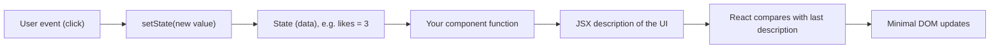
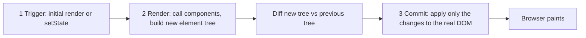
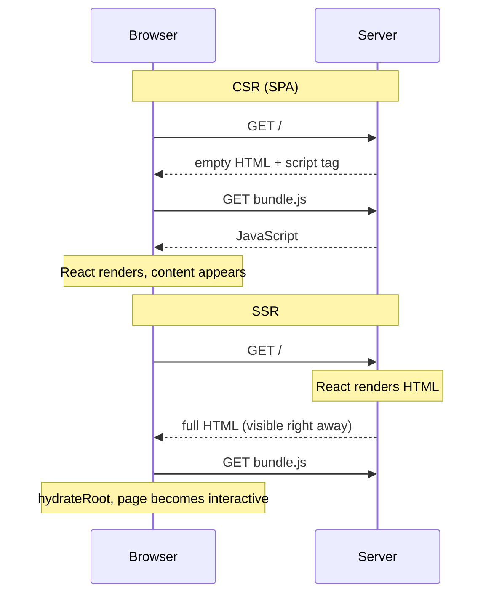
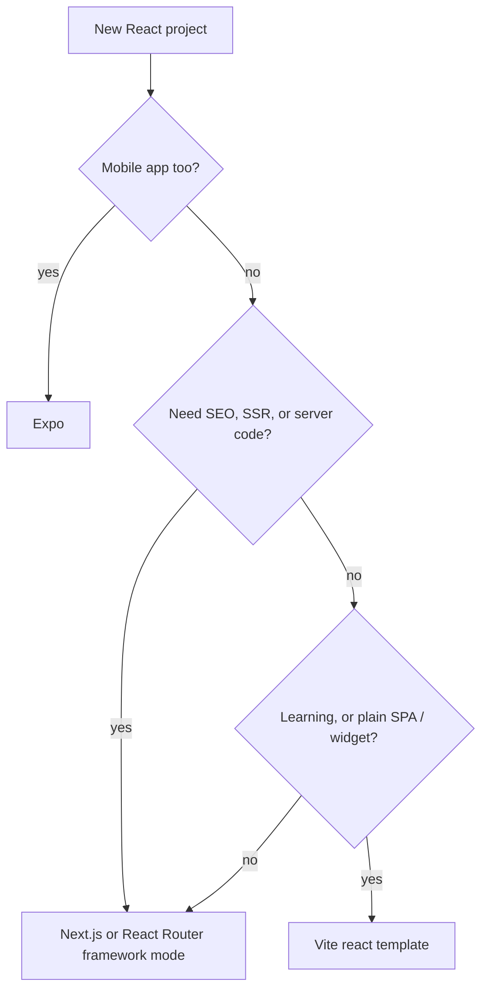

# Chapter 1 — Why React, and Setting Up

What problem React solves, how it updates the screen, and how to start a project — plus the JSX rules every later chapter assumes.

All code is in [`code/`](code/), run with **React 19.3** (current as of September 2026) on Node 24 (**Node.js** = a runtime that runs JavaScript outside the browser). `.jsx` files are **compiled** (translated to plain JavaScript) by **esbuild** (a fast compiler/bundler), rendered into **jsdom** (a browser-like DOM inside Node), and driven with `@testing-library/react` (clicks buttons, reads what a user sees). Run everything with `bash tools_run_js.sh react` from the repository root.

---

## 1.1 What React is

### What it is
**React** is a JavaScript **library** (ready-made code that *your* program calls) for building **user interfaces** out of **components**. A *component* is a JavaScript function that returns a description of a piece of screen — a button, a card, a whole page. Small components combine into bigger ones.

| Term | Meaning |
|---|---|
| **DOM** (Document Object Model) | The browser's live tree of objects for the page (`<div>`, `<button>` …). Changing it changes what you see. |
| **Component** | A function whose name starts with a capital letter and that returns JSX. |
| **JSX** | HTML-like syntax inside JavaScript (`<h1>Hi</h1>`) that compiles to plain function calls (§1.8). |
| **Props** | Inputs passed to a component, like function arguments (Chapter 2). |
| **State** | Data a component remembers between renders, e.g. "how many likes" (Chapter 3). |
| **Render** | React calling your component to find out what the UI should look like. |
| **Hook** | A function starting with `use` (e.g. `useState`) that lets a component use React features. |

### Library, not framework
React does one job: turn components + data into UI and keep it up to date. Routing (which page for which URL), data fetching and **build tooling** (turning source files into optimised browser files) come from other **packages** (installable code bundles, usually from npm) or from a **framework** built on React — a fuller toolkit that sets your app's structure and calls *your* code (Next.js, React Router, Expo — §1.5).

| Package | What it does |
|---|---|
| `react` | Components, JSX runtime, Hooks — platform independent |
| `react-dom` | Renders React to a browser DOM (`react-dom/client`) or to HTML strings/streams on a server (`react-dom/server`) |
| `react-native` | Renders the same kind of components to native iOS/Android views (separate project) |

### A short history
| Year | Event |
|---|---|
| 2011–2012 | Jordan Walke builds React at Facebook; it runs the News Feed, then Instagram. |
| May 2013 | Open-sourced at JSConf US. JSX was controversial ("HTML in my JavaScript?"). |
| 2015 | React Native brings the model to mobile apps. |
| Feb 2019 | React 16.8 introduces **Hooks**; function components become standard. |
| Mar 2022 | React 18: concurrent rendering (React can pause and resume rendering) and automatic batching (several state updates → one re-render). |
| Dec 5, 2024 | **React 19**: Actions, `useActionState`, `useOptimistic`, `use`, `ref` as a normal prop, Server Components stable. |
| Feb 14, 2025 | Create React App (CRA) deprecated for new apps. |
| Oct 2025 | React 19.2; React Compiler 1.0 (automatic **memoization** — reusing a computed result while inputs are unchanged); Meta announces React will move to an independent React Foundation hosted by the Linux Foundation. |
| Sep 9, 2026 | React 19.3 (`<ViewTransition>`, refs on `<Fragment>`) — the version used in this book. |

### Why it matters
- **Reusable pieces** — a `<Button>` written once, used in 200 places, fixed in one file.
- **Predictable updates** — describe the UI for the current data; React keeps the screen in sync (§1.2).
- **Huge ecosystem** (routers, forms, component kits, testing) and jobs; used by Meta (Facebook, Instagram, WhatsApp Web, Threads), Netflix, Airbnb, Discord, Shopify.
- **Many targets** — browser, server HTML (SSR, §1.4), mobile (React Native), even terminals and PDFs via community **renderers**.

### When not to use it
Mostly static sites (blog, docs, landing page) → plain HTML/CSS or a static-site generator plus a sprinkle of JS; a tiny widget on a server-rendered page → vanilla JS; hard JS-size limits (slow devices/networks) → server-rendered HTML with minimal JS. React's runtime (react + react-dom) adds roughly 60–70 KB of **gzipped** (compressed for transfer) JavaScript — Figure 1.1's whole **bundle** (the combined JS file built from your code and packages) is 69 KB gzipped. Small for an app, large for a single dropdown.

### Common mistakes
- Thinking React *is* the whole app — you still need routing, data fetching and a build tool, which is why react.dev recommends starting with a framework (§1.5).
- Learning from old tutorials: class components (the pre-2019 class-based style), `componentDidMount` (a class method that ran after the component appeared) and CRA are legacy. This book uses function components and Hooks only.

### TL;DR
React = a UI library: components (functions returning JSX) + React DOM to put them in the browser. Routing, data and build come from the ecosystem or a framework.

---

## 1.2 Declarative UI

### What it is
- **Imperative**: step-by-step commands. "Find the label, set its text to 3 likes; find the button; if likes ≥ 3 change its text to Popular!"
- **Declarative**: describe the *result* for any data. "The label says *N like(s)*; the button says *Popular!* when N ≥ 3." React works out the steps — like telling a taxi "the station" rather than every turn.

The core idea is **UI = f(state)**: the screen is a function of the current data. When data changes, React calls your function again and updates the page to match.



### The problem it solves
Imperatively, every **event handler** (function run on a click, key press…) must update *every* piece of screen that depends on the changed data; forget one line and the screen is inconsistent, and bugs grow with (state × places-that-show-it).

### How it works — the same button both ways
`code/01_imperative_vs_declarative.jsx`

```jsx
// ---- Imperative: YOU write every step that changes the page ----
let likes = 0;
const btn = document.createElement('button');
const label = document.createElement('span');
label.textContent = 'No likes yet';
btn.textContent = 'Like';
btn.addEventListener('click', () => {
  likes++;                                            // 1. change the data
  label.textContent = `${likes} like(s)`;             // 2. remember to update the label
  btn.textContent = likes >= 3 ? 'Popular!' : 'Like'; // 3. ...and the button
});

// ---- Declarative: you describe WHAT the UI looks like for a given state ----
function LikeButton() {
  const [likes, setLikes] = useState(0);
  return (
    <div>
      <button onClick={() => setLikes(likes + 1)}>{likes >= 3 ? 'Popular!' : 'Like'}</button>{' '}
      <span>{likes === 0 ? 'No likes yet' : `${likes} like(s)`}</span>
    </div>
  );
}
// ... both are clicked three times, then printed
```

Output:
```
imperative: <button>Popular!</button> <span>3 like(s)</span>
declarative: <div><button>Popular!</button> <span>3 like(s)</span></div>
```

Same HTML; the difference is *where the knowledge lives*: the React handler only changes data (`setLikes`) and the JSX alone decides what is shown. (`useState`: [Chapter 3](../03-state-and-events/README.md).)

### Trade-offs
| | Imperative DOM code | Declarative React |
|---|---|---|
| Small widget | Shortest code, no dependency | Library + build-step overhead |
| Growing UI | Handlers get tangled; easy to forget an update | Each piece described once; scales well |
| Performance | You can hand-optimise every step | React does diffing work; fast enough for almost all UIs, with tools for hot spots |
| Debugging | Trace which handler changed what | Inspect state and props in React DevTools (§1.5) |

### In the interview
**30-second answer:** "React is declarative: I describe what the UI should look like for the current state, and React works out the DOM operations. When state changes, React re-runs my component, compares the new output with the previous one, and applies only the differences. That removes a whole class of bugs where some part of the screen isn't updated."

- *Is React fully declarative?* — The UI description is. Event handlers ("on click, set state") and escape hatches — refs (hold a value or DOM node without re-rendering) and Effects (code run after rendering to sync with something outside React) (Chapter 5) — are imperative.
- *What does UI = f(state) mean?* — Same state and props → same JSX; the screen is derived from data, not edited by hand.

### TL;DR
Imperative = list the steps; declarative = describe the result. React components describe the result for the current state and React applies the steps.

---

## 1.3 Rendering, the virtual DOM and reconciliation (brief)

### What it is
- A **React element** is a small, plain object describing one piece of UI: `{ type: 'h1', props: { children: 'Hi' } }`. JSX creates these (§1.8).
- The element tree your components return is often called the **virtual DOM**: a lightweight *description* of the page in JS memory, not the real DOM. (react.dev talks about the *render tree*, but interviews say "virtual DOM".)
- **Reconciliation** is comparing the new element tree with the previous one to find the smallest set of real DOM changes.

### How it works — three steps on every update
1. **Trigger** — the initial `root.render(<App />)`, or a state update (`setLikes`).
2. **Render** — React *calls your components* to get a new element tree and diffs it with the previous one. Pure calculation; nothing on screen changes.
3. **Commit** — React applies only the differences to the real DOM. The browser then paints.



A general tree diff is roughly O(n³) (**Big-O notation** describes how work grows with input size *n*: 1,000 elements could need ~a billion steps). React's **heuristics** (fast rules of thumb that are almost always right) make it about O(n) — work grows in step with the number of elements:

| Rule | Consequence |
|---|---|
| **Different type at the same position** (`<div>` → `<section>`, or `<Profile>` → `<Settings>`) | React throws away the old subtree (DOM *and* component state) and builds a new one. |
| **Same type at the same position** | React keeps the DOM node and state, and updates only changed attributes/text. |
| **Lists** | Items are matched by their `key` prop, so React can tell "moved" from "changed" ([§2.8](../02-components-and-props/README.md#28-rendering-lists-and-keys)). |

Since React 16 the engine is **Fiber**: it splits rendering into small units that can pause and resume (the basis of React 18+ *concurrent rendering*).

### Code — watching what React actually changes
`code/04_reconciliation.jsx` renders a clock, records every DOM **mutation** with a `MutationObserver` (a browser API that reports DOM changes), then renders again with a new `time` prop.

```jsx
function Clock({ time }) {
  return (
    <div className="clock">
      <h1>Hello, world!</h1>
      <p>It is {time}.</p>
    </div>
  );
}
await act(() => root.render(<Clock time="10:00:00" />));
// ... start observing, then:
await act(() => root.render(<Clock time="10:00:01" />));
```

Output:
```
DOM changes made by React:
  characterData on <p>: "10:00:00" -> "10:00:01"
same <h1> node kept? true
same <p> node kept?  true
HTML now: <div class="clock"><h1>Hello, world!</h1><p>It is 10:00:01.</p></div>
```

The whole `Clock` function ran again, yet exactly **one** text node changed. (`act()` from `react` makes React finish pending work before the next line; used only in tests and scripts.)

### Common mistakes
- "Re-render = React rewrites the DOM." No: *re-render* means your function is called again; the DOM changes only where output differs.
- "The virtual DOM makes React faster than hand-written DOM code." Not necessarily — perfectly hand-tuned code does less work. The benefit is *good enough* performance automatically, with declarative code.
- Defining a component *inside* another: a new function (= new *type*) every render, so state resets (§1.7).

### In the interview
**30-second answer:** "When state changes, React re-renders: it calls the components to build a new tree of elements, diffs it against the previous tree, and commits only the differences to the DOM. The diff is O(n) thanks to two heuristics — elements of different types produce different trees, and keys identify list items across renders."

- *Render vs commit?* — Render = calling components to compute the new tree (pure, may be repeated or discarded); commit = mutating the DOM and running layout effects/refs (layout effects run after DOM changes but before paint; Chapter 5).
- *After `setState`, which functions run?* — The owning component and, by default, all its children; only changed DOM nodes are updated.
- *Why can changing a wrapper from `<div>` to `<section>` lose input text?* — Different type at the same position → subtree destroyed and recreated, including state.

### TL;DR
Trigger → render (call components, build element tree) → commit (apply minimal DOM diff). Same type at same position = keep and update; different type = replace; lists matched by key.

---

## 1.4 SPA vs MPA vs SSR (and SSG)

### What it is
Strategies for **where and when HTML is produced**.

| Term | Full name | How the page is produced |
|---|---|---|
| **MPA** | Multi-Page Application | Every navigation asks the server for a new HTML page (classic PHP/Rails/Django). |
| **SPA** | Single-Page Application | One almost-empty HTML file + a JS bundle; JavaScript builds every screen in the browser and navigates without full reloads. Also called **CSR** — client-side rendering. |
| **SSR** | Server-Side Rendering | The server runs your components per request and sends finished HTML; the browser then **hydrates** it (React attaches event handlers to the existing HTML). |
| **SSG** | Static Site Generation | Like SSR but once at **build time**; HTML files are served from a CDN (Content Delivery Network — servers worldwide that **cache** copies close to users). |

### How it works — see the difference in HTML
`code/05_csr_vs_ssr.jsx` renders one component both ways.

```jsx
function App() {
  const [n, setN] = useState(0);
  return <main><h1>Shop</h1><button onClick={() => setN(n + 1)}>Cart: {n}</button></main>;
}
const html = renderToString(<App />);                  // SSR: component -> HTML string
document.getElementById('root').innerHTML = html;      // what the browser receives
button.click();                                        // before hydration
await act(() => { hydrateRoot(document.getElementById('root'), <App />); });
await act(() => button.click());                       // after hydration
```

Output:
```
CSR first HTML : <div id="root"></div>  (+ <script src="bundle.js">)
SSR first HTML : <div id="root"><main><h1>Shop</h1><button>Cart: <!-- -->0</button></main></div>
click before hydration -> Cart: 0 (nothing happens yet)
click after hydration  -> Cart: 1 | same DOM node reused: true
```

CSR's first HTML is empty — users and search-engine **crawlers** see nothing until JS runs. SSR's has the content (`<!-- -->` separates adjacent text pieces so hydration can match them), but it is *not interactive* until hydration finishes, and hydration **reuses** the server's DOM nodes.



### Trade-offs
| | MPA | SPA / CSR | SSR | SSG |
|---|---|---|---|---|
| First content shown | Fast | Slow (wait for JS) | Fast | Fastest (from CDN) |
| Navigation between pages | Full reload | Instant, app-like | App-like after hydration | App-like after hydration |
| SEO (search-engine optimisation) / link previews | Good | Weaker (crawlers must run JS) | Good | Good |
| Server needed | Yes | No — static hosting | Yes (Node or edge runtime near the user) | No — static hosting |
| Fresh per-request data | Yes | Via API calls | Yes | Only at build (or revalidation — rebuilding a page after a set time) |
| Typical examples | Wikipedia, classic admin tools | Figma-style tools, dashboards behind login | E-commerce, news | Docs, blogs, marketing pages |

Modern frameworks mix these **per route**: static marketing page, server-rendered product page, client-rendered dashboard. React 19 **Server Components** (run only on the server, send no JS) go further — [Chapter 13](../13-server-rendering-and-frameworks/README.md). (Servers, CDNs and caching in general: [System Design Fundamentals](../../../system-design-patterns/modules/00-system-design-fundamentals/README.md).)

**When not to use SSR:** an internal tool behind a login where SEO does not matter and the tab stays open all day (a plain SPA is simpler and cheaper to host), or when you cannot run a server (choose CSR or SSG).

### Common mistakes
- Using browser-only APIs (`window`, `localStorage`) during render in an SSR app: the server has no `window`, so it crashes or the HTML differs from the client (a **hydration mismatch**).
- Assuming SSR makes the page interactive sooner. It makes content *visible* sooner; interactivity still waits for JS + hydration.

### In the interview
**30-second answer:** "An SPA ships an empty shell and renders everything in the browser — simple hosting, app-like navigation, but slow first paint and weaker SEO. SSR renders HTML on the server per request, so content appears immediately, then hydration attaches React to it. SSG does the same at build time for pages that rarely change. Frameworks like Next.js let you choose per route."

- *What is hydration?* — React running in the browser over server-generated HTML, reusing the existing DOM and attaching event handlers and state.
- *What causes a hydration mismatch?* — Different output on server and client, e.g. `Date.now()`, `Math.random()`, or `window` checks during render.

### TL;DR
MPA = server page per navigation; SPA/CSR = JS builds everything in the browser; SSR = server HTML + hydration; SSG = HTML at build time. Pick per route.

---

## 1.5 Setting up a React project

### What you need first
- **Node.js** current LTS — Long-Term Support release (Vite needs 20.19+ or 22.12+; check `node -v`) — runs the dev server and build tools; your React code still runs in the browser.
- **npm** (ships with Node) or pnpm / yarn / bun — installs packages listed in `package.json` (check `npm -v`).
- An editor (usually VS Code) with ESLint (a **linter** that flags likely bugs) and Prettier (formatter).
- **React Developer Tools** extension (Chrome, Firefox, Edge) — inspect the component tree, props and state; profile renders.

### Option A — start with a framework (react.dev's recommendation for new apps)
A framework bundles React with routing, data loading, server rendering and a build pipeline.

| Framework | Command | Good for |
|---|---|---|
| **Next.js** (App Router) | `npx create-next-app@latest` | Full-stack web apps, SSR/SSG, Server Components; maintained by Vercel |
| **React Router** v8 (framework mode) | `npx create-react-router@latest` | Apps that grow from an SPA to full stack; built on Vite, maintained by Shopify |
| **Expo** | `npx create-expo-app@latest` | iOS, Android and web from one codebase (React Native) |

react.dev also lists TanStack Start and RedwoodSDK. `npx` runs a package's command once without a global install; `@latest` picks the newest version.

### Option B — build from scratch with Vite
For a plain client-side app (learning, dashboards, embedding in an existing site) where you add routing and data fetching yourself. React docs list **Vite**, **Parcel** and **Rsbuild**; Vite is the most common. (`react-ts` uses **TypeScript** — JavaScript plus type annotations checked before the code runs.)

```bash
# (not run here — needs network) create, install, start
npm create vite@latest my-react-app -- --template react   # or react-ts for TypeScript
cd my-react-app
npm install          # download react, react-dom, vite, plugins into node_modules/
npm run dev          # start the dev server -> http://localhost:5173
```

| Command | What happens |
|---|---|
| `npm create vite@latest …` | Runs the `create-vite` scaffolder, which copies a template. The extra `--` passes `--template react` through npm. Templates include `react`, `react-ts`, and `react-compiler` / `react-compiler-ts` (pre-configured React Compiler). |
| `npm install` | Installs dependencies from `package.json` into `node_modules/`, writes `package-lock.json` (the **lockfile**: exact versions). |
| `npm run dev` | Starts Vite's **dev server**: serves native ES modules (files using `import`/`export`, loaded directly by the browser), compiles JSX on the fly, and uses **HMR** (Hot Module Replacement — edits appear in milliseconds without losing component state). |
| `npm run build` | Production bundle in `dist/`: minified, tree-shaken (unused code removed), hashed file names (change with content, so browsers cache safely). |
| `npm run preview` | Serves `dist/` locally to test the production build. |

Equivalents: `pnpm create vite`, `yarn create vite`, `bun create vite`.

### What about Create React App?
**CRA** was the standard starter from 2016. It was deprecated for new apps on **14 February 2025** (maintenance mode only): no active maintainers, slow (webpack-based), and no path to routing, data fetching or SSR. Tutorials using `npx create-react-app` are outdated.

### Adding React to an existing page
Add a build step that bundles your component, put `<div id="cart-widget"></div>` in the HTML, and call `createRoot(document.getElementById('cart-widget')).render(<Cart />)`. A page can have several roots.

### Choosing


### How this book runs React without a browser
Examples are compiled with esbuild (the same kind of compiler Vite uses; Vite 8 uses Oxc, earlier versions esbuild), rendered into jsdom and driven with Testing Library; screenshots come from the same code run in **headless** Chrome (no visible window, script-controlled). Real projects test React the same way (Vitest/Jest + jsdom + Testing Library — [Chapter 12](../12-testing-react/README.md)).

### Common mistakes
- Running `npm run dev` outside the project folder (no `package.json` → "Missing script: dev").
- Double-clicking `index.html`: it loads `/src/main.jsx`, which a browser cannot run directly; use the dev server or build first.
- Committing `node_modules/` to git; commit `package.json` and the lockfile instead.
- Mixing package managers (`npm` and `yarn` lockfiles in one repo).

### In the interview
**30-second answer:** "For a new production app, react.dev recommends a framework — Next.js, React Router, or Expo for native — because you get routing, data loading and SSR out of the box. For a pure client-side app or learning, I'd use Vite with the react or react-ts template. CRA is deprecated since February 2025."

- *Why Vite over CRA/webpack?* — The dev server serves native ES modules and compiles only requested files, so startup and HMR stay fast as the app grows; production is still fully bundled. CRA bundled everything with webpack before showing anything.
- *What is HMR?* — The dev server swaps the changed module in the running page, keeping state, instead of reloading.

### TL;DR
Framework (Next.js / React Router / Expo) for real apps; `npm create vite@latest app -- --template react` for SPAs and learning; CRA is deprecated. `npm run dev` / `build` / `preview`.

---

## 1.6 Project structure

### What it is
A new Vite React project (current `template-react`; the linter config name varies by version):

```
my-react-app/
├── index.html          ← the single HTML page; contains <div id="root"> and loads src/main.jsx
├── package.json        ← name, scripts (dev/build/preview/lint), dependencies
├── package-lock.json   ← exact installed versions (after npm install)
├── vite.config.js      ← Vite settings; registers @vitejs/plugin-react (JSX, Fast Refresh)
├── public/             ← files copied as-is (favicon, robots.txt), served from /
├── src/
│   ├── main.jsx        ← entry point: finds #root and renders <App />
│   ├── App.jsx         ← the top-level component you edit first
│   ├── App.css, index.css
│   └── assets/         ← images imported from code (get hashed file names on build)
└── node_modules/       ← installed packages (never edit, never commit)
```

### How it works — from `index.html` to pixels
1. The browser loads `index.html`: an empty `<div id="root"></div>` and `<script type="module" src="/src/main.jsx">`.
2. `main.jsx` calls **`createRoot(domNode)`**, creating a React **root** — React's handle on that element.
3. `root.render(<App />)` renders your tree into it; React now owns everything inside `#root`.
4. **`<StrictMode>`** (development only) calls each component twice per render and runs every Effect's setup → cleanup → setup once extra on **mount** (first appearance), exposing **impure** code (changes outside things, or differs for the same input) and missing **cleanups** early ([§2.5](../02-components-and-props/README.md#25-pure-components), Chapter 5). No effect in production.

`code/vite-app/src/main.jsx` (same shape as the template):
```jsx
import { StrictMode } from 'react';
import { createRoot } from 'react-dom/client';
import './index.css';
import App from './App.jsx';

createRoot(document.getElementById('root')).render(
  <StrictMode>
    <App />
  </StrictMode>,
);
```

`code/vite-app/src/App.jsx`:
```jsx
import { useState } from 'react';

function Welcome({ name }) {
  return <h1>Welcome to React, {name}!</h1>;
}

export default function App() {
  const [count, setCount] = useState(0);
  return (
    <div className="card">
      <Welcome name="Sam" />
      <p>This page was built from components.</p>
      <button onClick={() => setCount((c) => c + 1)}>count is {count}</button>
    </div>
  );
}
```

`code/06_first_app.jsx` mounts the **same** `App` into jsdom exactly as `main.jsx` does (`createRoot` + `<StrictMode>`), then clicks twice. Output:
```
after first render : Welcome to React, Sam!This page was built from components.count is 0
after two clicks   : count is 2
```

The same `main.jsx` bundled and opened in Chrome ([`code/first-app.html`](code/first-app.html)):


*Figure 1.1 — `App` from `vite-app/src` running in a real browser.*

### `package.json` in brief
```json
{
  "type": "module",
  "scripts": { "dev": "vite", "build": "vite build", "preview": "vite preview" },
  "dependencies": { "react": "^19.x", "react-dom": "^19.x" },
  "devDependencies": { "vite": "…", "@vitejs/plugin-react": "…" }
}
```
`dependencies` ship in your app; `devDependencies` are only needed to build it. `^19.x` = "any 19.* version" (semantic versioning MAJOR.MINOR.PATCH, where only a MAJOR bump may break you — see the JavaScript book, `../../../javascript/chapters/10-modules-and-tooling/README.md`).

### How to grow the structure
Start flat; add folders as patterns appear — e.g. `src/components/`, `src/features/<feature>/` (components + hooks + tests), `src/hooks/`, `src/lib/` (non-React helpers); one exported component per file ([Chapter 14](../14-patterns-and-architecture/README.md)).

### Common mistakes
- Calling `createRoot` twice on the same element (React warns); create once, call `render` as needed.
- Editing DOM inside `#root` by hand (`innerHTML = …`) — React overwrites it or gets confused.
- Removing `<StrictMode>` to "fix" doubled console logs; the doubles reveal real bugs.

### TL;DR
`index.html` (#root) → `main.jsx` (`createRoot(...).render(<StrictMode><App/></StrictMode>)`) → `App.jsx`. `public/` is copied as-is; `node_modules/` is never committed; StrictMode checks are dev-only.

---

## 1.7 Your first component

### What it is
A **component** is a JavaScript function that (1) has a name starting with a **capital letter** (`Profile`, not `profile`) and (2) returns **JSX** (or `null` to render nothing).

```jsx
function Profile() {
  return ;
}

export default function Gallery() {
  return (
    <section>
      <h1>Amazing scientists</h1>
      <Profile />
      <Profile />
      <Profile />
    </section>
  );
}
```
`Gallery` is a **parent** rendering three **child** `Profile`s; together they form the **component tree** that React DevTools shows. (Runnable version: `01_function_components.jsx`, [§2.1](../02-components-and-props/README.md#21-function-components).)

**Why the capital letter?** JSX uses it to decide the `type`: lowercase `<section>` → the string `'section'` (an HTML tag); `<Profile />` → the variable `Profile`. A lowercase component is treated as an unknown HTML tag.

### Exporting and importing
| Style | Export | Import |
|---|---|---|
| **Default** (one per file) | `export default function Button() {}` | `import Button from './Button.jsx'` (any name) |
| **Named** (many per file) | `export function Button() {}` | `import { Button } from './Button.jsx'` (exact name) |

Teams usually pick one style; named exports make renames and editor auto-imports more reliable.

### Rules
- **Define components at module top level, never inside another component** — an inner definition is a new function (= new *type*) every render, so React destroys its state and DOM (§1.3).
- **Be pure while rendering** ([§2.5](../02-components-and-props/README.md#25-pure-components)); keep components small (extract any JSX with its own meaning).

### Common mistakes
| Mistake | Symptom | Fix |
|---|---|---|
| `function profile()` (lowercase) | Renders `<profile>` tag, nothing shown | Capitalise |
| Missing `return` or a line break after `return` | Renders nothing (`return` alone returns `undefined`) | Wrap multi-line JSX in `( … )` starting on the `return` line |
| Nested component definitions | Inputs lose focus on every keystroke | Move the inner function to module level |
| Calling a component as a function `{Profile()}` | Hooks inside break rules, no own identity in the tree | Use `<Profile />` |

### TL;DR
Component = capitalised function returning JSX, defined at top level, exported default or named, used as `<Name />`.

---

## 1.8 JSX

### What it is
**JSX** (JavaScript XML) lets you write markup inside JavaScript. It is *not* HTML and not a string: the compiler (esbuild, Babel, SWC, Oxc) turns each tag into a function call returning a React element object. React works without JSX, but almost nobody does.

`code/02_jsx_is_javascript.jsx`:
```jsx
import { createElement, isValidElement } from 'react';

const fromJsx = <h1 className="title">Hello, {'Ada'}!</h1>;
const byHand = createElement('h1', { className: 'title' }, 'Hello, ', 'Ada', '!');

const show = (el) => JSON.stringify({ type: el.type, props: el.props });
console.log('JSX         ->', show(fromJsx));
console.log('createElement->', show(byHand));
console.log('is a React element?', isValidElement(fromJsx));
console.log('typeof element:', typeof fromJsx, '| frozen (dev):', Object.isFrozen(fromJsx));
```

Output:
```
JSX         -> {"type":"h1","props":{"className":"title","children":["Hello, ","Ada","!"]}}
createElement-> {"type":"h1","props":{"className":"title","children":["Hello, ","Ada","!"]}}
is a React element? true
typeof element: object | frozen (dev): true
```

JSX is a nicer `createElement(type, props, ...children)`. Since React 17 the compiler uses the **automatic JSX runtime** (inserts `import { jsx } from 'react/jsx-runtime'`), so modern files need no `import React from 'react'`. Elements are **immutable** (frozen in development): to change the UI you render a new element.

### The rules
`code/03_jsx_rules.jsx`:
```jsx
const user = { name: 'Grace Hopper', avatar: 'https://i.imgur.com/yXOvdOSs.jpg', online: true };
const size = 64;

function ProfileHeader() {
  // Rule 1: return ONE root element. A Fragment (<>...</>) groups without adding a DOM node.
  return (
    <>
      {/* Rule 2: attributes are camelCase; class -> className, for -> htmlFor */}
      <label htmlFor="bio" className="label">Bio</label>
      {/* Rule 3: every tag must be closed, even  and <input /> */}
      
      <input id="bio" defaultValue="Wrote the first compiler" />
      {/* Rule 4: curly braces hold any JavaScript EXPRESSION */}
      <h2>{user.name.toUpperCase()} ({user.online ? 'online' : 'offline'})</h2>
      {/* Rule 5: style takes an object; property names are camelCase */}
      <p style={{ backgroundColor: 'black', color: 'pink', fontSize: 14 }}>{2 + 3} papers</p>
    </>
  );
}
```

Output (the HTML React produced):
```
<label for="bio" class="label">Bio</label>

<input id="bio" value="Wrote the first compiler">
<h2>GRACE HOPPER (online)</h2>
<p style="background-color: black; color: pink; font-size: 14px;">5 papers</p>
```

| # | Rule | Why | Example |
|---|---|---|---|
| 1 | **One root element** | A function returns one value; JSX becomes one object | Wrap in `<div>` or a **Fragment** `<>…</>` (no extra DOM node) |
| 2 | **Close every tag** | JSX is stricter than HTML | `<br />`, ``, `<li>…</li>` |
| 3 | **camelCase attributes** | Attributes become JS object keys; `class`/`for` are reserved words | `className`, `htmlFor`, `onClick`, `tabIndex`, `strokeWidth`. `aria-*` and `data-*` keep dashes |
| 4 | **`{}` for JavaScript expressions** | Anything producing a value: variables, calls, ternaries, `&&`, `.map()` | `{user.name}`, `{count * 2}`, `{formatDate(d)}` |
| 5 | **`style` is an object** | `{{ … }}` = braces for JS + an object literal | `style={{ fontSize: 14 }}` — numbers get `px` for most properties |

Details that trip beginners:
- **Quotes vs braces:** `alt="text"` is a string literal; `alt={name}` a JS value. `src="{avatar}"` is the literal text `{avatar}`.
- **Expressions, not statements:** no `if`/`for`/`const` inside `{}`; use a ternary, `&&`, `.map()`, or a variable computed above the `return` ([§2.7](../02-components-and-props/README.md#27-conditional-rendering)).
- **Comments:** `{/* like this */}`.
- **What renders nothing:** `null`, `undefined`, `true`, `false`, `''`. But `0` and `NaN` *do* render (the `&&` trap, §2.7).
- **Objects cannot be rendered:** `{user}` throws "Objects are not valid as a React child" — render `{user.name}`. Arrays of elements are fine.
- **Keyed fragments:** `<>` takes no props; for a `key` in a list use `<Fragment key={id}>` (imported from `react`).
- **Safety:** text in `{}` is **escaped** (`<` becomes harmless text), so `{"<script>…"}` shows as text — protection against XSS (cross-site scripting). Raw HTML needs `dangerouslySetInnerHTML={{ __html: … }}`; use only with **sanitised** content.
- `defaultValue` sets an input's *initial* value without React controlling it; `value` makes it a **controlled input** (value always from state) ([§3.9](../03-state-and-events/README.md#39-controlled-inputs-basics)).

### Trade-offs
vs template languages (Vue/Angular/Svelte): JSX is full JavaScript inside markup (no new loop/if syntax) and type-checks with TypeScript like any code; directives (`v-for`, `@if`) are more restricted but easier for designers to read and need dedicated tooling. Both need a compile step in practice.

### In the interview
**30-second answer:** "JSX is syntax sugar: the compiler turns `<h1 className='x'>Hi</h1>` into a `jsx('h1', {className:'x', children:'Hi'})` call that returns a plain, immutable element object. The rules come from that: one root because a function returns one value, `className` because `class` is reserved, braces for expressions only, and style as an object."

- *What does `<Card title="x" />` compile to?* — `jsx(Card, { title: 'x' })`, returning `{ type: Card, props: { title: 'x' } }`.
- *Why no `import React` any more?* — The automatic JSX runtime (React 17+) imports `jsx` from `react/jsx-runtime` for you.
- *Is JSX safe from XSS?* — Values in braces are escaped; the risks are `dangerouslySetInnerHTML`, user-supplied URLs in `href` (React 19 replaces a `javascript:` URL with one that throws "React has blocked a javascript: URL as a security precaution"; still validate URLs) and third-party HTML.
- *`<div class="box">`?* — Must be `className`; React still sets it but logs "Invalid DOM property `class`. Did you mean `className`?".
- *Fragment vs div?* — A fragment groups children without an extra DOM node, keeping flex/grid/table layouts and HTML validity intact.

### TL;DR
JSX = `createElement` calls → immutable element objects. One root (use `<>`), close all tags, camelCase attributes (`className`, `htmlFor`), `{expressions}`, `style={{…}}`, text is auto-escaped.

---

## Chapter 1 TL;DR

| Idea | Remember |
|---|---|
| React | Library for UIs built from components; `react-dom` renders to the browser |
| Declarative | Describe UI for the current state; React applies the DOM changes |
| Update cycle | Trigger → render (call components) → commit (minimal DOM diff) |
| Diff rules | Same type = keep + update; different type = replace; lists by key |
| Rendering strategies | CSR/SPA, SSR (+ hydration), SSG, MPA — frameworks mix them per route |
| Setup | Framework (Next.js / React Router / Expo) or Vite (`--template react`); CRA deprecated Feb 2025 |
| Entry point | `createRoot(document.getElementById('root')).render(<StrictMode><App/></StrictMode>)` |
| Components | Capitalised functions returning JSX, defined at module top level |
| JSX | One root, closed tags, `className`, `{expression}`, `style={{}}`, fragments |

Next: [Chapter 2 — Components and Props](../02-components-and-props/README.md).
