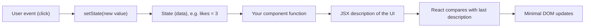
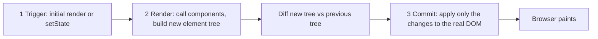
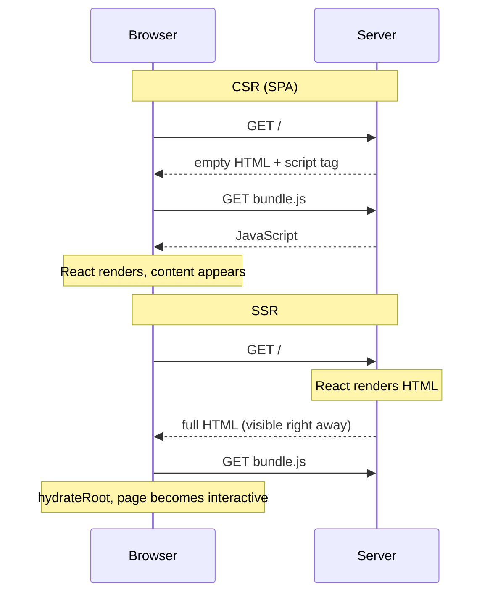
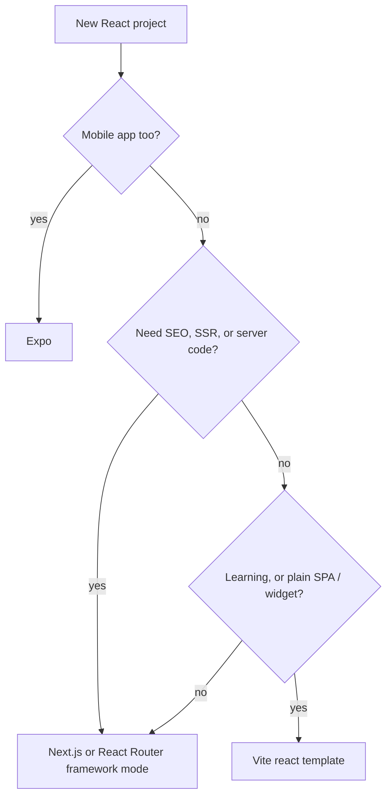

# Chapter 1 — Why React, and Setting Up

This chapter answers three questions before you write any serious React: *what problem does React solve*, *how does it update the screen*, and *how do I start a project*. By the end you will have read and run a first app, and you will know the handful of JSX rules that every later chapter assumes.

**What you'll learn**

| # | Topic | You will be able to… |
|---|---|---|
| 1.1 | What React is | explain React in one minute, and say what it is *not* |
| 1.2 | Declarative UI | contrast "describe the result" with "list the DOM steps" |
| 1.3 | Rendering, the virtual DOM and reconciliation | describe render → commit and why React touches only changed nodes |
| 1.4 | SPA vs MPA vs SSR | pick a rendering strategy and name its costs |
| 1.5 | Setting up a project | create an app with a framework or with Vite, and know which to choose |
| 1.6 | Project structure | find your way around `index.html`, `main.jsx`, `App.jsx`, `package.json` |
| 1.7 | Your first component | write, export, import and nest components |
| 1.8 | JSX rules | one root, closed tags, `className`, `{expressions}`, fragments, `style` objects |

All code lives in [`code/`](code/). It was run with **React 19.3** (current as of September 2026) on Node 24 (**Node.js** is a *runtime* — a program that runs JavaScript outside the browser, on your own computer or a server): `.jsx` files are **compiled** (translated into plain JavaScript that can actually run) by **esbuild** (a very fast JavaScript compiler and bundler) and rendered into **jsdom** (a browser-like DOM that runs inside Node), and `@testing-library/react` (a testing helper library) is used to click buttons and read what a user would see. Run everything with `bash tools_run_js.sh react` from the repository root.

---

## 1.1 What React is

### What it is
**React** is a JavaScript **library** (a package of ready-made code that *your* program calls when it needs it) for building **user interfaces** (UIs) out of **components**. A *component* is a JavaScript function that returns a description of a piece of screen — a button, a profile card, a whole page. You combine small components into bigger ones, the way you build a wall out of bricks.

Analogy: think of a restaurant. You (the developer) write the *menu* — for each situation, what the plate should look like. React is the kitchen: it works out how to get from the plate on the table now to the plate described on the menu, and does only the necessary work.

Key vocabulary used for the rest of the book:

| Term | Meaning |
|---|---|
| **DOM** (Document Object Model) | The browser's live tree of objects for the page (`<div>`, `<button>` …). Changing it changes what you see. |
| **Component** | A function whose name starts with a capital letter and that returns JSX. |
| **JSX** | An HTML-like syntax inside JavaScript (`<h1>Hi</h1>`) that compiles to plain function calls (§1.8). |
| **Props** | Inputs passed to a component, like function arguments (Chapter 2). |
| **State** | Data a component remembers between renders, such as "how many likes" (Chapter 3). |
| **Render** | React calling your component to find out what the UI should look like. |
| **Hook** | A function starting with `use` (e.g. `useState`) that lets a component use React features. |

### Library, not framework
React itself handles only one job: turning components + data into UI and keeping it up to date. Routing (which page for which URL), data fetching, and **build tooling** (programs that turn your source files into the optimised files a browser downloads) come from other packages (a **package** is a reusable bundle of code you download and install, usually from the npm registry) or from a **framework** built on React (a framework is a fuller toolkit that sets the overall structure of your app and calls *your* code — the reverse of a library) (Next.js, React Router, Expo — §1.5).

| Package | What it does |
|---|---|
| `react` | Components, JSX runtime, Hooks — platform independent |
| `react-dom` | Renders React to a browser DOM (`react-dom/client`) or to HTML strings/streams on a server (`react-dom/server`) |
| `react-native` | Renders the same kind of components to native iOS/Android views (separate project) |

### A short history
| Year | Event |
|---|---|
| 2011–2012 | Jordan Walke builds React at Facebook; it runs the Facebook News Feed and then Instagram. |
| May 2013 | Open-sourced at JSConf US. JSX was controversial ("HTML in my JavaScript?"). |
| 2015 | React Native brings the model to mobile apps. |
| Feb 2019 | React 16.8 introduces **Hooks**; function components become the standard way to write React. |
| Mar 2022 | React 18: concurrent rendering (React can pause and resume rendering work) and automatic batching (several state updates grouped into one re-render). |
| Dec 5, 2024 | **React 19**: Actions, `useActionState`, `useOptimistic`, `use`, `ref` as a normal prop, Server Components stable. |
| Feb 14, 2025 | Create React App (CRA) deprecated for new apps. |
| Oct 2025 | React 19.2; React Compiler 1.0 (automatic **memoization** — remembering a computed result so it is not recomputed when inputs are unchanged); Meta announces React will move to an independent React Foundation hosted by the Linux Foundation. |
| Sep 9, 2026 | React 19.3 (`<ViewTransition>`, refs on `<Fragment>`) — the version used in this book. |

### Why it matters
- **Reusable pieces.** A `<Button>` written once is used in 200 places; fixing a bug in that one file repairs every place it is used.
- **Predictable updates.** You describe the UI for the current data; React keeps the screen in sync (§1.2).
- **Huge ecosystem.** Routers, form libraries, component kits, testing tools, and jobs. React is used by Meta (Facebook, Instagram, WhatsApp Web, Threads), Netflix, Airbnb, Discord, Shopify, and many others.
- **One mental model, many targets.** Browser (React DOM), server HTML (SSR — server-side rendering, §1.4), mobile (React Native), even terminals and PDFs via community **renderers** (libraries that turn React components into output for one particular target).

### When not to use it
| Situation | Better fit |
|---|---|
| A mostly static site (blog, docs, landing page) with little interactivity | Plain HTML/CSS, or a static-site generator (a tool that builds plain HTML files ahead of time); add a sprinkle of JS |
| A tiny widget on a server-rendered page | Vanilla JS (plain JavaScript, no library) or a very small library |
| Hard limits on JavaScript size (very slow devices/networks) | Server-rendered HTML with minimal JS |

React's runtime (the React code that ships to the browser: react + react-dom) adds roughly 60–70 KB of **gzipped** JavaScript (compressed with gzip, the way servers usually send files) (the Figure 1.1 **bundle** — the single combined JavaScript file built from your code and its packages — React included, is 69 KB gzipped) — small for an app, large for a single dropdown.

### Common mistakes
- Thinking React *is* the whole app. You still need routing, data fetching, and a build tool — which is why react.dev recommends starting with a framework (§1.5).
- Learning old tutorials: class components (the pre-2019 style of writing components as JavaScript classes), `componentDidMount` (a method of those classes that ran after the component appeared on screen), and CRA are legacy. This book uses function components and Hooks only.

### TL;DR
React = a UI library: components (functions returning JSX) + React DOM to put them in the browser. Everything else (routing, data, build) comes from the ecosystem or a framework.

---

## 1.2 Declarative UI

### What it is
There are two ways to tell a computer how the screen should change.

- **Imperative**: you give step-by-step commands. "Find the label. Set its text to 3 likes. Find the button. If likes ≥ 3 change its text to Popular!"
- **Declarative**: you describe the *result* for any given data. "The label says *N like(s)*; the button says *Popular!* when N ≥ 3." A system (React) figures out the steps.

Analogy: a taxi. Imperative = "left, then right, then straight 200 m". Declarative = "take me to the station". You say *where*, the driver works out *how*.

React's core idea is often written as **UI = f(state)**: the screen is a function of the current data. When the data changes, React calls your function again and updates the page to match.



### The problem it solves
In an imperative UI every **event handler** (a function that runs in response to an event such as a click or a key press) must remember *every* piece of screen that depends on the changed data. With three labels, a badge and a disabled button all depending on `likes`, forgetting one line produces an inconsistent screen. Bugs grow with the number of (state × places-that-show-it) combinations. In the declarative version there is only one place — the JSX — that says what each piece looks like.

### How it works — the same button both ways
`code/01_imperative_vs_declarative.jsx`

```jsx
// ---- Imperative: YOU write every step that changes the page ----
let likes = 0;
const btn = document.createElement('button');
const label = document.createElement('span');
label.textContent = 'No likes yet';
btn.textContent = 'Like';
btn.addEventListener('click', () => {
  likes++;                                            // 1. change the data
  label.textContent = `${likes} like(s)`;             // 2. remember to update the label
  btn.textContent = likes >= 3 ? 'Popular!' : 'Like'; // 3. ...and the button
});

// ---- Declarative: you describe WHAT the UI looks like for a given state ----
function LikeButton() {
  const [likes, setLikes] = useState(0);
  return (
    <div>
      <button onClick={() => setLikes(likes + 1)}>{likes >= 3 ? 'Popular!' : 'Like'}</button>{' '}
      <span>{likes === 0 ? 'No likes yet' : `${likes} like(s)`}</span>
    </div>
  );
}
// ... both are clicked three times, then printed
```

Output:
```
imperative: <button>Popular!</button> <span>3 like(s)</span>
declarative: <div><button>Popular!</button> <span>3 like(s)</span></div>
```

Both give the same HTML. The difference is *where the knowledge lives*: in the imperative version the click handler knows about the label and the button; in React the click handler only changes data (`setLikes`), and the JSX alone decides what is shown. `useState` is explained fully in [Chapter 3](../03-state-and-events/README.md).

### Trade-offs
| | Imperative DOM code | Declarative React |
|---|---|---|
| Small widget | Shortest code, no dependency (extra package) | Overhead of a library and build step (a compile command run before deploying) |
| Growing UI | Handlers get tangled; easy to forget an update | Each piece described once; scales well |
| Performance | You can hand-optimise every step | React does diffing work; fast enough for almost all UIs, with tools for hot spots |
| Debugging | Trace which handler changed what | Inspect state and props in React DevTools (a browser extension, §1.5) |

### In the interview
**30-second answer:** "React is declarative: I describe what the UI should look like for the current state, and React works out the DOM operations. When state changes, React re-runs my component, compares the new output with the previous one, and applies only the differences. That removes a whole class of bugs where some part of the screen isn't updated."

- *Is React fully declarative?* — The UI description is. You still write imperative code in event handlers (e.g. "on click, set state") and escape hatches such as refs (a way to hold a value or a DOM node without re-rendering) and Effects (code that runs after rendering to sync with something outside React) (Chapter 5).
- *What does UI = f(state) mean?* — Given the same state and props, a component should return the same JSX; the screen is derived from data rather than edited by hand.

### TL;DR
Imperative = list the steps; declarative = describe the result. React components describe the result for the current state and React applies the steps.

---

## 1.3 Rendering, the virtual DOM and reconciliation (brief)

### What it is
- A **React element** is a small, plain JavaScript object that describes one piece of UI: `{ type: 'h1', props: { children: 'Hi' } }`. JSX creates these objects (§1.8).
- The tree of elements your components return is often called the **virtual DOM**: a lightweight *description* of the page that lives in JavaScript memory, not the real DOM. (react.dev rarely uses the term; it talks about the *render tree* instead, but you will hear "virtual DOM" in interviews.)
- **Reconciliation** is React's process of comparing the new element tree with the previous one to work out the smallest set of real DOM changes.

Analogy: an architect's plan. When the client asks for a bigger window, the builder compares the new plan to the old one and replaces only the window — not the whole house.

### How it works — three steps on every update
1. **Trigger** — something asks for a render: the initial `root.render(<App />)`, or a state update (`setLikes`).
2. **Render** — React *calls your components* to get a new element tree and compares (diffs) it with the previous tree to work out what changed. This is pure calculation; nothing on screen changes yet.
3. **Commit** — React applies only those differences to the real DOM. The browser then paints.



The diff uses two simple rules instead of an expensive general tree comparison (a general algorithm is roughly O(n³); React's **heuristics** — rules of thumb that are fast and almost always right — make it about O(n)). **Big-O notation** describes how work grows with input size *n*: O(n) means work grows in step with the number of elements, O(n³) means 1,000 elements could need about a billion steps.

| Rule | Consequence |
|---|---|
| **Different type at the same position** (`<div>` → `<section>`, or `<Profile>` → `<Settings>`) | React throws away the old subtree (DOM *and* component state) and builds a new one. |
| **Same type at the same position** | React keeps the DOM node and component state, and updates only changed attributes/text. |
| **Lists** | Items are matched by their `key` prop, so React can tell "moved" from "changed" ([Chapter 2 §2.8](../02-components-and-props/README.md)). |

Since React 16 the engine that performs this work is called **Fiber**; it can split rendering into small units, pause and resume (the basis of React 18+ *concurrent rendering*). You do not need its details to write React.

### Code — watching what React actually changes
`code/04_reconciliation.jsx` renders a clock, records every DOM **mutation** (change) with a `MutationObserver` (a browser **API** — Application Programming Interface, a set of functions a system offers for code to call — that reports DOM changes), then renders again with a new `time` prop.

```jsx
function Clock({ time }) {
  return (
    <div className="clock">
      <h1>Hello, world!</h1>
      <p>It is {time}.</p>
    </div>
  );
}
await act(() => root.render(<Clock time="10:00:00" />));
// ... start observing, then:
await act(() => root.render(<Clock time="10:00:01" />));
```

Output:
```
DOM changes made by React:
  characterData on <p>: "10:00:00" -> "10:00:01"
same <h1> node kept? true
same <p> node kept?  true
HTML now: <div class="clock"><h1>Hello, world!</h1><p>It is 10:00:01.</p></div>
```

Although the whole `Clock` function ran again, exactly **one** text node changed in the real DOM. (`act()` from `react` is a test helper that makes React finish all pending work before the next line runs; you only use it in tests and scripts like these.)

### Common mistakes
- "React re-renders = React rewrites the DOM." No: *re-render* means your function is called again; the DOM changes only where output differs.
- "The virtual DOM makes React faster than hand-written DOM code." Not necessarily — perfectly hand-tuned DOM code does less work. The benefit is getting *good enough* performance automatically while writing declarative code.
- Defining a component *inside* another component: each render creates a new function = a new *type*, so rule 1 applies and state is reset every time (§1.7).

### In the interview
**30-second answer:** "When state changes, React re-renders: it calls the components to build a new tree of elements, diffs it against the previous tree, and commits only the differences to the DOM. The diff is O(n) thanks to two heuristics — elements of different types produce different trees, and keys identify list items across renders."

- *What is the difference between render and commit?* — Render = calling components to compute the new tree (pure, may be repeated or discarded); commit = mutating the DOM and running layout effects/refs (layout effects are Effects that run right after the DOM changes but before the browser paints; Chapter 5).
- *Why can changing a wrapper from `<div>` to `<section>` lose input text?* — Different type at the same position → the subtree is destroyed and recreated, including its state.

### Self-check
1. After `setState`, which of your functions run? → The component that owns the state and, by default, all its children (they re-render); only changed DOM nodes are updated.
2. What does a React element look like? → A plain object with `type` and `props` (plus internals such as `key`).
3. What happens to state when a component's type at a position changes? → It is destroyed; the new component starts fresh.

### TL;DR
Trigger → render (call components, build element tree) → commit (apply minimal DOM diff). Same type at same position = keep and update; different type = replace; lists matched by key.

---

## 1.4 SPA vs MPA vs SSR (and SSG)

### What it is
These are strategies for **where and when HTML is produced**.

| Term | Full name | How the page is produced |
|---|---|---|
| **MPA** | Multi-Page Application | Every navigation asks the server for a new HTML page (classic PHP/Rails/Django sites). |
| **SPA** | Single-Page Application | The server sends one almost-empty HTML file plus a JavaScript bundle; JavaScript builds every screen in the browser and handles navigation without full reloads. Also called **CSR** — client-side rendering. |
| **SSR** | Server-Side Rendering | The server runs your React components per request and sends finished HTML; the browser then **hydrates** it (React attaches event handlers to existing HTML). |
| **SSG** | Static Site Generation | Like SSR, but done once at **build time** (when you run the build, before any user visits); the HTML files are served from a CDN (Content Delivery Network — servers around the world that **cache** (keep copies of) files close to users). |

### How it works — see the difference in HTML
`code/05_csr_vs_ssr.jsx` renders one component both ways.

```jsx
function App() {
  const [n, setN] = useState(0);
  return <main><h1>Shop</h1><button onClick={() => setN(n + 1)}>Cart: {n}</button></main>;
}
const html = renderToString(<App />);                  // SSR: component -> HTML string
document.getElementById('root').innerHTML = html;      // what the browser receives
button.click();                                        // before hydration
await act(() => { hydrateRoot(document.getElementById('root'), <App />); });
await act(() => button.click());                       // after hydration
```

Output:
```
CSR first HTML : <div id="root"></div>  (+ <script src="bundle.js">)
SSR first HTML : <div id="root"><main><h1>Shop</h1><button>Cart: <!-- -->0</button></main></div>
click before hydration -> Cart: 0 (nothing happens yet)
click after hydration  -> Cart: 1 | same DOM node reused: true
```

What the output teaches:
1. With **CSR**, the first HTML has no content — users and search-engine **crawlers** (bots that download pages to index them for search results) see nothing until JavaScript downloads and runs.
2. With **SSR**, the content is in the first HTML (the `<!-- -->` comment separates two adjacent text pieces so hydration can match them).
3. Server HTML is *not interactive* until **hydration** finishes; a click before that does nothing.
4. Hydration **reuses** the server's DOM nodes rather than recreating them.



### Trade-offs
| | MPA | SPA / CSR | SSR | SSG |
|---|---|---|---|---|
| First content shown | Fast | Slow (wait for JS) | Fast | Fastest (from CDN) |
| Navigation between pages | Full reload | Instant, app-like | App-like after hydration | App-like after hydration |
| SEO (search-engine optimisation) / link previews | Good | Weaker (crawlers must run JS) | Good | Good |
| Server needed | Yes | No — static hosting (plain file serving) | Yes (Node or edge runtime — code run on servers near the user) | No — static hosting |
| Fresh per-request data | Yes | Via API calls | Yes | Only at build (or revalidation — rebuilding a page after a set time) |
| Typical examples | Wikipedia, classic admin tools | Figma-style tools, dashboards behind login | E-commerce, news | Docs, blogs, marketing pages |

Modern React frameworks mix these **per route**: a marketing page can be static, a product page server-rendered, a dashboard client-rendered. React 19's **Server Components** go one step further (components that run only on the server and send no JS) — covered in [Chapter 13](../13-server-rendering-and-frameworks/README.md). (For servers, CDNs and caching in general, see [System Design Fundamentals](../../../system-design-patterns/modules/00-system-design-fundamentals/README.md).)

### When not to use SSR
- An internal tool behind a login where SEO does not matter and users keep the tab open all day — a plain SPA is simpler and cheaper to host.
- When you cannot run a server (pure static hosting) — choose CSR or SSG.

### Common mistakes
- Using browser-only APIs (`window` — the browser's global object; `localStorage` — small key-value storage saved in the browser) during render in an SSR app: the server has no `window`, so it crashes or the HTML differs from the client (a **hydration mismatch**).
- Assuming SSR makes the page interactive sooner. It makes content *visible* sooner; interactivity still waits for JS + hydration.

### In the interview
**30-second answer:** "An SPA ships an empty shell and renders everything in the browser — simple hosting, app-like navigation, but slow first paint and weaker SEO. SSR renders HTML on the server per request, so content appears immediately, then hydration attaches React to it. SSG does the same at build time for pages that rarely change. Frameworks like Next.js let you choose per route."

- *What is hydration?* — React running in the browser over server-generated HTML, reusing the existing DOM and attaching event handlers and state.
- *What causes a hydration mismatch?* — Rendering different output on server and client, e.g. `Date.now()`, `Math.random()`, or `window` checks during render.

### TL;DR
MPA = server page per navigation; SPA/CSR = JS builds everything in the browser; SSR = server HTML + hydration; SSG = HTML at build time. Pick per route.

---

## 1.5 Setting up a React project

### What you need first
| Tool | Why | Check |
|---|---|---|
| **Node.js** (current LTS — Long-Term Support release; Vite needs 20.19+ or 22.12+) | Runs the dev server (a local web server for development) and build tools on your computer — your React code still runs in the browser | `node -v` |
| **npm** (comes with Node), or pnpm / yarn / bun | Installs packages listed in `package.json` | `npm -v` |
| An editor — VS Code is the common choice | Syntax highlighting, JSX support, extensions (ESLint — a **linter** that flags likely bugs; Prettier — a code formatter) | — |
| **React Developer Tools** browser extension (Chrome, Firefox, Edge) | Inspect the component tree, props, and state; profile renders | Components tab in DevTools |

### Option A — start with a framework (react.dev's recommendation for new apps)
A **framework** bundles React with routing, data loading, server rendering and a build pipeline, so you do not assemble these yourself. The React docs currently recommend:

| Framework | Command | Good for |
|---|---|---|
| **Next.js** (App Router) | `npx create-next-app@latest` | Full-stack web apps (frontend and server code in one project), SSR/SSG, Server Components; maintained by Vercel |
| **React Router** v8 (framework mode) | `npx create-react-router@latest` | Apps that grow from an SPA to full stack; built on Vite, maintained by Shopify |
| **Expo** | `npx create-expo-app@latest` | iOS, Android and web from one codebase (React Native) |

react.dev also lists newer options such as TanStack Start and RedwoodSDK. `npx` downloads and runs a package's command once without installing it globally (system-wide, for every project); `@latest` picks the newest version.

### Option B — build from scratch with Vite
Use this when you want a plain client-side app (one rendered entirely in the browser — learning, dashboards, embedding in an existing site) and are happy to add routing and data fetching yourself. React docs list **Vite**, **Parcel** and **Rsbuild** as build tools; Vite is the most common. (The `react-ts` template below uses **TypeScript** — JavaScript plus type annotations such as "this prop is a string", checked before the code runs.)

```bash
# (not run here — needs network) create, install, start
npm create vite@latest my-react-app -- --template react   # or react-ts for TypeScript
cd my-react-app
npm install          # download react, react-dom, vite, plugins into node_modules/
npm run dev          # start the dev server -> http://localhost:5173
```

| Command | What happens |
|---|---|
| `npm create vite@latest …` | Runs the `create-vite` scaffolder (a generator of starter project files), which copies a template folder. The extra `--` passes `--template react` through npm to the scaffolder. Templates include `react`, `react-ts`, and `react-compiler` / `react-compiler-ts` (pre-configured React Compiler). |
| `npm install` | Reads `package.json`, installs dependencies (packages your project relies on) into `node_modules/`, writes `package-lock.json` (the **lockfile**: exact versions). |
| `npm run dev` | Starts Vite's **dev server**: serves files as native ES modules (JavaScript files that use `import`/`export`, loaded by the browser directly), compiles JSX on the fly, and uses **HMR** (Hot Module Replacement — edits appear in the browser in milliseconds without losing component state). |
| `npm run build` | Produces an optimised production bundle in `dist/` (minified = whitespace and long names stripped; tree-shaken = unused code removed; hashed file names = names that change when content changes, so browsers can cache safely). |
| `npm run preview` | Serves `dist/` locally to test the production build. |

Equivalent scaffolding commands: `pnpm create vite`, `yarn create vite`, `bun create vite`.

### What about Create React App?
**Create React App (CRA)** was the standard starter from 2016. The React team deprecated it for new apps on **14 February 2025** (it still works in maintenance mode) because it had no active maintainers, was slow (webpack-based — webpack is an older, configurable bundler) and gave no path to routing, data fetching or SSR. Old tutorials using `npx create-react-app` are outdated — use a framework or Vite.

### Adding React to an existing page
You do not need a new project to use React. On an existing server-rendered site you can mount React into one element: add a build step that bundles your component, put `<div id="cart-widget"></div>` in the HTML, and call `createRoot(document.getElementById('cart-widget')).render(<Cart />)`. You can have several roots on one page.

### Choosing


### How this book runs React without a browser
You cannot open a browser from a script, so each runnable example does what Vite does — compile JSX with **esbuild** (a fast compiler of the same kind Vite uses; Vite 8 uses Oxc, earlier versions esbuild) — and then renders into **jsdom**, a pure-JavaScript implementation of the DOM:

```jsx
import '../../../../tools_dom.mjs';          // 1. create window/document globals (jsdom)
import { render, screen } from '@testing-library/react';
// 2. render components, click/type like a user, console.log what is on screen
```

For pictures of real pages, the same code is bundled for the browser and screenshotted in **headless** Chrome (a real Chrome running without a visible window, controlled by a script). That is exactly how React apps are tested in real projects (Vitest/Jest — test runners that find and run test files — + jsdom + Testing Library — [Chapter 12](../12-testing-react/README.md)).

### Common mistakes
- Running `npm run dev` outside the project folder (no `package.json` → "Missing script: dev").
- Opening `index.html` by double-clicking. Vite's `index.html` loads `/src/main.jsx`, which a browser cannot run directly; use the dev server or build first.
- Committing `node_modules/` to **git** (the version-control tool that records your project's history); commit `package.json` and the lockfile instead.
- Mixing package managers (`npm` and `yarn` lockfiles in one repo).

### In the interview
**30-second answer:** "For a new production app, react.dev recommends a framework — Next.js, React Router, or Expo for native — because you get routing, data loading and SSR out of the box. For a pure client-side app or learning, I'd use Vite with the react or react-ts template. CRA is deprecated since February 2025."

- *Why Vite over CRA/webpack?* — The dev server serves native ES modules and compiles only the files the browser requests, so startup and HMR stay fast as the app grows; the production build is still fully bundled and optimised. CRA bundled everything with webpack before showing anything.
- *What is HMR?* — Hot Module Replacement: the dev server swaps the changed module in the running page, keeping state, instead of reloading.

### TL;DR
Framework (Next.js / React Router / Expo) for real apps; `npm create vite@latest app -- --template react` for SPAs and learning; CRA is deprecated. `npm run dev` / `build` / `preview`.

---

## 1.6 Project structure

### What it is
A new Vite React project looks like this (file list from the current `template-react`; the linter config file name varies by template version):

```
my-react-app/
├── index.html          ← the single HTML page; contains <div id="root"> and loads src/main.jsx
├── package.json        ← name, scripts (dev/build/preview/lint), dependencies
├── package-lock.json   ← exact installed versions (after npm install)
├── vite.config.js      ← Vite settings; registers @vitejs/plugin-react (JSX, Fast Refresh)
├── public/             ← files copied as-is (favicon, robots.txt), served from /
├── src/
│   ├── main.jsx        ← entry point: finds #root and renders <App />
│   ├── App.jsx         ← the top-level component you edit first
│   ├── App.css, index.css
│   └── assets/         ← images imported from code (get hashed file names on build)
└── node_modules/       ← installed packages (never edit, never commit)
```

### How it works — from `index.html` to pixels
1. The browser loads `index.html`, which has an empty `<div id="root"></div>` and `<script type="module" src="/src/main.jsx">`.
2. `main.jsx` calls **`createRoot(domNode)`** — this creates a React **root**, React's handle on that DOM element.
3. `root.render(<App />)` renders your component tree into it. From now on React owns everything inside `#root`.
4. **`<StrictMode>`** wraps the app in development only: it calls each component twice per render and runs every Effect's setup → cleanup → setup once extra on **mount** (the moment a component first appears on screen), to expose **impure** code (code that changes things outside itself or gives different output for the same input) and missing **cleanups** (code that undoes what an Effect set up) early (Chapter 2 §2.5, Chapter 5). It has no effect in production builds.

`code/vite-app/src/main.jsx` (identical in shape to the template):
```jsx
import { StrictMode } from 'react';
import { createRoot } from 'react-dom/client';
import './index.css';
import App from './App.jsx';

createRoot(document.getElementById('root')).render(
  <StrictMode>
    <App />
  </StrictMode>,
);
```

`code/vite-app/src/App.jsx`:
```jsx
import { useState } from 'react';

function Welcome({ name }) {
  return <h1>Welcome to React, {name}!</h1>;
}

export default function App() {
  const [count, setCount] = useState(0);
  return (
    <div className="card">
      <Welcome name="Sam" />
      <p>This page was built from components.</p>
      <button onClick={() => setCount((c) => c + 1)}>count is {count}</button>
    </div>
  );
}
```

### The runnable twin
Because the Vite dev server is not run here (no network), `code/06_first_app.jsx` mounts the **same** `App` into jsdom exactly as `main.jsx` does, then clicks twice:

```jsx
import '../../../../tools_dom.mjs';
import { StrictMode, act } from 'react';
import { createRoot } from 'react-dom/client';
import App from './vite-app/src/App.jsx';

const root = createRoot(document.getElementById('root'));
await act(() => root.render(<StrictMode><App /></StrictMode>));
console.log('after first render :', document.getElementById('root').textContent);
const button = document.querySelector('button');
await act(() => button.click());
await act(() => button.click());
console.log('after two clicks   :', button.textContent);
```

Output:
```
after first render : Welcome to React, Sam!This page was built from components.count is 0
after two clicks   : count is 2
```

And the same `main.jsx` bundled with esbuild and opened in Chrome ([`code/first-app.html`](code/first-app.html)):


*Figure 1.1 — `App` from `vite-app/src` running in a real browser.*

### `package.json` in brief
```json
{
  "type": "module",
  "scripts": { "dev": "vite", "build": "vite build", "preview": "vite preview" },
  "dependencies": { "react": "^19.x", "react-dom": "^19.x" },
  "devDependencies": { "vite": "…", "@vitejs/plugin-react": "…" }
}
```
`dependencies` ship in your app; `devDependencies` are only needed to build it. `^19.x` means "any 19.* version" (semantic versioning — the MAJOR.MINOR.PATCH numbering scheme where only a MAJOR bump may break your code — see the JavaScript book's modules chapter, `../../../javascript/chapters/10-modules-and-tooling/README.md`).

### How to grow the structure
Start flat; add folders when a pattern appears. A common medium-size layout: `src/components/` (reusable UI), `src/features/<feature>/` (components + hooks + tests for one feature), `src/hooks/`, `src/lib/` (non-React helpers). Keep one component per file when it is exported. Architecture is covered in [Chapter 14](../14-patterns-and-architecture/README.md).

### Common mistakes
- Calling `createRoot` twice on the same element (React warns); create the root once, call `render` as needed.
- Changing DOM inside `#root` by hand (`innerHTML = …`) — React will overwrite it or get confused.
- Removing `<StrictMode>` to "fix" doubled console logs; the doubles reveal real bugs.

### Self-check
1. Which file does the browser load first? → `index.html`, which loads `src/main.jsx`.
2. What does `createRoot` need? → A DOM element (e.g. `#root`) that React will manage.
3. Does `StrictMode` slow down production? → No; its checks run only in development.

### TL;DR
`index.html` (#root) → `main.jsx` (`createRoot(...).render(<StrictMode><App/></StrictMode>)`) → `App.jsx` (your components). `public/` is copied as-is; `node_modules/` is never committed.

---

## 1.7 Your first component

### What it is
A **component** is a JavaScript function that:
1. has a name starting with a **capital letter** (`Profile`, not `profile`),
2. returns **JSX** (or `null` to render nothing).

```jsx
function Profile() {
  return ;
}

export default function Gallery() {
  return (
    <section>
      <h1>Amazing scientists</h1>
      <Profile />
      <Profile />
      <Profile />
    </section>
  );
}
```
`Gallery` is a **parent** that renders three **child** `Profile` components. (A runnable version with its output is `01_function_components.jsx` in [Chapter 2 §2.1](../02-components-and-props/README.md).) The tree of components is the **component tree**; React DevTools shows it.

### Why the capital letter?
JSX uses it to decide the `type`: lowercase `<section>` → the string `'section'` (an HTML tag); capitalised `<Profile />` → the variable `Profile` (your function). A lowercase component would be treated as an unknown HTML tag ([Chapter 2 §2.1](../02-components-and-props/README.md) shows the output).

### Exporting and importing
| Style | Export | Import |
|---|---|---|
| **Default** (one per file) | `export default function Button() {}` | `import Button from './Button.jsx'` (any name) |
| **Named** (many per file) | `export function Button() {}` | `import { Button } from './Button.jsx'` (exact name) |

Teams often pick one style for consistency; named exports make renames and auto-imports (the editor adding `import` lines for you) more reliable.

### Rules
- **Define components at the top level of a module, never inside another component.** A component defined inside a parent is a brand-new function every render, so React sees a *different type* each time (§1.3) and destroys its state and DOM — slow and buggy.
- **A component should be pure while rendering**: same inputs → same JSX, no changing outside variables (Chapter 2 §2.5).
- Keep components small: when a piece of JSX has its own meaning (a card, a row, a header) extract it.

### Common mistakes
| Mistake | Symptom | Fix |
|---|---|---|
| `function profile()` (lowercase) | Renders `<profile>` tag, nothing shown | Capitalise |
| Missing `return` or a line break after `return` | Component renders nothing (`return` alone returns `undefined`) | Wrap multi-line JSX in `( … )` starting on the `return` line |
| Nested component definitions | Inputs lose focus on every keystroke | Move the inner function to module level |
| Calling a component as a function `{Profile()}` | Hooks inside break rules, no own identity in the tree | Use `<Profile />` |

### TL;DR
Component = capitalised function returning JSX, defined at top level, exported default or named, used as `<Name />`.

---

## 1.8 JSX

### What it is
**JSX** (JavaScript XML) is a syntax extension that lets you write markup inside JavaScript. It is *not* HTML and not a string: the compiler (esbuild, Babel, SWC, Oxc — all tools that translate modern JS/JSX into plain JS) turns each tag into a function call that returns a React element object. You can use React without JSX, but almost nobody does.

`code/02_jsx_is_javascript.jsx`:
```jsx
import { createElement, isValidElement } from 'react';

const fromJsx = <h1 className="title">Hello, {'Ada'}!</h1>;
const byHand = createElement('h1', { className: 'title' }, 'Hello, ', 'Ada', '!');

const show = (el) => JSON.stringify({ type: el.type, props: el.props });
console.log('JSX         ->', show(fromJsx));
console.log('createElement->', show(byHand));
console.log('is a React element?', isValidElement(fromJsx));
console.log('typeof element:', typeof fromJsx, '| frozen (dev):', Object.isFrozen(fromJsx));
```

Output:
```
JSX         -> {"type":"h1","props":{"className":"title","children":["Hello, ","Ada","!"]}}
createElement-> {"type":"h1","props":{"className":"title","children":["Hello, ","Ada","!"]}}
is a React element? true
typeof element: object | frozen (dev): true
```

So JSX is just a nicer way to write `createElement(type, props, ...children)`. Since React 17 the compiler uses the **automatic JSX runtime** (`import { jsx } from 'react/jsx-runtime'` inserted for you), which is why modern files do not need `import React from 'react'`. Elements are **immutable** (frozen in development): to change the UI you render a new element, you never edit an old one.

### The rules
`code/03_jsx_rules.jsx`:
```jsx
const user = { name: 'Grace Hopper', avatar: 'https://i.imgur.com/yXOvdOSs.jpg', online: true };
const size = 64;

function ProfileHeader() {
  // Rule 1: return ONE root element. A Fragment (<>...</>) groups without adding a DOM node.
  return (
    <>
      {/* Rule 2: attributes are camelCase; class -> className, for -> htmlFor */}
      <label htmlFor="bio" className="label">Bio</label>
      {/* Rule 3: every tag must be closed, even  and <input /> */}
      
      <input id="bio" defaultValue="Wrote the first compiler" />
      {/* Rule 4: curly braces hold any JavaScript EXPRESSION */}
      <h2>{user.name.toUpperCase()} ({user.online ? 'online' : 'offline'})</h2>
      {/* Rule 5: style takes an object; property names are camelCase */}
      <p style={{ backgroundColor: 'black', color: 'pink', fontSize: 14 }}>{2 + 3} papers</p>
    </>
  );
}
```

Output (the HTML React produced):
```
<label for="bio" class="label">Bio</label>

<input id="bio" value="Wrote the first compiler">
<h2>GRACE HOPPER (online)</h2>
<p style="background-color: black; color: pink; font-size: 14px;">5 papers</p>
```

| # | Rule | Why | Example |
|---|---|---|---|
| 1 | **One root element** | A function can return only one value; JSX becomes one object | Wrap in `<div>` or a **Fragment** `<>…</>` (no extra DOM node, as the output shows) |
| 2 | **Close every tag** | JSX is stricter than HTML | `<br />`, ``, `<li>…</li>` |
| 3 | **camelCase attributes** | Attributes become JS object keys; `class` and `for` are reserved words | `className`, `htmlFor`, `onClick`, `tabIndex`, `strokeWidth`. Exceptions: `aria-*` and `data-*` keep dashes |
| 4 | **`{}` for JavaScript expressions** | Anything that produces a value: variables, calls, ternaries (`cond ? a : b`), `&&`, `.map()` (builds a new array) | `{user.name}`, `{count * 2}`, `{formatDate(d)}` |
| 5 | **`style` is an object** | `{{ … }}` = braces for JS + an object literal | `style={{ fontSize: 14 }}` — numbers get `px` automatically for most properties |

Details that trip beginners:
- **Quotes vs braces for attributes:** `alt="text"` passes a string literal; `alt={name}` passes a JS value. Do not write `src="{avatar}"` — that is the literal text `{avatar}`.
- **Expressions, not statements:** `if`, `for`, and `const` cannot go inside `{}`. Use a ternary, `&&`, `.map()`, or compute a variable *above* the `return` (Chapter 2 §2.7).
- **Comments** inside JSX: `{/* like this */}`.
- **What renders nothing:** `null`, `undefined`, `true`, `false` render nothing; but `0` and `NaN` *do* render (the `&&` trap, Chapter 2 §2.7).
- **Objects cannot be rendered:** `{user}` throws "Objects are not valid as a React child" — render `{user.name}` instead. Arrays of elements are fine.
- **Keyed fragments:** the short `<>` cannot take props; when you need a `key` in a list use `<Fragment key={id}>` (import `Fragment` from `react`).
- **Safety:** text in `{}` is **escaped** automatically (special characters like `<` are turned into harmless text), so `{"<script>…"}` shows as text rather than running — protection against XSS (cross-site scripting). Inserting raw HTML requires the deliberately scary `dangerouslySetInnerHTML={{ __html: … }}`; only use it with **sanitised** content (HTML cleaned of scripts and other dangerous parts).
- `defaultValue` (seen above) sets an input's *initial* value without React controlling it; `value` makes it a **controlled input** (one whose value always comes from React state) ([Chapter 3 §3.9](../03-state-and-events/README.md)).

Converting HTML to JSX by hand is error-prone; online "HTML to JSX" converters and editor extensions do it automatically.

### Trade-offs
| JSX | Alternatives (template languages in Vue/Angular/Svelte) |
|---|---|
| Full JavaScript inside markup — no new loop/if syntax to learn | Special directives (template keywords such as `v-for`, `@if`) are more restricted but easier for designers to read |
| Type-checked with TypeScript like any code | Needs dedicated tooling |
| Needs a compile step | Also needs a compile step (in practice) |

### In the interview
**30-second answer:** "JSX is syntax sugar: the compiler turns `<h1 className='x'>Hi</h1>` into a `jsx('h1', {className:'x', children:'Hi'})` call that returns a plain, immutable element object. The rules come from that: one root because a function returns one value, `className` because `class` is reserved, braces for expressions only, and style as an object."

- *Why do you not need `import React` any more?* — The automatic JSX runtime (React 17+) imports `jsx` from `react/jsx-runtime` for you.
- *Is JSX safe from XSS?* — Values in braces are escaped before insertion; the risks are `dangerouslySetInnerHTML`, user-supplied URLs in `href` (React 19 replaces a `javascript:` URL with one that throws "React has blocked a javascript: URL as a security precaution"; still validate URLs yourself) and third-party HTML.
- *Fragment vs div?* — A fragment groups children without an extra DOM node, keeping CSS layouts (flex/grid/tables — layout modes where an extra wrapper changes the result) and HTML validity intact.

### Self-check
1. What does `<Card title="x" />` compile to? → A call like `jsx(Card, { title: 'x' })` returning `{ type: Card, props: { title: 'x' } }`.
2. Why is `<div class="box">` wrong in JSX? → `class` must be `className`; React still sets it but logs "Invalid DOM property `class`. Did you mean `className`?".
3. How do you return two sibling elements? → Wrap them in a Fragment `<>…</>`.
4. Which renders nothing: `false`, `0`, `null`, `''`? → `false`, `null` and `''` (empty text); `0` renders "0".

### TL;DR
JSX = `createElement` calls → immutable element objects. One root (use `<>`), close all tags, camelCase attributes (`className`, `htmlFor`), `{expressions}`, `style={{…}}`, text is auto-escaped.

---

## Chapter 1 TL;DR

| Idea | Remember |
|---|---|
| React | Library for UIs built from components; `react-dom` renders to the browser |
| Declarative | Describe UI for the current state; React applies the DOM changes |
| Update cycle | Trigger → render (call components) → commit (minimal DOM diff) |
| Diff rules | Same type = keep + update; different type = replace; lists by key |
| Rendering strategies | CSR/SPA, SSR (+ hydration), SSG, MPA — frameworks mix them per route |
| Setup | Framework (Next.js / React Router / Expo) or Vite (`--template react`); CRA deprecated Feb 2025 |
| Entry point | `createRoot(document.getElementById('root')).render(<StrictMode><App/></StrictMode>)` |
| Components | Capitalised functions returning JSX, defined at module top level |
| JSX | One root, closed tags, `className`, `{expression}`, `style={{}}`, fragments |

Next: [Chapter 2 — Components and Props](../02-components-and-props/README.md).
