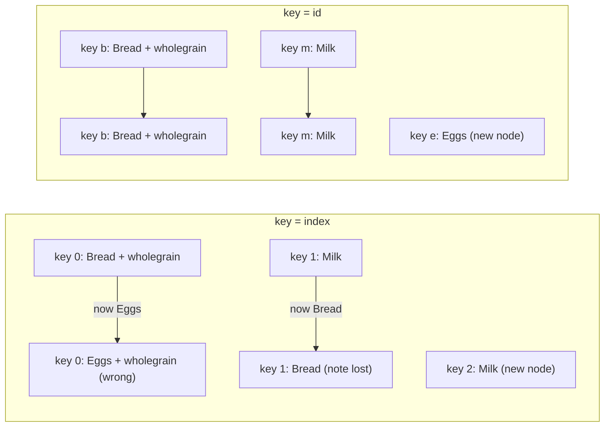

# Chapter 2 — Components and Props

How to write components, feed them data with **props**, nest them with `children`, keep them pure and small, and decide *what* to render with conditions and lists — ending with a small product catalog that uses every idea.

Code: [`code/`](code/) (React 19.3, run in jsdom with Testing Library — see [§1.5](../01-why-react-and-setup/README.md#15-setting-up-a-react-project)).

---

## 2.1 Function components

### What it is
A **function component** is a plain function that takes one argument (the **props** object) and returns JSX ([§1.8](../01-why-react-and-setup/README.md#18-jsx)). Its name **must start with a capital letter**. React calls it whenever it needs to know what that part of the screen should look like.

> Older code uses **class components** (`class X extends React.Component` with `render()` and **lifecycle methods** that React calls at fixed moments, e.g. after mount or before removal). They still work but are legacy: Hooks, Server Components and the React Compiler all target function components. You only *read* classes in old code — and for **error boundaries** (components that catch a crash in their children and show a fallback UI; Chapter 14).

### How it works
`code/01_function_components.jsx`:
```jsx
function Profile() {
  return ;
}

function Gallery() {
  return (
    <section>
      <h1>Amazing scientists</h1>
      <Profile />
      <Profile />
    </section>
  );
}

// Lowercase name: JSX treats <profile /> as an unknown HTML tag, NOT as the function below.
function profile() {
  return ;
}
// ... render(<Gallery />) and render(<div><profile /></div>)
```

Output:
```
Gallery      : <section><h1>Amazing scientists</h1></section>
<profile />  : <div><profile></profile></div>
React warned : The tag <profile> is unrecognized in this browser. If you meant to render a React component, start its name with an uppercase letter.
```

1. `render(<Gallery />)` creates `{ type: Gallery }`; `type` is a function, so React **calls** `Gallery(props)`.
2. `Gallery` returns elements including two `{ type: Profile }`; React calls `Profile` for each.
3. When only strings (`'section'`, `'img'`) remain, React creates DOM nodes.
4. `<profile />` became the *string* `'profile'` → a meaningless `<profile>` tag plus a warning.

The components themselves never appear in the HTML. The component tree lives in React (visible in DevTools); the DOM contains only **host elements** (built-in tags like `<section>`, ``).

**Rules** ([§1.7](../01-why-react-and-setup/README.md#17-your-first-component)): capitalised; returns JSX, a string/number, an array, or `null`; declared at module top level; used as `<Profile />`, not `Profile()` (a direct call gets no place in the tree, and its Hooks would belong to the caller).

### TL;DR
A component is a capitalised function `(props) => JSX`. React calls it; only the host elements it returns reach the DOM.

---

## 2.2 Props

### What it is
**Props** (*properties*) are the inputs a parent passes to a child, written like HTML attributes: `<Avatar person={ada} size={50} />`. React collects them into **one object** passed as the first argument. Any value can be a prop: strings, numbers, booleans, objects, arrays, functions, even JSX.

Props make one component reusable with different data and are the channel of **one-way data flow**: data moves *down* from parent to child (and *up* by passing a function as a prop — Chapter 3).

### How it works
1. **Pass**: strings in quotes, anything else in braces. A bare attribute (`admin`) means `true`.
2. **Read**: usually **destructure** (unpack named fields into variables) in the parameter list: `function Avatar({ person, size })`.
3. **Default**: `{ size = 100 }` — applies only when the prop is missing or `undefined` (not `null` or `0`).
4. **Forward** unused props with rest/spread (`...rest` collects remaining fields; `{...rest}` in JSX spreads them back as props): `function Button({ variant, ...rest }) { return <button {...rest} /> }`.

`code/02_props.jsx`:
```jsx
function getImageUrl(person, size = 's') {
  return `https://i.imgur.com/${person.imageId}${size}.jpg`;
}

// Destructure props in the parameter list; `size = 100` is a default used when size is undefined.
function Avatar({ person, size = 100 }) {
  return ;
}

function Profile() {
  return (
    <div>
      <Avatar person={{ name: 'Lin Lanying', imageId: '1bX5QH6' }} size={50} />
      <Avatar person={{ name: 'Aklilu Lemma', imageId: 'OKS67lh' }} />
    </div>
  );
}

// Forwarding: pass every prop through with spread syntax.
function Button({ variant = 'primary', ...rest }) {
  return <button className={`btn btn-${variant}`} {...rest} />;
}
render(<Button type="submit" disabled aria-label="Save">Save</Button>);

// Props are read-only: in development React freezes the props object.
function Mutator(props) {
  try { props.title = 'changed'; } catch (e) { console.log('mutating props ->', e.constructor.name + ':', e.message); }
  return <h2>{props.title}</h2>;
}

// What a component actually receives: ONE object.
function Spy(props) { console.log('props object:', JSON.stringify(props)); return null; }
render(<Spy name="Ada" age={36} admin tags={['math', 'code']} />);
```

Output:
```
<div>


</div>

forwarded   : <button class="btn btn-primary" type="submit" disabled="" aria-label="Save">Save</button>
mutating props -> TypeError: Cannot assign to read only property 'title' of object '#<Object>'
props object: {"name":"Ada","age":36,"admin":true,"tags":["math","code"]}
```

- `person={{ … }}`: outer braces = "JavaScript here", inner = object literal (like `style={{…}}`).
- The second `Avatar` had no `size`, so the default `100` applied; `admin` became `true`.
- `children` ("Save") was forwarded by `{...rest}` too — it is just another prop.
- In development React **freezes** props (`Object.freeze`), so assigning threw. Production does not freeze, but mutating props is still a bug — the parent owns that data.

### Props are a snapshot, and change only from above
Each render gets a fresh props object; when the parent re-renders with new values, the child is called again. You never "update" your own props — data that changes with interaction is **state** ([Chapter 3](../03-state-and-events/README.md)).

| | Props | State |
|---|---|---|
| Owned by | The parent | The component itself |
| Changed by | The parent re-rendering with new values | The component calling its setter (`setX`) |
| Purpose | Configure a component from outside | Remember something that changes with interaction |
| Analogy | Arguments to a function | A function's private memory between calls |

### Special props
| Prop | Behaviour |
|---|---|
| `key` | Identifies list items (§2.8). **Not** passed to your component: `props.key` is `undefined`. |
| `children` | Whatever you nest between the tags (§2.3). |
| `ref` | A handle to a DOM node or value. In React 19 a normal prop for function components; `forwardRef` is no longer needed and will be deprecated ([§5.10](../05-effects-and-refs/README.md#510-passing-refs-to-your-own-components)). |

React 19 removed `propTypes` (runtime type warnings) and `defaultProps` for function components; use destructuring defaults, and TypeScript for types ([Chapter 11](../11-typescript-with-react/README.md)).

### Trade-offs — spreading props
| `{...props}` forwarding | Listing props explicitly |
|---|---|
| Short; thin wrappers pass through any native attribute (`aria-*` accessibility hints for screen readers, `onClick`) | Clear which props the component supports |
| Can pass unknown props to the DOM (React warns) or override your own (later wins) | More typing when wrapping native elements |

Rule of thumb: spread in thin wrappers around a native element (`Button`, `Input`); list explicitly in feature components.

### Common mistakes
- `size="50"` passes a **string**; use `size={50}`.
- `function Avatar(person, size)` — forgot the destructuring braces; `size` is the second parameter (`undefined`), not a prop.
- Copying a prop into state "to change it" — the copy ignores later parent updates ([§3.8](../03-state-and-events/README.md#38-derived-state--choosing-the-minimal-state)).
- `defaultProps` on a function component in React 19 — ignored.

### In the interview
**30-second answer:** "Props are the read-only inputs a parent passes to a child, collected into one object. They make components reusable and implement one-way data flow: data goes down via props, and events go up via **callback props** (functions the parent passes down for the child to call). A component never mutates its props; if it needs changing data it uses state."

- *Why are props read-only?* — The parent owns the data; a mutating child would leave parent and siblings **stale** (out of date) or inconsistent, and React would not know to re-render.
- *Defaults?* — Destructuring default `({ size = 100 })`; used when `size` is missing or `undefined`.
- *Is `key` a prop?* — Written like one, but React consumes it; the component cannot read it.
- *`<Toggle on />` passes?* — `{ on: true }`.

### TL;DR
Props = one read-only object from the parent. Destructure with defaults, spread to forward, never mutate. Changing data belongs in state.

---

## 2.3 The `children` prop

### What it is
Whatever you put *between* a component's tags arrives as `props.children`, so **wrapper** components — cards, panels, **modals** (dialogs over the page), layouts — need not know what they contain.

### How it works
`code/03_children_composition.jsx` (first part):
```jsx
function Card({ title, children }) {
  return (
    <div className="card">
      {title && <h3>{title}</h3>}
      <div className="card-body">{children}</div>
    </div>
  );
}

// children can be anything renderable: text, elements, arrays, or nothing.
function Show({ children }) { return <span>[{children}]</span>; }
render(<Show>hi</Show>); render(<Show>{['a', 'b']}</Show>); render(<Show />);
```

Output (last three lines of the program):
```
text   : <span>[hi]</span>
array  : <span>[ab]</span>
none   : <span>[]</span>
```

`children` may be a string, one element, an array, or `undefined`; render `{children}` and let React handle the shape. (The `Children` utility for counting/mapping children is filed under react.dev's *legacy APIs* because it is fragile; prefer passing data as props.)

### TL;DR
Nested JSX arrives as `props.children`; render it with `{children}` to build generic wrappers.

---

## 2.4 Composition

### What it is
**Composition** = building complex UIs by *combining* components (passing components into components) instead of **inheritance** (a class extending a parent and overriding parts). React has no component inheritance; composition covers every use case.

### How it works — slots
When a layout has several "holes", pass JSX through **named props** (*slots*) as well as `children`:

```jsx
function PageLayout({ header, sidebar, children }) {
  return (
    <div className="page">
      <header>{header}</header>
      <aside>{sidebar}</aside>
      <main>{children}</main>
    </div>
  );
}

render(
  <PageLayout header={<h1>Dashboard</h1>} sidebar={<nav>Menu</nav>}>
    <Card title="Revenue">
      <p>$12,400 this week</p>
    </Card>
    <Card>
      <p>No title here</p>
    </Card>
  </PageLayout>,
);
```

Output (the program prints one tag per line; grouped here):
```
<div class="page">
<header><h1>Dashboard</h1></header>
<aside><nav>Menu</nav></aside>
<main>
<div class="card"><h3>Revenue</h3><div class="card-body"><p>$12,400 this week</p></div></div>
<div class="card"><div class="card-body"><p>No title here</p></div></div>
</main>
</div>
```

The second card has no `<h3>`: `title` was `undefined`, so `{title && …}` rendered nothing (§2.7).

### Why it matters — composition beats prop drilling
**Prop drilling** = passing a prop through components that don't use it to reach a deep child (`App → Page → Sidebar → UserMenu → Avatar`, only `Avatar` needs `user`). Fixes:
1. **Composition (try first):** `App` creates `<Avatar user={user} />` itself and passes it down as `children` or a slot; the middle components just place `{children}`.
2. **Context** ([§6.3](../06-state-management/README.md#63-context--pass-data-deeply-without-props)) — a value any descendant can read without props — when many distant components need the same data (theme, current user, **locale** = language and regional formats).

### Composition vs inheritance
| Need | OOP inheritance idea | React composition |
|---|---|---|
| A special kind of dialog | `class WelcomeDialog extends Dialog` | `<Dialog title="Welcome">…</Dialog>` — configure via props |
| Shared behaviour | Base class methods | A custom Hook (Chapter 7) or a wrapper component |
| Varying inner content | Override a method | `children` or a slot prop |

Real world: UI kits (MUI, Radix/shadcn) expose `Card`, `Dialog`, `Tabs` with `children` and slots (`title`, `actions`); routers render the matched page into an **outlet** slot (Chapter 9).

### In the interview
**30-second answer:** "Composition means building UIs by nesting components and passing JSX as `children` or slot props. React recommends it over inheritance. It also solves most prop drilling: the top component creates the deep child itself and passes it through as children, so intermediate components never touch the data."

- *When would you use context instead?* — When many components at different depths need the same value (theme, auth, locale) and threading it through children would be awkward.
- *Can a prop be a component?* — Yes: an element (`icon={<Star />}`) or a component type (`as={Link}`), rendered as `<Icon />` after capitalising the variable.

### TL;DR
Combine small components; pass JSX via `children` and slot props. Composition replaces inheritance and is the first cure for prop drilling.

---

## 2.5 Pure components

### What it is
A **pure function** (1) returns the same result for the same inputs and (2) changes nothing outside itself (no **side effects**). React assumes every component is pure **during rendering**: same props, state and context → same JSX, and no modification of pre-existing variables, objects, the DOM, or anything else.

React may call a component **more than once, in any order, or throw a render away** (concurrent rendering, Suspense — fallback while part of the UI waits, Chapter 9 — StrictMode checks, server rendering). Side effects in render then produce wrong results. Purity also enables **caching**: with unchanged inputs, React (and the React Compiler) can skip the call.

### How it works — StrictMode exposes impurity
`<StrictMode>` (development only) renders each component **twice** and keeps the second result. Pure components give identical output; impure ones show the bug.

`code/04_purity.jsx`:
```jsx
let guest = 0;
function ImpureCup() {
  guest = guest + 1;              // BAD: changes a variable outside the component during render
  return <h2>Tea cup for guest #{guest}</h2>;
}

function PureCup({ guest }) {     // GOOD: output depends only on props
  return <h2>Tea cup for guest #{guest}</h2>;
}

// Local mutation is fine: the array is created during this render.
function TeaGathering() {
  const cups = [];
  for (let i = 1; i <= 3; i++) cups.push(<PureCup key={i} guest={i} />);
  return <>{cups}</>;
}
```

Output:
```
impure, no StrictMode: Tea cup for guest #1Tea cup for guest #2Tea cup for guest #3
impure, StrictMode   : Tea cup for guest #2Tea cup for guest #4Tea cup for guest #6
pure,   StrictMode   : Tea cup for guest #1Tea cup for guest #2Tea cup for guest #3
local mutation OK    : Tea cup for guest #1Tea cup for guest #2Tea cup for guest #3
```

Without StrictMode the impure version *looks* right, so the bug would hide until some re-render; the double call (each cup rendered twice, shared counter bumped twice) makes it obvious: 2, 4, 6.

### Where side effects belong
| Allowed during render | Not allowed during render | Put it here instead |
|---|---|---|
| Reading props, state, context | Changing variables/objects that existed before the render | Local variables, or state |
| Creating and mutating **local** variables/arrays | Mutating props or state objects | Create new objects ([§3.6](../03-state-and-events/README.md#36-updating-objects-and-arrays-immutably)) |
| Calculating derived values | DOM manipulation, `fetch`, timers, subscriptions, analytics logging | **Event handlers** (first choice) or **Effects** — `useEffect`, code run after rendering ([Chapter 5](../05-effects-and-refs/README.md)) |
| | `Math.random()`, `Date.now()` for output (non-deterministic) | Compute once in a `useState` initialiser, a handler, or an Effect |

Event handlers need not be pure: they run on a user action, not during rendering.

### Common mistakes
- "Removing StrictMode fixes my doubled logs." It hides the symptom; fix the impurity.
- Sorting a prop **in place**: `items.sort()` mutates the parent's array. Use `items.toSorted()` or `[...items].sort()`.
- Pushing to a **module-level** array (top of file, shared by every render) during render — a render counter, a cache — works once, breaks on re-render.

### In the interview
**30-second answer:** "A React component must be pure while rendering: same props, state and context in, same JSX out, and no mutation of anything that existed before the render. React relies on this because it may render a component several times or discard a render. Side effects go in event handlers, or in Effects when they must sync with an **external system** (anything React does not control: the network, a timer, a browser API, a third-party widget). StrictMode double-renders in development to catch violations."

- *Is `console.log` in render impure?* — Technically, but harmless; DevTools dims the second StrictMode log. Avoid anything that changes app data.
- *Can a component mutate a local array?* — Yes — "local mutation" of values created in the same render is fine.
- *Where should `fetch` go?* — An event handler, or an Effect / data library (Chapters 5, 9).

### TL;DR
Render = pure calculation. Same inputs → same JSX; mutate only what you created in this render; side effects go to event handlers or Effects. StrictMode renders twice to catch mistakes.

---

## 2.6 Keeping components small

### What it is
A guideline: each component has **one clear job**; extract pieces when it grows several responsibilities.

### When to extract
| Signal | Example | Extract |
|---|---|---|
| A block of JSX has its own name in conversation | "the price", "the stock label" | `Price`, `StockLabel` |
| The same markup appears twice | Two identical badge spans | `Badge` |
| A section has its own logic | Stock thresholds | `StockLabel` with its `if`s |
| The file is hard to review (a few hundred lines) | A 400-line `Dashboard` | Sub-components per panel |
| A part needs its own state | An expandable row | `Row` with local state |

**How:** cut the JSX block into a new capitalised top-level function; every parent variable it used becomes a **prop**; replace the block with `<NewComponent prop={value} />`; move it to its own file once a second file uses it.

**Trade-off:** too big = hard to read, test and reuse, many reasons to change; too small = many files, jumping around to understand one screen, props threaded through thin layers. A useful split is **presentational** components (props in, UI out — `Price`, `Badge`) vs **feature** components (know the data, wire things — `Catalog`); container/presentational patterns: Chapter 14.

### TL;DR
One job per component. Extract when JSX has a name, repeats, carries its own logic, or needs its own state — its free variables become props.

---

## 2.7 Conditional rendering

### What it is
Showing different JSX depending on props or state, using ordinary JavaScript: `if`, the ternary `cond ? a : b`, logical `a && b` (gives `b` only when `a` is truthy), and variables.

### How it works — four techniques
`code/05_conditional_rendering.jsx`:
```jsx
// 1. if / early return (statements are allowed ABOVE the JSX)
function Item({ name, isPacked }) {
  if (isPacked) return <li className="item">{name} ✅</li>;
  return <li className="item">{name}</li>;
}
// 2. ternary inside JSX
function Item2({ name, isPacked }) {
  return <li className="item">{isPacked ? <del>{name}</del> : name}</li>;
}
// 3. && : render something or nothing
function Item3({ name, isPacked }) {
  return <li className="item">{name} {isPacked && '✅'}</li>;
}
// 4. store JSX in a variable
function Item4({ name, isPacked }) {
  let content = name;
  if (isPacked) content = <strong>{name} (packed)</strong>;
  return <li className="item">{content}</li>;
}
// returning null renders nothing at all
function Hidden({ show }) { return show ? <p>visible</p> : null; }

// The trap: a number on the left of && is rendered when it is 0.
function Inbox({ messages }) {
  return <p>{messages.length && `You have ${messages.length} messages`}</p>;
}
function InboxFixed({ messages }) {
  return <p>{messages.length > 0 && `You have ${messages.length} messages`}</p>;
}
```

Output:
```
if/return : <ul><li class="item">Space suit ✅</li><li class="item">Photo</li></ul>
ternary   : <ul><li class="item"><del>Helmet</del></li></ul>
&&        : <ul><li class="item">Helmet ✅</li><li class="item">Map </li></ul>
variable  : <ul><li class="item"><strong>Helmet (packed)</strong></li></ul>
null      : ""
0 && bug  : <p>0</p>
fixed     : <p></p>
```

### Which to use
| Technique | Best for | Watch out |
|---|---|---|
| `if` + early `return` | Whole component differs (loading / error / empty states) | Duplicate wrapper markup |
| `cond ? a : b` | Choosing between two small pieces inline | Nested ternaries become unreadable → extract a component |
| `cond && a` | Show-or-nothing | Left side `0` or `NaN` is rendered — make it a real boolean (`> 0`, `!!x`, `Boolean(x)`) |
| Variable (`let content`) | Several conditions building one piece | Slightly more lines |
| `return null` | Component decides to hide itself | The *parent* often should decide instead |

Why `0` shows: `a && b` returns `a` when `a` is **falsy** (`false`, `0`, `NaN` — "Not a Number" — `''`, `null`, `undefined`). `false`, `null`, `undefined` render nothing, but `0` is a number and numbers render (`''` gives an invisible empty text node).

Identity: `isPacked ? <del>{name}</del> : name` yields different *types* at one position, so React replaces the DOM there ([§1.3](../01-why-react-and-setup/README.md#13-rendering-the-virtual-dom-and-reconciliation-brief)). If both branches are the same component (`cond ? <Counter a /> : <Counter b />`), React keeps the same **instance** and its state — see [§3.10](../03-state-and-events/README.md#310-state-is-tied-to-a-position-in-the-tree) for how `key` changes that.

### In the interview
- *Why does `{count && <Badge />}` show "0"?* — `&&` returns its falsy left operand; 0 is renderable. Use `count > 0 &&`.
- *How do you render nothing?* — Return `null` (or `false`/`undefined` inside JSX).

### TL;DR
`if`/early return for big branches, `? :` for either-or, `&&` for show-or-nothing (with a boolean on the left!), `null` for nothing.

---

## 2.8 Rendering lists and keys

### What it is
Turn an **array of data** into an **array of elements** with `map()` (and `filter()` to select). Each element needs a **`key`**: a string or number identifying that item among its siblings.

### How it works
`code/06_lists_and_keys.jsx`:
```jsx
const people = [
  { id: 0, name: 'Creola Katherine Johnson', profession: 'mathematician' },
  { id: 1, name: 'Mario José Molina-Pasquel Henríquez', profession: 'chemist' },
  { id: 2, name: 'Mohammad Abdus Salam', profession: 'physicist' },
  { id: 3, name: 'Percy Lavon Julian', profession: 'chemist' },
];

function ChemistList() {
  const chemists = people.filter((p) => p.profession === 'chemist');
  return <ul>{chemists.map((p) => <li key={p.id}>{p.name}</li>)}</ul>;
}

// Missing key -> React logs a warning in development.
render(<ul>{people.map((p) => <li>{p.name}</li>)}</ul>);
```

Output:
```
<ul>
<li>Mario José Molina-Pasquel Henríquez</li>
<li>Percy Lavon Julian</li>
</ul>

warning: Each child in a list should have a unique "key" prop. See https://react.dev/link/warning-keys for more information.
```

**Arrow functions** (`(args) => result`): `p => <li>…</li>` returns implicitly; with a body `p => { return <li>…</li>; }` you must write `return`, or the list is empty.

### Why keys matter
On re-render React matches old list items to new ones by key ([§1.3](../01-why-react-and-setup/README.md#13-rendering-the-virtual-dom-and-reconciliation-brief)). With a stable ID it knows "the Bread row moved down"; with the **array index** it thinks "row 0 changed its text from Bread to Eggs", so any **state** in the row (input text, component state, **focus**, animations) stays at the old position.

The program renders rows each holding an **uncontrolled** `<input>` (value lives in the DOM, not React state), types *wholegrain* into Bread's input, then inserts Eggs at the top:
```jsx
function NoteList({ items, useIndexKey }) {
  return (
    <ul>
      {items.map((item, index) => (
        <li key={useIndexKey ? index : item.id}>
          {item.label}: <input aria-label={`note for ${item.label}`} defaultValue="" />
        </li>
      ))}
    </ul>
  );
}
// type 'wholegrain' into Bread's input, then rerender with Eggs prepended
```

Output:
```
key=index after prepend -> Eggs"wholegrain"  Bread""  Milk""
key=id    after prepend -> Eggs""  Bread"wholegrain"  Milk""
```

With index keys the note jumped to **Eggs** — real data corruption. With ID keys it stayed with Bread.



### Rules for keys
1. **Unique among siblings** (not globally); different lists can reuse keys.
2. **Stable**: same item, same key every render. Use IDs from your data (database IDs, or **UUIDs** — random IDs practically guaranteed unique — created *when the item is created*).
3. **Never generate during render**: `key={Math.random()}` / `key={crypto.randomUUID()}` → new keys each render → every item **remounts** (destroyed and recreated): slow, loses focus and state.
4. **Index only** for static lists: never reordered, filtered or inserted into (except at the end), and stateless items.
5. Put the key on the **outermost element returned from `map`** — `<ProductCard key=… />`, not the `<li>` inside `ProductCard`.
6. The key is not passed to the component; pass the ID separately if needed (`<Row key={id} id={id} />`).
7. One item rendering several siblings → `<Fragment key={id}>…</Fragment>` (`<>` cannot take a key).

### Common mistakes
| Mistake | Symptom |
|---|---|
| Missing key | Console warning; index used implicitly → same bugs as index keys |
| Index key on a sortable/filterable list (or after deleting the first item) | Inputs, checkboxes or expanded state attach to the wrong row (everything shifts) |
| `Math.random()` key | Inputs lose focus on each keystroke, poor performance |
| Duplicate keys | Warning "Encountered two children with the same key"; items duplicated or dropped |
| Key inside the child component instead of on the element in `map` | Warning persists |

Keys also **reset** a component outside lists: `<Profile key={userId} />` gives each user a fresh instance ([§3.10](../03-state-and-events/README.md#310-state-is-tied-to-a-position-in-the-tree)).

### In the interview
**30-second answer:** "`map` data to elements and give each a key that is stable and unique among siblings, usually the item's ID. React uses keys to match items between renders, so it can move DOM nodes and keep state with the right item. Index keys break when the list is reordered, filtered or prepended — state stays at the position instead of following the item. Random keys are worse: everything **remounts** every render."

- *When is index as key fine?* — Static lists with no per-item state (e.g. a fixed footer menu).
- *Globally unique?* — No, only among siblings of the same parent.
- *Can I read `props.key`?* — No; pass the value under another prop name.

### TL;DR
`data.map(item => <X key={item.id} … />)`. Keys: unique among siblings, stable, from data, never random, index only for static lists.

---

## 2.9 Putting it together — a product catalog

`code/catalog.jsx` combines small presentational components (`Price`, `Badge`, `StockLabel`), a card composing them, a `Section` wrapper using `children`, conditional rendering, and a filtered keyed list.

```jsx
// Price formats with Intl.NumberFormat; Badge = <span className={`badge badge-${tone}`}>{children}</span>;
// Section = <section><h2>{title}</h2>{children}</section>  (full file: code/catalog.jsx)
export function StockLabel({ stock }) {
  if (stock === 0) return <Badge tone="red">Out of stock</Badge>;
  if (stock < 5) return <Badge tone="amber">Only {stock} left</Badge>;
  return null;                                   // plenty in stock: show nothing
}

export function ProductCard({ product }) {
  const { name, price, stock, rating, tags } = product;
  return (
    <article className="product" aria-label={name}>
      <h3>{name}</h3>
      <div className="badges">
        {tags.includes('new') && <Badge tone="blue">New</Badge>}
        {tags.includes('sale') && <Badge tone="green">Sale</Badge>}
        <StockLabel stock={stock} />
      </div>
      <p><Price amount={price} /> · ★ {rating.toFixed(1)}</p>
      <button disabled={stock === 0}>{stock === 0 ? 'Sold out' : 'Add to cart'}</button>
    </article>
  );
}

export function Catalog({ products, minRating = 0 }) {
  const visible = products.filter((p) => p.rating >= minRating);
  if (visible.length === 0) return <p>No products match.</p>;
  return (
    <Section title={`Products (${visible.length})`}>
      <div className="grid">
        {visible.map((p) => <ProductCard key={p.id} product={p} />)}
      </div>
    </Section>
  );
}
```

`code/07_product_catalog.jsx` renders `<Catalog products={PRODUCTS} />`, reads the screen like a user (or test) — by **roles** (what a screen reader announces an element as) such as `article`, `heading`, `button` — then `rerender`s with `minRating={4.5}` and `{5}`:
```
Products (4)
  Mechanical keyboard  |  $89.00 | badges: New                | button: Add to cart
  USB-C hub            |  $35.00 | badges: Out of stock       | button: Sold out (disabled)
  27" monitor          | $249.00 | badges: Sale, Only 3 left  | button: Add to cart
  Laptop stand         |  $42.00 | badges: -                  | button: Add to cart

minRating=4.5 -> Products (2) [ 'Mechanical keyboard', '27" monitor' ]
minRating=5   -> No products match.
```

The same components in the browser ([`code/catalog.html`](code/catalog.html), styles in `catalog.css`):


*Figure 2.1 — `Catalog` rendered in Chrome. Every badge and button state comes from props and conditional rendering.*

`rerender` with a new `minRating` re-ran `Catalog`; nothing "updates" itself — components just describe the UI for their props. The buttons do nothing yet: that needs **state and events** (Chapter 3).

---

## Chapter 2 TL;DR

| Idea | Remember |
|---|---|
| Component | Capitalised function `(props) => JSX`, top-level, used as `<X />` |
| Props | One read-only object; destructure with defaults; strings in quotes, other values in braces |
| Forwarding | `({ a, ...rest }) => <button {...rest} />`; later props override earlier |
| `children` | Nested JSX; enables wrappers; slots = JSX in named props |
| Composition | Combine components instead of inheriting; first fix for prop drilling |
| Purity | Same inputs → same JSX, no outside mutation during render; StrictMode renders twice in dev |
| Small components | One job each; free variables become props |
| Conditions | `if`/return, `? :`, `&&` (boolean on the left — the `0` trap), `null` |
| Lists | `map` + `key` from stable IDs; index only for static lists; never random |

Next: [Chapter 3 — State and Events](../03-state-and-events/README.md).
