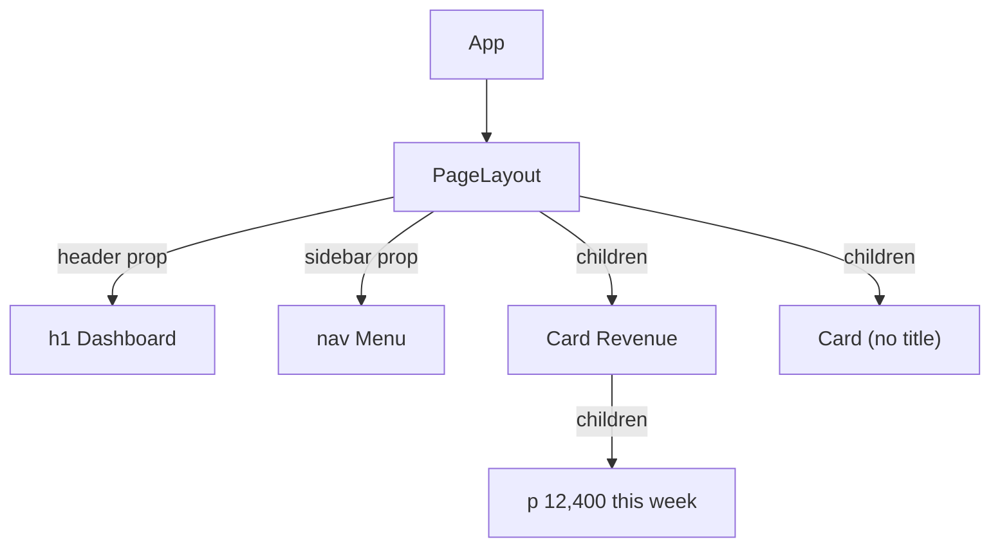
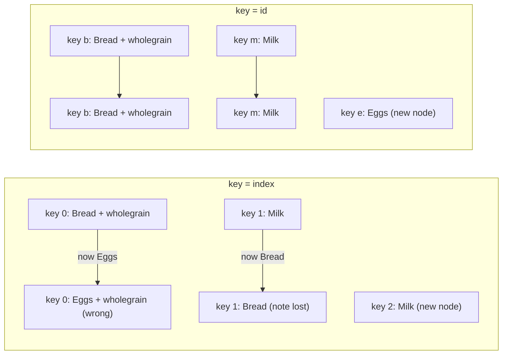
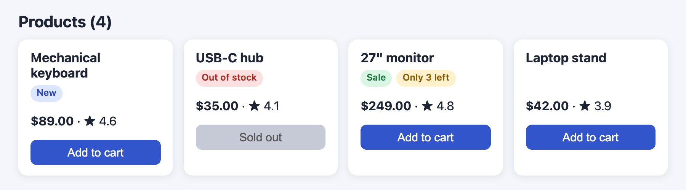

# Chapter 2 — Components and Props

Components are React's unit of reuse, and **props** are how data flows into them. This chapter shows how to write components, feed them data, nest them with `children`, keep them pure and small, and decide *what* to render with conditions and lists. It ends with a small product catalog that uses every idea.

**What you'll learn**

| # | Topic | You will be able to… |
|---|---|---|
| 2.1 | Function components | write components and avoid the lowercase-name trap |
| 2.2 | Props | pass, read, destructure, default and forward props; know they are read-only |
| 2.3 | `children` | build wrapper components such as `Card` and `Layout` |
| 2.4 | Composition | assemble UIs from small parts, use slots, and avoid prop drilling |
| 2.5 | Pure components | explain the purity rule and what `StrictMode` double rendering reveals |
| 2.6 | Keeping components small | know when and how to split a component |
| 2.7 | Conditional rendering | use `if`, `? :`, `&&`, `null` — and avoid the `0 &&` bug |
| 2.8 | Lists and keys | render arrays with `map`/`filter` and pick correct keys |
| 2.9 | Putting it together | read a complete small UI built from these parts |

Code: [`code/`](code/) (React 19.3, run in jsdom — a browser-like DOM that runs inside Node.js — with Testing Library, a helper for clicking and reading the screen like a user — see [Chapter 1 §1.5](../01-why-react-and-setup/README.md)).

---

## 2.1 Function components

### What it is
A **function component** is a plain JavaScript function that takes one argument (the **props** object) and returns JSX (the HTML-like syntax that compiles to JavaScript, Chapter 1 §1.8). Its name **must start with a capital letter**. React calls it whenever it needs to know what that part of the screen should look like.

Analogy: a component is a *recipe card*. The recipe (function) is written once; each `<Profile />` in your JSX is one dish cooked from it. Props (next section) are the ingredients you hand over for that particular dish.

> Older React code uses **class components** (`class X extends React.Component` with `render()` and **lifecycle methods** — methods React calls at fixed moments, such as after the component first appears or just before it is removed). They still work but are legacy; everything new — Hooks (functions starting with `use` that give components React features), Server Components (components that run only on the server), the React Compiler (a build tool that adds memoization automatically) — targets function components. You only need to *read* classes when maintaining old code (and for **error boundaries** — components that catch a crash in their children and show a fallback UI instead — Chapter 14).

### How it works
`code/01_function_components.jsx`:
```jsx
function Profile() {
  return ;
}

function Gallery() {
  return (
    <section>
      <h1>Amazing scientists</h1>
      <Profile />
      <Profile />
    </section>
  );
}

// Lowercase name: JSX treats <profile /> as an unknown HTML tag, NOT as the function below.
function profile() {
  return ;
}
// ... render(<Gallery />) and render(<div><profile /></div>)
```

Output:
```
Gallery      : <section><h1>Amazing scientists</h1></section>
<profile />  : <div><profile></profile></div>
React warned : The tag <profile> is unrecognized in this browser. If you meant to render a React component, start its name with an uppercase letter.
```

Step by step:
1. `render(<Gallery />)` creates an element `{ type: Gallery }`.
2. React sees that `type` is a function, so it **calls** `Gallery(props)`.
3. `Gallery` returns elements including two `{ type: Profile }`; React calls `Profile` for each.
4. When only strings (`'section'`, `'img'`) remain, React creates the DOM nodes.
5. `<profile />` became the *string* `'profile'`, so React created a meaningless `<profile>` tag and warned.

Notice the components themselves (`Gallery`, `Profile`) do **not** appear in the HTML — only what they return does. The component tree exists in React (visible in React DevTools, the browser extension for inspecting components); the DOM tree contains only **host elements** (the built-in platform tags such as `<section>` and ``).

### Rules recap (from [Chapter 1 §1.7](../01-why-react-and-setup/README.md))
- Capitalised name; returns JSX, a string/number, an array, or `null`.
- Declared at the top level of a module — never inside another component.
- Use it as `<Profile />`, not `Profile()` (calling it directly bypasses React: no own place in the tree, and Hooks inside would belong to the caller).

### TL;DR
A component is a capitalised function `(props) => JSX`. React calls it; only the host elements it returns reach the DOM.

---

## 2.2 Props

### What it is
**Props** (short for *properties*) are the inputs a parent passes to a child, written like HTML attributes: `<Avatar person={ada} size={50} />`. React collects them into **one object** and passes it as the component's first argument. Any JavaScript value can be a prop: strings, numbers, booleans, objects, arrays, functions, and even JSX.

Analogy: props are like the settings on a coffee machine order — size, milk, sugar. The machine (component) reads them to make the drink; it does not rewrite your order.

### Why it matters
Without props every `Profile` would show the same person. Props make one component reusable with different data, and they are the main channel of the **one-way data flow**: data moves *down* the tree from parent to child. (Data moves *up* by passing a function as a prop — Chapter 3.)

### How it works
1. **Pass** props in JSX: strings in quotes, anything else in braces. A bare attribute (`admin`) means `true`.
2. **Read** them: the function receives `props`; usually you **destructure** (unpack named fields of an object into separate variables) in the parameter list: `function Avatar({ person, size })`.
3. **Default** a prop with destructuring defaults: `{ size = 100 }`. The default applies only when the prop is missing or `undefined` (not for `null` or `0`).
4. **Forward** props you do not use yourself with the rest/spread syntax (`...rest` collects "all the remaining fields" into one object; `{...rest}` in JSX spreads them back out as individual props): `function Button({ variant, ...rest }) { return <button {...rest} /> }`.

`code/02_props.jsx`:
```jsx
function getImageUrl(person, size = 's') {
  return `https://i.imgur.com/${person.imageId}${size}.jpg`;
}

// Destructure props in the parameter list; `size = 100` is a default used when size is undefined.
function Avatar({ person, size = 100 }) {
  return ;
}

function Profile() {
  return (
    <div>
      <Avatar person={{ name: 'Lin Lanying', imageId: '1bX5QH6' }} size={50} />
      <Avatar person={{ name: 'Aklilu Lemma', imageId: 'OKS67lh' }} />
    </div>
  );
}

// Forwarding: pass every prop through with spread syntax.
function Button({ variant = 'primary', ...rest }) {
  return <button className={`btn btn-${variant}`} {...rest} />;
}
render(<Button type="submit" disabled aria-label="Save">Save</Button>);

// Props are read-only: in development React freezes the props object.
function Mutator(props) {
  try { props.title = 'changed'; } catch (e) { console.log('mutating props ->', e.constructor.name + ':', e.message); }
  return <h2>{props.title}</h2>;
}

// What a component actually receives: ONE object.
function Spy(props) { console.log('props object:', JSON.stringify(props)); return null; }
render(<Spy name="Ada" age={36} admin tags={['math', 'code']} />);
```

Output:
```
<div>


</div>

forwarded   : <button class="btn btn-primary" type="submit" disabled="" aria-label="Save">Save</button>
mutating props -> TypeError: Cannot assign to read only property 'title' of object '#<Object>'
props object: {"name":"Ada","age":36,"admin":true,"tags":["math","code"]}
```

What to notice:
- `person={{ … }}` — the outer braces mean "JavaScript here", the inner braces are an object literal (same as `style={{…}}`).
- The second `Avatar` had no `size`, so the default `100` was used.
- `children` ("Save") was forwarded by `{...rest}` too, because `children` is just another prop.
- `admin` with no value became `true`.
- Assigning to a prop threw: in development React **freezes** the props object (makes it read-only with `Object.freeze`). In **production** (the optimised build that real users run) it is not frozen, but mutating props is still a bug — the parent owns that data.

### Props are a snapshot, and change only from above
Each render receives a fresh props object. When a parent re-renders with different values, the child is called again with the new props — you never "update" your own props. If a component needs to change something over time in response to the user, that is **state** (data a component remembers between renders and can update) ([Chapter 3](../03-state-and-events/README.md)).

| | Props | State |
|---|---|---|
| Owned by | The parent | The component itself |
| Changed by | The parent re-rendering with new values | The component calling its setter (`setX`) |
| Purpose | Configure a component from outside | Remember something that changes with interaction |
| Analogy | Arguments to a function | A function's private memory between calls |

### Special props
| Prop | Behaviour |
|---|---|
| `key` | Used by React to identify list items (§2.8). **Not** passed to your component: `props.key` is `undefined`. |
| `children` | Whatever you nest between the tags (§2.3). |
| `ref` | A handle to a DOM node or value (Chapter 5). In React 19 a normal prop for function components (`forwardRef`, the old wrapper for this, is no longer needed and will be **deprecated** — marked as on its way out) — see Chapter 5. |

React 19 removed `propTypes` checks (runtime warnings when a prop had the wrong type) and `defaultProps` (an old way to declare default prop values) for function components; use destructuring defaults, and TypeScript (JavaScript with type annotations checked before running) for type checking ([Chapter 11](../11-typescript-with-react/README.md)).

### Trade-offs — spreading props
| `{...props}` forwarding | Listing props explicitly |
|---|---|
| Short; wrappers pass through any native attribute (`aria-*` = accessibility hints for screen readers, `onClick`) | Clear which props the component supports |
| Can accidentally pass unknown props to the DOM (React warns) or override your own ones (order matters: later wins) | More typing when wrapping native elements |

Rule of thumb: spread in thin wrappers around a native element (`Button`, `Input`); list explicitly in feature components.

### Common mistakes
- `size="50"` passes a **string**; use `size={50}` for a number.
- Forgetting braces in destructuring: `function Avatar(person, size)` — the second parameter is not a prop (it is `undefined`).
- Copying a prop into state "to be able to change it" — the copy ignores later updates from the parent (Chapter 3 §3.8).
- Using `defaultProps` on a function component in React 19 — it is ignored.

### In the interview
**30-second answer:** "Props are the read-only inputs a parent passes to a child, collected into one object. They make components reusable and implement one-way data flow: data goes down via props, and events go up via **callback props** (functions the parent passes down for the child to call). A component never mutates its props; if it needs changing data it uses state."

- *Why are props read-only?* — The parent owns the data. If a child mutated it, the parent and siblings would show **stale** (out-of-date) or inconsistent values and React could not know a re-render is needed.
- *How do you give a prop a default?* — Destructuring default `({ size = 100 })`; `defaultProps` is gone for function components in React 19.
- *Is `key` a prop?* — It is written like one but React consumes it; the component cannot read it.

### Self-check
1. How do you pass the number 3? → `count={3}` (quotes would pass `"3"`).
2. What does `<Toggle on />` pass? → `{ on: true }`.
3. When does `({ size = 100 })` use 100? → When `size` is missing or `undefined`.
4. Can a child change its props? → No; it asks the parent (callback prop) or uses its own state.

### TL;DR
Props = one read-only object from the parent. Destructure with defaults, spread to forward, never mutate. Changing data belongs in state.

---

## 2.3 The `children` prop

### What it is
Whatever you put *between* a component's opening and closing tags arrives as `props.children`. This lets you write **wrapper** components — cards, panels, **modals** (dialog boxes shown on top of the page), layouts — that do not need to know what they contain.

Analogy: a picture frame. The frame (component) provides border and glass; the picture (children) can be anything.

### How it works
`code/03_children_composition.jsx` (first part):
```jsx
function Card({ title, children }) {
  return (
    <div className="card">
      {title && <h3>{title}</h3>}
      <div className="card-body">{children}</div>
    </div>
  );
}

// children can be anything renderable: text, elements, arrays, or nothing.
function Show({ children }) { return <span>[{children}]</span>; }
render(<Show>hi</Show>); render(<Show>{['a', 'b']}</Show>); render(<Show />);
```

Output (last three lines of the program):
```
text   : <span>[hi]</span>
array  : <span>[ab]</span>
none   : <span>[]</span>
```

`children` may be a string, one element, an array of elements, or `undefined`. Render it with `{children}` and let React deal with the shape. (There is a `Children` utility in `react` for counting or mapping over children, but react.dev files it under *legacy APIs* (old functions kept only for compatibility) because it is fragile; prefer passing data as props.)

### TL;DR
Nested JSX arrives as `props.children`; render it with `{children}` to build generic wrappers.

---

## 2.4 Composition

### What it is
**Composition** means building complex UIs by *combining* components — passing components into other components — instead of creating special versions through **inheritance** (the object-oriented technique where a class extends a parent class and overrides parts of it). React has no component inheritance; composition covers all its use cases.

### How it works — slots
When a layout has several "holes", pass JSX through **named props** (often called *slots*) as well as `children`:

```jsx
function PageLayout({ header, sidebar, children }) {
  return (
    <div className="page">
      <header>{header}</header>
      <aside>{sidebar}</aside>
      <main>{children}</main>
    </div>
  );
}

render(
  <PageLayout header={<h1>Dashboard</h1>} sidebar={<nav>Menu</nav>}>
    <Card title="Revenue">
      <p>$12,400 this week</p>
    </Card>
    <Card>
      <p>No title here</p>
    </Card>
  </PageLayout>,
);
```

Output (HTML, one tag per line):
```
<div class="page">
<header>
<h1>Dashboard</h1>
</header>
<aside>
<nav>Menu</nav>
</aside>
<main>
<div class="card">
<h3>Revenue</h3>
<div class="card-body">
<p>$12,400 this week</p>
</div>
</div>
<div class="card">
<div class="card-body">
<p>No title here</p>
</div>
</div>
</main>
</div>
```

The second card has no `<h3>` because `title` was `undefined` and `{title && …}` rendered nothing (§2.7).



### Why it matters — composition beats prop drilling
**Prop drilling** is passing a prop through several components that do not use it, only to reach a deep child. Example: `App → Page → Sidebar → UserMenu → Avatar`, where only `Avatar` needs `user`. Two fixes:
1. **Composition (try first):** let `App` create `<Avatar user={user} />` itself and pass it down as `children` or a slot. The middle components just place `{children}` and never see `user`.
2. **Context** (Chapter 6) — React's built-in way for a component to provide a value that any descendant can read without passing props — when many distant components need the same data (theme, current user, **locale** = the user's language and regional formats).

### Composition vs inheritance
| Need | OOP (object-oriented programming) inheritance idea | React composition |
|---|---|---|
| A special kind of dialog | `class WelcomeDialog extends Dialog` | `<Dialog title="Welcome">…</Dialog>` — configure via props |
| Shared behaviour | Base class methods | A custom Hook (your own reusable `use…` function, Chapter 7) or a wrapper component |
| Varying inner content | Override a method | `children` or a slot prop |

### Real-world examples
- UI libraries (MUI, Chakra, Radix/shadcn — ready-made component kits) expose `Card`, `Dialog`, `Tabs` that accept `children` and slot props such as `title`, `actions`, `icon`.
- App shells (the frame shared by every page): a `Layout` with header/sidebar/content slots wrapping every page; routers (libraries that pick the page for the current URL) render the current page into an **outlet** slot — a placeholder where the matched child page appears (Chapter 9).

### In the interview
**30-second answer:** "Composition means building UIs by nesting components and passing JSX as `children` or slot props. React recommends it over inheritance. It also solves most prop drilling: the top component creates the deep child itself and passes it through as children, so intermediate components never touch the data."

- *When would you use context instead?* — When many components at different depths need the same value (theme, auth — who is logged in and what they may do, locale) and passing it through children would be awkward.
- *Can a prop be a component?* — Yes: either an element (`icon={<Star />}`) or a component type (`as={Link}`), rendered as `<Icon />` after capitalising the variable.

### TL;DR
Combine small components; pass JSX via `children` and slot props. Composition replaces inheritance and is the first cure for prop drilling.

---

## 2.5 Pure components

### What it is
In mathematics a **pure function** (1) always returns the same result for the same inputs and (2) changes nothing outside itself (no **side effects**). React assumes every component is pure **during rendering**: given the same props, state and context (values read from a Context provider above it), it returns the same JSX and does not modify pre-existing variables or objects, the DOM, or anything else.

Analogy: a calculator's `2 + 3` always shows 5 and does not change the number on your neighbour's calculator.

### Why it matters
React may call your component **more than once, in any order, or throw a render away** (for concurrent rendering — React pausing and resuming render work, Suspense — React's way of showing a fallback while part of the UI waits, Chapter 9 — StrictMode checks, server rendering). If rendering has side effects, those extra calls produce wrong results. Purity also enables **caching** (reusing a saved result instead of recomputing it): if inputs are unchanged, React (and the React Compiler) can skip the call.

### How it works — StrictMode exposes impurity
`<StrictMode>` (a development-only wrapper that adds extra checks) renders each component **twice** and keeps the second result. A pure component produces identical output both times; an impure one shows the bug.

`code/04_purity.jsx`:
```jsx
let guest = 0;
function ImpureCup() {
  guest = guest + 1;              // BAD: changes a variable outside the component during render
  return <h2>Tea cup for guest #{guest}</h2>;
}

function PureCup({ guest }) {     // GOOD: output depends only on props
  return <h2>Tea cup for guest #{guest}</h2>;
}

// Local mutation is fine: the array is created during this render.
function TeaGathering() {
  const cups = [];
  for (let i = 1; i <= 3; i++) cups.push(<PureCup key={i} guest={i} />);
  return <>{cups}</>;
}
```

Output:
```
impure, no StrictMode: Tea cup for guest #1Tea cup for guest #2Tea cup for guest #3
impure, StrictMode   : Tea cup for guest #2Tea cup for guest #4Tea cup for guest #6
pure,   StrictMode   : Tea cup for guest #1Tea cup for guest #2Tea cup for guest #3
local mutation OK    : Tea cup for guest #1Tea cup for guest #2Tea cup for guest #3
```

Without StrictMode the impure version *looks* right — which is exactly why the bug would stay hidden until React happened to re-render. StrictMode's double call makes it obvious (2, 4, 6).

### Where side effects belong
| Allowed during render | Not allowed during render | Put it here instead |
|---|---|---|
| Reading props, state, context | Changing variables/objects that existed before the render | Local variables, or state |
| Creating and mutating **local** variables/arrays | Mutating props or state objects | Create new objects (Chapter 3 §3.6) |
| Calculating derived values (computed from props/state) | DOM manipulation, `fetch` (network request), timers, subscriptions (listening to an outside source), logging analytics | **Event handlers** (first choice) or **Effects** `useEffect` — code React runs after rendering (Chapter 5) |
| | `Math.random()`, `Date.now()` for output (non-deterministic) | Compute once in state initialiser (the starting-value function of `useState`), handler, or Effect |

Event handlers do not need to be pure: they run in response to a user action, not during rendering.

### Common mistakes
- "Removing StrictMode fixes my doubled logs." It hides the symptom; fix the impurity.
- Sorting a prop array **in place** (changing the original array instead of making a new one): `items.sort()` mutates the parent's array. Use `items.toSorted()` or `[...items].sort()`.
- Pushing to a **module-level** array (one declared at the top of the file, outside any component, so it is shared by every render) during render (a render counter, a cache) — works once, breaks under re-render.

### In the interview
**30-second answer:** "A React component must be pure while rendering: same props, state and context in, same JSX out, and no mutation of anything that existed before the render. React relies on this because it may render a component several times or discard a render. Side effects go in event handlers, or in Effects when they must sync with an **external system** (anything React does not control: the network, a timer, a browser API, a third-party widget). StrictMode double-renders in development to catch violations."

- *Is `console.log` in render impure?* — Technically a side effect but harmless; React DevTools shows the second StrictMode log dimmed so you can tell them apart. Avoid anything that changes app data.
- *Can a component mutate a local array?* — Yes — "local mutation" of values created during the same render is fine.

### Self-check
1. Why did StrictMode print 2, 4, 6? → Each cup rendered twice; the shared counter incremented on both calls.
2. Is `items.sort()` on a prop OK in render? → No; it mutates the parent's array. Copy first.
3. Where should `fetch` go? → Event handler, or an Effect / data library (Chapters 5, 9).

### TL;DR
Render = pure calculation. Same inputs → same JSX; mutate only what you created in this render; side effects go to event handlers or Effects. StrictMode renders twice to catch mistakes.

---

## 2.6 Keeping components small

### What it is
A guideline, not a rule: each component should have **one clear job**. When a component grows several responsibilities, extract pieces into their own components.

### When to extract
| Signal | Example | Extract |
|---|---|---|
| A block of JSX has its own name in conversation | "the price", "the stock label" | `Price`, `StockLabel` |
| The same markup appears twice | Two identical badge spans | `Badge` |
| A section has its own logic (conditions, formatting) | Stock thresholds | `StockLabel` with its `if`s |
| The file is hard to scroll / review (a few hundred lines) | A 400-line `Dashboard` | Sub-components per panel |
| A part needs its own state | An expandable row | `Row` with local state |

### How to extract (steps)
1. Cut the JSX block into a new capitalised function at module top level.
2. Every variable the block used from the parent becomes a **prop**.
3. Replace the block with `<NewComponent prop={value} />`.
4. If more than one file uses it, move it to its own file and export it.

### Trade-offs
| Too big | Too small |
|---|---|
| Hard to read, test, and reuse; many reasons to change | Many files; you jump around to understand one screen; props passed through many thin layers |

A useful split: **presentational** components (take props, render UI — `Price`, `Badge`) versus **feature** components (know the data and wire things together — `Catalog`). Chapter 14 covers container/presentational patterns further (a *container* is a component that loads data and passes it to presentational ones).

### TL;DR
One job per component. Extract when JSX has a name, repeats, carries its own logic, or needs its own state — its free variables become props.

---

## 2.7 Conditional rendering

### What it is
Showing different JSX depending on props or state. Because JSX is JavaScript, you use ordinary JavaScript: `if`, the ternary `? :` (`cond ? a : b` picks `a` when `cond` is true, else `b`), logical `&&` (`a && b` gives `b` only when `a` is truthy), and variables.

### How it works — four techniques
`code/05_conditional_rendering.jsx`:
```jsx
// 1. if / early return (statements are allowed ABOVE the JSX)
function Item({ name, isPacked }) {
  if (isPacked) return <li className="item">{name} ✅</li>;
  return <li className="item">{name}</li>;
}
// 2. ternary inside JSX
function Item2({ name, isPacked }) {
  return <li className="item">{isPacked ? <del>{name}</del> : name}</li>;
}
// 3. && : render something or nothing
function Item3({ name, isPacked }) {
  return <li className="item">{name} {isPacked && '✅'}</li>;
}
// 4. store JSX in a variable
function Item4({ name, isPacked }) {
  let content = name;
  if (isPacked) content = <strong>{name} (packed)</strong>;
  return <li className="item">{content}</li>;
}
// returning null renders nothing at all
function Hidden({ show }) { return show ? <p>visible</p> : null; }

// The trap: a number on the left of && is rendered when it is 0.
function Inbox({ messages }) {
  return <p>{messages.length && `You have ${messages.length} messages`}</p>;
}
function InboxFixed({ messages }) {
  return <p>{messages.length > 0 && `You have ${messages.length} messages`}</p>;
}
```

Output:
```
if/return : <ul><li class="item">Space suit ✅</li><li class="item">Photo</li></ul>
ternary   : <ul><li class="item"><del>Helmet</del></li></ul>
&&        : <ul><li class="item">Helmet ✅</li><li class="item">Map </li></ul>
variable  : <ul><li class="item"><strong>Helmet (packed)</strong></li></ul>
null      : ""
0 && bug  : <p>0</p>
fixed     : <p></p>
```

### Which to use
| Technique | Best for | Watch out |
|---|---|---|
| `if` + early `return` | Whole component differs (loading / error / empty states) | Duplicate wrapper markup |
| `cond ? a : b` | Choosing between two small pieces inline | Nested ternaries become unreadable → extract a component |
| `cond && a` | Show-or-nothing | Left side `0` or `NaN` is rendered — make it a real boolean (`> 0`, `!!x`, `Boolean(x)`) |
| Variable (`let content`) | Several conditions building one piece | Slightly more lines |
| `return null` | Component decides to hide itself | The *parent* often should decide instead |

Why `0` shows: `a && b` returns `a` when `a` is **falsy** (one of the values JavaScript treats as false in a condition: `false`, `0`, `NaN` — "Not a Number" — `''`, `null`, `undefined`). `false`, `null`, `undefined` render nothing, but `0` is a number, and numbers render. (`''` renders an empty text node — invisible.)

A note on identity: `isPacked ? <del>{name}</del> : name` produces different *types* at the same position, so React replaces the DOM there (Chapter 1 §1.3). When both branches are the same component (`cond ? <Counter a /> : <Counter b />`), React keeps the same **instance** (that particular copy of the component on screen, with its own state) and its state — Chapter 3 §3.10 shows this and how `key` changes it.

### In the interview
- *Why does `{count && <Badge />}` show "0"?* — `&&` returns its falsy left operand; 0 is renderable. Use `count > 0 &&`.
- *How do you render nothing?* — Return `null` (or `false`/`undefined` inside JSX).

### TL;DR
`if`/early return for big branches, `? :` for either-or, `&&` for show-or-nothing (with a boolean on the left!), `null` for nothing.

---

## 2.8 Rendering lists and keys

### What it is
To render a collection you turn an **array of data** into an **array of elements**, usually with `array.map()` (and `filter()` to select). Each element in the array needs a **`key`**: a string or number that identifies that item among its siblings.

Analogy: keys are like name tags at a conference. If people change seats, you still know who is who by the tag, not by the seat number.

### How it works
`code/06_lists_and_keys.jsx`:
```jsx
const people = [
  { id: 0, name: 'Creola Katherine Johnson', profession: 'mathematician' },
  { id: 1, name: 'Mario José Molina-Pasquel Henríquez', profession: 'chemist' },
  { id: 2, name: 'Mohammad Abdus Salam', profession: 'physicist' },
  { id: 3, name: 'Percy Lavon Julian', profession: 'chemist' },
];

function ChemistList() {
  const chemists = people.filter((p) => p.profession === 'chemist');
  return <ul>{chemists.map((p) => <li key={p.id}>{p.name}</li>)}</ul>;
}

// Missing key -> React logs a warning in development.
render(<ul>{people.map((p) => <li>{p.name}</li>)}</ul>);
```

Output:
```
<ul>
<li>Mario José Molina-Pasquel Henríquez</li>
<li>Percy Lavon Julian</li>
</ul>

warning: Each child in a list should have a unique "key" prop. See https://react.dev/link/warning-keys for more information.
```

Arrow function reminder (an **arrow function** is the short `(args) => result` function syntax): `p => <li>…</li>` returns implicitly; with a body `p => { return <li>…</li>; }` you must write `return`, or the list is empty.

### Why keys matter
On re-render React must match old list items to new ones (reconciliation, Chapter 1 §1.3). The key is how it matches. With a stable ID React knows "the Bread row moved down one place"; with the **array index** as key, it thinks "row 0 changed its text from Bread to Eggs", and any **state** in the row (DOM input text, component state, **focus** — which element receives keyboard input — animations) stays at the old position.

The program renders a list of rows, each with an **uncontrolled** `<input>` (one whose typed value lives in the DOM, not in React state), types *wholegrain* into Bread's input, then inserts Eggs at the top:
```jsx
function NoteList({ items, useIndexKey }) {
  return (
    <ul>
      {items.map((item, index) => (
        <li key={useIndexKey ? index : item.id}>
          {item.label}: <input aria-label={`note for ${item.label}`} defaultValue="" />
        </li>
      ))}
    </ul>
  );
}
// type 'wholegrain' into Bread's input, then rerender with Eggs prepended
```

Output:
```
key=index after prepend -> Eggs"wholegrain"  Bread""  Milk""
key=id    after prepend -> Eggs""  Bread"wholegrain"  Milk""
```

With index keys the note jumped to **Eggs** — a real data-corruption bug users would notice. With ID keys it stayed with Bread.



### Rules for keys
1. **Unique among siblings** (not globally). Two different lists can reuse the same keys.
2. **Stable**: the same item gets the same key on every render. Use IDs from your data (database IDs, **UUIDs** — Universally Unique Identifiers, long random strings practically guaranteed never to repeat — created *when the item is created*).
3. **Never generate during render**: `key={Math.random()}` or `key={crypto.randomUUID()}` in JSX creates new keys each render → every item is destroyed and recreated (slow, loses input focus and state).
4. **Index is acceptable only** when the list is static: never reordered, filtered, or inserted into (except at the end), and items have no state.
5. Put the key on the **outermost element returned from `map`** — on `<ProductCard key=… />`, not on the `<li>` inside `ProductCard`.
6. The key is not passed to the component; pass the ID separately if the child needs it (`<Row key={id} id={id} />`).
7. When one item renders several siblings, wrap them in `<Fragment key={id}>…</Fragment>` (the short `<>` cannot take a key).

### Common mistakes
| Mistake | Symptom |
|---|---|
| Missing key | Console warning; index used implicitly → same bugs as index keys |
| Index key on a sortable/filterable list | Inputs, checkboxes, or expanded state attach to the wrong row |
| `Math.random()` key | Inputs lose focus on each keystroke, poor performance |
| Duplicate keys | Warning "Encountered two children with the same key"; items duplicated or dropped |
| Key inside the child component instead of on the element in `map` | Warning persists |

### Real-world examples
- A chat app keys messages by message ID so new messages at the bottom don't re-create older ones.
- A Kanban board (columns of task cards you drag between stages) keys cards by card ID so dragging a card between positions keeps its state.
- Keys also work outside lists to **reset** a component: `<Profile key={userId} />` gives each user a fresh instance (Chapter 3 §3.10).

### In the interview
**30-second answer:** "`map` data to elements and give each a key that is stable and unique among siblings, usually the item's ID. React uses keys to match items between renders, so it can move DOM nodes and keep state with the right item. Index keys break when the list is reordered, filtered or prepended — state stays at the position instead of following the item. Random keys are worse: everything **remounts** (is destroyed and created again from scratch) every render."

- *When is index as key fine?* — Static lists that never change order and have no per-item state (e.g. a fixed footer menu).
- *Do keys need to be globally unique?* — No, only among siblings of the same parent.
- *Can I read `props.key`?* — No; pass the value under another prop name.

### Self-check
1. Where does the key go in `items.map(i => <Row item={i} />)`? → On `<Row key={i.id} … />`.
2. What goes wrong with `key={index}` after deleting the first item? → Each remaining item gets the next item's state/DOM (everything shifts).
3. Why not `key={crypto.randomUUID()}`? → New key each render → remount everything.

### TL;DR
`data.map(item => <X key={item.id} … />)`. Keys: unique among siblings, stable, from data, never random, index only for static lists.

---

## 2.9 Putting it together — a product catalog

`code/catalog.jsx` combines every idea in this chapter: small presentational components (`Price`, `Badge`, `StockLabel`), a card that composes them, a `Section` wrapper using `children`, conditional rendering, and a filtered list with keys.

```jsx
export function Price({ amount, currency = 'USD' }) {
  const text = new Intl.NumberFormat('en-US', { style: 'currency', currency }).format(amount);
  return <span className="price">{text}</span>;
}

export function Badge({ tone = 'grey', children }) {
  return <span className={`badge badge-${tone}`}>{children}</span>;
}

export function StockLabel({ stock }) {
  if (stock === 0) return <Badge tone="red">Out of stock</Badge>;
  if (stock < 5) return <Badge tone="amber">Only {stock} left</Badge>;
  return null;                                   // plenty in stock: show nothing
}

export function ProductCard({ product }) {
  const { name, price, stock, rating, tags } = product;
  return (
    <article className="product" aria-label={name}>
      <h3>{name}</h3>
      <div className="badges">
        {tags.includes('new') && <Badge tone="blue">New</Badge>}
        {tags.includes('sale') && <Badge tone="green">Sale</Badge>}
        <StockLabel stock={stock} />
      </div>
      <p><Price amount={price} /> · ★ {rating.toFixed(1)}</p>
      <button disabled={stock === 0}>{stock === 0 ? 'Sold out' : 'Add to cart'}</button>
    </article>
  );
}

export function Section({ title, children }) {
  return (
    <section className="section">
      <h2>{title}</h2>
      {children}
    </section>
  );
}

export function Catalog({ products, minRating = 0 }) {
  const visible = products.filter((p) => p.rating >= minRating);
  if (visible.length === 0) return <p>No products match.</p>;
  return (
    <Section title={`Products (${visible.length})`}>
      <div className="grid">
        {visible.map((p) => <ProductCard key={p.id} product={p} />)}
      </div>
    </Section>
  );
}
```

`code/07_product_catalog.jsx` renders it and reads the screen the way a user (or a test) would — by **roles** (the accessibility category of an element, what a screen reader announces it as) such as `article`, `heading` and `button`:
```jsx
const { rerender } = render(<Catalog products={PRODUCTS} />);
// ... print each card's heading, price, badges and button
rerender(<Catalog products={PRODUCTS} minRating={4.5} />);
rerender(<Catalog products={PRODUCTS} minRating={5} />);
```

Output:
```
Products (4)
  Mechanical keyboard  |  $89.00 | badges: New                | button: Add to cart
  USB-C hub            |  $35.00 | badges: Out of stock       | button: Sold out (disabled)
  27" monitor          | $249.00 | badges: Sale, Only 3 left  | button: Add to cart
  Laptop stand         |  $42.00 | badges: -                  | button: Add to cart

minRating=4.5 -> Products (2) [ 'Mechanical keyboard', '27" monitor' ]
minRating=5   -> No products match.
```

The same components bundled for the browser ([`code/catalog.html`](code/catalog.html), styles in `catalog.css`):


*Figure 2.1 — `Catalog` rendered in Chrome. Every badge and button state comes from props and conditional rendering.*

Things to notice: `rerender` with a new `minRating` prop re-ran `Catalog`; nothing in the components "updates" itself — they just describe the UI for the props they receive. The buttons do nothing yet: making them respond to clicks needs **state and events**, the subject of Chapter 3.

---

## Chapter 2 TL;DR

| Idea | Remember |
|---|---|
| Component | Capitalised function `(props) => JSX`, top-level, used as `<X />` |
| Props | One read-only object; destructure with defaults; strings in quotes, other values in braces |
| Forwarding | `({ a, ...rest }) => <button {...rest} />`; later props override earlier |
| `children` | Nested JSX; enables wrappers; slots = JSX in named props |
| Composition | Combine components instead of inheriting; first fix for prop drilling |
| Purity | Same inputs → same JSX, no outside mutation during render; StrictMode renders twice in dev |
| Small components | One job each; free variables become props |
| Conditions | `if`/return, `? :`, `&&` (boolean on the left — the `0` trap), `null` |
| Lists | `map` + `key` from stable IDs; index only for static lists; never random |

Next: [Chapter 3 — State and Events](../03-state-and-events/README.md).
