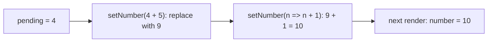
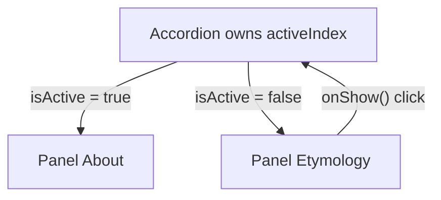
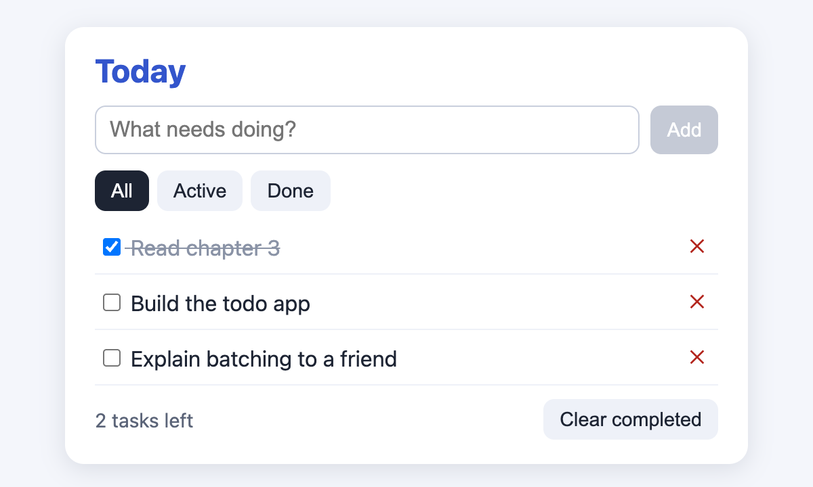

# Chapter 3 — State and Events

Chapter 2's catalog could *show* data but not *react* to the user. This chapter adds interactivity: **event handlers** respond to clicks and typing, and **state** lets a component remember values between renders. Most React bugs beginners meet — "my counter only goes up by one", "the screen doesn't update", "the note moved to the wrong row" — come from the ideas here, so each is shown with a program you can run.

**What you'll learn**

| # | Topic | You will be able to… |
|---|---|---|
| 3.1 | Responding to events | attach handlers, pass arguments, use `onX` props, stop propagation, prevent defaults |
| 3.2 | `useState` | give a component memory and trigger re-renders |
| 3.3 | State as a snapshot | predict what a handler sees after calling a setter |
| 3.4 | Batching | explain why several `setX` calls produce one re-render |
| 3.5 | Updater functions | queue updates based on the latest value (`n => n + 1`) |
| 3.6 | Objects and arrays in state | update them immutably (spread, `map`, `filter`, `toSorted`) and with Immer |
| 3.7 | Lifting state up | share state between siblings through their parent |
| 3.8 | Derived state | keep the minimal state and compute the rest |
| 3.9 | Controlled inputs | bind inputs to state and transform what the user types |
| 3.10 | State and tree position | know when state is kept or reset, and use `key` to reset it |
| 3.11 | Putting it together | a to-do app using every idea |

Code: [`code/`](code/) — React 19.3 in jsdom; user actions are simulated with `fireEvent` (dispatches one DOM event) and `@testing-library/user-event` (simulates a real user: focus, key presses, clicks).

---

## 3.1 Responding to events

### What it is
An **event** is something that happens in the browser — a click, a key press, a form submission. An **event handler** is a function you give React to run when that event happens. In JSX you pass it as a prop named `on` + event name in camelCase: `onClick`, `onChange`, `onSubmit`, `onKeyDown`, `onPointerMove`, `onFocus`, …

Analogy: a doorbell. You install the bell (pass the handler); it rings (runs) only when someone presses the button — not while you are installing it.

### How it works
1. Define a function (inside the component, so it can read props and state). Convention: name it `handle` + event, e.g. `handleClick`.
2. Pass the **function itself** — `onClick={handleClick}` or an inline arrow `onClick={() => …}`.
3. When the event fires, React calls it with an **event object** (`e`): `e.target` (the element), `e.type`, `e.key` for keyboard events, `e.preventDefault()`, `e.stopPropagation()`.

`code/02_events.jsx`:
```jsx
// 1. Pass the function; do not call it.
function Right() { return <button onClick={() => console.log('  Right: clicked')}>right</button>; }
function Wrong() {
  const handleClick = () => console.log('  Wrong: ran during RENDER, not on click');
  return <button onClick={handleClick()}>wrong</button>; // calls it now; onClick receives undefined
}

// 2. Passing arguments + custom event props (onX / handleX naming).
function Toolbar({ onPlay, onUpload }) {
  return (
    <div>
      <button onClick={() => onPlay('Kiki')}>Play movie</button>
      <button onClick={onUpload}>Upload image</button>
    </div>
  );
}
function App() {
  function handlePlay(title) { console.log(`  Playing ${title}`); }
  return <Toolbar onPlay={handlePlay} onUpload={(e) => console.log('  Uploading... event type =', e.type)} />;
}

// 3. Propagation: events bubble from child to parent; stopPropagation halts it.
function Panel({ stop }) {
  return (
    <div onClick={() => console.log('    parent <div> onClick')}>
      <button onClick={(e) => { if (stop) e.stopPropagation(); console.log('    child <button> onClick'); }}>
        {stop ? 'stop' : 'bubble'}
      </button>
    </div>
  );
}

// 4. preventDefault: stop the browser's default action (a form submit reloads the page).
function Signup() {
  return (
    <form onSubmit={(e) => { e.preventDefault(); console.log('  submitted without reload; defaultPrevented =', e.defaultPrevented); }}>
      <input aria-label="email" />
      <button>Send</button>
    </form>
  );
}
```

Output:
```
rendering <Wrong/>:
  Wrong: ran during RENDER, not on click
clicking wrong:
clicking right:
  Right: clicked
  Playing Kiki
  Uploading... event type = click
click "bubble":
    child <button> onClick
    parent <div> onClick
click "stop":
    child <button> onClick
  submitted without reload; defaultPrevented = true
```

What the output proves:
- **`onClick={handleClick()}` is a bug**: the parentheses call the function *during rendering*, and the button receives its return value (`undefined`), so clicking does nothing. If the function sets state, you get an infinite loop ("Too many re-renders"). Pass `handleClick`, or wrap in an arrow when you need arguments: `onClick={() => onPlay('Kiki')}`.
- **Custom components can define their own event props** (`onPlay`, `onUpload`). They are just function props; the name `on…` is a convention. The child decides *when* to call them; the parent decides *what* happens. This is how data flows **up** the tree.
- **Bubbling (propagation)**: the click fired on the button, then on its parent `<div>`. `e.stopPropagation()` stopped it at the button. (All React events bubble except `onScroll`. To catch an event on the way *down* before children see it, use the capture version, e.g. `onClickCapture`.)
- **`e.preventDefault()`** stops the browser's built-in behaviour — here, the full page reload a form submit would cause. It does *not* stop bubbling; that's `stopPropagation`.

### React's event object
React passes a **SyntheticEvent**: a wrapper around the browser's native event with the same interface (`target`, `currentTarget`, `preventDefault` …) that behaves consistently across browsers; `e.nativeEvent` gives the original. React attaches one listener per event type at the root container and dispatches to your handlers (event delegation) — you never call `addEventListener` for normal UI events.

### Common mistakes
| Mistake | Fix |
|---|---|
| `onClick={handle()}` | `onClick={handle}` or `onClick={() => handle(id)}` |
| `onclick` (lowercase) | `onClick` — React warns about the unknown prop |
| Putting handlers on a `<div>` for clickable things | Use `<button>` — keyboard and screen-reader support for free |
| Using `stopPropagation` to fix a design problem | Usually a sign the parent should get an explicit callback instead |
| Forgetting `preventDefault` on `onSubmit` | The page reloads and state is lost |

### In the interview
**30-second answer:** "Handlers are functions passed as `on…` props — pass the function, don't call it. React gives them a SyntheticEvent that mirrors the native one. Events bubble, so `stopPropagation` stops parents from seeing them, and `preventDefault` stops browser defaults like form submission. Components expose their own `onSomething` props so parents decide what happens."

- *Can handlers have side effects?* — Yes: handlers are *the* place for side effects (set state, fetch, log). Only rendering must be pure.
- *Difference between `e.target` and `e.currentTarget`?* — `target` is the element where the event started; `currentTarget` is the element whose handler is running.

### TL;DR
`onEvent={fn}` — pass, don't call. Arrow to pass arguments. Custom `onX` props send events up. `stopPropagation` = stop bubbling; `preventDefault` = stop browser default.

---

## 3.2 State: a component's memory — `useState`

### What it is
**State** is data a component remembers between renders and that changes over time because of interaction: the current input text, which tab is open, the items in a cart. You add state with the **`useState` Hook**:

```jsx
const [count, setCount] = useState(0);
//     value  setter          initial value (used on the first render only)
```

`useState` returns a pair (array destructuring gives them names): the **current value** and a **setter function**. Calling the setter (1) stores the new value and (2) asks React to **re-render** the component.

Analogy: a whiteboard in a meeting room. A normal local variable is a note written on your hand — gone when you leave (the function returns). State is written on the room's whiteboard: React keeps it for you, and when you rewrite it, everyone in the room (the UI) sees the new value.

### The problem it solves
`code/01_local_variable_vs_state.jsx`:
```jsx
function BrokenCounter() {
  let count = 0;                          // re-created as 0 on every render
  renders++;
  return <button onClick={() => { count = count + 1; console.log('  inside handler count =', count); }}>Broken: {count}</button>;
}

function Counter() {
  const [count, setCount] = useState(0);  // React keeps this value between renders
  return <button onClick={() => setCount(count + 1)}>Working: {count}</button>;
}
// click each twice; then render two <Counter />s and click only the first
```

Output:
```
  inside handler count = 1
  inside handler count = 2
screen shows: Broken: 0 | renders: 1
screen shows: Working: 2
two instances: Working: 1 | Working: 0
```

The broken version fails for two reasons: (1) changing a local variable does **not trigger a render** (renders stayed at 1), and (2) even if React re-rendered, `let count = 0` would reset it. `useState` fixes both: it **persists** the value and the setter **triggers** a render. The last line shows that **state is local to each instance**: two `<Counter />`s have independent counts.

### How it works
1. First render: `useState(0)` returns `[0, setCount]`; React stores `0` in its internal record for *this component instance at this position in the tree*.
2. Click → `setCount(1)` → React schedules a re-render.
3. Second render: `useState(0)` ignores the `0` and returns `[1, setCount]`.
4. React diffs and commits the new text.

React matches `useState` calls to stored values **by call order**. That is why Hooks have rules: call them only at the **top level** of a component (or custom Hook) — never inside `if`, loops, or nested functions (Chapter 7 explains why in detail).

### Details worth knowing
- **Several state variables** are fine: `const [name, setName] = useState(''); const [age, setAge] = useState(0);` Group values that always change together into one object.
- **Lazy initial state**: `useState(createInitialTodos)` (pass the function, not its result) runs an expensive initialiser only on the first render. `useState(createInitialTodos())` would call it every render and throw the result away.
- **Setter identity is stable**: `setCount` is the same function across renders — safe to pass down.
- **Same value → no re-render**: if the new value is identical to the current one (compared with `Object.is`), React skips re-rendering the component and its children (see §3.6).
- Naming: `[thing, setThing]` by convention.

### When not to use state
| Value | Where it belongs |
|---|---|
| Never changes | A constant outside the component |
| Comes from the parent | Props (don't copy into state — §3.8) |
| Can be computed from props/state | A variable in render (§3.8) |
| Must persist but must **not** re-render when it changes (timer ID, DOM node) | `useRef` (Chapter 5) |
| Shared by many distant components | Lift up (§3.7), then context / a store (Chapter 6) |
| Server data (lists from an API) | A data library such as TanStack Query (Chapters 6, 9) |

### In the interview
**30-second answer:** "`useState` gives a component memory. It returns the current value and a setter; calling the setter stores the new value and schedules a re-render. Local variables don't work because they reset each render and changing them doesn't trigger one. State is private to each component instance and identified by the Hook's call order, which is why Hooks must be called unconditionally at the top level."

- *What does `useState(fn)` do vs `useState(fn())`?* — Passing `fn` lets React call it once for the initial value; `fn()` runs every render.
- *Is state shared between two instances?* — No; each instance has its own.

### Self-check
1. Why does `let count` not work? → No re-render is triggered and it resets every render.
2. When is the argument of `useState(x)` used? → Only on the first render.
3. Can you call `useState` inside an `if`? → No — Hook order must be the same every render.

### TL;DR
`const [v, setV] = useState(initial)`. State persists between renders, is private per instance, and the setter triggers a re-render. Top-level calls only.

---

## 3.3 State as a snapshot

### What it is
When React renders your component, it hands you the state values **for that render**, like a photograph. Everything created during that render — the JSX *and the event handlers* — sees those fixed values. Calling a setter does not change the variable you already have; it requests a *new* render with a new snapshot.

### How it works
`code/03_state_as_snapshot.jsx`:
```jsx
function Counter() {
  const [number, setNumber] = useState(0);
  return (
    <>
      <h1>{number}</h1>
      <button onClick={() => {
        setNumber(number + 1);   // setNumber(0 + 1)
        setNumber(number + 1);   // setNumber(0 + 1)
        setNumber(number + 1);   // setNumber(0 + 1)
        console.log('  right after the three calls, number =', number);
      }}>+3</button>
    </>
  );
}

// Even a delayed callback sees the snapshot from the render it was created in.
function Delayed() {
  const [n, setN] = useState(0);
  return (
    <p>
      n is <output>{n}</output>{' '}
      <button onClick={() => { setN(n + 5); setTimeout(() => console.log('  timeout fired, n =', n), 10); }}>+5 later</button>
    </p>
  );
}
```

Output:
```
  right after the three calls, number = 0
heading after one click: 1
  timeout fired, n = 0
screen shows n = 5 (the timeout logged the old snapshot)
```

Step by step for the "+3" button:
1. The render where `number` is 0 created the click handler. Inside it, `number` is the constant `0`.
2. `setNumber(number + 1)` three times = `setNumber(1)` three times.
3. `console.log` still sees `0` — the setter does not mutate the variable.
4. React re-renders once with `number = 1`.

The timeout shows that the snapshot is permanent: even 10 ms later, after the screen shows 5, the closure still sees `n = 0` from the render that created it. This follows directly from JavaScript **closures** (a function remembers the variables in scope where it was created — see the JavaScript book, `../../../javascript/chapters/04-functions-scope-and-closures/README.md`).

### Why React works this way
Snapshots make handlers predictable: if a user clicks "Send to Alice", then quickly switches the recipient to Bob, the message still goes to Alice — the handler captured the recipient at click time. No surprises from values changing mid-handler.

### Common mistakes
- Reading state right after setting it and expecting the new value → use the value you computed: `const next = number + 1; setNumber(next); send(next);`.
- Expecting three `setX(x + 1)` calls to add 3 → use updater functions (§3.5).
- **Stale closures**: a timer or subscription created once keeps reading an old snapshot. Use an updater function, or refs/Effects (Chapter 5).

### TL;DR
State inside a render is a constant snapshot. Setters request a new render; they never change the variable you are holding.

---

## 3.4 Batching

### What it is
**Batching** means React collects all state updates made during one event and performs **a single re-render** after the handler finishes, instead of one render per `setX` call.

Analogy: a waiter takes the whole table's order before going to the kitchen, rather than walking to the kitchen after each person speaks.

### Why it matters
- **Performance**: five setters in one click = one render, not five.
- **Consistency**: the screen never shows a half-updated state (e.g. a new name with an old avatar).

Since **React 18**, batching is **automatic everywhere**: in React event handlers *and* inside `setTimeout`, promises, `fetch` callbacks and native event listeners. (Before React 18 only React event handlers were batched.) React also never batches *across* separate user events: two clicks are two renders.

### How it works — counting renders
`code/04_batching_and_updaters.jsx` counts renders for several buttons (the full component is in §3.5):

Output:
```
replace x3       -> number =  1 | re-renders caused: 1
updater x3       -> number =  4 | re-renders caused: 1
+5 then n=>n+1   -> number = 10 | re-renders caused: 1
+5, n=>n+1, 42   -> number = 42 | re-renders caused: 1
in timeout       -> number = 43 | re-renders caused: 1
```

Every row caused exactly **one** re-render, even "replace x3" (four setter calls on two state variables) and "in timeout" (two setters inside `setTimeout`).

**Opting out:** in rare cases you must have the DOM updated synchronously before the next line (e.g. to scroll to a just-added item); `flushSync(() => setX(v))` from `react-dom` forces it. Use sparingly — it hurts performance.

### TL;DR
All setter calls in one event → one re-render (everywhere since React 18). `flushSync` opts out.

---

## 3.5 Updater functions — queueing updates

### What it is
Instead of a value, you can pass a setter a **function** that receives the **pending** state and returns the next one: `setNumber(n => n + 1)`. React puts it in a **queue** and, on the next render, applies the queue in order.

### How it works
`code/04_batching_and_updaters.jsx`:
```jsx
function Counter() {
  const [number, setNumber] = useState(0);
  const [clicks, setClicks] = useState(0);
  renders++;
  return (
    <>
      <h1>{number}</h1>
      <button onClick={() => { setNumber(number + 1); setNumber(number + 1); setNumber(number + 1); setClicks(clicks + 1); }}>replace x3</button>
      <button onClick={() => { setNumber((n) => n + 1); setNumber((n) => n + 1); setNumber((n) => n + 1); }}>updater x3</button>
      <button onClick={() => { setNumber(number + 5); setNumber((n) => n + 1); }}>+5 then n=&gt;n+1</button>
      <button onClick={() => { setNumber(number + 5); setNumber((n) => n + 1); setNumber(42); }}>+5, n=&gt;n+1, 42</button>
      <button onClick={() => setTimeout(() => { setNumber((n) => n + 1); setClicks((c) => c + 1); }, 0)}>in timeout</button>
    </>
  );
}
```
(Output in §3.4: 1, 4, 10, 42, 43.)

Work through the queue exactly as React does. Each value in the queue means "replace with this"; each function means "compute from the previous result":

| Button (starting number) | Queue | Processing | Result |
|---|---|---|---|
| replace x3 (0) | `1`, `1`, `1` | replace 1, replace 1, replace 1 | **1** |
| updater x3 (1) | `n=>n+1` ×3 | 1→2→3→4 | **4** |
| +5 then n=>n+1 (4) | `9`, `n=>n+1` | replace 9, then 9+1 | **10** |
| +5, n=>n+1, 42 (10) | `15`, `n=>n+1`, `42` | 15 → 16 → replace 42 | **42** |
| in timeout (42) | `n=>n+1` | 42+1 | **43** |



### When to use which
| Use a plain value `setX(v)` | Use an updater `setX(prev => …)` |
|---|---|
| The new value doesn't depend on the old one (`setName('Ada')`, `setOpen(false)`) | The new value is computed from the old one and several updates may queue (`+1` twice) |
| Readability: most setters | Inside timers/subscriptions created earlier (avoids stale snapshots) |
| | Handlers passed to memoised children (no dependency on current state) |

Conventions: name the parameter after the state's first letter (`n`, `c`) or `prev`. Updaters must be **pure** — StrictMode calls them twice in development to check.

### Common mistakes
- `setCount(count++)` — mutates the snapshot variable and passes the *old* value. Use `count + 1`.
- Side effects inside an updater (`setX(x => { fetch(…); return x + 1; })`) — it may run twice.

### In the interview
**30-second answer:** "Setters queue updates. A plain value replaces the state; an updater function receives the pending value, so three `n => n + 1` calls add 3 while three `setN(n + 1)` calls add 1 because they all read the same snapshot. React processes the queue during the next render, and all of it is batched into one render."

- *What is `setN(n + 5); setN(m => m + 1)` from 0?* — 6.
- *What about `setN(m => m + 1); setN(n + 5)` from 0?* — 5 (the last replace wins).

### TL;DR
`setX(v)` replaces; `setX(prev => next)` computes from the queued value. Queue processed in order at the next render.

---

## 3.6 Updating objects and arrays immutably

### What it is
State can hold objects and arrays, but you must treat them as **immutable** (read-only): to change one, create a **new** object/array with the change and pass that to the setter. **Mutation** means changing an existing object in place (`obj.x = 1`, `arr.push(…)`).

Analogy: editing a shared document. Instead of scribbling on the original (others may be reading it, and nobody can tell it changed), you make a new version with the edit and announce "here's v2".

### Why it matters
1. **React only notices new references.** A setter compares old and new with `Object.is`. The same object — even if you changed its insides — looks "unchanged", so React may skip the render.
2. **Snapshots and history.** Old renders keep pointing at old objects; undo/redo and time-travel debugging work because previous versions are untouched.
3. **Optimisations** (`memo`, the React Compiler) rely on "new reference = changed".

### Objects
`code/05_updating_objects.jsx`:
```jsx
const [person, setPerson] = useState({
  name: 'Niki de Saint Phalle',
  artwork: { title: 'Blue Nana', city: 'Hamburg' },
});
// ...
<button onClick={() => { person.name = 'MUTATED'; setPerson(person); }}>mutate</button>
<button onClick={() => setPerson({ ...person, name: 'Niki' })}>copy name</button>
<button onClick={() => setPerson({ ...person, artwork: { ...person.artwork, city: 'Berlin' } })}>copy nested city</button>
```

Output:
```
initial           -> "Niki de Saint Phalle — Blue Nana (Hamburg)" | renders so far: 1
mutate + set same -> "Niki de Saint Phalle — Blue Nana (Hamburg)" | renders so far: 1
copy name         -> "Niki — Blue Nana (Hamburg)" | renders so far: 2
copy nested city  -> "Niki — Blue Nana (Berlin)" | renders so far: 3
```

- **mutate**: the object *was* changed, but `setPerson(person)` passed the same reference → no re-render → the screen is stale. (Worse: the change appears later at a random moment when something else re-renders.)
- **copy name**: `{ ...person, name }` — the **spread syntax** copies all top-level properties into a new object, then overrides `name`.
- **nested**: spread is *shallow* (one level). To change `artwork.city`, copy each level on the path: a new `person` containing a new `artwork`.

### Arrays — the recipe table
`code/06_updating_arrays.jsx`:
```jsx
const add = () => setItems([...items, { id: nextId++, title: 'Aurora', seen: false }]);          // add to end
const addFirst = () => setItems([{ id: nextId++, title: 'Fjords', seen: false }, ...items]);     // add to start
const insertAt1 = () => setItems([...items.slice(0, 1), { id: nextId++, title: 'Glacier', seen: false }, ...items.slice(1)]);
const remove = (id) => setItems(items.filter((it) => it.id !== id));                               // remove
const toggle = (id) => setItems(items.map((it) => (it.id === id ? { ...it, seen: !it.seen } : it))); // update one
const sortAZ = () => setItems(items.toSorted((a, b) => a.title.localeCompare(b.title)));          // sort a copy
const reverse = () => setItems([...items].reverse());                                              // copy, then reverse
const immerToggle = (id) => setItems(produce((draft) => {                                          // Immer: "mutate" a draft
  const it = draft.find((d) => d.id === id); it.seen = !it.seen;
}));
```

Output:
```
initial                  -> [ ] Big Bellies, [ ] Lunar Landscape, [x] Terracotta Army
add                      -> [ ] Big Bellies, [ ] Lunar Landscape, [x] Terracotta Army, [ ] Aurora
add first                -> [ ] Fjords, [ ] Big Bellies, [ ] Lunar Landscape, [x] Terracotta Army, [ ] Aurora
insert at 1              -> [ ] Fjords, [ ] Glacier, [ ] Big Bellies, [ ] Lunar Landscape, [x] Terracotta Army, [ ] Aurora
remove Lunar Landscape   -> [ ] Fjords, [ ] Glacier, [ ] Big Bellies, [x] Terracotta Army, [ ] Aurora
toggle Big Bellies       -> [ ] Fjords, [ ] Glacier, [x] Big Bellies, [x] Terracotta Army, [ ] Aurora
immer toggle Aurora      -> [ ] Fjords, [ ] Glacier, [x] Big Bellies, [x] Terracotta Army, [x] Aurora
sort                     -> [x] Aurora, [x] Big Bellies, [ ] Fjords, [ ] Glacier, [x] Terracotta Army
reverse                  -> [x] Terracotta Army, [ ] Glacier, [ ] Fjords, [x] Big Bellies, [x] Aurora
original array untouched: [ ] Big Bellies, [ ] Lunar Landscape, [x] Terracotta Army
```

| Goal | Avoid (mutates) | Use (returns a new array) |
|---|---|---|
| Add | `push`, `unshift` | `[...arr, x]`, `[x, ...arr]` |
| Insert at i | `splice(i, 0, x)` | `[...arr.slice(0, i), x, ...arr.slice(i)]` or `arr.toSpliced(i, 0, x)` |
| Remove | `splice`, `pop`, `shift` | `arr.filter(item => item.id !== id)` |
| Replace / update one item | `arr[i] = x`, `item.done = true` | `arr.map(item => item.id === id ? { ...item, done: true } : item)` or `arr.with(i, x)` |
| Sort / reverse | `sort()`, `reverse()` | `toSorted()`, `toReversed()` (ES2023), or copy first: `[...arr].sort()` |

The last line of the output confirms the original `initial` array was never modified.

Important: `[...arr]` copies the **array**, not the objects inside it. `const copy = [...items]; copy[0].seen = true` still mutates the shared object — that's why the toggle recipe also spreads the item (`{ ...it, seen: !it.seen }`).

### Immer — write "mutations" safely
Deep copying by hand gets noisy. **Immer** gives you a **draft** — a proxy object that records your changes — and produces a new immutable state with structural sharing (unchanged parts are reused). Above, `produce(draft => { … })` is passed to the setter as an updater. In components, the `use-immer` package wraps this as `useImmer`:

```jsx
// (use-immer — not run; same idea as produce above)
import { useImmer } from 'use-immer';
const [person, updatePerson] = useImmer({ name: 'Niki', artwork: { city: 'Hamburg' } });
updatePerson(draft => { draft.artwork.city = 'Berlin'; });
```
Redux Toolkit uses Immer internally (Chapter 6). Mutating the draft is fine; mutating real state is not.

### Trade-offs
| Manual spread | Immer |
|---|---|
| No dependency; explicit | Small extra dependency (a few KB) |
| Verbose for nested data | Reads like normal mutation, even deep |
| | Proxies: debugging drafts is slightly less direct |

Also consider **flattening** deeply nested state (normalise by ID, like a database table) — updates get simpler with or without Immer.

### Common mistakes
- `arr.push(x); setArr(arr)` → no re-render.
- `items.sort()` in render or before setting → mutates state.
- Copying only the outer level of nested data, then mutating inside.

### In the interview
**30-second answer:** "State must be treated as immutable: create new objects and arrays instead of mutating. React decides whether something changed by reference (`Object.is`), so mutating and setting the same object may not re-render and breaks snapshots and memoisation. Use spread for objects, `map`/`filter`/`toSorted`/`with` for arrays, copy every level for nested updates, or use Immer to write mutation-style code on a draft."

- *Is `[...arr]` a deep copy?* — No, shallow: the elements are shared.
- *How does Immer stay efficient?* — Structural sharing: only changed paths get new objects.

### Self-check
1. Why did "mutate" not update the screen? → Same reference passed; `Object.is` says unchanged → render skipped.
2. Update `user.address.zip` immutably? → `setUser({ ...user, address: { ...user.address, zip } })`.
3. Remove item with id 3? → `setItems(items.filter(i => i.id !== 3))`.

### TL;DR
Never mutate state. New object: `{ ...obj, key }`; new array: spread, `filter`, `map`, `toSorted`, `with`, `toSpliced`. Copy each nested level, or use Immer.

---

## 3.7 Lifting state up

### What it is
When two components must **share or coordinate** state, move the state to their **closest common parent** and pass it down as props, together with callbacks to change it. This is called **lifting state up**. The children become **controlled** (driven by props) instead of **uncontrolled** (driven by their own state).

Analogy: two siblings arguing over the TV remote. Give the remote to the parent; each child *asks* the parent to change the channel.

### How it works — an accordion
`code/07_lifting_state_up.jsx`. Requirement: only one panel open at a time.

```jsx
// Before: each Panel owns isActive -> both can be open at once.
function PanelLocal({ title, children }) {
  const [isActive, setIsActive] = useState(false);
  // ...
}

// After: Panel is controlled by props; the parent owns activeIndex.
function Panel({ title, isActive, onShow, children }) {
  return (
    <section>
      <h3>{title}</h3>
      {isActive ? <p>{children}</p> : <button onClick={onShow}>Show {title}</button>}
    </section>
  );
}
function Accordion() {
  const [activeIndex, setActiveIndex] = useState(0);
  return (
    <>
      <Panel title="About" isActive={activeIndex === 0} onShow={() => setActiveIndex(0)}>Almaty is Kazakhstan's largest city.</Panel>
      <Panel title="Etymology" isActive={activeIndex === 1} onShow={() => setActiveIndex(1)}>The name comes from the word for apple.</Panel>
    </>
  );
}
```

Output:
```
local state : open panels after clicking both = 2
lifted state: initially open = Almaty is Kazakhstan's largest city.
lifted state: after "Show Etymology" open panels = 1 -> The name comes from the word for apple.
```

The three steps:
1. **Remove** state from the children (`isActive` becomes a prop).
2. **Pass** hard-coded data from the common parent (`isActive={activeIndex === 0}`).
3. **Add** state to the parent (`activeIndex`) and pass a callback (`onShow`) so children can request changes.



### Single source of truth
For every piece of state there should be **one owner** component. Others receive it via props. If you find the same data stored in two places and "kept in sync", lift it to one owner instead.

### Trade-offs
| Lift up | Keep local |
|---|---|
| Siblings stay in sync; parent can reset/control | Simpler; state changes re-render less of the tree |
| Parent re-renders on every change (usually fine) | Parent cannot coordinate or read it |
| Too high → prop drilling (then context/composition, Chapter 6 / Chapter 2 §2.4) | |

Rule: keep state **as low as possible, as high as necessary**.

### In the interview
**30-second answer:** "When siblings need the same state, move it to their closest common parent, pass the value down as props and a callback to change it. The children become controlled components. It gives one source of truth; if lifting goes too high and causes prop drilling, use composition or context."

### TL;DR
Shared state → closest common parent. Pass value + `onChange`-style callback down. One owner per piece of state.

---

## 3.8 Derived state — choosing the minimal state

### What it is
**Derived state** is any value you can **calculate** from props or other state. It should be a normal variable computed during render, **not** stored with `useState`. Keep state **minimal** and let everything else be derived.

Analogy: you store your date of birth, not your age. Age is derived — storing it means updating it every year and risking it being wrong.

### How it works
`code/08_derived_state.jsx` shows three classic mistakes and fixes:
```jsx
// 1. Redundant state: fullName can be computed from first + last.
const fullName = `${first} ${last}`;              // derived: no useState, no sync code

// 2. Duplicated state: store the selected ID, not a copy of the selected object.
const [selectedItem, setSelectedItem] = useState(items[0]);     // BAD: a copy
const [selectedId, setSelectedId] = useState(0);                // GOOD: a reference by ID
const selected = storeObject ? selectedItem : items.find((i) => i.id === selectedId);

// 3. Mirroring a prop in state ignores later prop changes.
function MessageMirror({ color }) { const [c] = useState(color); return <p style={{ color: c }}>mirror: {c}</p>; }
function MessageDirect({ color }) { return <p style={{ color }}>direct: {color}</p>; }
```

Output:
```
derived fullName   : Ticket for: Ada King
store object copy  : You picked: pretzels
store selected id  : You picked: PRETZELS (renamed)
parent changed to red -> mirror: blue | direct: red
```

- Storing a **copy** of the selected object meant renaming the item left the selection showing the stale name. Storing the **ID** and deriving the object always shows current data.
- **Mirroring props** (`useState(color)`) captures only the first value; when the parent changed `color` to red, the mirror stayed blue. Use the prop directly. (If you really want only the initial value, name the prop `initialColor` to make that explicit.)

### Principles for structuring state
| Principle | Example |
|---|---|
| Group related state that always changes together | `{ x, y }` position in one object |
| Avoid contradictions | Instead of `isSending` + `isSent` booleans (both true = impossible), one `status: 'typing' \| 'sending' \| 'sent'` |
| Avoid redundant state | Compute `fullName`, `total`, `filteredList`, `remaining` in render |
| Avoid duplication | Store IDs, look objects up |
| Avoid deep nesting | Normalise: `{ byId: {…}, ids: […] }` |

"But isn't recalculating slow?" For typical lists (hundreds of items) filtering during render is microseconds. If a calculation is genuinely expensive, cache it with `useMemo` (Chapter 10) — still derived, never manually synced.

### In the interview
**30-second answer:** "I keep the minimal state and derive everything else during render — full names, totals, filtered lists. Storing derived values creates two sources of truth that can drift. I store IDs instead of copied objects, avoid mirroring props into state, and replace contradictory booleans with a single status value. Expensive derivations can be memoised with `useMemo`."

- *Should I use `useEffect` to update derived state when inputs change?* — No; that causes an extra render and a moment of stale UI. Compute it in render (Chapter 5 "You might not need an Effect").

### TL;DR
If it can be computed, compute it. Store IDs not copies, don't mirror props, prefer one status over several booleans.

---

## 3.9 Controlled inputs (basics)

### What it is
A **controlled input** is a form field whose displayed value comes from React state: you pass `value={state}` and update the state in `onChange`. React state is the **single source of truth**. An **uncontrolled input** keeps its own value in the DOM (you may set a starting `defaultValue` and read it later) — covered with forms and actions in Chapter 4.

| Element | Controlled prop | Read new value from |
|---|---|---|
| `<input type="text">`, `<textarea>` | `value` | `e.target.value` |
| `<select>` | `value` (on the `<select>`, not `selected` on options) | `e.target.value` |
| `<input type="checkbox">` / `radio` | `checked` | `e.target.checked` |

Note: React's `onChange` fires on **every keystroke** (like the DOM `input` event), not only on blur as the native `change` event does.

### How it works
`code/09_controlled_inputs.jsx`:
```jsx
function Profile() {
  const [name, setName] = useState('');
  const [bio, setBio] = useState('');
  const [plan, setPlan] = useState('free');
  const [agree, setAgree] = useState(false);
  return (
    <form onSubmit={(e) => { e.preventDefault(); console.log('  submit ->', JSON.stringify({ name, bio, plan, agree })); }}>
      <label>Username <input value={name} onChange={(e) => setName(e.target.value.toLowerCase().replace(/\s/g, ''))} /></label>
      <label>Bio <textarea value={bio} onChange={(e) => setBio(e.target.value.slice(0, 20))} /></label>
      <label>Plan
        <select value={plan} onChange={(e) => setPlan(e.target.value)}>
          <option value="free">Free</option><option value="pro">Pro</option>
        </select>
      </label>
      <label><input type="checkbox" checked={agree} onChange={(e) => setAgree(e.target.checked)} /> I agree</label>
      <p>{name ? `@${name}` : 'pick a username'} · {bio.length}/20</p>
      <button disabled={!agree || !name}>Create</button>
    </form>
  );
}
// user types "Ada Love Lace" and a 28-character bio, picks Pro, then ticks the box and submits
```

Output:
```
username field shows: adalovelace
bio field shows     : First programmer, 18
status line         : @adalovelace · 20/20
Create disabled?    : true
  submit -> {"name":"adalovelace","bio":"First programmer, 18","plan":"pro","agree":true}

value without onChange -> field shows: fixed
warning: You provided a `value` prop to a form field without an `onChange` handler. This will render a read-only field....
```

What control buys you:
1. **Transform input as it's typed** — lowercase, no spaces: "Ada Love Lace" became `adalovelace`.
2. **Enforce limits** — the bio stopped at 20 characters.
3. **Live derived UI** — the `@handle` preview, the counter, and the disabled button all react instantly.
4. **Submit** reads state directly — no DOM querying.

The last lines show the classic mistake: `value` without `onChange` makes a **read-only** field (typing did nothing) and React warns.

### Common mistakes
| Mistake | Symptom / fix |
|---|---|
| `value` without `onChange` | Read-only field + warning. Add `onChange`, or use `defaultValue` for uncontrolled, or `readOnly` if intended |
| `value={undefined}` first, then a string | Warning "changing an uncontrolled input to be controlled". Initialise with `''`, never `undefined`/`null` |
| Reading `e.target.value` for a checkbox | Use `e.target.checked` |
| Setting `selected` on `<option>` | Put `value` on `<select>` |
| One `useState` per field in a big form | Use one object + `[e.target.name]: e.target.value`, a reducer (Chapter 6), or a form library (Chapter 4) |

### Trade-offs
| Controlled | Uncontrolled |
|---|---|
| Instant validation, formatting, dependent fields | Less code; the DOM holds the value |
| Re-renders on each keystroke (fine for most forms) | Read values on submit via `FormData` or refs |
| Easy to reset/prefill from state | React 19 form **Actions** make this style first-class (Chapter 4) |

### TL;DR
Controlled input = `value={state}` + `onChange={e => setState(e.target.value)}` (`checked`/`e.target.checked` for checkboxes). Initialise with `''`. Gives formatting, limits and live UI.

---

## 3.10 State is tied to a position in the tree

### What it is
React stores state **not inside your component function** but in React's tree, attached to a **position** (the path of element types from the root). This explains when state is kept and when it resets:

| Situation | State |
|---|---|
| Same component type at the same position on the next render | **Kept** (even if props differ) |
| Different type at that position, or the component is removed | **Destroyed**; a new instance starts from initial state |
| Same type and position but a **different `key`** | **Destroyed and recreated** |

### How it works
`code/10_state_and_position.jsx`:
```jsx
function Counter({ person }) {
  const [score, setScore] = useState(0);
  return <p>{person}'s score: {score} <button onClick={() => setScore(score + 1)}>+1 {person}</button></p>;
}

function Scoreboard({ mode }) {
  const [isTaylor, setIsTaylor] = useState(true);
  let counter;
  if (mode === 'same-position') counter = isTaylor ? <Counter person="Taylor" /> : <Counter person="Sarah" />;
  if (mode === 'with-key') counter = isTaylor ? <Counter key="Taylor" person="Taylor" /> : <Counter key="Sarah" person="Sarah" />;
  return <div>{counter}<button onClick={() => setIsTaylor(!isTaylor)}>Next player</button></div>;
}
// Taylor scores 2, switch to Sarah, switch back
```

Output:
```
same-position: Taylor 2 -> switch -> Sarah's score: 2  -> switch back -> Taylor's score: 2
with-key     : Taylor 2 -> switch -> Sarah's score: 0  -> switch back -> Taylor's score: 0
```

- **Without keys** both branches are `<Counter>` at the same position, so React treats them as *the same component with a new `person` prop* — Sarah "inherits" Taylor's score. Usually a bug.
- **With keys** they are different identities: switching destroys one counter and creates the other fresh. (To *remember* each player's score while hidden, lift the scores up into the parent, §3.7.)

### Real-world use of `key` to reset
- A chat app: `<Chat key={contact.id} contact={contact} />` — switching contact clears the draft message instead of sending your text to the wrong person.
- An edit form: `<EditProfile key={userId} />` resets all fields when a different user is selected — no Effect needed.

### Common mistakes
- Defining a component inside another component (new type every render → state reset every render; Chapter 1 §1.7).
- Expecting different props to reset state — they don't; use a `key`.

### TL;DR
State lives at a tree position. Same type + same position = kept; different type or different key = reset. Use `key` to reset on purpose.

---

## 3.11 Putting it together — a to-do app

`code/todo.jsx` uses every idea from this chapter: a controlled input with `preventDefault` on submit, custom event props (`onAdd`, `onToggle`, `onDelete`), state lifted into `TodoApp`, immutable updates with updater functions, and derived `visible`/`remaining` values.

```jsx
function AddTodo({ onAdd }) {
  const [text, setText] = useState('');                      // controlled input
  function handleSubmit(e) {
    e.preventDefault();                                      // no page reload
    const title = text.trim();
    if (!title) return;
    onAdd(title);                                            // tell the parent
    setText('');
  }
  return (
    <form className="add" onSubmit={handleSubmit}>
      <input aria-label="New task" placeholder="What needs doing?" value={text} onChange={(e) => setText(e.target.value)} />
      <button disabled={!text.trim()}>Add</button>
    </form>
  );
}

function TodoItem({ todo, onToggle, onDelete }) {
  return (
    <li className={todo.done ? 'done' : ''}>
      <label>
        <input type="checkbox" checked={todo.done} onChange={() => onToggle(todo.id)} /> {todo.title}
      </label>
      <button aria-label={`Delete ${todo.title}`} onClick={() => onDelete(todo.id)}>✕</button>
    </li>
  );
}

const FILTERS = { all: () => true, active: (t) => !t.done, done: (t) => t.done };
// FilterBar renders one button per filter with aria-pressed ...

export default function TodoApp({ initialTodos = [] }) {
  const [todos, setTodos] = useState(initialTodos);          // lifted state: shared by all children
  const [filter, setFilter] = useState('all');

  const visible = todos.filter(FILTERS[filter]);             // derived, not stored
  const remaining = todos.filter((t) => !t.done).length;     // derived, not stored

  const add = (title) => setTodos((ts) => [...ts, { id: nextId++, title, done: false }]);
  const toggle = (id) => setTodos((ts) => ts.map((t) => (t.id === id ? { ...t, done: !t.done } : t)));
  const remove = (id) => setTodos((ts) => ts.filter((t) => t.id !== id));
  const clearDone = () => setTodos((ts) => ts.filter((t) => !t.done));

  return (
    <div className="todo">
      <h1>Today</h1>
      <AddTodo onAdd={add} />
      <FilterBar filter={filter} onChange={setFilter} />
      {visible.length === 0 ? <p className="empty">Nothing here.</p> : (
        <ul>{visible.map((t) => <TodoItem key={t.id} todo={t} onToggle={toggle} onDelete={remove} />)}</ul>
      )}
      <footer>
        <span>{remaining} {remaining === 1 ? 'task' : 'tasks'} left</span>
        {todos.length > remaining && <button onClick={clearDone}>Clear completed</button>}
      </footer>
    </div>
  );
}
```

`code/11_todo_app.jsx` drives it like a real user with `user-event` — typing, pressing Enter, clicking checkboxes and filter buttons:
```jsx
await user.type(screen.getByLabelText('New task'), 'Build the todo app{Enter}');
await user.type(screen.getByLabelText('New task'), 'Explain batching');
await user.click(screen.getByRole('button', { name: 'Add' }));
await user.click(screen.getByLabelText('Build the todo app'));
await user.click(screen.getByRole('button', { name: 'active' }));
// ... done filter, clear completed, delete
```

Output (label | visible items | footer):
```
start                       | [x] Read chapter 3                                               | 0 tasks left
added two                   | [x] Read chapter 3, [ ] Build the todo app, [ ] Explain batching | 2 tasks left
input cleared after add?   : true
ticked "Build the todo app" | [x] Read chapter 3, [x] Build the todo app, [ ] Explain batching | 1 task left
filter = active             | [ ] Explain batching                                             | 1 task left
filter = done               | [x] Read chapter 3, [x] Build the todo app                       | 1 task left
clear completed             | Nothing here.                                                    | 1 task left
filter = all, delete last   | Nothing here.                                                    | 0 tasks left
```

In the browser ([`code/todo.html`](code/todo.html), styles in `todo.css`):


*Figure 3.1 — `TodoApp` in Chrome. The struck-through item, the "2 tasks left" count and the "Clear completed" button are all derived from the one `todos` array.*

Design notes:
- **One owner**: only `TodoApp` holds `todos`; children get data + callbacks.
- **Minimal state**: `todos` and `filter`; `visible`, `remaining`, and whether "Clear completed" shows are derived.
- **Updater functions** in `add`/`toggle`/`remove` make each safe even if called several times in one event.
- **Accessible queries**: the test finds elements by label and role, which is also how screen-reader users find them (Chapter 12).

When this grows (editing, undo, persistence), the update logic moves into a **reducer** (`useReducer`, Chapter 6) and saving to `localStorage` needs an **Effect** (Chapter 5).

---

## Chapter 3 TL;DR

| Idea | Remember |
|---|---|
| Events | `onClick={handle}` — pass, don't call; `e.stopPropagation()`, `e.preventDefault()`; custom `onX` props send events up |
| `useState` | `[value, setValue]`; persists between renders, per instance; top-level calls only |
| Snapshot | Inside a render state is constant; setters request a new render |
| Batching | All updates in one event → one render (everywhere since React 18) |
| Updaters | `setX(prev => …)` to build on queued updates |
| Immutability | New objects/arrays: spread, `map`, `filter`, `toSorted`, `with`; Immer for deep updates |
| Lifting state | Shared state goes to the closest common parent; one owner |
| Derived state | Compute, don't store; store IDs, don't mirror props |
| Controlled inputs | `value` + `onChange` (`checked` for checkboxes); start with `''` |
| Position & key | Same type + position keeps state; a new `key` resets it |

Next: [Chapter 4 — Forms and Actions](../04-forms-and-actions/README.md).
