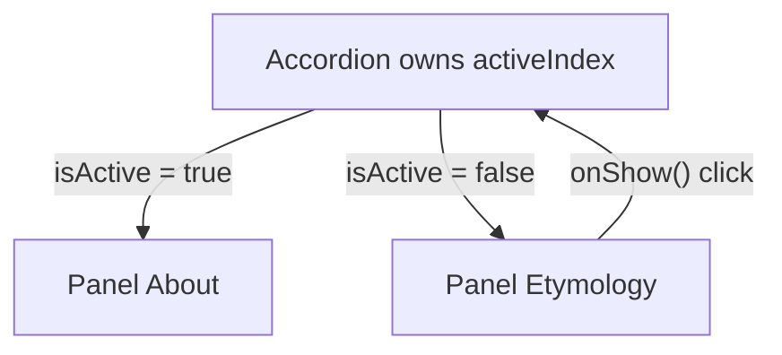

# Chapter 3 — State and Events

Chapter 2's catalog could *show* data but not *react* to the user. **Event handlers** respond to clicks and typing, and **state** lets a component remember values between **renders** (each time React calls your component). Most beginner bugs — "my counter only goes up by one", "the screen doesn't update", "the note moved to the wrong row" — come from the ideas here, so each is shown with a runnable program.

Code: [`code/`](code/) — React 19.3 in jsdom; user actions simulated with `fireEvent` (dispatches one DOM event) and `@testing-library/user-event` (simulates a real user: **focus** — which element receives keyboard input — key presses, clicks).

---

## 3.1 Responding to events

### What it is
An **event** is something that happens in the browser — a click, a key press, a form submission. An **event handler** is a function React runs when it happens, passed as a prop named `on` + event name in camelCase: `onClick`, `onChange`, `onSubmit`, `onKeyDown`, `onPointerMove`, `onFocus`, …

### How it works
1. Define a function inside the component (so it can read props and state); convention `handle` + event, e.g. `handleClick`.
2. Pass the **function itself** — `onClick={handleClick}` or an inline arrow `onClick={() => …}`.
3. React calls it with an **event object** `e`: `e.target`, `e.type`, `e.key` (keyboard), `e.preventDefault()`, `e.stopPropagation()`.

`code/02_events.jsx`:
```jsx
// 1. Pass the function; do not call it.
function Right() { return <button onClick={() => console.log('  Right: clicked')}>right</button>; }
function Wrong() {
  const handleClick = () => console.log('  Wrong: ran during RENDER, not on click');
  return <button onClick={handleClick()}>wrong</button>; // calls it now; onClick receives undefined
}

// 2. Passing arguments + custom event props (onX / handleX naming).
function Toolbar({ onPlay, onUpload }) {
  return (
    <div>
      <button onClick={() => onPlay('Kiki')}>Play movie</button>
      <button onClick={onUpload}>Upload image</button>
    </div>
  );
}
function App() {
  function handlePlay(title) { console.log(`  Playing ${title}`); }
  return <Toolbar onPlay={handlePlay} onUpload={(e) => console.log('  Uploading... event type =', e.type)} />;
}

// 3. Propagation: events bubble from child to parent; stopPropagation halts it.
function Panel({ stop }) {
  return (
    <div onClick={() => console.log('    parent <div> onClick')}>
      <button onClick={(e) => { if (stop) e.stopPropagation(); console.log('    child <button> onClick'); }}>
        {stop ? 'stop' : 'bubble'}
      </button>
    </div>
  );
}

// 4. preventDefault: stop the browser's default action (a form submit reloads the page).
function Signup() {
  return (
    <form onSubmit={(e) => { e.preventDefault(); console.log('  submitted without reload; defaultPrevented =', e.defaultPrevented); }}>
      <input aria-label="email" />
      <button>Send</button>
    </form>
  );
}
```

Output:
```
rendering <Wrong/>:
  Wrong: ran during RENDER, not on click
clicking wrong:
clicking right:
  Right: clicked
  Playing Kiki
  Uploading... event type = click
click "bubble":
    child <button> onClick
    parent <div> onClick
click "stop":
    child <button> onClick
  submitted without reload; defaultPrevented = true
```

- **`onClick={handleClick()}` is a bug**: it runs *during rendering* and the button receives `undefined`, so clicking does nothing. If the function sets state you get an **infinite loop** (React stops it with "Too many re-renders"). Pass `handleClick`, or wrap in an arrow for arguments: `onClick={() => onPlay('Kiki')}`.
- **Custom components define their own event props** (`onPlay`, `onUpload`) — plain function props named `on…` by convention. The child decides *when* to call; the parent decides *what* happens. This is how data flows **up**.
- **Bubbling (propagation)**: the click fired on the button, then its parent `<div>`; `e.stopPropagation()` stopped it at the button. All React events bubble except `onScroll`. To catch an event on the way *down* before children see it, use the **capture phase** version (root → target, before bubbling back up), e.g. `onClickCapture`.
- **`e.preventDefault()`** stops the browser's built-in behaviour (here the page reload of a form submit). It does *not* stop bubbling.

### React's event object
React passes a **SyntheticEvent**: a cross-browser-consistent wrapper around the **native** browser event with the same interface (`target`, `currentTarget`, `preventDefault` …); `e.nativeEvent` gives the original. React attaches one **listener** per event type at the root container and dispatches to your handlers (**event delegation**), so you never call `addEventListener` for normal UI events.

### Common mistakes
| Mistake | Fix |
|---|---|
| `onClick={handle()}` | `onClick={handle}` or `onClick={() => handle(id)}` |
| `onclick` (lowercase) | `onClick` — React warns about the unknown prop |
| Click handlers on a `<div>` | Use `<button>` — keyboard and screen-reader support for free |
| `stopPropagation` to fix a design problem | Usually the parent should get an explicit callback instead |
| No `preventDefault` on `onSubmit` | The page reloads and state is lost |

### In the interview
**30-second answer:** "Handlers are functions passed as `on…` props — pass the function, don't call it. React gives them a SyntheticEvent that mirrors the native one. Events bubble, so `stopPropagation` stops parents from seeing them, and `preventDefault` stops browser defaults like form submission. Components expose their own `onSomething` props so parents decide what happens."

- *Can handlers have side effects?* — Yes: handlers are *the* place for side effects (set state, fetch, log). Only rendering must be pure.
- *`e.target` vs `e.currentTarget`?* — `target` is where the event started; `currentTarget` is the element whose handler is running.

### TL;DR
`onEvent={fn}` — pass, don't call. Arrow to pass arguments. Custom `onX` props send events up. `stopPropagation` = stop bubbling; `preventDefault` = stop browser default.

---

## 3.2 State: a component's memory — `useState`

### What it is
**State** is data a component remembers between renders and that changes with interaction: input text, the open tab, cart items. Add it with the **`useState` Hook** (a **Hook** is a React function starting with `use` that taps into React features):

```jsx
const [count, setCount] = useState(0);
//     value  setter          initial value (used on the first render only)
```

`useState` returns a pair (named via array destructuring): the **current value** and a **setter**. Calling the setter (1) stores the new value and (2) asks React to **re-render** the component.

### The problem it solves
`code/01_local_variable_vs_state.jsx`:
```jsx
function BrokenCounter() {
  let count = 0;                          // re-created as 0 on every render
  renders++;
  return <button onClick={() => { count = count + 1; console.log('  inside handler count =', count); }}>Broken: {count}</button>;
}

function Counter() {
  const [count, setCount] = useState(0);  // React keeps this value between renders
  return <button onClick={() => setCount(count + 1)}>Working: {count}</button>;
}
// click each twice; then render two <Counter />s and click only the first
```

Output:
```
  inside handler count = 1
  inside handler count = 2
screen shows: Broken: 0 | renders: 1
screen shows: Working: 2
two instances: Working: 1 | Working: 0
```

The local variable fails twice: changing it does **not trigger a render** (renders stayed 1), and `let count = 0` would reset it anyway. `useState` **persists** the value and its setter **triggers** a render. The last line shows **state is local to each instance**.

### How it works
1. First render: `useState(0)` returns `[0, setCount]`; React stores `0` for *this instance at this position in the tree*.
2. Click → `setCount(1)` → React schedules a re-render.
3. Second render: `useState(0)` ignores the `0` and returns `[1, setCount]`; React diffs and commits.

React matches `useState` calls to stored values **by call order**, hence the rule: call Hooks only at the **top level** of a component or **custom Hook** (your own `use…` function) — never inside `if`, loops or nested functions ([§7.2](../07-custom-hooks-and-hook-rules/README.md#72-the-rules-of-hooks)).

### Details worth knowing
- **Several state variables** are fine; group values that always change together into one object. Name them `[thing, setThing]`.
- **Lazy initial state**: `useState(createInitialTodos)` (the function, not its result) runs an expensive initialiser only on the first render; `useState(createInitialTodos())` calls it every render and discards the result.
- **Setter identity is stable** across renders — safe to pass down.
- **Same value → no re-render**: if the new value is identical (`Object.is` — "same value / same object"), React skips re-rendering the component and its children (§3.6).

### When not to use state
| Value | Where it belongs |
|---|---|
| Never changes | A constant outside the component |
| Comes from the parent | Props (don't copy into state — §3.8) |
| Can be computed from props/state | A variable in render (§3.8) |
| Must persist but must **not** re-render (timer ID, DOM node) | `useRef` ([§5.8](../05-effects-and-refs/README.md#58-useref-for-values)) |
| Shared by many distant components | Lift up (§3.7), then context / a store ([Chapter 6](../06-state-management/README.md)) |
| Server data from an API (a server interface you request data from) | A data library such as TanStack Query ([§6.9](../06-state-management/README.md#69-tanstack-query--server-state), Chapter 9) |

### In the interview
**30-second answer:** "`useState` gives a component memory. It returns the current value and a setter; calling the setter stores the new value and schedules a re-render. Local variables don't work because they reset each render and changing them doesn't trigger one. State is private to each component instance and identified by the Hook's call order, which is why Hooks must be called unconditionally at the top level."

- *`useState(fn)` vs `useState(fn())`?* — `fn` is called once for the initial value; `fn()` runs every render.
- *When is the argument of `useState(x)` used?* — Only on the first render.
- *Shared between two instances?* — No; each instance has its own.

### TL;DR
`const [v, setV] = useState(initial)`. State persists between renders, is private per instance, and the setter triggers a re-render. Top-level calls only.

---

## 3.3 State as a snapshot

### What it is
Each render gets the state values **for that render**, like a photograph. Everything created during it — JSX *and event handlers* — sees those fixed values. A setter does not change the variable you hold; it requests a *new* render with a new snapshot.

### How it works
`code/03_state_as_snapshot.jsx`:
```jsx
function Counter() {
  const [number, setNumber] = useState(0);
  return (
    <>
      <h1>{number}</h1>
      <button onClick={() => {
        setNumber(number + 1);   // setNumber(0 + 1)
        setNumber(number + 1);   // setNumber(0 + 1)
        setNumber(number + 1);   // setNumber(0 + 1)
        console.log('  right after the three calls, number =', number);
      }}>+3</button>
    </>
  );
}

// Even a delayed callback sees the snapshot from the render it was created in.
function Delayed() {
  const [n, setN] = useState(0);
  return (
    <p>
      n is <output>{n}</output>{' '}
      <button onClick={() => { setN(n + 5); setTimeout(() => console.log('  timeout fired, n =', n), 10); }}>+5 later</button>
    </p>
  );
}
```

Output:
```
  right after the three calls, number = 0
heading after one click: 1
  timeout fired, n = 0
screen shows n = 5 (the timeout logged the old snapshot)
```

In the render where `number` is 0, the handler's `number` is the constant `0`: three `setNumber(number + 1)` = three `setNumber(1)`, the log still sees 0, and React re-renders once with 1. The timeout (`setTimeout(fn, ms)` runs `fn` once after a delay) shows the snapshot is permanent: 10 ms later, with the screen at 5, the closure still sees `n = 0` — plain JavaScript **closures** (a function remembers the variables in scope where it was created; JavaScript book, `../../../javascript/chapters/04-functions-scope-and-closures/README.md`).

**Why:** handlers are predictable. Click "Send to Alice", then quickly switch the recipient to Bob — the message still goes to Alice, captured at click time.

### Common mistakes
- Reading state right after setting it → use the value you computed: `const next = number + 1; setNumber(next); send(next);`.
- Expecting three `setX(x + 1)` to add 3 → updater functions (§3.5).
- **Stale closures**: a timer or **subscription** (long-lived "tell me when X changes" registration) created once keeps reading an old snapshot. Use an updater, or refs/Effects (Chapter 5).

### TL;DR
State inside a render is a constant snapshot. Setters request a new render; they never change the variable you are holding.

---

## 3.4 Batching

### What it is
**Batching**: React collects all state updates made during one event and performs **a single re-render** after the handler finishes — better performance (five setters = one render) and no half-updated screens (new name with old avatar).

Since **React 18** batching is **automatic everywhere**: React handlers *and* `setTimeout`, **promises** (values that arrive later, used with `.then`/`await`), `fetch` callbacks and native listeners. (Before 18, only React event handlers.) React never batches *across* separate user events: two clicks = two renders.

### How it works — counting renders
`code/04_batching_and_updaters.jsx` (component in §3.5) counts renders per button:

```
replace x3       -> number =  1 | re-renders caused: 1
updater x3       -> number =  4 | re-renders caused: 1
+5 then n=>n+1   -> number = 10 | re-renders caused: 1
+5, n=>n+1, 42   -> number = 42 | re-renders caused: 1
in timeout       -> number = 43 | re-renders caused: 1
```

Every row caused **one** re-render — including "replace x3" (four setter calls on two state variables) and "in timeout" (two setters inside `setTimeout`).

**Opting out:** when the DOM must update **synchronously** before the next line (e.g. scroll to a just-added item), `flushSync(() => setX(v))` from `react-dom` forces it. Use sparingly — it hurts performance.

### TL;DR
All setter calls in one event → one re-render (everywhere since React 18). `flushSync` opts out.

---

## 3.5 Updater functions — queueing updates

### What it is
Pass a setter a **function** that receives the **pending** state and returns the next one: `setNumber(n => n + 1)`. React queues it (first in, first out) and applies the queue in order on the next render.

### How it works
`code/04_batching_and_updaters.jsx`:
```jsx
function Counter() {
  const [number, setNumber] = useState(0);
  const [clicks, setClicks] = useState(0);
  renders++;
  return (
    <>
      <h1>{number}</h1>
      <button onClick={() => { setNumber(number + 1); setNumber(number + 1); setNumber(number + 1); setClicks(clicks + 1); }}>replace x3</button>
      <button onClick={() => { setNumber((n) => n + 1); setNumber((n) => n + 1); setNumber((n) => n + 1); }}>updater x3</button>
      <button onClick={() => { setNumber(number + 5); setNumber((n) => n + 1); }}>+5 then n=&gt;n+1</button>
      <button onClick={() => { setNumber(number + 5); setNumber((n) => n + 1); setNumber(42); }}>+5, n=&gt;n+1, 42</button>
      <button onClick={() => setTimeout(() => { setNumber((n) => n + 1); setClicks((c) => c + 1); }, 0)}>in timeout</button>
    </>
  );
}
```
(Output in §3.4: 1, 4, 10, 42, 43.)

A value in the queue means "replace with this"; a function means "compute from the previous result":

| Button (starting number) | Queue | Processing | Result |
|---|---|---|---|
| replace x3 (0) | `1`, `1`, `1` | replace 1, replace 1, replace 1 | **1** |
| updater x3 (1) | `n=>n+1` ×3 | 1→2→3→4 | **4** |
| +5 then n=>n+1 (4) | `9`, `n=>n+1` | replace 9, then 9+1 | **10** |
| +5, n=>n+1, 42 (10) | `15`, `n=>n+1`, `42` | 15 → 16 → replace 42 | **42** |
| in timeout (42) | `n=>n+1` | 42+1 | **43** |

### When to use which
| Plain value `setX(v)` | Updater `setX(prev => …)` |
|---|---|
| New value doesn't depend on the old (`setName('Ada')`, `setOpen(false)`) — most setters | New value computed from the old and several updates may queue (`+1` twice) |
| | Inside timers/subscriptions created earlier (avoids stale snapshots) |
| | Handlers passed to memoised children (no dependency on current state) |

Name the parameter after the state's first letter (`n`, `c`) or `prev`. Updaters must be **pure** — StrictMode calls them twice in development.

### Common mistakes
- `setCount(count++)` — mutates the snapshot variable and passes the *old* value. Use `count + 1`.
- Side effects inside an updater (`setX(x => { fetch(…); return x + 1; })`) — it may run twice.

### In the interview
**30-second answer:** "Setters queue updates. A plain value replaces the state; an updater function receives the pending value, so three `n => n + 1` calls add 3 while three `setN(n + 1)` calls add 1 because they all read the same snapshot. React processes the queue during the next render, and all of it is batched into one render."

- *`setN(n + 5); setN(m => m + 1)` from 0?* — 6.
- *`setN(m => m + 1); setN(n + 5)` from 0?* — 5 (the last replace wins).

### TL;DR
`setX(v)` replaces; `setX(prev => next)` computes from the queued value. Queue processed in order at the next render.

---

## 3.6 Updating objects and arrays immutably

### What it is
State may hold objects and arrays, but treat them as **immutable**: to change one, create a **new** object/array and pass it to the setter. **Mutation** = changing an existing object in place (`obj.x = 1`, `arr.push(…)`).

### Why it matters
1. **React only notices new references** (a **reference** points to where an object lives; two variables can share one). The setter compares with `Object.is`; the same object — even with changed insides — looks unchanged, so React may skip the render.
2. **Snapshots and history**: old renders keep pointing at old objects, so undo/redo and time-travel debugging work.
3. **Optimisations** (`memo`, the React Compiler) rely on "new reference = changed".

### Objects
`code/05_updating_objects.jsx`:
```jsx
const [person, setPerson] = useState({
  name: 'Niki de Saint Phalle',
  artwork: { title: 'Blue Nana', city: 'Hamburg' },
});
// ...
<button onClick={() => { person.name = 'MUTATED'; setPerson(person); }}>mutate</button>
<button onClick={() => setPerson({ ...person, name: 'Niki' })}>copy name</button>
<button onClick={() => setPerson({ ...person, artwork: { ...person.artwork, city: 'Berlin' } })}>copy nested city</button>
```

Output:
```
initial           -> "Niki de Saint Phalle — Blue Nana (Hamburg)" | renders so far: 1
mutate + set same -> "Niki de Saint Phalle — Blue Nana (Hamburg)" | renders so far: 1
copy name         -> "Niki — Blue Nana (Hamburg)" | renders so far: 2
copy nested city  -> "Niki — Blue Nana (Berlin)" | renders so far: 3
```

- **mutate**: the object changed, but the same reference was passed → no re-render → stale screen (and the change pops up later whenever something else re-renders).
- **copy name**: **spread** `{ ...person, name }` copies top-level properties into a new object, then overrides `name`.
- **nested**: spread is *shallow*; copy each level on the path (new `person` containing a new `artwork`).

### Arrays — the recipe table
`code/06_updating_arrays.jsx`:
```jsx
const add = () => setItems([...items, { id: nextId++, title: 'Aurora', seen: false }]);          // add to end
const addFirst = () => setItems([{ id: nextId++, title: 'Fjords', seen: false }, ...items]);     // add to start
const insertAt1 = () => setItems([...items.slice(0, 1), { id: nextId++, title: 'Glacier', seen: false }, ...items.slice(1)]);
const remove = (id) => setItems(items.filter((it) => it.id !== id));                               // remove
const toggle = (id) => setItems(items.map((it) => (it.id === id ? { ...it, seen: !it.seen } : it))); // update one
const sortAZ = () => setItems(items.toSorted((a, b) => a.title.localeCompare(b.title)));          // sort a copy
const reverse = () => setItems([...items].reverse());                                              // copy, then reverse
const immerToggle = (id) => setItems(produce((draft) => {                                          // Immer: "mutate" a draft
  const it = draft.find((d) => d.id === id); it.seen = !it.seen;
}));
```

Output:
```
initial                  -> [ ] Big Bellies, [ ] Lunar Landscape, [x] Terracotta Army
add                      -> [ ] Big Bellies, [ ] Lunar Landscape, [x] Terracotta Army, [ ] Aurora
add first                -> [ ] Fjords, [ ] Big Bellies, [ ] Lunar Landscape, [x] Terracotta Army, [ ] Aurora
insert at 1              -> [ ] Fjords, [ ] Glacier, [ ] Big Bellies, [ ] Lunar Landscape, [x] Terracotta Army, [ ] Aurora
remove Lunar Landscape   -> [ ] Fjords, [ ] Glacier, [ ] Big Bellies, [x] Terracotta Army, [ ] Aurora
toggle Big Bellies       -> [ ] Fjords, [ ] Glacier, [x] Big Bellies, [x] Terracotta Army, [ ] Aurora
immer toggle Aurora      -> [ ] Fjords, [ ] Glacier, [x] Big Bellies, [x] Terracotta Army, [x] Aurora
sort                     -> [x] Aurora, [x] Big Bellies, [ ] Fjords, [ ] Glacier, [x] Terracotta Army
reverse                  -> [x] Terracotta Army, [ ] Glacier, [ ] Fjords, [x] Big Bellies, [x] Aurora
original array untouched: [ ] Big Bellies, [ ] Lunar Landscape, [x] Terracotta Army
```

| Goal | Avoid (mutates) | Use (returns a new array) |
|---|---|---|
| Add | `push`, `unshift` | `[...arr, x]`, `[x, ...arr]` |
| Insert at i | `splice(i, 0, x)` | `[...arr.slice(0, i), x, ...arr.slice(i)]` or `arr.toSpliced(i, 0, x)` |
| Remove | `splice`, `pop`, `shift` | `arr.filter(item => item.id !== id)` |
| Replace / update one item | `arr[i] = x`, `item.done = true` | `arr.map(item => item.id === id ? { ...item, done: true } : item)` or `arr.with(i, x)` |
| Sort / reverse | `sort()`, `reverse()` | `toSorted()`, `toReversed()` (ES2023), or copy first: `[...arr].sort()` |

`[...arr]` copies the **array**, not the objects inside: `copy[0].seen = true` still mutates the shared object — which is why the toggle recipe also spreads the item.

### Immer — write "mutations" safely
**Immer** gives you a **draft** — a **proxy** (stand-in that intercepts reads and writes) recording your changes — and produces new immutable state with structural sharing (unchanged parts reused). Above, `produce(draft => { … })` is passed to the setter as an updater. In components, `use-immer` wraps it:

```jsx
// (use-immer — not run; same idea as produce above)
import { useImmer } from 'use-immer';
const [person, updatePerson] = useImmer({ name: 'Niki', artwork: { city: 'Hamburg' } });
updatePerson(draft => { draft.artwork.city = 'Berlin'; });
```
Redux Toolkit uses Immer internally ([§6.7](../06-state-management/README.md#67-redux-toolkit)). Mutating the draft is fine; mutating real state is not.

**Trade-off:** manual spread = no dependency and explicit, but verbose for nested data; Immer = a few KB, reads like normal mutation even deep, but proxied drafts are slightly harder to debug. Also consider **flattening** nested state (normalise by ID) — updates get simpler either way.

### Common mistakes
- `arr.push(x); setArr(arr)` → no re-render.
- `items.sort()` in render or before setting → mutates state.
- Copying only the outer level of nested data, then mutating inside.

### In the interview
**30-second answer:** "State must be treated as immutable: create new objects and arrays instead of mutating. React decides whether something changed by reference (`Object.is`), so mutating and setting the same object may not re-render and breaks snapshots and memoisation. Use spread for objects, `map`/`filter`/`toSorted`/`with` for arrays, copy every level for nested updates, or use Immer to write mutation-style code on a draft."

- *Is `[...arr]` a deep copy?* — No, shallow: elements are shared.
- *Update `user.address.zip`?* — `setUser({ ...user, address: { ...user.address, zip } })`.
- *How does Immer stay efficient?* — Structural sharing: only changed paths get new objects.

### TL;DR
Never mutate state. New object: `{ ...obj, key }`; new array: spread, `filter`, `map`, `toSorted`, `with`, `toSpliced`. Copy each nested level, or use Immer.

---

## 3.7 Lifting state up

### What it is
When two components must **share or coordinate** state, move it to their **closest common parent** and pass it down as props, with callbacks to change it — **lifting state up**. The children become **controlled** (driven by props) instead of **uncontrolled** (driven by their own state).

### How it works — an accordion
`code/07_lifting_state_up.jsx`. An **accordion** is a stack of panels where clicking a header expands it; requirement: only one open at a time.

```jsx
// Before: each Panel owns isActive -> both can be open at once.
function PanelLocal({ title, children }) {
  const [isActive, setIsActive] = useState(false);
  // ...
}

// After: Panel is controlled by props; the parent owns activeIndex.
function Panel({ title, isActive, onShow, children }) {
  return (
    <section>
      <h3>{title}</h3>
      {isActive ? <p>{children}</p> : <button onClick={onShow}>Show {title}</button>}
    </section>
  );
}
function Accordion() {
  const [activeIndex, setActiveIndex] = useState(0);
  return (
    <>
      <Panel title="About" isActive={activeIndex === 0} onShow={() => setActiveIndex(0)}>Almaty is Kazakhstan's largest city.</Panel>
      <Panel title="Etymology" isActive={activeIndex === 1} onShow={() => setActiveIndex(1)}>The name comes from the word for apple.</Panel>
    </>
  );
}
```

Output:
```
local state : open panels after clicking both = 2
lifted state: initially open = Almaty is Kazakhstan's largest city.
lifted state: after "Show Etymology" open panels = 1 -> The name comes from the word for apple.
```

Steps: (1) **remove** state from the children (`isActive` becomes a prop); (2) **pass** it from the common parent (`isActive={activeIndex === 0}`); (3) **add** state to the parent and pass a callback (`onShow`) so children can request changes.



### Single source of truth
Each piece of state has **one owner**; others get it via props. Same data stored in two places and "kept in sync" → lift it to one owner.

### Trade-offs
| Lift up | Keep local |
|---|---|
| Siblings stay in sync; parent can reset/control | Simpler; state changes re-render less of the tree |
| Parent re-renders on every change (usually fine) | Parent cannot coordinate or read it |
| Too high → prop drilling (then composition [§2.4](../02-components-and-props/README.md#24-composition) or context [§6.3](../06-state-management/README.md#63-context--pass-data-deeply-without-props)) | |

Rule: keep state **as low as possible, as high as necessary**.

### In the interview
**30-second answer:** "When siblings need the same state, move it to their closest common parent, pass the value down as props and a callback to change it. The children become controlled components. It gives one source of truth; if lifting goes too high and causes prop drilling, use composition or context."

### TL;DR
Shared state → closest common parent. Pass value + `onChange`-style callback down. One owner per piece of state.

---

## 3.8 Derived state — choosing the minimal state

### What it is
**Derived state** is any value you can **calculate** from props or other state. Compute it as a normal variable during render — **not** with `useState`. Keep state **minimal** (store a birth date, not an age).

### How it works
`code/08_derived_state.jsx` — three classic mistakes and fixes:
```jsx
// 1. Redundant state: fullName can be computed from first + last.
const fullName = `${first} ${last}`;              // derived: no useState, no sync code

// 2. Duplicated state: store the selected ID, not a copy of the selected object.
const [selectedItem, setSelectedItem] = useState(items[0]);     // BAD: a copy
const [selectedId, setSelectedId] = useState(0);                // GOOD: a reference by ID
const selected = storeObject ? selectedItem : items.find((i) => i.id === selectedId);

// 3. Mirroring a prop in state ignores later prop changes.
function MessageMirror({ color }) { const [c] = useState(color); return <p style={{ color: c }}>mirror: {c}</p>; }
function MessageDirect({ color }) { return <p style={{ color }}>direct: {color}</p>; }
```

Output:
```
derived fullName   : Ticket for: Ada King
store object copy  : You picked: pretzels
store selected id  : You picked: PRETZELS (renamed)
parent changed to red -> mirror: blue | direct: red
```

- A stored **copy** of the selected object kept the stale name after a rename; storing the **ID** and deriving always shows current data.
- **Mirroring props** (`useState(color)`) captures only the first value — the mirror stayed blue. Use the prop directly; if you really want only the initial value, name it `initialColor`.

### Principles for structuring state
| Principle | Example |
|---|---|
| Group related state that always changes together | `{ x, y }` position in one object |
| Avoid contradictions | Instead of `isSending` + `isSent` (both true = impossible), one `status: 'typing' \| 'sending' \| 'sent'` |
| Avoid redundant state | Compute `fullName`, `total`, `filteredList`, `remaining` in render |
| Avoid duplication | Store IDs, look objects up |
| Avoid deep nesting | Normalise: `{ byId: {…}, ids: […] }` |

"Isn't recalculating slow?" Filtering hundreds of items takes microseconds. A genuinely expensive calculation can be cached with `useMemo` (Chapter 10) — still derived, never manually synced.

### In the interview
**30-second answer:** "I keep the minimal state and derive everything else during render — full names, totals, filtered lists. Storing derived values creates two sources of truth that can drift. I store IDs instead of copied objects, avoid mirroring props into state, and replace contradictory booleans with a single status value. Expensive derivations can be memoised with `useMemo`."

- *Use `useEffect` to update derived state when inputs change?* — No; it causes an extra render and a moment of stale UI. Compute it in render ([§5.6](../05-effects-and-refs/README.md#56-you-might-not-need-an-effect)).

### TL;DR
If it can be computed, compute it. Store IDs not copies, don't mirror props, prefer one status over several booleans.

---

## 3.9 Controlled inputs (basics)

### What it is
A **controlled input**'s displayed value comes from React state: `value={state}` plus a state update in `onChange`; state is the **single source of truth**. An **uncontrolled input** keeps its value in the DOM (optional `defaultValue`, read later) — [§4.2](../04-forms-and-actions/README.md#42-controlled-vs-uncontrolled-inputs).

| Element | Controlled prop | Read new value from |
|---|---|---|
| `<input type="text">`, `<textarea>` | `value` | `e.target.value` |
| `<select>` | `value` (on the `<select>`, not `selected` on options) | `e.target.value` |
| `<input type="checkbox">` / `radio` | `checked` | `e.target.checked` |

React's `onChange` fires on **every keystroke** (like the DOM `input` event), not only on **blur** (losing focus) like the native `change` event.

### How it works
`code/09_controlled_inputs.jsx`:
```jsx
function Profile() {
  const [name, setName] = useState('');
  const [bio, setBio] = useState('');
  const [plan, setPlan] = useState('free');
  const [agree, setAgree] = useState(false);
  return (
    <form onSubmit={(e) => { e.preventDefault(); console.log('  submit ->', JSON.stringify({ name, bio, plan, agree })); }}>
      <label>Username <input value={name} onChange={(e) => setName(e.target.value.toLowerCase().replace(/\s/g, ''))} /></label>
      <label>Bio <textarea value={bio} onChange={(e) => setBio(e.target.value.slice(0, 20))} /></label>
      <label>Plan
        <select value={plan} onChange={(e) => setPlan(e.target.value)}>
          <option value="free">Free</option><option value="pro">Pro</option>
        </select>
      </label>
      <label><input type="checkbox" checked={agree} onChange={(e) => setAgree(e.target.checked)} /> I agree</label>
      <p>{name ? `@${name}` : 'pick a username'} · {bio.length}/20</p>
      <button disabled={!agree || !name}>Create</button>
    </form>
  );
}
// user types "Ada Love Lace" and a 28-character bio, picks Pro, then ticks the box and submits
```

Output:
```
username field shows: adalovelace
bio field shows     : First programmer, 18
status line         : @adalovelace · 20/20
Create disabled?    : true
  submit -> {"name":"adalovelace","bio":"First programmer, 18","plan":"pro","agree":true}

value without onChange -> field shows: fixed
warning: You provided a `value` prop to a form field without an `onChange` handler. This will render a read-only field....
```

Control buys you: **transforming input as typed** ("Ada Love Lace" → `adalovelace`), **enforcing limits** (bio stopped at 20), **live derived UI** (`@handle`, counter, disabled button), and a **submit** that reads state directly. The last lines show `value` without `onChange`: a **read-only** field plus a warning.

### Common mistakes
| Mistake | Symptom / fix |
|---|---|
| `value` without `onChange` | Read-only field + warning. Add `onChange`, use `defaultValue` for uncontrolled, or `readOnly` if intended |
| `value={undefined}` first, then a string | Warning "changing an uncontrolled input to be controlled". Initialise with `''`, never `undefined`/`null` |
| Reading `e.target.value` for a checkbox | Use `e.target.checked` |
| Setting `selected` on `<option>` | Put `value` on `<select>` |
| One `useState` per field in a big form | One object + `[e.target.name]: e.target.value`, a reducer (a function `(state, action) => newState`; [§6.2](../06-state-management/README.md#62-usereducer--consolidate-update-logic)), or a form library (Chapter 4) |

### Trade-offs
| Controlled | Uncontrolled |
|---|---|
| Instant validation, formatting, dependent fields | Less code; the DOM holds the value |
| Re-renders on each keystroke (fine for most forms) | Read values on submit via `FormData` (browser object with all a form's field values) or refs |
| Easy to reset/prefill from state | React 19 form **Actions** (functions passed to `<form action>` that React runs on submit) make this style first-class ([§4.4](../04-forms-and-actions/README.md#44-form-actions--form-actionfn)) |

### TL;DR
Controlled input = `value={state}` + `onChange={e => setState(e.target.value)}` (`checked`/`e.target.checked` for checkboxes). Initialise with `''`. Gives formatting, limits and live UI.

---

## 3.10 State is tied to a position in the tree

### What it is
React stores state **not inside your component function** but in its tree, attached to a **position** (the path of element types from the root):

| Situation | State |
|---|---|
| Same component type at the same position on the next render | **Kept** (even if props differ) |
| Different type at that position, or the component is removed | **Destroyed**; a new instance starts from initial state |
| Same type and position but a **different `key`** | **Destroyed and recreated** |

### How it works
`code/10_state_and_position.jsx`:
```jsx
function Counter({ person }) {
  const [score, setScore] = useState(0);
  return <p>{person}'s score: {score} <button onClick={() => setScore(score + 1)}>+1 {person}</button></p>;
}

function Scoreboard({ mode }) {
  const [isTaylor, setIsTaylor] = useState(true);
  let counter;
  if (mode === 'same-position') counter = isTaylor ? <Counter person="Taylor" /> : <Counter person="Sarah" />;
  if (mode === 'with-key') counter = isTaylor ? <Counter key="Taylor" person="Taylor" /> : <Counter key="Sarah" person="Sarah" />;
  return <div>{counter}<button onClick={() => setIsTaylor(!isTaylor)}>Next player</button></div>;
}
// Taylor scores 2, switch to Sarah, switch back
```

Output:
```
same-position: Taylor 2 -> switch -> Sarah's score: 2  -> switch back -> Taylor's score: 2
with-key     : Taylor 2 -> switch -> Sarah's score: 0  -> switch back -> Taylor's score: 0
```

- **Without keys** both branches are `<Counter>` at one position, so React sees *the same component with a new `person` prop* — Sarah "inherits" Taylor's score. Usually a bug.
- **With keys** they are different identities: switching destroys one and creates the other fresh. (To *remember* each score while hidden, lift scores into the parent, §3.7.)

**Resetting with `key` in practice:** `<Chat key={contact.id} contact={contact} />` clears the draft when switching contact (instead of sending your text to the wrong person); `<EditProfile key={userId} />` resets all fields for a different user — no Effect needed.

### Common mistakes
- Defining a component inside another (new type every render → state reset every render; [§1.7](../01-why-react-and-setup/README.md#17-your-first-component)).
- Expecting different props to reset state — they don't; use a `key`.

### TL;DR
State lives at a tree position. Same type + same position = kept; different type or different key = reset. Use `key` to reset on purpose.

---

## 3.11 Putting it together — a to-do app

`code/todo.jsx` uses every idea: a controlled input with `preventDefault` on submit, custom event props (`onAdd`, `onToggle`, `onDelete`), state lifted into `TodoApp`, immutable updates with updater functions, and derived `visible`/`remaining`. The core (full file in `code/todo.jsx`):

```jsx
function AddTodo({ onAdd }) {
  const [text, setText] = useState('');                      // controlled input
  function handleSubmit(e) {
    e.preventDefault();                                      // no page reload
    const title = text.trim();
    if (!title) return;
    onAdd(title);                                            // tell the parent
    setText('');
  }
  // <form onSubmit={handleSubmit}> <input value={text} onChange=…/> <button disabled={!text.trim()}>Add</button>
}
// TodoItem: checkbox calls onToggle(todo.id), ✕ button calls onDelete(todo.id)
// FilterBar: one button per filter with aria-pressed

const FILTERS = { all: () => true, active: (t) => !t.done, done: (t) => t.done };

export default function TodoApp({ initialTodos = [] }) {
  const [todos, setTodos] = useState(initialTodos);          // lifted state: shared by all children
  const [filter, setFilter] = useState('all');

  const visible = todos.filter(FILTERS[filter]);             // derived, not stored
  const remaining = todos.filter((t) => !t.done).length;     // derived, not stored

  const add = (title) => setTodos((ts) => [...ts, { id: nextId++, title, done: false }]);
  const toggle = (id) => setTodos((ts) => ts.map((t) => (t.id === id ? { ...t, done: !t.done } : t)));
  const remove = (id) => setTodos((ts) => ts.filter((t) => t.id !== id));
  const clearDone = () => setTodos((ts) => ts.filter((t) => !t.done));

  return (
    <div className="todo">
      <h1>Today</h1>
      <AddTodo onAdd={add} />
      <FilterBar filter={filter} onChange={setFilter} />
      {visible.length === 0 ? <p className="empty">Nothing here.</p> : (
        <ul>{visible.map((t) => <TodoItem key={t.id} todo={t} onToggle={toggle} onDelete={remove} />)}</ul>
      )}
      <footer>
        <span>{remaining} {remaining === 1 ? 'task' : 'tasks'} left</span>
        {todos.length > remaining && <button onClick={clearDone}>Clear completed</button>}
      </footer>
    </div>
  );
}
```

`code/11_todo_app.jsx` drives it like a real user with `user-event` (e.g. `await user.type(screen.getByLabelText('New task'), 'Build the todo app{Enter}')`, then clicking checkboxes and filter buttons). Output (label | visible items | footer):
```
start                       | [x] Read chapter 3                                               | 0 tasks left
added two                   | [x] Read chapter 3, [ ] Build the todo app, [ ] Explain batching | 2 tasks left
input cleared after add?   : true
ticked "Build the todo app" | [x] Read chapter 3, [x] Build the todo app, [ ] Explain batching | 1 task left
filter = active             | [ ] Explain batching                                             | 1 task left
filter = done               | [x] Read chapter 3, [x] Build the todo app                       | 1 task left
clear completed             | Nothing here.                                                    | 1 task left
filter = all, delete last   | Nothing here.                                                    | 0 tasks left
```

In the browser ([`code/todo.html`](code/todo.html), styles in `todo.css`):


*Figure 3.1 — `TodoApp` in Chrome. The struck-through item, the "2 tasks left" count and the "Clear completed" button are all derived from the one `todos` array.*

Design notes:
- **One owner**: only `TodoApp` holds `todos`; children get data + callbacks.
- **Minimal state**: `todos` and `filter`; `visible`, `remaining` and "Clear completed" visibility are derived.
- **Updater functions** make `add`/`toggle`/`remove` safe even if called several times in one event.
- **Accessible queries**: the test finds elements by label and role, as screen-reader users do (Chapter 12).

When it grows (editing, undo, **persistence**), update logic moves into a **reducer** ([§6.2](../06-state-management/README.md#62-usereducer--consolidate-update-logic)) and saving to `localStorage` needs an **Effect** ([Chapter 5](../05-effects-and-refs/README.md)).

---

## Chapter 3 TL;DR

| Idea | Remember |
|---|---|
| Events | `onClick={handle}` — pass, don't call; `e.stopPropagation()`, `e.preventDefault()`; custom `onX` props send events up |
| `useState` | `[value, setValue]`; persists between renders, per instance; top-level calls only |
| Snapshot | Inside a render state is constant; setters request a new render |
| Batching | All updates in one event → one render (everywhere since React 18) |
| Updaters | `setX(prev => …)` to build on queued updates |
| Immutability | New objects/arrays: spread, `map`, `filter`, `toSorted`, `with`; Immer for deep updates |
| Lifting state | Shared state goes to the closest common parent; one owner |
| Derived state | Compute, don't store; store IDs, don't mirror props |
| Controlled inputs | `value` + `onChange` (`checked` for checkboxes); start with `''` |
| Position & key | Same type + position keeps state; a new `key` resets it |

Next: [Chapter 4 — Forms and Actions](../04-forms-and-actions/README.md).
