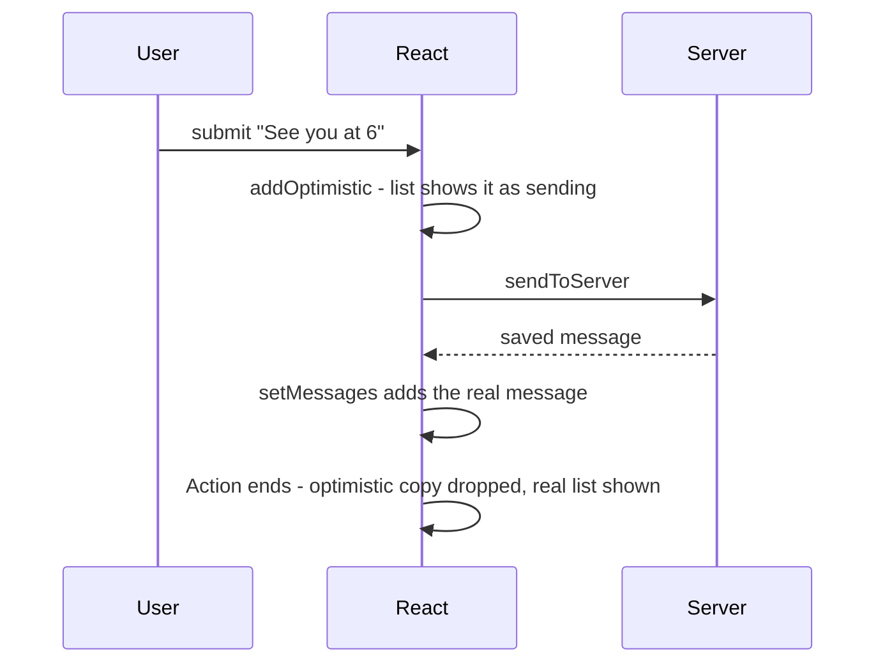

# Chapter 4 — Forms and Actions

[§3.9](../03-state-and-events/README.md#39-controlled-inputs-basics) showed the basic **controlled input**. This chapter covers the whole topic: the two ways to own a field's value, helpful and accessible validation, and React 19's **Actions** — built-in form submission that tracks "pending" (request in flight), keeps the last result, resets the form, and supports **optimistic updates** (showing the expected result before the server confirms), with far less code than `onSubmit` + several `useState`s.

Code: [`code/`](code/) — React 19.3 in jsdom, driven by `@testing-library/user-event`. Notes for reusing the tests: each program sets `globalThis.FormData = window.FormData` (Node's own `FormData` cannot read a `<form>` element), and after React resets a form, `user.clear()` is called before typing again (user-event keeps its own copy of the field's text and doesn't notice the reset).

---

## 4.1 How a form submission works

### What it is
A **form** (`<form>`) groups input fields. On a submit-button click or Enter in a text field, the browser fires a **`submit` event** and then, by default, *navigates*: it sends the field values to the URL in the form's `action` attribute and loads a new page. (HTML side — input types, labels, fieldsets: [`../../../html-css/chapters/05-tables-and-forms/README.md`](../../../html-css/chapters/05-tables-and-forms/README.md).)

Only fields with a **`name`** are sent, as **name/value pairs**, exposed in JavaScript as **`FormData`**:

| `FormData` method | Returns |
|---|---|
| `fd.get('email')` | The first value for that name (a string, or a `File` for file inputs), or `null` |
| `fd.getAll('topic')` | Every value for that name — several checkboxes sharing one name |
| `Object.fromEntries(fd)` | A plain object `{ name: value }` (keeps only the last value of repeated names) |
| `new FormData(formElement)` | Builds the pairs from a form's current field values |

Memorise: an **unchecked** checkbox is **not included at all** (not `false`); a checked checkbox without `value` sends `"on"`; every value is a **string**; disabled fields are skipped.

### In a single-page app
An SPA ([§1.4](../01-why-react-and-setup/README.md#14-spa-vs-mpa-vs-ssr-and-ssg)) must not reload, or all React state is lost:

| Classic (any React version) | React 19 Actions |
|---|---|
| `<form onSubmit={e => { e.preventDefault(); … }}>` | `<form action={fn}>` |
| You call `preventDefault()` and read values yourself | React prevents the navigation and calls `fn(formData)` |
| You track "submitting" and errors with `useState` | Pending state, result and reset are built in (§4.4–§4.7) |

Both appear in real code bases.

### TL;DR
Fields need `name` to be submitted. `FormData` reads them; unchecked boxes are missing and all values are strings. In React either `preventDefault()` in `onSubmit` or pass a function to `action`.

---

## 4.2 Controlled vs uncontrolled inputs

### What it is
The question is **who owns** a field's current value:

- **Controlled** — React state owns it: `value={state}` (or `checked`) plus a state update in `onChange`. The DOM always shows exactly what state says.
- **Uncontrolled** — the DOM owns it, as in plain HTML. Optionally give a **starting** value with `defaultValue` (`defaultChecked`) and read the value **when needed**: from `FormData` on submit, or through a **ref** (a handle to the DOM element — [§5.9](../05-effects-and-refs/README.md#59-refs-to-dom-nodes)).

### How it works
`code/01_controlled_vs_uncontrolled.jsx`:
```jsx
// 1. Uncontrolled: the DOM keeps the value. defaultValue/defaultChecked set only the START value.
function UncontrolledSignup() {
  renders++;
  function handleSubmit(e) {
    e.preventDefault();
    const data = new FormData(e.currentTarget);          // read every named field at once
    console.log('  submit ->', JSON.stringify(Object.fromEntries(data)));
  }
  return (
    <form onSubmit={handleSubmit}>
      <input name="city" aria-label="City" defaultValue="Oslo" />
      <select name="size" aria-label="Size" defaultValue="m">…</select>
      <label><input type="checkbox" name="gift" defaultChecked /> Gift wrap</label>
      <button>Order</button>
    </form>
  );
}

// 2. Uncontrolled + ref: read one field on demand without re-rendering.
function SearchBox() {
  const inputRef = useRef(null);
  return (
    <>
      <input ref={inputRef} aria-label="Search" />
      <button onClick={() => console.log('  ref reads:', inputRef.current.value)}>Go</button>
    </>
  );
}

// 3. Controlled: React state owns the value, so every keystroke re-renders.
function ControlledCity() {
  const [city, setCity] = useState('Oslo');
  renders++;
  return <input aria-label="Controlled city" value={city} onChange={(e) => setCity(e.target.value.toUpperCase())} />;
}

// 4. The classic warning: value starts undefined (uncontrolled) and later becomes a string (controlled).
function Flip() {
  const [v, setV] = useState();                          // undefined!
  return <input aria-label="Flip" value={v} onChange={(e) => setV(e.target.value)} />;
}
// user: replaces "Oslo" with "Bergen", picks L, unticks Gift wrap, clicks Order; types "hooks" + Go;
// types "ville" into the controlled field; types "a" into Flip
```

Output:
```
  submit -> {"city":"Bergen","size":"l"}
uncontrolled renders while typing 6 letters: 1
  ref reads: hooks
controlled shows: OSLOVILLE | renders: 6
warning: A component is changing an uncontrolled input to be controlled. This is likely caused by t...
```

1. **Uncontrolled forms render once** — the browser handled typing; `FormData` collected everything at submit.
2. **The unticked checkbox vanished** (`gift` missing), as §4.1 said.
3. **A ref** reads one field on demand.
4. **Controlled inputs re-render per keystroke** (1 + 5 = 6) — the price of transforming text (upper-casing) as typed.
5. `value` going from `undefined` to a string triggers the mode-switch warning; initialise controlled state with `''`.

### `defaultValue` is only a starting value
It is read when the element is created; afterwards the value belongs to the user. So:
- To **reset** an uncontrolled field to new defaults, **remount** it with a new `key` ([§3.10](../03-state-and-events/README.md#310-state-is-tied-to-a-position-in-the-tree)) or call `form.reset()` (restores the *default* values).
- `<select>` **ignores a changed `defaultValue` after mount** (first appearance); §4.10 uses `key` to remount it.

`<input type="file">` is **always uncontrolled** — for security, JavaScript cannot set the chosen file. Read `input.files` or `formData.get('avatar')` (a `File`).

### Trade-offs
| | Controlled | Uncontrolled |
|---|---|---|
| Who owns the value | React state | The DOM |
| Re-renders | Every keystroke | None while typing |
| Instant formatting / limits (`toUpperCase`, max length) | Easy | Awkward |
| Live dependent UI (character counter, enable button) | Easy | Needs extra events |
| Code for a big form | One state + handler per field (or one object) | Just `name` attributes |
| Works with React 19 form Actions and auto-reset | Values come from state, not reset | Natural fit |
| Prefill / reset from data | Set state | `defaultValue` + `key` or `form.reset()` |

**When:** uncontrolled + `FormData` (usually with a form Action) for most fill-and-submit forms (sign-up, contact, settings); controlled when the UI must react to every keystroke — live search, input masks (credit-card spacing), counters, interdependent fields, a **wizard** (multi-step form) keeping values across steps. Mixing is fine.

### Common mistakes
| Mistake | Fix |
|---|---|
| `value` without `onChange` (read-only field) | Add `onChange`, or use `defaultValue` |
| `useState()` / `useState(null)` for a text field | `useState('')` |
| Changing `defaultValue` and expecting the field to update | Remount with `key`, or make it controlled |
| Forgetting `name` on uncontrolled fields | `FormData` silently skips them |
| Treating `formData.get('age')` as a number | `Number(formData.get('age'))` |

### In the interview
**30-second answer:** "A controlled input's value lives in React state — `value` plus `onChange` — so React can validate or format on every keystroke, at the cost of a render per keystroke. An uncontrolled input keeps its value in the DOM; you set a starting `defaultValue` and read it on submit with `FormData` or a ref. File inputs are always uncontrolled. In React 19 I default to uncontrolled fields with a form Action and use controlled fields where the UI must react while typing."

- *What causes 'changing an uncontrolled input to be controlled'?* — `value` was `undefined`/`null` on one render and a string later.
- *How do you reset an uncontrolled form?* — `form.reset()` (a successful form Action does it automatically) or change the form's `key`.

### TL;DR
Controlled = React owns the value (`value` + `onChange`), re-renders per keystroke, good for live behaviour. Uncontrolled = DOM owns it (`defaultValue`, read with `FormData`/ref), less code, pairs with Actions. File inputs are always uncontrolled.

---

## 4.3 Validation

### What it is
**Validation** checks input before you act on it (required fields, email shape, password length, matching fields). Good validation says **what** is wrong, **where**, and **how to fix it**, at a moment that helps rather than nags. Real apps use three layers:

| Layer | Where it runs | Purpose |
|---|---|---|
| **Built-in HTML constraints** (`required`, `type="email"`, `minLength`, `pattern` — a regex the value must match, `min`/`max`) | Browser | Free, instant, works without JavaScript |
| **Client-side rules** in React | Browser | Custom messages, cross-field rules ("passwords match"), consistent styling |
| **Server-side validation** | Server | The only one you can **trust** — anyone can bypass the browser |

Client validation is for **user experience**; server validation is for **correctness and security**. Never skip the server.

### How built-in validation works
If any constraint fails, the browser blocks the submit and shows its own bubble. Each field exposes a **`validity`** object (`valueMissing`, `typeMismatch`, `tooShort`, `patternMismatch`, `rangeOverflow`, …, summary `valid`) and `validationMessage`. **`noValidate`** on `<form>` turns off the blocking and bubbles so your UI takes over — `validity` still works.

### How custom validation works
1. Write **one pure `validate(values)`** returning an `errors` object (`{ email: 'Enter a valid email' }`) — easy to test and reuse on the server.
2. Compute `errors` **during render** — derived state ([§3.8](../03-state-and-events/README.md#38-derived-state--choosing-the-minimal-state)), never stored.
3. Decide **when to show** errors. "Email is invalid" after one keystroke is hostile; the common rule: show once the user has **left** the field (**blur**, tracked in a `touched` object) or after the first **submit**, then update live as they fix it.
4. On a failed submit, **move focus to the first invalid field** so keyboard and screen-reader users land on the problem.
5. Make errors **accessible** with **ARIA** (Accessible Rich Internet Applications — attributes telling assistive technology what an element is or its state): `aria-invalid="true"` on the field, the message linked with `aria-describedby`, `role="alert"` so it is announced ([`../../../html-css/chapters/03-semantic-html-and-accessibility/README.md`](../../../html-css/chapters/03-semantic-html-and-accessibility/README.md)).

`code/02_validation.jsx`:
```jsx
// 1. Built-in constraint validation: the browser blocks submit while a field is invalid.
function Native() {
  return (
    <form onSubmit={(e) => { e.preventDefault(); console.log('  native form submitted'); }}>
      <input aria-label="Nick" name="nick" required minLength={3} pattern="[a-z]+" />
      <button>Save</button>
    </form>
  );
}

// 2. Custom validation in React: one pure validate() function, errors shown after blur or submit.
function validate({ email, password, confirm }) {
  const errors = {};
  if (!email) errors.email = 'Email is required';
  else if (!/^\S+@\S+\.\S+$/.test(email)) errors.email = 'Enter a valid email';
  if (password.length < 8) errors.password = 'Use at least 8 characters';
  if (confirm !== password) errors.confirm = 'Passwords do not match';   // cross-field rule
  return errors;
}

function Field({ name, label, type = 'text', value, error, show, onChange, onBlur }) {
  const errorId = `${name}-error`;
  return (
    <div>
      <label htmlFor={name}>{label}</label>
      <input id={name} name={name} type={type} value={value} onChange={onChange} onBlur={onBlur}
        aria-invalid={show && !!error} aria-describedby={show && error ? errorId : undefined} />
      {show && error && <p id={errorId} role="alert">{error}</p>}
    </div>
  );
}

function SignupForm() {
  const [values, setValues] = useState({ email: '', password: '', confirm: '' });
  const [touched, setTouched] = useState({});          // which fields the user has left
  const [submitted, setSubmitted] = useState(false);
  const errors = validate(values);                      // derived — never stored
  const show = (name) => submitted || touched[name];

  const handleChange = (e) => setValues({ ...values, [e.target.name]: e.target.value });
  const handleBlur = (e) => setTouched({ ...touched, [e.target.name]: true });
  function handleSubmit(e) {
    e.preventDefault();
    setSubmitted(true);
    const first = Object.keys(errors)[0];
    if (first) { document.getElementById(first).focus(); return; }   // move focus to the first problem
    console.log('  sending', values.email);
  }
  // ... <form noValidate onSubmit={handleSubmit}> with three <Field>s and a button
}
```

Output:
```
native: "Al" blocked | valid = false | patternMismatch = true
  native form submitted
while typing (not yet touched): []
after leaving Email           : [ 'Enter a valid email' ]
after submit                  : [ 'Enter a valid email', 'Use at least 8 characters' ]
focused field                 : email | aria-invalid = true
after fixing                  : []
  sending ada@example.com
```

- **Native**: "Al" broke `pattern="[a-z]+"` (capital A), so submit was blocked; "alan" went through.
- **Custom**: nothing shown while typing; leaving Email revealed its error; submit revealed *all* errors and focused the first; fixing cleared them live.
- One `handleChange` serves every field via the **computed property name** `[e.target.name]`.

### Trade-offs — when to show errors
| Strategy | Feels | Use for |
|---|---|---|
| On every change from the start | Nagging ("invalid" after one letter) | Only positive feedback like password-strength meters |
| On blur (touched) | Balanced | Most fields |
| On submit only | Calm but late | Short forms (login) |
| On blur, then live while fixing | Best of both | Default recommendation |
| Async (server) checks such as "username taken" | Needs debouncing (wait until typing pauses) and pending UI | Uniqueness checks — or return the error from the submit Action (§4.5) |

### Common mistakes
- Trusting client validation — attackers call your API directly. Validate on the server too.
- Storing `errors` in state and syncing it in an Effect — compute it ([§5.6](../05-effects-and-refs/README.md#56-you-might-not-need-an-effect)).
- Errors shown only by colour — also use text, `aria-invalid`, `aria-describedby`.
- Disabling submit until valid — users can't discover *why*. Allow submit and show errors.
- Over-strict regexes for emails and names; keep client checks simple and let the server (or a confirmation email) decide.

### In the interview
**30-second answer:** "I layer validation: HTML constraints for free basics, a pure `validate` function in React for custom and cross-field rules, and always server-side validation because the client can be bypassed. Errors are derived from values, shown after blur or first submit, linked with `aria-describedby`, flagged with `aria-invalid`, and on a failed submit I focus the first invalid field. For big forms I'd use a schema library such as Zod so the same rules run on both sides." (A **schema** describes what valid data looks like — §4.9.)

- *What does `noValidate` do?* — Turns off the browser's blocking and bubbles; `validity` still works.
- *Why a pure `validate`?* — Testable, reusable on the server, and errors become derived state.

### TL;DR
HTML constraints + a pure `validate()` + server checks. Derive errors; show them on blur or submit; announce and link them accessibly; focus the first invalid field.

---

## 4.4 Form Actions — `<form action={fn}>`

### What it is
In React 19 `<form action>` accepts a **function**. On submit React prevents navigation, builds `FormData` from the form and calls your function with it. A function run inside a **Transition** (a non-urgent update React tracks as "pending" — [§7.10](../07-custom-hooks-and-hook-rules/README.md#710-usetransition--non-urgent-updates)) is called an **Action**; name them `…Action` or by what they do (`subscribe`, `saveNote`).

**`formAction={fn}`** on a `<button>` (or `<input type="submit">`) overrides the form's action for that button — e.g. "Publish" vs "Save draft".

### Why it matters
- No `e.preventDefault()`, no reading fields by hand — you get `FormData`.
- The function may be **async** (returns a **promise**); React tracks it as pending, powering `useFormStatus` (§4.6), `useActionState`'s `isPending` (§4.5) and `useOptimistic` (§4.7).
- After the Action **finishes successfully**, React **resets the form**: uncontrolled fields return to their `defaultValue`s — a fresh form after "Send".
- With Server Functions (§4.8) the form can work **before JavaScript loads**.

### How it works
1. User submits; React calls `preventDefault()`, creates `new FormData(form, submitter)` and starts a Transition.
2. Your function runs; while its promise is pending, the form is "pending".
3. On resolve, React commits state updates and **resets** uncontrolled fields.
4. If it **throws** (or rejects), the error goes to the nearest **error boundary** (catches crashes below it, shows a fallback; Chapter 14) — so catch expected errors and turn them into state (§4.5).

`code/03_form_action.jsx`:
```jsx
function Newsletter() {
  const [log, setLog] = useState([]);
  async function subscribe(formData) {            // no event, no preventDefault
    const email = formData.get('email');
    const topics = formData.getAll('topic');       // several checkboxes with the same name
    await wait(50);                               // pretend network call
    setLog((l) => [...l, `${email} -> ${topics.join('+') || 'none'}`]);
  }
  function saveDraft(formData) {                  // a second button can run a different action
    setLog((l) => [...l, `draft saved for ${formData.get('email')}`]);
  }
  return (
    <form action={subscribe}>
      <input name="email" type="email" aria-label="Email" />
      <label><input type="checkbox" name="topic" value="react" /> React</label>
      <label><input type="checkbox" name="topic" value="css" /> CSS</label>
      <button type="submit">Subscribe</button>
      <button formAction={saveDraft}>Save draft</button>
      <ul>{log.map((line) => <li key={line}>{line}</li>)}</ul>
    </form>
  );
}
// user: types ada@example.com, ticks React and CSS, clicks Subscribe; later types bo@example.com, clicks Save draft
```

Output:
```
right after click, email field = "ada@example.com"
after the action finished:
  log          = [ 'ada@example.com -> react+css' ]
  email field  = "" (auto-reset)
  React ticked = false
  log          = [ 'ada@example.com -> react+css', 'draft saved for bo@example.com' ]
```

The field kept the email while the Action ran and was reset **after** it finished (boxes unticked too); `log` state was *not* reset — the reset touches only uncontrolled DOM values. `getAll('topic')` collected both boxes; "Save draft" ran `saveDraft` via `formAction`.

### Details worth knowing
| Detail | Behaviour |
|---|---|
| HTTP method (`GET`/`POST`) | Irrelevant with a function action — the browser sends nothing; React calls your function |
| Controlled fields | Not reset (value comes from state) — clear the state yourself |
| Keep values after an error | Return them from the Action and use as `defaultValue` (§4.5), or use controlled fields |
| Reset by hand | `requestFormReset(formElement)` from `react-dom`, called inside a Transition/Action |
| Mixing with `onSubmit` | If `onSubmit` calls `preventDefault()`, the function action does not run — use one or the other |
| Where it runs | In the browser. Only a Server Function (`'use server'`, §4.8) runs on the server |

### Trade-offs
| `onSubmit` + `preventDefault` | `action={fn}` |
|---|---|
| Works in every React version | React 19+ |
| Full access to the event | Receives `FormData` only |
| Pending/error/reset are manual | Pending state, reset, optimistic UI, progressive enhancement built in |
| Natural with controlled fields | Natural with uncontrolled fields |

### Common mistakes
- Losing the user's input after a failed validation because the form reset → return the values (§4.5) or keep them in state.
- Letting expected errors (validation, "email taken") throw — shows the error boundary. Return them.
- Forgetting `name` attributes — `FormData` is empty.

### In the interview
**30-second answer:** "In React 19 `<form action>` accepts a function. React prevents the navigation, passes `FormData`, and runs it inside a Transition, so it can be async and its pending state is visible to `useFormStatus` and `useActionState`. After a successful Action, uncontrolled fields are reset. `formAction` on a button overrides the action per button. Uncaught errors go to an error boundary."

- *What's an "Action" in React 19?* — A function run inside a Transition, e.g. passed to `action`/`formAction` or called in `startTransition`.
- *Does the form reset if the Action throws?* — No; the reset follows successful completion; errors go to the error boundary.

### TL;DR
`<form action={fn}>` → `fn(formData)` inside a Transition; async allowed; auto-reset of uncontrolled fields after success; `formAction` per button; return expected errors, don't throw them.

---

## 4.5 `useActionState` — the result of the last submission

### What it is
Forms usually show **what happened last time** (validation errors, "Saved!", a server error). `useActionState` wraps your Action and stores its **return value** as state:

```js
const [state, formAction, isPending] = useActionState(actionFn, initialState, permalink?);
//      last result  pass to action=   true while running
// actionFn(previousState, payload) -> new state (sync or async)
```

| Piece | Meaning |
|---|---|
| `actionFn(prevState, formData)` | Your function. First argument is the **previous state**, then the form data. Its return value becomes the new `state` |
| `initialState` | The state before the first submission |
| `state` | The latest return value |
| `formAction` | A wrapped function for `<form action>` / `formAction` (or to call yourself) |
| `isPending` | `true` while the Action runs |
| `permalink` (optional) | For Server Functions: the URL the form posts to if JavaScript hasn't loaded |

During the React 19 **canary** period (pre-release builds) it was `useFormState` in `react-dom`; the stable API is `useActionState` from `react`.

### How it works
`code/04_use_action_state.jsx`:
```jsx
// Pretend server call: validates, may fail, returns a result object.
async function registerUser(prevState, formData) {
  const username = String(formData.get('username') ?? '').trim();
  const age = Number(formData.get('age'));
  await wait(30);
  const errors = {};
  if (username.length < 3) errors.username = 'At least 3 characters';
  else if (taken.has(username)) errors.username = `"${username}" is taken`;
  if (!(age >= 13)) errors.age = 'You must be 13 or older';
  if (Object.keys(errors).length) return { errors, values: { username, age: formData.get('age') }, attempts: prevState.attempts + 1 };
  taken.add(username);
  return { message: `Welcome, ${username}!`, errors: {}, values: { username: '', age: '' }, attempts: prevState.attempts + 1 };
}

const initialState = { errors: {}, values: { username: '', age: '' }, attempts: 0 };

function Register() {
  const [state, formAction, isPending] = useActionState(registerUser, initialState);
  return (
    <form action={formAction}>
      {/* defaultValue from the last result: after the automatic reset the fields show what the user typed */}
      <input name="username" aria-label="Username" defaultValue={state.values.username} />
      {state.errors.username && <p role="alert">{state.errors.username}</p>}
      <input name="age" aria-label="Age" inputMode="numeric" defaultValue={state.values.age} />
      {state.errors.age && <p role="alert">{state.errors.age}</p>}
      <button disabled={isPending}>{isPending ? 'Registering…' : 'Register'}</button>
      {state.message && <p role="status">{state.message}</p>}
      <small>attempts: {state.attempts}</small>
    </form>
  );
}

// Calling the dispatch function yourself: wrap it in startTransition. Calls are queued in order.
function Stock() {
  const [count, dispatch, isPending] = useActionState(async (prev, delta) => { await wait(20); return prev + delta; }, 0);
  return (
    <p>
      <button onClick={() => startTransition(() => dispatch(+1))}>+1</button>
      <output>{count}</output>{isPending && ' (saving…)'}
    </p>
  );
}
```

Output:
```
pending   : button = "Registering…" | disabled = true
attempt 1 : [ '"ada" is taken', 'You must be 13 or older' ] | fields kept: ada 9
attempt 2 : [] | Welcome, grace! | fields: "" "" | attempts: 2

three quick clicks -> shows +10 (saving…)
after the queue ran  -> shows +13
```

1. **Pending**: while `registerUser` awaited, the button read "Registering…" and was disabled (no double submits).
2. **Attempt 1** returned errors *and the submitted values*. The form reset, but since `defaultValue` came from `state.values`, the reset restored the user's text — the standard "don't wipe the form on a validation error" pattern for uncontrolled fields.
3. **Attempt 2** succeeded and returned empty values → clean form + message; `prevState.attempts + 1` shows the previous state passed in.
4. **Manual dispatch**: three clicks queued three calls run **one after another**, each receiving the previous result (0→1→2→3). Dispatching outside a Transition logs a dev error and `isPending` doesn't update — wrap in `startTransition` (an `action` prop does it for you).

### Rules and caveats
- The action receives **`(prevState, payload)`** — a common bug is `async (formData) => …`, which receives the previous state as "formData".
- **Queued and sequential**: dispatches never run in parallel — correct, but a slow request delays the next.
- **No built-in reset** of the state: return `initialState` from the action, or remount with a new `key`.
- **Throwing** cancels queued actions and shows the nearest error boundary — return errors instead.
- Setting *other* state after an `await` inside the action currently needs `startTransition` (§4.7).
- With Server Functions, `initialState` and the payload must be **serializable** (plain data that can be sent as text and rebuilt).

### `useActionState` vs doing it yourself
| Manual (`onSubmit`) | `useActionState` |
|---|---|
| `useState` for errors, message, isSubmitting | One Hook: `[state, action, isPending]` |
| `try/finally` to clear `isSubmitting` | Pending is automatic |
| Double submit possible unless guarded | Calls are queued; button can use `isPending` |
| Works with any event | Designed for Actions (forms, buttons, `startTransition`) |

It is a **reducer for async work**: `(prevState, action) => newState`, like `useReducer` ([§6.2](../06-state-management/README.md#62-usereducer--consolidate-update-logic)) but allowed to be async and have side effects.

### In the interview
**30-second answer:** "`useActionState(fn, initialState)` returns the latest result of an Action, a wrapped action to pass to a form, and `isPending`. The function gets the previous state and the form data and returns the next state, so it's the natural place to return validation errors or a success message. Calls are queued sequentially; when dispatching manually you wrap it in `startTransition`. With uncontrolled fields I return the submitted values and use them as `defaultValue`s so a failed submit doesn't wipe the form."

- *First argument of the action?* — The previous state; form data is second.
- *Where do server validation errors go?* — Returned from the action → `state.errors`.
- *How do you reset the state?* — Return `initialState` or remount with a `key`.

### TL;DR
`const [state, action, isPending] = useActionState(async (prev, formData) => next, initial)`. Return errors/results, don't throw. Sequential queue. Manual calls go in `startTransition`.

---

## 4.6 `useFormStatus` — status of the parent form

### What it is
`useFormStatus()` (from **`react-dom`**) lets any component **rendered inside a `<form>`** read that form's current submission without props:

| Field | Meaning |
|---|---|
| `pending` | `true` while the parent form's Action is running |
| `data` | The `FormData` being submitted (or `null`) |
| `method` | The form's `method` attribute: `'get'` (default) or `'post'` |
| `action` | The function passed to the parent's `action` (or `null`) |

### How it works
`code/05_use_form_status.jsx`:
```jsx
// Reusable: works in any form, because it asks its parent <form> for the status.
function SubmitButton({ children }) {
  const { pending, data, method } = useFormStatus();
  return (
    <button disabled={pending}>
      {pending ? `Saving "${data.get('title')}" (${method})…` : children}
    </button>
  );
}

// Wrong place: the Hook is in the SAME component that renders the <form>, so it sees no parent form.
function WrongPlace() {
  const { pending } = useFormStatus();
  return (
    <form action={() => wait(30)}>
      <input name="title" aria-label="Title 2" defaultValue="x" />
      <button>{pending ? 'pending' : 'never pending'}</button>
    </form>
  );
}

async function saveNote(formData) { await wait(30); console.log('  saved:', formData.get('title')); }

function NoteForm() {
  return (
    <form action={saveNote}>
      <input name="title" aria-label="Title" />
      <SubmitButton>Save note</SubmitButton>
    </form>
  );
}
```

Output:
```
during  : "Saving \"Groceries\" (get)…" disabled = true | "never pending"
  saved: Groceries
after   : "Save note" disabled = false
```

`SubmitButton` saw pending and the submitted title via `data`; `method` just mirrors the form attribute (default `get` — no HTTP request is made with a function action). `WrongPlace` never saw `pending`: the Hook must be in a **child component of the form**.

### `useFormStatus` vs `useActionState`'s `isPending`
| `useFormStatus` | `isPending` from `useActionState` |
|---|---|
| Read by any **descendant** of the form | Available in the component that owns the action |
| Great for reusable design-system buttons/spinners | Great when the owner needs it (disable the whole form) |
| Also exposes the submitted `data` | Also gives the action's result `state` |

### Common mistakes
- Calling it in the same component as the `<form>` (always `pending: false`).
- Importing it from `react` — it's in **`react-dom`**.
- Expecting it to track sibling or nested forms — only the nearest **parent** `<form>`.

### TL;DR
`const { pending, data } = useFormStatus()` (from `react-dom`) inside a child of the form. Perfect for a reusable Submit button.

---

## 4.7 `useOptimistic` — instant feedback, automatic rollback

### What it is
An **optimistic update** shows the result you *expect* before the server confirms (a chat message appears immediately, a like count goes up); on failure you undo it. Most requests succeed, so the app feels fast.

```js
const [optimisticState, addOptimistic] = useOptimistic(value, reducer?);
// value: the real (confirmed) state, e.g. from useState or props
// reducer(currentState, optimisticValue) -> the state to show while an Action runs (pure)
```

- With **no Action running**, `optimisticState` equals `value`.
- `addOptimistic(x)` **inside an Action** (form action or `startTransition`) immediately shows `reducer(value, x)` (or `x` with no reducer).
- When the Action **ends**, the optimistic value is dropped and `optimisticState` is `value` again — including the real result if you updated it, or the old data if it failed. **Rollback is automatic.**

### How it works
`code/06_use_optimistic.jsx`:
```jsx
function Chat() {
  const [messages, setMessages] = useState([{ id: 'm1', text: 'Hi!' }]);
  const [error, setError] = useState(null);
  // optimisticMessages === messages when no Action is running
  const [optimisticMessages, addOptimistic] = useOptimistic(
    messages,
    (current, text) => [...current, { id: 'temp-' + text, text, sending: true }],   // pure reducer
  );

  async function sendAction(formData) {               // runs inside a Transition (form action)
    const text = formData.get('text');
    setError(null);
    addOptimistic(text);                              // 1. appears instantly, marked "sending"
    try {
      const saved = await sendToServer(text);         // 2. wait for the server
      startTransition(() => setMessages((ms) => [...ms, saved]));  // 3. real state (after await -> wrap)
    } catch (e) {
      setError(e.message);                            // optimistic item disappears by itself
    }
  }

  return (
    <>
      <ul>
        {optimisticMessages.map((m) => <li key={m.id}>{m.text}{m.sending && ' (sending…)'}</li>)}
      </ul>
      {error && <p role="alert">{error}</p>}
      <form action={sendAction}>
        <input name="text" aria-label="Message" />
        <button>Send</button>
      </form>
    </>
  );
}
```

Output:
```
instantly      : [ 'Hi!', 'See you at 6 (sending…)' ]
server said OK : [ 'Hi!', 'See you at 6' ]
instantly      : [ 'Hi!', 'See you at 6', 'buy spam now (sending…)' ]
server said NO : [ 'Hi!', 'See you at 6' ]
```
(the second run also shows the alert "Message rejected")



- The optimistic item had a temporary id and a `sending` flag so the UI could grey it out.
- On failure no "undo" code ran — `messages` never changed, so the optimistic line vanished; `catch` only showed a message.
- `setMessages` after `await` is wrapped in `startTransition` (a current React requirement for updates after `await` in an Action) so it lands with the end of the Action.

### Outside forms
In a click handler, start the Action yourself:
```jsx
// (not run separately — same rules as above)
function LikeButton({ likes, onSave }) {
  const [optimisticLikes, setOptimisticLikes] = useOptimistic(likes);
  return (
    <button onClick={() => startTransition(async () => {
      setOptimisticLikes((n) => n + 1);   // must be inside startTransition / an Action
      await onSave();                     // parent updates `likes` when the server confirms
    })}>♥ {optimisticLikes}</button>
  );
}
```
Calling the setter outside an Action gives a dev warning — no pending Action keeps the optimistic value alive.

**When not to use it:** when failure is common or costly to take back (payments, bookings, irreversible actions) — show a real pending state; or when the server's result is hard to predict (generated IDs are fine, complex server calculations are not).

### Common mistakes
- Treating optimistic state as the source of truth — it's temporary; always update the real state (`setMessages`, refetch, or parent props).
- Side effects in the reducer — it must be pure (it re-runs if `value` changes while pending).
- Not showing that an item is pending — users should tell "sent" from "sending".

### In the interview
**30-second answer:** "`useOptimistic(value, reducer)` gives a state that equals the real value except while an Action is running, when it shows what I optimistically added. I call the setter inside the Action, then await the server and update the real state. When the Action ends React drops the optimistic value, so on success the real data takes over and on failure it rolls back automatically."

- *Where must `addOptimistic` be called?* — Inside an Action: a form/button action or `startTransition`.
- *How does rollback work?* — The optimistic value lives only for the Action's duration; if real state wasn't updated, the old value shows again.

### TL;DR
`useOptimistic(realValue, reducer)` → show the expected result during an Action; update the real state on success; failure rolls back by itself. Only call the setter inside an Action.

---

## 4.8 Server Functions and progressive enhancement (overview)

### What it is
In a framework supporting **React Server Components** (components that run only on the server and ship no JS — e.g. Next.js App Router, Chapter 13), the **directive** (a special string at the top of a file or function) **`'use server'`** turns an async function into a **Server Function**: its code stays on the server, and the client gets a reference that sends the arguments over the network and runs it there. Passed to a form's `action`, it is often called a **Server Action**.

```jsx
// (framework-only — not run; needs a React Server Components bundler such as Next.js)
// app/actions.js
'use server';
export async function addToCart(prevState, formData) {
  const id = formData.get('productId');
  await db.cart.add(id);                       // runs on the server: database, secrets are safe here
  return { added: id };
}

// app/AddButton.jsx
'use client';
import { useActionState } from 'react';
import { addToCart } from './actions';
export function AddButton({ productId }) {
  const [state, action, isPending] = useActionState(addToCart, null, `/product/${productId}`);
  return (
    <form action={action}>
      <input type="hidden" name="productId" value={productId} />
      <button disabled={isPending}>Add to cart</button>
      {state?.added && <p>Added!</p>}
    </form>
  );
}
```

### Why it matters — progressive enhancement
**Progressive enhancement**: the basic feature works with plain HTML; JavaScript makes it nicer. A Server Function has a URL, so a server-rendered form can be submitted **before the JS bundle has loaded** (slow phone, flaky network): the browser does a normal POST, the server runs the function and returns the page with the result (`useActionState`'s `permalink` says which page). Once **hydrated**, the same form behaves like the Actions above.

### Rules to remember
- Arguments and return values must be **serializable** (strings, numbers, plain objects, arrays, `FormData`, …) — no functions or class instances.
- Treat every Server Function as a **public API endpoint** anyone can call: **authenticate** (who is calling), **authorise** (may they do this) and validate inside it.
- `'use server'` marks server-callable functions; it is **not** how you mark Server Components (they need no directive). Chapter 13.

### TL;DR
`'use server'` functions run on the server but are called like local functions; used as form actions they enable forms that work before JS loads. Validate and authorise inside them.

---

## 4.9 Form libraries — React Hook Form and Zod (overview)

### The problem they solve
Hand-written forms (§4.3) are fine for 3–5 fields. Big forms — dozens of fields, nested objects, arrays of rows ("add another address"), async checks, wizards — pile up `values`/`touched`/`errors` plumbing.

| Library | Job |
|---|---|
| **React Hook Form** (RHF) | Field registration, values, touched/dirty state (dirty = changed from initial), errors, submit handling. Uses **uncontrolled inputs** + refs, so typing doesn't re-render the whole form |
| **Zod** | A **schema** library: describe data shape and rules once, then `parse`/`safeParse` any value. Also infers TypeScript types from the schema |
| `@hookform/resolvers` | Adapter letting RHF validate with a Zod (or Yup, Valibot…) schema |

Sharing one Zod schema between browser form and server handler means the rules can't drift apart.

### What the code looks like
```jsx
// (React Hook Form 7 + Zod 4 + @hookform/resolvers — not run; these packages aren't installed for this book)
import { useForm } from 'react-hook-form';
import { zodResolver } from '@hookform/resolvers/zod';
import { z } from 'zod';

const schema = z.object({
  email: z.email({ error: 'Enter a valid email' }),          // Zod 4: top-level z.email()
  password: z.string().min(8, { error: 'At least 8 characters' }),
  confirm: z.string(),
}).refine((d) => d.password === d.confirm, { error: 'Passwords do not match', path: ['confirm'] });

export function SignupForm({ onSignup }) {
  const { register, handleSubmit, formState: { errors, isSubmitting } } =
    useForm({ resolver: zodResolver(schema), mode: 'onTouched' });   // validate after blur, then live
  return (
    <form onSubmit={handleSubmit(onSignup)} noValidate>              {/* onSignup gets typed, valid data */}
      <input type="email" {...register('email')} aria-invalid={!!errors.email} />
      {errors.email && <p role="alert">{errors.email.message}</p>}
      {/* ... password and confirm the same way ... */}
      <button disabled={isSubmitting}>Create account</button>
    </form>
  );
}

// On the server, the same schema:
// const result = schema.safeParse(body);      // { success: true, data } | { success: false, error }
// if (!result.success) return { errors: z.flattenError(result.error).fieldErrors };
```

- `register('email')` returns `{ name, onChange, onBlur, ref }`, spread onto the input.
- `handleSubmit(fn)` prevents the default, validates, and calls `fn(data)` only when valid (focusing the first invalid field by default).
- Zod 4: string formats are top-level (`z.email()`); custom messages use the `error` option (`message` still works but is deprecated). `safeParse` never throws.

### When to use what
| Situation | Recommendation |
|---|---|
| Small form, submit → server | Plain form Action + `useActionState` (§4.5) |
| Needs live UI per keystroke | A few controlled fields |
| Large/complex client-side form, field arrays, wizards | React Hook Form (+ Zod) |
| Same rules on client and server, TypeScript types from rules | Zod (or Valibot) schema shared by both |

Alternatives: Formik (older, controlled-input based, less active), TanStack Form, Conform (built around Actions/progressive enhancement), Yup/Valibot schemas.

### TL;DR
RHF manages big forms efficiently with uncontrolled inputs; Zod describes validation rules once for client and server; `zodResolver` connects them. Don't add them for a 3-field form.

---

## 4.10 Putting it together — an RSVP form

`code/rsvp.jsx` combines the chapter: uncontrolled fields read with `FormData`, a pure `validateRsvp`, `useActionState` returning errors + submitted values, a `SubmitButton` using `useFormStatus`, and an optimistic guest list with `useOptimistic`. Core (full file in `code/rsvp.jsx`):

```jsx
function SubmitButton() {
  const { pending } = useFormStatus();                 // reads the parent <form>
  return <button className="primary" disabled={pending}>{pending ? 'Sending…' : 'Send RSVP'}</button>;
}

export default function Rsvp({ saveRsvp, initialGuests = [], initialResult = emptyResult }) {
  const [guests, setGuests] = useState(initialGuests);
  const [optimisticGuests, addOptimistic] = useOptimistic(guests, (list, g) => [...list, { ...g, id: 'pending', pending: true }]);

  async function rsvpAction(prev, formData) {
    const values = Object.fromEntries(formData);        // { name, email, guests, diet }
    const rsvp = { name: values.name.trim(), email: values.email.trim(), guests: Number(values.guests), diet: values.diet };
    const errors = validateRsvp(rsvp);
    if (Object.keys(errors).length) return { errors, values, message: '' };   // keep what they typed
    addOptimistic(rsvp);                                 // show in the list right away
    try {
      const saved = await saveRsvp(rsvp);
      startTransition(() => setGuests((gs) => [...gs, saved]));
      return { ...emptyResult, message: `Thanks ${saved.name}, see you there!` };
    } catch (e) {
      return { errors: { form: e.message }, values, message: '' };
    }
  }
  const [result, formAction] = useActionState(rsvpAction, initialResult);
  const { errors, values } = result;
  const total = optimisticGuests.reduce((n, g) => n + g.guests, 0);   // derived
  // JSX: <form action={formAction} noValidate>; inputs use defaultValue={values.name}, aria-invalid,
  // aria-describedby; <select key={values.guests} defaultValue={values.guests}> (key remounts it, since
  // React ignores a CHANGED defaultValue on <select>); radios use defaultChecked; <SubmitButton />;
  // then "Coming ({total})" and optimisticGuests.map(...) with "(saving…)" for pending rows.
}
```

`code/07_rsvp_app.jsx` drives an invalid submit (2 guests, "vegan"), a valid one, then a duplicate the fake server rejects:
```
1 invalid      : [ 'Please enter your name', 'Enter an email like ada@example.com' ] | kept: A 2 true
2 sending      : [ 'Host · 1 seat', 'Ada · 2 seats · vegan (saving…)' ] | button: Sending…
2 saved        : [ 'Host · 1 seat', 'Ada · 2 seats · vegan' ] | Thanks Ada, see you there! | heading: Coming (3)
3 server error : [ 'ada@example.com has already replied' ] | list: [ 'Host · 1 seat', 'Ada · 2 seats · vegan' ]
```

1. Invalid → two errors; name, guest count and diet survived the reset (returned `values` → `defaultValue`s; the select remounted via `key`).
2. Valid → the guest appeared instantly as "(saving…)", the button read "Sending…", the headcount already included the optimistic seats; then the real row replaced it, the message appeared and the form cleared.
3. Duplicate email → the server threw; the action **caught** it and returned a form-level error; the optimistic row rolled back by itself.

In the browser ([`code/rsvp.html`](code/rsvp.html), styles in `rsvp.css`; `rsvp-main.jsx` starts in the state after one invalid submit):


*Figure 4.1 — The RSVP form after a failed submit: the typed values are kept, the invalid field is marked with `aria-invalid` (red border) and its message is linked by `aria-describedby`.*

Design notes: **minimal state** (only `guests` is `useState`; the result lives in `useActionState`, pending in the form, headcount derived); **validation in one pure function** a real server would call too; **expected failures returned, not thrown**, so no error boundary is needed for "already replied".

---

## Chapter 4 TL;DR

| Idea | Remember |
|---|---|
| `FormData` | Needs `name`; unchecked boxes missing; values are strings; `getAll` for repeated names |
| Controlled | `value` + `onChange`; re-render per keystroke; live formatting/limits |
| Uncontrolled | `defaultValue`/`defaultChecked`; read via `FormData` or a ref; file inputs always uncontrolled |
| Validation | HTML constraints + pure `validate()` + **server**; show on blur/submit; `aria-invalid` + `aria-describedby`; focus first error |
| Form Action | `<form action={fn}>` → `fn(formData)` in a Transition; auto-reset after success; `formAction` per button |
| `useActionState` | `[state, action, isPending] = useActionState((prev, formData) => next, initial)`; return errors; queued calls; manual calls in `startTransition` |
| `useFormStatus` | From `react-dom`, in a **child** of the form: `{ pending, data, method, action }` |
| `useOptimistic` | Show expected result during an Action; update real state; auto rollback |
| Server Functions | `'use server'`; progressive enhancement; always validate/authorise inside |
| Libraries | React Hook Form + Zod for big forms; plain Actions for small ones |

Next: [Chapter 5 — Effects and Refs](../05-effects-and-refs/README.md).
