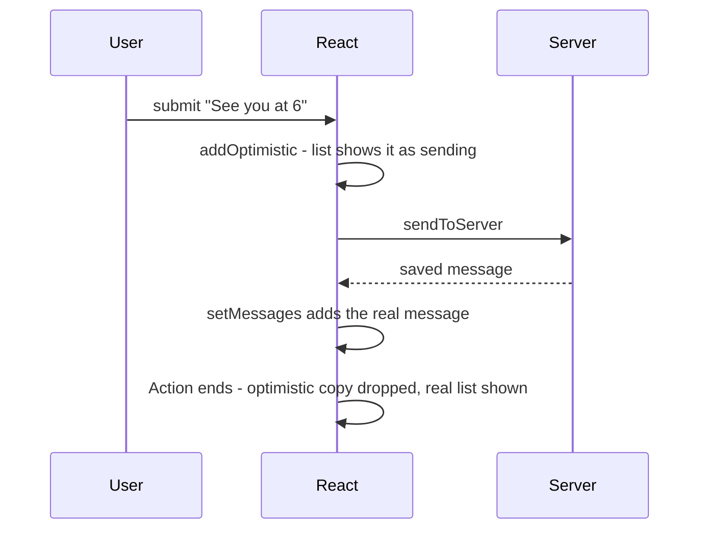

# Chapter 4 — Forms and Actions

Almost every real app has forms: sign-up, search, checkout, settings, comments. Chapter 3 §3.9 showed the basic **controlled input** (`value` + `onChange`). This chapter covers the whole topic: the two ways to own a field's value, validation that is helpful and accessible, and React 19's **Actions** — a built-in way to submit forms that tracks "pending" (the request is still in flight), keeps the last result, resets the form, and shows **optimistic updates** (showing the expected result before the server confirms it), with far less code than the classic `onSubmit` + several `useState` calls.

**What you'll learn**

| # | Topic | You will be able to… |
|---|---|---|
| 4.1 | How a form submission works | name fields, read them with `FormData`, know what the browser does by default |
| 4.2 | Controlled vs uncontrolled inputs | choose who owns a field's value, use `defaultValue`, refs and `FormData` |
| 4.3 | Validation | combine built-in HTML constraints with your own rules; show errors at the right time, accessibly |
| 4.4 | Form Actions | pass a function to `<form action>`; use `formAction`; understand the automatic reset |
| 4.5 | `useActionState` | keep the result of the last submission (errors / success) and a pending flag |
| 4.6 | `useFormStatus` | build a submit button that knows its form is submitting |
| 4.7 | `useOptimistic` | show the expected result instantly and roll back on failure |
| 4.8 | Server Functions and progressive enhancement | know what `'use server'` adds (overview) |
| 4.9 | Form libraries | when React Hook Form + Zod pay off, and what the code looks like |
| 4.10 | Putting it together | an RSVP form using every idea |

Code: [`code/`](code/) — React 19.3 in jsdom (a browser-like DOM running inside Node.js), driven by `@testing-library/user-event` (a test helper that types and clicks like a real user). Two small notes for anyone reusing the tests: each program sets `globalThis.FormData = window.FormData` (`globalThis` is the global object in any JavaScript environment; Node has its own `FormData` that cannot read a `<form>` element), and after React resets a form, `user.clear()` is called before typing again (user-event keeps its own copy of the field's text and doesn't notice the reset).

---

## 4.1 How a form submission works

### What it is
A **form** (`<form>`) groups input fields. When the user presses a submit button or hits Enter in a text field, the browser fires a **`submit` event** and then, by default, *navigates* (goes to another page): it sends the field values to the URL (web address) in the form's `action` attribute and loads a new page. (The HTML side — every input type, labels, fieldsets — is in the HTML & CSS book, [`../../../html-css/chapters/05-tables-and-forms/README.md`](../../../html-css/chapters/05-tables-and-forms/README.md).)

Only fields with a **`name`** attribute are sent. The data is a list of **name/value pairs**, which JavaScript exposes as a **`FormData`** object:

| `FormData` method | Returns |
|---|---|
| `fd.get('email')` | The first value for that name (a string, or a `File` — the browser's object for an uploaded file — for file inputs), or `null` |
| `fd.getAll('topic')` | Every value for that name — for several checkboxes sharing one name |
| `Object.fromEntries(fd)` | A plain object `{ name: value }` (keeps only the last value of repeated names) |
| `new FormData(formElement)` | Builds the pairs from a form's current field values |

Rules worth memorising: an **unchecked** checkbox is **not included at all** (not `false`); a checked checkbox without a `value` sends `"on"`; every value is a **string** (convert numbers yourself); disabled fields are skipped.

### In a single-page app
A **single-page app** (SPA — Chapter 1 §1.4) must not reload the page, or all React state is lost. There are two ways to stop that:

| Classic (any React version) | React 19 Actions |
|---|---|
| `<form onSubmit={e => { e.preventDefault(); … }}>` | `<form action={fn}>` |
| You call `preventDefault()` and read values yourself | React prevents the navigation and calls `fn(formData)` |
| You track "submitting" and errors with `useState` | Pending state, result and reset are built in (§4.4–§4.7) |

Both are fine and both appear in real code bases; this chapter shows when each fits.

### TL;DR
Fields need `name` to be submitted. `FormData` reads them; unchecked boxes are missing and all values are strings. In React either `preventDefault()` in `onSubmit` or pass a function to `action`.

---

## 4.2 Controlled vs uncontrolled inputs

### What it is
Every input has a current value. The question is **who owns it**:

- **Controlled** — React state owns it. You pass `value={state}` (or `checked` for checkboxes/radios) and update state in `onChange`. The DOM always shows exactly what state says. (Chapter 3 §3.9.)
- **Uncontrolled** — the DOM owns it, as in plain HTML. You may give a **starting** value with `defaultValue` (or `defaultChecked`), and you read the value **when you need it**: from `FormData` on submit, or through a **ref** (a handle to the DOM element — Chapter 5 §5.9).

Analogy: a controlled input is a puppet — it moves only when React pulls the strings. An uncontrolled input is a person you ask "what did you write?" when the time comes.

### How it works
`code/01_controlled_vs_uncontrolled.jsx`:
```jsx
// 1. Uncontrolled: the DOM keeps the value. defaultValue/defaultChecked set only the START value.
function UncontrolledSignup() {
  renders++;
  function handleSubmit(e) {
    e.preventDefault();
    const data = new FormData(e.currentTarget);          // read every named field at once
    console.log('  submit ->', JSON.stringify(Object.fromEntries(data)));
  }
  return (
    <form onSubmit={handleSubmit}>
      <input name="city" aria-label="City" defaultValue="Oslo" />
      <select name="size" aria-label="Size" defaultValue="m">…</select>
      <label><input type="checkbox" name="gift" defaultChecked /> Gift wrap</label>
      <button>Order</button>
    </form>
  );
}

// 2. Uncontrolled + ref: read one field on demand without re-rendering.
function SearchBox() {
  const inputRef = useRef(null);
  return (
    <>
      <input ref={inputRef} aria-label="Search" />
      <button onClick={() => console.log('  ref reads:', inputRef.current.value)}>Go</button>
    </>
  );
}

// 3. Controlled: React state owns the value, so every keystroke re-renders.
function ControlledCity() {
  const [city, setCity] = useState('Oslo');
  renders++;
  return <input aria-label="Controlled city" value={city} onChange={(e) => setCity(e.target.value.toUpperCase())} />;
}

// 4. The classic warning: value starts undefined (uncontrolled) and later becomes a string (controlled).
function Flip() {
  const [v, setV] = useState();                          // undefined!
  return <input aria-label="Flip" value={v} onChange={(e) => setV(e.target.value)} />;
}
// user: replaces "Oslo" with "Bergen", picks L, unticks Gift wrap, clicks Order; types "hooks" + Go;
// types "ville" into the controlled field; types "a" into Flip
```

Output:
```
  submit -> {"city":"Bergen","size":"l"}
uncontrolled renders while typing 6 letters: 1
  ref reads: hooks
controlled shows: OSLOVILLE | renders: 6
warning: A component is changing an uncontrolled input to be controlled. This is likely caused by t...
```

What the output shows:
1. **Uncontrolled forms render once.** Typing "Bergen" caused no re-renders — the browser handled it. `FormData` collected everything at submit time.
2. **The unticked checkbox vanished** from the submitted data (`gift` is missing), exactly as §4.1 said.
3. **A ref** reads a single field on demand.
4. **Controlled inputs re-render on every keystroke** (1 initial + 5 letters = 6) — the price of being able to transform the text (upper-casing here) as it is typed.
5. **Switching modes** — `value` going from `undefined` to a string — triggers React's warning. Initialise controlled state with `''`.

### `defaultValue` is only a starting value
`defaultValue` is read when the element is created; afterwards the DOM value belongs to the user. Two consequences:
- To **reset** an uncontrolled field to new defaults, **remount** it (make React throw it away and create a fresh one) with a new `key` (Chapter 3 §3.10) or call `form.reset()` (which restores the *default* values).
- For `<select>`, React **ignores a changed `defaultValue` after mount** (after the element first appears on the page) (it only applies it on creation). §4.10 hits this and uses `key` to remount the select.

### Which elements must be uncontrolled?
`<input type="file">` is **always uncontrolled** — for security, JavaScript cannot set the file a user picks. Read `input.files` or `formData.get('avatar')` (a `File` object).

### Trade-offs
| | Controlled | Uncontrolled |
|---|---|---|
| Who owns the value | React state | The DOM |
| Re-renders | Every keystroke | None while typing |
| Instant formatting / limits (`toUpperCase`, max length) | Easy | Awkward |
| Live dependent UI (character counter, enable button) | Easy | Needs extra events |
| Code for a big form | One state + handler per field (or one object) | Just `name` attributes |
| Works with React 19 form Actions and auto-reset | Values come from state, not reset | Natural fit |
| Prefill / reset from data | Set state | `defaultValue` + `key` or `form.reset()` |

### When to use which
- **Uncontrolled + `FormData`** (usually with a form Action): most "fill in and submit" forms — sign-up, contact, settings.
- **Controlled**: when the UI must react to every keystroke — live search, input masks (credit-card spacing), a counter, fields that depend on each other, a **wizard** (a form split into several steps with Next/Back buttons) that keeps values across steps.
- Mixing is fine: one controlled search box in an otherwise uncontrolled form.

### Common mistakes
| Mistake | Fix |
|---|---|
| `value` without `onChange` (read-only field) | Add `onChange`, or use `defaultValue` |
| `useState()` / `useState(null)` for a text field | `useState('')` |
| Changing `defaultValue` and expecting the field to update | Remount with `key`, or make it controlled |
| Forgetting `name` on uncontrolled fields | `FormData` silently skips them |
| Treating `formData.get('age')` as a number | `Number(formData.get('age'))` |

### In the interview
**30-second answer:** "A controlled input's value lives in React state — `value` plus `onChange` — so React can validate or format on every keystroke, at the cost of a render per keystroke. An uncontrolled input keeps its value in the DOM; you set a starting `defaultValue` and read it on submit with `FormData` or a ref. File inputs are always uncontrolled. In React 19 I default to uncontrolled fields with a form Action and use controlled fields where the UI must react while typing."

- *What causes 'changing an uncontrolled input to be controlled'?* — `value` was `undefined`/`null` on one render and a string on a later one.
- *How do you reset an uncontrolled form?* — `form.reset()` (a successful form Action does it automatically) or change the form's `key`.

### Self-check
1. Where does an unchecked checkbox appear in `FormData`? → Nowhere; the name is absent.
2. Why did the uncontrolled form render only once? → The browser updates the field; no React state changed.
3. How do you read a `<input type="file">`? → It's uncontrolled: `input.files` or `formData.get(name)`.

### TL;DR
Controlled = React owns the value (`value` + `onChange`), re-renders per keystroke, good for live behaviour. Uncontrolled = DOM owns it (`defaultValue`, read with `FormData`/ref), less code, pairs with Actions. File inputs are always uncontrolled.

---

## 4.3 Validation

### What it is
**Validation** checks that input is acceptable before you act on it: required fields filled, email looks like an email, password long enough, two fields match. Good validation tells the user **what** is wrong, **where**, and **how to fix it** — at a moment that helps rather than nags.

There are three layers, and real apps use all of them:

| Layer | Where it runs | Purpose |
|---|---|---|
| **Built-in HTML constraints** (`required`, `type="email"`, `minLength`, `pattern` — a regular expression the value must match, `min`/`max`) | Browser | Free, instant, works without JavaScript |
| **Client-side rules** in React | Browser | Custom messages, cross-field rules ("passwords match"), consistent styling |
| **Server-side validation** | Server | The only one you can **trust** — anyone can bypass the browser |

Client validation (the **client** is the user's browser; the **server** is your machine that receives the request) is for **user experience**; server validation is for **correctness and security**. Never skip the server.

### How built-in validation works
The browser checks each field's constraints; if any fails, it blocks the submit event and shows its own bubble. Each field exposes a **`validity`** object (`valueMissing`, `typeMismatch`, `tooShort`, `patternMismatch`, `rangeOverflow`, …, and the summary `valid`) and `validationMessage`. Adding **`noValidate`** to the `<form>` turns the browser's blocking and bubbles off so your own UI takes over — while `validity` still works.

### How custom validation works
1. Write **one pure `validate(values)` function** (pure = same input always gives the same output, and it changes nothing outside itself) that returns an `errors` object (`{ email: 'Enter a valid email' }`). Pure means it's easy to test and to reuse on the server.
2. Compute `errors` **during render** from the current values — it's derived state (Chapter 3 §3.8), so never store it.
3. Decide **when to show** each error. Showing "Email is invalid" after the first keystroke is hostile. A widely used rule: show a field's error once the user has **left** it (**blur** — the field losing keyboard focus — tracked in a `touched` object) or after the first **submit** attempt; then update it live as they fix it.
4. On submit with errors, **move focus to the first invalid field** so keyboard and screen-reader users (people using software that reads the page aloud) land where the problem is.
5. Make errors **accessible** (usable by people with disabilities and their assistive tools) using ARIA attributes (**ARIA** = Accessible Rich Internet Applications, extra HTML attributes that tell assistive technology what an element is or what state it is in): `aria-invalid="true"` on the field, the message linked with `aria-describedby`, and `role="alert"` so it's announced (details in the HTML & CSS book, [`../../../html-css/chapters/03-semantic-html-and-accessibility/README.md`](../../../html-css/chapters/03-semantic-html-and-accessibility/README.md)).

`code/02_validation.jsx`:
```jsx
// 1. Built-in constraint validation: the browser blocks submit while a field is invalid.
function Native() {
  return (
    <form onSubmit={(e) => { e.preventDefault(); console.log('  native form submitted'); }}>
      <input aria-label="Nick" name="nick" required minLength={3} pattern="[a-z]+" />
      <button>Save</button>
    </form>
  );
}

// 2. Custom validation in React: one pure validate() function, errors shown after blur or submit.
function validate({ email, password, confirm }) {
  const errors = {};
  if (!email) errors.email = 'Email is required';
  else if (!/^\S+@\S+\.\S+$/.test(email)) errors.email = 'Enter a valid email';
  if (password.length < 8) errors.password = 'Use at least 8 characters';
  if (confirm !== password) errors.confirm = 'Passwords do not match';   // cross-field rule
  return errors;
}

function Field({ name, label, type = 'text', value, error, show, onChange, onBlur }) {
  const errorId = `${name}-error`;
  return (
    <div>
      <label htmlFor={name}>{label}</label>
      <input id={name} name={name} type={type} value={value} onChange={onChange} onBlur={onBlur}
        aria-invalid={show && !!error} aria-describedby={show && error ? errorId : undefined} />
      {show && error && <p id={errorId} role="alert">{error}</p>}
    </div>
  );
}

function SignupForm() {
  const [values, setValues] = useState({ email: '', password: '', confirm: '' });
  const [touched, setTouched] = useState({});          // which fields the user has left
  const [submitted, setSubmitted] = useState(false);
  const errors = validate(values);                      // derived — never stored
  const show = (name) => submitted || touched[name];

  const handleChange = (e) => setValues({ ...values, [e.target.name]: e.target.value });
  const handleBlur = (e) => setTouched({ ...touched, [e.target.name]: true });
  function handleSubmit(e) {
    e.preventDefault();
    setSubmitted(true);
    const first = Object.keys(errors)[0];
    if (first) { document.getElementById(first).focus(); return; }   // move focus to the first problem
    console.log('  sending', values.email);
  }
  // ... <form noValidate onSubmit={handleSubmit}> with three <Field>s and a button
}
```

Output:
```
native: "Al" blocked | valid = false | patternMismatch = true
  native form submitted
while typing (not yet touched): []
after leaving Email           : [ 'Enter a valid email' ]
after submit                  : [ 'Enter a valid email', 'Use at least 8 characters' ]
focused field                 : email | aria-invalid = true
after fixing                  : []
  sending ada@example.com
```

Reading it:
- **Native**: "Al" broke `pattern="[a-z]+"` (capital A), so the browser refused to submit; after typing "alan" it submitted.
- **Custom**: nothing was shown while the user was still typing the email; leaving the field revealed its error; submitting revealed *all* errors and moved focus to the first; fixing the values cleared them live and the next submit went through.
- One `handleChange` serves every field thanks to the **computed property name** `[e.target.name]`.

### Trade-offs — when to show errors
| Strategy | Feels | Use for |
|---|---|---|
| On every change from the start | Nagging ("invalid" after one letter) | Only for positive feedback like password-strength meters |
| On blur (touched) | Balanced | Most fields |
| On submit only | Calm but late | Short forms (login) |
| On blur, then live while fixing | Best of both | Default recommendation |
| Async (server) checks such as "username taken" | Needs debouncing (waiting until the user pauses typing before checking) and pending UI | Uniqueness checks — or just return the error from the submit Action (§4.5) |

### Common mistakes
- Trusting client validation — attackers call your API (the server URLs your app sends requests to) directly. Validate on the server too.
- Storing `errors` in state and "syncing" it in an Effect — compute it (Chapter 5 §5.6).
- Showing errors only by colour — also use text, `aria-invalid` and `aria-describedby`.
- Disabling the submit button until the form is valid — users can't discover *why* it's disabled. Prefer allowing submit and showing errors.
- Over-strict regexes (regular expressions — compact text-matching patterns) for emails and names; keep client checks simple and let the server (or a confirmation email) decide.

### In the interview
**30-second answer:** "I layer validation: HTML constraints for free basics, a pure `validate` function in React for custom and cross-field rules, and always server-side validation because the client can be bypassed. Errors are derived from values, shown after blur or first submit, linked with `aria-describedby`, flagged with `aria-invalid`, and on a failed submit I focus the first invalid field. For big forms I'd use a schema library such as Zod so the same rules run on both sides." (A **schema** is a description of what valid data looks like — §4.9.)

- *What does `noValidate` do?* — Turns off the browser's blocking and bubbles; constraint APIs (`validity`) still work.
- *Why a pure `validate` function?* — Testable, reusable on the server, and errors become derived state.

### Self-check
1. Which validation layer is mandatory? → Server-side.
2. Where do `errors` live? → Computed during render from values — not in state.
3. Two ARIA attributes for an invalid field? → `aria-invalid="true"` and `aria-describedby` pointing at the message.

### TL;DR
HTML constraints + a pure `validate()` + server checks. Derive errors; show them on blur or submit; announce and link them accessibly; focus the first invalid field.

---

## 4.4 Form Actions — `<form action={fn}>`

### What it is
In React 19 the `action` prop of `<form>` accepts a **function**. When the form is submitted, React prevents the page navigation, builds a `FormData` from the form, and calls your function with it. In React's vocabulary a function that runs inside a **Transition** (a state update React treats as non-urgent and tracks as "pending" — Chapter 7) is called an **Action**. By convention such functions are named `…Action` or describe what they do (`subscribe`, `saveNote`).

The same idea exists on buttons: **`formAction={fn}`** on a `<button>` (or `<input type="submit">`) overrides the form's action for submissions made with that button — e.g. "Publish" vs "Save draft".

### Why it matters
Compared with `onSubmit`:
- No `e.preventDefault()`, no reading fields by hand — you get `FormData`.
- The function may be **async** (declared `async`, so it can `await` slow work such as a network call and returns a **promise** — an object for a result that arrives later); React tracks it as pending, which powers `useFormStatus` (§4.6), `useActionState`'s `isPending` (§4.5) and `useOptimistic` (§4.7).
- After the Action **finishes successfully**, React **resets the form**: uncontrolled fields go back to their `defaultValue`s (a fresh, empty form — exactly what you want after "Send").
- With Server Functions (§4.8) the same form can even work **before JavaScript loads**.

### How it works
1. User submits (button click or Enter).
2. React calls `preventDefault()`, creates `new FormData(form, submitter)` and starts a Transition.
3. Your function runs with `formData`; while its promise is pending, the form is "pending".
4. When it resolves, React commits any state updates and **resets** the form's uncontrolled fields.
5. If it **throws** (or rejects — the promise fails), the error goes to the nearest **error boundary** (a component that catches crashes below it and shows a fallback UI; Chapter 14) — so catch expected errors yourself and turn them into state (§4.5).

`code/03_form_action.jsx`:
```jsx
function Newsletter() {
  const [log, setLog] = useState([]);
  async function subscribe(formData) {            // no event, no preventDefault
    const email = formData.get('email');
    const topics = formData.getAll('topic');       // several checkboxes with the same name
    await wait(50);                               // pretend network call
    setLog((l) => [...l, `${email} -> ${topics.join('+') || 'none'}`]);
  }
  function saveDraft(formData) {                  // a second button can run a different action
    setLog((l) => [...l, `draft saved for ${formData.get('email')}`]);
  }
  return (
    <form action={subscribe}>
      <input name="email" type="email" aria-label="Email" />
      <label><input type="checkbox" name="topic" value="react" /> React</label>
      <label><input type="checkbox" name="topic" value="css" /> CSS</label>
      <button type="submit">Subscribe</button>
      <button formAction={saveDraft}>Save draft</button>
      <ul>{log.map((line) => <li key={line}>{line}</li>)}</ul>
    </form>
  );
}
// user: types ada@example.com, ticks React and CSS, clicks Subscribe; later types bo@example.com, clicks Save draft
```

Output:
```
right after click, email field = "ada@example.com"
after the action finished:
  log          = [ 'ada@example.com -> react+css' ]
  email field  = "" (auto-reset)
  React ticked = false
  log          = [ 'ada@example.com -> react+css', 'draft saved for bo@example.com' ]
```

- While the Action was running the field still showed the email; **after** it finished the form was reset (empty field, boxes unticked). The `log` state was *not* reset — the reset only affects the DOM values of uncontrolled fields.
- `getAll('topic')` collected both ticked checkboxes.
- "Save draft" ran `saveDraft` instead of `subscribe` because of `formAction`.

### Details worth knowing
| Detail | Behaviour |
|---|---|
| HTTP method (`GET`/`POST` — the kind of request a browser sends) | With a function action the `method` prop is irrelevant — nothing is sent by the browser; React calls your function |
| Controlled fields | Not reset (their value comes from state) — clear the state yourself |
| Keep values after an error | Return them from the Action and use them as `defaultValue` (§4.5), or use controlled fields |
| Reset by hand | `requestFormReset(formElement)` from `react-dom`, called inside a Transition/Action |
| Mixing with `onSubmit` | If an `onSubmit` handler calls `preventDefault()`, the function action does not run — use one or the other |
| Where it runs | In the browser. Only a Server Function (`'use server'`, §4.8) runs on the server |

### Trade-offs
| `onSubmit` + `preventDefault` | `action={fn}` |
|---|---|
| Works in every React version | React 19+ |
| Full access to the event | Receives `FormData` only |
| Pending/error/reset are manual | Pending state, reset, optimistic UI, progressive enhancement built in |
| Natural with controlled fields | Natural with uncontrolled fields |

### Common mistakes
- Expecting the form *not* to reset and losing the user's input after a failed validation → return the values (§4.5) or throw nothing and keep them in state.
- Letting expected errors (validation, "email taken") throw — that shows the error boundary. Return them instead.
- Forgetting `name` attributes — `FormData` is empty.

### In the interview
**30-second answer:** "In React 19 `<form action>` accepts a function. React prevents the navigation, passes `FormData`, and runs it inside a Transition, so it can be async and its pending state is visible to `useFormStatus` and `useActionState`. After a successful Action, uncontrolled fields are reset. `formAction` on a button overrides the action per button. Uncaught errors go to an error boundary."

- *What's an "Action" in React 19?* — A function run inside a Transition, e.g. passed to `action`/`formAction` or called in `startTransition`.
- *Does the form reset if the Action throws?* — The reset happens after a successful completion; errors go to the error boundary.

### TL;DR
`<form action={fn}>` → `fn(formData)` inside a Transition; async allowed; auto-reset of uncontrolled fields after success; `formAction` per button; return expected errors, don't throw them.

---

## 4.5 `useActionState` — the result of the last submission

### What it is
A form usually needs to show **what happened last time**: validation errors, "Saved!", or a server error. `useActionState` wraps your Action and stores its **return value** as state:

```js
const [state, formAction, isPending] = useActionState(actionFn, initialState, permalink?);
//      last result  pass to action=   true while running
// actionFn(previousState, payload) -> new state (sync or async)
```

| Piece | Meaning |
|---|---|
| `actionFn(prevState, formData)` | Your function. First argument is the **previous state** (then the form data). Whatever it returns becomes the new `state` |
| `initialState` | The state before the first submission |
| `state` | The latest return value |
| `formAction` | A wrapped function to pass to `<form action>` / `formAction` (or call yourself, see below) |
| `isPending` | `true` while the Action runs |
| `permalink` (optional) | For Server Functions: the URL the form should post to if JavaScript hasn't loaded |

Analogy: a receipt printer on the form. Each submission prints a receipt (the returned state); the form shows the latest receipt, and the printer can see the previous one.

It was called `useFormState` (in `react-dom`) during the React 19 **canary** period (pre-release builds published for early testing); the stable API is `useActionState` from `react`.

### How it works
`code/04_use_action_state.jsx`:
```jsx
// Pretend server call: validates, may fail, returns a result object.
async function registerUser(prevState, formData) {
  const username = String(formData.get('username') ?? '').trim();
  const age = Number(formData.get('age'));
  await wait(30);
  const errors = {};
  if (username.length < 3) errors.username = 'At least 3 characters';
  else if (taken.has(username)) errors.username = `"${username}" is taken`;
  if (!(age >= 13)) errors.age = 'You must be 13 or older';
  if (Object.keys(errors).length) return { errors, values: { username, age: formData.get('age') }, attempts: prevState.attempts + 1 };
  taken.add(username);
  return { message: `Welcome, ${username}!`, errors: {}, values: { username: '', age: '' }, attempts: prevState.attempts + 1 };
}

const initialState = { errors: {}, values: { username: '', age: '' }, attempts: 0 };

function Register() {
  const [state, formAction, isPending] = useActionState(registerUser, initialState);
  return (
    <form action={formAction}>
      {/* defaultValue from the last result: after the automatic reset the fields show what the user typed */}
      <input name="username" aria-label="Username" defaultValue={state.values.username} />
      {state.errors.username && <p role="alert">{state.errors.username}</p>}
      <input name="age" aria-label="Age" inputMode="numeric" defaultValue={state.values.age} />
      {state.errors.age && <p role="alert">{state.errors.age}</p>}
      <button disabled={isPending}>{isPending ? 'Registering…' : 'Register'}</button>
      {state.message && <p role="status">{state.message}</p>}
      <small>attempts: {state.attempts}</small>
    </form>
  );
}

// Calling the dispatch function yourself: wrap it in startTransition. Calls are queued in order.
function Stock() {
  const [count, dispatch, isPending] = useActionState(async (prev, delta) => { await wait(20); return prev + delta; }, 0);
  return (
    <p>
      <button onClick={() => startTransition(() => dispatch(+1))}>+1</button>
      <output>{count}</output>{isPending && ' (saving…)'}
    </p>
  );
}
```

Output:
```
pending   : button = "Registering…" | disabled = true
attempt 1 : [ '"ada" is taken', 'You must be 13 or older' ] | fields kept: ada 9
attempt 2 : [] | Welcome, grace! | fields: "" "" | attempts: 2

three quick clicks -> shows +10 (saving…)
after the queue ran  -> shows +13
```

Step by step:
1. **Pending**: while `registerUser` awaited, `isPending` was `true` — the button said "Registering…" and was disabled (no double submits).
2. **Attempt 1** returned errors *and the submitted values*. The form was reset after the Action, but because the inputs' `defaultValue` now came from `state.values`, the reset put the user's text back. This is the standard pattern for "don't wipe the form on a validation error" with uncontrolled fields.
3. **Attempt 2** succeeded and returned empty values → a clean form and a success message. `prevState.attempts + 1` shows the previous state being passed in.
4. **Manual dispatch**: three clicks queued three calls; React runs them **one after another**, each receiving the previous result (0→1→2→3). Calling `dispatch` outside a Transition logs an error in development — wrap it in `startTransition` (or pass it to an `action` prop, which does that for you).

### Rules and caveats
- The action receives **`(prevState, payload)`** — a very common bug is writing `async (formData) => …` and getting the previous state as "formData".
- **Queued and sequential** (one after another): multiple dispatches (calls of the returned action function) don't run in parallel (at the same time). Good for correctness, but a slow request delays the next one.
- **No built-in reset** of the state: return the initial state from the action, or remount the component with a new `key`.
- **Throwing** cancels queued actions and shows the nearest error boundary — return errors instead.
- If you set *other* state after an `await` inside the action, currently wrap that update in `startTransition` (§4.7 shows this).
- With Server Functions, `initialState` and the payload must be **serializable** (plain data that can be turned into text, sent over the network and rebuilt on the other side).

### `useActionState` vs doing it yourself
| Manual (`onSubmit`) | `useActionState` |
|---|---|
| `useState` for errors, message, isSubmitting | One Hook: `[state, action, isPending]` |
| `try/finally` to clear `isSubmitting` | Pending is automatic |
| Double submit possible unless guarded | Calls are queued; button can use `isPending` |
| Works with any event | Designed for Actions (forms, buttons, `startTransition`) |

It is also a **reducer for async work**: `(prevState, action) => newState`, like `useReducer` (Chapter 6 §6.2) but allowed to be async and have side effects.

### In the interview
**30-second answer:** "`useActionState(fn, initialState)` returns the latest result of an Action, a wrapped action to pass to a form, and `isPending`. The function gets the previous state and the form data and returns the next state, so it's the natural place to return validation errors or a success message. Calls are queued sequentially; when dispatching manually you wrap it in `startTransition`. With uncontrolled fields I return the submitted values and use them as `defaultValue`s so a failed submit doesn't wipe the form."

- *What's the first argument of the action?* — The previous state; the form data is second.
- *How do you reset the state?* — Return `initialState` from the action or remount with a `key`.

### Self-check
1. Where do validation errors from the server go? → Returned from the action → `state.errors`.
2. Why did the fields keep "ada" and "9" after the reset? → `defaultValue={state.values…}` — reset restores defaults, which now hold the submitted values.
3. What happens if you call `dispatch()` in a plain `onClick`? → Dev error; not treated as a Transition, `isPending` doesn't update.

### TL;DR
`const [state, action, isPending] = useActionState(async (prev, formData) => next, initial)`. Return errors/results, don't throw. Sequential queue. Manual calls go in `startTransition`.

---

## 4.6 `useFormStatus` — status of the parent form

### What it is
`useFormStatus()` (imported from **`react-dom`**) lets any component **rendered inside a `<form>`** read that form's current submission — without the form passing props down. It returns:

| Field | Meaning |
|---|---|
| `pending` | `true` while the parent form's Action is running |
| `data` | The `FormData` being submitted (or `null`) |
| `method` | The form's `method` attribute: `'get'` (default) or `'post'` |
| `action` | The function passed to the parent's `action` (or `null`) |

Analogy: a light above the office door. Anyone inside the room (a child of the form) sees whether a meeting is in progress; people outside don't.

### How it works
`code/05_use_form_status.jsx`:
```jsx
// Reusable: works in any form, because it asks its parent <form> for the status.
function SubmitButton({ children }) {
  const { pending, data, method } = useFormStatus();
  return (
    <button disabled={pending}>
      {pending ? `Saving "${data.get('title')}" (${method})…` : children}
    </button>
  );
}

// Wrong place: the Hook is in the SAME component that renders the <form>, so it sees no parent form.
function WrongPlace() {
  const { pending } = useFormStatus();
  return (
    <form action={() => wait(30)}>
      <input name="title" aria-label="Title 2" defaultValue="x" />
      <button>{pending ? 'pending' : 'never pending'}</button>
    </form>
  );
}

async function saveNote(formData) { await wait(30); console.log('  saved:', formData.get('title')); }

function NoteForm() {
  return (
    <form action={saveNote}>
      <input name="title" aria-label="Title" />
      <SubmitButton>Save note</SubmitButton>
    </form>
  );
}
```

Output:
```
during  : "Saving \"Groceries\" (get)…" disabled = true | "never pending"
  saved: Groceries
after   : "Save note" disabled = false
```

- `SubmitButton` knew the form was pending and even showed the title being submitted from `data`.
- `method` reported `'get'` — it simply mirrors the form's `method` attribute (default `get`); with a function action no HTTP request is made anyway.
- `WrongPlace` never saw `pending`: the Hook must be in a **child component of the form**, not in the component that renders it.

### `useFormStatus` vs `useActionState`'s `isPending`
| `useFormStatus` | `isPending` from `useActionState` |
|---|---|
| Read by any **descendant** of the form | Available in the component that owns the action |
| Great for reusable design-system (a team's shared kit of UI components and styles) buttons/spinners (animated loading indicators) | Great when the owner needs it (disable the whole form) |
| Also exposes the submitted `data` | Also gives the action's result `state` |

### Common mistakes
- Calling it in the same component as the `<form>` (always `pending: false`).
- Importing it from `react` — it's in **`react-dom`**.
- Expecting it to track sibling or nested forms — only the nearest **parent** `<form>`.

### TL;DR
`const { pending, data } = useFormStatus()` (from `react-dom`) inside a child of the form. Perfect for a reusable Submit button.

---

## 4.7 `useOptimistic` — instant feedback, automatic rollback

### What it is
An **optimistic update** shows the result you *expect* before the server confirms it: a sent chat message appears immediately, a like count goes up at once. If the server later fails, you undo it. Users perceive the app as fast because most requests succeed.

```js
const [optimisticState, addOptimistic] = useOptimistic(value, reducer?);
// value: the real (confirmed) state, e.g. from useState or props
// reducer(currentState, optimisticValue) -> the state to show while an Action runs (pure)
```

- When **no Action is running**, `optimisticState` equals `value`.
- Calling `addOptimistic(x)` **inside an Action** (a form action or `startTransition`) immediately shows `reducer(value, x)` (or `x` itself if there is no reducer).
- When the Action **ends**, the optimistic value is thrown away and `optimisticState` is `value` again — which by then includes the real result if you updated it, or the old data if it failed. **Rollback is automatic.**

Analogy: a restaurant writes your order on the board as "pending" the moment you order; once the kitchen confirms, it becomes a normal line; if the kitchen is out of that dish, the line is simply erased.

### How it works
`code/06_use_optimistic.jsx`:
```jsx
function Chat() {
  const [messages, setMessages] = useState([{ id: 'm1', text: 'Hi!' }]);
  const [error, setError] = useState(null);
  // optimisticMessages === messages when no Action is running
  const [optimisticMessages, addOptimistic] = useOptimistic(
    messages,
    (current, text) => [...current, { id: 'temp-' + text, text, sending: true }],   // pure reducer
  );

  async function sendAction(formData) {               // runs inside a Transition (form action)
    const text = formData.get('text');
    setError(null);
    addOptimistic(text);                              // 1. appears instantly, marked "sending"
    try {
      const saved = await sendToServer(text);         // 2. wait for the server
      startTransition(() => setMessages((ms) => [...ms, saved]));  // 3. real state (after await -> wrap)
    } catch (e) {
      setError(e.message);                            // optimistic item disappears by itself
    }
  }

  return (
    <>
      <ul>
        {optimisticMessages.map((m) => <li key={m.id}>{m.text}{m.sending && ' (sending…)'}</li>)}
      </ul>
      {error && <p role="alert">{error}</p>}
      <form action={sendAction}>
        <input name="text" aria-label="Message" />
        <button>Send</button>
      </form>
    </>
  );
}
```

Output:
```
instantly      : [ 'Hi!', 'See you at 6 (sending…)' ]
server said OK : [ 'Hi!', 'See you at 6' ]
instantly      : [ 'Hi!', 'See you at 6', 'buy spam now (sending…)' ]
server said NO : [ 'Hi!', 'See you at 6' ]
```
(the second run also shows the alert "Message rejected")



Notes:
- The optimistic item had a temporary id and a `sending` flag, so the UI could grey it out.
- On failure, no "undo" code was written — the Action ended without `messages` changing, so the optimistic line vanished; the `catch` just showed a message.
- The `setMessages` after `await` is wrapped in `startTransition` (a current React requirement for state updates after `await` inside an Action) so it lands together with the end of the Action.

### Outside forms
In a click handler, start the Action yourself:
```jsx
// (not run separately — same rules as above)
function LikeButton({ likes, onSave }) {
  const [optimisticLikes, setOptimisticLikes] = useOptimistic(likes);
  return (
    <button onClick={() => startTransition(async () => {
      setOptimisticLikes((n) => n + 1);   // must be inside startTransition / an Action
      await onSave();                     // parent updates `likes` when the server confirms
    })}>♥ {optimisticLikes}</button>
  );
}
```
Calling the setter outside an Action produces a development warning — there is no pending Action to keep the optimistic value alive.

### When not to use it
- When failure is common or costly to "take back" (payments, bookings, irreversible actions) — show a real pending state instead.
- When the server's result differs a lot from what you can predict (generated IDs are fine; complex server-side calculations are not).

### Common mistakes
- Treating the optimistic state as the source of truth — it's temporary; always update the real state (`setMessages`, refetch, or parent props).
- Side effects in the reducer — it must be pure (it can re-run if `value` changes while the Action is pending).
- Forgetting to show that an item is pending — users should be able to tell "sent" from "sending".

### In the interview
**30-second answer:** "`useOptimistic(value, reducer)` gives a state that equals the real value except while an Action is running, when it shows what I optimistically added. I call the setter inside the Action, then await the server and update the real state. When the Action ends React drops the optimistic value, so on success the real data takes over and on failure it rolls back automatically."

- *Where must `addOptimistic` be called?* — Inside an Action: a form/button action or `startTransition`.
- *How does rollback work?* — The optimistic value only lives for the Action's duration; if the real state wasn't updated, the old value shows again.

### TL;DR
`useOptimistic(realValue, reducer)` → show the expected result during an Action; update the real state on success; failure rolls back by itself. Only call the setter inside an Action.

---

## 4.8 Server Functions and progressive enhancement (overview)

### What it is
In a framework that supports **React Server Components** (components that run only on the server and send no JavaScript to the browser — for example Next.js App Router, Chapter 13), you can mark an async function with the **directive** (a special string at the top of a file or function that changes how tools treat it) **`'use server'`**. It becomes a **Server Function**: its code stays on the server, and the client gets a reference that, when called, sends the arguments over the network and runs the function there. Passed to a form's `action`, it's often called a **Server Action**.

```jsx
// (framework-only — not run; needs a React Server Components bundler such as Next.js)
// app/actions.js
'use server';
export async function addToCart(prevState, formData) {
  const id = formData.get('productId');
  await db.cart.add(id);                       // runs on the server: database, secrets are safe here
  return { added: id };
}

// app/AddButton.jsx
'use client';
import { useActionState } from 'react';
import { addToCart } from './actions';
export function AddButton({ productId }) {
  const [state, action, isPending] = useActionState(addToCart, null, `/product/${productId}`);
  return (
    <form action={action}>
      <input type="hidden" name="productId" value={productId} />
      <button disabled={isPending}>Add to cart</button>
      {state?.added && <p>Added!</p>}
    </form>
  );
}
```

### Why it matters — progressive enhancement
**Progressive enhancement** means the basic feature works with plain HTML, and JavaScript makes it nicer. Because a Server Function has a URL, a server-rendered form can be submitted **before the JavaScript bundle** (the combined JS file of your app) **has loaded** (slow phone, flaky network): the browser does a normal POST (an HTTP request that sends data to the server), the server runs the function, and the page comes back with the result. The optional `permalink` argument of `useActionState` tells React which page to return in that case. Once **hydrated** (React has started in the browser and attached itself to the server's HTML), the same form works as the Actions in this chapter.

### Rules to remember
- Arguments and return values must be **serializable** (strings, numbers, plain objects, arrays, `FormData`, …) — no functions or class instances.
- Treat every Server Function as a **public API endpoint** (a URL anyone on the internet can call): **authenticate** (check who the caller is), **authorise** (check they are allowed to do this) and validate inside it.
- `'use server'` marks server-callable functions; it is **not** how you mark Server Components (those need no directive). Details in Chapter 13.

### TL;DR
`'use server'` functions run on the server but are called like local functions; used as form actions they enable forms that work before JS loads. Validate and authorise inside them.

---

## 4.9 Form libraries — React Hook Form and Zod (overview)

### The problem they solve
Hand-written forms (§4.3) are fine for 3–5 fields. Big forms — dozens of fields, nested objects, arrays of rows ("add another address"), async checks, multi-step wizards — accumulate a lot of `values`/`touched`/`errors` plumbing. Two popular libraries split that work:

| Library | Job |
|---|---|
| **React Hook Form** (RHF) | Manages field registration, values, touched/dirty state (dirty = changed from its initial value), errors, submit handling. Uses **uncontrolled inputs** + refs, so typing doesn't re-render the whole form |
| **Zod** | A **schema** library: describe the shape and rules of data once, then `parse`/`safeParse` any value. Also infers TypeScript types (works out the static types of typed JavaScript) from the schema |
| `@hookform/resolvers` | Glue (small adapter code): lets RHF validate with a Zod (or Yup, Valibot…) schema |

Sharing one Zod schema between the browser form and the server handler means the rules can't drift apart.

### What the code looks like
```jsx
// (React Hook Form 7 + Zod 4 + @hookform/resolvers — not run; these packages aren't installed for this book)
import { useForm } from 'react-hook-form';
import { zodResolver } from '@hookform/resolvers/zod';
import { z } from 'zod';

const schema = z.object({
  email: z.email({ error: 'Enter a valid email' }),          // Zod 4: top-level z.email()
  password: z.string().min(8, { error: 'At least 8 characters' }),
  confirm: z.string(),
}).refine((d) => d.password === d.confirm, { error: 'Passwords do not match', path: ['confirm'] });

export function SignupForm({ onSignup }) {
  const { register, handleSubmit, formState: { errors, isSubmitting } } =
    useForm({ resolver: zodResolver(schema), mode: 'onTouched' });   // validate after blur, then live
  return (
    <form onSubmit={handleSubmit(onSignup)} noValidate>              {/* onSignup gets typed, valid data */}
      <input type="email" {...register('email')} aria-invalid={!!errors.email} />
      {errors.email && <p role="alert">{errors.email.message}</p>}
      <input type="password" {...register('password')} />
      {errors.password && <p role="alert">{errors.password.message}</p>}
      <input type="password" {...register('confirm')} />
      {errors.confirm && <p role="alert">{errors.confirm.message}</p>}
      <button disabled={isSubmitting}>Create account</button>
    </form>
  );
}

// On the server, the same schema:
// const result = schema.safeParse(body);      // { success: true, data } | { success: false, error }
// if (!result.success) return { errors: z.flattenError(result.error).fieldErrors };
```

- `register('email')` returns `{ name, onChange, onBlur, ref }`, spread onto the input (`{...obj}` passes every field as a separate prop).
- `handleSubmit(fn)` prevents the default, validates, and calls `fn(data)` only when valid (focusing the first invalid field by default).
- In Zod 4, string formats such as email are top-level (`z.email()`), and custom messages use the `error` option (`message` still works but is deprecated). `safeParse` never throws.

### When to use what
| Situation | Recommendation |
|---|---|
| Small form, submit → server | Plain form Action + `useActionState` (§4.5) |
| Needs live UI per keystroke | A few controlled fields |
| Large/complex client-side form, field arrays, wizards | React Hook Form (+ Zod) |
| Same rules on client and server, TypeScript types from rules | Zod (or Valibot) schema shared by both |

Alternatives you'll meet: Formik (older, controlled-input based, less active), TanStack Form, Conform (built around Actions/progressive enhancement), Yup/Valibot schemas.

### TL;DR
RHF manages big forms efficiently with uncontrolled inputs; Zod describes validation rules once for client and server; `zodResolver` connects them. Don't add them for a 3-field form.

---

## 4.10 Putting it together — an RSVP form

`code/rsvp.jsx` combines the chapter: uncontrolled fields read with `FormData`, a pure `validateRsvp`, `useActionState` returning errors + submitted values, a reusable `SubmitButton` with `useFormStatus`, and an optimistic guest list with `useOptimistic`.

```jsx
function SubmitButton() {
  const { pending } = useFormStatus();                 // reads the parent <form>
  return <button className="primary" disabled={pending}>{pending ? 'Sending…' : 'Send RSVP'}</button>;
}

export default function Rsvp({ saveRsvp, initialGuests = [], initialResult = emptyResult }) {
  const [guests, setGuests] = useState(initialGuests);
  const [optimisticGuests, addOptimistic] = useOptimistic(guests, (list, g) => [...list, { ...g, id: 'pending', pending: true }]);

  async function rsvpAction(prev, formData) {
    const values = Object.fromEntries(formData);        // { name, email, guests, diet }
    const rsvp = { name: values.name.trim(), email: values.email.trim(), guests: Number(values.guests), diet: values.diet };
    const errors = validateRsvp(rsvp);
    if (Object.keys(errors).length) return { errors, values, message: '' };   // keep what they typed
    addOptimistic(rsvp);                                 // show in the list right away
    try {
      const saved = await saveRsvp(rsvp);
      startTransition(() => setGuests((gs) => [...gs, saved]));
      return { ...emptyResult, message: `Thanks ${saved.name}, see you there!` };
    } catch (e) {
      return { errors: { form: e.message }, values, message: '' };
    }
  }
  const [result, formAction] = useActionState(rsvpAction, initialResult);
  const { errors, values } = result;
  const total = optimisticGuests.reduce((n, g) => n + g.guests, 0);   // derived

  return (
    <div className="card">
      <h1>Team dinner — RSVP</h1>
      <form action={formAction} noValidate>
        <label htmlFor="name">Name</label>
        <input id="name" name="name" defaultValue={values.name} aria-invalid={!!errors.name} aria-describedby="name-err" />
        <FieldError id="name-err" message={errors.name} />
        {/* ... email the same way ... */}
        {/* key: React ignores a CHANGED defaultValue on <select>, so remount it with the new default */}
        <select key={values.guests} id="guests" name="guests" defaultValue={values.guests}>…</select>
        {/* ... radio buttons with defaultChecked={values.diet === d} ... */}
        <FieldError id="form-err" message={errors.form} />
        {result.message && <p className="ok" role="status">{result.message}</p>}
        <SubmitButton />
      </form>
      <h2>Coming ({total})</h2>
      <ul className="guests">{/* optimisticGuests.map(...) with "(saving…)" for pending */}</ul>
    </div>
  );
}
```

`code/07_rsvp_app.jsx` drives it: an invalid submit (with 2 guests and "vegan" chosen), a valid one, then a duplicate that the fake server rejects:

Output:
```
1 invalid      : [ 'Please enter your name', 'Enter an email like ada@example.com' ] | kept: A 2 true
2 sending      : [ 'Host · 1 seat', 'Ada · 2 seats · vegan (saving…)' ] | button: Sending…
2 saved        : [ 'Host · 1 seat', 'Ada · 2 seats · vegan' ] | Thanks Ada, see you there! | heading: Coming (3)
3 server error : [ 'ada@example.com has already replied' ] | list: [ 'Host · 1 seat', 'Ada · 2 seats · vegan' ]
```

1. Invalid input → two errors; the name, guest count and diet choice survived the automatic reset (returned `values` → `defaultValue`s; the select remounted through its `key`).
2. Valid input → the guest appeared instantly as "(saving…)", the button read "Sending…", the headcount already counted the optimistic seats.
3. The server's answer replaced the optimistic row; the success message appeared and the form was cleared.
4. A duplicate email → the server threw; the action **caught** it and returned it as a form-level error, and the optimistic row rolled back by itself.

In the browser ([`code/rsvp.html`](code/rsvp.html), styles in `rsvp.css`; the entry `rsvp-main.jsx` starts the form in the state after one invalid submit):


*Figure 4.1 — The RSVP form after a failed submit: the typed values are kept, the invalid field is marked with `aria-invalid` (red border) and its message is linked by `aria-describedby`.*

Design notes:
- **Minimal state**: only `guests` is `useState`; the action result lives in `useActionState`, the pending flag in the form, the headcount is derived.
- **Validation in one pure function** that a real server would call too.
- **Expected failures are returned, not thrown**, so no error boundary is needed for "already replied".

---

## Chapter 4 TL;DR

| Idea | Remember |
|---|---|
| `FormData` | Needs `name`; unchecked boxes missing; values are strings; `getAll` for repeated names |
| Controlled | `value` + `onChange`; re-render per keystroke; live formatting/limits |
| Uncontrolled | `defaultValue`/`defaultChecked`; read via `FormData` or a ref; file inputs always uncontrolled |
| Validation | HTML constraints + pure `validate()` + **server**; show on blur/submit; `aria-invalid` + `aria-describedby`; focus first error |
| Form Action | `<form action={fn}>` → `fn(formData)` in a Transition; auto-reset after success; `formAction` per button |
| `useActionState` | `[state, action, isPending] = useActionState((prev, formData) => next, initial)`; return errors; queued calls; manual calls in `startTransition` |
| `useFormStatus` | From `react-dom`, in a **child** of the form: `{ pending, data, method, action }` |
| `useOptimistic` | Show expected result during an Action; update real state; auto rollback |
| Server Functions | `'use server'`; progressive enhancement; always validate/authorise inside |
| Libraries | React Hook Form + Zod for big forms; plain Actions for small ones |

Next: [Chapter 5 — Effects and Refs](../05-effects-and-refs/README.md).
