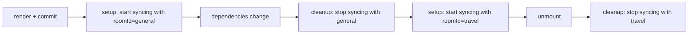
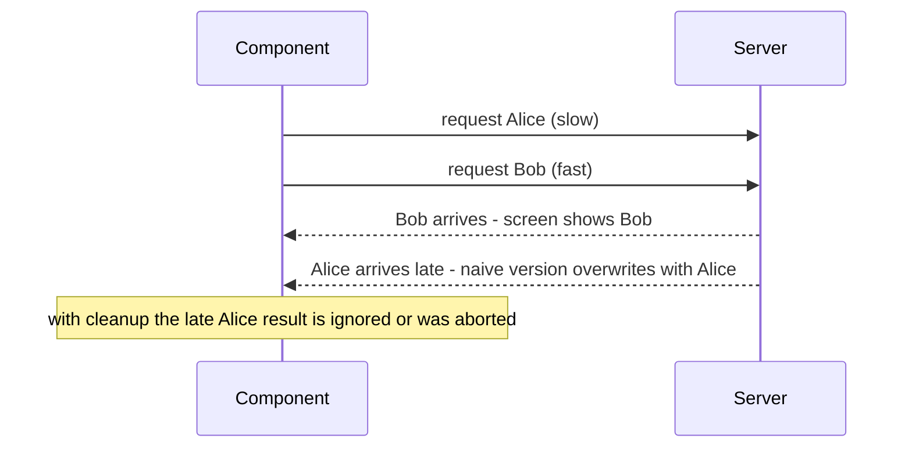
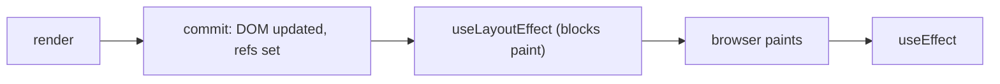

# Chapter 5 — Effects and Refs

So far every component has been a pure function of props and state ([§2.5](../02-components-and-props/README.md#25-pure-components)) and every change came from an event handler (Chapter 3). Real apps also talk to things **outside React**: a chat connection, a timer, a browser API such as `document.title`, a **third-party** map widget, a DOM node to focus or measure. React's two **escape hatches** (deliberate ways to step outside render-from-state) are **Effects** (`useEffect`: "after rendering, synchronise with something outside") and **refs** (`useRef`: "remember a value or hold a DOM node without re-rendering").

They are also the most over-used Hooks, so half of this chapter is about **when not to use an Effect** — unnecessary Effects make apps slower and buggier.

Code: [`code/`](code/) — React 19.3 in jsdom. jsdom has no **layout engine** (computes element sizes and positions), so examples that measure or scroll fake the numbers they need and say so.

---

## 5.1 Where side effects belong

### What it is
A **side effect** is anything code does besides computing a return value: changing the DOM by hand, sending a request, starting a timer, writing to `localStorage`, logging analytics. React has three places for code:

| Place | Runs when | Must be | Use it for |
|---|---|---|---|
| **Rendering** (the component body) | Every time React needs the UI | **Pure** — same inputs, same JSX, no side effects | Computing JSX and derived values |
| **Event handlers** | When a specific user action happens | Anything goes | Side effects **caused by a particular interaction**: submit a form, buy a product, start a timer on click |
| **Effects** (`useEffect`) | **After** a render is committed (changes applied to the real DOM) | Should be undoable (cleanup) | Side effects **caused by rendering itself** — keeping the component **synchronised** with an **external system** (network, timers, browser APIs, other libraries) while it's on screen |

Ask **"why does this code run?"** Because the user clicked "Send" → handler. Because this component is visible and must stay connected / subscribed / in sync → Effect. Because I need a value computed from props or state → neither: compute it during render.

### TL;DR
Pure calculations → render. Caused by a user action → handler. Needed because the component is on screen, to sync with something outside React → Effect.

---

## 5.2 `useEffect` basics

### What it is
```js
useEffect(setup, dependencies?)
// setup: function run after the render is committed; may return a cleanup function
// dependencies: array of every reactive value setup reads (props, state, values derived from them)
```

An **Effect** runs **after** React has updated the DOM (normally after the browser has **painted**), so it never blocks the new screen. A **reactive value** is anything declared in the component body that can change between renders: props, state, and values computed from them.

| You write | Setup runs |
|---|---|
| `useEffect(fn)` — no array | After **every** render |
| `useEffect(fn, [])` — empty array | Once after the first render (**mount**); cleanup on **unmount** (removed from screen) |
| `useEffect(fn, [a, b])` | After mount, and after any render where `a` or `b` changed (compared with `Object.is`) |

### How it works
`code/01_effect_basics.jsx`:
```jsx
function Demo() {
  const [count, setCount] = useState(0);
  const [name, setName] = useState('Ada');
  console.log(`render      count=${count} name=${name} | DOM says: ${document.querySelector('h1')?.textContent ?? '(nothing yet)'}`);

  useEffect(() => {
    console.log(`  effect A (no array)   -> after EVERY render; DOM says: ${document.querySelector('h1').textContent}`);
  });
  useEffect(() => {
    console.log('  effect B ([])         -> once, after the first render (mount)');
    return () => console.log('  cleanup B            -> on unmount');
  }, []);
  useEffect(() => {
    console.log(`  effect C ([name])     -> name is now ${name}`);
    return () => console.log(`  cleanup C            -> cleans up the "${name}" effect`);
  }, [name]);

  return (
    <>
      <h1>{name}: {count}</h1>
      <button onClick={() => setCount((c) => c + 1)}>count</button>
      <button onClick={() => setName('Grace')}>name</button>
    </>
  );
}
```

Output:
```
--- mount
render      count=0 name=Ada | DOM says: (nothing yet)
  effect A (no array)   -> after EVERY render; DOM says: Ada: 0
  effect B ([])         -> once, after the first render (mount)
  effect C ([name])     -> name is now Ada
--- click count (name unchanged)
render      count=1 name=Ada | DOM says: Ada: 0
  effect A (no array)   -> after EVERY render; DOM says: Ada: 1
--- click name
render      count=1 name=Grace | DOM says: Ada: 1
  cleanup C            -> cleans up the "Ada" effect
  effect A (no array)   -> after EVERY render; DOM says: Grace: 1
  effect C ([name])     -> name is now Grace
--- click name again (same value: nothing committed, so no effects)
render      count=1 name=Grace | DOM says: Grace: 1
--- unmount
  cleanup B            -> on unmount
  cleanup C            -> cleans up the "Grace" effect
```

1. **Effects run after the DOM is updated**: during render `<h1>` shows the old text, inside the Effect the new text.
2. **Dependencies are compared with the previous render**: "count" didn't re-run C; "name" did.
3. **Cleanup runs before the next setup** and sees the *old* values (`"Ada"`) — each render's Effect closes over that render's snapshot (a **closure**, [§3.3](../03-state-and-events/README.md#33-state-as-a-snapshot)).
4. **Same state value → nothing committed**: React may call the component once more to check, but no DOM update or Effects.
5. **Unmount** runs every remaining cleanup.

### An Effect's life, from its own point of view
Don't think "mount/update/unmount" (class lifecycles). Think **"start synchronising with X; stop synchronising with X"** — React may start and stop as often as needed (on every dependency change, and once extra in development, §5.4). A symmetrical setup/cleanup pair makes the count irrelevant.



### Rules
- Call `useEffect` at the **top level** ([§7.2](../07-custom-hooks-and-hook-rules/README.md#72-the-rules-of-hooks)).
- The setup must not be `async` (it would return a **promise**, not a cleanup); define an async function inside and call it (§5.7).
- Effects **don't run on the server** (server rendering, Chapter 13).

### In the interview
**30-second answer:** "`useEffect` synchronises a component with an external system. The setup runs after the render is committed; the optional cleanup runs before the next setup and on unmount. The dependency array lists every reactive value the Effect reads: no array runs after every render, an empty array only on mount, and otherwise when a dependency changes by `Object.is`. I think of it as start-sync/stop-sync rather than lifecycle events."

- *Before or after paint?* — Normally after; `useLayoutEffect` runs before (§5.11).
- *Why can't the setup be `async`?* — It must return nothing or a cleanup function, not a promise.

### TL;DR
`useEffect(() => { start; return () => stop; }, [deps])`. Runs after commit; re-runs when deps change; cleanup before the next run and on unmount.

---

## 5.3 Cleanup — undo what setup did

### What it is
The **cleanup function** your setup returns must **undo** the setup: disconnect, unsubscribe, clear the timer, remove the listener, cancel the request. Without it each re-run *adds* another connection/timer/listener — a **leak** (resources never released, piling up memory and network use).

### How it works
`code/02_cleanup_and_strict_mode.jsx`:
```jsx
function ChatRoom({ roomId }) {
  useEffect(() => {
    const connection = createConnection(roomId);   // setup
    connection.connect();
    return () => connection.disconnect();           // cleanup
  }, [roomId]);
  return <h2>Welcome to {roomId}</h2>;
}

function LeakyChatRoom({ roomId }) {
  useEffect(() => {
    createConnection(roomId).connect();             // no cleanup!
  }, [roomId]);
  return <h2>Leaky {roomId}</h2>;
}
// rendered inside <StrictMode>; the user switches room, then closes the chat

// Timers and listeners follow the same shape.
function Clock() {
  const [ticks, setTicks] = useState(0);
  useEffect(() => {
    const id = setInterval(() => setTicks((t) => t + 1), 10);
    const onKey = (e) => console.log('  key pressed:', e.key);
    window.addEventListener('keydown', onKey);
    return () => { clearInterval(id); window.removeEventListener('keydown', onKey); };
  }, []);
  return <p>ticks: {ticks}</p>;
}
```

Output:
```
=== WITH cleanup, inside <StrictMode> (development)
mount:
  connect    general (open: 1)
  disconnect general (open: 0)
  connect    general (open: 1)
switch room:
  disconnect general (open: 0)
  connect    travel (open: 1)
close:
  disconnect travel (open: 0)
connections still open: 0

=== WITHOUT cleanup, inside <StrictMode> (development)
mount:
  connect    general (open: 1)
  connect    general (open: 2)
switch room:
  connect    travel (open: 3)
close:
connections still open: 3

  key pressed: Escape
clock shows ticks: 5 (one interval, one listener — the StrictMode duplicate was cleaned up)
after unmount the listener is gone (no "key pressed: Enter" above)
```

With cleanup there is always **exactly one** connection, to the right room. Without it, connections pile up — to rooms already left — and outlive the component.

### Common setup/cleanup pairs
| Setup | Cleanup |
|---|---|
| `connection.connect()` | `connection.disconnect()` |
| `const id = setInterval(…)` / `setTimeout(…)` | `clearInterval(id)` / `clearTimeout(id)` |
| `window.addEventListener('resize', fn)` | `window.removeEventListener('resize', fn)` — the **same** function reference |
| `const unsub = store.subscribe(fn)` | `unsub()` |
| `const controller = new AbortController(); fetch(url, { signal })` | `controller.abort()` |
| `const obs = new IntersectionObserver(…); obs.observe(el)` (reports when an element scrolls into view) | `obs.disconnect()` |
| `const map = new MapWidget(el)` | `map.destroy()` |
| `dialog.showModal()` | `dialog.close()` |
| Start an animation | Reset it to the initial state |

### Common mistakes
- Removing a listener with a *new* arrow function (`removeEventListener('x', () => fn())`) — nothing is removed. Keep the function in a variable.
- Forgetting that cleanup sees the old render's values — usually what you want (disconnect the *old* room).
- Writing cleanup for something that can't be undone (a one-off POST) — that code belongs in an event handler (§5.6).

### TL;DR
Return a function that exactly undoes the setup. Then re-runs, room switches and unmounts never leak.

---

## 5.4 StrictMode's double run (development only)

### What it is
Under `<StrictMode>` (Vite and most templates add it — [§1.6](../01-why-react-and-setup/README.md#16-project-structure)), React in **development** mounts every component, then **immediately simulates unmount + remount**: setup → cleanup → setup (the `connect / disconnect / connect` above). Production runs setup once.

React 19 applies the same check to **ref callbacks** (§5.9), and React 19.3 also to components that were server-rendered and then **hydrated**.

### Why React does this
Users *do* unmount and remount: navigating away and back, a tab hidden with `<Activity>` (React 19.2's component that hides a subtree while keeping its state) and shown again, a filtered list. Asymmetric setup/cleanup produces hard-to-reproduce bugs in those cases; StrictMode forces the situation on every dev mount so you see it immediately (the leaky version shows `open: 2` at mount).

### How to handle it
The fix is **never** "stop React running it twice" — it is a correct cleanup:

| Symptom in development | Wrong fix | Right fix |
|---|---|---|
| Two connections / subscriptions | A ref flag "already connected" | Return `disconnect` / `unsubscribe` |
| Two intervals ticking twice as fast | Disable StrictMode | `return () => clearInterval(id)` |
| Two fetches in the Network tab | Ref flag | Harmless if you ignore/abort the first (§5.7); or use a caching data library |
| Analytics event logged twice | Ref flag | Acceptable in dev (production logs once), or send analytics from the causing event |
| Code that must run once per **app load** (initialising a SDK — Software Development Kit, a vendor's client library) | Effect with a ref | Top-level module code, or a module-level `let didInit = false` guard |

### In the interview
**30-second answer:** "In development, StrictMode runs every Effect's setup, cleanup and setup again on mount to check the cleanup mirrors the setup. It doesn't happen in production. If the double run causes a visible problem, the Effect is missing a cleanup — the fix is to add one, not to suppress the second run."

### TL;DR
Dev-only setup → cleanup → setup exposes missing cleanups. Fix the cleanup; don't fight the double run.

---

## 5.5 Dependencies in depth

### The rule
Every **reactive value** the Effect reads must be in its dependency array. The **`react-hooks/exhaustive-deps`** rule of the **linter** (ESLint, via `eslint-plugin-react-hooks`, included in Vite's React template) checks this. Values that never change — module constants, `useRef` objects, state setters, `dispatch` from `useReducer`/`useActionState` — can be omitted.

**You don't choose the dependencies; the code does.** If an Effect re-runs too often, change the code so it reads fewer reactive values. Never silence the linter with `// eslint-disable-next-line` — it leads to stale values.

### Techniques
`code/03_dependencies.jsx`:

```jsx
// 1. An object created during render is a NEW object every render -> Effect re-runs on every keystroke.
function ObjectDep({ roomId }) {
  const [draft, setDraft] = useState('');
  const options = { serverUrl: 'https://chat.example', roomId };     // new {} each render
  useEffect(() => connect(options), [options]);
  // ... controlled <input> for draft
}
// Fix: create the object INSIDE the Effect and depend on the primitive.
function PrimitiveDep({ roomId }) {
  const [draft, setDraft] = useState('');
  useEffect(() => {
    const options = { serverUrl: 'https://chat.example', roomId };
    return connect(options);
  }, [roomId]);
  // ...
}

// 2. Reading state only to compute the next state: use an updater, and the dependency disappears.
useEffect(() => {
  const id = setInterval(() => (useUpdater ? setCount((c) => c + 1) : setCount(count + 1)), 10);
  return () => clearInterval(id);
}, useUpdater ? [] : [count]);

// 3. useEffectEvent (React 19.2+): read the LATEST props/state inside an Effect without making them dependencies.
function ChatRoom({ roomId, theme }) {
  const onConnected = useEffectEvent(() => log.push(`connected to ${roomId}, toast in ${theme} theme`));
  useEffect(() => {
    log.push(`connect ${roomId}`);
    const t = setTimeout(() => onConnected(), 5);                // "the server said connected"
    return () => { clearTimeout(t); log.push(`disconnect ${roomId}`); };
  }, [roomId]);                                                   // theme is NOT a dependency
  return null;
}
// theme changes light -> dark while connecting; later roomId changes to travel
```

Output (the middle two lines depend on timer timing):
```
object dependency   : connects after typing 5 letters = 6
primitive dependency: connects after typing 5 letters = 1
count dep: count=5 interval restarts=6
updater: count=5 interval restarts=1
useEffectEvent: [
  'connect general',
  'connected to general, toast in dark theme',
  'disconnect general',
  'connect travel',
  'connected to travel, toast in dark theme'
]
```

1. **Objects/functions created during render** are new each render, so `Object.is` always says "changed": 6 connections for 5 keystrokes. Move them **inside** the Effect (or outside the component if they use no props/state) and depend on **primitives** (strings, numbers, booleans — compared by value).
2. **Updater functions** ([§3.5](../03-state-and-events/README.md#35-updater-functions--queueing-updates)) let the interval increment `count` without reading it, so it is created once instead of restarted every tick.
3. **`useEffectEvent`** splits the *reactive* part (connect to `roomId` — re-run on change) from the *non-reactive* part (show a **toast** — a small self-dismissing notification — in the *current* `theme`, without reconnecting when the theme changes). Theme change: no reconnect, toast still "dark". Room change: reconnect.

### `useEffectEvent` rules (stable since React 19.2)
- Call it **only from inside Effects** (or other Effect Events), never during render or from event handlers.
- **Don't** list it in dependencies (the linter knows it's non-reactive).
- Declare it in the same component/Hook as the Effect; don't pass it to other components.
- Use it for genuinely event-like logic ("connected", "message arrived", "log a visit with the current cart size"), not to hide real dependencies.

### Other techniques
| Problem | Technique |
|---|---|
| Function prop from parent re-creates every render | Call it from an Effect Event, or have the parent memoise it (keep the same function) with `useCallback` (Chapter 10) |
| Effect reads a whole object prop but needs one field | Destructure the primitive outside: `const { id } = user;` → `[id]` |
| Two unrelated things in one Effect | Split into two Effects, each with its own dependencies |
| Mutable value such as `location.pathname` or a ref's `.current` | Not a valid dependency (changes don't re-render). Subscribe with `useSyncExternalStore` ([§7.9](../07-custom-hooks-and-hook-rules/README.md#79-usesyncexternalstore--subscribing-to-outside-data)) |

### TL;DR
List everything the Effect reads; reduce the list by changing code — move objects inside, use updaters, split Effects, and use `useEffectEvent` for non-reactive logic. Never lie to the linter.

---

## 5.6 You might not need an Effect

### The problem it solves
Beginners reach for `useEffect` whenever "something should happen when X changes". Most such cases have **no external system** and are better without an Effect, which costs an **extra render**, can show **stale UI for a frame** (~16 ms at 60 fps), and creates hard-to-follow **chains**. Red flag: the Effect only (a) calls `setState` from props/state, or (b) reacts to a *user action* that just happened.

`code/04_you_might_not_need_an_effect.jsx` runs five before/after pairs:
```jsx
// 1. Derived data: computing in an Effect = one extra render + one stale frame.
function FullNameEffect({ first, last }) {
  const [fullName, setFullName] = useState('');
  useEffect(() => setFullName(`${first} ${last}`), [first, last]);   // 🔴
  return <p id="n">{fullName}</p>;
}
function FullNameRender({ first, last }) {
  const fullName = `${first} ${last}`;                                // ✅ just compute it
  return <p id="n">{fullName}</p>;
}

// 2. Resetting state when a prop changes: Effect shows the OLD comment for one frame; a key doesn't.
function CommentBoxEffect({ userId }) {
  const [comment, setComment] = useState('');
  useEffect(() => setComment(''), [userId]);                          // 🔴
  // ...
}
function Profile({ userId }) {
  return <CommentBox key={userId} userId={userId} />;                 // ✅ new key = fresh state
}

// 3. Event-specific logic belongs in the event handler, not in an Effect watching state.
function ProductEffect({ initialInCart }) {
  const [inCart, setInCart] = useState(initialInCart);
  useEffect(() => { if (inCart) toasts.push('effect: "Added to cart!"'); }, [inCart]);      // 🔴 also fires on page load
  return <button onClick={() => setInCart(true)}>Buy</button>;
}
function ProductHandler({ initialInCart }) {
  const [inCart, setInCart] = useState(initialInCart);
  function handleBuy() { setInCart(true); toasts.push('handler: "Added to cart!"'); }      // ✅ only when the user buys
  return <button onClick={handleBuy}>Buy</button>;
}

// 4. Notifying the parent: from an Effect = a second render pass; from the handler = one pass.
function Toggle({ onChange, viaEffect }) {
  const [on, setOn] = useState(false);
  useEffect(() => { if (viaEffect) onChange(on); }, [on]);           // 🔴 (and runs on mount too)
  function handleClick() { const next = !on; setOn(next); if (!viaEffect) onChange(next); }   // ✅ same event
  return <button onClick={handleClick}>{on ? 'On' : 'Off'}</button>;
}

// 5. Adjusting SOME state when a prop changes: best is to derive; else set state during render (no Effect).
function ListAdjust({ items }) {
  const [selection, setSelection] = useState(items[0]);
  const [prevItems, setPrevItems] = useState(items);
  if (items !== prevItems) {            // prop changed since last render -> fix up state right now
    setPrevItems(items);
    setSelection(null);                 // React re-runs this component immediately, before touching the DOM
  }
  return <p id="s">{selection ?? 'none'}</p>;
}
function ListDerived({ items }) {
  const [selectedId, setSelectedId] = useState('a');
  const selection = items.find((i) => i === selectedId) ?? null;      // ✅ derive: kept if still present
  return <p id="s">{selection ?? 'none'}</p>;
}
```

Output ("screen after each commit" is recorded right after every DOM update):
```
1 derived via Effect : renders=4 | screen after each commit: ["","Ada Lovelace","Ada Lovelace","Grace Hopper"]
1 derived via render : renders=2 | screen after each commit: ["Ada Lovelace","Grace Hopper"]
2 reset via Effect: screen after switching user: ["hi Ada","(empty)"]
2 reset via key   : screen after switching user: ["(empty)"]
3 ProductEffect : toasts on page load = ["effect: \"Added to cart!\""]
3 ProductHandler: toasts on page load = []
4 notify via Effect : component renders for one click = 3 | parent shows on
4 notify via handler: component renders for one click = 2 | parent shows on
5 ListAdjust : renders=3 | selection after items changed = none
5 ListDerived: renders=2 | selection after items changed = a
```

1. The Effect version rendered **twice as often**, committing an **empty name** first, then a **stale "Ada Lovelace"** while props already said Grace Hopper.
2. The Effect reset committed the previous user's draft ("hi Ada") before clearing it — in a chat app, a privacy bug. `key` never shows it.
3. The Effect toast fired when a page merely **loaded** with an item in the cart; the handler fires only on buying.
4. Notifying the parent from an Effect costs an extra render pass (and fires on mount); calling `onChange` in the handler batches both updates.
5. Setting state during render with a "previous value" avoids the Effect, but deriving from an ID is simpler — and keeps the selection when the item survives.

### The full catalogue
| You want to… | Instead of an Effect… |
|---|---|
| Compute something from props/state | Compute during render ([§3.8](../03-state-and-events/README.md#38-derived-state--choosing-the-minimal-state)) |
| Cache an expensive calculation | `useMemo` (Chapter 10) |
| Reset **all** state when a prop changes | Give the component a `key` |
| Adjust **some** state when a prop changes | Derive it; if you must, set state during render with a stored previous value |
| Share logic between two event handlers | Extract a function and call it from both |
| Send a request because the user did something (POST on submit) | Do it in the event handler / form Action (Chapter 4) |
| Run a chain of state updates (A changes → set B → set C…) | Calculate all next state in the one handler |
| Initialise the app once (read a token, init a SDK) | Top-level module code or a `didInit` module flag |
| Tell the parent about a change | Call the parent's callback in the same handler, or lift state up ([§3.7](../03-state-and-events/README.md#37-lifting-state-up)) |
| Pass fetched data up to the parent | Fetch in the parent and pass it down |
| Subscribe to an external store | `useSyncExternalStore` (Chapter 7) |
| Fetch data | An Effect *with cleanup* is acceptable (§5.7), but prefer a framework loader (router function that fetches a page's data before showing it) or TanStack Query ([§6.9](../06-state-management/README.md#69-tanstack-query--server-state), Chapter 9) |

### What *does* need an Effect
Connecting to a server or WebSocket (a connection kept open so the server can push messages), subscribing to browser events (`resize`, `online`, keyboard shortcuts), timers while visible, syncing a non-React widget (map, video player, `dialog.showModal()`), updating `document.title`, logging an **impression** (analytics record that something was seen) **because the component was shown**, and fetching (with cleanup).

### In the interview
**30-second answer:** "Effects are for synchronising with external systems. If there's no external system — just transforming props into state or reacting to a user event — I don't use one. Derived values are computed during render, expensive ones memoised; full resets use a `key`; event-caused logic goes in the handler; parents are notified in the same handler. Unneeded Effects add renders, show stale frames, and chain into hard-to-follow code."

- *`useEffect(() => setTotal(a + b), [a, b])`?* — `const total = a + b;` in render.
- *Reset a form when `userId` changes?* — `<Form key={userId} />`.
- *'POST analytics when the form is submitted'?* — Submit handler. 'Log that the page was viewed' → Effect.

### TL;DR
No external system → no Effect. Compute in render, reset with `key`, act in handlers, notify parents in the same event, subscribe with `useSyncExternalStore`.

---

## 5.7 Fetching data in Effects and race conditions

### What it is
Fetching in an Effect — when the component shows with some input, request the matching data and store it — is legitimate (syncing with a server) but has a classic trap: a **race condition** (the result depends on which overlapping operation finishes first). Two requests are **in flight** and the **slower, older** one finishes last, overwriting the correct result.

### How it works — three versions
`code/05_fetch_race_conditions.jsx` (the fake API answers Alice in 60 ms and Bob in 10 ms; the user picks Alice, then quickly Bob):
```jsx
function BioNaive({ person }) {                               // 🔴 no cleanup
  const [bio, setBio] = useState(null);
  useEffect(() => { fetchBio(person).then(setBio); }, [person]);
  return <p>{bio ?? 'Loading…'}</p>;
}

function BioIgnore({ person }) {                              // ✅ ignore stale responses
  const [bio, setBio] = useState(null);
  useEffect(() => {
    let ignore = false;
    setBio(null);
    fetchBio(person).then((result) => { if (!ignore) setBio(result); });
    return () => { ignore = true; };                          // runs when person changes or on unmount
  }, [person]);
  return <p>{bio ?? 'Loading…'}</p>;
}

function BioAbort({ person }) {                               // ✅ cancel the request itself + loading/error states
  const [state, setState] = useState({ status: 'loading' });
  useEffect(() => {
    const controller = new AbortController();
    setState({ status: 'loading' });
    fetchBio(person, { signal: controller.signal })
      .then((bio) => setState({ status: 'success', bio }))
      .catch((err) => { if (err.name !== 'AbortError') setState({ status: 'error', message: err.message }); });
    return () => controller.abort();
  }, [person]);
  if (state.status === 'loading') return <p>Loading…</p>;
  if (state.status === 'error') return <p role="alert">Could not load: {state.message}</p>;
  return <p>{state.bio}</p>;
}
```

Output:
```
BioNaive  selected Bob, screen shows: "This is Alice's bio."
BioIgnore selected Bob, screen shows: "This is Bob's bio."
BioAbort  selected Bob, screen shows: "This is Bob's bio." [ 'aborted Alice' ]
BioAbort  error state: Could not load: 404 Not Found
```



- **Naive**: the user selected Bob but sees Alice — the late response won.
- **Ignore flag**: each Effect run has its own `ignore`; the Alice run's cleanup sets *its* flag, so Alice is dropped.
- **`AbortController`** (`abort()` cancels requests given its `signal`): actually cancels the old request, saving **bandwidth**; `fetch` rejects with `AbortError`, which must not be shown as an error. It also models the three states you always need: **loading, error, success**.

With real `fetch`, check `response.ok` — `fetch` rejects only on network failure, not on HTTP 404/500 (**status codes**: 404 = not found, 500 = server error; HTTP basics: [System Design Fundamentals](../../../system-design-patterns/modules/00-system-design-fundamentals/README.md)):
```js
// (pattern — not run)
const res = await fetch(`/api/bio/${person}`, { signal });
if (!res.ok) throw new Error(`HTTP ${res.status}`);
const data = await res.json();
```

### Why fetching in Effects isn't the end of the story
| Downside | Consequence |
|---|---|
| Starts only after render + paint | Slower than fetching during navigation or on the server |
| Parent fetches, then child renders and fetches | **Network waterfalls** (requests waiting on each other instead of running in parallel) |
| No cache | Going back and forth re-fetches everything |
| Boilerplate | Loading/error/abort/retry in every component |
| No deduplication (merging identical requests) | Two components needing the same data make two requests |

Real apps use **framework data loading** (React Router loaders, Next.js Server Components — Chapters 9, 13) or a **client cache** such as **TanStack Query** ([§6.9](../06-state-management/README.md#69-tanstack-query--server-state)), which handle caching, deduplication, retries and races. React 19's `use()` with Suspense (shows a fallback while something loads) is another option for promises created outside render (Chapter 9).

### Common mistakes
- `useEffect(async () => …)` — setup must not return a promise.
- No cleanup → race conditions and "state update on unmounted component" style bugs.
- Showing "Error: AbortError" after a cancellation — filter it out.
- Storing fetched data *and* a filtered copy in state — keep the data, derive the filtered list.

### In the interview
**30-second answer:** "Fetching in an Effect is fine if you handle races: either an `ignore` flag set in cleanup, or an `AbortController` aborted in cleanup, so a stale response can't overwrite a newer one. You also need loading and error states and to check `response.ok`. In production I'd rather use a data library like TanStack Query or framework loaders, which add caching, deduplication, retries and avoid waterfalls."

### TL;DR
Fetch-in-Effect needs cleanup (ignore flag or `AbortController`) plus loading/error states. For real apps, prefer TanStack Query or framework loaders.

---

## 5.8 `useRef` for values

### What it is
```js
const ref = useRef(initialValue);   // -> { current: initialValue }, the same object on every render
```
A **ref** is a plain object with one `current` property that React keeps for the component's lifetime. You may read and change `ref.current` freely, and **changing it does not trigger a re-render**.

| | `useState` | `useRef` |
|---|---|---|
| Returns | `[value, setValue]` | `{ current: value }` |
| Changing it | Via setter → **re-render** | Assign `ref.current = x` → **no re-render** |
| Value during a render | A fixed snapshot | Mutable; could change at any time |
| Read it during render? | Yes | **No** (except lazy initialisation) |
| Use for | Anything shown on screen | Timer IDs, DOM nodes, latest-value holders, instances of non-React objects |

### How it works
`code/06_use_ref_values.jsx`:
```jsx
// 1. Ref vs state: changing a ref never re-renders; the screen shows a stale value until something else renders.
function Compare() {
  const [stateClicks, setStateClicks] = useState(0);
  const refClicks = useRef(0);
  return (
    <>
      <button onClick={() => { refClicks.current++; console.log('  ref is now', refClicks.current); }}>ref +1</button>
      <button onClick={() => setStateClicks(stateClicks + 1)}>state +1</button>
      <p>state: {stateClicks} | ref (as of last render): {refClicks.current}</p>   {/* reading in render: a bug, shown on purpose */}
    </>
  );
}

// 2. Stopwatch: the interval ID is needed by a later event but never shown -> ref.
function Stopwatch() {
  const [startTime, setStartTime] = useState(null);
  const [now, setNow] = useState(null);
  const intervalRef = useRef(null);
  function handleStart() {
    setStartTime(Date.now()); setNow(Date.now());
    clearInterval(intervalRef.current);
    intervalRef.current = setInterval(() => setNow(Date.now()), 10);
  }
  function handleStop() { clearInterval(intervalRef.current); }
  const secondsPassed = startTime != null && now != null ? (now - startTime) / 1000 : 0;
  // ... <output>{secondsPassed.toFixed(3)} s</output> + Start / Stop buttons
}

// 3. Lazy-initialise an expensive object once (the only OK "write during render" pattern).
function Player() {
  const engine = useRef(null);
  if (engine.current === null) engine.current = new VideoPlayerEngine();   // runs on the first render only
  // ...
}
```

Output:
```
  ref is now 1
  ref is now 2
after 2 ref clicks  : state: 0 | ref (as of last render): 0
after 1 state click : state: 1 | ref (as of last render): 2
stopwatch ran        : true | still frozen 50 ms after Stop: true
engines created over 4 renders: 1
```

1. The ref really was 2, but the screen said 0 until an unrelated state change — so **anything displayed must be state**.
2. The interval ID lives in a ref: "Stop" needs it, the UI doesn't; state would cause a pointless re-render.
3. `useRef(new VideoPlayerEngine())` would construct an engine **every** render and discard it; `if (ref.current === null)` creates it once. (For state, `useState(() => …)` — [§3.2](../03-state-and-events/README.md#32-state-a-components-memory--usestate).)

### Rules
- **Don't read or write `ref.current` during rendering** (except lazy init): rendering must be pure, and the React Compiler (Chapter 10) assumes this rule.
- Read and write refs in **event handlers and Effects**.
- A ref is **per component instance**, like state; a module-level variable would be shared by all instances.
- The online "`usePrevious`" hook (writing the previous value into a ref in an Effect and reading it in render) breaks this rule; store the previous value in state as in §5.6 case 5.

### In the interview
**30-second answer:** "`useRef` returns a stable `{ current }` object that persists across renders; mutating it doesn't re-render. I use it for values the UI doesn't display — timer IDs, DOM nodes, instances of non-React libraries, the latest value for a callback — and I only touch it in handlers and Effects, not during render. Anything shown on screen belongs in state."

- *Is `useRef(expensive())` efficient?* — No, `expensive()` runs every render; lazy-init with `if (r.current === null)`.

### TL;DR
`useRef` = a persistent box whose changes don't re-render. Use it for non-visual values; use state for anything on screen; don't touch refs during render.

---

## 5.9 Refs to DOM nodes

### What it is
Pass a ref to a built-in element — `<input ref={inputRef} />` — and React puts the **DOM node** in `inputRef.current` after creating it (and `null` when removed). Then call browser APIs React doesn't wrap: `focus()`, `scrollIntoView()`, `getBoundingClientRect()`, media `play()`/`pause()`, `<dialog>` `showModal()`.

### How it works
`code/07_dom_refs.jsx`, parts 1 and 2:
```jsx
// 1. The basic pattern: useRef(null) + ref={...}; React fills .current after the DOM node exists.
function FocusForm() {
  const inputRef = useRef(null);
  console.log('  during render, inputRef.current =', inputRef.current?.tagName ?? null);
  return (
    <>
      <input ref={inputRef} aria-label="name" />
      <button onClick={() => inputRef.current.focus()}>Focus the input</button>
    </>
  );
}

// 2. A list of refs: one ref holding a Map, filled by ref CALLBACKS. React 19: a callback may return a cleanup.
function CatGallery({ cats }) {
  const itemsRef = useRef(new Map());
  return (
    <>
      <nav>{cats.map((c) => <button key={c} onClick={() => itemsRef.current.get(c).scrollIntoView({ behavior: 'smooth' })}>{c}</button>)}</nav>
      <ul>
        {cats.map((c) => (
          <li key={c}>
             {
              itemsRef.current.set(c, node);            // called with the node when attached
              return () => itemsRef.current.delete(c);  // cleanup when detached (React 19+)
            }} />
          </li>
        ))}
      </ul>
    </>
  );
}
```

Output:
```
1 focus:
  during render, inputRef.current = null
  focused element: name
2 list of refs:
  scrollIntoView -> Jellylorum
  after removing Jellylorum, the Map holds: Tom, Maru
```

- During the first render the ref is `null` — the node doesn't exist yet. React sets refs during **commit**, before layout Effects (§5.11). Use refs in handlers and Effects.
- `useRef` can't go in a loop (Hook rules), so a list uses **one ref holding a `Map`** plus a **ref callback** per item.

### Ref callbacks
A **ref callback** is a function passed as `ref`, called with the DOM node when attached. In **React 19** it may **return a cleanup**, called on detach (removing the cat from the Map above). (Before 19, or if nothing is returned, React calls it again with `null` on detach.)
- An inline callback is a new function each render, so React detaches and re-attaches it every render — harmless for bookkeeping; wrap in `useCallback` if the work is expensive.
- Arrow functions with an **implicit return**, like `ref={(n) => (instance = n)}`, now look like "returning a cleanup"; TypeScript rejects them. Use a block body `{ instance = n; }`.

### When to use DOM refs — and when not
| Good uses | Avoid |
|---|---|
| Focus management (modals, forms, "press / to search") | Changing text, classes, children by hand — let React render them |
| Scrolling an item into view | Removing nodes React created (React will crash or be confused) |
| Measuring size/position (§5.11) | Reading input values you could keep in state/`FormData` (unless uncontrolled, [§4.2](../04-forms-and-actions/README.md#42-controlled-vs-uncontrolled-inputs)) |
| Integrating non-React libraries (charts, maps, editors) | |
| Media: `play()`, `pause()`; `<dialog>`: `showModal()` | |

To scroll to an item you *just* added with `setState`, the DOM doesn't have it yet inside the handler: wrap the update in `flushSync(() => setItems(…))` from `react-dom` to commit synchronously, then scroll ([§3.4](../03-state-and-events/README.md#34-batching)).

### TL;DR
`ref={myRef}` → `myRef.current` is the DOM node after commit (`null` during the first render). Use ref callbacks + a `Map` for lists; React 19 callbacks may return a cleanup. Don't edit DOM that React manages.

---

## 5.10 Passing refs to your own components

### What it is
A component's DOM nodes are private by default. When a parent legitimately needs a child's node — a design-system `<TextField>` the page wants to focus — the child must **pass the ref through**:

- **React 19**: `ref` is an **ordinary prop** for function components; destructure it and put it on the element.
- **React 18 and earlier**: wrap in **`forwardRef`**, which passes `ref` as a second argument. Still works in 19 but React has announced deprecation; new code uses the prop. (Class components still don't get `ref` as a prop.)
- **`useImperativeHandle(ref, () => api, deps)`** exposes a **custom, limited object** instead of the raw node — e.g. only `focus()` and `clear()`.

### How it works
`code/07_dom_refs.jsx`, parts 3–5:
```jsx
// 3. React 19: `ref` is an ordinary prop for function components — no forwardRef needed.
function TextField({ label, ref }) {
  return <label>{label} <input ref={ref} /></label>;
}
// Legacy (React 18 and earlier) — still works in 19, but forwardRef is planned for deprecation.
const OldTextField = forwardRef(function OldTextField({ label }, ref) {
  return <label>{label} <input ref={ref} /></label>;
});

// 4. useImperativeHandle: expose a small, deliberate API instead of the raw DOM node.
function VideoLikeInput({ ref }) {
  const real = useRef(null);
  useImperativeHandle(ref, () => ({
    focus: () => real.current.focus(),
    clear: () => { real.current.value = ''; },
  }), []);
  return <input ref={real} aria-label="limited" defaultValue="draft" />;
}

// 5. React 19.3: a ref on a <Fragment> gives a FragmentInstance that acts on its children without a wrapper <div>.
function Toolbar() {
  const group = useRef(null);
  return (
    <>
      <Fragment ref={group}>
        <button>Bold</button><button>Italic</button>
      </Fragment>
      <button onClick={() => group.current.focus()}>focus toolbar</button>
    </>
  );
}
```

Output:
```
3 ref as a prop:
  new-style ref -> INPUT | old-style ref -> INPUT
  focused: New
4 useImperativeHandle:
  exposed keys: [ 'focus', 'clear' ]
  value now "" | focused: limited
5 Fragment ref:
  focused: Bold
```

- Both styles delivered the `<input>`; the React 19 version is just a prop.
- With `useImperativeHandle` the parent can only `focus` and `clear`, not restyle or remove the node — good **encapsulation** (exposing only a deliberate interface) for component libraries.
- **Fragment refs** (stable in React 19.3) give a `FragmentInstance` with `focus()` (first focusable child), `addEventListener`, `observeUsing(observer)` and `getClientRects()` — instead of a wrapper `<div>` just to hold a ref.

### Migration
| Old | New (React 19) |
|---|---|
| `const X = forwardRef((props, ref) => …)` | `function X({ ref, ...props }) { … }` |
| `X.displayName` needed for DevTools with anonymous `forwardRef` | Normal named function |
| `<Ctx.Provider value>` (related 19 change) | `<Ctx value>` ([§6.3](../06-state-management/README.md#63-context--pass-data-deeply-without-props)) |

React provides a **codemod** (a script that rewrites source automatically) for the `forwardRef` migration.

### In the interview
**30-second answer:** "To give a parent access to a child's DOM node, in React 19 the child just accepts `ref` as a prop and passes it to the element; `forwardRef` is the older way and is on the path to deprecation. If I don't want to expose the whole node, `useImperativeHandle` exposes a small API like `focus`. Refs are an escape hatch — I use them for focus, scroll, measurement and third-party widgets, not for rendering."

### TL;DR
React 19: `function Field({ ref }) { return <input ref={ref} /> }`. `forwardRef` = legacy. `useImperativeHandle` exposes a limited API. React 19.3 adds refs on `<Fragment>`.

---

## 5.11 `useLayoutEffect` — before the browser paints

### What it is
Same signature as `useEffect`, but runs **synchronously after React updates the DOM and before the browser paints**; the browser waits for it. Its one job: **measure layout and adjust before the user sees anything** — position a **tooltip** (small pop-up label next to an element), or scroll a chat to the bottom without a jump.

`useInsertionEffect` runs even earlier (before layout effects) so CSS-in-JS libraries ([§8.7](../08-styling/README.md#87-css-in-js)) can insert `<style>` tags; app code rarely needs it.

### How it works
`code/08_layout_effect.jsx` — the order of work, then a tooltip that must flip below its target when there's no room above:
```jsx
function Order() {
  const [n, setN] = useState(0);
  console.log(`  render (n=${n})`);
  useInsertionEffect(() => { console.log('  useInsertionEffect  (for CSS-in-JS libraries: inject <style> first)'); });
  useLayoutEffect(() => { console.log('  useLayoutEffect     (DOM updated, not painted yet: measure here)'); return () => console.log('  layout cleanup'); });
  useEffect(() => { console.log('  useEffect           (after paint: subscriptions, fetching, logging)'); return () => console.log('  effect cleanup'); });
  return <button onClick={() => setN(n + 1)}>n={n}</button>;
}

function Tooltip({ targetTop, useLayout }) {
  const ref = useRef(null);
  const [height, setHeight] = useState(0);                      // unknown until measured
  const measure = () => setHeight(ref.current.getBoundingClientRect().height);
  (useLayout ? useLayoutEffect : useEffect)(measure, []);
  const placeAbove = targetTop - height >= 0;                    // enough room above the target?
  const top = placeAbove ? targetTop - height : targetTop + 30;
  return <div ref={ref} data-h="80" role="tooltip" style={{ position: 'absolute', top }}>{placeAbove ? 'above' : 'below'} the button</div>;
}
// Rendered with createRoot + flushSync like a browser task; "first paint" = the DOM at the end of that task.
```

Output:
```
mount:
  render (n=0)
  useInsertionEffect  (for CSS-in-JS libraries: inject <style> first)
  useLayoutEffect     (DOM updated, not painted yet: measure here)
  useEffect           (after paint: subscriptions, fetching, logging)
click:
  render (n=1)
  useInsertionEffect  (for CSS-in-JS libraries: inject <style> first)
  layout cleanup
  useLayoutEffect     (DOM updated, not painted yet: measure here)
  effect cleanup
  useEffect           (after paint: subscriptions, fetching, logging)
  layout cleanup
  effect cleanup
useEffect      : first paint "above the button" top=50px | settled "below the button" top=80px
useLayoutEffect: first paint "below the button" top=80px | settled "below the button" top=80px
```
(The last two "cleanup" lines are the unmount between demos. The tooltip's 80 px height is faked because jsdom has no layout.)

The tooltip can't know its height until it's in the DOM, so the first render guesses (height 0 → "above"). With **`useEffect`** that wrong position reaches the screen and is fixed a frame later — a visible **flicker**. With **`useLayoutEffect`** React measures and re-renders **before** paint, so the user only sees the correct position.



### Trade-offs
| `useEffect` | `useLayoutEffect` |
|---|---|
| Doesn't block painting — **default choice** | Blocks painting — slow code here makes the app janky (stuttering) |
| May show one frame of the "before" state | No flicker for measure-then-adjust |
| Fine for 99% of Effects | Only for reading layout and synchronously fixing it |
| — | Does nothing during server rendering (HTML is sent before any layout exists) |

### TL;DR
`useLayoutEffect` = runs after DOM update, before paint; use it to measure and reposition without flicker. Everything else: `useEffect`.

---

## 5.12 Putting it together — a city search

`code/citysearch.jsx` uses each tool for its proper job:

| Need | Tool | Why |
|---|---|---|
| Debounce the query (wait until typing pauses) | Effect with `setTimeout` + cleanup (in a tiny `useDebounced` Hook — custom Hooks are Chapter 7) | Timer = external system; each keystroke's cleanup cancels the previous timer |
| Focus the box when the page opens | DOM ref + Effect | Focus is a browser API |
| Press `/` anywhere to focus search | Window listener in an Effect + cleanup | Global subscription while mounted |
| Search the (fake) API | Effect with `AbortController` | Server sync, race-safe |
| Keep the tab title in sync | Effect writing `document.title` | Browser API |
| Tooltip that flips if there's no room | Refs + `useLayoutEffect` | Measure before paint |
| Result count | Plain variable | Derived — no Effect |

Key parts (full file in `code/citysearch.jsx`):
```jsx
// Effect 1 (timer): a debounced copy of a value — only updates after `delay` ms without changes.
function useDebounced(value, delay) {
  const [debounced, setDebounced] = useState(value);
  useEffect(() => {
    const id = setTimeout(() => setDebounced(value), delay);
    return () => clearTimeout(id);                   // a new keystroke cancels the pending update
  }, [value, delay]);
  return debounced;
}

export default function CitySearch({ searchCities, delay = 250, initialQuery = '', tipFor = null }) {
  const [query, setQuery] = useState(initialQuery);
  const [result, setResult] = useState({ status: 'idle', cities: [] });
  const inputRef = useRef(null);
  const debouncedQuery = useDebounced(query.trim(), delay);

  useEffect(() => { inputRef.current.focus(); }, []);          // Effect 2 (DOM): focus on open
  // Effect 3 (global listener): window keydown "/" -> inputRef.current.focus(); cleanup removes the listener

  // Effect 4 (network): fetch for the debounced query; abort the previous request on change.
  useEffect(() => {
    if (!debouncedQuery) { setResult({ status: 'idle', cities: [] }); return; }
    const controller = new AbortController();
    setResult((r) => ({ ...r, status: 'loading' }));  // keep old results visible while loading
    searchCities(debouncedQuery, { signal: controller.signal })
      .then((cities) => setResult({ status: 'done', cities }))
      .catch((e) => { if (e.name !== 'AbortError') setResult({ status: 'error', cities: [], message: e.message }); });
    return () => controller.abort();
  }, [debouncedQuery, searchCities]);

  // Effect 5 (browser API): keep the tab title in sync.
  useEffect(() => {
    document.title = debouncedQuery ? `“${debouncedQuery}” – City search` : 'City search';
  }, [debouncedQuery]);

  const count = result.cities.length;                   // derived
  // ... input, status line, <CityRow> list
}

// In CityRow: a useLayoutEffect([hover]) measures rowRef and tipRef with getBoundingClientRect() and
// flips the tooltip below the row when row.top - tipHeight - 6 < 0 (no room above).
// It lives in the row, not in the tooltip: a parent's layout effect runs after its children's refs are attached.
```

`code/09_city_search.jsx` drives it (debounce 50 ms; the fake API is slow for short queries so a race can happen):
```
on open, focused: true | Start typing to search.
typed "osa"  -> Searching… | requests so far: [ 'osa' ]
             -> 1 city for “osa” [ 'Osaka' ] | title: “osa” – City search
"to" then "tor" -> 1 city for “tor” [ 'Toronto' ] | requests: [ 'to', 'aborted "to"', 'tor' ]
"error"      -> Error: Service unavailable
pressed "/"  -> focused: true
```

Typing "o", "s", "a" made **one** request (debounce cleanups cancelled earlier timers); typing "r" while "to" was in flight **aborted** it, so only "tor" results showed; errors became visible state, aborts didn't; `/` worked because the listener was registered while mounted.

In the browser ([`code/citysearch.html`](code/citysearch.html), styles in `citysearch.css`; opens with query "o" and Tokyo's tooltip shown):


*Figure 5.1 — The city search. The focus came from a ref + Effect, the list from an aborted-when-stale fetch Effect, and the tooltip's position from `useLayoutEffect` measuring before paint.*

Design notes: **every Effect names its external system** (timer, DOM focus, window events, network, document title) — none merely copies props into state; **every Effect cleans up**, so StrictMode and fast typing are harmless; in production Effect 4 would be one line of TanStack Query (`useQuery({ queryKey: ['cities', q], queryFn })` — [§6.9](../06-state-management/README.md#69-tanstack-query--server-state)), which also caches.

---

## Chapter 5 TL;DR

| Idea | Remember |
|---|---|
| Where code goes | Pure calc → render; user action → handler; sync with outside while on screen → Effect |
| `useEffect` | Runs after commit; `[]` = mount only; `[a]` = when `a` changes; no array = every render |
| Cleanup | Return a function that undoes setup: disconnect, clear, remove, abort |
| StrictMode | Dev-only setup → cleanup → setup; fix cleanups, don't suppress |
| Dependencies | Everything reactive the Effect reads; reduce by moving objects inside, updaters, splitting, `useEffectEvent` |
| Not needed | Derived data, resets (`key`), event logic, notifying parents, chains, app init |
| Fetching | Ignore flag or `AbortController`; loading/error; prefer TanStack Query / loaders |
| `useRef` | `{ current }`, persists, no re-render; not for displayed data; not read in render |
| DOM refs | `ref={r}` → node after commit; ref callbacks (+ cleanup in 19) for lists |
| Refs to components | React 19 `ref` prop; `forwardRef` legacy; `useImperativeHandle` for limited APIs; Fragment refs in 19.3 |
| `useLayoutEffect` | Before paint; measure and adjust without flicker; otherwise use `useEffect` |

Next: [Chapter 6 — State Management](../06-state-management/README.md).
