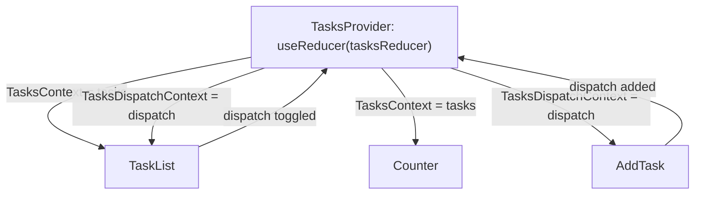
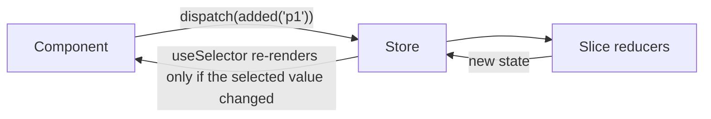
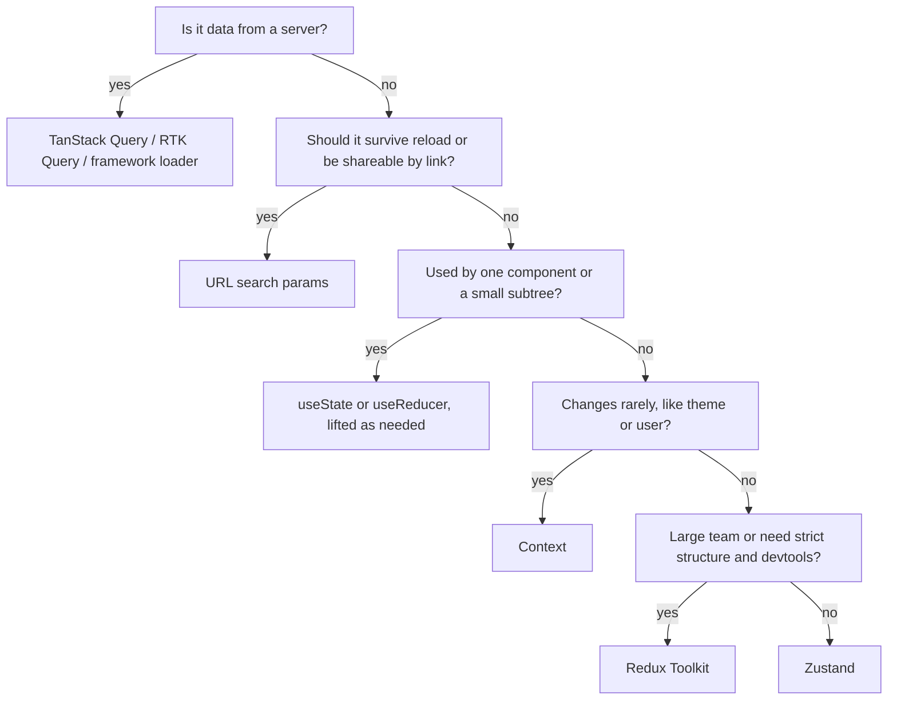

# Chapter 6 — State Management

Chapter 3 gave each component its own memory with `useState` and showed how to **lift state up** to share it. That works until an app grows: update logic gets scattered across many handlers, and data needed by distant components has to be passed through every layer in between. This chapter covers React's two built-in tools for that — **`useReducer`** (organise *how* state changes) and **Context** (deliver values *far down* the tree) — then the three libraries you'll meet in most codebases: **Redux Toolkit** and **Zustand** for client state, and **TanStack Query** for server state. Every library example runs with the real packages.

**What you'll learn**

| # | Topic | You will be able to… |
|---|---|---|
| 6.1 | Kinds of state | classify state and pick the right home for each kind |
| 6.2 | `useReducer` | move update logic into a pure reducer; dispatch actions |
| 6.3 | Context | provide and read values anywhere below, override them, set defaults |
| 6.4 | Context performance | know when consumers re-render and how to limit it |
| 6.5 | Reducer + context | build a small app-wide store with only React |
| 6.6 | When to use a library | recognise the signals that built-ins aren't enough |
| 6.7 | Redux Toolkit | slices, store, `useSelector`/`useDispatch`, thunks, memoised selectors |
| 6.8 | Zustand | a store in a few lines; selectors, `useShallow`, middleware |
| 6.9 | TanStack Query | server state: queries, cache keys, staleness, mutations, invalidation |
| 6.10 | Choosing | a comparison table and a decision flow |
| 6.11 | Putting it together | a bookshop using each kind of state in its natural home |

Code: [`code/`](code/) — React 19.3, Redux Toolkit 2.12 + React Redux 9.3, Zustand 5.0, TanStack Query 5.104, run in jsdom (a browser-like DOM that runs inside Node.js).

---

## 6.1 Kinds of state — and where each belongs

### What it is
"State management" sounds like one problem, but apps have several **kinds** of state with different needs. Most state-management pain comes from putting one kind in the wrong home — especially treating **server data** as if it were ordinary client state.

| Kind | Examples | Needs | Natural home |
|---|---|---|---|
| **Local UI state** | Is this dropdown open? Current tab? Text in this input? | Nothing special | `useState` in the component (Chapter 3) |
| **Complex local state** | A form wizard, an editor with many actions | Clear update rules | `useReducer` (§6.2) |
| **Shared / global client state** | Current user, theme, cart, feature flags (on/off switches that enable a feature for some users), a multi-step draft | Reachable from far away; efficient updates | Lift up → Context (§6.3) → Zustand / Redux (§6.7–6.8) |
| **Server state** (a cached copy of data owned by a server) | Product list, user profile, search results | Fetching, caching (keeping a local copy to reuse), de-duplication (merging identical requests), refetching, staleness (how out-of-date the copy may be), retries | TanStack Query (§6.9), RTK Query, or framework loaders (router functions that fetch a page's data; Chapter 9) |
| **URL state** | Filters, page number, selected item ID | Shareable, survives reload, back button | The URL: route params (parts of the path, like the `42` in `/books/42`) and search params (the `?genre=sf&page=2` part) (Chapter 9) |
| **Form state** | Field values, errors, pending | Validation, submission | Form Actions / `useActionState`, or a form library (Chapter 4) |
| **Derived state** | Totals, filtered lists, "is valid" | Must never be out of sync | **Not state** — compute during render (Chapter 3 §3.8) |

Analogy: a house. Things you use in one room stay in that room (local state). Things the whole family needs go in the hallway (context/global store). Food you buy from the shop goes in the fridge, which has expiry dates and needs restocking (server state in a cache). The house address is written on the door (URL state).

### Why server state is different
Server data is **owned by someone else**: other users can change it at any moment, so your copy is always potentially **stale**. It needs loading and error states, caching, de-duplication of identical requests, background refetching, and **invalidation** (marking cached data as out of date so it is fetched again) after you change it. (For caching in general, see [System Design Fundamentals](../../../system-design-patterns/modules/00-system-design-fundamentals/README.md).) Writing all that by hand with `useEffect` + `useState` (Chapter 5 §5.7) or storing it in Redux is a major source of complexity. A dedicated server-state library usually removes most of the "global state" an app thought it had.

### TL;DR
Classify first: local, complex local, shared client, server, URL, form, derived. Keep state as local as possible; put server data in a query cache; never store what you can derive.

---

## 6.2 `useReducer` — consolidate update logic

### What it is
With `useState`, each event handler decides the next state itself. As a component grows (add, edit, delete, reorder, clear…), that logic spreads across many handlers. **`useReducer`** moves it into **one function outside the component**:

```js
const [state, dispatch] = useReducer(reducer, initialArg, init?);
// reducer(state, action) -> nextState     (pure: no side effects, no mutation)
// dispatch(action)                        (action = a plain object describing what happened, e.g. { type: 'added', text })
// init?: optional function; initial state = init(initialArg), computed once
```

Vocabulary: an **action** is a plain object describing **what happened** (by convention with a `type` string, e.g. `'added'`, plus any data). **Dispatch** means "send this action to the reducer". The **reducer** takes the current state and an action and returns the **next** state.

Analogy: a bank teller. You don't open the vault and change the balance yourself; you hand over a slip ("deposit 50") and the teller, following fixed rules, updates the ledger. The slips form a clear history of what happened.

### How it works
The reducer (`code/tasks-reducer.js`) — note that it never mutates, and throws on unknown actions:
```js
export function tasksReducer(tasks, action) {
  switch (action.type) {
    case 'added':
      return [...tasks, { id: action.id, text: action.text, done: false }];
    case 'toggled':
      return tasks.map((t) => (t.id === action.id ? { ...t, done: !t.done } : t));
    case 'renamed':
      return tasks.map((t) => (t.id === action.id ? { ...t, text: action.text } : t));
    case 'deleted':
      return tasks.filter((t) => t.id !== action.id);
    case 'cleared_done':
      return tasks.filter((t) => !t.done);
    default:
      throw new Error(`Unknown action: ${action.type}`);   // catches typos early
  }
}
```

`code/01_use_reducer.jsx`:
```jsx
// 1. Reducers are plain functions: test them without React.
const s0 = [{ id: 1, text: 'Visit Kafka Museum', done: true }];
const s1 = tasksReducer(s0, { type: 'added', id: 2, text: 'Watch a puppet show' });
const s2 = tasksReducer(s1, { type: 'toggled', id: 2 });
// ...
// 2. In a component: dispatch describes WHAT happened; the reducer decides HOW state changes.
function createInitialTasks(username) {                 // lazy initialiser: runs once
  console.log(`  (init for ${username})`);
  return [{ id: 1, text: `${username}'s first task`, done: false }];
}
function TaskApp({ username }) {
  const [tasks, dispatch] = useReducer(tasksReducer, username, createInitialTasks);
  return (
    <>
      <button onClick={() => dispatch({ type: 'added', id: nextId++, text: 'Buy stamps' })}>add</button>
      <button onClick={() => dispatch({ type: 'cleared_done' })}>clear done</button>
      <ul>
        {tasks.map((t) => (
          <li key={t.id}>
            <label><input type="checkbox" checked={t.done} onChange={() => dispatch({ type: 'toggled', id: t.id })} />{t.text}</label>
            <button onClick={() => dispatch({ type: 'deleted', id: t.id })}>delete {t.text}</button>
          </li>
        ))}
      </ul>
    </>
  );
}
```

Output:
```
pure reducer: ["[x] Visit Kafka Museum","[x] Watch a puppet show"] | s0 untouched: true
typo caught  : Unknown action: addded
  (init for Ada)
after 2 adds       : [ "[ ] Ada's first task", '[ ] Buy stamps', '[ ] Buy stamps' ]
toggle + clear done: [ '[ ] Buy stamps', '[ ] Buy stamps' ]
delete one         : [ '[ ] Buy stamps' ]
```

- The reducer was **tested without rendering anything**, and the original array stayed untouched (immutability — Chapter 3 §3.6).
- A misspelt action type failed loudly instead of silently doing nothing.
- The **lazy initialiser** ran once, even though the component rendered several times.
- Event handlers became one-liners that say *what happened*; all the *how* is in one place.

### Rules for reducers
1. **Pure**: same state + action → same result. No requests, timers, random IDs, or `Date.now()` inside — create those in the handler and put them in the action (`id: nextId++` above). StrictMode calls reducers twice in development to catch impurity.
2. **Immutable**: return new objects/arrays. (Immer's `useImmerReducer` lets you write mutating code safely — the same trick Redux Toolkit uses, §6.7.)
3. **Actions describe events, not setters**: prefer `{ type: 'task_completed', id }` over `{ type: 'set_done', value: true }`. One user action = one dispatch, even if several fields change.
4. `dispatch` has a **stable identity** (it is the very same function object on every render), so it's safe to pass down or omit from Effect dependencies.
5. Like setters, `dispatch` only affects the **next** render; reading `state` right after dispatching gives the old snapshot (Chapter 3 §3.3).

### `useState` vs `useReducer`
| | `useState` | `useReducer` |
|---|---|---|
| Code size | Small for simple values | More upfront (reducer + actions) |
| Many update types on one piece of state | Logic scattered in handlers | Centralised, readable |
| Testing | Needs a render | Test the reducer as a plain function |
| Debugging | Where did this change? | Log every action + state in one place |
| Next state depends on several fields | Several setters, risk of inconsistency | One transition computes everything |

Rule of thumb: start with `useState`; switch to `useReducer` when you see several handlers modifying the same state in related ways, or bugs from inconsistent updates. You can mix both in one component.

### In the interview
**30-second answer:** "`useReducer` takes a reducer — a pure function from state and action to the next state — and returns the state plus a stable `dispatch`. Handlers dispatch actions describing what happened, and all update logic lives in the reducer, which I can **unit-test** (test one small piece of code on its own) without React. I switch from `useState` when many handlers update the same state or the transitions get complex, and I combine it with context for app-wide state."

- *Can a reducer fetch data?* — No; it must be pure. Fetch in an event handler or Effect and dispatch the result.
- *What's the third argument?* — An initialiser: initial state is `init(initialArg)`, computed once.

### Self-check
1. Why does the reducer throw on unknown types? → To catch typos immediately instead of silently ignoring actions.
2. Where does a random ID for a new item come from? → Generated in the handler and passed in the action.
3. What does `useReducer` return? → `[state, dispatch]`.

### TL;DR
`const [state, dispatch] = useReducer(reducer, initial)`. Reducer = pure `(state, action) => next`. Dispatch events, not setters. Test reducers without React.

---

## 6.3 Context — pass data deeply without props

### The problem it solves
**Prop drilling** is passing a prop through many components that don't use it, only so a deep child can. With a theme, the current user or a **locale** (the user's language and regional formats) needed in dozens of places, it becomes noise and **couples** (makes dependent on) every layer to data it doesn't care about. **Context** lets a parent make a value available to **every component below it**, however deep.

Analogy: a building's Wi-Fi. Instead of running a cable (prop) from the router to each room through every room in between, the router broadcasts, and any device inside the building connects directly. A device in another building (outside the provider) gets nothing — or a default.

### How it works
Three steps: **create**, **provide**, **use**.

`code/02_context_basics.jsx`:
```jsx
// 1. Create: the argument is the DEFAULT, used only when there is no provider above.
const ThemeContext = createContext('light');
const LevelContext = createContext(1);

// 2. Read: useContext(Ctx) — or use(Ctx), which (unlike Hooks) may be called conditionally.
function Button({ children }) {
  const theme = useContext(ThemeContext);
  return <button className={`btn-${theme}`}>{children}</button>;
}
function Heading({ children }) {
  if (!children) return null;                   // early return...
  const level = use(LevelContext);              // ...then read context: allowed with use(), not with useContext
  const Tag = `h${Math.min(level, 6)}`;
  return <Tag>{children}</Tag>;
}
// 3. A component can read the nearest value and provide a new one for its subtree.
function Section({ children }) {
  const level = useContext(LevelContext);
  return <section><LevelContext value={level + 1}>{children}</LevelContext></section>;   // React 19: <Ctx value>
}

function App() {
  const [theme, setTheme] = useState('light');
  return (
    <ThemeContext value={theme}>
      <Heading>Title</Heading>
      <Section>
        <Heading>Chapter</Heading>
        <Section>
          <Heading>Sub-section</Heading>
          <Heading />
          <Button>Save</Button>
          <ThemeContext.Provider value="high-contrast">   {/* older syntax, still works */}
            <Button>Nested override</Button>
          </ThemeContext.Provider>
        </Section>
      </Section>
      <button onClick={() => setTheme(theme === 'light' ? 'dark' : 'light')}>toggle theme</button>
    </ThemeContext>
  );
}
```

Output:
```
headings : H1:Title  H2:Chapter  H3:Sub-section
buttons  : Save -> btn-light | Nested override -> btn-high-contrast
toggled  : Save -> btn-dark | Nested override -> btn-high-contrast
no provider -> btn-light (the default from createContext)
```

What happened:
1. Each `Section` read the level from the **nearest provider above** and provided `level + 1` to its children — so headings got the right tag without any `level` prop.
2. A component reads the **closest** provider; the inner `high-contrast` provider overrode the outer theme only for its **subtree** (that component and everything nested below it).
3. When the provided value changed (toggle), consumers **re-rendered automatically** with the new value.
4. With **no provider**, `useContext` returned the **default** passed to `createContext`.

### Syntax notes (React 19)
| Topic | Detail |
|---|---|
| Providing | `<MyContext value={…}>` is the React 19 way; `<MyContext.Provider value={…}>` still works and is planned for deprecation |
| Reading | `useContext(MyContext)` (a Hook: top level only) or `use(MyContext)` (can be inside `if`/after early returns) |
| Default value | Used only when no provider is above — not when the provider's value is `undefined` |
| Scope | Context passes through any intermediate components, including ones from libraries |
| Class components | `static contextType` (legacy) |

### Common uses
Theme, locale/i18n (internationalisation — translating the UI into many languages), current user/auth, feature flags, a router's location, a form library's form state, design-system settings (density, direction), and **dependency injection** for tests (handing a component the services it uses from outside, e.g. provide a fake API client).

### Before you use context
- **Try passing props first.** Explicit props through two or three levels are fine and easier to follow.
- **Try composition** — pass JSX as `children` so intermediate components don't need to know about the data at all (Chapter 2 §2.4): `<Layout sidebar={<UserMenu user={user} />} />`.
- Context is a **delivery mechanism**, not a state manager: it moves a value down; the value itself still lives in `useState`/`useReducer`/a store.

### In the interview
**30-second answer:** "Context lets a component provide a value to its entire subtree without prop drilling: `createContext(default)`, provide with `<Ctx value>` (or `.Provider` in older code), read with `useContext` or `use`. Consumers get the nearest provider's value and re-render when it changes. I use it for rarely-changing, widely-needed values like theme, locale or auth, and I try props or composition first."

- *What if there's no provider?* — The default from `createContext`.
- *Difference between `useContext` and `use(Context)`?* — `use` can be called conditionally (after early returns, in loops); `useContext` follows Hook rules.

### TL;DR
`createContext(default)` → `<Ctx value={v}>` → `useContext(Ctx)`/`use(Ctx)`. Nearest provider wins; consumers re-render on change. Props and composition first.

---

## 6.4 Context performance caveats

### What it is
When a provider's `value` changes — compared with `Object.is` — **every component that reads that context re-renders**, even if it's wrapped in `memo` (a wrapper that skips re-rendering when props are unchanged — Chapter 10) and even if it only uses one field of the value. That's usually fine for rarely-changing values (theme, locale). It becomes a problem when a context holds frequently-changing data or a new object is created on every render.

### How it works — measuring renders
`code/03_context_performance.jsx`:
```jsx
const AuthContext = createContext(null);
const UserBadge = memo(function UserBadge() {           // reads the user
  count('UserBadge'); const { user } = useContext(AuthContext); return <span>{user}</span>;
});
const LogoutButton = memo(function LogoutButton() {     // only needs the function
  count('LogoutButton'); const { logout } = useContext(AuthContext); return <button onClick={logout}>logout</button>;
});
const Sidebar = memo(function Sidebar() { count('Sidebar(no context)'); return <nav>links</nav>; });

function App({ memoValue }) {
  const [user, setUser] = useState('ada');
  const [clock, setClock] = useState(0);                // unrelated state in the same component
  const logout = useCallback(() => setUser(null), []);
  const literal = { user, logout };                      // 🔴 new object every render
  const memoised = useMemo(() => ({ user, logout }), [user, logout]);   // ✅ same object until user changes
  return (
    <AuthContext value={memoValue ? memoised : literal}>
      <UserBadge /><LogoutButton /><Sidebar />
      <button onClick={() => setClock(clock + 1)}>tick</button>
    </AuthContext>
  );
}

// Split state and actions into two contexts: action-only consumers stop re-rendering.
function AuthProvider({ children }) {
  const [user, setUser] = useState('ada');
  const actions = useMemo(() => ({ logout: () => setUser(null), login: (u) => setUser(u) }), []);  // never changes
  return <UserContext value={user}><AuthActionsContext value={actions}>{children}</AuthActionsContext></UserContext>;
}
// render(<AuthProvider><Badge2 /><Logout2 /><Sidebar /></AuthProvider>)
```

Output (renders per component for each step):
```
mount (literal value)                        {"UserBadge":1,"LogoutButton":1,"Sidebar(no context)":1}
  unrelated state change ->                  {"UserBadge":1,"LogoutButton":1}
  user changed ->                            {"UserBadge":1,"LogoutButton":1}
mount (useMemo value)                        {"UserBadge":1,"LogoutButton":1,"Sidebar(no context)":1}
  unrelated state change ->                  {}
  user changed ->                            {"UserBadge":1,"LogoutButton":1}
split contexts: mount                        {"Badge2":1,"Logout2":1,"Sidebar(no context)":1}
  user changed ->                            {"Badge2":1}
```

Three lessons:
1. **Object literal as `value`** → a new object on every render of the provider → **all consumers re-render** on *unrelated* changes (the clock tick), defeating `memo`. Wrapping the value in `useMemo` (a Hook that returns the same cached value until its inputs change) (and functions in `useCallback`, the same idea for functions) fixed it. (The React Compiler does this memoisation automatically — Chapter 10.)
2. **Consumers re-render when anything in the value changes.** `LogoutButton` only needs `logout`, but re-rendered when `user` changed. **Splitting** into a state context and an actions context fixed it: the action-only consumer no longer re-renders.
3. `memo` components that **don't read** the context (`Sidebar`) are unaffected. And a provider component that receives its subtree as **`children`** (like `AuthProvider`) doesn't re-render that subtree when its own state changes — only the consumers.

### Techniques summary
| Problem | Fix |
|---|---|
| New object/function as `value` each render | `useMemo` for the value, `useCallback` for functions (or the React Compiler) |
| Some consumers only need actions/dispatch | Separate "state" and "dispatch/actions" contexts (§6.5) |
| One big context with unrelated values | Split per concern: `ThemeContext`, `AuthContext`, `CartContext` |
| High-frequency values (mouse position, text being typed, timers) | Don't put them in widely-used context; keep local or use a store with **selectors** (Zustand/Redux re-render only components whose selected slice changed) |
| Provider re-renders its whole subtree | Put state in a dedicated provider component that takes `children` |

### When not to use context
As a general-purpose global store for frequently changing data. Context has no **selectors** — a consumer can't say "re-render me only when `cart.count` changes". That's exactly what external stores add.

### TL;DR
All consumers re-render when the value's identity changes. Memoise the value, split state from actions, split by concern, and use a selector-based store for fast-changing shared data.

---

## 6.5 Reducer + context — a store with only React

### What it is
Combine the two tools: a **reducer** owns the state and its update rules; **two contexts** deliver the state and the `dispatch` function to any component. Wrap it all in a provider component and two custom Hooks, and you have a tidy, dependency-free store — a good fit for a feature-sized slice of state.



### How it works
`code/04_reducer_plus_context.jsx`:
```jsx
// ---- TasksContext.jsx (in a real app: its own file exporting the provider + two Hooks)
const TasksContext = createContext(null);
const TasksDispatchContext = createContext(null);

export function TasksProvider({ initialTasks, children }) {
  const [tasks, dispatch] = useReducer(tasksReducer, initialTasks);
  return (
    <TasksContext value={tasks}>
      <TasksDispatchContext value={dispatch}>{children}</TasksDispatchContext>
    </TasksContext>
  );
}
export function useTasks() {
  const tasks = useContext(TasksContext);
  if (tasks === null) throw new Error('useTasks must be used inside <TasksProvider>');
  return tasks;
}
export function useTasksDispatch() {
  const dispatch = useContext(TasksDispatchContext);
  if (dispatch === null) throw new Error('useTasksDispatch must be used inside <TasksProvider>');
  return dispatch;                                      // stable identity: components using only this rarely re-render
}

// ---- Components deep in the tree: no tasks/onAdd/onToggle props passed through the middle.
function AddTask() {
  const dispatch = useTasksDispatch();
  const [text, setText] = useState('');
  return (
    <form onSubmit={(e) => { e.preventDefault(); dispatch({ type: 'added', id: nextId++, text }); setText(''); }}>
      <input aria-label="New task" value={text} onChange={(e) => setText(e.target.value)} /><button>Add</button>
    </form>
  );
}
function TaskList() { const tasks = useTasks(); const dispatch = useTasksDispatch(); /* ... checkboxes dispatch 'toggled' */ }
function Counter() { const tasks = useTasks(); return <p>{tasks.filter((t) => !t.done).length} left</p>; }
function Layout() { return <main><AddTask /><section><TaskList /></section><footer><Counter /></footer></main>; }  // passes nothing down
```

Output:
```
tasks  : [ '[x] Philosopher’s Path', '[ ] Visit the temple' ]
footer : 1 left
outside provider -> useTasks must be used inside <TasksProvider>
```

- `Layout` passes **no props** — `AddTask`, `TaskList` and `Counter` connect directly.
- The **custom Hooks** hide the context objects (components never import them) and turn "forgot the provider" into a clear error instead of `null` bugs. Using `null` as the default makes that check possible.
- Because `dispatch` never changes, `AddTask` doesn't re-render when tasks change (§6.4 lesson 2).

### Limits
It re-renders every `useTasks()` consumer on every change, has no selectors, no devtools/time travel (stepping back through previous states in a debugging tool), no middleware, and async flows (fetching) are up to you. Fine for a feature or a small app; for large shared client state with frequent updates, a library is more efficient and conventional.

### TL;DR
`useReducer` in a provider + separate state and dispatch contexts + `useX()` Hooks that throw outside the provider = a small, dependency-free store.

---

## 6.6 When to reach for a library

Built-ins (local state, lifting, `useReducer`, context) take most apps a long way. Signals that a library would pay off:

| Signal | Likely answer |
|---|---|
| Lots of `useEffect` + `useState` for fetching; loading/error flags everywhere; duplicate requests; stale lists after edits | **TanStack Query** (or RTK Query / SWR / framework loaders — all server-data caching tools) — this alone removes most "global state" |
| Shared client state that changes often and is read by many components (editor, canvas, dashboard filters, cart) | A store with selectors: **Zustand** (small) or **Redux Toolkit** (structured) |
| Large team, many features, need strict conventions, action logs, time-travel debugging, middleware | **Redux Toolkit** |
| State updates from outside React (WebSocket — a connection kept open so the server can push messages, timers, non-React code) | A store usable outside React (Zustand's `getState/setState`, Redux `store.dispatch`) |
| Complex flows with explicit states and transitions (checkout, wizard, media player) | A reducer, or a **state-machine** library (a model with a fixed list of states and allowed transitions between them) such as XState |
| Fine-grained derived values (spreadsheet-like) | An **atom** library (state split into many tiny independent pieces) such as Jotai |

And signals that you *don't* need one: a handful of shared values that rarely change (theme, user) — context is enough; or "global state" that is really server data — use a query library.

---

## 6.7 Redux Toolkit

### What it is
**Redux** is a pattern and library for keeping app-wide state in **one store**, changed only by **dispatching actions** to **reducers** (the same idea as `useReducer`, but global and with a big ecosystem). **Redux Toolkit (RTK)** is the official, recommended way to write Redux today: it removes the old **boilerplate** (repetitive set-up code: hand-written action types, switch statements, spread-heavy immutable updates, store setup).

| Term | Meaning |
|---|---|
| **Store** | Holds the whole state tree; `getState()`, `dispatch(action)`, `subscribe(listener)` |
| **Slice** | One feature's state + reducers + generated action creators (`createSlice`) |
| **Action creator** | Function returning an action object: `added('p1')` → `{ type: 'cart/added', payload: 'p1' }` |
| **Selector** | Function that reads (and maybe derives) data from state: `state => state.cart.lines` |
| **Thunk** | A function you dispatch for async logic; RTK's `createAsyncThunk` dispatches `pending`/`fulfilled`/`rejected` (the three states of a promise: waiting, succeeded, failed) for you |
| **Middleware** | Code between `dispatch` and the reducer (logging, thunks, analytics) |



### How it works
`code/05_redux_toolkit.jsx`:
```jsx
// ---- features/products/productsSlice.js : async data with createAsyncThunk
export const fetchProducts = createAsyncThunk('products/fetch', () => fakeApi.fetchProducts());
const productsSlice = createSlice({
  name: 'products',
  initialState: { items: [], status: 'idle', error: null },
  reducers: {},
  extraReducers: (builder) => {
    builder
      .addCase(fetchProducts.pending, (state) => { state.status = 'loading'; })
      .addCase(fetchProducts.fulfilled, (state, action) => { state.status = 'succeeded'; state.items = action.payload; })
      .addCase(fetchProducts.rejected, (state, action) => { state.status = 'failed'; state.error = action.error.message; });
  },
});

// ---- features/cart/cartSlice.js : "mutating" code is safe here — Immer produces a new immutable state
const cartSlice = createSlice({
  name: 'cart',
  initialState: { lines: {} },                         // { [productId]: quantity }
  reducers: {
    added(state, action) { const id = action.payload; state.lines[id] = (state.lines[id] ?? 0) + 1; },
    removed(state, action) { delete state.lines[action.payload]; },
    cleared() { return { lines: {} }; },               // or return a brand-new state
  },
});
export const { added, removed, cleared } = cartSlice.actions;   // action creators generated for you

// ---- selectors: read and derive; createSelector memoises derived data
const selectLines = (state) => state.cart.lines;
const selectProducts = (state) => state.products.items;
export const selectCartTotal = createSelector([selectLines, selectProducts], (lines, products) =>
  products.reduce((sum, p) => sum + (lines[p.id] ?? 0) * p.price, 0));

// ---- app/store.js
export const makeStore = () => configureStore({ reducer: { products: productsSlice.reducer, cart: cartSlice.reducer } });

// ---- components
function ProductList() {
  const { items, status } = useSelector((s) => s.products);
  const dispatch = useDispatch();
  if (status === 'loading') return <p>Loading…</p>;
  return <ul>{items.map((p) => <li key={p.id}>{p.name} ${p.price} <button onClick={() => dispatch(added(p.id))}>add {p.name}</button></li>)}</ul>;
}
function CartTotal() {
  const total = useSelector(selectCartTotal);          // re-renders only when THIS value changes
  return <p>Total: ${total}</p>;
}
// render(<Provider store={store}><ProductList /><CartTotal /></Provider>); store.dispatch(fetchProducts()); click "add" ×3
```

Output:
```
initial state : {"products":{"items":[],"status":"idle","error":null},"cart":{"lines":{}}}
after fetch   : Notebook, Pen | succeeded
cart lines    : {"p1":2,"p2":1} | Total: $10
renders       : {"CartTotal":3} (ProductList does not re-render: the products slice did not change)
memoised selector recomputed on repeat calls: 0 times
after cleared : Total: $0 | action object: {"type":"cart/added","payload":"p9"}
```

What each part did:
1. **`createSlice`** generated the reducer *and* action creators (`added('p9')` → `{ type: 'cart/added', payload: 'p9' }`). Its reducers **look** mutating (`state.lines[id] = …`) but RTK runs them through **Immer**, which produces a new immutable state. (Either mutate the draft *or* return a new value — not both.)
2. **`createAsyncThunk`** handled the async fetch and dispatched `pending` → `fulfilled`; the slice reacted with `extraReducers` to track `status`.
3. **`configureStore`** combined the slices and, by default, added the thunk middleware, Redux DevTools support, and development checks that warn if you mutate state outside a reducer or put non-serializable values (ones that can't be turned into plain JSON text, e.g. class instances, functions) in state.
4. **`useSelector`** subscribes a component to **just the value its selector returns**. Adding to the cart re-rendered `CartTotal` three times but `ProductList` zero times — the products slice was unchanged.
5. **`createSelector`** (from Reselect, re-exported by RTK) **memoised** (cached by input) the derived total: repeat calls with the same inputs didn't recompute.

### Rules and good practices
- One store per app; **slices per feature** (`features/cart/cartSlice.js`). Put state in Redux only if other parts of the app care about it — form input text usually doesn't belong there.
- Keep state **serializable** (plain objects/arrays/primitives) — needed for DevTools, persistence (saving state, e.g. to `localStorage`) and SSR (server-side rendering).
- **Selectors must not return new objects/arrays on every call** (e.g. `useSelector(s => s.items.filter(...))`): the component would re-render on every dispatch (React Redux warns in development). Use `createSelector` or select primitives.
- Model actions as **events** (`cart/added`), not setters (`cart/setLines`).
- For server data, prefer **RTK Query** (included in RTK: `createApi`, auto-generated hooks such as `useGetProductsQuery`, caching and invalidation by tags — labels that link queries to the mutations that make them stale) over hand-written thunks — same ideas as TanStack Query (§6.9).
- TypeScript (JavaScript with static types): infer `RootState` and `AppDispatch` from the store and use pre-typed hooks (Chapter 11).

### Trade-offs
| Pros | Cons |
|---|---|
| Predictable one-way data flow; every change is an action you can log | More concepts and files than Zustand |
| Excellent DevTools: action log, state diff (what changed between two states), time travel | Overkill for small apps |
| Conventions scale to large teams | Needs a `<Provider>` |
| Middleware ecosystem; RTK Query built in | Global by default — easy to over-centralise |

### In the interview
**30-second answer:** "Redux keeps app state in one store changed only by dispatching actions to pure reducers. Redux Toolkit is the modern way: `createSlice` generates reducers and action creators and uses Immer so I can write mutating-style updates; `configureStore` sets up thunks, DevTools and safety checks; `createAsyncThunk` or RTK Query handle async data. Components read with `useSelector`, which re-renders only when the selected value changes, and write with `useDispatch`. I'd pick it for large apps with lots of shared client state and a need for strict conventions and tooling."

- *Why can `state.count++` appear in an RTK reducer?* — Immer gives a draft and produces a new immutable state from the changes.
- *Why might a component re-render on every dispatch?* — Its selector returns a new object/array each time; memoise with `createSelector`.
- *Redux vs Context?* — Context only delivers a value; Redux is a store with selectors, middleware and tooling, so consumers re-render selectively.

### TL;DR
RTK: `createSlice` (reducers + actions, Immer), `configureStore`, `<Provider>`, `useSelector` (fine-grained), `useDispatch`, `createAsyncThunk`/RTK Query, `createSelector`. Structured and tool-rich; best for large apps.

---

## 6.8 Zustand

### What it is
**Zustand** ("state" in German) is a small store library. You create a store with one function that returns the state *and* the actions; `create` gives back a **Hook**. Components call the Hook with a **selector** and re-render only when that selection changes. No provider, no action types, no reducers required.

### How it works
`code/06_zustand.jsx`:
```jsx
// ---- stores/useBearStore.js : state and the actions that change it live together
const useBearStore = create((set, get) => ({
  bears: 0,
  fish: 10,
  addBear: () => set((state) => ({ bears: state.bears + 1 })),     // set merges (shallowly) into the state
  eatFish: () => set((state) => ({ fish: Math.max(0, state.fish - get().bears) })),
  reset: () => set({ bears: 0, fish: 10 }),
}));

function BearCounter() { const bears = useBearStore((s) => s.bears); return <p>{bears} bears</p>; }
function FishCounter() { const fish = useBearStore((s) => s.fish); return <p>{fish} fish</p>; }
function Controls() {
  // several values at once: useShallow compares the picked object's fields, not its identity
  const { addBear, eatFish } = useBearStore(useShallow((s) => ({ addBear: s.addBear, eatFish: s.eatFish })));
  return <><button onClick={addBear}>add bear</button><button onClick={eatFish}>eat</button></>;
}
function Everything() { const s = useBearStore(); return <small>{s.bears}/{s.fish}</small>; }   // no selector

// Outside React: read, write, subscribe (tests, WebSocket handlers, other modules).
const unsub = useBearStore.subscribe((state, prev) => console.log(`  subscriber: bears ${prev.bears} -> ${state.bears}`));
useBearStore.getState().addBear();
useBearStore.setState({ fish: 99 });

// ---- Middleware: persist to localStorage.
const useSettings = create(persist(
  (set) => ({ theme: 'light', toggle: () => set((s) => ({ theme: s.theme === 'light' ? 'dark' : 'light' })) }),
  { name: 'settings', storage: createJSONStorage(() => localStorage) },
));

// ---- Common mistake: a selector that builds a NEW object each call, without useShallow.
function Broken() { const { bears, fish } = useBearStore((s) => ({ bears: s.bears, fish: s.fish })); return <p>{bears}/{fish}</p>; }
```

Output:
```
after 2 bears: 2 bears | 10 fish | renders: {"BearCounter":2,"Everything(no selector)":2}
after eating : 8 fish | renders: {"FishCounter":1,"Everything(no selector)":1}
  subscriber: bears 2 -> 3
  subscriber: bears 3 -> 3
getState()   : {"bears":3,"fish":99} | screen: 99 fish
persisted    : {"state":{"theme":"dark"},"version":0}
new-object selector -> Maximum update depth exceeded. This can …  (fix: useShallow)
```

- **Selective re-renders**: adding bears re-rendered only `BearCounter`; eating fish only `FishCounter`. `Controls` (selecting stable action functions) never re-rendered. `Everything`, with **no selector**, subscribed to the whole store and re-rendered on every change — avoid that in real code.
- **`set` merges** the object you return into the state (one level deep, like the old class `setState`); pass `true` as a second argument to replace instead. **`get()`** reads current state inside actions.
- **Outside React**: `getState`, `setState` and `subscribe` work anywhere (the subscriber fired for both changes, including the `fish` one where bears stayed 3).
- **Middleware**: `persist` saved the settings store to `localStorage` (the browser's small key-value storage) (and **rehydrates** it — loads the saved state back — on load); `devtools` connects to Redux DevTools; `immer` allows mutating-style `set`.
- **The classic Zustand 5 bug**: a selector returning a **new object** every call makes React think the store changed on every check → **infinite loop** (render, "changed", render again … until React gives up). Select primitives separately, or wrap object/array selectors in **`useShallow`**.

### Trade-offs
| Pros | Cons |
|---|---|
| Tiny API; almost no boilerplate | Fewer conventions — large teams must agree on structure |
| No provider; usable outside React | Stores are module **singletons** (exactly one shared instance per loaded file): for SSR per-request state or tests you may need a store-per-provider pattern (`createStore` + context) |
| Selector-based re-renders | Less tooling than Redux (DevTools via middleware) |
| Middleware for persist/devtools/immer | Easy to grow one giant store — split into slices/stores |

### In the interview
**30-second answer:** "Zustand creates a store with `create((set, get) => ({ state…, actions… }))` and returns a Hook. Components select what they need — `useStore(s => s.count)` — and re-render only when that value changes; for multiple values I wrap the selector in `useShallow`. It needs no provider, works outside React via `getState/setState`, and has middleware like `persist` and `devtools`. I choose it for shared client state when Redux's structure would be overkill."

### TL;DR
`const useStore = create((set, get) => ({ …state, …actions }))`; read with selectors; `useShallow` for objects; `getState/setState/subscribe` outside React; `persist`/`devtools` middleware.

---

## 6.9 TanStack Query — server state

### What it is
**TanStack Query** (formerly React Query) is a **cache for server data**. You describe *what* data you need with a **query key** and *how* to fetch it with a **query function**; the library handles loading and error states, caching, de-duplication, background refetching, retries, and marking data stale when you change it.

| Concept | Meaning | Default |
|---|---|---|
| `queryKey` | Array that identifies the data, e.g. `['todos']`, `['user', id]`. Include every variable the fetch depends on | — |
| `queryFn` | Async function returning the data (or throwing) | — |
| `staleTime` | How long fetched data counts as **fresh** (no automatic refetch) | `0` (stale immediately) |
| `gcTime` | How long **unused** cached data is kept before garbage collection (freeing memory nobody uses) | 5 minutes |
| Retries | Failed queries retried with exponential backoff (waiting longer after each failure: 1 s, 2 s, 4 s…) | 3 retries in the browser |
| Refetch triggers | While stale: component mount (first appears), window refocus (user returns to the tab), network reconnect | On |
| `status` | `'pending'` (no data yet), `'error'`, `'success'` | — |
| `fetchStatus` | `'fetching'`, `'paused'` (offline), `'idle'` — can be fetching while `success` (background refresh) | — |

Analogy: a well-run library desk. Ask for a book by its catalogue number (query key); if a recent copy is on the desk you get it at once (cache), and if it's old the librarian fetches a new edition in the background (stale-while-revalidate). If two people ask at once, one trip to the stacks serves both (de-duplication).

### How it works
`code/07_tanstack_query.jsx`:
```jsx
function useTodos() {                                     // wrap each query in a small custom Hook
  return useQuery({ queryKey: ['todos'], queryFn: api.getTodos, staleTime: 30_000 });
}
function TodoCount() { const { data } = useTodos(); return <p>count: {data?.length ?? '…'}</p>; }
function TodoList() {
  const { data, isPending, isError, error, isFetching } = useTodos();
  if (isPending) return <p>Loading…</p>;                  // no data yet
  if (isError) return <p role="alert">{error.message}</p>;
  return <ul aria-busy={isFetching}>{data.map((t) => <li key={t.id}>{t.title}</li>)}</ul>;
}
function AddTodo() {
  const queryClient = useQueryClient();
  const mutation = useMutation({
    mutationFn: api.addTodo,
    onSuccess: () => queryClient.invalidateQueries({ queryKey: ['todos'] }),   // mark stale + refetch
  });
  return <button disabled={mutation.isPending} onClick={() => mutation.mutate('Review chapter 6')}>{mutation.isPending ? 'Adding…' : 'Add'}</button>;
}
function UserCard({ id }) {                                // the key includes the variable -> one cache entry per id
  const { data, status, error } = useQuery({ queryKey: ['user', id], queryFn: () => api.getUser(id) });
  return <p>user {id}: {status === 'success' ? data.name : status === 'error' ? `error (${error.message})` : 'loading'}</p>;
}

// Test/script settings: no retries (default is 3) and no 5-minute garbage-collection timers keeping Node alive.
const queryClient = new QueryClient({ defaultOptions: { queries: { retry: false, gcTime: Infinity }, mutations: { gcTime: Infinity } } });
const App = ({ children }) => <QueryClientProvider client={queryClient}>{children}</QueryClientProvider>;
```

Output:
```
first render  : Loading… | count: …
loaded        : [ 'Write chapter 6' ] | count: 1 | requests: [ 'GET /todos' ]
remount       : shows 1 item(s) instantly from cache | requests: []
mutating      : button = Adding…
after mutation: [ 'Write chapter 6', 'Review chapter 6' ] | requests: [ 'POST /todos', 'GET /todos' ]
user switch   : user 1: User 1 (from cache at once; refetched in the background because staleTime is 0)
missing user  : user 404: error (User not found) | requests: [ 'GET /users/1', 'GET /users/2', 'GET /users/1', 'GET /users/404' ]
cache keys    : ["todos"] ["user",1] ["user",2] ["user",404]
```

Reading it:
1. **De-duplication**: `TodoList` and `TodoCount` both asked for `['todos']` — **one** request.
2. **Caching**: after unmounting and remounting within `staleTime` (30 s), the list appeared **instantly with zero requests**.
3. **Mutations + invalidation**: `useMutation` exposed `isPending` for the button; `invalidateQueries(['todos'])` marked the list stale and refetched it — no manual "push the new item into state".
4. **Keys with variables**: each user ID got its own cache entry. Switching back to user 1 showed the cached name at once and, because the default `staleTime` is 0, refetched in the background (**stale-while-revalidate**).
5. **Errors** are a state (`status === 'error'`, `error.message`), not a crash. In the browser the failed request would first be retried 3 times; here retries are off.

### What you no longer write
Compare with Chapter 5 §5.7: no `useEffect`, no `ignore` flag, no loading/error `useState`s, no cache, no refetch-after-save code. Race conditions are handled because results are stored per key.

### More features (brief)
- **Optimistic updates** with `onMutate` (update the cache, return a rollback) or by rendering `mutation.variables` while pending.
- **`enabled: false`** for dependent queries (fetch B only when A's result exists).
- **`placeholderData: keepPreviousData`** for **pagination** (showing results one page at a time) without flashing a spinner.
- **`useInfiniteQuery`** for "load more"/infinite scroll; **`useSuspenseQuery`** for Suspense (React's way to show a fallback while data loads; Chapter 9).
- **Prefetching** (fetching data *before* it is needed, e.g. `queryClient.prefetchQuery`) on hover or in route loaders; **DevTools** panel.

### Common mistakes
- Leaving a variable out of the key (`['user']` for every id) — different users overwrite each other's cache.
- Copying query `data` into `useState`/Redux — you lose updates; read from the query (derive filtered views in render).
- Creating the `QueryClient` inside a component body without `useState` — a new cache every render. Create it once (module level or `useState(() => new QueryClient())`).
- Expecting `isPending` during background refetches — use `isFetching` for that.

### In the interview
**30-second answer:** "Server state is a cache of data someone else owns, so it needs fetching, caching, de-duplication, refetching and invalidation — TanStack Query does that. `useQuery({ queryKey, queryFn })` returns status, data and error; the key identifies the cache entry and must include every variable. `staleTime` controls freshness, `gcTime` how long unused data stays. Writes go through `useMutation`, and on success I invalidate the affected keys so they refetch. With it, most 'global state' disappears from Redux or context."

- *`isPending` vs `isFetching`?* — `isPending`: no data yet. `isFetching`: any request in flight, including background refetches.
- *`staleTime` vs `gcTime`?* — Fresh vs stale (refetch triggers) vs how long unused data remains in memory.

### TL;DR
TanStack Query = server-state cache. `useQuery({ queryKey: [...vars], queryFn })`, `useMutation` + `invalidateQueries`. Defaults: `staleTime` 0, `gcTime` 5 min, 3 retries, refetch on focus/reconnect/mount.

---

## 6.10 Choosing — comparison and decision flow

| | Context (+ reducer) | Redux Toolkit | Zustand | TanStack Query |
|---|---|---|---|---|
| For | Rarely-changing shared values; small feature stores | Large shared client state, strict conventions | Shared client state with little ceremony | **Server** state |
| Provider needed | Yes | Yes | No | Yes (`QueryClientProvider`) |
| Selective re-renders | No (all consumers) | Yes (`useSelector`) | Yes (selectors) | Per query/key |
| Async | Your code | Thunks, RTK Query | Plain async actions | Built in (it's the whole point) |
| DevTools | React DevTools only | Redux DevTools (time travel) | Via `devtools` middleware | TanStack Query DevTools |
| Outside React | No | `store.dispatch/getState` | `getState/setState` | `queryClient` methods |
| Extra bundle size (JS added to what users download) | None | Moderate (RTK + React Redux) | Very small (about 1 kB gzipped, i.e. compressed) | Moderate |

Other names you'll meet: **Jotai** (atoms — small independent pieces of state composed together), **MobX** (observable objects — objects that notify listeners when they change — with automatic tracking), **Valtio** (proxy-based mutable state, where a stand-in object intercepts your writes), **XState** (state machines), **SWR** (server-state library by Vercel, similar to TanStack Query), **Recoil** (Meta's atom library — its repository (the project's code on GitHub) was archived, i.e. made read-only and unmaintained, in January 2025; don't start new projects with it).



### In the interview
**30-second answer:** "I start by classifying the state. Server data goes into a query cache like TanStack Query; shareable UI state like filters goes in the URL; local state stays in components with `useState`/`useReducer`; rarely-changing app-wide values use context. Only frequently-changing shared client state needs a store — Zustand for simplicity, Redux Toolkit when the team benefits from its structure and tooling."

---

## 6.11 Putting it together — a bookshop

`code/shop.jsx` puts each kind of state in its natural home:

| State | Home | Why |
|---|---|---|
| Book catalogue | TanStack Query (`['books']`) | Server data: cached, shared by `Catalog` and `Cart` with one request |
| Cart lines | Zustand store | Shared client state, updated often, needed in several places, cleared from outside React after checkout |
| Currency | Context | App-wide, changes rarely |
| Genre filter | `useState` in `Catalog` | Local UI state |
| Visible books, cart items, totals | Computed during render | Derived |

Key parts:
```jsx
// ---- Zustand: cart store (usable from any component, no provider)
export const useCart = create((set) => ({
  lines: {},                                                   // { [bookId]: qty }
  add: (id) => set((s) => ({ lines: { ...s.lines, [id]: (s.lines[id] ?? 0) + 1 } })),
  remove: (id) => set((s) => { const { [id]: _, ...rest } = s.lines; return { lines: rest }; }),
  clear: () => set({ lines: {} }),
}));

// ---- Context: currency formatter chosen once at the top
const CurrencyContext = createContext({ code: 'USD', locale: 'en-US' });
function useMoney() {
  const { code, locale } = useContext(CurrencyContext);
  return (n) => new Intl.NumberFormat(locale, { style: 'currency', currency: code }).format(n);
}

// ---- TanStack Query: the catalog
function useBooks(fetchBooks) {
  return useQuery({ queryKey: ['books'], queryFn: fetchBooks, staleTime: 60_000 });
}

function Catalog({ fetchBooks }) {
  const [genre, setGenre] = useState('all');                  // local UI state
  const { data: books, isPending, isError, error } = useBooks(fetchBooks);
  const add = useCart((s) => s.add);                           // select just the action -> never re-renders for cart changes
  const money = useMoney();
  if (isPending) return <p className="muted">Loading catalog…</p>;
  if (isError) return <p role="alert">{error.message}</p>;
  const visible = genre === 'all' ? books : books.filter((b) => b.genre === genre);   // derived
  // ... genre buttons + list with "Add" buttons
}

function Cart({ fetchBooks }) {
  const { lines, remove, clear } = useCart(useShallow((s) => ({ lines: s.lines, remove: s.remove, clear: s.clear })));
  const { data: books = [] } = useBooks(fetchBooks);            // same key -> same cache, no extra request
  const money = useMoney();
  const items = books.filter((b) => lines[b.id]).map((b) => ({ ...b, qty: lines[b.id] }));
  const total = items.reduce((sum, i) => sum + i.qty * i.price, 0);   // derived
  // ... list with remove buttons, total, "Empty cart"
}

export default function Shop({ fetchBooks, queryClient = new QueryClient(), currency = { code: 'USD', locale: 'en-US' } }) {
  return (
    <QueryClientProvider client={queryClient}>
      <CurrencyContext value={currency}>
        <div className="shop">
          <header><h1>Corner Bookshop</h1></header>
          <Catalog fetchBooks={fetchBooks} />
          <Cart fetchBooks={fetchBooks} />
        </div>
      </CurrencyContext>
    </QueryClientProvider>
  );
}
```
(The default `new QueryClient()` in the parameter list is fine here because `Shop` is the app root and renders once; in a component that re-renders, create the client once with `useState(() => new QueryClient())`.)

`code/08_bookshop.jsx` drives it with a euro/German-locale currency provided through context:

Output:
```
start      : Loading catalog…
catalog    : 4 books | catalog requests: 1 (Catalog and Cart share one query)
fiction    : [ 'The Hobbit', 'Dune' ]
cart       : Cart (3) -> 1 × The Pragmatic Programmer; 2 × Dune | Total 72,00 €
store      : {"b4":2,"b1":1}
removed    : 1 × The Pragmatic Programmer | Total 42,00 €
cleared    : Your cart is empty.
```

- One catalogue request served both panels; the filter was purely local; money formatting followed the context (`72,00 €`); the cart store was cleared from outside React, as a checkout callback would.

In the browser ([`code/shop.html`](code/shop.html), styles in `shop.css`; the entry seeds the cart store with two titles before rendering, using the default USD currency):


*Figure 6.1 — The bookshop. The catalogue comes from the TanStack Query cache, the cart from a Zustand store seeded with `useCart.setState` before rendering, and the prices are formatted using the currency context.*

Design notes:
- **No Redux, no Effects**: server data lives in the query cache; the store holds only what the client owns.
- **Selectors keep renders narrow**: `Catalog` selects only `add`, so it doesn't re-render when the cart changes.
- **Everything countable is derived** (visible books, item count, total).

---

## Chapter 6 TL;DR

| Idea | Remember |
|---|---|
| Kinds of state | Local, complex local, shared client, server, URL, form, derived — each has a home |
| `useReducer` | Pure `(state, action) => next`; dispatch events; test without React |
| Context | `createContext(default)`, `<Ctx value>`, `useContext`/`use`; nearest provider wins |
| Context performance | All consumers re-render on value change; memoise value, split state/actions, split by concern |
| Reducer + context | Provider + two contexts + `useX()` Hooks that throw outside the provider |
| Redux Toolkit | `createSlice` (Immer), `configureStore`, `useSelector`/`useDispatch`, thunks, `createSelector`, RTK Query |
| Zustand | `create((set, get) => …)`; selectors; `useShallow`; no provider; `persist`/`devtools` |
| TanStack Query | `useQuery({ queryKey, queryFn })`, `useMutation` + `invalidateQueries`; `staleTime` vs `gcTime` |
| Choosing | Server → query cache; shareable → URL; local → `useState`; rare global → context; busy global → Zustand/RTK |

Next: [Chapter 7 — Custom Hooks and the Rules of Hooks](../07-custom-hooks-and-hook-rules/README.md).
