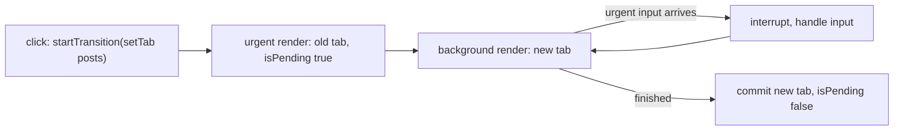

# Chapter 7 — Custom Hooks and the Rules of Hooks

You have used `useState` (Chapter 3), `useActionState` (Chapter 4), `useEffect` and `useRef` (Chapter 5), `useReducer` and `useContext` (Chapter 6). This chapter explains the **Rules of Hooks** properly — what they are, *why* React needs them, what breaks when ignored — then shows how to write your **own** Hooks: reusable **stateful logic** (code that remembers values between renders) such as `useLocalStorage`, `useDebounce` and `useFetch`. It finishes with built-ins that are easiest to grasp once you think in Hooks: `useId`, `useSyncExternalStore`, `useTransition`, `useDeferredValue` (plus `useEffectEvent` for callback-taking Hooks).

Code: [`code/`](code/) — React 19.3 in jsdom with `@testing-library/react`. Fetching examples start a tiny `node:http` server on `127.0.0.1` (localhost) inside the script, so no internet is needed.

---

## 7.1 What a Hook really is

### What it is
A **Hook** is a function whose name starts with `use` that lets a component "hook into" a React feature: state (`useState`), **side effects** (`useEffect`), **context** (`useContext`), and so on. Hooks only work **while React is rendering a component** — the only time React knows which component the call belongs to.

### How it works — state is matched by call order
A component's local variables vanish when it returns, so React stores Hook state *outside* your function, in an internal record per component instance (a **fiber**) holding a **list of Hook slots**:

1. Before calling your component, React points a **cursor** at slot 0.
2. Each Hook call reads the current slot and advances the cursor.
3. The **only** thing identifying "this `useState` is the `name` one" is its **position**. Hooks have no names or keys.

A 15-line toy model in plain JavaScript reproduces this.

`code/01_hooks_by_call_order.js`:
```js
let slots = [];      // this component instance's remembered values
let index = 0;       // which slot the next useState call reads

function useState(initial) {
  const i = index++;                       // position = identity
  if (!(i in slots)) slots[i] = initial;   // first render: store the initial value
  const setState = (v) => { slots[i] = v; };
  return [slots[i], setState];
}
function render(Component, props) { index = 0; return Component(props); }

// A "component" that breaks the rule: it calls a Hook only when a condition is true.
function Profile({ showNickname }) {
  const [name] = useState('Ada');
  if (showNickname) {
    const [nick] = useState('Countess');   // slot 1 ONLY on some renders
    void nick;
  }
  const [age] = useState(36);              // slot 1 or 2 depending on the condition!
  return `name=${name} age=${age}`;
}

console.log('render 1 (showNickname=true): ', render(Profile, { showNickname: true }));
console.log('slots now:', JSON.stringify(slots));
console.log('render 2 (showNickname=false):', render(Profile, { showNickname: false }));
```

Output:
```
render 1 (showNickname=true):  name=Ada age=36
slots now: ["Ada","Countess",36]
render 2 (showNickname=false): name=Ada age=Countess
-> age read slot 1, which holds the nickname. State got mixed up.
```

The skipped conditional call made `useState(36)` the *second* call, reading the nickname's slot — the whole reason for the Rules of Hooks.

### Why React chose call order
Names or keys were considered. Position won because it keeps Hooks cheap (no string keys), makes custom Hooks **composable** (two custom Hooks can each call `useState` without name clashes) and allows the same Hook several times in one component. The price: *call Hooks in the same order every render*.

### TL;DR
React stores Hook state in a per-component list and matches calls by **position**. Change the number or order of calls between renders and values land in the wrong slots.

---

## 7.2 The Rules of Hooks

### What it is
From react.dev:
1. **Only call Hooks at the top level** of a function component or custom Hook — never inside conditions, loops or nested functions.
2. **Only call Hooks from React functions** — components and custom Hooks, not plain JavaScript functions or class components.

### The allowed and forbidden places

| ✅ Allowed | 🔴 Not allowed |
|---|---|
| Top level of a function component body | Inside `if`, `&&`, `? :`, `switch` branches |
| Top level of a custom Hook body | Inside `for` / `while` loops |
| | **After** an early `return` (the Hook is skipped on some renders) |
| | Inside event handlers (`onClick={() => useState()}`) |
| | Inside the callbacks you pass to `useMemo`, `useReducer`, `useEffect` |
| | Inside `try` / `catch` / `finally` blocks |
| | In class components, or in plain helper functions |

**One exception:** the `use` API (§9.11 of [Chapter 9](../09-routing-and-data-fetching/README.md)) *may* be called inside `if` and loops because it keeps no slot — but still not inside `try/catch`.

### What React does when you break rule 1
`code/02_rules_of_hooks_errors.jsx`:
```jsx
// BAD: a Hook after an early return
function Greeting({ user }) {
  const [lang] = useState('en');
  if (!user) return <p>Please sign in ({lang})</p>;
  const [greeting] = useState('Hello');     // skipped when user is missing
  return <p>{greeting}, {user}</p>;
}

// BAD: a Hook inside a condition
function Tracker({ tracking }) {
  const [clicks] = useState(0);
  if (tracking) useEffect(() => {});
  return <p>clicks: {clicks}</p>;
}
// ... tryRender(label, firstUi, nextUi) renders, re-renders, prints the error ...

// GOOD: call every Hook unconditionally at the top, put the condition inside.
function GreetingFixed({ user }) {
  const [greeting] = useState('Hello');
  if (!user) return <p>Please sign in</p>;
  return <p>{greeting}, {user}</p>;
}
function TrackerFixed({ tracking }) {
  const [clicks] = useState(0);
  useEffect(() => { if (!tracking) return; /* start tracking */ }, [tracking]);
  return <p>clicks: {clicks}</p>;
}
```

Output:
```
  [dev warning] React has detected a change in the order of Hooks called by Greeting. This will lead to bugs and errors if not fixed. For more information, read the Rules of Hooks: https://react.dev/link/rules-of-hooks
Greeting: signed-out then signed-in -> Rendered more hooks than during the previous render.
Greeting: signed-in then signed-out -> Rendered fewer hooks than expected. This may be caused by an accidental early return statement.
  [dev warning] React has detected a change in the order of Hooks called by Tracker. This will lead to bugs and errors if not fixed. For more information, read the Rules of Hooks: https://react.dev/link/rules-of-hooks
Tracker : off then on               -> Rendered more hooks than during the previous render.
GreetingFixed     -> Hello, Ada
TrackerFixed      -> clicks: 0
```

A changed count makes React **throw** ("Rendered more/fewer hooks…"), crashing that part of the tree. If the count is the same but the *kind* of Hook changes, development builds warn about "a change in the order of Hooks" and you get §7.1's mixed-up state. The fix is always: **call the Hook unconditionally, move the condition inside it** (Effect body, returned JSX, or arguments).

### Why rule 2 exists
A Hook needs a "currently rendering component" for its slot. A plain function called from a handler, a timer or **module scope** (top level of a file) has none → *"Invalid hook call. Hooks can only be called inside of the body of a function component."* The same message appears when the app **bundles two copies of React** (e.g. a linked library with its own `react`) — a classic **monorepo** (one repository holding several packages) bug.

### The linter: `eslint-plugin-react-hooks`
Never find these bugs at **runtime**: the official **ESLint** plugin (a **linter** reads code without running it and flags likely bugs) checks as you type:

| Rule | What it catches |
|---|---|
| `react-hooks/rules-of-hooks` | Hooks in conditions, loops, after early returns, in non-`use` functions |
| `react-hooks/exhaustive-deps` | Missing or unnecessary values in `useEffect` / `useMemo` / `useCallback` dependency arrays ([§5.5](../05-effects-and-refs/README.md#55-dependencies-in-depth)) |
| Compiler-based rules (purity, refs, set-state-in-effect, …) | Code the React Compiler (auto-memoising build tool) cannot safely optimise — in the plugin's recommended preset in recent versions |

Setup with ESLint 9's flat config (one `eslint.config.js` exporting an array; not run — Vite's React template already includes it):
```js
// eslint.config.js
import reactHooks from 'eslint-plugin-react-hooks';
import { defineConfig } from 'eslint/config';

export default defineConfig([
  reactHooks.configs.flat.recommended,
]);
```

The linter recognises Hooks **by name**: `useSomething` (capital after `use`) is checked as a Hook; a capitalised function is treated as a component. Hence naming matters (§7.3).

### Common mistakes
| Mistake | Fix |
|---|---|
| `if (!data) return <Spinner/>;` above a `useMemo` | Move all Hooks above the first `return` |
| Calling a Hook in a `.map()` to make one per item | Extract an `<Item>` component and call the Hook inside it |
| Calling `useContext` in an event handler "to get the latest value" | Read it at top level; the handler closes over it |
| Silencing `exhaustive-deps` with `// eslint-disable-next-line` | Almost always hides a stale-value bug; restructure (Chapter 5, §7.7) |
| Naming a Hook `getUser()` | Call it `useUser()` so the linter checks it and its callers |

### In the interview
**30-second answer:** "Two rules: call Hooks only at the top level of components or custom Hooks, and only from React functions. React stores Hook state in a list per component and matches calls by order, so the order must be identical every render — a Hook inside an `if` or after an early return shifts every later slot. React throws 'Rendered more/fewer hooks' when the count changes, and `eslint-plugin-react-hooks` catches it **statically** (by reading the code, before it runs)."

- *Why can `use` be conditional but `useState` can't?* — `use` stores nothing in a slot; it reads a promise or context each time.
- *Conditionally run an effect?* — Always call `useEffect`; put the `if` inside and include the condition in dependencies.
- *Is `const [a] = cond ? useState(1) : [0]` allowed?* — No — the Hook is conditional.
- *What else causes "Invalid hook call"?* — Calling a Hook outside a component, or two copies of React in the bundle.

### TL;DR
Top level only, React functions only. The rule protects call order; the linter enforces it.

---

## 7.3 Custom Hooks — reusing stateful logic

### What it is
A **custom Hook** is a function whose name starts with `use` and that **calls other Hooks**, extracting stateful logic for reuse — like a helper function, but for logic needing state or effects. Callers share the logic, each with its own state.

### The problem it solves
Before Hooks, sharing stateful logic needed **higher-order components** (HOCs: functions taking a component and returning a wrapped one with extra props) and **render props** (a function prop that returns what to render) (Chapter 14), which nested the tree deeply ("wrapper hell"). A custom Hook is a plain call: no extra components or nesting, and you can call several.

### How it works
1. Spot duplicated Hook logic (a toggle, a subscription, a fetch) and move it into `function useSomething(args) { … }`.
2. Return what callers need — a value, a **tuple** (fixed-length array with meaningful positions) `[value, setter]`, or an object `{ data, error, status }`.
3. Every call site gets its **own** state: `useToggle()` in two components runs `useState` twice, in two fibers.
4. The Hook re-runs on each render of its caller, so it always sees the latest arguments.

`code/03_custom_hook_basics.jsx`:
```jsx
function useToggle(initial = false) {
  const [on, setOn] = useState(initial);
  const toggle = () => setOn(v => !v);
  return [on, toggle];                     // return whatever shape is convenient
}

function Spoiler({ title, children }) {
  const [open, toggleOpen] = useToggle();
  return (
    <section>
      <button onClick={toggleOpen}>{open ? 'Hide' : 'Show'} {title}</button>
      {open && <p>{children}</p>}
    </section>
  );
}

function DarkSwitch() {
  const [dark, toggleDark] = useToggle(true);
  return <button onClick={toggleDark}>theme: {dark ? 'dark' : 'light'}</button>;
}
// render two <Spoiler>s and a <DarkSwitch>; click "Show ending", then "theme"

// Not every helper is a Hook: this one calls no Hooks, so it should NOT start with "use".
function formatCount(n) { return n === 1 ? '1 item' : `${n} items`; }
```

Output:
```
start          : Show ending | Show twist | theme: dark
open "ending"  : Hide ending | The butler did it. | Show twist | theme: dark
toggle theme   : Hide ending | The butler did it. | Show twist | theme: light
plain helper   : 3 items
```

Opening one spoiler didn't open the other; the theme switch has its own value: **custom Hooks share logic, never state**. For shared state, lift it, use context, or an external store (Chapter 6, §7.9).

### Designing a good custom Hook
| Guideline | Why |
|---|---|
| Name it `use` + CapitalLetter (`useOnlineStatus`) | The linter and React Compiler treat it as a Hook; readers know it may hold state |
| If it calls **no** Hooks, don't prefix it with `use` | It's a normal function; the prefix would wrongly restrict where it can be called |
| Name it after its **purpose**, not its mechanism | `useChatRoom(roomId)` beats `useEffectWithWebSocket` |
| Mirror built-in shapes where it helps | `useLocalStorage` returning `[value, setValue]` feels like `useState` |
| Return objects when there are 3+ values | `{ data, error, status }` is self-documenting and order-free |
| Keep it pure during render | Same rule as components: side effects go in Effects or handlers |
| Avoid "lifecycle" Hooks like `useMount(fn)` | They hide dependencies from the linter; write the Effect you mean |
| Add `useDebugValue(label)` for library Hooks | Shows a label next to the Hook in React DevTools (used in `code/hooks.js`) |

**Don't write one** when the logic is short and used once (inline is clearer), when it is **server data** (fetch + cache + refetch — TanStack Query does it better, [Chapter 9](../09-routing-and-data-fetching/README.md)), or when you only share a *value* (props or context). **Testing:** through a tiny component (as here) or `renderHook` from `@testing-library/react` ([Chapter 12](../12-testing-react/README.md)).

### In the interview
**30-second answer:** "A custom Hook is a function starting with `use` that calls other Hooks. It's how you reuse stateful logic — like a subscription or a debounced value — without wrapper components. Each call has independent state, it re-runs on every render so it sees fresh arguments, and it must follow the Rules of Hooks. The `use` prefix is what lets the linter check it."

- *Do two components using the same custom Hook share state?* — No; share via lifting, context, or a store.
- *Custom Hooks vs HOCs/render props?* — Hooks compose without tree nesting and make data flow explicit; HOCs and render props remain valid but are rarely needed.

### TL;DR
`useX` = a function that calls Hooks. It shares logic, not state. Name by purpose; don't prefix non-Hooks with `use`.

---

## 7.4 `useLocalStorage` — state that survives a reload

### What it is
A Hook with `useState`'s API whose value is saved in **`localStorage`** (a small per-site key–value store keeping strings across reloads and restarts) and read back next visit.

### How it works
1. **Lazy initial state**: pass a function to `useState` so storage is read once, on mount.
2. `JSON.parse` / `JSON.stringify` (**JSON** = JavaScript Object Notation, the standard text data format) because storage holds only strings.
3. `try/catch` around every storage call: it can throw (Safari private mode, **quota** — size limit — full, disabled cookies) and stored JSON can be corrupted.
4. An Effect writes the value when it changes — writing is a side effect, not render work.
5. A second Effect listens for the **`storage` event**, fired in *other* tabs of the same site when one tab changes a key — keeping tabs in sync.

`code/04_use_local_storage.jsx`:
```jsx
export function useLocalStorage(key, initialValue) {
  // 1. Lazy initial state: read storage once, on the first render only.
  const [value, setValue] = useState(() => {
    try {
      const raw = window.localStorage.getItem(key);
      return raw !== null ? JSON.parse(raw) : initialValue;
    } catch {
      return initialValue;                   // corrupted JSON or storage blocked
    }
  });

  // 2. Write whenever the value (or key) changes.
  useEffect(() => {
    try { window.localStorage.setItem(key, JSON.stringify(value)); } catch { /* quota / private mode */ }
  }, [key, value]);

  // 3. Other tabs fire a "storage" event when they change the same key.
  useEffect(() => {
    function onStorage(e) {
      if (e.key === key && e.newValue !== null) setValue(JSON.parse(e.newValue));
    }
    window.addEventListener('storage', onStorage);
    return () => window.removeEventListener('storage', onStorage);
  }, [key]);

  return [value, setValue];                  // same shape as useState, so updaters work too
}

function Settings() {
  const [fontSize, setFontSize] = useLocalStorage('fontSize', 16);
  return (
    <div>
      <p>font size: {fontSize}px</p>
      <button onClick={() => setFontSize(s => s + 2)}>bigger</button>
    </div>
  );
}
```

Output:
```
first visit     : font size: 16px
after 2 clicks  : font size: 20px | stored = 20
after reload    : font size: 20px
other tab -> 24 : font size: 24px
corrupted JSON  : font size: 16px (fell back to the default)
```

### Trade-offs and limits
| Concern | Note |
|---|---|
| Server rendering | No `localStorage` on the server. Reading it during render makes server HTML (default) differ from the client (stored value) → **hydration mismatch** (React warns and redraws). With SSR, render the default first and load the stored value in an Effect, or use `useSyncExternalStore` with `getServerSnapshot` (§7.9). |
| Two components, same key, same tab | Each has its own `useState` and doesn't see the other's changes (`storage` fires only in *other* tabs). If that matters, make storage an external store read with `useSyncExternalStore`. |
| Size | About 5 MB per **origin** (protocol + domain + port, e.g. `https://shop.example`); strings only; synchronous (blocks the **main thread** that runs JS and draws the page). Large data → IndexedDB (asynchronous browser database). |
| Security | Readable by any script on the page — never store tokens (session/access credentials) or personal data (see the JS book's storage chapter). |

### TL;DR
Lazy-read once, write in an Effect, `try/catch` everything, listen to `storage` for other tabs. Beware SSR mismatches.

---

## 7.5 `useDebounce` — wait until the user stops

### What it is
**Debouncing** delays an action until input has been quiet for a set time: a search box firing per keystroke sends 5 requests for "react"; debounced by 300 ms it sends 1, after the pause.

### How it works
1. Keep a second state, `debounced`, starting equal to `value`.
2. Each time `value` changes, an Effect schedules `setDebounced(value)` after `delayMs`.
3. The Effect's **cleanup** cancels the previous timer, so each keystroke cancels the last pending update — only the final value survives the pause.

`code/05_use_debounce.jsx`:
```jsx
export function useDebounce(value, delayMs = 300) {
  const [debounced, setDebounced] = useState(value);
  useEffect(() => {
    const id = setTimeout(() => setDebounced(value), delayMs);  // schedule
    return () => clearTimeout(id);           // a newer value cancels the pending one
  }, [value, delayMs]);
  return debounced;
}

function Search() {
  const [text, setText] = useState('');
  const query = useDebounce(text, 100);
  useEffect(() => { if (query) console.log(`  -> would search for "${query}"`); }, [query]);
  return <input aria-label="search" value={text} onChange={e => setText(e.target.value)} />;
}
// types r, re, rea, reac, react (one key every 30 ms), pauses, then types "react hooks"
```

Output:
```
typed "r"
typed "re"
typed "rea"
typed "reac"
typed "react"
(pause 150 ms)
  -> would search for "react"
typed "react hooks"
(pause 150 ms)
  -> would search for "react hooks"
```

Five keystrokes, one search. The input itself is **not** debounced — `text` updates immediately so typing feels instant; only the *derived* `query` waits.

### Debounce vs throttle vs `useDeferredValue`
| Technique | Behaviour | Use for |
|---|---|---|
| **Debounce** | Fire once after N ms of silence | Network requests while typing, autosave |
| **Throttle** | Fire at most once every N ms | Scroll/resize handlers, analytics |
| **`useDeferredValue`** (§7.11) | Re-render a slow part as soon as React has time; no fixed delay, interruptible | Expensive *rendering* (filtering a big list) — not network calls |

`useDebouncedCallback(fn, ms)` debounces a *function* instead (autosave on change); libraries such as `use-debounce` provide both.

### Common mistakes
- No cleanup → every keystroke eventually fires.
- Debouncing the controlled input's own value → the **caret** (text cursor) lags and characters appear late.
- Creating the debounced function inline each render (`debounce(fn, 300)` in the body) → a new timer per render, nothing debounced. Keep it in a ref or use the value-based Hook.

### TL;DR
Timer in an Effect, cleared by the cleanup. Debounce the derived value, never the input.

---

## 7.6 `useFetch` — loading, error, success, and no races

### What it is
A Hook that fetches a URL and returns `{ status, data, error }`, packaging the Effect-based fetching pattern and its **race-condition** fix from [§5.7](../05-effects-and-refs/README.md#57-fetching-data-in-effects-and-race-conditions): when the URL changes while a request is in flight, the last response to arrive would otherwise win, even for the old URL.

`code/06_use_fetch.jsx` — the local server answers user 1 slowly (150 ms) and user 2 quickly (20 ms):
```jsx
// The naive version: no cleanup, so whichever response arrives LAST wins.
function useFetchNaive(url) {
  const [data, setData] = useState(null);
  useEffect(() => { fetch(url).then(r => r.json()).then(setData); }, [url]);
  return data;
}

export function useFetch(url) {
  const [state, setState] = useState({ status: 'idle', data: null, error: null });
  useEffect(() => {
    if (!url) return;
    const controller = new AbortController();          // lets cleanup cancel the request
    setState(s => ({ ...s, status: 'loading', error: null }));
    fetch(url, { signal: controller.signal })
      .then(res => { if (!res.ok) throw new Error(`HTTP ${res.status}`); return res.json(); })
      .then(data => setState({ status: 'success', data, error: null }))
      .catch(error => {
        if (error.name === 'AbortError') return;         // we cancelled it: not a real error
        setState({ status: 'error', data: null, error });
      });
    return () => controller.abort();                     // url changed or unmounted
  }, [url]);
  return state;
}

function Profile({ id }) {
  const { status, data, error } = useFetch(`${BASE}/api/users/${id}`);
  if (status === 'loading' && !data) return <p>Loading…</p>;
  if (status === 'error') return <p role="alert">Could not load user {id}: {error.message}</p>;
  if (!data) return null;
  return <p>User {id}: {data.name}{status === 'loading' ? ' (refreshing…)' : ''}</p>;
}
// render id=1, immediately switch to id=2, wait; then id=99 (does not exist)
```

Output:
```
naive         : Asked for user 2, showing: Ada <- WRONG user (race condition)
initial       : Loading…
switched to 2 : User 2: Grace
200 ms later  : User 2: Grace (the slow Ada response was aborted, not shown)
missing user  : Could not load user 99: HTTP 404
```

### How it works
1. Each Effect run creates an `AbortController`; its `signal` goes to `fetch`. When `url` changes (or on unmount), cleanup calls `abort()` → the old `fetch` rejects with `AbortError`, which is ignored. (An `ignore` flag also prevents the stale `setState` but lets the request finish; aborting saves bandwidth.)
2. `fetch` rejects only on *network* failure, so `res.ok` is checked to turn 4xx/5xx **status codes** (e.g. 404 Not Found, 500 server error) into errors.
3. One state object with a `status` field makes impossible combinations (loading *and* error) impossible.
4. Keeping old `data` while `status === 'loading'` shows "refreshing…" instead of flashing a spinner.

**When not to use it:** fine as an exercise or one-off widget, but real apps need **caching**, **deduplication**, **refetch on focus**, **retries**, **pagination** and **mutations with invalidation** — exactly what TanStack Query or a router loader provides ([Chapter 9](../09-routing-and-data-fetching/README.md)). Effects also start fetching only *after* render, causing request **waterfalls** in nested components.

### In the interview
**30-second answer:** "I'd keep `{status, data, error}` in one state object, start the fetch in an Effect keyed on the URL, pass an AbortController signal, and abort in the cleanup so a stale response can't overwrite a newer one. I'd check `res.ok` because fetch doesn't reject on 404. For production I'd use TanStack Query or router loaders to get caching, dedupe and retries."

### TL;DR
Fetch in an Effect, abort in cleanup, check `res.ok`, one status field. For real apps, reach for a data library.

---

## 7.7 Hooks that take callbacks — `useEffectEvent`

### What it is
Some custom Hooks accept a function — `useInterval(callback, ms)`, `useEventListener('keydown', handler)`, `useWebSocket(url, onMessage)`. The inner Effect must call the **latest** callback (seeing the latest props/state) without **restarting** the timer or connection each time the parent passes a new function.

**`useEffectEvent`** (stable since React 19.2) wraps a function into an **Effect Event**: a stable function that, called from an Effect, always runs the newest callback version. It is *not* reactive, so it stays out of the dependency array.

### The problem it solves
Before, both options were bad: `callback` in the dependencies → the interval is torn down and recreated every render; leave it out (`[]`) → the Effect keeps the **first** callback forever (a **stale closure** — a function holding variables from an old render) and the linter complains.

`code/11_use_effect_event.jsx`:
```jsx
export function useInterval(callback, delayMs) {
  const onTick = useEffectEvent(callback);        // always calls the newest callback
  useEffect(() => {
    if (delayMs === null) return;                  // null = paused
    timersStarted++;
    const id = setInterval(() => onTick(), delayMs);
    return () => clearInterval(id);
  }, [delayMs]);                                   // onTick is deliberately NOT a dependency
}

// The tempting-but-wrong version: an empty dependency array freezes the FIRST callback.
function useIntervalStale(callback, delayMs) {
  useEffect(() => {
    const id = setInterval(() => callback(), delayMs);
    return () => clearInterval(id);
  }, []);                                          // the linter would warn: missing 'callback', 'delayMs'
}

// Stopwatch: useIntervalImpl(() => stepsSeen.add(step), running ? 20 : null)
// wait 70 ms, click "step" twice (step becomes 3), wait 70 ms
```

Output:
```
useInterval (useEffectEvent): ticks used step values 1, 3
useIntervalStale ([] deps)  : ticks used step values 1
intervals started: 2 (mount + resume; changing step never restarted it)
```

The correct Hook saw `step = 3` without restarting; the stale one kept `1`. Changing `delayMs` (pause → `null`, resume → `20`) *does* restart it, because the delay is a real dependency.

**Rules** (full list in [§5.5](../05-effects-and-refs/README.md#55-dependencies-in-depth)): call Effect Events only from inside Effects (not during render or from handlers, which already see latest values); don't pass them to other components or Hooks; never list them as dependencies; use them for the *non-reactive* part of an Effect, not to hide real dependencies.

Before 19.2 the "latest ref" pattern did this — `const saved = useRef(callback); useEffect(() => { saved.current = callback; });` then `saved.current()` in the interval — still common in older code and libraries.

### TL;DR
Callback-taking Hooks: wrap the callback in `useEffectEvent`, call it from the Effect, keep only truly reactive values in the dependencies.

---

## 7.8 `useId` — IDs for accessibility

### What it is
`useId()` returns a **unique string ID** for the calling component instance, stable across re-renders and identical between server HTML and the hydrated client. It is for attributes linking elements by ID, including **ARIA** (`aria-*` attributes describing elements to screen readers): `<label htmlFor>`, `aria-describedby`, `aria-labelledby`, `aria-controls`.

### The problem it solves
A reusable `<PasswordField>` needs an input `id` for its `<label>`. Hard-coded `id="password"` breaks when the field appears twice (duplicate IDs; the second label points at the first input). A global counter (`id = nextId++`) breaks under server rendering, where server and client may count in different orders → hydration mismatches.

`code/07_use_id.jsx`:
```jsx
function PasswordField({ label }) {
  const id = useId();                       // one ID per component instance
  return (
    <div>
      <label htmlFor={`${id}-input`}>{label}</label>
      <input id={`${id}-input`} type="password" aria-describedby={`${id}-hint`} />
      <p id={`${id}-hint`}>At least 12 characters.</p>
    </div>
  );
}
function SignupForm() {
  return (<form><PasswordField label="Password" /><PasswordField label="Repeat password" /></form>);
}
// ... render, then renderToString + hydrateRoot, then an identifierPrefix
```

Output:
```
input id=_r_0_-input  aria-describedby=_r_0_-hint
input id=_r_1_-input  aria-describedby=_r_1_-hint
label lookup finds the 2nd input: true
its description: _r_1_-hint
server ids   : _R_1_-input, _R_1_-hint, _R_2_-input, _R_2_-hint
after hydrate: _R_1_-input, _R_1_-hint, _R_2_-input, _R_2_-hint
with identifierPrefix: _widget-R_0_-input
```

### How it works
- The ID derives from the component's **position in the tree** (parent path), not a counter, so server and client agree when they render the same tree.
- Call it **once** per component; derive related IDs with suffixes (`${id}-input`, `${id}-hint`).
- `identifierPrefix` (option of `createRoot`, `hydrateRoot` and server renderers) stops IDs from two React **roots** on one page colliding.
- The format is an implementation detail that has changed between versions; never parse it or hard-code it in CSS or tests (query by role/label instead — which works *because* the IDs are wired correctly).

**Not for list keys** (keys come from data, `todo.id`; `useId` per item defeats the purpose), and not for database IDs or anything globally unique — use `crypto.randomUUID()` when *creating* data.

### TL;DR
`useId()` → unique, SSR-safe ID per component for `htmlFor`/`aria-*`. One call, suffixes for related IDs. Never for keys.

---

## 7.9 `useSyncExternalStore` — subscribing to outside data

### What it is
An **external store** is data living outside React state that can change on its own: browser APIs (`navigator.onLine` — online?, `matchMedia` — does a CSS media query match?, `window.innerWidth`, `localStorage`), third-party state libraries, a WebSocket cache. `useSyncExternalStore` lets a component **read** it and **re-render** on change, without the subtle bugs of `useState` + `useEffect`.

```js
const snapshot = useSyncExternalStore(subscribe, getSnapshot, getServerSnapshot?);
```

| Argument | Contract |
|---|---|
| `subscribe(callback)` | Start listening; call `callback` whenever the store changes; **return an unsubscribe function**. Should be the same function each render (define it outside the component) or React re-subscribes every render. |
| `getSnapshot()` | Return the current value. Must return the **same value (by `Object.is`)** if the store hasn't changed. |
| `getServerSnapshot()` | Optional: the value to use during server rendering and hydration. Required if the component renders on the server. |

### Why not `useState` + `useEffect`?
The Effect version subscribes *after* the first paint (the first render may be wrong), and under **concurrent rendering** (React can pause a render and continue later, §7.10) different components can read the store at different moments in one render and show inconsistent values — **tearing**. `useSyncExternalStore` reads snapshots in a way React can check for consistency, forcing a synchronous re-render if the store changes mid-render.

`code/08_use_sync_external_store.jsx`:
```jsx
// ---- 1. A browser API: navigator.onLine + 'online'/'offline' events ----
function subscribeOnline(callback) {          // React passes a callback; call it on every change
  window.addEventListener('online', callback);
  window.addEventListener('offline', callback);
  return () => {                               // and return an unsubscribe function
    window.removeEventListener('online', callback);
    window.removeEventListener('offline', callback);
  };
}
function useOnlineStatus() {
  return useSyncExternalStore(
    subscribeOnline,                           // defined OUTSIDE the component: same function every render
    () => navigator.onLine,                    // getSnapshot (client)
    () => true                                 // getServerSnapshot (used during SSR and hydration)
  );
}
function StatusBar() { return <p>{useOnlineStatus() ? 'Online' : 'Offline - changes will sync later'}</p>; }

// ---- 2. Your own tiny store (the pattern Redux/Zustand use internally) ----
function createStore(initial) {
  let state = initial;
  const listeners = new Set();
  return {
    getState: () => state,
    setState: (update) => { state = { ...state, ...update }; listeners.forEach(l => l()); },
    subscribe: (l) => { listeners.add(l); return () => listeners.delete(l); },
  };
}
const cart = createStore({ items: 0 });
function useCartCount() { return useSyncExternalStore(cart.subscribe, () => cart.getState().items); }

// ---- 3. The classic bug: getSnapshot returns a NEW object every time ----
function BadCart() {
  const snap = useSyncExternalStore(cart.subscribe, () => ({ ...cart.getState() })); // new object each call
  return <p>{snap.items}</p>;
}
```

Output:
```
start        : Online
wifi drops   : Offline - changes will sync later
wifi returns : Online
store update : header says 3 items | badge: 3
dev warning  : The result of getSnapshot should be cached to avoid an infinite loop
bad snapshot : Maximum update depth exceeded. This can happen when a component repeatedly calls setState inside componentWillUpdate or componentDidUpdate. React limits the number of nested updates to prevent infinite loops.
```

### How it works
1. On render React calls `getSnapshot()`; after commit it calls `subscribe(callback)`.
2. When the store changes, your code calls `callback`; React re-reads `getSnapshot()` and re-renders only if the value differs (`Object.is`).
3. On unmount (or if `subscribe` changes) React calls the unsubscribe function.

Part 3 shows why the snapshot must be *stable*: a fresh object is "different" every time → infinite re-renders. Return the same immutable object until it changes (as `cart.getState()` does), or select a primitive (`.items`).

**Real world:** **Zustand** and **React Redux** v8+ are built on it ([Chapter 6](../06-state-management/README.md)); `useMediaQuery('(prefers-color-scheme: dark)')` subscribes to `matchMedia(...).addEventListener('change', …)` for theming ([§8.8](../08-styling/README.md#88-theming-and-dark-mode)); routers subscribe to the history/location store this way.

**When not to use it:** if data can live in React state, keep it there. External store mutations can't be non-blocking **transitions** (§7.10) — a store update during a transition falls back to a blocking render — so prefer React state for UI that benefits from `useTransition`.

### In the interview
**30-second answer:** "`useSyncExternalStore(subscribe, getSnapshot, getServerSnapshot)` is the official way to read mutable data from outside React. React subscribes after commit and re-reads the snapshot on each change, re-rendering when it differs. It prevents tearing in concurrent rendering. The snapshot must be cached — return the same reference while nothing changed — and `subscribe` should be stable. Zustand and React Redux use it internally."

- *What is tearing?* — Different parts of the UI showing different versions of the same store during one render.
- *`getSnapshot` returns a new array each time?* — Infinite re-render loop; React warns "should be cached".

### TL;DR
External data → `useSyncExternalStore`. Stable `subscribe`, cached `getSnapshot`, `getServerSnapshot` for SSR.

---

## 7.10 `useTransition` — non-urgent updates

### What it is
React 18 introduced **concurrent rendering**: React can prepare new UI in the background, pause it for something more urgent, and discard it if outdated. You opt in by marking updates as **transitions**:
- **Urgent updates**: direct responses to input (typing, clicking) — expected instantly.
- **Transition updates**: moving between views (switching tabs, showing results) — a short delay is fine; freezing is not.

```js
const [isPending, startTransition] = useTransition();
startTransition(() => setTab('posts'));          // this update is a transition
```

`isPending` is `true` while the transition is in progress — dim the old UI or show a small spinner instead of a blank screen.

### How it works
1. `startTransition(fn)` runs `fn` immediately; updates inside it are tagged as transitions.
2. React first re-renders **urgently** with `isPending = true` and the *old* state — the current screen stays visible and interactive.
3. It renders the new state in the background; an urgent update arriving meanwhile interrupts it, is handled, and the transition restarts with the newest state.
4. When done, React commits and `isPending` becomes `false`.



`code/09_use_transition.jsx`:
```jsx
function SlowPosts() {                              // pretend this tab is expensive to render
  const start = performance.now(); while (performance.now() - start < 30) { /* busy 30 ms */ }
  return <p>500 posts</p>;
}
const TABS = { about: () => <p>About me</p>, posts: SlowPosts };

function TabApp() {
  const [tab, setTab] = useState('about');
  const [isPending, startTransition] = useTransition();
  log.push(`render tab=${tab} isPending=${isPending}`);
  const Tab = TABS[tab];
  return (
    <div style={{ opacity: isPending ? 0.6 : 1 }}>
      <button onClick={() => startTransition(() => setTab('posts'))}>Posts</button>
      <Tab />
    </div>
  );
}

// React 19: the function passed to startTransition may be ASYNC (an "Action").
function RenameForm() {
  const [name, setName] = useState('ada');
  const [isPending, startTransition] = useTransition();
  seen.push(`${isPending ? 'Saving…' : 'Idle   '} name=${name}`);
  function handleSave() {
    startTransition(async () => {
      const saved = await saveToServer('grace');
      startTransition(() => setName(saved));      // updates AFTER an await need their own startTransition
    });
  }
  return <button onClick={handleSave}>Save</button>;
}
```

Output:
```
--- click "Posts" (update inside startTransition) ---
render tab=about isPending=true
render tab=posts isPending=false
--- async action ---
Idle    name=ada
Saving… name=ada
Saving… name=ada
Idle    name=GRACE
```

The first render after the click still shows **about** (dimmed, `isPending=true`); the expensive posts tab replaces it when ready. In the async example `isPending` stays true from click until the whole async function — network wait included — finishes and the new name applies (React may render more than once while pending).

### React 19: async transitions are "Actions"
Since React 19, `startTransition` accepts an **async function**, called an **Action**: React tracks its pending state, and it's the mechanism behind form `action` props, `useActionState` and `useOptimistic` ([Chapter 4](../04-forms-and-actions/README.md)). Current limitation: state updates **after an `await`** aren't automatically in the transition — wrap them in another `startTransition`, as above.

### Transitions and Suspense
If a transition makes a component **suspend** (pause rendering because something isn't ready, e.g. route data — [Chapter 9](../09-routing-and-data-fetching/README.md)), React **keeps showing the old screen** instead of replacing visible content with a `<Suspense>` fallback (placeholder UI such as a spinner). That's why routers wrap navigations in transitions: no spinner flashes between pages.

### Trade-offs and caveats
| Point | Detail |
|---|---|
| Can't control text inputs | Updates to an input's `value` must be urgent; a transition would make the caret lag. Keep two states (urgent text + transitioned results) or use `useDeferredValue`. |
| The callback runs synchronously | `startTransition` doesn't delay anything like `setTimeout`; it only lowers the priority of the updates. |
| Not for making slow code fast | It keeps the UI *responsive* while slow rendering happens; to reduce the work itself, see [Chapter 10](../10-performance/README.md). |
| No `isPending` needed? | Import the standalone `startTransition` from `react` (usable outside components, e.g. in a store). |

### In the interview
**30-second answer:** "`useTransition` marks state updates as non-urgent. React renders them in the background and can interrupt them for urgent input, while `isPending` lets me show the old UI dimmed instead of freezing or flashing a fallback. In React 19 the callback can be async — an Action — and `isPending` covers the whole async operation. I can't use it for the value of a controlled input."

- *`useTransition` vs `useDeferredValue`?* — `useTransition` wraps the *update* (you own the setter); `useDeferredValue` wraps a *value* (useful when you only receive it, e.g. as a prop).
- *Is it a debounce?* — No: no timer; it runs as soon as possible and yields to urgent work.

### TL;DR
`startTransition(() => setX(...))` = "update when you can, keep the old UI meanwhile". `isPending` for feedback. Async callbacks = Actions (React 19).

---

## 7.11 `useDeferredValue` — let part of the UI lag behind

### What it is
`useDeferredValue(value)` returns a **deferred copy** of `value`: on an urgent update it first returns the **old** value (so fast parts update immediately), then schedules a background re-render with the new value — the same interruptible, low-priority render a transition uses.

```js
const deferredQuery = useDeferredValue(query);                 // React 18+
const deferredQuery = useDeferredValue(query, initialValue);   // React 19: value for the very first render
```

### How it works
1. The user types; `text` updates urgently and the component renders with `text = "re"` but `deferred = ""`.
2. A `memo`-wrapped child (skips re-rendering when props are unchanged; Chapter 10) receiving `deferred` sees the **same prop** and is skipped — the input stays snappy.
3. React re-renders in the background with `deferred = "re"`; now the slow child renders.
4. If another key arrives first, React abandons that render and restarts with the newest value.

`code/10_use_deferred_value.jsx`:
```jsx
// memo is essential: it lets React skip SlowList when only the urgent `text` changed.
const SlowList = memo(function SlowList({ query }) {
  log.push(`  SlowList renders with query="${query}"`);
  const start = performance.now(); while (performance.now() - start < 20) { /* expensive */ }
  return <ul>{WORDS.filter(w => w.startsWith(query)).map(w => <li key={w}>{w}</li>)}</ul>;
});

function Search() {
  const [text, setText] = useState('');
  const deferred = useDeferredValue(text);           // lags behind `text` during typing
  const isStale = text !== deferred;
  log.push(`render text="${text}" deferred="${deferred}"${isStale ? '  (list is stale)' : ''}`);
  return (
    <>
      <input aria-label="q" value={text} onChange={e => setText(e.target.value)} />
      <div style={{ opacity: isStale ? 0.5 : 1 }}><SlowList query={deferred} /></div>
    </>
  );
}

// React 19: an initial value lets the FIRST render be cheap too.
function Preview({ text }) {
  const shown = useDeferredValue(text, '');           // first render uses '' then catches up
  log.push(`Preview render shown="${shown}"`);
  return <p>{shown}</p>;
}
```

Output:
```
render text="re" deferred=""  (list is stale)
render text="re" deferred="re"
  SlowList renders with query="re"
list now: react, redux, reducer, ref, render
Preview render shown=""
Preview render shown="hello"
```

The first render after the keystroke didn't run `SlowList` (memo saw the same `query`), so the input updated instantly; the list caught up in the background render. `text !== deferred` is a free "stale" flag for dimming.

### Common mistakes
| Mistake | Fix |
|---|---|
| No `memo` on the slow child | Without it the child re-renders on the urgent pass too, and nothing is gained |
| Passing a new object each render (`useDeferredValue({ q })`) | Defer primitives or memoised values; a new object is "new" every time |
| Using it to reduce network requests | It has no delay; it doesn't limit requests — debounce instead (§7.5) |
| Expecting it to help with slow *effects* | It only defers rendering |

**With Suspense:** if the deferred value makes a child suspend (loading data for the new query), React keeps showing the **previous results** instead of a fallback — "stale-while-loading" search for free.

### TL;DR
`useDeferredValue(v)` → urgent render with the old value, background render with the new one. Pair with `memo`. Not a debounce.

---

## 7.12 Putting it together — a user search

Four Hooks compose into one feature: `useId` wires the label, `useDebounce` limits requests, `useFetch` loads results without races, `useLocalStorage` remembers recent searches. Final Hook versions are in [`code/hooks.js`](code/hooks.js) (with a `useDebugValue` label on `useFetch`); the component is [`code/UserSearch.jsx`](code/UserSearch.jsx):

```jsx
export function UserSearch({ apiBase = '', initialQuery = '' }) {
  const id = useId();
  const [text, setText] = useState(initialQuery);
  const query = useDebounce(text.trim(), 250);
  const { status, data, error } = useFetch(query ? `${apiBase}/api/users?q=${encodeURIComponent(query)}` : null);
  const [recent, setRecent] = useLocalStorage('recent-searches', []);

  function remember(term) { setRecent(r => [term, ...r.filter(t => t !== term)].slice(0, 3)); }

  return (
    <div className="search">
      <label htmlFor={id}>Find a person</label>
      <input id={id} value={text} placeholder="Type a name…" onChange={e => setText(e.target.value)}
             onKeyDown={e => { if (e.key === 'Enter' && text.trim()) remember(text.trim()); }} />
      {recent.length > 0 && <p className="recent">Recent: {recent.join(', ')}</p>}
      {status === 'loading' && <p className="muted">Searching…</p>}
      {status === 'error' && <p role="alert">Search failed: {error.message}</p>}
      {status === 'success' && (data.length === 0
        ? <p className="muted">No one called “{query}”.</p>
        : <ul>{data.map(u => <li key={u.id}><strong>{u.name}</strong> <span>{u.role}</span></li>)}</ul>)}
    </div>
  );
}
```

`code/12_user_search.jsx` runs it against a local server that records every request:
```
typed a, ad, ada quickly -> requests sent: ["ada"]
results: Ada Lovelace Analyst
after "zed": No one called “zed”.
Recent: zed, ada | stored: ["zed","ada"]
```

In the browser ([`code/search.html`](code/search.html); `fetch` is mocked in `search-main.jsx` so it works offline):


*Figure 7.1 — `UserSearch` in Chrome. The component itself contains no timers, `fetch` calls or storage code — each concern is one Hook call.*

Design notes: the component reads like a description of the feature, and each Hook is testable and reusable alone; swapping `useFetch` for TanStack Query's `useQuery` ([Chapter 9](../09-routing-and-data-fetching/README.md)) changes one line and adds caching; three typed characters made one request — debounce + abort keep the server quiet and results correct.

---

## Chapter 7 TL;DR

| Idea | Remember |
|---|---|
| How Hooks work | State lives in a per-component list, matched by **call order** |
| Rules of Hooks | Top level only (no `if`/loops/early-return/`try`/handlers); only in components and custom Hooks; enforced by `eslint-plugin-react-hooks` |
| Custom Hooks | `useX` functions that call Hooks; share **logic**, not state; name by purpose |
| `useLocalStorage` | Lazy read, write in Effect, `try/catch`, `storage` event; beware SSR mismatch |
| `useDebounce` | Timer in Effect + cleanup; debounce the derived value, not the input |
| `useFetch` | AbortController in cleanup, check `res.ok`, one status field — then prefer TanStack Query |
| `useEffectEvent` | Latest callback inside an Effect without re-subscribing (React 19.2) |
| `useId` | SSR-safe unique IDs for `htmlFor`/`aria-*`; never for keys |
| `useSyncExternalStore` | Read outside data; stable `subscribe`, cached `getSnapshot`, `getServerSnapshot` |
| `useTransition` | Mark updates non-urgent; `isPending`; async callbacks = Actions (19) |
| `useDeferredValue` | Deferred copy of a value; needs `memo`; `initialValue` in 19; not a debounce |

Next: [Chapter 8 — Styling](../08-styling/README.md).
