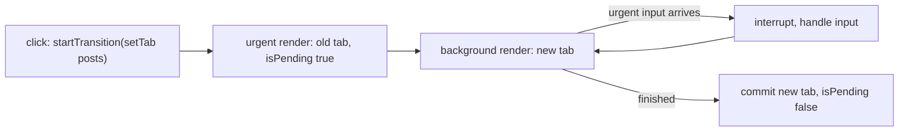
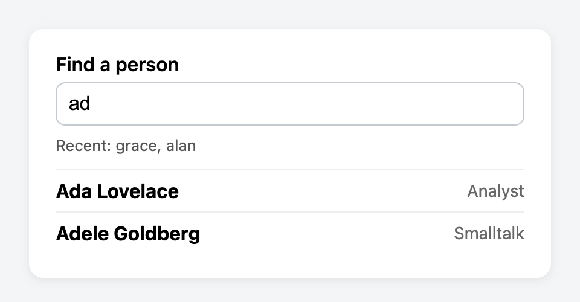

# Chapter 7 — Custom Hooks and the Rules of Hooks

You have used a handful of built-in Hooks — `useState` (Chapter 3), `useActionState` (Chapter 4), `useEffect` and `useRef` (Chapter 5), `useReducer` and `useContext` (Chapter 6). This chapter does two things. First it explains the **Rules of Hooks** properly: what they are, *why* React needs them, and what breaks when you ignore them. Then it shows how to write your **own** Hooks — reusable pieces of **stateful logic** (code that remembers values between renders, not just computes) such as `useLocalStorage`, `useDebounce` and `useFetch` — and finishes with four built-in Hooks that are easiest to understand once you think in "Hooks": `useId`, `useSyncExternalStore`, `useTransition` and `useDeferredValue` (plus `useEffectEvent`, which makes callback-taking custom Hooks correct).

**What you'll learn**

| # | Topic | You will be able to… |
|---|---|---|
| 7.1 | What a Hook really is | explain how React matches Hook calls to stored state |
| 7.2 | The Rules of Hooks | list both rules, the forbidden places, and the lint rules that enforce them |
| 7.3 | Custom Hooks | extract logic into `useSomething`, name it, design its inputs and outputs |
| 7.4 | `useLocalStorage` | persist state across reloads and tabs |
| 7.5 | `useDebounce` | wait until the user stops typing |
| 7.6 | `useFetch` | load data with loading/error states and no race conditions |
| 7.7 | Hooks that take callbacks — `useEffectEvent` | write `useInterval` without stale closures or restarts |
| 7.8 | `useId` | generate IDs for labels and ARIA attributes that survive SSR |
| 7.9 | `useSyncExternalStore` | subscribe to browser APIs and your own stores safely |
| 7.10 | `useTransition` | keep the UI responsive during expensive or async updates |
| 7.11 | `useDeferredValue` | let a slow part of the screen lag behind fast input |
| 7.12 | Putting it together | a user search built from four custom Hooks |

Code: [`code/`](code/) — React 19.3 in jsdom (a browser-like DOM for Node), driven with `@testing-library/react`. Examples that fetch data start a tiny `node:http` server (Node's built-in web server module) on `127.0.0.1` ("localhost" — the address of your own machine) inside the same script, so no internet is needed.

---

## 7.1 What a Hook really is

### What it is
A **Hook** is a special function, whose name starts with `use`, that lets a component "hook into" a React feature: remembering state (`useState`), running **side effects** (work beyond computing a result — network calls, timers, DOM changes; `useEffect`), reading **context** (a value provided by a component higher up the tree; `useContext`), and so on. Hooks only work **while React is rendering a component**, because that is the only time React knows *which* component the call belongs to.

### How it works — state is matched by call order
A component is just a function; its local variables disappear after it returns. So where does `useState` keep the value? React stores it *outside* your function, in an internal record for that component instance (called a **fiber**). That record holds a **list of Hook slots**. On every render React walks the list in step with your calls:

1. Before calling your component, React points a **cursor** (a marker for "which slot is next") at slot 0.
2. The first Hook call reads slot 0 and moves the cursor to slot 1; the second reads slot 1; and so on.
3. The **only** thing that tells React "this `useState` is the `name` one" is its **position** in the sequence. Hooks have no names or keys.

The toy model below reproduces that mechanism in 15 lines of plain JavaScript — no React at all.

`code/01_hooks_by_call_order.js`:
```js
let slots = [];      // this component instance's remembered values
let index = 0;       // which slot the next useState call reads

function useState(initial) {
  const i = index++;                       // position = identity
  if (!(i in slots)) slots[i] = initial;   // first render: store the initial value
  const setState = (v) => { slots[i] = v; };
  return [slots[i], setState];
}
function render(Component, props) { index = 0; return Component(props); }

// A "component" that breaks the rule: it calls a Hook only when a condition is true.
function Profile({ showNickname }) {
  const [name] = useState('Ada');
  if (showNickname) {
    const [nick] = useState('Countess');   // slot 1 ONLY on some renders
    void nick;
  }
  const [age] = useState(36);              // slot 1 or 2 depending on the condition!
  return `name=${name} age=${age}`;
}

console.log('render 1 (showNickname=true): ', render(Profile, { showNickname: true }));
console.log('slots now:', JSON.stringify(slots));
console.log('render 2 (showNickname=false):', render(Profile, { showNickname: false }));
```

Output:
```
render 1 (showNickname=true):  name=Ada age=36
slots now: ["Ada","Countess",36]
render 2 (showNickname=false): name=Ada age=Countess
-> age read slot 1, which holds the nickname. State got mixed up.
```

On the second render the conditional call was skipped, so `useState(36)` became the *second* call and read slot 1 — the nickname. That is the whole reason the Rules of Hooks exist.

Analogy: a cloakroom that hands out coats by **queue position**, not by ticket. It works perfectly as long as the same people always queue in the same order. If one person skips the queue, everyone behind them gets the wrong coat.

### Why React chose call order
The React team considered giving each Hook a name or key. Position won because it keeps Hooks cheap (no string keys to compare), makes custom Hooks **composable** (able to be combined freely: two custom Hooks can each call `useState` without name clashes) and lets the same Hook be used several times in one component (`useState` twice). The price is one simple rule: *call Hooks in the same order every render*.

### TL;DR
React stores Hook state in a per-component list and matches calls by **position**. Change the number or order of calls between renders and values land in the wrong slots.

---

## 7.2 The Rules of Hooks

### What it is
Two rules, from react.dev:

1. **Only call Hooks at the top level** of a function component or a custom Hook — never inside conditions, loops, or nested functions.
2. **Only call Hooks from React functions** — function components and custom Hooks, not ordinary JavaScript functions or class components.

### The allowed and forbidden places

| ✅ Allowed | 🔴 Not allowed |
|---|---|
| Top level of a function component body | Inside `if`, `&&`, `? :`, `switch` branches |
| Top level of a custom Hook body | Inside `for` / `while` loops |
| | **After** an early `return` (the Hook is skipped on some renders) |
| | Inside event handlers (`onClick={() => useState()}`) |
| | Inside the callbacks you pass to `useMemo`, `useReducer`, `useEffect` |
| | Inside `try` / `catch` / `finally` blocks |
| | In class components, or in plain helper functions |

**One exception:** the `use` API (§9.11 of [Chapter 9](../09-routing-and-data-fetching/README.md)) *may* be called inside `if` and loops, because it does not keep a slot. It still may not be called inside `try/catch`.

### What React does when you break rule 1
`code/02_rules_of_hooks_errors.jsx`:
```jsx
// BAD: a Hook after an early return
function Greeting({ user }) {
  const [lang] = useState('en');
  if (!user) return <p>Please sign in ({lang})</p>;
  const [greeting] = useState('Hello');     // skipped when user is missing
  return <p>{greeting}, {user}</p>;
}

// BAD: a Hook inside a condition
function Tracker({ tracking }) {
  const [clicks] = useState(0);
  if (tracking) useEffect(() => {});
  return <p>clicks: {clicks}</p>;
}
// ... tryRender(label, firstUi, nextUi) renders, re-renders, prints the error ...

// GOOD: call every Hook unconditionally at the top, put the condition inside.
function GreetingFixed({ user }) {
  const [greeting] = useState('Hello');
  if (!user) return <p>Please sign in</p>;
  return <p>{greeting}, {user}</p>;
}
function TrackerFixed({ tracking }) {
  const [clicks] = useState(0);
  useEffect(() => { if (!tracking) return; /* start tracking */ }, [tracking]);
  return <p>clicks: {clicks}</p>;
}
```

Output:
```
  [dev warning] React has detected a change in the order of Hooks called by Greeting. This will lead to bugs and errors if not fixed. For more information, read the Rules of Hooks: https://react.dev/link/rules-of-hooks
Greeting: signed-out then signed-in -> Rendered more hooks than during the previous render.
Greeting: signed-in then signed-out -> Rendered fewer hooks than expected. This may be caused by an accidental early return statement.
  [dev warning] React has detected a change in the order of Hooks called by Tracker. This will lead to bugs and errors if not fixed. For more information, read the Rules of Hooks: https://react.dev/link/rules-of-hooks
Tracker : off then on               -> Rendered more hooks than during the previous render.
GreetingFixed     -> Hello, Ada
TrackerFixed      -> clicks: 0
```

React detects the changed count and **throws** ("Rendered more/fewer hooks…"), which crashes that part of the tree. If the count stays the same but the *kind* of Hook changes, development builds (the unoptimised version used while coding, with extra checks) print the "change in the order of Hooks" warning and you get the mixed-up state from §7.1. The fix is always the same shape: **call the Hook unconditionally, move the condition inside it** (into the Effect body, into the returned JSX, or into the arguments).

### Why rule 2 exists
A Hook needs a "currently rendering component" to attach its slot to. A plain function called from an event handler, a timer or **module scope** (code at the top level of a file, outside any function) has none — React throws *"Invalid hook call. Hooks can only be called inside of the body of a function component."* (The same message appears if your app accidentally **bundles** (packs into the shipped JavaScript) **two copies of React**, e.g. a linked library with its own `react` — a classic **monorepo** bug; a monorepo is one repository holding several packages.)

### The linter: `eslint-plugin-react-hooks`
You should never have to find these bugs at **runtime** (while the app is running). The official **ESLint** plugin (ESLint is a **linter** — a tool that reads code without running it and flags likely bugs) checks them as you type:

| Rule | What it catches |
|---|---|
| `react-hooks/rules-of-hooks` | Hooks in conditions, loops, after early returns, in non-`use` functions |
| `react-hooks/exhaustive-deps` | Missing or unnecessary values in `useEffect` / `useMemo` / `useCallback` dependency arrays (Chapter 5) |
| Compiler-based rules (purity, refs, set-state-in-effect, …) | Code the React Compiler (a build tool that memoises components automatically) cannot safely optimise — included in the plugin's recommended preset (bundle of pre-chosen rules) in recent versions |

Setup with ESLint 9's flat config (the newer config format: one `eslint.config.js` exporting an array) (not run — Vite's React template already includes it):
```js
// eslint.config.js
import reactHooks from 'eslint-plugin-react-hooks';
import { defineConfig } from 'eslint/config';

export default defineConfig([
  reactHooks.configs.flat.recommended,
]);
```

The linter recognises Hooks **by name**: any function called `useSomething` (with a capital letter after `use`) is checked as a Hook, and any function whose name starts with a capital letter is treated as a component. That is why naming matters (§7.3).

### Common mistakes
| Mistake | Fix |
|---|---|
| `if (!data) return <Spinner/>;` above a `useMemo` | Move all Hooks above the first `return` |
| Calling a Hook in a `.map()` to make one per item | Extract an `<Item>` component and call the Hook inside it |
| Calling `useContext` in an event handler "to get the latest value" | Read it at top level; the handler closes over it |
| Silencing `exhaustive-deps` with `// eslint-disable-next-line` | Almost always hides a stale-value bug; restructure (Chapter 5, §7.7) |
| Naming a Hook `getUser()` | Call it `useUser()` so the linter checks it and its callers |

### In the interview
**30-second answer:** "Two rules: call Hooks only at the top level of components or custom Hooks, and only from React functions. React stores Hook state in a list per component and matches calls by order, so the order must be identical every render — a Hook inside an `if` or after an early return shifts every later slot. React throws 'Rendered more/fewer hooks' when the count changes, and `eslint-plugin-react-hooks` catches it **statically** (by reading the code, before it runs)."

- *Why can `use` be conditional but `useState` can't?* — `use` doesn't store anything in a Hook slot; it reads a promise or context each time.
- *How do you conditionally run an effect?* — Always call `useEffect`; put the `if` inside its body and include the condition in the dependencies.
- *What else causes "Invalid hook call"?* — Calling a Hook outside a component, or two copies of React in the bundle.

### Self-check
1. What identifies a `useState` call to React? → Its position among the component's Hook calls.
2. Is `const [a] = cond ? useState(1) : [0]` allowed? → No — the Hook is conditional.
3. Where do you put the condition instead? → Inside the Hook's callback or arguments, or in the JSX.
4. Which lint rule checks dependency arrays? → `react-hooks/exhaustive-deps`.

### TL;DR
Top level only, React functions only. The rule protects call order; the linter enforces it.

---

## 7.3 Custom Hooks — reusing stateful logic

### What it is
A **custom Hook** is a JavaScript function whose name starts with `use` and that **calls other Hooks**. It lets you pull a piece of stateful logic out of a component and reuse it in many components — the same way you extract a helper function, but for logic that needs state or effects.

Analogy: a recipe card. Two cooks follow the same card, but each has their **own pot**. The recipe (logic) is shared; the soup (state) is not.

### The problem it solves
Before Hooks, sharing stateful logic needed wrapper patterns — **higher-order components** (HOCs: functions that take a component and return a wrapped one with extra props) and **render props** (passing a function as a prop that returns what to render) (Chapter 14) — that nested the tree deeply ("wrapper hell"). A custom Hook is a plain function call: no extra components, no extra nesting, and you can call several.

### How it works
1. Notice duplicated Hook logic in two components (a toggle, a subscription, a fetch).
2. Move it into `function useSomething(args) { … }`.
3. Return what callers need — a value, a **tuple** (a short fixed-length array where each position has a meaning) `[value, setter]`, or an object `{ data, error, status }`.
4. Every call site gets its **own** state: calling `useToggle()` in two components runs `useState` twice, in two different fibers.
5. The Hook re-runs on every render of its caller, so it always sees the latest arguments.

`code/03_custom_hook_basics.jsx`:
```jsx
function useToggle(initial = false) {
  const [on, setOn] = useState(initial);
  const toggle = () => setOn(v => !v);
  return [on, toggle];                     // return whatever shape is convenient
}

function Spoiler({ title, children }) {
  const [open, toggleOpen] = useToggle();
  return (
    <section>
      <button onClick={toggleOpen}>{open ? 'Hide' : 'Show'} {title}</button>
      {open && <p>{children}</p>}
    </section>
  );
}

function DarkSwitch() {
  const [dark, toggleDark] = useToggle(true);
  return <button onClick={toggleDark}>theme: {dark ? 'dark' : 'light'}</button>;
}
// render two <Spoiler>s and a <DarkSwitch>; click "Show ending", then "theme"

// Not every helper is a Hook: this one calls no Hooks, so it should NOT start with "use".
function formatCount(n) { return n === 1 ? '1 item' : `${n} items`; }
```

Output:
```
start          : Show ending | Show twist | theme: dark
open "ending"  : Hide ending | The butler did it. | Show twist | theme: dark
toggle theme   : Hide ending | The butler did it. | Show twist | theme: light
plain helper   : 3 items
```

Opening the first spoiler did not open the second, and the theme switch has its own value: **custom Hooks share logic, never state**. If you *want* shared state, lift it up, put it in context, or use an external store (Chapter 6, §7.9).

### Designing a good custom Hook
| Guideline | Why |
|---|---|
| Name it `use` + CapitalLetter (`useOnlineStatus`) | The linter and React Compiler treat it as a Hook; readers know it may hold state |
| If it calls **no** Hooks, don't prefix it with `use` | It's a normal function; the prefix would wrongly restrict where it can be called |
| Name it after its **purpose**, not its mechanism | `useChatRoom(roomId)` beats `useEffectWithWebSocket` |
| Mirror built-in shapes where it helps | `useLocalStorage` returning `[value, setValue]` feels like `useState` |
| Return objects when there are 3+ values | `{ data, error, status }` is self-documenting and order-free |
| Keep it pure during render | Same rule as components: side effects go in Effects or handlers |
| Avoid "lifecycle" Hooks like `useMount(fn)` | They hide dependencies from the linter; write the Effect you mean |
| Add `useDebugValue(label)` for library Hooks | Shows a label next to the Hook in React DevTools (the browser extension for inspecting components) (used in `code/hooks.js`) |

### When not to write one
- The logic is used once and is short — inline is clearer.
- It is **server data** (fetch + cache + refetch): a data library does this better than any hand-written Hook (TanStack Query, [Chapter 9](../09-routing-and-data-fetching/README.md)).
- You only want to share a *value*, not logic — use props or context.

### Testing custom Hooks
Test them through a tiny component (as every example here does) or with `renderHook` from `@testing-library/react` — see [Chapter 12](../12-testing-react/README.md).

### In the interview
**30-second answer:** "A custom Hook is a function starting with `use` that calls other Hooks. It's how you reuse stateful logic — like a subscription or a debounced value — without wrapper components. Each call has independent state, it re-runs on every render so it sees fresh arguments, and it must follow the Rules of Hooks. The `use` prefix is what lets the linter check it."

- *Do two components using the same custom Hook share state?* — No; each call has its own state. Share state via lifting, context, or a store.
- *Custom Hooks vs HOCs/render props?* — Hooks compose without extra tree nesting and make data flow explicit; HOCs and render props are still valid but rarely needed now.

### TL;DR
`useX` = a function that calls Hooks. It shares logic, not state. Name by purpose; don't prefix non-Hooks with `use`.

---

## 7.4 `useLocalStorage` — state that survives a reload

### What it is
A Hook with the same API as `useState`, but whose value is saved in the browser's **`localStorage`** (a small per-site key–value store that keeps strings across reloads and browser restarts) and read back on the next visit.

### How it works
1. **Lazy initial state**: pass a function to `useState` so storage is read once, on mount (the component's first appearance) (reading storage on every render would be wasteful).
2. `JSON.parse` / `JSON.stringify` (convert between JavaScript values and **JSON** text — JavaScript Object Notation, the standard text format for data) because storage only holds strings.
3. `try/catch` around every storage call: storage can throw (Safari private mode, **quota** — the storage size limit — full, disabled cookies) and stored JSON can be corrupted.
4. An Effect writes the value whenever it changes — writing is a side effect, so it does not belong in render.
5. A second Effect listens for the **`storage` event**, which the browser fires in *other* tabs of the same site when one tab changes a key — so all tabs stay in sync.

`code/04_use_local_storage.jsx`:
```jsx
export function useLocalStorage(key, initialValue) {
  // 1. Lazy initial state: read storage once, on the first render only.
  const [value, setValue] = useState(() => {
    try {
      const raw = window.localStorage.getItem(key);
      return raw !== null ? JSON.parse(raw) : initialValue;
    } catch {
      return initialValue;                   // corrupted JSON or storage blocked
    }
  });

  // 2. Write whenever the value (or key) changes.
  useEffect(() => {
    try { window.localStorage.setItem(key, JSON.stringify(value)); } catch { /* quota / private mode */ }
  }, [key, value]);

  // 3. Other tabs fire a "storage" event when they change the same key.
  useEffect(() => {
    function onStorage(e) {
      if (e.key === key && e.newValue !== null) setValue(JSON.parse(e.newValue));
    }
    window.addEventListener('storage', onStorage);
    return () => window.removeEventListener('storage', onStorage);
  }, [key]);

  return [value, setValue];                  // same shape as useState, so updaters work too
}

function Settings() {
  const [fontSize, setFontSize] = useLocalStorage('fontSize', 16);
  return (
    <div>
      <p>font size: {fontSize}px</p>
      <button onClick={() => setFontSize(s => s + 2)}>bigger</button>
    </div>
  );
}
```

Output:
```
first visit     : font size: 16px
after 2 clicks  : font size: 20px | stored = 20
after reload    : font size: 20px
other tab -> 24 : font size: 24px
corrupted JSON  : font size: 16px (fell back to the default)
```

### Trade-offs and limits
| Concern | Note |
|---|---|
| Server rendering | `localStorage` doesn't exist on the server. Reading it during render makes the server HTML (default value) differ from the client (stored value) → **hydration mismatch** (when React starts in the browser over server-made HTML — *hydration* — and finds different output, it warns and redraws). With SSR, render the default first and load the stored value in an Effect, or use `useSyncExternalStore` with a `getServerSnapshot` (§7.9). |
| Two components, same key, same tab | Each has its own `useState`; they don't see each other's changes (the `storage` event only fires in *other* tabs). If that matters, turn storage into an external store read with `useSyncExternalStore`. |
| Size | About 5 MB per **origin** (protocol + domain + port, e.g. `https://shop.example`) in most browsers; strings only; synchronous (blocks the **main thread** — the single thread that runs your JS and draws the page). Large data → IndexedDB (the browser's built-in asynchronous database). |
| Security | Readable by any script on the page — never store tokens (login credentials such as session or access tokens) or personal data here (see the JS book's storage chapter). |

### TL;DR
Lazy-read once, write in an Effect, `try/catch` everything, listen to `storage` for other tabs. Beware SSR mismatches.

---

## 7.5 `useDebounce` — wait until the user stops

### What it is
**Debouncing** delays an action until input has been quiet for a set time. A search box that fires a request on every keystroke sends 5 requests for "react"; debounced by 300 ms it sends 1, after the user pauses.

Analogy: a lift door that waits until nobody has walked in for a few seconds before closing.

### How it works
1. Keep a second state variable, `debounced`, that starts equal to `value`.
2. Every time `value` changes, an Effect schedules `setDebounced(value)` after `delayMs`.
3. The Effect's **cleanup** cancels the previous timer. Because the Effect re-runs on every change, each keystroke cancels the last pending update — only the final value survives the pause.

`code/05_use_debounce.jsx`:
```jsx
export function useDebounce(value, delayMs = 300) {
  const [debounced, setDebounced] = useState(value);
  useEffect(() => {
    const id = setTimeout(() => setDebounced(value), delayMs);  // schedule
    return () => clearTimeout(id);           // a newer value cancels the pending one
  }, [value, delayMs]);
  return debounced;
}

function Search() {
  const [text, setText] = useState('');
  const query = useDebounce(text, 100);
  useEffect(() => { if (query) console.log(`  -> would search for "${query}"`); }, [query]);
  return <input aria-label="search" value={text} onChange={e => setText(e.target.value)} />;
}
// types r, re, rea, reac, react (one key every 30 ms), pauses, then types "react hooks"
```

Output:
```
typed "r"
typed "re"
typed "rea"
typed "reac"
typed "react"
(pause 150 ms)
  -> would search for "react"
typed "react hooks"
(pause 150 ms)
  -> would search for "react hooks"
```

Five keystrokes, one search. Note the input itself is **not** debounced — `text` updates immediately so typing feels instant; only the *derived* `query` waits.

### Debounce vs throttle vs `useDeferredValue`
| Technique | Behaviour | Use for |
|---|---|---|
| **Debounce** | Fire once after N ms of silence | Network requests while typing, autosave |
| **Throttle** | Fire at most once every N ms | Scroll/resize handlers, analytics |
| **`useDeferredValue`** (§7.11) | Re-render a slow part as soon as React has time; no fixed delay, interruptible | Expensive *rendering* (filtering a big list) — not network calls |

A variant, `useDebouncedCallback(fn, ms)`, debounces a *function* instead of a value (useful for autosave on change). Libraries such as `use-debounce` provide both.

### Common mistakes
- Forgetting the cleanup → every keystroke eventually fires.
- Debouncing the controlled input's own value → the **caret** (the blinking text cursor) lags and characters appear late.
- Creating the debounced function inline each render (`debounce(fn, 300)` in the body) → a new timer per render, so nothing is debounced. Keep it in a ref or use the value-based Hook above.

### TL;DR
Timer in an Effect, cleared by the cleanup. Debounce the derived value, never the input.

---

## 7.6 `useFetch` — loading, error, success, and no races

### What it is
A Hook that fetches a URL and returns `{ status, data, error }`. It packages the Effect-based fetching pattern from [Chapter 5](../05-effects-and-refs/README.md) so components don't repeat it.

### The problem it solves — race conditions
If the URL changes while a request is **in flight** (sent but not answered yet) (the user clicks user 1, then quickly user 2), two responses are racing — a **race condition**, where the result depends on which finishes first. Without cleanup, **whichever arrives last wins** — even if it is for the old URL.

`code/06_use_fetch.jsx` — the local server answers user 1 slowly (150 ms) and user 2 quickly (20 ms):
```jsx
// The naive version: no cleanup, so whichever response arrives LAST wins.
function useFetchNaive(url) {
  const [data, setData] = useState(null);
  useEffect(() => { fetch(url).then(r => r.json()).then(setData); }, [url]);
  return data;
}

export function useFetch(url) {
  const [state, setState] = useState({ status: 'idle', data: null, error: null });
  useEffect(() => {
    if (!url) return;
    const controller = new AbortController();          // lets cleanup cancel the request
    setState(s => ({ ...s, status: 'loading', error: null }));
    fetch(url, { signal: controller.signal })
      .then(res => { if (!res.ok) throw new Error(`HTTP ${res.status}`); return res.json(); })
      .then(data => setState({ status: 'success', data, error: null }))
      .catch(error => {
        if (error.name === 'AbortError') return;         // we cancelled it: not a real error
        setState({ status: 'error', data: null, error });
      });
    return () => controller.abort();                     // url changed or unmounted
  }, [url]);
  return state;
}

function Profile({ id }) {
  const { status, data, error } = useFetch(`${BASE}/api/users/${id}`);
  if (status === 'loading' && !data) return <p>Loading…</p>;
  if (status === 'error') return <p role="alert">Could not load user {id}: {error.message}</p>;
  if (!data) return null;
  return <p>User {id}: {data.name}{status === 'loading' ? ' (refreshing…)' : ''}</p>;
}
// render id=1, immediately switch to id=2, wait; then id=99 (does not exist)
```

Output:
```
naive         : Asked for user 2, showing: Ada <- WRONG user (race condition)
initial       : Loading…
switched to 2 : User 2: Grace
200 ms later  : User 2: Grace (the slow Ada response was aborted, not shown)
missing user  : Could not load user 99: HTTP 404
```

### How it works
1. Each Effect run creates an `AbortController` (a browser object that can cancel requests); its `signal` is passed to `fetch`.
2. When `url` changes (or the component unmounts), React runs the cleanup → `controller.abort()` → the old `fetch` rejects with an `AbortError`, which we ignore.
3. `fetch` only rejects on *network* failure, so we check `res.ok` ourselves and turn 4xx/5xx (HTTP **status codes** for client errors such as 404 Not Found, and server errors such as 500) into errors. (HTTP basics: [System Design Fundamentals](../../../system-design-patterns/modules/00-system-design-fundamentals/README.md).)
4. The state is one object with a `status` field, so impossible combinations (loading *and* error) can't happen.
5. Keeping old `data` while `status === 'loading'` lets the UI show "refreshing…" instead of flashing a spinner.

(An alternative to aborting is an `ignore` flag set in cleanup, as in Chapter 5; it prevents the stale `setState` but lets the request finish. Aborting also saves bandwidth — the amount of data transferred.)

### When not to use it
`useFetch` is a good exercise and fine for a one-off widget, but real apps quickly need **caching** (don't refetch what you just loaded), **deduplication** (two components, one request), **refetch on focus**, **retries**, **pagination** (loading results one page at a time) and **mutations with invalidation** (after changing data, mark the cached copy out of date so it reloads). That list is exactly what TanStack Query or a router loader provides — see [Chapter 9](../09-routing-and-data-fetching/README.md). Effects also start fetching only *after* render, which causes request **waterfalls** (each request waiting for the previous one to finish instead of running in parallel) in nested components.

### In the interview
**30-second answer:** "I'd keep `{status, data, error}` in one state object, start the fetch in an Effect keyed on the URL, pass an AbortController signal, and abort in the cleanup so a stale response can't overwrite a newer one. I'd check `res.ok` because fetch doesn't reject on 404. For production I'd use TanStack Query or router loaders to get caching, dedupe and retries."

### TL;DR
Fetch in an Effect, abort in cleanup, check `res.ok`, one status field. For real apps, reach for a data library.

---

## 7.7 Hooks that take callbacks — `useEffectEvent`

### What it is
Some custom Hooks accept a function: `useInterval(callback, ms)`, `useEventListener('keydown', handler)`, `useWebSocket(url, onMessage)`. The Effect inside needs to call the **latest** callback (which sees the latest props and state), but you don't want the timer or connection to **restart** every time the parent re-renders and passes a new function.

**`useEffectEvent`** (stable since React 19.2) solves this. It wraps a function into an **Effect Event**: a stable function that, when called from inside an Effect, always runs the newest version of your callback. It is *not* reactive, so it doesn't go in the dependency array.

### The problem it solves
Two bad options existed before:
- Put `callback` in the dependencies → the interval is torn down and recreated on every render.
- Leave it out (`[]`) → the Effect keeps the **first** callback forever (a **stale closure** — a function still holding variables from an old render) and the linter complains.

`code/11_use_effect_event.jsx`:
```jsx
export function useInterval(callback, delayMs) {
  const onTick = useEffectEvent(callback);        // always calls the newest callback
  useEffect(() => {
    if (delayMs === null) return;                  // null = paused
    timersStarted++;
    const id = setInterval(() => onTick(), delayMs);
    return () => clearInterval(id);
  }, [delayMs]);                                   // onTick is deliberately NOT a dependency
}

// The tempting-but-wrong version: an empty dependency array freezes the FIRST callback.
function useIntervalStale(callback, delayMs) {
  useEffect(() => {
    const id = setInterval(() => callback(), delayMs);
    return () => clearInterval(id);
  }, []);                                          // the linter would warn: missing 'callback', 'delayMs'
}

// Stopwatch: useIntervalImpl(() => stepsSeen.add(step), running ? 20 : null)
// wait 70 ms, click "step" twice (step becomes 3), wait 70 ms
```

Output:
```
useInterval (useEffectEvent): ticks used step values 1, 3
useIntervalStale ([] deps)  : ticks used step values 1
intervals started: 2 (mount + resume; changing step never restarted it)
```

The correct Hook saw `step = 3` after the clicks without restarting the timer; the stale one kept seeing `1`. Changing `delayMs` (pause → `null`, resume → `20`) *does* restart it, because the delay is a real dependency.

### Rules for Effect Events
- Call them **only from inside Effects** (or functions called by Effects) — not during render and not from event handlers (a normal handler already sees the latest values).
- Don't pass them to other components or Hooks.
- Never list them in dependency arrays; the linter knows this.
- Use them for the *non-reactive* part of an Effect ("when this fires, read the latest X"), not as a way to hide real dependencies.

Before React 19.2 the same effect was achieved with the "latest ref" pattern: `const saved = useRef(callback); useEffect(() => { saved.current = callback; });` and then calling `saved.current()` in the interval. You will still see it in older code and libraries.

### TL;DR
Callback-taking Hooks: wrap the callback in `useEffectEvent`, call it from the Effect, keep only truly reactive values in the dependencies.

---

## 7.8 `useId` — IDs for accessibility

### What it is
`useId()` returns a **unique string ID** for the component instance calling it, stable across re-renders and identical between the server HTML and the hydrated client. It exists for HTML attributes that link elements by ID, including **ARIA** attributes (Accessible Rich Internet Applications — `aria-*` attributes that describe elements to screen readers): `<label htmlFor>`, `aria-describedby`, `aria-labelledby`, `aria-controls`.

### The problem it solves
A reusable `<PasswordField>` needs `id` on its input so its `<label>` can point at it. Hard-coding `id="password"` breaks as soon as the field appears twice on a page (duplicate IDs; the second label points at the first input). A global counter (`id = nextId++`) breaks with server rendering, because server and client may count in a different order, causing hydration mismatches.

`code/07_use_id.jsx`:
```jsx
function PasswordField({ label }) {
  const id = useId();                       // one ID per component instance
  return (
    <div>
      <label htmlFor={`${id}-input`}>{label}</label>
      <input id={`${id}-input`} type="password" aria-describedby={`${id}-hint`} />
      <p id={`${id}-hint`}>At least 12 characters.</p>
    </div>
  );
}
function SignupForm() {
  return (<form><PasswordField label="Password" /><PasswordField label="Repeat password" /></form>);
}
// ... render, then renderToString + hydrateRoot, then an identifierPrefix
```

Output:
```
input id=_r_0_-input  aria-describedby=_r_0_-hint
input id=_r_1_-input  aria-describedby=_r_1_-hint
label lookup finds the 2nd input: true
its description: _r_1_-hint
server ids   : _R_1_-input, _R_1_-hint, _R_2_-input, _R_2_-hint
after hydrate: _R_1_-input, _R_1_-hint, _R_2_-input, _R_2_-hint
with identifierPrefix: _widget-R_0_-input
```

### How it works
- The ID is derived from the component's **position in the tree** (its "parent path"), not from a counter, which is why server and client agree as long as they render the same tree.
- Call it **once** per component and derive related IDs with suffixes (`${id}-input`, `${id}-hint`).
- `identifierPrefix` (an option of `createRoot`, `hydrateRoot` and the server renderers) keeps IDs from two React **roots** (separate React apps mounted into different DOM elements via `createRoot`) on one page from colliding.
- The exact format is an implementation detail and has changed between React versions; never parse it or hard-code it in CSS or tests. (Query by role/label in tests instead — as the output shows, that works *because* the IDs are wired correctly.)

### When not to use it
- **Not for list keys.** Keys must come from your data (`todo.id`); `useId` in a list item would produce a new key per item position and defeat the purpose.
- Not for database IDs or anything that must be globally unique beyond the page — use `crypto.randomUUID()` when *creating* data.

### TL;DR
`useId()` → unique, SSR-safe ID per component for `htmlFor`/`aria-*`. One call, suffixes for related IDs. Never for keys.

---

## 7.9 `useSyncExternalStore` — subscribing to outside data

### What it is
An **external store** is any data that lives outside React state and can change on its own: browser APIs (`navigator.onLine` — is the device online?, `matchMedia` — does a CSS media query match?, `window.innerWidth`, `localStorage`), third-party state libraries, a WebSocket (a persistent two-way server connection) cache. `useSyncExternalStore` lets a component **read** such a store and **re-render** when it changes, without the subtle bugs of doing it with `useState` + `useEffect`.

```js
const snapshot = useSyncExternalStore(subscribe, getSnapshot, getServerSnapshot?);
```

| Argument | Contract |
|---|---|
| `subscribe(callback)` | Start listening; call `callback` whenever the store changes; **return an unsubscribe function**. Should be the same function each render (define it outside the component) or React re-subscribes every render. |
| `getSnapshot()` | Return the current value. Must return the **same value (by `Object.is`)** if the store hasn't changed. |
| `getServerSnapshot()` | Optional: the value to use during server rendering and hydration. Required if the component renders on the server. |

### Why not `useState` + `useEffect`?
The Effect version subscribes *after* the first paint (so the first render may show a wrong value) and, with **concurrent rendering** (React can pause a render part-way and continue later, §7.10), different components can read the store at slightly different moments during one render and show inconsistent values — called **tearing**. `useSyncExternalStore` reads the snapshot in a way React can check for consistency, and forces a synchronous re-render if the store changes mid-render.

`code/08_use_sync_external_store.jsx`:
```jsx
// ---- 1. A browser API: navigator.onLine + 'online'/'offline' events ----
function subscribeOnline(callback) {          // React passes a callback; call it on every change
  window.addEventListener('online', callback);
  window.addEventListener('offline', callback);
  return () => {                               // and return an unsubscribe function
    window.removeEventListener('online', callback);
    window.removeEventListener('offline', callback);
  };
}
function useOnlineStatus() {
  return useSyncExternalStore(
    subscribeOnline,                           // defined OUTSIDE the component: same function every render
    () => navigator.onLine,                    // getSnapshot (client)
    () => true                                 // getServerSnapshot (used during SSR and hydration)
  );
}
function StatusBar() { return <p>{useOnlineStatus() ? 'Online' : 'Offline - changes will sync later'}</p>; }

// ---- 2. Your own tiny store (the pattern Redux/Zustand use internally) ----
function createStore(initial) {
  let state = initial;
  const listeners = new Set();
  return {
    getState: () => state,
    setState: (update) => { state = { ...state, ...update }; listeners.forEach(l => l()); },
    subscribe: (l) => { listeners.add(l); return () => listeners.delete(l); },
  };
}
const cart = createStore({ items: 0 });
function useCartCount() { return useSyncExternalStore(cart.subscribe, () => cart.getState().items); }

// ---- 3. The classic bug: getSnapshot returns a NEW object every time ----
function BadCart() {
  const snap = useSyncExternalStore(cart.subscribe, () => ({ ...cart.getState() })); // new object each call
  return <p>{snap.items}</p>;
}
```

Output:
```
start        : Online
wifi drops   : Offline - changes will sync later
wifi returns : Online
store update : header says 3 items | badge: 3
dev warning  : The result of getSnapshot should be cached to avoid an infinite loop
bad snapshot : Maximum update depth exceeded. This can happen when a component repeatedly calls setState inside componentWillUpdate or componentDidUpdate. React limits the number of nested updates to prevent infinite loops.
```

### How it works
1. On render React calls `getSnapshot()` and uses the result.
2. After commit it calls `subscribe(callback)`.
3. When the store changes, your code calls `callback`; React calls `getSnapshot()` again and re-renders only if the value differs (`Object.is`).
4. On unmount (or if `subscribe` changes) React calls the unsubscribe function.

Part 3 shows why step 3 needs a *stable* snapshot: a fresh object is "different" every time, so React re-renders forever. Fix: store immutable state and return the same object until it changes (as `cart.getState()` does), or select a primitive (`.items`).

### Real-world examples
- **Zustand** and **React Redux** v8+ are built on `useSyncExternalStore` ([Chapter 6](../06-state-management/README.md)).
- `useMediaQuery('(prefers-color-scheme: dark)')` subscribing to `matchMedia(...).addEventListener('change', …)` — used for theming in [Chapter 8](../08-styling/README.md).
- Router libraries subscribe to the history/location store this way.

### When not to use it
If you can keep the data in React state (`useState`, `useReducer`), do. Mutations of an external store can't be marked as non-blocking **transitions** (low-priority updates React may interrupt, §7.10); if a store update happens during a transition, React falls back to a blocking render — so prefer React state for UI that benefits from `useTransition`.

### In the interview
**30-second answer:** "`useSyncExternalStore(subscribe, getSnapshot, getServerSnapshot)` is the official way to read mutable data from outside React. React subscribes after commit and re-reads the snapshot on each change, re-rendering when it differs. It prevents tearing in concurrent rendering. The snapshot must be cached — return the same reference while nothing changed — and `subscribe` should be stable. Zustand and React Redux use it internally."

- *What is tearing?* — Different parts of the UI showing different versions of the same store during one render.
- *What happens if `getSnapshot` returns a new array each time?* — An infinite re-render loop; React warns "should be cached".

### TL;DR
External data → `useSyncExternalStore`. Stable `subscribe`, cached `getSnapshot`, `getServerSnapshot` for SSR.

---

## 7.10 `useTransition` — non-urgent updates

### What it is
React 18 introduced **concurrent rendering**: React can prepare a new UI in the background, pause that work to handle something more urgent, and throw it away if it's out of date. You opt in by marking some updates as **transitions** (non-urgent).

- **Urgent updates**: direct responses to input — typing, clicking, pressing. Users expect them instantly.
- **Transition updates**: moving the UI from one view to another — switching tabs, showing search results. A short delay is fine; freezing is not.

```js
const [isPending, startTransition] = useTransition();
startTransition(() => setTab('posts'));          // this update is a transition
```

`isPending` is `true` while the transition is in progress, so you can dim the old UI or show a small spinner instead of a blank screen.

### How it works
1. `startTransition(fn)` runs `fn` immediately; state updates made inside it are tagged as transition updates.
2. React first re-renders **urgently** with `isPending = true` and the *old* state — the current screen stays visible and interactive.
3. It then renders the new state in the background. If an urgent update (a keystroke, another click) arrives meanwhile, React interrupts, handles the urgent one, and restarts the transition with the newest state.
4. When the background render finishes, React commits it and `isPending` becomes `false`.



`code/09_use_transition.jsx`:
```jsx
function SlowPosts() {                              // pretend this tab is expensive to render
  const start = performance.now(); while (performance.now() - start < 30) { /* busy 30 ms */ }
  return <p>500 posts</p>;
}
const TABS = { about: () => <p>About me</p>, posts: SlowPosts };

function TabApp() {
  const [tab, setTab] = useState('about');
  const [isPending, startTransition] = useTransition();
  log.push(`render tab=${tab} isPending=${isPending}`);
  const Tab = TABS[tab];
  return (
    <div style={{ opacity: isPending ? 0.6 : 1 }}>
      <button onClick={() => startTransition(() => setTab('posts'))}>Posts</button>
      <Tab />
    </div>
  );
}

// React 19: the function passed to startTransition may be ASYNC (an "Action").
function RenameForm() {
  const [name, setName] = useState('ada');
  const [isPending, startTransition] = useTransition();
  seen.push(`${isPending ? 'Saving…' : 'Idle   '} name=${name}`);
  function handleSave() {
    startTransition(async () => {
      const saved = await saveToServer('grace');
      startTransition(() => setName(saved));      // updates AFTER an await need their own startTransition
    });
  }
  return <button onClick={handleSave}>Save</button>;
}
```

Output:
```
--- click "Posts" (update inside startTransition) ---
render tab=about isPending=true
render tab=posts isPending=false
--- async action ---
Idle    name=ada
Saving… name=ada
Saving… name=ada
Idle    name=GRACE
```

The first render after the click still shows the **about** tab (dimmed, `isPending=true`); the expensive posts tab replaces it only when ready. In the async example `isPending` stays true from the click until the whole async function — including the network wait — has finished and the new name is applied. (React may render more than once while pending; what matters is the pending flag covering the whole operation.)

### React 19: async transitions are "Actions"
Since React 19 you can pass an **async function** to `startTransition`. React calls such a function an **Action**: it tracks pending state for you, and it's the same mechanism behind form `action` props, `useActionState` and `useOptimistic` ([Chapter 4](../04-forms-and-actions/README.md)). One current limitation: state updates that happen **after an `await`** are not automatically part of the transition — wrap them in another `startTransition`, as in the example.

### Transitions and Suspense
If a transition causes a component to **suspend** (pause rendering because something it needs isn't ready yet, e.g. a route loads data, [Chapter 9](../09-routing-and-data-fetching/README.md)), React **keeps showing the old screen** instead of replacing already-visible content with a `<Suspense>` fallback (the placeholder UI, such as a spinner, that `<Suspense>` shows while children are suspended). That's why routers wrap navigations in transitions: no flashing spinners between pages.

### Trade-offs and caveats
| Point | Detail |
|---|---|
| Can't control text inputs | Updates to an input's `value` must be urgent; a transition would make the caret lag. Keep two states (urgent text + transitioned results) or use `useDeferredValue`. |
| The callback runs synchronously | `startTransition` doesn't delay anything like `setTimeout`; it only lowers the priority of the updates. |
| Not for making slow code fast | It keeps the UI *responsive* while slow rendering happens; to reduce the work itself, see [Chapter 10](../10-performance/README.md). |
| No `isPending` needed? | Import the standalone `startTransition` from `react` (usable outside components, e.g. in a store). |

### In the interview
**30-second answer:** "`useTransition` marks state updates as non-urgent. React renders them in the background and can interrupt them for urgent input, while `isPending` lets me show the old UI dimmed instead of freezing or flashing a fallback. In React 19 the callback can be async — an Action — and `isPending` covers the whole async operation. I can't use it for the value of a controlled input."

- *Difference between `useTransition` and `useDeferredValue`?* — `useTransition` wraps the *update* (you own the setter); `useDeferredValue` wraps a *value* (useful when you only receive it, e.g. as a prop).
- *Is it a debounce?* — No: there's no timer; it runs as soon as possible and yields to urgent work.

### TL;DR
`startTransition(() => setX(...))` = "update when you can, keep the old UI meanwhile". `isPending` for feedback. Async callbacks = Actions (React 19).

---

## 7.11 `useDeferredValue` — let part of the UI lag behind

### What it is
`useDeferredValue(value)` returns a **deferred copy** of `value`. On an urgent update it first returns the **old** value (so the fast parts of the UI update immediately), then schedules a background re-render with the new value — the same interruptible, low-priority render a transition uses.

```js
const deferredQuery = useDeferredValue(query);                 // React 18+
const deferredQuery = useDeferredValue(query, initialValue);   // React 19: value for the very first render
```

### How it works
1. The user types; `text` updates urgently and the component renders with `text = "re"` but `deferred = ""`.
2. A child wrapped in `memo` (a wrapper that skips re-rendering when props are unchanged; Chapter 10) that receives `deferred` sees the **same prop** as before and is skipped — the input stays snappy.
3. React then re-renders in the background with `deferred = "re"`; now the slow child renders.
4. If another key arrives first, React abandons that background render and starts over with the newest value.

`code/10_use_deferred_value.jsx`:
```jsx
// memo is essential: it lets React skip SlowList when only the urgent `text` changed.
const SlowList = memo(function SlowList({ query }) {
  log.push(`  SlowList renders with query="${query}"`);
  const start = performance.now(); while (performance.now() - start < 20) { /* expensive */ }
  return <ul>{WORDS.filter(w => w.startsWith(query)).map(w => <li key={w}>{w}</li>)}</ul>;
});

function Search() {
  const [text, setText] = useState('');
  const deferred = useDeferredValue(text);           // lags behind `text` during typing
  const isStale = text !== deferred;
  log.push(`render text="${text}" deferred="${deferred}"${isStale ? '  (list is stale)' : ''}`);
  return (
    <>
      <input aria-label="q" value={text} onChange={e => setText(e.target.value)} />
      <div style={{ opacity: isStale ? 0.5 : 1 }}><SlowList query={deferred} /></div>
    </>
  );
}

// React 19: an initial value lets the FIRST render be cheap too.
function Preview({ text }) {
  const shown = useDeferredValue(text, '');           // first render uses '' then catches up
  log.push(`Preview render shown="${shown}"`);
  return <p>{shown}</p>;
}
```

Output:
```
render text="re" deferred=""  (list is stale)
render text="re" deferred="re"
  SlowList renders with query="re"
list now: react, redux, reducer, ref, render
Preview render shown=""
Preview render shown="hello"
```

The first render after the keystroke did **not** run `SlowList` at all (memo saw the same `query`), so the input updated instantly; the list caught up in the second, background render. `text !== deferred` is a free "stale" flag for dimming.

### Common mistakes
| Mistake | Fix |
|---|---|
| No `memo` on the slow child | Without it the child re-renders on the urgent pass too, and nothing is gained |
| Passing a new object each render (`useDeferredValue({ q })`) | Defer primitives or memoised values; a new object is "new" every time |
| Using it to reduce network requests | It has no delay; it doesn't limit requests — debounce instead (§7.5) |
| Expecting it to help with slow *effects* | It only defers rendering |

### With Suspense
If the deferred value makes a child suspend (it loads data for the new query), React keeps showing the **previous results** instead of a fallback — a smooth "stale-while-loading" search without extra code.

### TL;DR
`useDeferredValue(v)` → urgent render with the old value, background render with the new one. Pair with `memo`. Not a debounce.

---

## 7.12 Putting it together — a user search

Four Hooks from this chapter compose into a small feature: `useId` wires the label, `useDebounce` limits requests, `useFetch` loads results without races, and `useLocalStorage` remembers recent searches. The final versions of the Hooks live in [`code/hooks.js`](code/hooks.js) (with a `useDebugValue` label on `useFetch`); the component is [`code/UserSearch.jsx`](code/UserSearch.jsx):

```jsx
export function UserSearch({ apiBase = '', initialQuery = '' }) {
  const id = useId();
  const [text, setText] = useState(initialQuery);
  const query = useDebounce(text.trim(), 250);
  const { status, data, error } = useFetch(query ? `${apiBase}/api/users?q=${encodeURIComponent(query)}` : null);
  const [recent, setRecent] = useLocalStorage('recent-searches', []);

  function remember(term) { setRecent(r => [term, ...r.filter(t => t !== term)].slice(0, 3)); }

  return (
    <div className="search">
      <label htmlFor={id}>Find a person</label>
      <input id={id} value={text} placeholder="Type a name…" onChange={e => setText(e.target.value)}
             onKeyDown={e => { if (e.key === 'Enter' && text.trim()) remember(text.trim()); }} />
      {recent.length > 0 && <p className="recent">Recent: {recent.join(', ')}</p>}
      {status === 'loading' && <p className="muted">Searching…</p>}
      {status === 'error' && <p role="alert">Search failed: {error.message}</p>}
      {status === 'success' && (data.length === 0
        ? <p className="muted">No one called “{query}”.</p>
        : <ul>{data.map(u => <li key={u.id}><strong>{u.name}</strong> <span>{u.role}</span></li>)}</ul>)}
    </div>
  );
}
```

`code/12_user_search.jsx` runs it against a local server that records every request:

Output:
```
typed a, ad, ada quickly -> requests sent: ["ada"]
results: Ada Lovelace Analyst
after "zed": No one called “zed”.
Recent: zed, ada | stored: ["zed","ada"]
```

In the browser ([`code/search.html`](code/search.html); `fetch` is mocked in `search-main.jsx` so the page works offline):


*Figure 7.1 — `UserSearch` in Chrome. The component itself contains no timers, `fetch` calls or storage code — each concern is one Hook call.*

Design notes:
- The component reads like a description of the feature; each Hook can be tested and reused on its own.
- Swapping `useFetch` for TanStack Query's `useQuery` later ([Chapter 9](../09-routing-and-data-fetching/README.md)) changes one line and adds caching.
- Three typed characters produced one request — debounce + abort together keep the server quiet and the results correct.

---

## Chapter 7 TL;DR

| Idea | Remember |
|---|---|
| How Hooks work | State lives in a per-component list, matched by **call order** |
| Rules of Hooks | Top level only (no `if`/loops/early-return/`try`/handlers); only in components and custom Hooks; enforced by `eslint-plugin-react-hooks` |
| Custom Hooks | `useX` functions that call Hooks; share **logic**, not state; name by purpose |
| `useLocalStorage` | Lazy read, write in Effect, `try/catch`, `storage` event; beware SSR mismatch |
| `useDebounce` | Timer in Effect + cleanup; debounce the derived value, not the input |
| `useFetch` | AbortController in cleanup, check `res.ok`, one status field — then prefer TanStack Query |
| `useEffectEvent` | Latest callback inside an Effect without re-subscribing (React 19.2) |
| `useId` | SSR-safe unique IDs for `htmlFor`/`aria-*`; never for keys |
| `useSyncExternalStore` | Read outside data; stable `subscribe`, cached `getSnapshot`, `getServerSnapshot` |
| `useTransition` | Mark updates non-urgent; `isPending`; async callbacks = Actions (19) |
| `useDeferredValue` | Deferred copy of a value; needs `memo`; `initialValue` in 19; not a debounce |

Next: [Chapter 8 — Styling](../08-styling/README.md).
