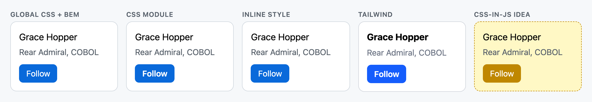
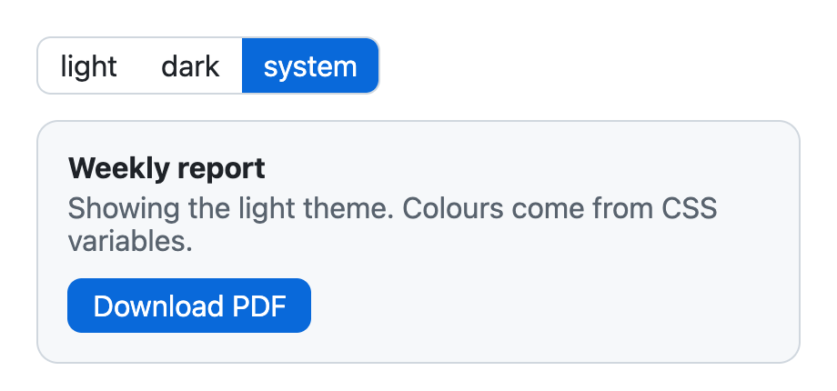
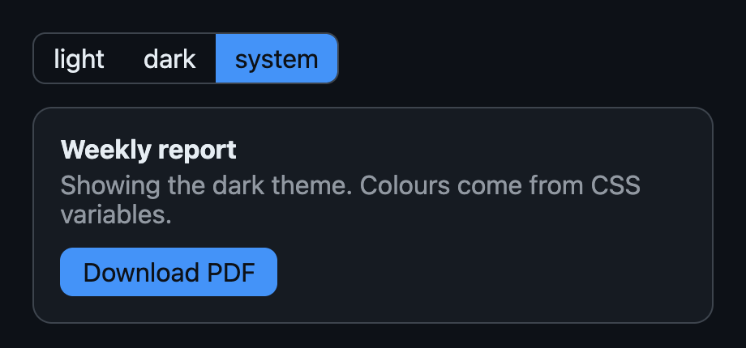

# Chapter 8 — Styling React Apps

React has no built-in styling system. It renders HTML elements, and you style those with CSS — the question is only *how you write, **scope** (limit which elements a rule can affect) and ship* that CSS. This chapter compares the approaches you will meet in real codebases, shows each one running, and helps you choose. It assumes you know CSS itself (selectors — patterns that pick elements; the cascade — the rules for which conflicting declaration wins; specificity — how "strong" a selector is; custom properties — CSS variables such as `--accent`); if not, read the HTML & CSS book first — [CSS fundamentals](../../../html-css/chapters/06-css-fundamentals/README.md) and [modern CSS & architecture](../../../html-css/chapters/13-modern-css-and-architecture/README.md).

**What you'll learn**

| # | Topic | You will be able to… |
|---|---|---|
| 8.1 | The styling landscape | name the five families of approaches and the problem they all try to solve |
| 8.2 | Plain CSS files | use `className`, import CSS, and avoid global name clashes with conventions |
| 8.3 | Inline styles | use the `style` prop correctly — and know its limits |
| 8.4 | CSS Modules | scope class names to a file automatically |
| 8.5 | Composing class names | build `className` from props with a `clsx`-style helper |
| 8.6 | Tailwind CSS | style with utility classes, configure a theme, avoid its traps |
| 8.7 | CSS-in-JS | understand styled-components/Emotion vs zero-runtime tools, and why the trend moved |
| 8.8 | Theming and dark mode | build light/dark/system themes with CSS variables, without a flash |
| 8.9 | Component libraries | choose between styled kits, headless libraries and copy-in components |
| 8.10 | Choosing an approach | pick a strategy for a new project |

Code: [`code/`](code/). Node programs print what React puts in the DOM; the visual results are screenshots of real pages in **headless** Chrome (a real browser running without a window, driven by a script) (bundled with esbuild, a fast JavaScript bundler; Tailwind compiled with the Tailwind v4.3 **CLI** — command-line interface, a program you run in the terminal).

---

## 8.1 The styling landscape

### The problem every approach solves
CSS was designed for documents: every rule is **global**, and conflicts are settled by the **cascade** (origin — browser default vs your stylesheet, specificity, order). In a large app built from hundreds of components, that causes three recurring pains:

1. **Name collisions** — two teams both write `.title`; whichever file loads last wins.
2. **Dead CSS** — nobody dares delete a rule because they can't tell which components still use it.
3. **Dynamic styles** — colours or sizes that depend on props and state.

Every approach below is a different answer to these three problems.

| Family | How you write styles | Scoping | Runtime cost (extra work done in the browser while the app runs) | Typical tools |
|---|---|---|---|---|
| Global CSS files | `.css` files, `className="card"` | Naming conventions (BEM, §8.2) | None | Plain CSS, Sass (a CSS preprocessor adding variables, nesting and mixins) |
| Inline styles | `style={{ color: 'red' }}` | Per element | Tiny | Built into React |
| CSS Modules | `.module.css`, `className={styles.card}` | Automatic, per file | None | Vite, Next.js, webpack |
| Utility-first CSS | `className="p-4 rounded-xl bg-white"` | Nothing to scope — classes are single-purpose | None | **Tailwind CSS**, UnoCSS |
| CSS-in-JS | Styles in JS (`styled.div\`…\``) | Automatic, generated names | Runtime libs: yes; zero-runtime: none | styled-components, Emotion; vanilla-extract, StyleX, Panda |

The same card, styled five ways (`code/gallery.html`, components in `code/cards.jsx`):


*Figure 8.1 — One component, five styling approaches. The output is ordinary HTML + CSS in every case; they differ in how the CSS is authored, scoped and delivered. (The Tailwind heading uses an explicit `font-bold` — Tailwind's **reset** (a stylesheet that wipes the browser's default styles), "Preflight", removes default heading styles on the whole page, which is why the other headings look lighter than browser defaults.)*

---

## 8.2 Plain CSS files

### What it is
The oldest approach: write rules in a `.css` file and apply them with the **`className`** prop (JSX uses `className` because `class` is a reserved word in JavaScript — see [Chapter 1](../01-why-react-and-setup/README.md)). With a **bundler** (a build tool that combines your source files and their imports into files the browser loads) such as Vite you can `import './Card.css'` from a component file; the bundler adds the file to the page's stylesheet.

```jsx
// cards.jsx
import './global.css';
export function GlobalCssCard({ name, role }) {
  const [following, setFollowing] = useState(false);
  return (
    <div className="profile-card">
      <h3 className="profile-card__name">{name}</h3>
      <p className="profile-card__role">{role}</p>
      <button className={cx('profile-card__button', following && 'profile-card__button--following')}
              onClick={() => setFollowing(f => !f)}>{following ? 'Following' : 'Follow'}</button>
    </div>
  );
}
```

```css
/* global.css — BEM naming keeps selectors from colliding by convention only. */
.profile-card { border: 1px solid #d0d7de; border-radius: 12px; padding: 16px; background: #fff; }
.profile-card__name { margin: 0 0 4px; font-size: 18px; }
.profile-card__button:hover { background: #0550ae; }
.profile-card__button--following { background: #eaeef2; color: #24292f; }
```

### How it works
1. `import './global.css'` is **not** JavaScript — it's a bundler feature. The bundler collects every imported CSS file into the page (a `<link>` in production — the optimised build users get, injected `<style>` in dev).
2. **Importing CSS in a component does not scope it.** Once loaded, the rules apply to the *whole page*, even to components that never imported the file.
3. To avoid collisions, teams use naming conventions such as **BEM** (Block__Element--Modifier): `profile-card` (block), `profile-card__name` (element), `profile-card__button--following` (modifier).

### Trade-offs
| ✅ Strengths | ❌ Weaknesses |
|---|---|
| Zero tooling, zero runtime, full CSS power (`:hover`, media/container queries — rules that apply only at certain screen or container sizes, animations, nesting, `@layer`) | Global by default — scoping is only as good as your discipline |
| Easy for designers and CSS experts | Hard to know if a rule is still used; dead CSS accumulates |
| Browser caches (keeps a downloaded copy of) the stylesheet separately from JS | Dynamic values need CSS variables or inline styles |

Modern CSS removed much of the old pain: **native nesting**, **cascade layers** (`@layer` — decide which group of rules wins regardless of specificity) and **custom properties** all work in current browsers (HTML & CSS book, [Chapter 13](../../../html-css/chapters/13-modern-css-and-architecture/README.md)). Sass is still common but no longer necessary for variables or nesting.

### React 19: stylesheets as components
React 19 can manage stylesheets for you: render `<link rel="stylesheet" href="/card.css" precedence="default" />` anywhere in the tree and React moves it into `<head>`, loads it once even if many components render it, orders it by `precedence`, and — inside a Suspense boundary (a `<Suspense>` wrapper that shows a fallback while its content is not ready) — waits for it to load before revealing the content. This is mostly used by frameworks and libraries; in a Vite app you normally just `import` CSS.

### TL;DR
`className` + CSS file. Imports are global — use a naming convention or move to CSS Modules.

---

## 8.3 Inline styles — the `style` prop

### What it is
Every HTML element accepts a **`style` prop**: a JavaScript object whose keys are CSS properties in **camelCase** (words joined with each new word capitalised) (`backgroundColor`, not `background-color`). React writes it to the element's `style` attribute. The double braces in `style={{ … }}` are a JSX expression (outer) containing an object literal (inner).

`code/01_inline_styles.jsx`:
```jsx
function ProgressBar({ percent, color = 'seagreen' }) {
  return (
    <div style={{ background: '#eee', borderRadius: 4, height: 8 }}>            {/* numbers -> px */}
      <div style={{ width: `${percent}%`, height: '100%', backgroundColor: color, borderRadius: 4 }} />
    </div>
  );
}

function Examples() {
  return (
    <>
      <ProgressBar percent={40} />
      <p style={{ lineHeight: 1.5, zIndex: 2, opacity: 0.8, flexGrow: 1 }}>unitless properties stay unitless</p>
      <p style={{ '--accent': 'tomato', color: 'var(--accent)' }}>CSS custom property set inline</p>
      <p style={{ WebkitLineClamp: 2, msTransform: 'none' }}>vendor prefixes</p>
      <p style={{ ':hover': { color: 'red' }, '@media (max-width: 600px)': { display: 'none' } }}>no pseudo-classes or media queries</p>
    </>
  );
}
```

Output (the elements' real `style` attributes; the first line is React's development warning):
```
Unsupported style property @media (max-width: 600px). Did you mean @media (maxWidth: 600px)?
<div style="background: rgb(238, 238, 238); border-radius: 4px; height: 8px;">
<div style="width: 40%; height: 100%; background-color: seagreen; border-radius: 4px;">
<p style="line-height: 1.5; z-index: 2; opacity: 0.8; flex-grow: 1;">
<p style="--accent: tomato; color: var(--accent);">
<p style="-webkit-line-clamp: 2;">
```

### How it works — the rules the output shows
1. **Numbers get `px`** for length properties (`borderRadius: 4` → `4px`), but **unitless properties** (`lineHeight`, `zIndex`, `opacity`, `flexGrow`, …) stay plain numbers. For other units pass a string: `'50%'`, `'2rem'`.
2. **Custom properties** (`'--accent'`) are passed through unchanged — the cleanest way to feed a dynamic value into a stylesheet.
3. **Vendor prefixes** (browser-specific property prefixes such as `-webkit-`, from the days when features were experimental) start with a capital (`WebkitLineClamp`), except `ms` (`msTransform`). (jsdom — the browser-like DOM used in these Node scripts — like modern browsers, dropped the obsolete `-ms-transform`.)
4. **Pseudo-classes (state selectors like `:hover`), pseudo-elements (`::before`), media queries, keyframes (animation steps) are impossible**: a `style` attribute can't hold selectors or at-rules (CSS statements starting with `@`). The last `<p>` got no style at all, and React warned.

### When to use it (and when not)
| Use inline styles for | Don't use them for |
|---|---|
| Values computed at runtime: progress width, drag position, a user-chosen colour | Whole-component styling (no hover/focus/responsive — adapting to screen size; hard to override) |
| Passing a value to CSS: `style={{ '--progress': `${p}%` }}` with the rest in a stylesheet | Anything a designer will want to theme |
| Quick prototypes | Large lists where every row repeats the same object (use a class) |

Inline styles have the **highest specificity** of normal declarations, so a stylesheet can override them only with `!important` — another reason to keep them for truly dynamic values.

### TL;DR
`style={{ camelCase: value }}`; numbers → px except unitless properties; no `:hover` or media queries. Best for dynamic values, ideally via CSS variables.

---

## 8.4 CSS Modules

### What it is
A **CSS Module** is a CSS file (named `*.module.css`) whose class names are **local to the file that imports it**. The build tool renames every class to something unique and gives your JavaScript an object mapping the original names to the generated ones. You write normal CSS; collisions become impossible.

Supported out of the box by Vite, Next.js, Parcel, webpack's `css-loader` and esbuild — no library to install.

`code/Card.module.css`:
```css
.card { border: 1px solid #d0d7de; border-radius: 12px; padding: 16px; background: #fff; }
.title { margin: 0 0 4px; font-size: 18px; }
.role { margin: 0 0 12px; color: #57606a; }
.button { font: inherit; padding: 6px 14px; border-radius: 8px; border: 0; background: #0969da; color: #fff; cursor: pointer; }
.button:hover { background: #0550ae; }
.primary { composes: button; font-weight: 600; }       /* reuse another class */
:global(.sr-only) { position: absolute; width: 1px; height: 1px; overflow: hidden; clip: rect(0 0 0 0); } /* escape hatch */
```

Using it (`code/cards.jsx`):
```jsx
import styles from './Card.module.css';
export function ModuleCard({ name, role }) {
  return (
    <div className={styles.card}>
      <h3 className={styles.title}>{name}</h3>
      <p className={styles.role}>{role}</p>
      <button className={styles.primary}>Follow</button>
    </div>
  );
}
```

What the bundler produces — `code/02_css_modules.mjs` runs esbuild on that file:
```js
const result = await esbuild.build({
  stdin: { contents: `import styles from './Card.module.css'; console.log(JSON.stringify(styles, null, 1));`, resolveDir: '.', loader: 'js' },
  bundle: true, write: false, outdir: 'out', format: 'esm', logLevel: 'error',
});
// ... print the JS object and the emitted CSS
```

Output:
```
--- the JS object you get from `import styles from "./Card.module.css"` ---
{ card: "Card_card", title: "Card_title", role: "Card_role", button: "Card_button", primary: "Card_button Card_primary" }
--- the CSS the bundler emits (renamed, so it cannot clash) ---
.Card_card {
  border: 1px solid #d0d7de;
  border-radius: 12px;
  padding: 16px;
  background: #fff;
}
.Card_title {
  margin: 0 0 4px;
  font-size: 18px;
}
... (role, button and button:hover renamed the same way)
.Card_primary {
  font-weight: 600;
}
.sr-only {
  position: absolute;
  ...
}
```

### How it works
1. The tool parses the file and renames each class selector: `.card` → `.Card_card` (esbuild's scheme; Vite and webpack add a short **hash** — a short code computed from the content, e.g. `_card_1x9ab_1`, so names are unique even across files with the same name).
2. `import styles from …` returns the mapping; `styles.card` is the generated string.
3. **`composes: button`** makes `styles.primary` equal *both* class names — `"Card_button Card_primary"` — reuse without duplicating rules.
4. **`:global(.sr-only)`** opts a selector out of renaming, for the rare global class you need.
5. Element selectors (`h3 { … }`) and IDs are *not* scoped — only class names — so keep module files to classes.

### Trade-offs
| ✅ | ❌ |
|---|---|
| Real CSS: hover, media/container queries, animations, nesting | Styles live in a second file (some like this, some don't) |
| Zero runtime, works with Server Components (React components that run only on the server, Chapter 13) | Dynamic values still need CSS variables or inline styles |
| Unused-class detection with TypeScript plugins / linters (tools that scan code for mistakes) | Class names with dashes need bracket access: `styles['is-active']` (or configure camelCase conversion) |
| Easy migration from plain CSS | Theming across modules relies on CSS variables (§8.8) |

### Common mistakes
- Naming the file `Card.css` (no `.module`) → nothing is scoped and `styles` is empty.
- Writing `className="card"` instead of `className={styles.card}` → no style applied (the real name is renamed).
- Referencing a class that doesn't exist → `styles.tittle` is `undefined` and React renders `class` without it — silently. TypeScript typings for modules catch this.

### TL;DR
`*.module.css` + `styles.x`. Local class names, real CSS, no runtime. A safe default for teams that like writing CSS.

---

## 8.5 Composing class names from props

### What it is
Real components choose classes based on props and state: a Button has a `variant`, a `size`, a `loading` state and maybe an extra `className` from its parent. Building that string by hand with `+` and ternaries is error-prone; the tiny **`clsx`** package (and its older sibling `classnames`) does it for you. `code/cx.js` is a 10-line version so you can see there's no magic:

```js
// cx('a', cond && 'b', { c: true, d: false }, ['e', null]) -> 'a b c e'
export function cx(...args) {
  const out = [];
  for (const a of args) {
    if (!a) continue;                                        // false, null, undefined, 0, ''
    if (typeof a === 'string' || typeof a === 'number') out.push(a);
    else if (Array.isArray(a)) { const inner = cx(...a); if (inner) out.push(inner); }
    else if (typeof a === 'object') for (const [k, v] of Object.entries(a)) if (v) out.push(k);
  }
  return out.join(' ');
}
```

`code/03_class_names.jsx`:
```jsx
function Button({ variant = 'primary', size = 'md', loading = false, className, ...rest }) {
  return (
    <button
      className={cx('btn', `btn--${variant}`, `btn--${size}`, { 'btn--loading': loading }, className)}
      disabled={loading || rest.disabled}
      {...rest}
    />
  );
}
// <Button>Save</Button>  <Button variant="danger" size="sm">Delete</Button>
// <Button loading>Uploading</Button>  <Button variant="ghost" className="ml-auto">Cancel</Button>
```

Output:
```
"btn active lg"
Save      class="btn btn--primary btn--md"
Delete    class="btn btn--danger btn--sm"
Uploading class="btn btn--primary btn--md btn--loading" disabled
Cancel    class="btn btn--ghost btn--md ml-auto"
concatenated: "btn false undefined"
```

The last line is the bug `clsx` prevents: naive concatenation leaks `"false"` and `"undefined"` into the DOM.

### Patterns worth knowing
- **Always accept and merge a `className` prop** in reusable components, so parents can add spacing or layout (`ml-auto`) without **forking** the component (copying it to make a modified version).
- **Variant maps** beat nested ternaries: `const VARIANTS = { primary: '…', danger: '…' }` then `VARIANTS[variant]`. Libraries like **`cva`** (class-variance-authority) formalise this for Tailwind.
- **With CSS Modules**: `cx(styles.btn, styles[variant], loading && styles.loading)`.
- **With Tailwind**, conflicting utilities (`px-2` from the component, `px-4` from the parent) are *not* resolved by order in the string; use **`tailwind-merge`** (`twMerge(clsx(...))`) so the last one wins (§8.6).

In a real project: `npm install clsx` and `import { clsx } from 'clsx'` — the API above matches it for these cases.

### TL;DR
Build class strings with `clsx`/`cx`; accept a `className` prop; use variant maps instead of ternary chains.

---

## 8.6 Tailwind CSS

### What it is
**Tailwind CSS** is a **utility-first** CSS framework: instead of inventing class names (`.profile-card`) and writing rules for them, you compose many tiny single-purpose classes directly in your **markup** (the HTML/JSX) — `p-4` (padding), `rounded-xl`, `bg-white`, `text-gray-500`, `hover:bg-blue-700`. A build step scans your source files and generates CSS for **only the classes you actually use**. The current major version is **v4** (released January 2025; v4.3 at the time of writing), which is configured in CSS rather than a JavaScript config file.

The Tailwind card from Figure 8.1:
```jsx
export function TailwindCard({ name, role }) {
  return (
    <div className="rounded-xl border border-gray-300 bg-white p-4">
      <h3 className="mb-1 text-lg font-bold">{name}</h3>
      <p className="mb-3 text-gray-500">{role}</p>
      <button className="rounded-lg bg-blue-600 px-3.5 py-1.5 font-semibold text-white hover:bg-blue-700">Follow</button>
    </div>
  );
}
```

### How it works
1. You add one line to your main CSS file: `@import "tailwindcss";` (it brings in the default **theme** — colours, spacing, fonts as CSS variables — **Preflight**, a CSS reset, and the **utilities** layer).
2. The build tool (the Vite plugin or the CLI) scans your project's source files for anything that looks like a class name. `@source "./path"` adds places it would not find by itself.
3. For each class it recognises, it generates one rule. Variants are prefixes: `hover:`, `focus-visible:`, `md:` (screen ≥ 48rem = 768px; `rem` is a unit relative to the root font size, usually 16px), `dark:`, `disabled:`, `group-hover:` …
4. Values come from the theme (`px-2` = 2 × `--spacing`), or you can use an **arbitrary value** in brackets: `w-[37px]`, `grid-cols-[1fr_2fr]`.

`code/05_tailwind_build.mjs` runs the real Tailwind CLI on a one-line component:
```jsx
<span className="px-2 font-semibold hover:bg-blue-700 md:text-lg dark:text-white w-[37px]">new</span>
```

Output (the generated utilities — nothing else from Tailwind's thousands of possible classes):
```
@layer utilities {
  .w-\[37px\] {
    width: 37px;
  }
  .px-2 {
    padding-inline: calc(var(--spacing) * 2);
  }
  .font-semibold {
    --tw-font-weight: var(--font-weight-semibold);
    font-weight: var(--font-weight-semibold);
  }
  @media (hover: hover) {
    .hover\:bg-blue-700:hover {
      background-color: var(--color-blue-700);
    }
  }
  @media (width >= 48rem) {
    .md\:text-lg {
      font-size: var(--text-lg);
      line-height: var(--tw-leading, var(--text-lg--line-height));
    }
  }
  @media (prefers-color-scheme: dark) {
    .dark\:text-white {
      color: var(--color-white);
    }
  }
}
```

Notice: variants become ordinary CSS (media queries, `:hover`), `hover:` only applies on devices that can hover (v4 behaviour), and every value points at a theme variable — change `--color-blue-700` once and every use follows.

### Setting it up (Vite — not run here)
```bash
npm install tailwindcss @tailwindcss/vite
```
```js
// vite.config.js
import { defineConfig } from 'vite';
import react from '@vitejs/plugin-react';
import tailwindcss from '@tailwindcss/vite';
export default defineConfig({ plugins: [react(), tailwindcss()] });
```
```css
/* src/index.css */
@import "tailwindcss";

@theme {                                  /* your design tokens -> new utilities */
  --color-brand: oklch(0.55 0.2 260);     /* enables bg-brand, text-brand, border-brand… */
  --font-display: "Inter", sans-serif;    /* enables font-display */
}
@custom-variant dark (&:where(.dark, .dark *));   /* optional: dark: follows a .dark class instead of the OS */
```

(For this book the CLI does the same job: `tailwindcss -i tailwind.input.css -o tailwind.css` produced `code/tailwind.css` for the screenshot.)

### Reusing styles: components, not `@apply`
Long class lists are repeated in one place only if you make a **component** (`<Button>`, `<Card>`) — that's the intended way to reuse Tailwind styles in React. `@apply` (copying utilities into a custom class) exists but brings back the naming and dead-CSS problems Tailwind was avoiding; use it sparingly (e.g. styling Markdown output you don't control).

### Common mistakes
| Mistake | Why it fails | Fix |
|---|---|---|
| `` className={`bg-${color}-500`} `` | The scanner reads source *text*; it never sees `bg-red-500`, so no CSS is generated | Map to complete class names: `{ red: 'bg-red-500', green: 'bg-green-500' }[color]` |
| `className="px-2 px-4"` expecting px-4 to win | Winner is decided by order *in the generated CSS*, not in the attribute | Don't pass conflicting classes; merge with `tailwind-merge` |
| Forgetting Preflight resets headings, lists, buttons | `<h1>` looks like body text | Style explicitly (`text-3xl font-bold`) — intended |
| Huge unreadable class strings | Hard to review | Extract components; order with the official Prettier plugin (Prettier is an automatic code formatter) |

### Trade-offs
| ✅ | ❌ |
|---|---|
| No naming, no switching files, no dead CSS (unused classes are never generated) | Markup gets long and noisy |
| Consistent design tokens (named design values such as colours and spacing; §8.8) out of the box | A new vocabulary to learn; team must agree to use it |
| Tiny production CSS that stops growing with the app | Dynamic values need arbitrary values or CSS variables |
| Zero runtime; works with Server Components | Styles are coupled to markup — harder to restyle a whole app by editing one stylesheet (use theme variables) |

### Real-world examples
Tailwind is the default in many starter kits (Next.js `create-next-app` offers it; shadcn/ui is built on it) and is used widely in product teams that value speed of iteration.

### In the interview
**30-second answer:** "Tailwind is utility-first: I compose small classes like `p-4 rounded-xl hover:bg-blue-700` in JSX, and the build scans my files and generates only the CSS I used, so there's no naming, no dead CSS and no runtime. Reuse happens through React components. The traps are dynamically-built class names, which the scanner can't see, and conflicting utilities, which need `tailwind-merge`. v4 configures the theme in CSS with `@theme`."

### TL;DR
Utilities in JSX, CSS generated from what you use. Write complete class names, reuse via components, configure with `@theme`.

---

## 8.7 CSS-in-JS

### What it is
**CSS-in-JS** means writing styles in JavaScript files, usually **colocated** (kept in the same file or folder) with the component, often with access to props:

```jsx
// styled-components / Emotion style (not run — not installed)
import styled from 'styled-components';
const Button = styled.button`
  padding: 6px 14px;
  border-radius: 8px;
  background: ${props => (props.$danger ? 'crimson' : '#0969da')};
  &:hover { filter: brightness(0.9); }
`;
<Button $danger>Delete</Button>
```

There are two very different kinds:

| Kind | How it works | Examples |
|---|---|---|
| **Runtime** | In the browser, the library turns the template (the backtick **tagged template literal** after `styled.button`) into CSS, hashes it into a class name, and injects a `<style>` tag while rendering | styled-components, Emotion |
| **Zero-runtime** (build-time) | A compiler extracts the styles into static `.css` files during the build; only class names remain in JS | vanilla-extract, Linaria, Panda CSS, StyleX (Meta) |

### How runtime CSS-in-JS works — a tiny version
`code/cards.jsx` contains a 5-line imitation, using a React 19 feature: a `<style>` element with `href` and `precedence` is **hoisted** (moved up) **into `<head>` and de-duplicated** (inserted only once) by React, however many components render it.

```jsx
function css(strings) { /* hash the text into a class name, replace & with .className */ }
const cardStyle = css`& { border: 1px dashed #bf8700; border-radius: 12px; padding: 16px; background: #fff8c5; }
  & h3 { margin: 0 0 4px; font-size: 18px; } & p { margin: 0 0 12px; color: #57606a; }
  & button { font: inherit; padding: 6px 14px; border-radius: 8px; border: 0; background: #bf8700; color: #fff; }`;

export function CssInJsCard({ name, role }) {
  return (
    <div className={cardStyle.id}>
      <style href={cardStyle.id} precedence="medium">{cardStyle.text}</style>
      <h3>{name}</h3><p>{role}</p><button>Follow</button>
    </div>
  );
}
```

That is the yellow card in Figure 8.1. Real libraries add prop interpolation, theming, vendor prefixing and server-side extraction — and they must insert styles *before* layout effects (Effects that run after DOM changes but before paint; Chapter 5) read the DOM, which is why React has a dedicated Hook for library authors, `useInsertionEffect`.

### Why the trend moved away from runtime CSS-in-JS
1. **Runtime cost**: **serialising** (turning style objects into CSS text) and hashing styles during render adds work to every render, and injecting new rules forces the browser to recalculate styles.
2. **Server Components** ([Chapter 13](../13-server-rendering-and-frameworks/README.md)): runtime libraries rely on React context and client-side rendering (rendering in the browser), so styled components must live in `'use client'` files (files marked to run in the browser).
3. **Streaming SSR** (server-side rendering that sends HTML in chunks as it is ready) needs extra setup to collect styles per request.

In **March 2025 styled-components entered maintenance mode** (bug and security fixes only, no new features); its maintainer advised against adopting it for new projects. Existing apps keep working, and Emotion remains widely used (e.g. inside MUI). New projects mostly choose CSS Modules, Tailwind, or a **zero-runtime** library that keeps the colocated, typed authoring style without the runtime.

### Trade-offs
| ✅ | ❌ |
|---|---|
| Styles next to the component; dynamic styles from props | Runtime libs: slower renders, bigger bundles, RSC (React Server Components) friction |
| Automatic scoping; dead styles die with the component | Another abstraction to learn; debugging generated class names |
| Zero-runtime libs: type-safe tokens, static CSS output | Zero-runtime libs need build-tool plugins |

### TL;DR
Runtime CSS-in-JS (styled-components, Emotion) is convenient but costs render time and clashes with Server Components; zero-runtime tools (vanilla-extract, StyleX, Panda) or CSS Modules/Tailwind are the usual picks for new work.

---

## 8.8 Theming and dark mode

### What it is
**Theming** means switching a whole set of design values — colours, radii, fonts — at once. The modern, framework-independent way is **CSS custom properties** (CSS variables) as **design tokens**: components only ever reference `var(--bg)`, `var(--accent)`; a theme is just a different set of values for those variables.

### How it works
1. Define tokens on `:root`; override them under an attribute selector such as `[data-theme="dark"]`.
2. A small React **provider** (a component that supplies a value to everything below it through context) stores the user's choice (`light` / `dark` / `system`), resolves `system` using the OS preference (the `prefers-color-scheme` media query), and writes the result to `<html data-theme="…">`.
3. CSS does the rest — no component re-renders are needed to recolour the page.
4. Save the choice in `localStorage` (the browser's small key-value storage), and apply it with a tiny inline script **before** the page **paints** (draws pixels) to avoid a **flash of the wrong theme**.
5. Set the CSS `color-scheme` property so browser-drawn parts (form controls, scrollbars) match.

`code/theme.css` (tokens):
```css
:root {
  --bg: #ffffff; --surface: #f6f8fa; --text: #1f2328; --muted: #59636e;
  --border: #d0d7de; --accent: #0969da; --accent-text: #ffffff;
}
[data-theme="dark"] {
  --bg: #0d1117; --surface: #161b22; --text: #e6edf3; --muted: #9198a1;
  --border: #3d444d; --accent: #4493f8; --accent-text: #0d1117;
}
body  { background: var(--bg); color: var(--text); }
.panel { background: var(--surface); border: 1px solid var(--border); border-radius: 12px; padding: 16px; }
.cta  { background: var(--accent); color: var(--accent-text); }
```

`code/theme.jsx` (the provider — the OS setting is an external store (data living outside React that can change by itself), so it uses `useSyncExternalStore` from [Chapter 7](../07-custom-hooks-and-hook-rules/README.md)):
```jsx
const ThemeContext = createContext(null);
const QUERY = '(prefers-color-scheme: dark)';

function subscribeSystem(cb) { const m = window.matchMedia(QUERY); m.addEventListener('change', cb); return () => m.removeEventListener('change', cb); }
function useSystemDark() { return useSyncExternalStore(subscribeSystem, () => window.matchMedia(QUERY).matches, () => false); }

export function ThemeProvider({ children }) {
  const [choice, setChoice] = useState(() => localStorage.getItem('theme') ?? 'system'); // 'light' | 'dark' | 'system'
  const systemDark = useSystemDark();
  const resolved = choice === 'system' ? (systemDark ? 'dark' : 'light') : choice;

  useEffect(() => {                        // sync to the <html> element: CSS does the rest
    document.documentElement.dataset.theme = resolved;
    document.documentElement.style.colorScheme = resolved;   // native controls + scrollbars follow
    localStorage.setItem('theme', choice);
  }, [choice, resolved]);

  return <ThemeContext.Provider value={{ choice, resolved, setChoice }}>{children}</ThemeContext.Provider>;
}

export function useTheme() {
  const ctx = useContext(ThemeContext);
  if (!ctx) throw new Error('useTheme must be used inside <ThemeProvider>');
  return ctx;
}
// ThemeSwitcher renders three role="radio" buttons: light / dark / system
```

`code/04_theme_provider.jsx` drives it with a fake OS setting:

Output:
```
first visit (OS light)     choice=system resolved=light | <html data-theme="light"> | saved=system
OS switches to dark        choice=system resolved=dark | <html data-theme="dark"> | saved=system
user picks "light"         choice=light resolved=light | <html data-theme="light"> | saved=light
OS changes again (ignored) choice=light resolved=light | <html data-theme="light"> | saved=light
reload                     choice=light resolved=light | <html data-theme="light"> | saved=light
outside provider -> useTheme must be used inside <ThemeProvider>
```

The same page in Chrome with the OS in light mode and in dark mode (`code/theme.html`, "system" selected):



*Figure 8.2 — One set of components, two token sets. Only the `data-theme` attribute on `<html>` differs.*

### Avoiding the flash
React runs after the HTML and CSS have been parsed, so if the theme is only applied in an Effect, a dark-mode user briefly sees the light page. `code/theme.html` fixes this with a blocking script in `<head>`:
```html
<script>
  try {
    const saved = localStorage.getItem('theme') || 'system';
    const dark = saved === 'dark' || (saved === 'system' && matchMedia('(prefers-color-scheme: dark)').matches);
    document.documentElement.dataset.theme = dark ? 'dark' : 'light';
  } catch {}
</script>
```
Frameworks with SSR need the same trick (packages like `next-themes` inject it for you); a **cookie** (a small value the browser sends to the server with every request) lets the server render the right theme directly.

### Alternatives and extras
- **CSS only**: if you don't need a manual toggle, `@media (prefers-color-scheme: dark) { :root { … } }` is enough — no JavaScript.
- **`light-dark()`**: with `color-scheme: light dark` set, `color: light-dark(#111, #eee)` picks a value per scheme in one declaration (Baseline since 2024 — "Baseline" means supported in all major current browsers).
- **Tailwind**: `dark:` variants follow the OS by default; `@custom-variant dark (&:where(.dark, .dark *))` or a `[data-theme=dark]` selector makes them follow your toggle.
- **Component libraries** expose a `ThemeProvider` that fills the same role (§8.9).
- **Why not pass colours through React context?** You can, but every theme change then re-renders every consumer; CSS variables recolour without rendering.

### Common mistakes
- Hard-coded colours in components (`color: '#333'`) that don't respond to the theme — always use tokens.
- Reading `localStorage` during server rendering (it doesn't exist there) — read it on the client or use a cookie.
- Only inverting colours: dark themes also need adjusted shadows, borders and less saturated accents, and still must meet contrast ratios (brightness difference between text and background; WCAG 2.2 — the Web Content Accessibility Guidelines — requires 4.5:1 for normal text).

### TL;DR
Tokens as CSS variables, overridden by `[data-theme]`; a provider resolves light/dark/system and writes the attribute; a head script prevents the flash; `color-scheme` for native controls.

---

## 8.9 Component libraries

### What it is
A **component library** gives you ready-made, accessible UI components — buttons, dialogs, menus, date pickers, tables — so you don't rebuild (and re-debug) them. Accessibility is the main reason to use one: a correct dropdown menu needs focus management (moving keyboard focus to the right element), keyboard navigation and ARIA roles (attributes that tell screen readers what a custom element is, e.g. `role="menu"`) that take weeks to get right (see [Chapter 14](../14-patterns-and-architecture/README.md) and the HTML & CSS book's [accessibility chapter](../../../html-css/chapters/03-semantic-html-and-accessibility/README.md)).

### Three kinds

| Kind | What you get | Examples | Best when |
|---|---|---|---|
| **Styled kits** | Complete components with a design system (a shared set of visual rules and components) and theming API | MUI (Material UI), Mantine, Chakra UI, Ant Design, React Bootstrap | Internal tools, admin panels, fast delivery, you accept their look |
| **Headless (unstyled) primitives** | Behaviour + accessibility, no styles — you bring CSS/Tailwind | Radix UI Primitives, React Aria (Adobe), Headless UI (Tailwind Labs), Base UI | A custom brand design that must still be accessible |
| **Copy-in components** | Source code copied into *your* repo (repository — your project's version-controlled code) (via a CLI), built on headless primitives + Tailwind | shadcn/ui | You want to own and edit the code, not depend on a package's API |

### How to choose
| Question | Leans towards |
|---|---|
| Is there a designer with a custom design system? | Headless or copy-in |
| Do we need 50 components next week? | Styled kit |
| Are we using Tailwind? | shadcn/ui, Headless UI, Radix + Tailwind |
| Server Components / Next.js App Router? | Check the library's RSC guidance — many interactive components need `'use client'` |
| Bundle-size sensitive (public site)? | Headless + your CSS; import only what you use |

### Common mistakes
- Fighting a styled kit's design with overrides everywhere — pick headless instead.
- Mixing two styled kits (two resets, two themes, two button styles).
- Wrapping a library's component so thinly that you still leak its API everywhere — create your own `<Button>` that wraps it once, so you can swap later.

### TL;DR
Styled kit for speed, headless for custom design with accessibility, copy-in (shadcn/ui) to own the code. Never hand-roll complex widgets without a reason.

---

## 8.10 Choosing an approach

| Situation | Sensible default |
|---|---|
| New app, team likes utility classes and fast iteration | **Tailwind** + `clsx`/`tailwind-merge`, headless or shadcn/ui components |
| New app, team prefers writing CSS | **CSS Modules** + CSS variables for tokens |
| Content site with little interactivity | Plain CSS (with `@layer` and nesting) or CSS Modules |
| Existing styled-components/Emotion codebase | Keep it; consider zero-runtime or CSS Modules for new areas, especially if moving to Server Components |
| Design system shared across apps | Tokens as CSS variables + headless primitives; publish compiled CSS |
| Truly dynamic values (drag, progress, user colours) | Inline `style`, ideally setting a CSS variable |

Whatever you choose, the rules that matter most are the same: **one approach per codebase**, **tokens in CSS variables**, **components as the unit of reuse**, and **accessibility first** — styles must never remove focus outlines without replacing them.

### In the interview
**30-second answer:** "React doesn't prescribe styling. Global CSS is simple but needs naming conventions; CSS Modules scope classes per file with zero runtime; Tailwind uses utility classes and generates only what I use; runtime CSS-in-JS like styled-components is convenient but adds render cost and doesn't fit Server Components, so zero-runtime tools are preferred now. Inline styles are for truly dynamic values. For theming I use CSS variables switched by a data attribute."

- *How do you handle dark mode?* — Tokens as CSS variables, `[data-theme=dark]` overrides, a provider for the toggle, a head script to avoid the flash, `color-scheme` for native controls.
- *CSS Modules vs Tailwind?* — Both scoped and zero-runtime; Modules keep CSS in CSS files with semantic names, Tailwind keeps styling in markup with a token scale. Team preference decides.
- *Why is `className` not `class`?* — JSX compiles to JavaScript, where `class` is a reserved word, and it matches the DOM property `element.className`.

### Self-check
1. Does `import './Card.css'` scope the rules to `Card`? → No; imported CSS is global.
2. What does `style={{ zIndex: 2, width: 100 }}` produce? → `z-index: 2; width: 100px`.
3. Why won't `` `text-${size}` `` work in Tailwind? → The scanner only sees complete class names in source text.
4. What does `composes` do in a CSS Module? → Adds another class's generated name to this one.
5. How do you switch themes without re-rendering components? → Change CSS variable values via a `data-theme` attribute.

---

## Chapter 8 TL;DR

| Approach | Remember |
|---|---|
| Plain CSS | `className`; imports are global; BEM or layers for order |
| Inline `style` | camelCase object; numbers → px (except unitless); no `:hover`/media; for dynamic values |
| CSS Modules | `*.module.css`, `styles.x`; local names, `composes`, `:global`; zero runtime |
| Class composition | `clsx`/`cx`; accept `className`; variant maps |
| Tailwind v4 | Utilities in JSX; only used classes generated; `@theme` tokens; no dynamic class names; `tailwind-merge` for conflicts |
| CSS-in-JS | Runtime (styled-components, Emotion) vs zero-runtime (vanilla-extract, StyleX, Panda); runtime is out of favour for new RSC apps |
| Theming | CSS variables + `data-theme`; provider for choice; head script against flash; `color-scheme`; `light-dark()` |
| Libraries | Styled kits vs headless vs copy-in (shadcn/ui); accessibility is the reason |

Next: [Chapter 9 — Routing and Data Fetching](../09-routing-and-data-fetching/README.md).
