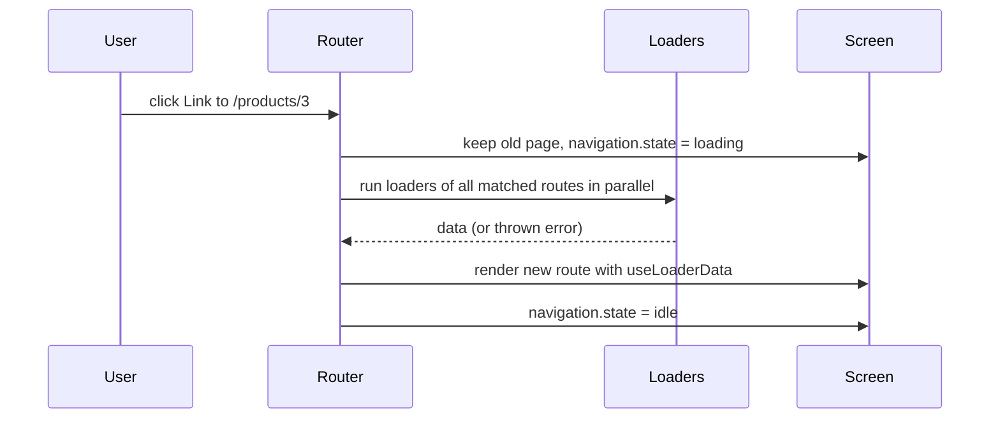
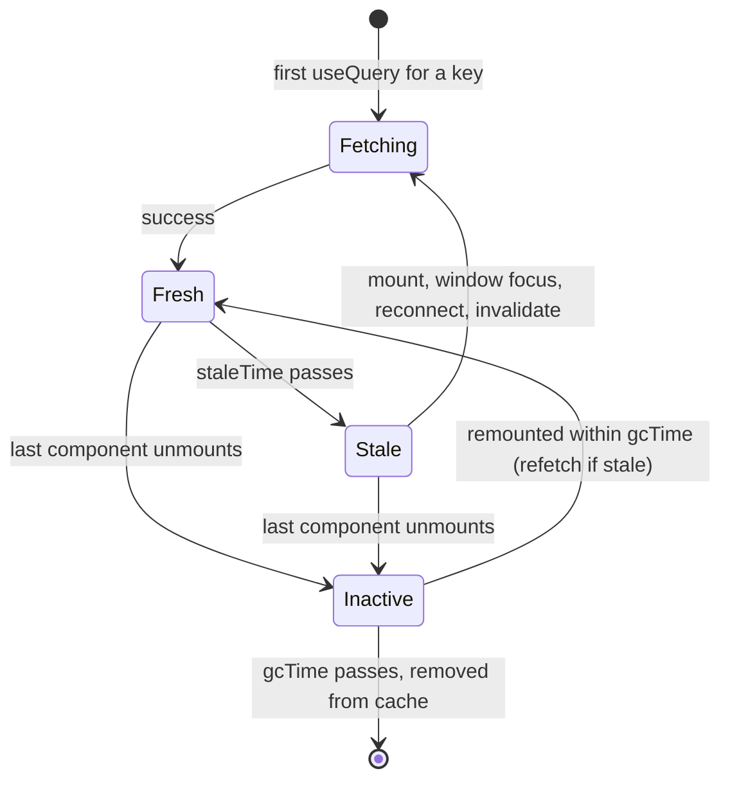

# Chapter 9 — Routing and Data Fetching

Real apps have many screens and live on server data. This chapter covers **React Router** (which screen for which URL and, in data mode, loading that screen's data) and **TanStack Query** (caching — keeping a reusable local copy of — and synchronising server data), then React's own async tools **Suspense** (a fallback while something loads) and **`use()`** (reads a promise's value during render), and ends with loading/error-state patterns. The manual way — fetching in an Effect with cleanup — is in [Chapter 5](../05-effects-and-refs/README.md) and the `useFetch` Hook in [Chapter 7](../07-custom-hooks-and-hook-rules/README.md); why server data is a different kind of state is in [Chapter 6](../06-state-management/README.md).

Versions: **React 19.3**, **React Router 8.4**, **TanStack Query 5.104**. Code in [`code/`](code/) runs in Node with jsdom (a browser-like DOM for Node) against a tiny in-memory API ([`code/api-server.js`](code/api-server.js), started on `127.0.0.1` per script); `[server]` lines in outputs are its log. Listings below show the essential lines; the files are complete.

---

## 9.1 Client-side routing

### What it is
**Routing** chooses what to show from the **URL** (the web address, e.g. `/products/3?sort=price`). In a multi-page site (MPA) the *server* routes: every click requests a new HTML page and the browser reloads. In a **single-page application (SPA)** the page loads once and a **client-side router** in JavaScript:

1. Intercepts clicks on its `<Link>`s (`event.preventDefault()`) and updates the address bar with the **History API** (the browser's functions for changing the URL and history, e.g. `history.pushState`) — no request, no reload.
2. Listens for Back/Forward (the `popstate` event).
3. Matches the new URL against your **route definitions** and renders the matching components. Your JS and state stay loaded.

### Why the URL matters
The URL *is* state — the most shareable state you have. Anything a user might bookmark, share, refresh or go "back" to (page, product, tab, filters, sort, page number) belongs in the URL, not only in `useState`.

### Trade-offs
| Client-side routing | Server routing (MPA) |
|---|---|
| Instant page changes, state survives navigation | Every page is a fresh load |
| Needs JS; first load downloads the app | Works without JS |
| Server must return `index.html` for *every* app path (else a refresh on `/products/3` gets 404 Not Found) | Each URL maps to a real page |
| SEO (search-engine optimisation) and first paint (first time content appears) need SSR/pre-rendering (HTML produced on the server per request or ahead of time) for public content ([Chapter 13](../13-server-rendering-and-frameworks/README.md)) | Good by default |

---

## 9.2 React Router v8 and its three modes

### What it is
**React Router** is the most widely used React router. **v8** (June 2026) is a small upgrade from v7: requires React 19.2.7+ and Node 22.22+, is ESM-only (only `import`/`export` modules, no `require`), removes the `react-router-dom` package, and turns v7's "future flags" (opt-in switches, notably **middleware**, §9.7) on by default.

```bash
npm install react-router          # one package; there is no react-router-dom in v8
```
```js
import { Link, useParams, createBrowserRouter } from 'react-router';   // everything...
import { RouterProvider } from 'react-router/dom';                     // ...except the DOM-specific pieces
```

Three **modes** — pick one per app; each includes everything above it:

| Mode | You write | Router provides | Use when |
|---|---|---|---|
| **Declarative** | `<BrowserRouter>` + `<Routes>`/`<Route>` JSX | URL matching, links, params, navigation | Simple SPAs, adding routing to an existing app, fetching your own way (e.g. TanStack Query) |
| **Data** | Route **objects** to `createBrowserRouter`, rendered with `<RouterProvider>` | + **loaders**, **actions**, pending states, route error boundaries, fetchers, middleware | SPAs that want data loading tied to navigation |
| **Framework** | Route **modules** (files) + the React Router Vite plugin | + server rendering, per-route code splitting, type generation, pre-rendering | Full-stack apps (successor of Remix) |

§9.3–9.4 use declarative mode, §9.5–9.7 data mode. Examples use the **memory** variants (`<MemoryRouter>`, `createMemoryRouter`), which keep history in memory; in a browser use `<BrowserRouter>`/`createBrowserRouter` with identical routes.

Alternatives: **TanStack Router** (type-safe paths/params, built-in search-param validation) and file-based routers (**Next.js** etc.).

---

## 9.3 Routes, links and URL parameters (declarative mode)

### How it works
1. Wrap the app in `<BrowserRouter>` (tests: `<MemoryRouter>`).
2. `<Routes>` holds `<Route path element>` entries. React Router picks the **best** match by specificity — static **segments** (pieces between slashes) beat dynamic `:params`, which beat `*` — so write order doesn't matter.
3. **Dynamic segments**: `/products/:productId` matches `/products/3`; `useParams()` returns `{ productId: '3' }` (always strings).
4. `path="*"` matches anything left: your **404** page.
5. `<Link to>` navigates; **`<NavLink>`** knows if it's **active** and passes `isActive` to `className`/`style` (`end` = match exactly).
6. **Search params** (`?sort=price`): `useSearchParams()`, like `useState` but stored in the URL.
7. **`useNavigate()`** navigates in code: `navigate('/products')`, `navigate(-1)` (back), `navigate('/login', { replace: true })` (replace the history entry). Declaratively: `<Navigate to="/login" />`.

`code/01_declarative_routing.jsx` (abridged):
```jsx
function Nav() {
  const cls = ({ isActive }) => (isActive ? 'active' : undefined);   // NavLink knows if it matches the URL
  return <nav><NavLink to="/" end className={cls}>Home</NavLink> <NavLink to="/products" className={cls}>Products</NavLink></nav>;
}
function ProductList() {
  const [searchParams, setSearchParams] = useSearchParams();       // ?sort=price
  const sort = searchParams.get('sort') ?? 'name';
  // ...sorted list of <Link to={`/products/${p.id}`}>, plus:
  // <button onClick={() => setSearchParams({ sort: 'price' })}>Sort by price</button>
}
function ProductPage() {
  const { productId } = useParams();                                // from the :productId segment
  const navigate = useNavigate();
  // ...<button onClick={() => navigate('/products')}>  <button onClick={() => navigate(-1)}>
}
function NotFound() { return <h1>404 - nothing at {useLocation().pathname}</h1>; }

function App() {
  return (
    <>
      <Nav />
      <Routes>
        <Route path="/" element={<Home />} />
        <Route path="/products" element={<ProductList />} />
        <Route path="/products/:productId" element={<ProductPage />} />
        <Route path="*" element={<NotFound />} />
      </Routes>
    </>
  );
}
```

Output:
```
start                    url=/                    active=Home     h1="Welcome"
click Products           url=/products            active=Products h1="Products (by name)"
sort by price            url=/products?sort=price active=Products h1="Products (by price)"
   list order: Mouse, Keyboard, Monitor
click Monitor            url=/products/3          active=Products h1="Monitor - $199"
navigate(-1)             url=/products?sort=price active=Products h1="Products (by price)"
click Mouse              url=/products/2          active=Products h1="Mouse - $19"
navigate("/products")    url=/products            active=Products h1="Products (by name)"
deep link /nope -> 404 - nothing at /nope
```

- "Products" stays **active** on `/products/3` (NavLink matches descendants); "Home" uses `end`.
- The sort lives in the URL, so **Back** returned to `?sort=price`; `useState` would have lost it.

### Common mistakes
| Mistake | Fix |
|---|---|
| `<a href="/products">` inside the app | Full reload, state lost — use `<Link to>` (keep `<a>` for external sites) |
| Treating `useParams()` values as numbers | They're strings: `Number(productId)` |
| Filters/tabs/page in `useState` | Put shareable UI state in search params |
| Calling `navigate()` during render | Navigate in handlers/Effects, or render `<Navigate>` |
| Server 404s on refresh of `/products/3` | Fallback to `index.html` (Vite preview, Netlify `_redirects`, nginx `try_files`) |

---

## 9.4 Nested routes and layouts

### What it is
**Layouts** (a header on every page, a sidebar on account pages) are modelled by **nesting** routes: the parent renders shared UI and an **`<Outlet />`** where the matching child appears. URL segments nest too: `users` + `:userId` = `/users/42`.

| Route kind | Written as | Matches | Use |
|---|---|---|---|
| **Index route** | `<Route index element=…>` | The parent's own URL exactly | Default child ("Pick a user" at `/users`) |
| **Layout (pathless) route** | `<Route element={<Layout/>}>`, no `path` | Nothing itself; wraps children | Shared UI without a URL segment |
| **Static vs dynamic siblings** | `new` and `:userId` side by side | `/users/new` → static wins | Ranking, not order |

`code/02_nested_routes.jsx` (abridged):
```jsx
function AppLayout() { return <div><header>MyShop</header><main><Outlet /></main><footer>(c) 2026</footer></div>; }
function AccountLayout() {                           // pathless layout: groups routes, adds no URL segment
  const user = { name: 'Ada' };
  return <section><aside>Account menu</aside><Outlet context={user} /></section>;
}
function Settings() { const user = useOutletContext(); return <h1>Settings for {user.name}</h1>; }
function UsersLayout() {
  return <div><nav><Link to="new">New user</Link> <Link to="42">User 42</Link> <Link to="..">Up</Link></nav><Outlet /></div>;
}
<Routes>
  <Route element={<AppLayout />}>                          {/* layout route: no path */}
    <Route index element={<h1>Home</h1>} />               {/* "/" exactly */}
    <Route path="users" element={<UsersLayout />}>
      <Route index element={<UsersIndex />} />             {/* /users */}
      <Route path="new" element={<NewUser />} />           {/* static beats dynamic */}
      <Route path=":userId" element={<User />} />          {/* /users/42 */}
    </Route>
    <Route element={<AccountLayout />}><Route path="settings" element={<Settings />} /></Route>
  </Route>
</Routes>
```

Output:
```
/           -> header  h1="Home"
/users      -> header+nav  h1="Pick a user"
/users/new  -> header+nav  h1="Create a user"
/users/42   -> header+nav  h1="User #42"
/settings   -> header+aside  h1="Settings for Ada"
from /users/42 click "new" -> header+nav  h1="Create a user"
click ".."              -> header  h1="Home"
```

### How it works
1. The router finds the **chain** of matching routes (`AppLayout → UsersLayout → User`), renders the outermost, and each `<Outlet />` renders the next.
2. **Relative links** (no leading `/`) resolve against the **route** rendering them: `to="new"` in `UsersLayout` is `/users/new` even at `/users/42`; `..` goes to the parent *route* (here the pathless layout at `/`).
3. `<Outlet context={value}>` + `useOutletContext()` pass data from a layout to its rendered child.

### Why it matters
Layouts don't re-mount when moving between their children — header state, sidebar scroll and open menus survive.

---

## 9.5 Loaders — data before render (data mode)

### What it is
A route's **`loader`** is an async function that runs **when navigation to the route starts, before it renders**; the component reads the result with **`useLoaderData()`**.

### The problem it solves
Effect fetching ([Chapter 5](../05-effects-and-refs/README.md)) starts only *after* render, and nested components wait for their parent before starting their own request — a **waterfall** (request → render → request…). Loaders start **all** requests for **all** matched routes **in parallel** on click; the component renders once, with data.

### How it works
1. Define route objects `{ path, Component, loader, ErrorBoundary, children }`; `createBrowserRouter(routes)` (tests: `createMemoryRouter(routes, { initialEntries })`); render `<RouterProvider router={router} />`.
2. On navigation, matched loaders run in parallel with `{ params, request, context }` (`request.signal` aborts if the user navigates away).
3. Meanwhile the **current** screen stays and **`useNavigation().state`** is `'loading'` — drive a progress bar from it.
4. On resolve, the new route renders with `useLoaderData()`.
5. If a loader **throws**, the nearest route **`ErrorBoundary`** renders. Throw **`data(message, { status })`** for expected HTTP-like errors; check with `isRouteErrorResponse(error)`. (No `ErrorBoundary` at all → React Router's default error screen.)
6. On first load there's no current screen, so the root route's **`HydrateFallback`** shows until the app has **hydrated** (React started in the browser).



`code/03_loaders_and_errors.jsx` (abridged):
```jsx
async function getJson(path, request) {
  const res = await fetch(api.base + path, { signal: request.signal });   // aborted if the user navigates away
  if (res.status === 404) throw data((await res.json()).message, { status: 404 });
  if (!res.ok) throw new Error(`API error ${res.status}`);
  return res.json();
}
function Root() {
  const navigation = useNavigation();               // 'idle' | 'loading' | 'submitting'
  return <div><nav>{/* links */}</nav>{navigation.state === 'loading' && <p role="status">Loading…</p>}<Outlet /></div>;
}
function Product() { const product = useLoaderData(); return <h1>{product.name} costs ${product.price}</h1>; }
function ProductError() {
  const error = useRouteError();                    // whatever the loader threw
  if (isRouteErrorResponse(error)) return <h1>{error.status}: {error.data}</h1>;
  return <h1>Unexpected: {error.message}</h1>;
}
const router = createMemoryRouter([{
  path: '/', Component: Root, HydrateFallback: () => <p>Starting…</p>,
  children: [
    { index: true, Component: ProductList,
      loader: async ({ request }) => {             // two requests in PARALLEL, not a waterfall
        const [products, categories] = await Promise.all([getJson('/api/products', request), getJson('/api/categories', request)]);
        return { products, categories };
      } },
    { path: 'products/:id', Component: Product, ErrorBoundary: ProductError,
      loader: ({ params, request }) => getJson(`/api/products/${params.id}`, request) },
  ],
}], { initialEntries: ['/'] });
```

Output:
```
first paint: Starting…
  [server] start GET /api/products
  [server] start GET /api/categories
  [server] end   GET /api/products -> 200
  [server] end   GET /api/categories -> 200
loaded     : 3 products in 2 categories
  [server] start GET /api/products/3
during nav : Loading… | still showing: 3 products in 2 categories
  [server] end   GET /api/products/3 -> 200
after nav  : Monitor costs $199
  [server] start GET /api/products/9
  [server] end   GET /api/products/9 -> 404
missing    : 404: No product 9 | nav still rendered: true
```

The two list requests ran **in parallel**; the **old** page stayed during navigation (no blank flash); the 404 was contained by the product route's `ErrorBoundary`, so the root nav kept working.

### Details worth knowing
- **Revalidation**: after an action (§9.6) or `useRevalidator().revalidate()`, loaders on the page re-run; a route's `shouldRevalidate` can opt out.
- **Streaming non-critical data**: return an object with an *un-awaited* promise (`return { product: await p, reviews: reviewsPromise }`) and render it with `<Await resolve={reviews}>` inside `<Suspense>`, or with `use()` (§9.11). The page shows once critical data is ready.
- **Loaders are not components**: no Hooks; plain async functions, easy to unit-test.
- **Loaders don't cache**: going back re-runs them. Pair with a cache (TanStack Query, §9.13) when that matters.

---

## 9.6 Actions, `<Form>` and fetchers

### What it is
An **action** is a route's function for **writes**. **`<Form method="post">`** works like an HTML form but, instead of reloading, **serialises** the fields into a `Request`, calls the route's `action`, then **automatically re-runs the page's loaders**.

### How it works
1. `<Form method="post">` submits to its own route's action (or `action="/path"`).
2. The action reads `await request.formData()`, validates, writes.
3. It returns **validation errors** — `return data({ errors }, { status: 400 })`, read via **`useActionData()`** — or **`redirect('/somewhere')`** (*Post/Redirect/Get*: after a POST, send the browser to a GET page so Refresh doesn't resubmit).
4. `useNavigation().state === 'submitting'` while it runs — disable the button.
5. Afterwards the router **revalidates**: every `useLoaderData()` gets fresh data.
6. **`useFetcher()`** does the same *without navigating* (like buttons, inline edits, quick-add, several concurrent submissions), with its own `fetcher.state` and `fetcher.data`.

`code/04_actions_and_forms.jsx` (abridged):
```jsx
async function newTodoAction({ request }) {
  const form = await request.formData();
  const title = String(form.get('title') ?? '').trim();
  if (title.length < 3) return data({ errors: { title: 'At least 3 characters' } }, { status: 400 });
  await postTodo(title);
  return redirect('/todos');                           // Post/Redirect/Get
}
function TodoList() {
  const todos = useLoaderData();
  const fetcher = useFetcher();                        // submit WITHOUT navigating
  return (/* list, then */
    <fetcher.Form method="post" action="/todos/new">
      <input name="title" aria-label="quick add" defaultValue="Buy milk" />
      <button>{fetcher.state === 'idle' ? 'Quick add' : 'Adding…'}</button>
    </fetcher.Form>);
}
function NewTodo() {
  const actionData = useActionData();                  // validation errors from the action
  const navigation = useNavigation();
  return (
    <Form method="post">
      <input name="title" aria-label="title" />
      {actionData?.errors?.title && <p role="alert">{actionData.errors.title}</p>}
      <button disabled={navigation.state === 'submitting'}>{navigation.state === 'submitting' ? 'Saving…' : 'Save'}</button>
    </Form>);
}
// routes: /todos (index: TodoList + todosLoader), /todos/new (NewTodo + newTodoAction)
```

Output:
```
list      : 1 todos: Read chapter 9
too short : At least 3 characters | url still /todos/new
  [server] start POST /api/todos
submitting: button says "Saving…"
  [server] end   POST /api/todos -> 201
  [server] start GET /api/todos
  [server] end   GET /api/todos -> 200
redirected: /todos | 2 todos: Read chapter 9, Write the router demo
  [server] … same POST + GET pair
fetcher   : /todos | 3 todos: Read chapter 9, Write the router demo, Buy milk
```

The short title never reached the server; after each POST the router re-fetched `GET /api/todos` **by itself**.

### Relation to React 19 form actions
React's `<form action={fn}>`, `useActionState`, `useFormStatus` ([Chapter 4](../04-forms-and-actions/README.md)) solve this at component level. The router's `<Form>` adds URL-addressed actions, redirects and automatic revalidation of route data — prefer it (and fetchers) for route data in data mode.

---

## 9.7 Middleware, lazy routes and framework mode

### Middleware (v8: on by default)
**Middleware** runs **before** a route's loaders/actions, parent to child, and can act before and after the rest of the chain by awaiting `next()`. Uses: **authentication guards** (redirect logged-out users to login), logging/timing, putting shared data (current user) into a typed **context** for loaders.

`code/05_middleware.jsx` (abridged):
```jsx
const userContext = createContext(null);                   // typed slot in the router context (from react-router)
async function logMiddleware({ request }, next) {
  const path = new URL(request.url).pathname;
  console.log(`  -> ${path}`);
  await next();                                            // child middleware + loaders
  console.log(`  <- ${path} done`);
}
async function authMiddleware({ request, context }) {
  if (!session) {
    console.log('  auth: no session, redirecting');
    throw redirect(`/login?next=${encodeURIComponent(new URL(request.url).pathname)}`);
  }
  context.set(userContext, session);                       // loaders below can read it
}
const routes = [{ path: '/', Component: Outlet, middleware: [logMiddleware], HydrateFallback: () => null, children: [
  { path: 'login', Component: Login },
  { path: 'dashboard', Component: Dashboard, middleware: [authMiddleware],
    loader: ({ context }) => ({ user: context.get(userContext) }) },
] }];
```

Output:
```
signed out, open /dashboard:
  -> /dashboard
  auth: no session, redirecting
  <- /dashboard done
  -> /login
  <- /login done
  shows "Please log in" at /login?next=%2Fdashboard
signed in, open /dashboard:
  -> /dashboard
  <- /dashboard done
  shows "Dashboard for Ada"
```

One guard on a parent protects every child; loaders stop re-checking the session. Client-side guards are **UX**, not security — the server must still reject unauthorised API calls. Declarative mode has no middleware: use a wrapper component rendering `<Navigate to="/login" replace />`.

### Lazy routes (code splitting)
**Code splitting** breaks the bundle into files loaded on demand. A route's `lazy` loads its module on first visit:
```js
// not run
{ path: 'reports', lazy: () => import('./routes/reports.jsx') }   // the module exports Component, loader, …
```
React's `lazy()` + `<Suspense>` does this for any component ([Chapter 10](../10-performance/README.md)).

### Framework mode in one page
React Router as a full-stack framework (successor of Remix). Routes in `app/routes.ts` point at **route modules** that export their pieces:

```ts
// app/routes.ts (not run)
import { type RouteConfig, index, route } from '@react-router/dev/routes';
export default [index('routes/home.tsx'), route('products/:id', 'routes/product.tsx')] satisfies RouteConfig;
```
```tsx
// app/routes/product.tsx (not run)
import type { Route } from './+types/product';          // generated types for THIS route
export async function loader({ params }: Route.LoaderArgs) {   // runs on the server
  return { product: await db.product.find(params.id) };
}
export default function Product({ loaderData }: Route.ComponentProps) {
  return <h1>{loaderData.product.name}</h1>;             // loaderData is fully typed
}
export function ErrorBoundary({ error }: Route.ErrorBoundaryProps) { /* … */ }
```

You get server rendering (or `ssr: false` for an SPA, or pre-rendering to static HTML), `loader` on the server and `clientLoader` in the browser, automatic per-route code splitting, and generated types for `params`/`loaderData`. [Chapter 13](../13-server-rendering-and-frameworks/README.md) compares it with Next.js.

---

## 9.8 TanStack Query basics

### What it is
**TanStack Query** (formerly React Query) is a **server-state** library: it fetches, **caches**, de-duplicates (merges identical simultaneous requests), refreshes and invalidates (marks out of date) server data. (Caching in general: [System Design Fundamentals](../../../system-design-patterns/modules/00-system-design-fundamentals/README.md).) You say *what* (a **query key**) and *how* (a **query function**); it handles *when*. Server data can be changed by others, go stale, and be needed by many components ([Chapter 6](../06-state-management/README.md)) — doing that with Effects means re-implementing a cache.

### How it works
1. Create one `QueryClient` (the cache) and provide it: `<QueryClientProvider client={queryClient}>`.
2. `useQuery({ queryKey: ['product', id], queryFn: () => fetchProduct(id) })`.
3. The first asker triggers the fetch; simultaneous askers for the same key **share** it.
4. Later askers get cached data **immediately**; if it is **stale**, a background refetch updates it.
5. The query function must **throw** on failure (`fetch` doesn't throw on 404 — check `res.ok`); failures are **retried** (3 times by default in the browser, with **exponential backoff** — doubling the wait each time).

| Option | Default | Meaning |
|---|---|---|
| **`staleTime`** | `0` | How long data is **fresh** (served with **no** refetch). With `0`, every mount/focus triggers a background refetch (cached data still shows instantly). |
| **`gcTime`** | 5 minutes | How long **unused** data (no component using the key) stays before garbage collection. |



Stale queries refetch on **mount**, window **focus** and network **reconnect** (each switchable, e.g. `refetchOnWindowFocus: false`).

| Field | Meaning |
|---|---|
| `status` / `isPending`, `isError`, `isSuccess` | Do we **have** data? `pending` = not yet |
| `fetchStatus` / `isFetching` | Is a request **in flight** (including background refetches)? |
| `isLoading` | `isPending && isFetching` — the first load |
| `data`, `error`, `failureCount`, `refetch()` | As named |

`code/06_query_basics.jsx` (abridged):
```jsx
function ProductName({ id, staleTime = 0 }) {
  const { data, status, fetchStatus, isPending, isFetching, error } = useQuery({
    queryKey: ['product', id],                        // cache key
    queryFn: () => fetchJson(`/api/products/${id}`),  // must return a promise
    staleTime,
  });
  // logs status/fetchStatus each render
  if (isPending) return <p>Loading…</p>;
  if (error) return <p role="alert">Error: {error.message}</p>;
  return <p>{data.name}</p>;
}
function Flaky() {
  const q = useQuery({ queryKey: ['flaky'], queryFn: () => fetchJson('/api/flaky'), retry: 3, retryDelay: 10 });
  return <p>{q.isSuccess ? 'flaky ok' : `attempts failed so far: ${q.failureCount}`}</p>;
}
// 1) render once  2) two at once  3) unmount + remount (staleTime 0, then 60 s)  4) flaky endpoint  5) a 404 with retry: false
```

Output:
```
1) first load:
   status=pending fetchStatus=fetching isPending=true isFetching=true data=undefined
   status=success fetchStatus=idle     isPending=false isFetching=false data=Keyboard
2) two <ProductName id={2}/> mounted together -> requests for /api/products/2: 1
3) remount id=1 (staleTime 0): first render -> status=success fetchStatus=fetching isPending=false isFetching=true data=Keyboard
   background refetch happened: requests for /api/products/1 = 2
   remount with staleTime 60s -> requests still 2 (fresh data, no refetch)
4) retry: 3 -> succeeded after 3 requests
5) missing product -> Error: HTTP 404
```

(2) **De-duplication**. (3) **Cache**: the remount rendered data at once while `isFetching` refreshed it — no spinner; with `staleTime: 60s`, no refetch. (4) Retries hid two transient 503s. (5) Errors arrive as `status: 'error'` with the thrown `Error`.

### Choosing `staleTime`
`0` is safe but chatty. For rarely changing data (catalogue, profile) 30 s–5 min removes most refetches. Set a default — `new QueryClient({ defaultOptions: { queries: { staleTime: 60_000 } } })` — and override per query.

### Common mistakes
| Mistake | Fix |
|---|---|
| Copying query data into `useState` | Use `data` directly; derive during render |
| `new QueryClient()` inside a component | Create once (module scope or `useState(() => new QueryClient())`) |
| Query function that doesn't throw on HTTP errors | Check `res.ok` and throw |
| Using `isLoading` to decide whether `data` exists | Use `isPending` (or check `data`) |
| Turning off all refetching "because it's noisy" | Raise `staleTime` |

### In the interview
**30-second answer:** "TanStack Query manages server state. `useQuery` takes a key and a fetch function; it caches by key, de-dupes concurrent requests, retries failures, and refetches stale data in the background on mount, focus and reconnect. `staleTime` (default 0) is how long data is fresh; `gcTime` (default 5 minutes) how long unused data stays cached. `isPending` = no data yet; `isFetching` = request in flight."

- *Why not Redux for server data?* — You'd hand-write caching, dedupe, refetching and invalidation; RTK Query/TanStack Query exist because that's hard.
- *What happens on window focus?* — Stale queries with mounted observers (components using them) refetch.

---

## 9.9 Query keys, pagination and dependent queries

### Query keys
A **query key** is an array identifying the data: `['products']`, `['products', 7]`, `['products', { page: 2, sort: 'price' }]`.
- **Every variable the query function uses belongs in the key** — new variable value → new key → new cache entry → fetch. Forget one and stale data keeps showing.
- Compared by value (objects hashed with sorted keys): `{ page: 1, sort: 'x' }` equals `{ sort: 'x', page: 1 }`.
- **Hierarchical**: invalidating `['products']` matches `['products', 7]` and `['products', 7, 'reviews']` — design general → specific.

**`queryOptions()`** bundles key + function into one reusable definition for `useQuery`, `useSuspenseQuery`, `prefetchQuery`, `ensureQueryData`, `getQueryData` (in TypeScript the data type flows through).

`code/08_query_keys_pagination.jsx` (abridged):
```jsx
const productsPage = (page) => queryOptions({
  queryKey: ['products', { page }],              // variables IN the key -> each page cached separately
  queryFn: () => getJson(`/api/products?page=${page}`),
});
const reviewsOf = (id) => queryOptions({ queryKey: ['products', id, 'reviews'], queryFn: () => getJson(`/api/products/${id}/reviews`) });

function Catalog() {
  const [page, setPage] = useState(1);
  const [selected, setSelected] = useState(null);
  const list = useQuery({ ...productsPage(page), placeholderData: keepPreviousData });  // keep old page while next loads
  const reviews = useQuery({ ...reviewsOf(selected), enabled: selected !== null });     // waits until something is picked
  // dim while list.isPlaceholderData; Next disabled={!list.data.hasMore || list.isPlaceholderData}
}
```

Output (one line per render):
```
load page 1:
   page=1 showing=[] placeholder=false reviews=idle/pending
   page=1 showing=[Keyboard,Mouse] placeholder=false reviews=idle/pending
click Next (old page stays visible, dimmed, until page 2 arrives):
   page=2 showing=[Keyboard,Mouse] placeholder=true reviews=idle/pending
   page=2 showing=[Monitor] placeholder=false reviews=idle/pending
click Prev (page 1 is cached -> instant):
   page=1 showing=[Keyboard,Mouse] placeholder=false reviews=idle/pending
pick Mouse (the dependent reviews query is now enabled):
   page=1 showing=[Keyboard,Mouse] placeholder=false reviews=fetching/pending
   page=1 showing=[Keyboard,Mouse] placeholder=false reviews=idle/success
cache keys: ["products",{"page":1}]  ["products",null,"reviews"]  ["products",{"page":2}]  ["products",2,"reviews"]
```

- **Pagination without flicker**: a new key normally means `isPending`; `placeholderData: keepPreviousData` keeps page 1 (flagged `isPlaceholderData`) until page 2 arrives. Back to page 1 was instant (cached).
- **Dependent queries**: `enabled: false` keeps a query idle (`fetchStatus: 'idle'`, `status: 'pending'`) until its input exists — the `null` entry exists but never fetched.
- "Load more"/infinite scroll: **`useInfiniteQuery`** stores pages in one entry with `fetchNextPage` and `hasNextPage`.

---

## 9.10 Mutations, invalidation and optimistic updates

### What it is
A **mutation** changes server data (POST/PUT/PATCH/DELETE — create, replace, partial update, delete). **`useMutation({ mutationFn })`** gives `mutate(variables)` plus `isPending`, `isError`, `error`, `data`; mutations don't run automatically and aren't cached by key. Afterwards, **invalidate** affected queries: `queryClient.invalidateQueries({ queryKey: ['todos'] })` marks matches stale and refetches those on screen.

### How it works — two strategies
| Strategy | Steps | Feels | Use when |
|---|---|---|---|
| **Invalidate** (pessimistic: wait for the server) | `mutate` → server → invalidate → refetch → UI | Correct, slight delay | Default; complex server-side effects |
| **Optimistic update** | `onMutate`: cancel refetches, snapshot cache, write expected result → server → `onError`: restore snapshot → `onSettled`: invalidate | Instant | Likes, toggles, reordering, adding to lists — server almost always agrees |

`code/07_mutations.jsx` (abridged):
```jsx
const mutation = useMutation({
  mutationFn: addTodo,
  onMutate: optimistic ? async (newTitle) => {
    await queryClient.cancelQueries({ queryKey: ['todos'] });          // don't let a refetch overwrite us
    const previous = queryClient.getQueryData(['todos']);
    queryClient.setQueryData(['todos'], old => [...old, { id: 'temp', title: newTitle + ' (saving)' }]);
    return { previous };                                               // 3rd argument of onError
  } : undefined,
  onError: (err, newTitle, ctx) => { if (ctx?.previous) queryClient.setQueryData(['todos'], ctx.previous); },
  onSettled: () => queryClient.invalidateQueries({ queryKey: ['todos'] }),  // refetch the truth either way
});
// <button disabled={mutation.isPending}>; {mutation.isError && <p role="alert">Could not add: {mutation.error.message}</p>}
```

Output (server log abridged to the requests that matter):
```
A) plain mutation + invalidate
   right after submit : Read chapter 9 | button: Adding…
  [server] start POST /api/todos
  [server] end   POST /api/todos -> 201
  [server] start GET /api/todos
  [server] end   GET /api/todos -> 200
   after refetch      : Read chapter 9 | Learn mutations
B) optimistic update
  [server] start GET /api/todos
  [server] start POST /api/todos
   right after submit : Read chapter 9 | Learn mutations | Ship it (saving)
  [server] end   GET /api/todos -> 200
  [server] end   POST /api/todos -> 201
   after server + refetch: Read chapter 9 | Learn mutations | Ship it
C) optimistic update that fails
  [server] start POST /api/todos
   right after submit : Read chapter 9 | Learn mutations | Ship it | This will fail (saving)
  [server] end   POST /api/todos -> 500
   after the 500      : Read chapter 9 | Learn mutations | Ship it | Could not add: Server refused
```

**A** updated only after POST + refetch. **B** showed the item **immediately**; `cancelQueries` made the client ignore the in-flight `GET` so it couldn't overwrite the optimistic list; `onSettled` swapped in the server's version. **C**: `onError` restored the snapshot — always pair optimistic updates with a visible error.

### Other tools
- `queryClient.setQueryData(key, data)` — write the mutation's response into the cache (skip a refetch).
- `mutateAsync` — returns a promise for `await` (wrap in `try/catch`).
- **`useOptimistic`** (React 19, [Chapter 4](../04-forms-and-actions/README.md)) — optimistic UI for one component's form action; the cache approach is better when many components show the data.

---

## 9.11 Suspense and `use()`

### What it is
**`<Suspense fallback={…}>`** shows a placeholder while something inside isn't ready (lazy code or data). A component **suspends** when it asks for an unavailable value; React shows the nearest boundary's fallback and retries when the value arrives.

**`use(resource)`** (React 19) reads such a value during render:
- `use(promise)` returns the resolved value, **suspends** while pending, **throws** a rejection to the nearest **error boundary**.
- `use(context)` reads context like `useContext`.
- Unlike Hooks, `use` **may be called inside `if` and loops** (§7.2); not inside `try/catch`.

### The one rule: don't create the promise during render
`use(fetch(url))` in a component creates a **new** promise each render, so React never finishes (warning: "suspended by an uncached promise"). The promise must be **created once and reused**: a prop from a Server Component (runs only on the server, Chapter 13) or loader, a cache, or a library (TanStack Query, the router).

`code/09_suspense_and_use.jsx` (abridged):
```jsx
const cache = new Map();                                 // create each promise ONCE, reuse across renders
function fetchProduct(id) {
  if (!cache.has(id)) cache.set(id, fetch(`${api.base}/api/products/${id}`).then(async r => {
    if (!r.ok) throw new Error(`HTTP ${r.status}`);
    return r.json();
  }));
  return cache.get(id);
}
const CurrencyContext = createContext('$');
function Product({ id, showPrice }) {
  const product = use(fetchProduct(id));                 // suspends until resolved; throws to the boundary if rejected
  if (!showPrice) return <h2>{product.name}</h2>;
  const currency = use(CurrencyContext);                 // use() may sit inside an if
  return <h2>{product.name} {currency}{product.price}</h2>;
}
function Page() {
  const [id, setId] = useState(1);
  const [isPending, startTransition] = useTransition();
  return (<>
    <button onClick={() => setId(2)}>plain setId(2)</button>
    <button onClick={() => startTransition(() => setId(3))}>transition setId(3)</button>
    <button onClick={() => setId(9)}>missing</button>
    {isPending && <p>(switching…)</p>}
    <ErrorBoundary fallback={({ error, reset }) => <p role="alert">Failed: {error.message} <button onClick={() => { reset(); setId(1); }}>Retry</button></p>}>
      <Suspense fallback={<p>Loading product…</p>}><Product id={id} showPrice /></Suspense>
    </ErrorBoundary>
  </>);
}
// TanStack Query: useSuspenseQuery never returns "pending" - data is always defined.
function SuspenseName({ id }) {
  const { data } = useSuspenseQuery({ queryKey: ['product', id], queryFn: () => fetchProduct(id) });
  return <p>useSuspenseQuery: {data.name}</p>;
}
```

The error boundary ([`code/ErrorBoundary.jsx`](code/ErrorBoundary.jsx)) is a class component — React has no Hook equivalent of `getDerivedStateFromError`; most apps use the `react-error-boundary` package. Full anatomy: [§14.9](../14-patterns-and-architecture/README.md#149-error-boundaries).

Output (visible text after each step):
```
first render      : Loading product…
resolved          : Keyboard $49
plain update      : Loading product… <- content replaced by the fallback
transition update : (switching…) Mouse $19 <- old content kept, isPending shown
then              : Monitor $199
rejected promise  : Failed: HTTP 404 Retry
after Retry       : Keyboard $49
useSuspenseQuery: Mouse
```

### How it works
1. `use(promise)` on a pending promise stops rendering `Product`; the **closest** `<Suspense>` fallback shows.
2. When it settles, React re-renders; `use` returns the value or throws to the **closest error boundary**.
3. A **plain update** to an unloaded id **hides** visible content behind the fallback (a jarring flash).
4. A **transition** (`startTransition`, [Chapter 7](../07-custom-hooks-and-hook-rules/README.md)) **keeps the old content** and exposes `isPending`. Routers wrap navigations in transitions for this reason.
5. The boundary's `reset()` clears the error and retries (a real cache should also **evict** failed promises so a retry refetches).

### Placing boundaries
- Put `<Suspense>` where a placeholder makes sense **visually** — a card, panel, route — not around every component.
- Siblings in one boundary reveal **together** (no "popcorn" pop-in); separate boundaries let fast parts show first.
- Nest boundaries to stream progressively: shell → main content → comments.
- Pair each important Suspense boundary with an **error boundary** outside it.

---

## 9.12 Loading and error states that users like

### Loading states — pick by situation
| Situation | Show | Tool |
|---|---|---|
| First load of a page/section | **Skeleton** in the final layout — avoids **layout shift** (content jumping) | Suspense fallback, `isPending` |
| Navigating between pages | **Old page + progress indicator** | `useNavigation`, transitions |
| Refreshing data already shown | Keep data; small hint or nothing | `isFetching` with data |
| Paginating / filtering | Previous results dimmed until new arrive | `keepPreviousData`, `useDeferredValue` |
| User action (save, like) | Disabled button + "Saving…", or optimistic UI | mutation/action `isPending`, `useOptimistic` |
| Very fast responses | **Nothing** — a 50 ms spinner is a flicker | Delay spinners ~200–300 ms, or transitions |

### Error states — every failure needs a home
| Error kind | Where | UI |
|---|---|---|
| Expected not found / 403 Forbidden | Route `ErrorBoundary` via `throw data(msg, { status })`, or query `error` | Friendly page inside the layout; navigation still works |
| Transient network error | Retries (Query: 3 by default), then error UI | Message + **Retry** (`refetch()` / boundary `reset`) |
| Validation error on submit | Action return / mutation error | Inline by the field (`role="alert"`) |
| Bug (exception during render) | Error boundary per route + one at the root | "Something went wrong" + report to monitoring (e.g. Sentry) in `componentDidCatch` |
| Failure after optimistic update | `onError` rollback | Revert + toast explaining what didn't save |

Error boundaries **don't** catch errors in event handlers, async code outside render (`setTimeout`), or the boundary itself — use `try/catch` + state, or route them into render (e.g. `mutation.error`).

### Common mistakes
One app-wide spinner per fetch (users lose context); an error page for a failed *background* refetch when good cached data exists (show data + subtle warning); swallowed errors (`catch {}`) leaving "Loading…" forever; no empty state ("No results") distinct from loading and error.

---

## 9.13 Putting it together — loaders + TanStack Query

- The **router** knows *when* data is needed (on click), so loaders **start** fetches early and in parallel.
- **TanStack Query** knows *whether* it's cached and fresh, and keeps it updated.

Pattern: in the loader, `queryClient.ensureQueryData(options)` (return cached or fetch) for critical data and `prefetchQuery` (start, don't wait) for non-critical; read both in the component with the **same** `queryOptions` via `useSuspenseQuery`/`useQuery`.

[`code/shop.jsx`](code/shop.jsx) (key parts):
```jsx
const fresh = 30_000;                                            // fresh for 30 s
const productsQuery = queryOptions({ queryKey: ['products'], queryFn: () => getJson('/api/products'), staleTime: fresh });
const productQuery = (id) => queryOptions({ queryKey: ['products', id], queryFn: () => getJson(`/api/products/${id}`), staleTime: fresh });
const reviewsQuery = (id) => queryOptions({ queryKey: ['products', id, 'reviews'], queryFn: () => getJson(`/api/products/${id}/reviews`), staleTime: fresh });

function Product() {
  const { id } = useParams();
  const { data: product } = useSuspenseQuery(productQuery(id));   // already cached thanks to the loader
  const reviews = useQuery(reviewsQuery(id));                      // not awaited by the loader: streams in after
  // ... render product, reviews (or "Loading reviews…")
}

return [{
  path: '/', Component: Layout, ErrorBoundary: RouteError, HydrateFallback: () => <p>Loading shop…</p>,
  loader: () => queryClient.ensureQueryData(productsQuery),        // fetch if missing, reuse if cached
  children: [
    { index: true, Component: Home },
    { path: 'products/:id', Component: Product, ErrorBoundary: RouteError,
      loader: async ({ params }) => {
        queryClient.prefetchQuery(reviewsQuery(params.id));          // start, don't wait (non-critical)
        await queryClient.ensureQueryData(productQuery(params.id));  // wait (critical)
        return null;
      } },
  ],
}];
```

`code/10_router_with_query.jsx` deep-links to `/products/1`, clicks around, then opens a missing product:
```
  [server] start GET /api/products
  [server] start GET /api/products/1/reviews
  [server] start GET /api/products/1
  [server] end   GET /api/products -> 200
  [server] end   GET /api/products/1/reviews -> 200
  [server] end   GET /api/products/1 -> 200
deep link /products/1 -> Keyboard | reviews: 2
  [server] … GET /api/products/3/reviews and /api/products/3 in parallel
click Monitor         -> Monitor
back to Keyboard      -> Keyboard (served from the cache: no requests)
  [server] start GET /api/products/7/reviews
  [server] start GET /api/products/7
  [server] end   GET /api/products/7/reviews -> 200
  [server] end   GET /api/products/7 -> 404
/products/7           -> 404 - This product does not exist
```

The deep link started **all three** requests at once (parent and child loaders in parallel); back to Keyboard made **zero** requests (`ensureQueryData` found fresh data — plain loaders would refetch); the 404 was thrown as `data(…, { status: 404 })` by the query function and rendered by the route's `ErrorBoundary`.

In the browser ([`code/shop.html`](code/shop.html); `fetch` is mocked in `shop-main.jsx`):


*Figure 9.1 — The shop at `/products/1`. `NavLink` highlighted the active product; the product came from the loader-filled cache, the reviews from a prefetch.*

### In the interview
**30-second answer:** "React Router's data mode so loaders start fetching in parallel as navigation begins, and TanStack Query as the cache: the loader calls `ensureQueryData` with shared `queryOptions`, the component reads the same options with `useSuspenseQuery`. Critical data is awaited, non-critical prefetched. Mutations go through actions or `useMutation` and invalidate affected keys. Route error boundaries handle errors; navigations are transitions so the old page stays visible."

- *Why both a loader and a query?* — The loader removes the render-then-fetch waterfall; the cache removes repeated requests and keeps data fresh.
- *Where does the `QueryClient` live?* — Created once outside components, provided at the root, passed to route loaders.

---

## Chapter 9 TL;DR

| Idea | Remember |
|---|---|
| Client-side routing | History API + route matching; URL is shareable state |
| React Router v8 | `npm i react-router`; `RouterProvider` from `react-router/dom`; declarative / data / framework modes |
| Routes | `path`, `:params` (`useParams`, strings), `?search` (`useSearchParams`), `*` 404, `<Link>`/`<NavLink>`, `useNavigate` |
| Nesting | `<Outlet/>`, `index`, pathless layouts, relative links resolve against the route tree, `useOutletContext` |
| Loaders | Run before render, in parallel; `useLoaderData`; `useNavigation` for pending; `throw data(msg,{status})` + `ErrorBoundary`; no caching |
| Actions | `<Form method="post">` → `action` → errors (`useActionData`) or `redirect`; automatic revalidation; `useFetcher` |
| Middleware / lazy / framework | Before/after loaders (auth, logging, `createContext` + `context.get/set`); `lazy` splits route code; framework mode = route modules + SSR + typegen |
| TanStack Query | Key + fn; cache, dedupe, retries, background refetch; `staleTime` (0) / `gcTime` (5 min); `isPending` vs `isFetching` |
| Keys & pagination | Every input in the key; `queryOptions`; `keepPreviousData`; `enabled`; `useInfiniteQuery` |
| Mutations | `useMutation` + `invalidateQueries`; optimistic: cancel → snapshot → set → rollback → invalidate |
| Suspense & `use()` | Cached promise only; fallback while pending; error boundary for rejections; transitions keep old UI |
| Loading/error UX | Skeletons first, old content during navigation, inline validation, Retry buttons, visible rollbacks |

Next: [Chapter 10 — Performance](../10-performance/README.md).
