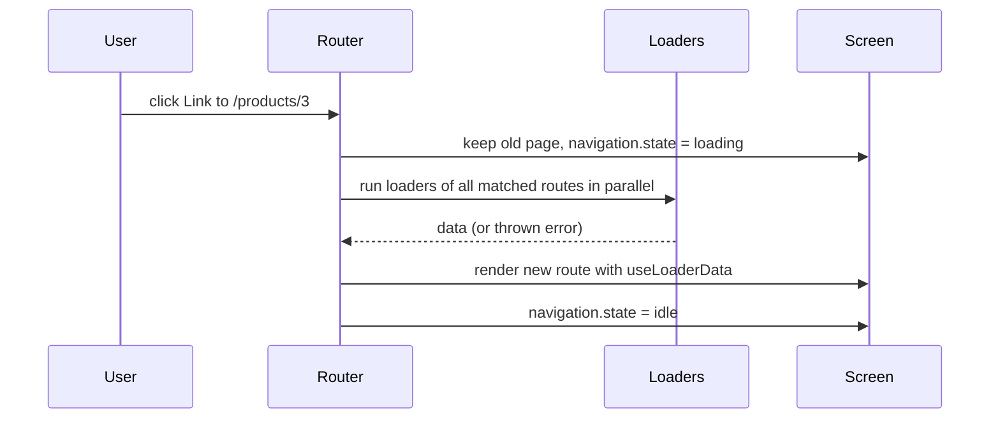
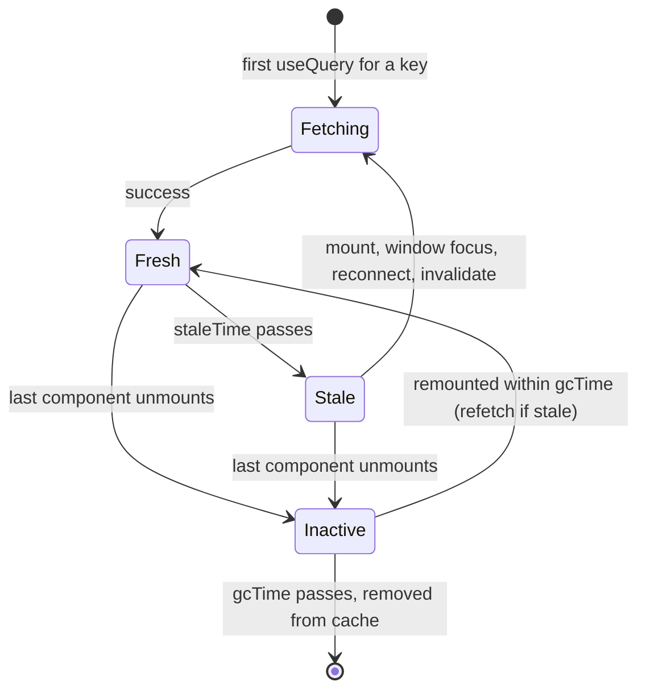
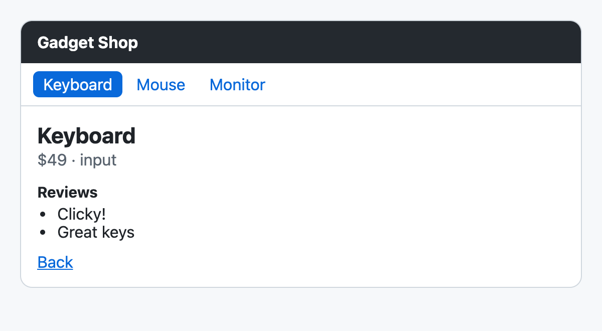

# Chapter 9 — Routing and Data Fetching

Real apps have many screens and live on data from a server. This chapter covers the two libraries most React apps use for that: **React Router** (which screen to show for which URL, and — in its data mode — loading the data for that screen) and **TanStack Query** (caching and synchronising server data). It then connects both to React's own async tools, **Suspense** and **`use()`**, and ends with patterns for loading and error states that users actually like.

You already know the manual way — fetching in an Effect with cleanup ([Chapter 5](../05-effects-and-refs/README.md), and the `useFetch` Hook in [Chapter 7](../07-custom-hooks-and-hook-rules/README.md)) — and [Chapter 6](../06-state-management/README.md) explained why server data is a different kind of state. Here you'll see what the libraries add and how to use them well.

**What you'll learn**

| # | Topic | You will be able to… |
|---|---|---|
| 9.1 | Client-side routing | explain how an SPA changes pages without reloading |
| 9.2 | React Router v8 and its modes | install it and pick declarative, data or framework mode |
| 9.3 | Routes, links, params | map URLs to components; read `:params` and `?search` params; navigate in code; 404s |
| 9.4 | Nested routes and layouts | share layouts with `<Outlet>`, use index and pathless routes, relative links |
| 9.5 | Loaders | load data *before* a route renders; pending UI; route error boundaries |
| 9.6 | Actions and forms | handle mutations with `<Form>`, validation, redirects, `useFetcher` |
| 9.7 | Middleware, lazy routes, framework mode | guard routes, split code, know what framework mode adds |
| 9.8 | TanStack Query basics | `useQuery`, states, caching, `staleTime`/`gcTime`, dedupe, retries |
| 9.9 | Query keys, pagination, dependent queries | design keys, paginate without flicker, chain queries |
| 9.10 | Mutations and invalidation | `useMutation`, invalidate, optimistic updates with rollback |
| 9.11 | Suspense and `use()` | read promises in render, fallbacks, error boundaries, transitions |
| 9.12 | Loading and error states | choose spinners vs skeletons vs stale content; handle every failure |
| 9.13 | Putting it together | router loaders + Query cache in one small shop |

Versions used: **React 19.3**, **React Router 8.4**, **TanStack Query 5.104**. Code in [`code/`](code/) runs in Node with jsdom; data comes from a tiny in-memory API ([`code/api-server.js`](code/api-server.js)) started on `127.0.0.1` inside each script, and the `[server]` lines in the outputs are that server's log.

---

## 9.1 Client-side routing

### What it is
**Routing** means choosing what to show based on the **URL**. In a traditional multi-page site the *server* does it: every link click requests a new HTML page and the browser reloads. In a **single-page application (SPA)** the page loads once, and a **client-side router** in JavaScript does it:

1. It intercepts clicks on its links (`<Link>`), calls `event.preventDefault()`, and updates the address bar with the **History API** (`history.pushState`) — no request, no reload.
2. It listens for the Back/Forward buttons (the `popstate` event).
3. It matches the new URL against your **route definitions** and renders the matching components.

Analogy: a museum with one entrance. A server-routed site sends you outside and back in through the door for every room; a client-side router just walks you down the corridor — the building (your JS, your state) stays loaded.

### Why the URL matters
The URL *is* state — the most shareable state in your app. Anything a user might want to bookmark, share, refresh or go "back" to (which page, which product, which tab, filters, sort order, page number) belongs in the URL, not only in `useState`. A good router makes that easy.

### Trade-offs
| Client-side routing | Server routing (MPA) |
|---|---|
| Instant page changes, state survives navigation | Every page is a fresh load |
| Needs JS; first load downloads the app | Works without JS |
| The server must return `index.html` for *every* app path (so a refresh on `/products/3` doesn't 404) | Each URL maps to a real page |
| SEO and first paint need SSR/pre-rendering for public content ([Chapter 13](../13-server-rendering-and-frameworks/README.md)) | Good by default |

---

## 9.2 React Router v8 and its three modes

### What it is
**React Router** is the most widely used router for React. Version **8** (June 2026) is a deliberately small upgrade from v7: it requires React 19.2.7+ and Node 22.22+, is ESM-only, removes the old `react-router-dom` package, and turns v7's "future flags" (notably **middleware**) on by default.

```bash
npm install react-router          # one package; there is no react-router-dom in v8
```
```js
import { Link, useParams, createBrowserRouter } from 'react-router';   // everything...
import { RouterProvider } from 'react-router/dom';                     // ...except the DOM-specific pieces
```

It can be used in three **modes** — pick one per app:

| Mode | You write | Router provides | Use when |
|---|---|---|---|
| **Declarative** | `<BrowserRouter>` + `<Routes>`/`<Route>` JSX | URL matching, links, params, navigation | Simple SPAs, adding routing to an existing app, fetching data your own way (e.g. TanStack Query) |
| **Data** | Route **objects** passed to `createBrowserRouter`, rendered with `<RouterProvider>` | + **loaders**, **actions**, pending states, route error boundaries, fetchers, middleware | SPAs that want data loading tied to navigation |
| **Framework** | Route **modules** (files) + the React Router Vite plugin | + server rendering, code splitting per route, type generation, pre-rendering | Full-stack apps (this is the successor of the Remix framework) |

Each mode includes everything in the modes above it. The sections below use **declarative** mode first (§9.3–9.4), then **data** mode (§9.5–9.7). Tests and these examples use the **memory** variants — `<MemoryRouter>` and `createMemoryRouter` — which keep the URL history in memory instead of the address bar; in a browser app you use `<BrowserRouter>` / `createBrowserRouter` with identical route definitions.

(Alternatives worth knowing: **TanStack Router**, a fully type-safe router with built-in search-param validation, and the file-based routers of **Next.js** and other frameworks.)

---

## 9.3 Routes, links and URL parameters (declarative mode)

### How it works
1. Wrap the app in a router: `<BrowserRouter>` (tests: `<MemoryRouter>`).
2. Inside, `<Routes>` holds `<Route path="…" element={…}>` entries. On each URL change React Router picks the **best** matching route (it ranks routes by specificity — static segments beat dynamic `:params`, which beat `*` — so the order you write them in doesn't matter).
3. **Dynamic segments** start with `:` — `/products/:productId` matches `/products/3` and `useParams()` returns `{ productId: '3' }` (always strings).
4. `path="*"` matches anything left over: your **404** page.
5. `<Link to>` navigates; **`<NavLink>`** is a Link that knows whether it's **active** (matches the current URL) and passes `isActive` to `className`/`style` (`end` makes it match exactly).
6. **Search params** (`?sort=price`) are read and written with `useSearchParams()`, which works like `useState` but stores the value in the URL.
7. **`useNavigate()`** returns a function for navigating in code (after a form submit, on a timer): `navigate('/products')`, `navigate(-1)` (back), `navigate('/login', { replace: true })` (replace the history entry). Declaratively, render `<Navigate to="/login" />`.

`code/01_declarative_routing.jsx`:
```jsx
import { MemoryRouter, Routes, Route, Link, NavLink, useParams, useSearchParams, useNavigate, useLocation } from 'react-router';

function Nav() {
  const cls = ({ isActive }) => (isActive ? 'active' : undefined);   // NavLink knows if it matches the URL
  return (
    <nav>
      <NavLink to="/" end className={cls}>Home</NavLink> <NavLink to="/products" className={cls}>Products</NavLink>
    </nav>
  );
}
function ProductList() {
  const [searchParams, setSearchParams] = useSearchParams();       // ?sort=price
  const sort = searchParams.get('sort') ?? 'name';
  const items = PRODUCTS.toSorted((a, b) => (sort === 'price' ? a.price - b.price : a.name.localeCompare(b.name)));
  return (
    <>
      <h1>Products (by {sort})</h1>
      <button onClick={() => setSearchParams({ sort: 'price' })}>Sort by price</button>
      <ul>{items.map(p => <li key={p.id}><Link to={`/products/${p.id}`}>{p.name}</Link></li>)}</ul>
    </>
  );
}
function ProductPage() {
  const { productId } = useParams();                                // from the :productId segment
  const navigate = useNavigate();
  const product = PRODUCTS.find(p => p.id === productId);
  if (!product) return <h1>No product {productId}</h1>;
  return (
    <>
      <h1>{product.name} - ${product.price}</h1>
      <button onClick={() => navigate('/products')}>Back to list</button>
      <button onClick={() => navigate(-1)}>Browser back</button>
    </>
  );
}
function NotFound() { return <h1>404 - nothing at {useLocation().pathname}</h1>; }

function App() {
  return (
    <>
      <Nav />
      <Routes>
        <Route path="/" element={<Home />} />
        <Route path="/products" element={<ProductList />} />
        <Route path="/products/:productId" element={<ProductPage />} />
        <Route path="*" element={<NotFound />} />
      </Routes>
    </>
  );
}
// render(<MemoryRouter initialEntries={['/']}><App /></MemoryRouter>), then click around
```

Output:
```
start                    url=/                    active=Home     h1="Welcome"
click Products           url=/products            active=Products h1="Products (by name)"
sort by price            url=/products?sort=price active=Products h1="Products (by price)"
   list order: Mouse, Keyboard, Monitor
click Monitor            url=/products/3          active=Products h1="Monitor - $199"
navigate(-1)             url=/products?sort=price active=Products h1="Products (by price)"
click Mouse              url=/products/2          active=Products h1="Mouse - $19"
navigate("/products")    url=/products            active=Products h1="Products (by name)"
deep link /nope -> 404 - nothing at /nope
```

Things to notice:
- "Products" stays **active** on `/products/3` because NavLink matches descendants; "Home" uses `end` so it's active only on `/` exactly.
- The sort order lives in the URL: **Back** returned to `?sort=price`, not to the default sort. `useState` would have lost it.
- A deep link to an unknown path rendered the `*` route.

### Common mistakes
| Mistake | Fix |
|---|---|
| `<a href="/products">` inside the app | Full page reload, state lost — use `<Link to>` (keep `<a>` for external sites) |
| Treating `useParams()` values as numbers | They're strings: `Number(productId)` or compare as strings |
| Filters/tabs/page in `useState` | Put shareable UI state in search params |
| Calling `navigate()` during render | Navigate in handlers/Effects, or render `<Navigate>` |
| Server returns 404 on refresh of `/products/3` | Configure a fallback to `index.html` (Vite preview, Netlify `_redirects`, nginx `try_files`) |

### TL;DR
`<Routes>`/`<Route path>`; `:param` + `useParams`; `useSearchParams` for `?query`; `<Link>`/`<NavLink>`; `useNavigate` in code; `*` for 404.

---

## 9.4 Nested routes and layouts

### What it is
Most apps have **layouts**: a header on every page, a sidebar on all account pages. React Router models this by **nesting** routes. A parent route renders the shared UI and an **`<Outlet />`** where the matching child route appears. The URL segments nest the same way: `users` + `:userId` = `/users/42`.

Three kinds of routes help:

| Route kind | Written as | Matches | Use |
|---|---|---|---|
| **Index route** | `<Route index element=…>` | The parent's own URL, exactly | Default child: "Pick a user" at `/users` |
| **Layout (pathless) route** | `<Route element={<Layout/>}>` with no `path` | Nothing by itself; wraps its children | Share UI without adding a URL segment |
| **Dynamic vs static children** | `new` and `:userId` side by side | `/users/new` → static wins | Ranking, not order, decides |

`code/02_nested_routes.jsx`:
```jsx
function AppLayout() {                               // renders on EVERY page
  return (<div><header>MyShop</header><main><Outlet /></main><footer>(c) 2026</footer></div>);
}
function AccountLayout() {                           // pathless layout: groups routes, adds no URL segment
  const user = { name: 'Ada' };
  return (<section><aside>Account menu</aside><Outlet context={user} /></section>);
}
function Settings() { const user = useOutletContext(); return <h1>Settings for {user.name}</h1>; }
function UsersLayout() {
  return (
    <div>
      <nav><Link to="new">New user</Link> <Link to="42">User 42</Link> <Link to="..">Up</Link></nav>  {/* relative links */}
      <Outlet />
    </div>
  );
}

function App() {
  return (
    <Routes>
      <Route element={<AppLayout />}>                          {/* layout route: no path */}
        <Route index element={<h1>Home</h1>} />               {/* matches "/" exactly */}
        <Route path="users" element={<UsersLayout />}>
          <Route index element={<UsersIndex />} />             {/* /users */}
          <Route path="new" element={<NewUser />} />           {/* /users/new - static beats dynamic */}
          <Route path=":userId" element={<User />} />          {/* /users/42 */}
        </Route>
        <Route element={<AccountLayout />}>
          <Route path="settings" element={<Settings />} />
        </Route>
      </Route>
    </Routes>
  );
}
```

Output (which layout pieces are on screen, and the heading):
```
/           -> header  h1="Home"
/users      -> header+nav  h1="Pick a user"
/users/new  -> header+nav  h1="Create a user"
/users/42   -> header+nav  h1="User #42"
/settings   -> header+aside  h1="Settings for Ada"
from /users/42 click "new" -> header+nav  h1="Create a user"
click ".."              -> header  h1="Home"
```

### How it works
1. React Router finds the **chain** of matching routes (e.g. `AppLayout → UsersLayout → User`).
2. It renders the outermost element; each `<Outlet />` renders the next element in the chain.
3. **Relative links** (no leading `/`) resolve against the **route** that renders them: `to="new"` inside `UsersLayout` means `/users/new`, even when the current URL is `/users/42`. `..` goes to the parent *route* — here the pathless layout at `/`.
4. `<Outlet context={value}>` + `useOutletContext()` passes data from a layout to whichever child is rendered.

### Why it matters
Layouts don't re-mount when you move between their children — the header's state, the sidebar's scroll position and any open menus survive. It also mirrors how designers think: "all account pages share this sidebar".

### TL;DR
Parents render `<Outlet/>`; `index` for the default child; pathless routes for shared layouts; relative links resolve against the route tree.

---

## 9.5 Loaders — data before render (data mode)

### What it is
In **data mode** each route can have a **`loader`**: an async function that runs **when navigation to that route starts, before the route renders**. Its return value is read in the component with **`useLoaderData()`**.

### The problem it solves
Fetching in Effects ([Chapter 5](../05-effects-and-refs/README.md)) starts only *after* the component renders, and nested components each wait for their parent to render before starting their own request — a **waterfall** (request 1 → render → request 2 → render…). Loaders let the router start **all** the requests for **all** matched routes **in parallel** as soon as the user clicks — and the component renders once, with data.

### How it works
1. Define routes as objects: `{ path, Component, loader, ErrorBoundary, children }`.
2. `createBrowserRouter(routes)` (tests: `createMemoryRouter(routes, { initialEntries })`) and render `<RouterProvider router={router} />`.
3. On navigation the router calls the loaders of the matched routes in parallel with `{ params, request, context }` (`request.signal` aborts if the user navigates away again).
4. While they run, the **current** screen stays visible and **`useNavigation().state`** is `'loading'` — use it for a progress bar.
5. When they resolve, the new route renders; `useLoaderData()` returns the data.
6. If a loader **throws**, the nearest route **`ErrorBoundary`** renders instead. Throw **`data(message, { status })`** for expected HTTP-like errors and check them with `isRouteErrorResponse(error)`.
7. On the very first load there is no "current screen", so the router shows the root route's **`HydrateFallback`**.



`code/03_loaders_and_errors.jsx`:
```jsx
async function getJson(path, request) {
  const res = await fetch(api.base + path, { signal: request.signal });   // aborted if the user navigates away
  if (res.status === 404) throw data((await res.json()).message, { status: 404 });
  if (!res.ok) throw new Error(`API error ${res.status}`);
  return res.json();
}

function Root() {
  const navigation = useNavigation();               // 'idle' | 'loading' | 'submitting'
  return (
    <div>
      <nav><Link to="/">All</Link> <Link to="/products/3">Monitor</Link> <Link to="/products/9">Missing</Link></nav>
      {navigation.state === 'loading' && <p role="status">Loading…</p>}
      <Outlet />
    </div>
  );
}
function ProductList() {
  const { products, categories } = useLoaderData();
  return <h1>{products.length} products in {categories.length} categories</h1>;
}
function Product() {
  const product = useLoaderData();
  return <h1>{product.name} costs ${product.price}</h1>;
}
function ProductError() {
  const error = useRouteError();                    // whatever the loader threw
  if (isRouteErrorResponse(error)) return <h1>{error.status}: {error.data}</h1>;
  return <h1>Unexpected: {error.message}</h1>;
}

const router = createMemoryRouter([
  {
    path: '/', Component: Root, HydrateFallback: () => <p>Starting…</p>,
    children: [
      {
        index: true, Component: ProductList,
        loader: async ({ request }) => {             // two requests in PARALLEL, not a waterfall
          const [products, categories] = await Promise.all([getJson('/api/products', request), getJson('/api/categories', request)]);
          return { products, categories };
        },
      },
      {
        path: 'products/:id', Component: Product, ErrorBoundary: ProductError,
        loader: ({ params, request }) => getJson(`/api/products/${params.id}`, request),
      },
    ],
  },
], { initialEntries: ['/'] });
render(<RouterProvider router={router} />);
```

Output:
```
first paint: Starting…
  [server] start GET /api/products
  [server] start GET /api/categories
  [server] end   GET /api/products -> 200
  [server] end   GET /api/categories -> 200
loaded     : 3 products in 2 categories
  [server] start GET /api/products/3
during nav : Loading… | still showing: 3 products in 2 categories
  [server] end   GET /api/products/3 -> 200
after nav  : Monitor costs $199
  [server] start GET /api/products/9
  [server] end   GET /api/products/9 -> 404
missing    : 404: No product 9 | nav still rendered: true
```

The server log proves the two list requests ran **in parallel**. During navigation the **old** page stayed on screen with a "Loading…" status (no blank flash). The 404 was caught by the product route's own `ErrorBoundary`, so the root layout and its nav **kept working** — errors are contained to the route that failed. (Without any `ErrorBoundary`, React Router shows a default error screen.)

### Details worth knowing
- **Revalidation**: after an action (§9.6) or `useRevalidator().revalidate()`, the router re-runs the loaders on the page so data stays fresh; `shouldRevalidate` on a route can opt out.
- **Streaming non-critical data**: a loader can return an object containing an *un-awaited* promise (`return { product: await p, reviews: reviewsPromise }`); render it with `<Await resolve={reviews}>` inside `<Suspense>`, or with `use()` (§9.11). The page shows as soon as the critical data is ready.
- **Loaders are not components**: no Hooks inside them. They're plain async functions, easy to unit-test.
- **Loaders don't cache**. Navigate back to a page and its loader runs again. Pair them with a cache (TanStack Query, §9.13) when that matters.

### TL;DR
`loader` runs before render, in parallel for all matched routes; `useLoaderData()` reads it; `useNavigation()` for pending UI; throw `data(msg, {status})` and handle it in a route `ErrorBoundary`.

---

## 9.6 Actions, `<Form>` and fetchers

### What it is
An **action** is a route's function for **writes** (create, update, delete). React Router's **`<Form method="post">`** works like an HTML form, but instead of reloading the page it serialises the fields into a `Request`, calls the route's `action`, and then **automatically re-runs the loaders** on the page so the UI shows the new data.

### How it works
1. `<Form method="post">` submits to the action of the route it's rendered in (or `action="/path"`).
2. The action reads `await request.formData()`, validates, and writes to the server.
3. It returns either:
   - **validation errors** — `return data({ errors }, { status: 400 })` — read in the component with **`useActionData()`**; or
   - **`redirect('/somewhere')`** — the classic *Post/Redirect/Get* pattern, so Refresh doesn't resubmit.
4. `useNavigation().state === 'submitting'` while the action runs — disable the button.
5. After the action, the router **revalidates**: loaders run again and every `useLoaderData()` gets fresh data.
6. **`useFetcher()`** does the same *without navigating* — for "like" buttons, inline edits, quick-add fields, several independent submissions at once. It has its own `fetcher.state` and `fetcher.data`.

`code/04_actions_and_forms.jsx`:
```jsx
async function newTodoAction({ request }) {
  const form = await request.formData();              // the submitted <Form> fields
  const title = String(form.get('title') ?? '').trim();
  if (title.length < 3) return data({ errors: { title: 'At least 3 characters' } }, { status: 400 });
  await postTodo(title);
  return redirect('/todos');                           // Post/Redirect/Get
}

function TodoList() {
  const todos = useLoaderData();
  const fetcher = useFetcher();                        // submit WITHOUT navigating
  return (
    <>
      <h1>{todos.length} todos: {todos.map(t => t.title).join(', ')}</h1>
      <fetcher.Form method="post" action="/todos/new">
        <input name="title" aria-label="quick add" defaultValue="Buy milk" />
        <button>{fetcher.state === 'idle' ? 'Quick add' : 'Adding…'}</button>
      </fetcher.Form>
      <Link to="new">New todo page</Link>
    </>
  );
}
function NewTodo() {
  const actionData = useActionData();                  // what the action returned (validation errors)
  const navigation = useNavigation();
  return (
    <Form method="post">
      <h1>New todo</h1>
      <input name="title" aria-label="title" />
      {actionData?.errors?.title && <p role="alert">{actionData.errors.title}</p>}
      <button disabled={navigation.state === 'submitting'}>{navigation.state === 'submitting' ? 'Saving…' : 'Save'}</button>
    </Form>
  );
}

const router = createMemoryRouter([
  { path: '/todos', Component: Outlet, HydrateFallback: () => null, children: [
    { index: true, Component: TodoList, loader: todosLoader },
    { path: 'new', Component: NewTodo, action: newTodoAction },
  ] },
], { initialEntries: ['/todos'] });
```

Output:
```
  [server] start GET /api/todos
  [server] end   GET /api/todos -> 200
list      : 1 todos: Read chapter 9
too short : At least 3 characters | url still /todos/new
  [server] start POST /api/todos
submitting: button says "Saving…"
  [server] end   POST /api/todos -> 201
  [server] start GET /api/todos
  [server] end   GET /api/todos -> 200
redirected: /todos | 2 todos: Read chapter 9, Write the router demo
  [server] start POST /api/todos
  [server] end   POST /api/todos -> 201
  [server] start GET /api/todos
  [server] end   GET /api/todos -> 200
fetcher   : /todos | 3 todos: Read chapter 9, Write the router demo, Buy milk
```

Notice: the too-short title never reached the server; after each successful POST the router re-fetched `GET /api/todos` **by itself** — you never wrote "refresh the list" code.

### Relation to React 19 form actions
React 19's own `<form action={fn}>`, `useActionState` and `useFormStatus` ([Chapter 4](../04-forms-and-actions/README.md)) solve the same problem at the component level. React Router's `<Form>` adds routing concerns: URL-addressed actions, redirects and automatic revalidation of route data. In a data-mode app, prefer the router's `<Form>`/fetchers for route data.

### TL;DR
`<Form method="post">` → route `action` → return errors (`useActionData`) or `redirect`; loaders revalidate automatically; `useFetcher` for submissions that shouldn't navigate.

---

## 9.7 Middleware, lazy routes and framework mode

### Middleware (v8: on by default)
**Middleware** functions run **before** a route's loaders/actions, from parent to child, and can do work before and after the rest of the chain by awaiting `next()`. Typical uses: authentication guards, logging/timing, putting shared data (the current user) into a typed **context** that loaders read.

`code/05_middleware.jsx`:
```jsx
const userContext = createContext(null);                   // typed slot in the router context (from react-router)

async function logMiddleware({ request }, next) {
  const path = new URL(request.url).pathname;
  console.log(`  -> ${path}`);
  await next();                                            // run the rest: child middleware + loaders
  console.log(`  <- ${path} done`);
}
async function authMiddleware({ request, context }) {
  if (!session) {
    const next = new URL(request.url).pathname;
    console.log('  auth: no session, redirecting');
    throw redirect(`/login?next=${encodeURIComponent(next)}`);
  }
  context.set(userContext, session);                       // loaders below can read it
}

const routes = [
  { path: '/', Component: Outlet, middleware: [logMiddleware], HydrateFallback: () => null, children: [
    { path: 'login', Component: Login },
    { path: 'dashboard', Component: Dashboard, middleware: [authMiddleware],
      loader: ({ context }) => ({ user: context.get(userContext) }) },
  ] },
];
```

Output:
```
signed out, open /dashboard:
  -> /dashboard
  auth: no session, redirecting
  <- /dashboard done
  -> /login
  <- /login done
  shows "Please log in" at /login?next=%2Fdashboard
signed in, open /dashboard:
  -> /dashboard
  <- /dashboard done
  shows "Dashboard for Ada"
```

One guard on the parent protects every child route, and loaders no longer each re-check the session. (Client-side guards are about **UX**, not security — the server must still reject unauthorised API calls.) In declarative mode there is no middleware; the equivalent is a wrapper component that renders `<Navigate to="/login" replace />` when there's no user.

### Lazy routes (code splitting)
Large apps shouldn't download every page up front. A route's `lazy` property loads its module only when the route is first visited:
```js
// not run
{ path: 'reports', lazy: () => import('./routes/reports.jsx') }   // the module exports Component, loader, …
```
React's own `lazy()` + `<Suspense>` does the same for any component ([Chapter 10](../10-performance/README.md)).

### Framework mode in one page
Framework mode is React Router as a full-stack framework (the successor of Remix). Routes are declared in `app/routes.ts` and each points at a **route module** — a file that exports its pieces:

```ts
// app/routes.ts (not run)
import { type RouteConfig, index, route } from '@react-router/dev/routes';
export default [
  index('routes/home.tsx'),
  route('products/:id', 'routes/product.tsx'),
] satisfies RouteConfig;
```
```tsx
// app/routes/product.tsx (not run)
import type { Route } from './+types/product';          // generated types for THIS route
export async function loader({ params }: Route.LoaderArgs) {   // runs on the server
  return { product: await db.product.find(params.id) };
}
export default function Product({ loaderData }: Route.ComponentProps) {
  return <h1>{loaderData.product.name}</h1>;             // loaderData is fully typed
}
export function ErrorBoundary({ error }: Route.ErrorBoundaryProps) { /* … */ }
```

What you get: server rendering (or `ssr: false` for an SPA, or pre-rendering to static HTML), `loader` on the server and `clientLoader` in the browser, automatic code splitting per route, and generated types so `params` and `loaderData` are type-checked. [Chapter 13](../13-server-rendering-and-frameworks/README.md) compares it with Next.js.

### TL;DR
Middleware = before/after hooks around loaders (auth, logging, context). `lazy` splits route code. Framework mode = route modules + SSR + typegen.

---

## 9.8 TanStack Query basics

### What it is
**TanStack Query** (formerly React Query) is a **server-state** library: it fetches, **caches**, de-duplicates, refreshes and invalidates data that lives on a server. You tell it *what* the data is (a **query key**) and *how* to get it (a **query function**); it handles *when*.

Why a special library? Server data is not like UI state ([Chapter 6](../06-state-management/README.md)): someone else can change it, it can be out of date, several components need the same data, and loading/error states are everywhere. Writing that with Effects means re-implementing a cache.

### How it works
1. Create one `QueryClient` (the cache) and provide it: `<QueryClientProvider client={queryClient}>`.
2. In a component: `useQuery({ queryKey: ['product', id], queryFn: () => fetchProduct(id) })`.
3. The first component to ask for a key triggers the fetch; others asking for the same key at the same time **share** it.
4. The result is stored under the key. Next time any component asks, it gets the cached data **immediately**, and — if the data is **stale** — a background refetch updates it.
5. The query function must **throw** on failure (`fetch` doesn't throw on 404 — check `res.ok`); failed queries are **retried** (3 times by default in the browser, with exponential backoff).

Two timers control the cache:

| Option | Default | Meaning |
|---|---|---|
| **`staleTime`** | `0` | How long data counts as **fresh**. Fresh data is served from cache with **no** refetch. With `0`, every new mount/focus triggers a background refetch (still showing cached data instantly). |
| **`gcTime`** | 5 minutes | How long **unused** data (no component using the key) stays in memory before being garbage-collected. |



Stale queries are refetched automatically when a component **mounts**, when the window regains **focus**, and when the network **reconnects** (each can be turned off: `refetchOnWindowFocus: false`, …).

The states you'll use:

| Field | Meaning |
|---|---|
| `status` / `isPending`, `isError`, `isSuccess` | Do we **have** data? `pending` = not yet |
| `fetchStatus` / `isFetching` | Is a request **in flight** right now (including background refetches)? |
| `isLoading` | `isPending && isFetching` — the first load |
| `data`, `error`, `failureCount`, `refetch()` | What you'd expect |

`code/06_query_basics.jsx`:
```jsx
function ProductName({ id, staleTime = 0 }) {
  const { data, status, fetchStatus, isPending, isFetching, error } = useQuery({
    queryKey: ['product', id],                        // cache key: identifies this data
    queryFn: () => fetchJson(`/api/products/${id}`),  // how to get it (must return a promise)
    staleTime,
  });
  timeline.push(`status=${status.padEnd(7)} fetchStatus=${fetchStatus.padEnd(8)} isPending=${isPending} isFetching=${isFetching} data=${data?.name}`);
  if (isPending) return <p>Loading…</p>;
  if (error) return <p role="alert">Error: {error.message}</p>;
  return <p>{data.name}</p>;
}
const client = new QueryClient();
// 1) render once  2) render two at once  3) unmount + remount (staleTime 0, then 60 s)
// 4) a flaky endpoint with retry: 3   5) a 404 with retry: false

function Flaky() {
  const q = useQuery({ queryKey: ['flaky'], queryFn: () => fetchJson('/api/flaky'), retry: 3, retryDelay: 10 });
  return <p>{q.isSuccess ? 'flaky ok' : `attempts failed so far: ${q.failureCount}`}</p>;
}
```

Output:
```
1) first load:
   status=pending fetchStatus=fetching isPending=true isFetching=true data=undefined
   status=success fetchStatus=idle     isPending=false isFetching=false data=Keyboard
2) two <ProductName id={2}/> mounted together -> requests for /api/products/2: 1
3) remount id=1 (staleTime 0): first render -> status=success fetchStatus=fetching isPending=false isFetching=true data=Keyboard
   background refetch happened: requests for /api/products/1 = 2
   remount with staleTime 60s -> requests still 2 (fresh data, no refetch)
4) retry: 3 -> succeeded after 3 requests
5) missing product -> Error: HTTP 404
```

Reading the output:
1. The first load goes `pending/fetching` → `success/idle`.
2. **De-duplication**: two components, one request.
3. **Cache**: on remount the very first render already had `data=Keyboard` (`status=success`) while `isFetching=true` refreshed it in the background — no spinner. With `staleTime: 60s` there was no refetch at all.
4. **Retries** hid two transient 503s from the user.
5. Errors arrive as `status: 'error'` with the thrown `Error`.

### Choosing `staleTime`
`0` is safe but chatty. For data that changes rarely (product catalogue, user profile) a `staleTime` of 30 s–5 min removes most refetches. Set a default on the client — `new QueryClient({ defaultOptions: { queries: { staleTime: 60_000 } } })` — and override per query.

### Common mistakes
| Mistake | Fix |
|---|---|
| Copying query data into `useState` | Use `data` directly; derive during render |
| Creating `new QueryClient()` inside a component | Create it once (module scope, or `useState(() => new QueryClient())`) |
| Query function that doesn't throw on HTTP errors | Check `res.ok` and throw |
| Using `isLoading` to decide whether `data` exists | Use `isPending` (or check `data`) |
| Turning off all refetching "because it's noisy" | Raise `staleTime` instead |

### In the interview
**30-second answer:** "TanStack Query manages server state. `useQuery` takes a key and a fetch function; it caches by key, de-dupes concurrent requests, retries failures, and refetches stale data in the background on mount, focus and reconnect. `staleTime` says how long data is fresh — default 0 — and `gcTime` how long unused data stays cached — default 5 minutes. `isPending` means no data yet; `isFetching` means a request is in flight."

- *Why not Redux for server data?* — You'd hand-write caching, dedupe, refetching and invalidation; RTK Query or TanStack Query exist because that's hard to get right.
- *What happens on window focus?* — Stale queries with mounted observers refetch.

### TL;DR
`useQuery({ queryKey, queryFn })`. Cache by key, dedupe, retry, background refetch of stale data. Tune `staleTime`; `isPending` vs `isFetching`.

---

## 9.9 Query keys, pagination and dependent queries

### Query keys
A **query key** is an array that uniquely identifies the data: `['products']`, `['products', 7]`, `['products', { page: 2, sort: 'price' }]`. Rules:
- **Every variable the query function uses belongs in the key.** Change a variable → new key → new cache entry → fetch. Forgetting one means the query keeps showing the old data.
- Keys are compared by value (objects are hashed with sorted keys), so `{ page: 1, sort: 'x' }` and `{ sort: 'x', page: 1 }` are the same.
- Keys are **hierarchical**: invalidating `['products']` also matches `['products', 7]` and `['products', 7, 'reviews']` — design them general → specific.

**`queryOptions()`** bundles a key and function into one reusable definition you can pass to `useQuery`, `useSuspenseQuery`, `prefetchQuery`, `ensureQueryData` and `getQueryData` (with TypeScript, the data type flows through).

`code/08_query_keys_pagination.jsx`:
```jsx
const productsPage = (page) => queryOptions({
  queryKey: ['products', { page }],              // variables go IN the key -> each page cached separately
  queryFn: () => getJson(`/api/products?page=${page}`),
});
const reviewsOf = (id) => queryOptions({ queryKey: ['products', id, 'reviews'], queryFn: () => getJson(`/api/products/${id}/reviews`) });

function Catalog() {
  const [page, setPage] = useState(1);
  const [selected, setSelected] = useState(null);
  const list = useQuery({ ...productsPage(page), placeholderData: keepPreviousData });  // keep old page while next loads
  const reviews = useQuery({ ...reviewsOf(selected), enabled: selected !== null });     // waits until something is picked
  if (list.isPending) return <p>Loading…</p>;
  return (
    <div style={{ opacity: list.isPlaceholderData ? 0.5 : 1 }}>
      <ul>{list.data.items.map(p => <li key={p.id}><button onClick={() => setSelected(p.id)}>{p.name}</button></li>)}</ul>
      <button onClick={() => setPage(p => p - 1)} disabled={page === 1}>Prev</button>
      <button onClick={() => setPage(p => p + 1)} disabled={!list.data.hasMore || list.isPlaceholderData}>Next</button>
      {reviews.data && <p>Reviews: {reviews.data.join(' / ') || 'none yet'}</p>}
    </div>
  );
}
```

Output (each line is one render):
```
load page 1:
   page=1 showing=[] placeholder=false reviews=idle/pending
   page=1 showing=[Keyboard,Mouse] placeholder=false reviews=idle/pending
click Next (old page stays visible, dimmed, until page 2 arrives):
   page=2 showing=[Keyboard,Mouse] placeholder=true reviews=idle/pending
   page=2 showing=[Monitor] placeholder=false reviews=idle/pending
click Prev (page 1 is cached -> instant):
   page=1 showing=[Keyboard,Mouse] placeholder=false reviews=idle/pending
pick Mouse (the dependent reviews query is now enabled):
   page=1 showing=[Keyboard,Mouse] placeholder=false reviews=fetching/pending
   page=1 showing=[Keyboard,Mouse] placeholder=false reviews=idle/success
cache keys: ["products",{"page":1}]  ["products",null,"reviews"]  ["products",{"page":2}]  ["products",2,"reviews"]
```

- **Pagination without flicker**: normally a new key means `isPending` and a spinner. `placeholderData: keepPreviousData` keeps showing page 1 (flagged `isPlaceholderData`) until page 2 arrives. Going back to page 1 was instant — it was cached.
- **Dependent queries**: `enabled: false` keeps a query idle (`fetchStatus: 'idle'`, `status: 'pending'`) until its input exists. The cache listing shows the disabled `null` entry exists but never fetched.
- For "Load more" / infinite scroll, use **`useInfiniteQuery`**, which stores pages in one cache entry and gives you `fetchNextPage` and `hasNextPage`.

### TL;DR
All inputs in the key; general → specific; `queryOptions` for reuse; `keepPreviousData` for pagination; `enabled` for dependent queries; `useInfiniteQuery` for infinite lists.

---

## 9.10 Mutations, invalidation and optimistic updates

### What it is
A **mutation** changes data on the server (POST/PUT/PATCH/DELETE). **`useMutation({ mutationFn })`** gives you `mutate(variables)` plus `isPending`, `isError`, `error`, `data`. Unlike queries, mutations don't run automatically and aren't cached by key.

After a write, the cached queries that show that data are out of date. You fix that by **invalidating** them: `queryClient.invalidateQueries({ queryKey: ['todos'] })` marks matching queries stale and refetches the ones on screen.

### How it works — two strategies
| Strategy | Steps | Feels | Use when |
|---|---|---|---|
| **Invalidate** (pessimistic) | `mutate` → wait for server → invalidate → refetch → UI updates | Correct, slight delay | Default; complex server-side effects |
| **Optimistic update** | `onMutate`: cancel refetches, snapshot cache, write the expected result → server call → `onError`: restore snapshot → `onSettled`: invalidate | Instant | Likes, toggles, reordering, adding to lists — when the server almost always agrees |

`code/07_mutations.jsx`:
```jsx
function Todos({ optimistic }) {
  const queryClient = useQueryClient();
  const [title, setTitle] = useState('');
  const todos = useQuery({ queryKey: ['todos'], queryFn: getTodos });

  const mutation = useMutation({
    mutationFn: addTodo,
    // Optimistic path: show the new item immediately, remember the old list for rollback.
    onMutate: optimistic ? async (newTitle) => {
      await queryClient.cancelQueries({ queryKey: ['todos'] });          // don't let a refetch overwrite us
      const previous = queryClient.getQueryData(['todos']);
      queryClient.setQueryData(['todos'], old => [...old, { id: 'temp', title: newTitle + ' (saving)' }]);
      return { previous };                                               // becomes the 3rd argument of onError
    } : undefined,
    onError: (err, newTitle, ctx) => { if (ctx?.previous) queryClient.setQueryData(['todos'], ctx.previous); },
    onSettled: () => queryClient.invalidateQueries({ queryKey: ['todos'] }),  // refetch the truth either way
  });

  if (todos.isPending) return <p>Loading…</p>;
  return (
    <form onSubmit={e => { e.preventDefault(); mutation.mutate(title); setTitle(''); }}>
      <ul>{todos.data.map(t => <li key={t.id}>{t.title}</li>)}</ul>
      <input aria-label="title" value={title} onChange={e => setTitle(e.target.value)} />
      <button disabled={mutation.isPending}>{mutation.isPending ? 'Adding…' : 'Add'}</button>
      {mutation.isError && <p role="alert">Could not add: {mutation.error.message}</p>}
    </form>
  );
}
```

Output:
```
  [server] start GET /api/todos
  [server] end   GET /api/todos -> 200
A) plain mutation + invalidate
   right after submit : Read chapter 9 | button: Adding…
  [server] start POST /api/todos
  [server] end   POST /api/todos -> 201
  [server] start GET /api/todos
  [server] end   GET /api/todos -> 200
   after refetch      : Read chapter 9 | Learn mutations
B) optimistic update
  [server] start GET /api/todos
  [server] start POST /api/todos
   right after submit : Read chapter 9 | Learn mutations | Ship it (saving)
  [server] end   GET /api/todos -> 200
  [server] end   POST /api/todos -> 201
  [server] start GET /api/todos
  [server] end   GET /api/todos -> 200
   after server + refetch: Read chapter 9 | Learn mutations | Ship it
C) optimistic update that fails
  [server] start POST /api/todos
   right after submit : Read chapter 9 | Learn mutations | Ship it | This will fail (saving)
  [server] end   POST /api/todos -> 500
  [server] start GET /api/todos
  [server] end   GET /api/todos -> 200
   after the 500      : Read chapter 9 | Learn mutations | Ship it | Could not add: Server refused
```

- **A**: the list updated only after the POST **and** the refetch.
- **B**: the new item appeared **immediately** (marked "saving"). The remount had started a background `GET`; `cancelQueries` made the client ignore its result so it couldn't overwrite the optimistic list. `onSettled` then replaced the temporary item with the server's version.
- **C**: the server refused; `onError` put the snapshot back, the item vanished, and the error message explains why. Always pair optimistic updates with a visible error.

### Other tools
- `queryClient.setQueryData(key, data)` — write the server's response straight into the cache (skip a refetch) when the mutation returns the updated object.
- `mutateAsync` — returns a promise, for `await` in handlers (wrap in `try/catch`).
- **`useOptimistic`** (React 19, [Chapter 4](../04-forms-and-actions/README.md)) gives optimistic UI for a single component's form action; TanStack's cache approach is better when many components show the same data.

### TL;DR
`useMutation` for writes; `invalidateQueries` afterwards. Optimistic: cancel → snapshot → set → rollback on error → invalidate on settle.

---

## 9.11 Suspense and `use()`

### What it is
**`<Suspense fallback={…}>`** is React's built-in way to show a placeholder while something inside it isn't ready — lazily loaded code or data. A component **suspends** when it asks for a value that isn't available yet; React shows the nearest Suspense boundary's fallback and retries the component when the value arrives.

**`use(resource)`** (React 19) is the API to read such a value during render:
- `use(promise)` returns the resolved value, **suspends** while pending, and **throws** the rejection to the nearest **error boundary**.
- `use(context)` reads context like `useContext`.
- Unlike Hooks, `use` **may be called inside `if` blocks and loops** (§7.2). It may not be called inside `try/catch`.

### The one rule: don't create the promise during render
`use(fetch(url))` inside a component creates a **new** promise on every render, so React can never finish (it warns that a component "was suspended by an uncached promise"). The promise must be **created once and reused**: passed in as a prop from a Server Component or a loader, stored in a cache, or produced by a library (TanStack Query, the router).

`code/09_suspense_and_use.jsx`:
```jsx
// A promise must be CREATED ONCE and reused across renders, so cache it (here: by id).
const cache = new Map();
function fetchProduct(id) {
  if (!cache.has(id)) cache.set(id, fetch(`${api.base}/api/products/${id}`).then(async r => {
    if (!r.ok) throw new Error(`HTTP ${r.status}`);
    return r.json();
  }));
  return cache.get(id);
}

const CurrencyContext = createContext('$');
function Product({ id, showPrice }) {
  const product = use(fetchProduct(id));                 // suspends until resolved; throws to the boundary if rejected
  if (!showPrice) return <h2>{product.name}</h2>;
  const currency = use(CurrencyContext);                 // unlike useContext, use() may sit inside an if
  return <h2>{product.name} {currency}{product.price}</h2>;
}

function Page() {
  const [id, setId] = useState(1);
  const [isPending, startTransition] = useTransition();
  return (
    <>
      <button onClick={() => setId(2)}>plain setId(2)</button>
      <button onClick={() => startTransition(() => setId(3))}>transition setId(3)</button>
      <button onClick={() => setId(9)}>missing</button>
      {isPending && <p>(switching…)</p>}
      <ErrorBoundary fallback={({ error, reset }) => <p role="alert">Failed: {error.message} <button onClick={() => { reset(); setId(1); }}>Retry</button></p>}>
        <Suspense fallback={<p>Loading product…</p>}>
          <Product id={id} showPrice />
        </Suspense>
      </ErrorBoundary>
    </>
  );
}

// The same idea with TanStack Query: useSuspenseQuery never returns "pending" - data is always defined.
function SuspenseName({ id }) {
  const { data } = useSuspenseQuery({ queryKey: ['product', id], queryFn: () => fetchProduct(id) });
  return <p>useSuspenseQuery: {data.name}</p>;
}
```

The error boundary ([`code/ErrorBoundary.jsx`](code/ErrorBoundary.jsx)) is a class component — React still has no Hook equivalent of `getDerivedStateFromError`; most apps use the small `react-error-boundary` package instead:
```jsx
export class ErrorBoundary extends Component {
  state = { error: null };
  static getDerivedStateFromError(error) { return { error }; }       // render the fallback next
  componentDidCatch(error, info) { this.props.onError?.(error, info); } // log it (Sentry, console…)
  reset = () => this.setState({ error: null });
  render() {
    if (this.state.error) return this.props.fallback({ error: this.state.error, reset: this.reset });
    return this.props.children;
  }
}
```

Output (the visible text after each step):
```
first render      : Loading product…
resolved          : Keyboard $49
plain update      : Loading product… <- content replaced by the fallback
transition update : (switching…) Mouse $19 <- old content kept, isPending shown
then              : Monitor $199
rejected promise  : Failed: HTTP 404 Retry
after Retry       : Keyboard $49
useSuspenseQuery: Mouse
```

### How it works
1. `Product` calls `use(promise)`; the promise is pending, so React stops rendering `Product` and shows the **closest** `<Suspense>` fallback.
2. When the promise settles, React re-renders `Product`; `use` now returns the value (or throws the error to the **closest error boundary**).
3. **Plain update** to an id whose data isn't loaded → the already-visible product is **hidden** and replaced by the fallback (a jarring flash).
4. **Transition update** (`startTransition`, [Chapter 7](../07-custom-hooks-and-hook-rules/README.md)) → React **keeps the old content** on screen and exposes `isPending` instead. Routers wrap navigations in transitions for exactly this reason.
5. `reset()` on the boundary clears the error and tries again (here with a different id; a real cache should also evict failed promises so a retry refetches).

### Placing boundaries
- Put `<Suspense>` where a loading placeholder makes sense **visually** — around a card, a panel, a route — not around every component.
- Siblings inside one boundary are revealed **together** (no popcorn effect); separate boundaries let fast parts show first.
- Nest boundaries to stream progressively: page shell → main content → comments.
- Pair each important Suspense boundary with an **error boundary** outside it.

### TL;DR
`use(promise)` + `<Suspense>` + error boundary. Cache the promise; never create it in render. Use transitions to keep old content instead of flashing fallbacks. `useSuspenseQuery` = Suspense with a cache.

---

## 9.12 Loading and error states that users like

### Loading states — pick by situation
| Situation | Show | Tool |
|---|---|---|
| First load of a page/section | **Skeleton** in the final layout (grey blocks) — avoids layout shift | Suspense fallback, `isPending` |
| Navigating between pages | **Old page + progress indicator** (top bar, dimming) | `useNavigation`, transitions |
| Refreshing data already shown | Keep data, small "refreshing" hint, or nothing | `isFetching` with data |
| Paginating / filtering | Previous results dimmed until new ones arrive | `keepPreviousData`, `useDeferredValue` |
| User action (save, like) | Disable button + inline "Saving…", or optimistic UI | `isPending` of mutation/action, `useOptimistic` |
| Very fast responses | **Nothing** — a spinner for 50 ms is a flicker | Delay spinners ~200–300 ms, or rely on transitions |

### Error states — every failure needs a home
| Error kind | Where to handle | UI |
|---|---|---|
| Expected "not found" / 403 | Route `ErrorBoundary` via `throw data(msg, { status })`, or query `error` | A friendly page inside the layout, with navigation still working |
| Transient network error | Retries (Query does 3 by default), then error UI | Message + **Retry** button (`refetch()` / boundary `reset`) |
| Validation error on submit | Action return value / mutation error | Inline, next to the field (`role="alert"`) |
| Bug (exception during render) | Error boundary at route level + one at the app root | "Something went wrong" + report to monitoring in `componentDidCatch` |
| Failure after optimistic update | `onError` rollback | Revert + toast explaining what didn't save |

What error boundaries **don't** catch: errors in event handlers, in async code outside render (a `setTimeout`), and in the boundary itself. Handle those with `try/catch` and state, or route them into render (e.g. `mutation.error`).

### Common mistakes
- A single spinner for the whole app on every fetch — users lose context.
- Showing an error page for a failed *background* refetch while good cached data exists — show the data and a subtle warning.
- Swallowing errors (`catch {}`) so the UI stays in "Loading…" forever.
- Not handling the empty state ("No results") separately from loading and error.

### TL;DR
Skeletons for first loads, old content + indicator for navigations, nothing for fast refreshes. Route/query errors in boundaries with Retry; validation errors inline; roll back optimistic updates visibly.

---

## 9.13 Putting it together — loaders + TanStack Query

Loaders and TanStack Query solve different halves of the problem and combine well:
- The **router** knows *when* data is needed — as soon as a link is clicked — so its loaders **start** fetches early and in parallel.
- **TanStack Query** knows *whether* data is already cached and fresh, and keeps it updated afterwards.

The pattern: in the loader call `queryClient.ensureQueryData(options)` (return cached data or fetch it) for critical data, `prefetchQuery` (start, don't wait) for non-critical data, and read both in the component with the **same** `queryOptions` via `useSuspenseQuery`/`useQuery`.

[`code/shop.jsx`](code/shop.jsx) (key parts):
```jsx
const fresh = 30_000;                                            // treat data as fresh for 30 s
const productsQuery = queryOptions({ queryKey: ['products'], queryFn: () => getJson('/api/products'), staleTime: fresh });
const productQuery = (id) => queryOptions({ queryKey: ['products', id], queryFn: () => getJson(`/api/products/${id}`), staleTime: fresh });
const reviewsQuery = (id) => queryOptions({ queryKey: ['products', id, 'reviews'], queryFn: () => getJson(`/api/products/${id}/reviews`), staleTime: fresh });

function Product() {
  const { id } = useParams();
  const { data: product } = useSuspenseQuery(productQuery(id));   // already in the cache thanks to the loader
  const reviews = useQuery(reviewsQuery(id));                      // not awaited by the loader: streams in after
  // ... render product, reviews (or "Loading reviews…")
}

return [{
  path: '/', Component: Layout, ErrorBoundary: RouteError, HydrateFallback: () => <p>Loading shop…</p>,
  loader: () => queryClient.ensureQueryData(productsQuery),        // fetch if missing, reuse if cached
  children: [
    { index: true, Component: Home },
    { path: 'products/:id', Component: Product, ErrorBoundary: RouteError,
      loader: async ({ params }) => {
        queryClient.prefetchQuery(reviewsQuery(params.id));          // start, but don't wait (non-critical)
        await queryClient.ensureQueryData(productQuery(params.id));  // wait (critical)
        return null;
      } },
  ],
}];
```

`code/10_router_with_query.jsx` deep-links to `/products/1`, clicks around, then navigates to a missing product:

Output:
```
  [server] start GET /api/products
  [server] start GET /api/products/1/reviews
  [server] start GET /api/products/1
  [server] end   GET /api/products -> 200
  [server] end   GET /api/products/1/reviews -> 200
  [server] end   GET /api/products/1 -> 200
deep link /products/1 -> Keyboard | reviews: 2
  [server] start GET /api/products/3/reviews
  [server] start GET /api/products/3
  [server] end   GET /api/products/3/reviews -> 200
  [server] end   GET /api/products/3 -> 200
click Monitor         -> Monitor
back to Keyboard      -> Keyboard (served from the cache: no requests)
  [server] start GET /api/products/7/reviews
  [server] start GET /api/products/7
  [server] end   GET /api/products/7/reviews -> 200
  [server] end   GET /api/products/7 -> 404
/products/7           -> 404 - This product does not exist
```

- The deep link started **all three** requests at once (parent and child loaders run in parallel) — no waterfall.
- Returning to Keyboard made **zero** requests: loaders ran, but `ensureQueryData` found fresh cached data. Plain loaders would have refetched.
- The 404 was thrown as `data(…, { status: 404 })` from the query function and rendered by the route's `ErrorBoundary`.

In the browser ([`code/shop.html`](code/shop.html); `fetch` is mocked in `shop-main.jsx`):


*Figure 9.1 — The shop at `/products/1`. `NavLink` highlighted the active product; the product came from the loader-filled cache, the reviews from a prefetch.*

### In the interview
**30-second answer:** "I'd use React Router's data mode so loaders start fetching as soon as navigation begins, in parallel, and TanStack Query as the cache: the loader calls `ensureQueryData` with shared `queryOptions`, the component reads the same options with `useSuspenseQuery`. Critical data is awaited, non-critical data is prefetched and shown when ready. Mutations go through actions or `useMutation` and invalidate the affected keys. Errors are handled by route error boundaries, and navigations are transitions so the old page stays visible."

- *Why both a router loader and a query?* — The loader removes the render-then-fetch waterfall; the query cache removes repeated requests and keeps data fresh.
- *Where would you put the `QueryClient`?* — Created once outside components, provided at the root, and passed to route loaders.

---

## Chapter 9 TL;DR

| Idea | Remember |
|---|---|
| Client-side routing | History API + route matching; URL is shareable state |
| React Router v8 | `npm i react-router`; `RouterProvider` from `react-router/dom`; declarative / data / framework modes |
| Routes | `path`, `:params` (`useParams`), `?search` (`useSearchParams`), `*` 404, `<Link>`/`<NavLink>`, `useNavigate` |
| Nesting | `<Outlet/>`, `index`, pathless layouts, relative links, `useOutletContext` |
| Loaders | Run before render, in parallel; `useLoaderData`; `useNavigation` for pending; `throw data(msg,{status})` + `ErrorBoundary` |
| Actions | `<Form method="post">` → `action` → errors (`useActionData`) or `redirect`; automatic revalidation; `useFetcher` |
| Middleware | Before/after loaders; auth guards; `createContext` + `context.get/set` |
| TanStack Query | Key + fn; cache, dedupe, retries, background refetch; `staleTime` (0) / `gcTime` (5 min); `isPending` vs `isFetching` |
| Keys & pagination | Every input in the key; `queryOptions`; `keepPreviousData`; `enabled`; `useInfiniteQuery` |
| Mutations | `useMutation` + `invalidateQueries`; optimistic: cancel → snapshot → set → rollback → invalidate |
| Suspense & `use()` | Cached promise only; fallback while pending; error boundary for rejections; transitions keep old UI |
| Loading/error UX | Skeletons first, old content during navigation, inline validation, Retry buttons, visible rollbacks |

Next: [Chapter 10 — Performance](../10-performance/README.md).
