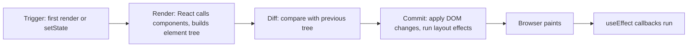
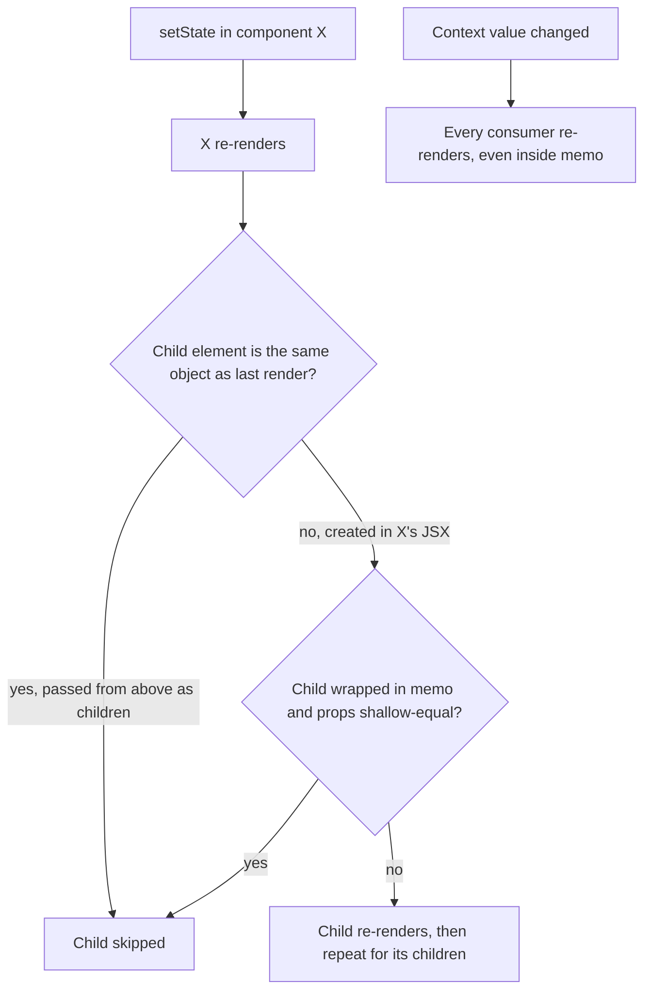
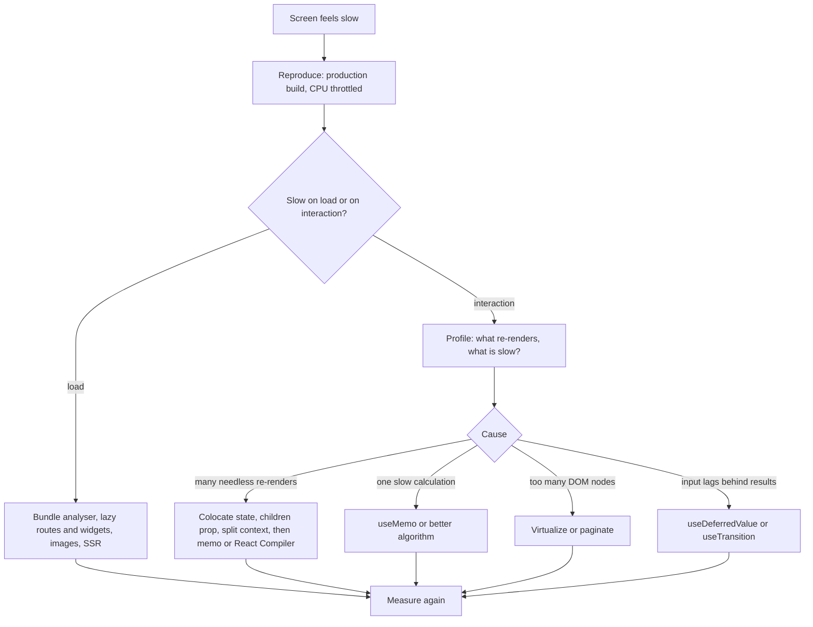

# Chapter 10 — Performance

Most React apps are fast enough without special effort. When one isn't, the cause is almost always one of: components rendering far more often than needed, an expensive calculation repeated every render, too many DOM nodes, or too much JavaScript downloaded up front. This chapter teaches you to **see** each problem (render counters, the `<Profiler>` API, React DevTools — the browser extension for inspecting components) and fix it with the right tool: `memo`, `useMemo`, `useCallback` (all **memoization** — reusing a previous result when inputs are unchanged), React Compiler, code splitting with `lazy` + `<Suspense>`, and list virtualization. Every demo prints **numbers** (render counts, DOM nodes, milliseconds) so you watch a fix work.

Code: [`code/`](code/) — React 19.3 in jsdom (a browser-like DOM for Node), driven with `@testing-library/react`. jsdom timings are only indicative (no real **layout** — computing sizes/positions — or **paint**), so demos focus on exact, repeatable **counts**. Background: state and batching ([Chapter 3](../03-state-and-events/README.md)), Effects ([Chapter 5](../05-effects-and-refs/README.md)), Context ([Chapter 6](../06-state-management/README.md)), `useTransition`/`useDeferredValue` ([Chapter 7](../07-custom-hooks-and-hook-rules/README.md)).

---

## 10.1 The render cycle: trigger → render → commit

### What it is
1. **Trigger** — the first `root.render(...)`, or a state setter somewhere in the tree.
2. **Render** — React **calls your component functions** to get a tree of React elements (plain objects). The screen doesn't change yet.
3. **Commit** — React compares the new tree with the previous one (**reconciliation**, [Chapter 1](../01-why-react-and-setup/README.md)) and applies **only the differences** to the DOM, runs layout effects (`useLayoutEffect`, after DOM changes but before paint), the browser paints, then ordinary Effects (`useEffect`) run.



### Why it matters
- **"Re-render" ≠ "DOM update".** A re-render is a function call; identical output changes nothing in the DOM. Re-renders are cheap *unless* a component does heavy work or renders a huge subtree.
- **Render must be pure** ([Chapter 2](../02-components-and-props/README.md)). React may call components many times (twice in development under StrictMode), so render must not have **side effects** (network calls, mutating shared variables). Purity lets React skip, repeat or interrupt renders safely.

### Seeing it
`code/01_render_cycle.jsx` logs from render, a layout effect and an effect, and counts DOM changes with a `MutationObserver` (browser API reporting every DOM change):

```jsx
function Clock({ label }) {
  log(`  render  <Clock label="${label}">`);               // RENDER phase
  useLayoutEffect(() => log('  commit  React applied changes, then ran layout effects'));
  useEffect(() => log('  after   passive effects run (after paint)'));
  return <p>{label}</p>;
}
// App: <Clock label={label} /> + buttons: setLabel('world') | setClicks(c => c + 1) | setLabel(label)
```

Output:
```
TRIGGER 1: initial render (createRoot().render)
  render  <Clock label="hello">
  commit  React applied changes, then ran layout effects
  after   passive effects run (after paint)
  DOM mutations: many (whole tree inserted)

TRIGGER 2: state change that changes Clock output
  render  <Clock label="world">
  commit  React applied changes, then ran layout effects
  after   passive effects run (after paint)
  DOM mutations: 1

TRIGGER 3: state change elsewhere - Clock re-renders, but its output is identical
  render  <Clock label="world">
  commit  React applied changes, then ran layout effects
  after   passive effects run (after paint)
  DOM mutations: 1  (only the button text changed; <p> untouched)

TRIGGER 4: setState with the SAME value (Object.is equal)
  DOM mutations: 0  (React bailed out: nothing rendered)
```

- Trigger 3: `Clock` re-rendered with unchanged props, but the DOM got one change (the button text) — the diff protected the DOM.
- Trigger 4: an `Object.is`-equal value (JavaScript's "same value/same object" check) lets React **bail out**, skipping the component and its children. (React may occasionally call the component once before bailing out; the result is discarded.)
- Effects ran every commit only because they have no dependency array.

### Common mistakes
- Treating every re-render as a bug — a 0.1 ms re-render isn't worth optimizing. Measure first (§10.3).
- Side effects (server logging, mutating globals) in the render body — they run more often than you expect.

---

## 10.2 When components re-render

### What it is
| Cause | Example | Notes |
|---|---|---|
| **Its own state changed** | `setOpen(true)` inside it | Unless the new value is `Object.is`-equal |
| **Its parent re-rendered** | parent's state changed | Default: *all* children re-render, props changed or not |
| **A context it reads changed** | provider `value` changed | Even if the parent didn't re-render, and through `memo` |
| **A subscribed external store changed** (state outside React) | Redux/Zustand selector result changed | Via `useSyncExternalStore` ([Chapter 7](../07-custom-hooks-and-hook-rules/README.md)) |

**Not** causes: mutating a prop object in place, changing `ref.current`, changing a plain variable (why you never mutate state — React wouldn't notice). Myth: "re-renders when props change". Accurate: **re-renders when its parent re-renders**; props aren't even checked without `memo` (§10.4).

### Seeing it
`code/02_when_rerenders.jsx` gives each component a render counter:

```jsx
// Case A: a parent's state change re-renders ALL of its children (props or not)
function Parent() {
  count('Parent');
  const [n, setN] = useState(0);
  return <div><button onClick={() => setN(n + 1)}>parent clicks {n}</button><ul><Child name="ChildWithProps" /><Static /></ul></div>;
}
// Case B: the same children passed in as JSX from ABOVE do NOT re-render
function Wrapper({ children }) {
  count('Wrapper');
  const [n, setN] = useState(0);
  return <div><button onClick={() => setN(n + 1)}>wrapper clicks {n}</button>{children}</div>;
}
// Case C: a context change re-renders every consumer, wherever it is
function ThemeProvider({ children }) {         // state lives here; children come from above
  const [theme, setTheme] = useState('light');
  return <ThemeCtx value={theme}><button onClick={() => setTheme(t => (t === 'light' ? 'dark' : 'light'))}>toggle theme</button>{children}</ThemeCtx>;
}
function Middle() { count('Middle'); return <><Consumer /><NotConsumer /></>; }   // Consumer reads ThemeCtx
render(<><Parent /><Wrapper><Child name="ChildAsChildren" /></Wrapper><ThemeProvider><Middle /></ThemeProvider></>);
```

Output:
```
mount             {"Parent":1,"ChildWithProps":1,"StaticNoProps":1,"Wrapper":1,"ChildAsChildren":1,"Middle":1,"ContextConsumer":1,"NotAConsumer":1}
Parent setState   {"Parent":1,"ChildWithProps":1,"StaticNoProps":1}
Wrapper setState  {"Wrapper":1}
theme change      {"ContextConsumer":1}
```

### How it works
1. **A.** Re-running `Parent` created **new** elements for `<Child>` and `<Static>`, so both rendered — even prop-less `Static`.
2. **B.** `<Child name="ChildAsChildren">` was created by *Wrapper's parent*, which didn't re-render; React got the **same element object** in `children` and skipped it. "Pass JSX as children" is the cheapest optimization in React — no `memo` needed.
3. **C.** React re-rendered **only** context readers: `Consumer` yes; `Middle` and `NotConsumer` (came in as `children`) no.



### Real-world examples
- A layout owning "sidebar open" state that receives the page as `children` doesn't re-render the page on toggle.
- Redux/Zustand let a component subscribe to a *slice* via a selector, re-rendering only when that slice changes — why they scale better than one big context ([Chapter 6](../06-state-management/README.md)).

### In the interview
**30-second answer:** "A component re-renders when its own state changes, its parent re-renders, a context it reads changes, or a subscribed external store changes. Unchanged props don't stop a re-render by default — only `memo` checks props. Setting state to an identical value bails out. Elements passed as `children` from above keep their identity, so they're skipped when the wrapper re-renders."

- *Does changing a ref cause a re-render?* — No; refs are invisible to rendering.
- *Does `memo` stop context updates?* — No.
- *Parent re-renders; `Child` has no props — does it re-render?* — Yes, unless wrapped in `memo` or passed from above as `children`.

---

## 10.3 Measure first: DevTools Profiler and `<Profiler>`

### Why it matters
Optimizing without measuring usually fixes the wrong thing and adds complexity.

| Tool | Where | What it shows |
|---|---|---|
| **React DevTools → Profiler tab** | browser extension | Recorded commits; *flamegraph* (bar width = render time), *ranked* chart (slowest first); "why did this render?" |
| **React Performance Tracks** (React 19.2+) | Chrome DevTools → Performance panel | React's **scheduler** work (blocking vs transition — low-priority, interruptible — updates) and a component flamegraph on the same timeline as network and JS |
| **`<Profiler>` component** | your code | Timings for every commit of a subtree — for tests, logging, monitoring |

### Using React DevTools (step by step)
1. Install **React Developer Tools**; open the app in **development mode** (profiling needs a development or profiling build).
2. Settings (gear) → **General** → **"Highlight updates when components render"**: every re-render flashes an outline.
3. Settings → **Profiler** → **"Record why each component rendered while profiling"**.
4. **Record**, do the slow interaction once, **Stop**.
5. Pick the tallest commit bar. In the **flamegraph**, grey = didn't render this commit; coloured = rendered, warmer = slower. Click a bar for *why* ("Props changed: onAdd", "Hook 2 changed", "The parent component rendered").
6. **Ranked** lists the slowest first. Fix the top one, record again, compare.

Also profile a **production build** (profiling build, below) with **CPU throttling** (Performance panel → 4× slowdown) so your laptop behaves like an average phone.

### The `<Profiler>` API
`<Profiler id="..." onRender={fn}>` calls, after each commit involving the subtree:
```js
onRender(id, phase, actualDuration, baseDuration, startTime, commitTime)
```

| Parameter | Meaning |
|---|---|
| `id` | the `id` prop |
| `phase` | `"mount"`, `"update"`, or `"nested-update"` (update scheduled during a layout effect) |
| `actualDuration` | ms rendering this subtree **in this commit** — falls when memoization works |
| `baseDuration` | estimated ms for a *full* re-render (sum of each component's latest render time) — the worst case |
| `startTime`, `commitTime` | timestamps; profilers in one commit share `commitTime` |

`code/09_profiler_api.jsx` (abridged):
```jsx
const Sidebar = memo(function Sidebar() { busy(3); return <nav>links</nav>; });   // memoized, 3 ms
function Feed({ posts }) { busy(5); return <section>{posts} posts</section>; }    // 5 ms every render
function App() {
  const [posts, setPosts] = useState(10);
  return (
    <Profiler id="app" onRender={onRender}>
      <button onClick={() => setPosts(p => p + 1)}>load more</button>
      <Profiler id="sidebar" onRender={onRender}><Sidebar /></Profiler>
      <Profiler id="feed" onRender={onRender}><Feed posts={posts} /></Profiler>
    </Profiler>
  );
}
// render, click "load more" twice, print samples
```

Output (ms vary per run):
```
id       phase    actual  base  (ms)
sidebar  mount         3     3
feed     mount         5     5
app      mount        10     9
sidebar  update        0     3
feed     update        5     5
app      update        5     8
sidebar  update        0     3
feed     update        5     5
app      update        5     8

9 onRender calls in 3 commits (profilers in one commit share commitTime)
```

On updates `sidebar` has `actual 0`, `base 3` — memoization saved 3 ms. `feed` has `actual = base = 5` — it fully re-renders each time, so look there next. `app`'s actual (5) < base (8): the tree is partly skipped.

### Profiling in production
The normal production build **disables** profiling (`onRender` not called). To profile production code, **alias** (have the bundler substitute one import path for another) `react-dom/client` to `react-dom/profiling`; some frameworks have a flag. Don't ship it to all users without reason.

### Real-world examples
- Teams send `<Profiler>` samples from a small share of sessions to metrics to catch **regressions**.
- Tests assert render counts for critical components so an "everything re-renders" change fails **CI** (the server running tests on every push).
- Web Vitals such as **INP** (Interaction to Next Paint: how fast the page visually responds to input) are what users feel; React profiling explains *why* an interaction is slow.

### Common mistakes
- Profiling only a dev build on a fast laptop — dev React is much slower than production, and users' phones are slower than your laptop.
- Leaving `<Profiler>` everywhere permanently — each has a cost.

---

## 10.4 `memo` — skipping a child's re-render

### What it is
`memo(Component)` returns a component React **skips re-rendering** when its parent re-renders and every prop is **shallow**-equal to last time (each prop compared with `Object.is` — like `===` except `NaN` equals `NaN` and `+0` differs from `-0`).

```js
import { memo } from 'react';
const Row = memo(function Row({ product, onAdd }) { /* ... */ });
// optional second argument: arePropsEqual(prevProps, nextProps) => true to skip
```

### How it works
1. Parent re-renders, producing `<Row product={p} onAdd={fn} />`.
2. React compares new vs previous props key by key with `Object.is`.
3. All equal → reuse the previous result; `Row` (and its children) aren't called. Any different → normal render.

`memo` only filters parent-caused re-renders: own state and read contexts still re-render it.

### The catch: primitives compare by value, objects by identity
`Object.is(3, 3)` is `true`; `Object.is({}, {})` and `Object.is(() => {}, () => {})` are `false`. Inline props (`style={{ padding: 0 }}`, `onAdd={id => ...}`) are new every parent render, so a memoized child re-renders anyway and `memo` only adds a comparison. §10.5 fixes that.

### Measuring it: before and after
`code/03_memo_before_after.jsx`: a search box plus 300 product rows; type five characters (irrelevant to the list, so ideally zero row renders). A `<Profiler>` wraps the list; each `Row` counts renders.

```jsx
function Row({ product, onAdd }) {
  rowRenders++;
  let x = 0; for (let i = 0; i < 2000; i++) x += i;           // pretend work
  return <li>{product.name} ${product.price} <button onClick={() => onAdd(product.id)}>add</button></li>;
}
const MemoRow = memo(Row);
const MemoList = memo(List);   // List renders <RowComponent key product onAdd /> for each item
// V1 - no memo: <List items={PRODUCTS} onAdd={id => setCart(c => [...c, id])} RowComponent={Row} style={{ padding: 0 }} />
// V2 - <MemoList ... RowComponent={MemoRow} ...> but new onAdd and new style each render
// V3 - memo + stable props:
//   const onAdd = useCallback(id => setCart(c => [...c, id]), []);
//   const style = useMemo(() => ({ padding: 0 }), []);
```

Output:
```
V1 no memo                         typing 5 chars -> Row renders: 1500, list profiler commits: 5 | click add -> Row renders: 300
V2 memo, unstable props            typing 5 chars -> Row renders: 1500, list profiler commits: 5 | click add -> Row renders: 300
V3 memo + useCallback/useMemo      typing 5 chars -> Row renders:    0, list profiler commits: 5 | click add -> Row renders: 0

actualDuration while typing (ms, varies per run): V1 32.6, V2 26.5, V3 0.0
```

- **V1:** 5 keystrokes × 300 rows = 1,500 wasted row renders.
- **V2:** `memo` changed **nothing** — new `onAdd`/`style` each render fail the shallow compare. The most common misuse.
- **V3:** zero rows render while typing or on **add** (the list doesn't receive `cart`). The profiler still reports 5 commits: `onRender` fires whenever the surrounding tree commits, even if the subtree was skipped (`actualDuration` ≈ 0).

### When `memo` is worth it — and when not
| Use `memo` when… | Skip it when… |
|---|---|
| The component often re-renders with the **same props** | It's cheap (button, label), or props change nearly every render |
| Its render is noticeably expensive (large subtree, heavy calculation) | Moving state down or passing JSX as `children` (§10.10) removes the re-render |
| You can keep props stable (primitives, memoized objects/functions) | The project uses **React Compiler** (§10.7) |

### Custom comparison
`memo(Chart, (prev, next) => prev.data.version === next.data.version)` defines equality yourself. Returning `true` while a callback prop changed leaves the child calling a **stale closure** (a function that captured old state). Compare every prop, or make props stable.

### Common mistakes
- `memo` plus inline objects/functions/JSX — see V2.
- `<MemoCard><p>hi</p></MemoCard>` — `children` is a new element every render, so `MemoCard` always re-renders.
- Deep-equality in `arePropsEqual` on big data — can cost more than the render.

### In the interview
**30-second answer:** "`memo` makes a component skip re-rendering when its parent re-renders with shallow-equal props (`Object.is`). It doesn't stop re-renders from its own state or context. It only helps with stable props, so it goes with `useCallback`/`useMemo`. I use it for expensive components that re-render often with the same props, after profiling — and with React Compiler I mostly don't need it."

- *Why can `memo` make things slower?* — A props comparison on every parent render; if props always differ you pay for both.
- *Is `memo` a guarantee?* — No, a performance hint; code must be correct if the component re-renders.

---

## 10.5 `useCallback` and `useMemo` for stable props

### What it is
Both **cache a value between renders** and return the *same* reference until a dependency changes:

```js
const onAdd = useCallback(id => setCart(c => [...c, id]), []);   // caches the FUNCTION
const style = useMemo(() => ({ padding: 0 }), []);                 // caches the RESULT of calling the function
```

`useCallback(fn, deps)` is exactly `useMemo(() => fn, deps)`. On first render React stores `[value, deps]` in the component's Hook slot ([Chapter 7](../07-custom-hooks-and-hook-rules/README.md)); on later renders it compares each dep with `Object.is` — all equal → stored value (same reference, so a memoized child sees an unchanged prop); else store and return the new one.

### Keeping dependencies small
- Use an **updater function** (`setCart(c => [...c, id])`) so the callback needn't depend on `cart` ([Chapter 3](../03-state-and-events/README.md)).
- Move constants **out of the component** (`const STYLE = { padding: 0 }` at module level) — no Hook needed.
- Pass **primitives** (`userId`) rather than objects (`user`) when the child needs one field.

### When they help — and when they don't
| Situation | Worth it? |
|---|---|
| Passing a function/object to a `memo` child | Yes — else `memo` is useless (V2) |
| Value is a `useEffect` dependency that mustn't re-trigger every render | Yes (or restructure the Effect, [Chapter 5](../05-effects-and-refs/README.md)) |
| A custom Hook returns functions callers may put in dependency arrays | Yes |
| Callback on a plain DOM element (`<button onClick>`) | No — DOM elements aren't memoized |
| Child not wrapped in `memo` | No — it re-renders anyway |
| Everything, "just in case" | No — noise and memory; hides real problems |

### Common mistakes
- **Missing dependencies**: `useCallback(() => save(draft), [])` keeps the first `draft` forever (stale closure). Let `eslint-plugin-react-hooks` check.
- **Unstable dependencies**: `useMemo(() => filter(items, opts), [items, opts])` with a new `opts` each render never hits the cache.
- Assuming the cache survives — React may discard cached values (e.g. during dev file edits); code must be correct without it.

---

## 10.6 `useMemo` for expensive calculations

### What it is
`useMemo`'s second job: skip **re-doing a slow calculation** when its inputs didn't change.
```js
const visible = useMemo(() => filterTodos(todos, tab), [todos, tab]);
```

### Seeing it
`code/04_usememo_expensive.jsx` filters 5,000 todos (~2 ms) with 4 unrelated re-renders (theme toggles) and 1 relevant one (tab change):
```jsx
const visible = filterTodos(TODOS, tab);                          // Plain: recomputed on EVERY render
const visible = useMemo(() => filterTodos(TODOS, tab), [tab]);   // Memoized: cached until `tab` changes
```

Output:
```
without useMemo: 6 renders, filterTodos ran 6x, shows "1667 visible"
with useMemo   : 6 renders, filterTodos ran 2x, shows "1667 visible"
```

### How do I know a calculation is "expensive"?
Time it with `console.time`/`console.timeEnd`, ideally CPU-throttled. React's docs suggest memoizing at around **1 ms or more** — sorting/filtering thousands of items, building chart data, parsing large text; not `a + b` or mapping 20 items.

### Alternatives to consider first
- **Do it outside render**: once when data arrives (fetch handler, reducer, server).
- **Keep less state**: cheap derived values ([Chapter 3](../03-state-and-events/README.md)) can just be recomputed.
- **Don't block typing**: `useDeferredValue`/`useTransition` mark rendering as low-priority so input stays instant ([Chapter 7](../07-custom-hooks-and-hook-rules/README.md)); combine with `memo` on the slow list.

### Common mistakes
- Side effects in the `useMemo` function — it must be pure (StrictMode calls it twice in dev to surface this).
- Expecting a faster **first** render — it only helps later renders.

---

## 10.7 React Compiler

### What it is
**React Compiler** is a build-time Babel plugin (`babel-plugin-react-compiler`; Babel transforms JS source) that **automatically adds memoization** — the equivalent of well-placed `useMemo`, `useCallback` and `memo`. **v1.0** went stable on **7 October 2025**. Best with React 19; also supports React 17 and 18 (via the extra `react-compiler-runtime` package and a `target` option).

### How it works
1. At build time it analyses which values in each component/Hook depend on which props and state.
2. It rewrites the function to keep a per-instance **cache array** (`useMemoCache`, from `react/compiler-runtime`).
3. Each computed value and JSX element is recomputed only when its inputs changed. Returning the *same* JSX element object lets React skip that child (as with "children from above", §10.2) — so `memo` is typically unnecessary.
4. Components that break the Rules of React (mutating props, reading refs during render, side effects in render) are **skipped**, not risked — they still run, unoptimised.

### Seeing it — what the compiler produces (by hand)
This book's toolchain doesn't run the plugin, so `code/05_compiler_output.jsx` has a **hand-simplified** version of compiler-style output using the real `c` from `react/compiler-runtime` (real output differs in naming and detail):

```jsx
// ---- what you write ----
function ProductPage({ products, theme }) {
  const visible = products.filter(p => p.inStock);
  const onBuy = id => console.log('buy', id);
  return <div className={theme}><ProductList items={visible} onBuy={onBuy} /></div>;
}

// ---- roughly what the compiler turns it into ----
import { c as _c } from 'react/compiler-runtime';
function ProductPageCompiled({ products, theme }) {
  const $ = _c(6);                                            // 6 cache slots for this component instance
  let visible;
  if ($[0] !== products) {                                    // input changed -> recompute
    visible = products.filter(p => p.inStock);
    $[0] = products; $[1] = visible;
  } else visible = $[1];                                      // unchanged -> reuse the same array
  let onBuy;
  if ($[2] === Symbol.for('react.memo_cache_sentinel')) {     // first render only: the function uses no props
    onBuy = id => console.log('buy', id);
    $[2] = onBuy;
  } else onBuy = $[2];
  let list;
  if ($[3] !== visible || $[4] !== onBuy) {                   // the JSX element itself is cached
    list = <ProductList items={visible} onBuy={onBuy} />;
    $[3] = visible; $[4] = onBuy; $[5] = list;
  } else list = $[5];
  return <div className={theme}>{list}</div>;
}
```

`ProductList` is **not** wrapped in `memo`. Changing `theme` three times:
```
hand-written code  : 4 renders of the page -> filter ran 4x, ProductList rendered 4x
compiler-style code: 4 renders of the page -> filter ran 1x, ProductList rendered 1x
```
The online **React Compiler Playground** (linked from react.dev) shows real output for any component.

### Setting it up (not run here)
Install with an exact version; it must run **first** among Babel plugins:

```bash
npm install --save-dev --save-exact babel-plugin-react-compiler@latest
```
```js
// babel.config.js
module.exports = {
  plugins: ['babel-plugin-react-compiler'],   // must be first
};
```
```js
// vite.config.js — @vitejs/plugin-react v6 and later (also: npm install -D @rolldown/plugin-babel)
import { defineConfig } from 'vite';
import react, { reactCompilerPreset } from '@vitejs/plugin-react';
import babel from '@rolldown/plugin-babel';
export default defineConfig({
  plugins: [react(), babel({ presets: [reactCompilerPreset()] })],
});

// older @vitejs/plugin-react versions:
//   plugins: [react({ babel: { plugins: ['babel-plugin-react-compiler'] } })]
```

- **Next.js** and **Vite** templates offer it at creation (`create-next-app`, `create-vite`); **Expo SDK 54+** enables it by default.
- Its lint rules ship in **`eslint-plugin-react-hooks`** (`recommended`), replacing `eslint-plugin-react-compiler`; they flag code it can't optimise (setting state or reading `ref.current` during render).
- **Verify**: compiled components show a **"Memo ✨"** badge in React DevTools.
- **Opt out** one component/file temporarily with the **directive** (a special string statement tools read) `"use no memo"`; fix the issue and remove it.
- Adopt **incrementally** in large codebases (one directory first, or behind a flag — react.dev has a guide), and pin the exact version if test coverage is thin, since new versions can memoize differently.

### What happens to `useMemo`, `useCallback` and `memo`?
- They still work and are respected; no need to delete them.
- In new compiled code, use them only as **escape hatches** — e.g. to guarantee an Effect dependency keeps its identity.
- The compiler can memoize things Hooks can't, such as values computed **after an early return**.
- It doesn't fix slow algorithms (an O(n²) loop is still slow), huge DOM trees (virtualize) or large bundles (split).

### Real-world examples
The v1.0 announcement (react.dev, October 2025) cites the Meta Quest Store: initial loads and cross-page navigations up to 12% faster, some interactions over 2.5× faster, memory unchanged. Examples, not a promise — measure.

### In the interview
**30-second answer:** "React Compiler is a build-time Babel plugin, stable since v1.0 in October 2025, that automatically memoizes components and Hooks — values, callbacks and JSX — from static analysis of their dependencies. It relies on the Rules of React and skips components that break them. With it, manual `memo`/`useMemo`/`useCallback` become mostly escape hatches. It doesn't solve slow algorithms, big DOM or bundle size."

- *How do you check it's working?* — "Memo ✨" badge in DevTools; the playground shows transformed code.
- *A component misbehaves after compiling?* — Add `"use no memo"`, find the Rules-of-React violation (lint helps), fix, remove the directive.

---

## 10.8 Code splitting with `lazy` and `<Suspense>`

### What it is
By default the bundler emits one JS file the browser must download, **parse** and run before the first screen works — including a chart library for a page the user may never open. **Code splitting** breaks it into chunks loaded **on demand**. The building block is the **dynamic import** `import('./chart.jsx')`, which returns a **Promise** of the **module**; bundlers (Vite, webpack, esbuild, Rollup) emit each as a separate file. `lazy` turns that Promise into a component:

```js
import { lazy, Suspense } from 'react';
const HeavyChart = lazy(() => import('./heavy_chart.jsx'));   // at MODULE level

<Suspense fallback={<p>Loading chart...</p>}>
  <HeavyChart points={data} />
</Suspense>
```

### How it works
1. `lazy(load)` returns a placeholder component; nothing downloads yet.
2. On first render React calls `load()`; the Promise is pending, so the component **suspends** and the **nearest `<Suspense>`** shows its `fallback`.
3. On resolve, React renders the module's **`default` export** in its place and caches it — `load` runs once.
4. On reject (network failure), the error is thrown during render and caught by the nearest **error boundary** (a component that catches children's render errors and shows fallback UI).

### Seeing it — real chunk files
esbuild with code splitting (`--splitting --format=esm --minify`; a large data array lives in `chart.jsx`):
```js
// main.jsx
import { lazy } from 'react';
export const HeavyChart = lazy(() => import('./chart.jsx'));
export const Settings = lazy(() => import('./settings.jsx'));
```
Output (sizes/hashes depend on input):
```
  dist/chart-GX2X5FGR.js     22.9kb
  dist/main.js                153b 
  dist/settings-7FL34NKO.js   114b 
```
`dist/main.js` contains `import("./chart-GX2X5FGR.js")` — the 22.9 kB chunk is fetched only when `HeavyChart` first renders. The **hash** (content fingerprint) changes with content, so chunks can be cached forever.

### Seeing it — loading states and failures
`code/06_lazy_suspense.jsx` (chunk load delayed 100 ms to imitate the network):
```jsx
// 1. Declare lazy components at MODULE level (never inside a component).
const HeavyChart = lazy(() => delay(100).then(() => import('./heavy_chart.jsx')));
// lazy() needs a default export; for a named export, map it to { default }.
const Legend = lazy(() => import('./heavy_chart.jsx').then(m => ({ default: m.Legend })));
// A chunk that fails to load (e.g. a deploy replaced the file, or the user went offline).
const Broken = lazy(() => delay(10).then(() => { throw new Error('Failed to fetch dynamically imported module'); }));

function Dashboard() {
  const [tab, setTab] = useState('summary');
  return (
    <main>
      {/* buttons: chart tab, broken tab */}
      {tab === 'summary' && <p>summary text</p>}
      <Suspense fallback={<p>Loading chart...</p>}>
        {tab === 'chart' && <><HeavyChart points={[1, 2, 3]} /><Legend /></>}
      </Suspense>
      <ChunkErrorBoundary>   {/* class with getDerivedStateFromError, renders "Could not load: …" */}
        <Suspense fallback={<p>Loading...</p>}>{tab === 'broken' && <Broken />}</Suspense>
      </ChunkErrorBoundary>
    </main>
  );
}
```

Output (`heavy_chart.jsx` prints when evaluated):
```
first render             -> summary text
clicked chart tab        -> Loading chart...
    [module] heavy_chart.jsx evaluated (its code was just loaded)
after the chunk loaded   -> chart with 3 points | legend
broken tab               -> Could not load: Failed to fetch dynamically imported module
```
The module didn't run until the tab opened; one boundary covered both lazy components, so one loading message.

### Where to split
| Split point | Why |
|---|---|
| **Routes / pages** | Users view one page at a time; React Router's route `lazy`, frameworks split per route automatically ([Chapter 9](../09-routing-and-data-fetching/README.md), [Chapter 13](../13-server-rendering-and-frameworks/README.md)) |
| **Heavy, rarely used widgets** | Rich-text editors, charts, maps, PDF viewers, admin panels |
| **Below-the-fold** (not visible until the user scrolls) **or behind-a-click UI** | Modals, settings drawers, "advanced" tabs |
| **Not worth it** | Small components; anything on the first screen (adds a request and a spinner) |

### Making it feel fast
- **Preload on intent** — calling the same `import()` early is enough; the module system caches it:
  ```js
  const loadChart = () => import('./heavy_chart.jsx');
  const HeavyChart = lazy(loadChart);
  <button onMouseEnter={loadChart} onFocus={loadChart} onClick={() => setTab('chart')}>Chart</button>
  ```
- **Place boundaries deliberately**: one around the page blanks everything; one per widget keeps the rest usable. Skeletons avoid layout jumps.
- **Don't hide visible content**: wrap the update in `startTransition` so React keeps the old tab until the new one is ready ([Chapter 7](../07-custom-hooks-and-hook-rules/README.md)).
- **Handle chunk failures**: after a new deployment old chunk files may be gone — an error boundary with "Reload" is the usual fix.

### Common mistakes
- **`lazy` inside a component** — a new component type each render, so it remounts and loses state. Declare at module level.
- **Named export without mapping** — `lazy` needs `default`.
- **No `<Suspense>` above a lazy component**.
- **Splitting everything** — many tiny chunks mean many requests and waterfalls.

### How to find what to split
A bundle analyser (`rollup-plugin-visualizer`, `webpack-bundle-analyzer`, `source-map-explorer`) shows what takes space; Chrome DevTools' **Coverage** tab shows downloaded JS that never ran.

### In the interview
**30-second answer:** "Code splitting moves code not needed immediately into chunks loaded on demand. `const Page = lazy(() => import('./Page'))` at module level, rendered inside `<Suspense fallback>`; it suspends until the chunk loads. Split at routes and heavy widgets, preload on hover, catch failed loads with an error boundary, and use `startTransition` so navigation doesn't flash a spinner over existing content."

- *Why must the module have a default export?* — `lazy` reads the resolved module's `default`; map named exports to `{ default }`.

---

## 10.9 List virtualization

### What it is
**Virtualization** (**windowing**) renders only the rows visible in a scrollable area (plus a few extra); rows leaving the window are removed and entering rows added. A tall spacer keeps the scrollbar correct so the list *looks* complete.

### Why it matters
Every row costs DOM nodes, memory, style and layout; 10,000 rows mean tens of thousands of nodes and slow rendering, scrolling, even typing. Memoization can't help — the problem is node count, not re-renders.

### How it works (fixed-height rows)
1. Inputs: `rowHeight`, **viewport** `height` (the visible scrolling box), current `scrollTop`.
2. First visible row = `floor(scrollTop / rowHeight)`; visible count = `ceil(height / rowHeight)`.
3. Add **overscan** rows above/below so fast scrolling shows no gaps.
4. Render a spacer of `items.length × rowHeight` px with only in-range rows, **absolutely positioned** at `top = index × rowHeight`.
5. Each `scroll` event stores `scrollTop` → re-render → new slice.

`code/virtual_list.jsx`:
```jsx
export function VirtualList({ items, rowHeight, height, overscan = 3, renderRow }) {
  const [scrollTop, setScrollTop] = useState(0);
  const first = Math.max(0, Math.floor(scrollTop / rowHeight) - overscan);
  const visibleCount = Math.ceil(height / rowHeight) + 2 * overscan;
  const last = Math.min(items.length - 1, first + visibleCount - 1);
  const rows = [];
  for (let i = first; i <= last; i++) {
    rows.push(
      <div key={i} role="listitem" className="row"
           style={{ position: 'absolute', top: i * rowHeight, height: rowHeight, left: 0, right: 0 }}>
        {renderRow(items[i], i)}
      </div>
    );
  }
  return (
    <div role="list" aria-label="virtual list" className="viewport"
         style={{ height, overflowY: 'auto', position: 'relative' }}
         onScroll={e => setScrollTop(e.currentTarget.scrollTop)}>
      <div style={{ height: items.length * rowHeight, position: 'relative' }}>{rows}</div>
    </div>
  );
}
```

`code/07_virtualization.jsx` renders 10,000 customers both ways, then simulates scrolling (jsdom has no layout, so the test sets `scrollTop` and fires `scroll`):
```
naive list    : 10000 row nodes, 10006 elements in document
virtual list  : 16 row nodes, 23 elements in document
  at top          -> rows Customer #0 .. Customer #15
  scrollTop=3000   -> rows Customer #97 .. Customer #112  (16 in DOM)
  scrollTop=150000 -> rows Customer #4997 .. Customer #5012  (16 in DOM)
  scrollTop=299700 -> rows Customer #9987 .. Customer #9999  (13 in DOM)

mount time (varies per run): naive 130 ms, virtual 6 ms
```

At `scrollTop = 3000`: 3000 / 30 = 100, minus overscan 3 = 97. The window is always 300 / 30 = 10 + 2 × 3 = 16 rows, however long the list; at the end it shrinks to 13 (no rows after #9999).

In Chrome (`code/virtual.html`, scrolled half-way; rows 32 px, viewport 320 px):


*Figure 10.1 — The hand-rolled `VirtualList` in Chrome. Ten rows are visible; only sixteen exist in the DOM.*

### Use a library in real projects
Production needs **variable/unknown row heights** (measured after render), grids, sticky headers, stable scroll when prepending (chat), infinite loading:

| Library | Notes |
|---|---|
| **TanStack Virtual** | Headless (logic only — you write the markup); lists, grids, variable sizes |
| **react-window** | Small and simple; fixed/variable lists and grids |
| **react-virtuoso** | Automatic variable heights, grouped lists, chat-style reverse scrolling |

CSS-only alternative for moderately long pages: `content-visibility: auto` lets the browser skip layout/paint for off-screen sections while keeping them in the DOM (find-in-page still works) — cuts rendering cost, not React component count.

### Trade-offs
| | Plain list | Virtualized list |
|---|---|---|
| DOM size | grows with data | constant (~visible rows) |
| Browser find (Ctrl+F) | finds any row | only rendered rows |
| Accessibility | screen readers see all rows | need `aria-setsize`/`aria-posinset` ("item 5 of 10,000") on rows |
| Complexity | none | scroll math, measuring, focus management |
| Good for | < a few hundred rows | thousands of rows, feeds, logs, tables |

Don't virtualize short lists (pagination/"load more" is often better UX) or content that must be printable/fully searchable.

### Common mistakes
- Index `key`s when items are inserted/removed — rows show wrong state; use stable IDs (the demo list never changes, so index keys are safe there).
- No overscan → blank flashes when scrolling fast.
- No fixed viewport height → it never scrolls.

### In the interview
**30-second answer:** "Virtualization renders only visible rows plus overscan inside a spacer the height of the full list, recomputing the slice on scroll, so the DOM stays small. Fixed heights need only `floor(scrollTop / rowHeight)`; variable heights need measuring, so in production I'd use TanStack Virtual or react-window. Downsides: browser find and screen-reader counts need care."

- *Why doesn't `memo` fix a 10,000-row list?* — The cost is DOM node count and initial render, not re-renders.
- *Infinite scroll?* — Virtualize; when the last rendered index nears the end, fetch the next page (an `IntersectionObserver` — reports when an element becomes visible — on a **sentinel** row at the end, or the library's range callback).

---

## 10.10 Common performance bugs

### What it is
Four mistakes cause a large share of slow screens. `code/08_perf_bugs.jsx` measures each before/after, counting **renders** (function ran) and **mounts** (brand-new instance: new DOM, state reset, effects re-run — far costlier).

```jsx
function Tracked({ label }) { renders++; useEffect(() => { mounts++; }, []); return <span>{label}</span>; }

// BUG 1: a component defined INSIDE another component
function Bad1() {
  const [n, setN] = useState(0);
  function Inner() { return <Tracked label="inner" />; }        // new type every render!
  return <><button onClick={() => setN(n + 1)}>bump</button><Inner /></>;
}
// BUG 2: unstable keys
<ul>{ITEMS.map(it => <li key={Math.random()}><Tracked label={it} /></li>)}</ul>
// BUG 3: a new context object every render (Consumer is memo'd and reads Ctx)
const fresh = { user };                                  // new object each render
const cached = useMemo(() => ({ user }), [user]);        // same object until user changes
// BUG 4: state kept too high
function AppHigh() {
  const [q, setQ] = useState('');
  return <><input aria-label="q" value={q} onChange={e => setQ(e.target.value)} /><Expensive /><Expensive /></>;
}
const AppLow = () => <><SearchBox /><Expensive /><Expensive /></>;   // SearchBox owns q: state moved DOWN
```

Output:
```
1. component defined inside a component (3 parent re-renders)
  bad : Inner declared in render           renders=3, mounts=3
  good: Inner declared at top level        renders=3, mounts=0
2. unstable keys on a 3-item list (3 parent re-renders)
  bad : key={Math.random()}                renders=9, mounts=9
  good: key={item.id}                      renders=9, mounts=0
3. new context object each render (3 unrelated provider re-renders)
  bad : value={{ user }}                   renders=3, mounts=0
  good: value={useMemo(...)}               renders=0, mounts=0
4. input state kept too high (typing 5 characters)
  bad : query state in <App>               renders=10, mounts=0
  good: query state in <SearchBox>         renders=0, mounts=0
```

### The four bugs explained
| # | Bug | Why it's slow | Fix |
|---|---|---|---|
| 1 | Component declared inside another | Each render makes a **new component type** (a different function): old subtree unmounted, new one mounted — DOM rebuilt, state lost, effects re-run | Declare components at module top level; pass data as props |
| 2 | `key={Math.random()}` / changing keys | Every item looks new → unmount + mount every render | Stable IDs from the data ([Chapter 2](../02-components-and-props/README.md)) |
| 3 | `value={{ user, setUser }}` on a provider | New object each render → **every** consumer re-renders; `memo` can't stop it | `useMemo` the value, split contexts (state vs setters), or a store with selectors |
| 4 | State owned higher than needed | Each keystroke re-renders everything under the owner | **Colocate** state in the smallest component that uses it; or pass expensive parts as `children` |

### More perf traps worth knowing
- **Effects that set state every render** (render → effect → setState → render) — usually a derived value to compute during render ([Chapter 5](../05-effects-and-refs/README.md)).
- **Fetch waterfalls** (parent fetches, then child fetches…) — fetch in parallel, in route loaders or with TanStack Query ([Chapter 9](../09-routing-and-data-fetching/README.md)).
- **Huge images, heavy libraries** (a whole date library for one format) — modern image formats, `Intl.DateTimeFormat`, **tree-shakable** imports (unused code trimmed by the bundler).
- **Expensive event handlers** block the next paint — split the work, `startTransition`, or a **Web Worker** (background JS thread).
- **Development build in production** — deploy `vite build`/`next build` output.

### In the interview
**30-second answer:** "Components defined inside components (remount every render), unstable keys, context values recreated each render, state kept too high, and effect-driven render loops. Fix structure first — colocate state, pass JSX as children, stable keys, memoized or split context — then `memo`/`useMemo`."

---

## 10.11 A performance checklist

Work through in order; stop when it's fast enough:

1. **Reproduce with a production build**, CPU throttled, realistic data.
2. **Find the slow interaction** (Performance panel with React tracks, or the DevTools Profiler): initial load or a specific interaction?
3. **Slow load?** Bundle analyser, `lazy` routes/heavy widgets (§10.8), images, server rendering ([Chapter 13](../13-server-rendering-and-frameworks/README.md)).
4. **Slow interaction?** "Highlight updates" and see what re-renders:
   - Too much re-renders → colocate state, `children`, split context (§10.10); then `memo` + stable props (§10.4–10.5) or React Compiler (§10.7).
   - One component slow on its own → `useMemo` (§10.6) or a better algorithm.
   - Too many DOM nodes → virtualize (§10.9) or paginate.
   - Typing lags while results render → `useDeferredValue`/`useTransition`.
5. **Measure again**; keep the change only if it measurably helped.



### In the interview — putting it together
**"How would you speed up a slow React page?"** — "Measure first: production build, CPU throttling, the Profiler to find the slowest commit and why things rendered. For load time, check bundle size and split routes and heavy widgets with `lazy` + `Suspense`. For interactions, reduce re-renders structurally (colocate state, pass children, stable context values), then `memo` with stable props or React Compiler. Virtualize long lists, memoize expensive calculations, mark non-urgent updates as transitions — and measure again."

### Self-check (whole chapter)
1. Render vs commit? → Render calls components to compute UI; commit applies differences to the DOM.
2. Why didn't `ChildAsChildren` re-render (§10.2 B)? → Same element object, created by a component that didn't re-render.
3. Which components re-render on a context change? → Those reading it (plus what they render).
4. Why did V2 render as much as V1? → New function/object props fail the shallow comparison.
5. What does `baseDuration` tell you? → Estimated full re-render time of the subtree — compare with `actualDuration`.
6. DOM rows for a 300 px viewport, 30 px rows, overscan 3? → 10 + 6 = 16.
7. Why does declaring `Inner` inside `Bad1` reset its state? → Each render yields a different function = different type, so React mounts a fresh instance.
8. "Colocating state"? → Keeping state in the lowest component that needs it.
9. A memoized consumer re-renders on unrelated provider state — why? → The provider's `value` is a new object each render; context changes bypass `memo`.

---

## Chapter 10 TL;DR

| Idea | Remember |
|---|---|
| Render cycle | Trigger → render (call components) → commit (DOM diff) → effects; a re-render is not a DOM update |
| Re-render causes | Own state, parent render, context, external store — props aren't compared without `memo` |
| Measure | DevTools highlight + Profiler ("why did this render?"), Performance tracks (19.2+), `<Profiler onRender>` (`actualDuration` vs `baseDuration`); production profiling needs the profiling build |
| `memo` | Skip re-render on shallow-equal props; useless with new objects/functions as props |
| `useCallback` / `useMemo` | Stable references for `memo` children and effect deps; cache calculations ≥ ~1 ms |
| React Compiler | v1.0 (Oct 2025); build-time auto-memoization; follow the Rules of React; `"use no memo"` escape hatch |
| Code splitting | `lazy(() => import())` at module level + `<Suspense>` + error boundary; split by route/heavy widget; preload on intent |
| Virtualization | Visible rows + overscan in a full-height spacer; TanStack Virtual / react-window in production |
| Perf bugs | Nested component definitions, unstable keys, new context objects, state too high, effect loops |
| Order of fixes | Structure first (colocate, children, keys) → memoization → specialised tools |

Next: [Chapter 11 — TypeScript with React](../11-typescript-with-react/README.md).
