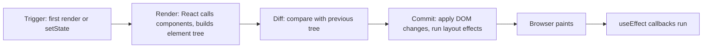
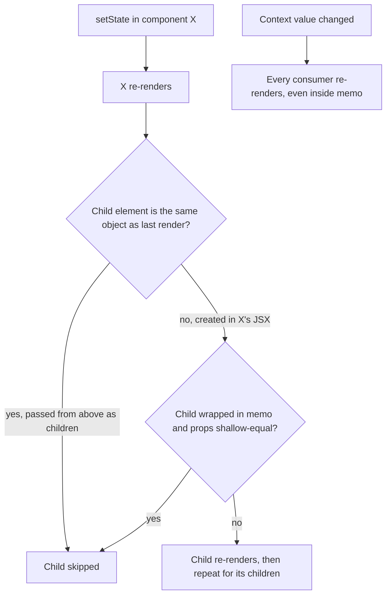
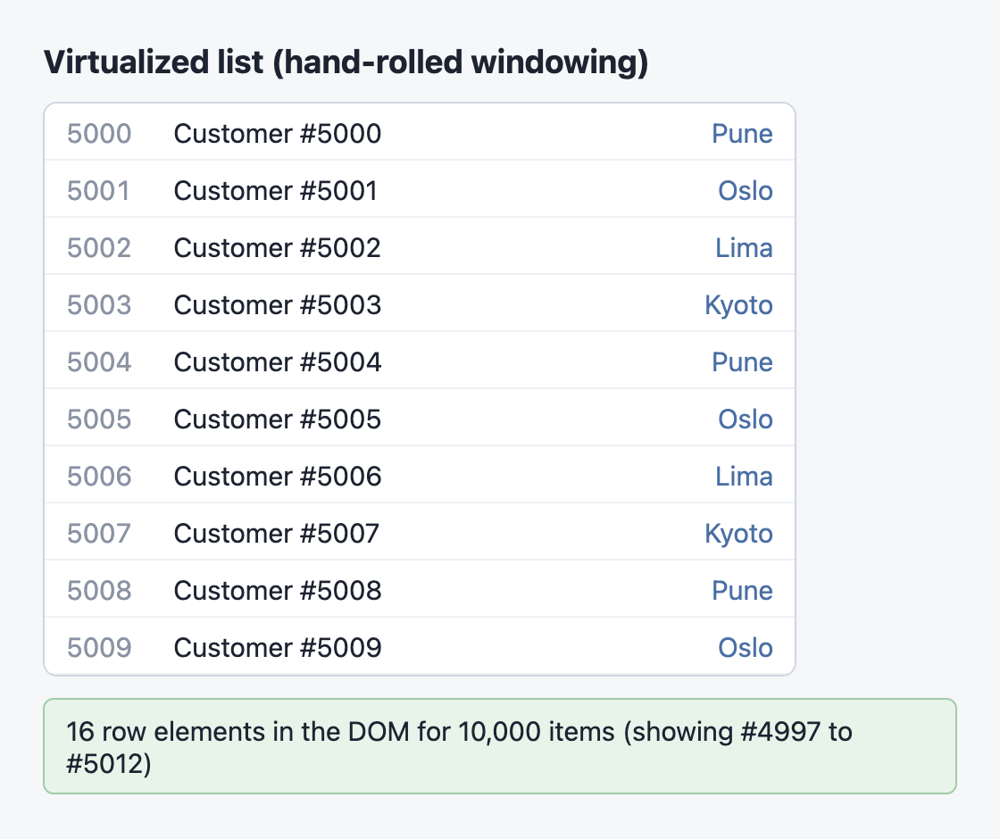
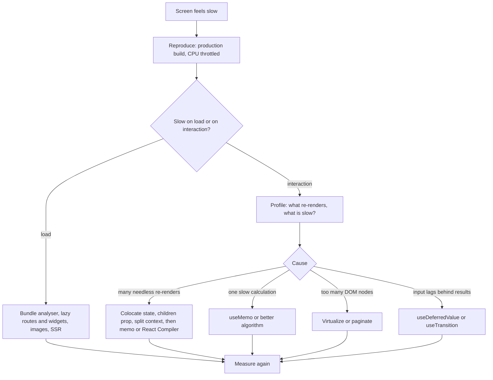

# Chapter 10 — Performance

Most React apps are fast enough without any special effort. When one is not, the cause is almost always one of a small number of things: components rendering far more often than they need to, one expensive calculation repeated on every render, too many DOM nodes, or too much JavaScript downloaded up front. This chapter teaches you to **see** each problem first (with render counters, the `<Profiler>` API and React DevTools — the browser extension for inspecting React components) and then fix it with the right tool: `memo`, `useMemo`, `useCallback` (all forms of **memoization** — remembering a previous result and reusing it when the inputs are unchanged), React Compiler, code splitting with `lazy` + `<Suspense>`, and list virtualization (each explained in its own section).

Every demo in this chapter prints **numbers** — how many times a component rendered, how many DOM nodes exist, how many milliseconds React spent — so you can watch a fix work instead of taking it on trust.

**What you'll learn**

| # | Topic | You will be able to… |
|---|---|---|
| 10.1 | The render cycle: trigger → render → commit | explain what "render" means in React and why a re-render is not a DOM update |
| 10.2 | When components re-render | predict which components re-render after a state, prop or context change |
| 10.3 | Measure first: DevTools Profiler and `<Profiler>` | find slow components with tools, not guesses |
| 10.4 | `memo` — skipping a child's re-render | wrap a component and know exactly when it helps |
| 10.5 | `useCallback` and `useMemo` for stable props | stop new functions and objects from defeating `memo` |
| 10.6 | `useMemo` for expensive calculations | cache a slow computation between renders |
| 10.7 | React Compiler | let the build step add memoization automatically |
| 10.8 | Code splitting with `lazy` and `<Suspense>` | load a component's code only when it is needed |
| 10.9 | List virtualization | render 10,000 rows with ~16 DOM nodes |
| 10.10 | Common performance bugs | recognise and fix the four mistakes that cause most slow React apps |
| 10.11 | A performance checklist | a step-by-step routine for a slow screen |

Code: [`code/`](code/) — React 19.3 in jsdom (a browser-like DOM for Node), driven with `@testing-library/react`. Timings from jsdom are only indicative (there is no real **layout** — the browser working out sizes and positions — or **paint** — drawing the pixels), so the demos focus on **counts**, which are exact and repeatable. Background you may want first: state and batching ([Chapter 3](../03-state-and-events/README.md)), Effects ([Chapter 5](../05-effects-and-refs/README.md)), Context ([Chapter 6](../06-state-management/README.md)), `useTransition`/`useDeferredValue` ([Chapter 7](../07-custom-hooks-and-hook-rules/README.md)).

---

## 10.1 The render cycle: trigger → render → commit

### What it is
Every screen update in React goes through three steps:

1. **Trigger** — something asks for an update: the first `root.render(...)` call, or a state setter (`setCount(...)`) somewhere in the tree.
2. **Render** — React **calls your component functions** to find out what the UI should look like now. The result is a tree of React elements (plain JavaScript objects). Nothing on the screen changes yet.
3. **Commit** — React compares the new element tree with the previous one (this comparison is called **reconciliation**, introduced in [Chapter 1](../01-why-react-and-setup/README.md)) and applies **only the differences** to the real DOM. Then it runs layout effects (`useLayoutEffect` — code that runs after DOM changes but before the screen is drawn), the browser paints, and after that React runs ordinary Effects (`useEffect` — code that runs after the screen is drawn, to sync with things outside React).

Analogy: a restaurant. The *trigger* is a customer's order. The *render* is the chef writing down the plate on a ticket. The *commit* is the waiter changing only what differs on the table — if the new ticket matches what is already served, the waiter does nothing.



### Why it matters
Two consequences drive the rest of this chapter:

- **"Re-render" does not mean "DOM update".** A re-render is just a function call. If the output is the same, the commit changes nothing in the DOM. Re-renders are cheap *unless* a component does heavy work while rendering or renders a huge subtree.
- **Render must be pure** ([Chapter 2](../02-components-and-props/README.md)). Because React may call your component many times (and twice in development under StrictMode, a development-only checking mode), render must not have **side effects** (changes outside the function, such as network calls or mutating shared variables). That purity is what lets React skip, repeat or interrupt renders safely.

### Seeing it
`code/01_render_cycle.jsx` logs from the render body, from a layout effect and from an effect, and counts real DOM changes with a `MutationObserver` (a browser API that reports every change to the DOM).

```jsx
function Clock({ label }) {
  log(`  render  <Clock label="${label}">`);               // runs during the RENDER phase
  useLayoutEffect(() => log('  commit  React applied changes, then ran layout effects'));
  useEffect(() => log('  after   passive effects run (after paint)'));
  return <p>{label}</p>;
}

function App() {
  const [label, setLabel] = useState('hello');
  const [clicks, setClicks] = useState(0);
  return (
    <>
      <Clock label={label} />
      <button onClick={() => setLabel('world')}>change label</button>
      <button onClick={() => setClicks(c => c + 1)}>count {clicks}</button>
      <button onClick={() => setLabel(label)}>set same label</button>
    </>
  );
}
// ... a MutationObserver counts DOM mutations after each click ...
```

Output:
```
TRIGGER 1: initial render (createRoot().render)
  render  <Clock label="hello">
  commit  React applied changes, then ran layout effects
  after   passive effects run (after paint)
  DOM mutations: many (whole tree inserted)

TRIGGER 2: state change that changes Clock output
  render  <Clock label="world">
  commit  React applied changes, then ran layout effects
  after   passive effects run (after paint)
  DOM mutations: 1

TRIGGER 3: state change elsewhere - Clock re-renders, but its output is identical
  render  <Clock label="world">
  commit  React applied changes, then ran layout effects
  after   passive effects run (after paint)
  DOM mutations: 1  (only the button text changed; <p> untouched)

TRIGGER 4: setState with the SAME value (Object.is equal)
  DOM mutations: 0  (React bailed out: nothing rendered)
```

What to notice:
- Trigger 3: clicking **count** re-rendered `Clock` (its function ran) even though its props did not change — but the DOM received only one change, the button's text. React's diff protected the DOM.
- Trigger 4: setting state to a value that is `Object.is`-equal (JavaScript's "same value / same object" check) to the current one lets React **bail out** — it skips rendering that component and its children. (React may occasionally still call the component once before bailing out; that is harmless and its result is thrown away.)
- The effects ran on every commit here only because they have no dependency array ([Chapter 5](../05-effects-and-refs/README.md)).

### Common mistakes
- Treating every re-render as a bug. A re-render that takes 0.1 ms is not worth optimizing. Measure (§10.3) before changing code.
- Putting side effects (logging to a server, mutating globals) in the render body — they will run more often than you expect.

### TL;DR
Trigger → render (call components, build elements) → commit (apply only the differences to the DOM, then effects). Re-rendering is calling a function; it touches the DOM only when the output changed.

---

## 10.2 When components re-render

### What it is
A component re-renders in exactly these situations:

| Cause | Example | Notes |
|---|---|---|
| **Its own state changed** | `setOpen(true)` inside it | Unless the new value is `Object.is`-equal to the old one |
| **Its parent re-rendered** | parent's state changed | The default: *all* children re-render, whether or not their props changed |
| **A context it reads changed** | `useContext(ThemeCtx)` and the provider's `value` changed | Happens even if the parent did not re-render and even through `memo` |
| **An external store it subscribes to changed** (state kept outside React) | Redux/Zustand selector (a function picking part of the store) result changed | Via `useSyncExternalStore` ([Chapter 7](../07-custom-hooks-and-hook-rules/README.md)) |

What does **not** cause a re-render: a prop object being mutated in place, a `ref.current` change, or a plain variable changing. (That is why you never mutate state — React would not notice.)

A common myth is "a component re-renders when its props change". The more accurate rule: **a component re-renders when its parent re-renders**; props are not even checked unless you wrap the child in `memo` (§10.4).

### Seeing it
`code/02_when_rerenders.jsx` gives each component a render counter.

```jsx
// Case A: a parent's state change re-renders ALL of its children (props or not)
function Child({ name }) { count(name); return <li>{name}</li>; }
function Static() { count('StaticNoProps'); return <li>static</li>; }
function Parent() {
  count('Parent');
  const [n, setN] = useState(0);
  return (<div>
      <button onClick={() => setN(n + 1)}>parent clicks {n}</button>
      <ul><Child name="ChildWithProps" /><Static /></ul>
    </div>);
}

// Case B: the same children passed in as JSX from ABOVE do NOT re-render
function Wrapper({ children }) {
  count('Wrapper');
  const [n, setN] = useState(0);
  return <div><button onClick={() => setN(n + 1)}>wrapper clicks {n}</button>{children}</div>;
}

// Case C: a context change re-renders every consumer, wherever it is
const ThemeCtx = createContext('light');
function Consumer() { count('ContextConsumer'); return <i>{useContext(ThemeCtx)}</i>; }
function NotConsumer() { count('NotAConsumer'); return <i>plain</i>; }
function ThemeProvider({ children }) {         // state lives here; children come from above
  const [theme, setTheme] = useState('light');
  return (<ThemeCtx value={theme}>
      <button onClick={() => setTheme(t => (t === 'light' ? 'dark' : 'light'))}>toggle theme</button>
      {children}
    </ThemeCtx>);
}
function Middle() { count('Middle'); return <><Consumer /><NotConsumer /></>; }
const ThemeApp = () => <ThemeProvider><Middle /></ThemeProvider>;

render(<><Parent /><Wrapper><Child name="ChildAsChildren" /></Wrapper><ThemeApp /></>);
// ... click each button and print the counters ...
```

Output:
```
mount             {"Parent":1,"ChildWithProps":1,"StaticNoProps":1,"Wrapper":1,"ChildAsChildren":1,"Middle":1,"ContextConsumer":1,"NotAConsumer":1}
Parent setState   {"Parent":1,"ChildWithProps":1,"StaticNoProps":1}
Wrapper setState  {"Wrapper":1}
theme change      {"ContextConsumer":1}
```

### How it works
1. **Case A.** `Parent`'s state changed, so React called `Parent` again. Its JSX created **new** element objects for `<Child>` and `<Static>`, so React rendered both — even `Static`, which has no props at all.
2. **Case B.** `Wrapper`'s state changed, but `<Child name="ChildAsChildren">` was created by *Wrapper's parent*, which did not re-render. React received the **same element object** as last time in `children` and skipped it. This "pass JSX as children" trick is the cheapest optimization in React — no `memo` needed.
3. **Case C.** The provider changed `value`. React found every component that reads that context and re-rendered **only** those: `Middle` and `NotConsumer` were skipped (they came in as `children`), `Consumer` re-rendered.



### Real-world examples
- A layout component that owns a "sidebar open" state and receives the page as `children` does not re-render the page when the sidebar toggles.
- Libraries such as Redux and Zustand (global state libraries, Chapter 6) let a component subscribe to a *slice* (one part) of state with a selector, so it re-renders only when that slice changes — this is why they scale better than one big context ([Chapter 6](../06-state-management/README.md)).

### In the interview
**30-second answer:** "A component re-renders when its own state changes, when its parent re-renders, when a context it reads changes, or when a subscribed external store changes. Props being 'unchanged' does not stop a re-render by default — only `memo` checks props. Setting state to an identical value bails out. Elements passed as `children` from above keep their identity, so they are skipped when the wrapper re-renders."

- *Does changing a ref cause a re-render?* — No. Refs are deliberately invisible to rendering.
- *Does `memo` stop context updates?* — No. A memoized component that reads a changed context still re-renders.

### Self-check
1. `Parent` re-renders; `Child` has no props. Does `Child` re-render? → Yes, unless it is wrapped in `memo` or passed in from above as `children`.
2. Why did `ChildAsChildren` not re-render in Case B? → It is the same element object, created by a component that did not re-render.
3. Which components re-render when a context value changes? → Those that read that context (plus whatever they render).

### TL;DR
Re-render triggers: own state, parent re-render, context, external store. Props are not compared unless you use `memo`. "Children from above" and state kept low are free optimizations.

---

## 10.3 Measure first: DevTools Profiler and `<Profiler>`

### Why it matters
Optimizing without measuring usually fixes the wrong thing and adds complexity. React offers three measuring tools:

| Tool | Where | What it shows |
|---|---|---|
| **React DevTools → Profiler tab** | browser extension (Chrome, Firefox, Edge) | Records commits; a *flamegraph* (the tree, bar width = render time) and a *ranked* chart (slowest first); "why did this render?" |
| **React Performance Tracks** (React 19.2+) | Chrome DevTools → Performance panel | React's **scheduler** work (the part of React that decides which update to work on next; blocking vs transition — low-priority, interruptible — updates) and a component flamegraph on the same timeline as network and JavaScript |
| **`<Profiler>` component** | in your code | A callback with timings for every commit of a subtree — for tests, logging, or monitoring |

### Using React DevTools (step by step)
1. Install **React Developer Tools** for your browser and open your app **in development mode** (DevTools shows production apps too, but profiling needs a development or profiling build).
2. In React DevTools settings (the gear icon) → **General**, turn on **"Highlight updates when components render"**. Now every re-render flashes an outline — you *see* what re-renders as you type or click.
3. In the settings → **Profiler** section, enable **"Record why each component rendered while profiling"**.
4. Press **Record**, perform the slow interaction once, press **Stop**.
5. Pick the tallest commit bar at the top (the slowest commit). Read the **flamegraph**: grey bars did not render in this commit; coloured bars did, and warmer colours took longer. Click a bar to see *why* it rendered ("Props changed: onAdd", "Hook 2 changed", "The parent component rendered").
6. Switch to **Ranked** to list the slowest components first. Fix the top one, record again, compare.

Tip: to measure what users actually experience, profile a **production build** too (add the profiling build, see below) and **throttle** the CPU (deliberately slow it down: Chrome Performance panel → CPU 4× slowdown) so your fast laptop behaves like an average phone.

### The `<Profiler>` API
Wrap any subtree in `<Profiler id="..." onRender={fn}>`. After each commit that involves that subtree, React calls:

```js
onRender(id, phase, actualDuration, baseDuration, startTime, commitTime)
```

| Parameter | Meaning |
|---|---|
| `id` | the `id` prop, to tell several profilers apart |
| `phase` | `"mount"` (first render), `"update"` (re-render), or `"nested-update"` (an update scheduled during a layout effect) |
| `actualDuration` | ms spent rendering this subtree **in this commit** — falls when memoization works |
| `baseDuration` | ms an estimated *full* re-render of the subtree would take (the sum of each component's latest render time) — the worst case |
| `startTime`, `commitTime` | timestamps; all profilers in one commit share `commitTime` |

`code/09_profiler_api.jsx`:
```jsx
const samples = [];
function onRender(id, phase, actualDuration, baseDuration, startTime, commitTime) {
  samples.push({ id, phase, actual: actualDuration, base: baseDuration, commitTime });
}
const busy = ms => { const t = performance.now(); while (performance.now() - t < ms) {} };

const Sidebar = memo(function Sidebar() { busy(3); return <nav>links</nav>; });   // memoized, 3 ms
function Feed({ posts }) { busy(5); return <section>{posts} posts</section>; }    // 5 ms every render

function App() {
  const [posts, setPosts] = useState(10);
  return (
    <Profiler id="app" onRender={onRender}>
      <button onClick={() => setPosts(p => p + 1)}>load more</button>
      <Profiler id="sidebar" onRender={onRender}><Sidebar /></Profiler>
      <Profiler id="feed" onRender={onRender}><Feed posts={posts} /></Profiler>
    </Profiler>
  );
}
render(<App />);
fireEvent.click(screen.getByText('load more'));
fireEvent.click(screen.getByText('load more'));
// ... print the samples, rounded to whole ms ...
```

Output (exact milliseconds vary from run to run):
```
id       phase    actual  base  (ms)
sidebar  mount         3     3
feed     mount         5     5
app      mount        10     9
sidebar  update        0     3
feed     update        5     5
app      update        5     8
sidebar  update        0     3
feed     update        5     5
app      update        5     8

9 onRender calls in 3 commits (profilers in one commit share commitTime)
```

How to read it: on updates, `sidebar` has `actual 0` but `base 3` — memoization saved its full 3 ms. `feed` has `actual = base = 5` — it re-renders completely every time, so it is the thing to look at next. `app`'s `actual` (5) is well below its `base` (8): the tree as a whole is being partly skipped.

### Profiling in production
Profiling adds overhead, so the normal production build of React **disables** it (`onRender` is not called there). To profile production code, use React's profiling build by **aliasing** (telling the bundler to substitute one import path for another) `react-dom/client` to `react-dom/profiling` in your **bundler** (the build tool that packs your code into files for the browser) — some frameworks have a flag for this. Never ship the profiling build to all users without a reason.

### Real-world examples
- Teams send `<Profiler>` samples from a small share of sessions (profiling build) to their metrics system to catch **regressions** (things that used to be fast — or working — getting worse after a change).
- Test suites assert render counts for critical components, as this chapter's demos do, so an accidental "everything re-renders" change fails **CI** (continuous integration — the server that runs your tests on every code push).
- Web Vitals (Google's standard user-experience speed metrics) such as **INP** (Interaction to Next Paint: how long the page takes to respond visually to a click or key press) are what users feel; React profiling explains *why* an interaction is slow.

### Common mistakes
- Profiling only a development build on a fast laptop — development React is much slower than production, and your users' phones are slower than your laptop.
- Wrapping everything in `<Profiler>` permanently. Each one has a cost; add them where you are investigating.

### TL;DR
Highlight updates to *see* re-renders, record with the DevTools Profiler to find the slowest commit and the reason, and use `<Profiler onRender>` when you need numbers in code. Compare `actualDuration` with `baseDuration` to see what memoization saves.

---

## 10.4 `memo` — skipping a child's re-render

### What it is
`memo(Component)` returns a new component that React **skips re-rendering** when its parent re-renders and every prop is the same as last time. "The same" means a **shallow** comparison: each prop compared with `Object.is` (like `===`, except `NaN` equals `NaN` and `+0` differs from `-0`).

```js
import { memo } from 'react';
const Row = memo(function Row({ product, onAdd }) { /* ... */ });
// optional second argument: arePropsEqual(prevProps, nextProps) => true to skip
```

Analogy: a receptionist who, if a request is identical to the last one, hands back the previous answer instead of interrupting a busy colleague.

### How it works
1. The parent re-renders and produces `<Row product={p} onAdd={fn} />`.
2. React compares the new props with the previous ones, one key at a time, with `Object.is`.
3. All equal → React reuses the previous result and does not call `Row` (nor its children).
4. Any prop different → `Row` renders normally.

A memoized component **still** re-renders when its own state changes or a context it reads changes — `memo` only filters re-renders caused by the parent.

### The catch: primitives compare by value, objects by identity
`Object.is(3, 3)` is `true`, but `Object.is({}, {})` and `Object.is(() => {}, () => {})` are `false`. Every render of the parent creates **new** objects, arrays and functions for inline props (`style={{ padding: 0 }}`, `onAdd={id => ...}`), so a memoized child receiving them re-renders every time and `memo` does nothing except add a comparison. §10.5 fixes that.

### Measuring it: before and after
`code/03_memo_before_after.jsx` builds a page with a search box and 300 product rows, and types five characters into the box. Typing has nothing to do with the list, so ideally the rows should not render at all. A `<Profiler>` wraps the list and each `Row` increments a counter.

```jsx
function Row({ product, onAdd }) {
  rowRenders++;
  let x = 0; for (let i = 0; i < 2000; i++) x += i;           // pretend work
  return <li>{product.name} ${product.price} <button onClick={() => onAdd(product.id)}>add</button></li>;
}
const MemoRow = memo(Row);
function List({ items, onAdd, RowComponent, style }) {
  return <ul style={style}>{items.map(p => <RowComponent key={p.id} product={p} onAdd={onAdd} />)}</ul>;
}
const MemoList = memo(List);

// V1 - no memoization at all
function PageV1() {
  const [query, setQuery] = useState('');
  const [cart, setCart] = useState([]);
  const onAdd = id => setCart(c => [...c, id]);
  return (<>
      <input aria-label="search" value={query} onChange={e => setQuery(e.target.value)} />
      <Profiler id="list" onRender={onRender}>
        <List items={PRODUCTS} onAdd={onAdd} RowComponent={Row} style={{ padding: 0 }} />
      </Profiler>
      <p>cart: {cart.length}</p>
    </>);
}
// V2 - same, but <MemoList ... RowComponent={MemoRow} ...>: new onAdd and new style each render
// V3 - memo + stable props:
//   const onAdd = useCallback(id => setCart(c => [...c, id]), []);
//   const style = useMemo(() => ({ padding: 0 }), []);
```

Output:
```
V1 no memo                         typing 5 chars -> Row renders: 1500, list profiler commits: 5 | click add -> Row renders: 300
V2 memo, unstable props            typing 5 chars -> Row renders: 1500, list profiler commits: 5 | click add -> Row renders: 300
V3 memo + useCallback/useMemo      typing 5 chars -> Row renders:    0, list profiler commits: 5 | click add -> Row renders: 0

actualDuration while typing (ms, varies per run): V1 32.6, V2 26.5, V3 0.0
```

Reading the numbers:
- **V1:** 5 keystrokes × 300 rows = 1,500 row renders for nothing.
- **V2:** adding `memo` changed **nothing** — `onAdd` and `style` were new every render, so the shallow comparison failed every time. This is the most common way `memo` is misused.
- **V3:** with stable props, typing renders **zero** rows and the list's `actualDuration` drops to 0. Clicking **add** changes `cart`, which the list does not receive, so again zero rows render.
- The profiler still reports 5 commits in V3: `onRender` fires whenever the surrounding tree commits, even when the subtree was skipped (with `actualDuration` near 0).

### When `memo` is worth it
- The component renders often with the **same props**, and
- its render is noticeably expensive (large subtree, heavy calculation), and
- you can keep its props stable (primitives, or memoized objects/functions).

### When not to use it
- Cheap components (a button, a label), or props that change on nearly every render anyway.
- When moving state down or passing JSX as `children` (§10.10) removes the re-render entirely.
- In a project using **React Compiler** (§10.7), which memoizes for you.

### Custom comparison
`memo(Chart, (prev, next) => prev.data.version === next.data.version)` lets you define equality yourself. Be careful: if you return `true` while a callback prop changed, the child keeps calling a **stale** function (one that captured old state — a *stale closure*). Compare every prop, or prefer making props stable.

### Common mistakes
- Wrapping a component in `memo` and passing inline objects/functions/JSX — see V2.
- Passing `children` to a memoized component: `<MemoCard><p>hi</p></MemoCard>` creates a new `children` element every render, so `MemoCard` always re-renders.
- Deep-equality comparisons in `arePropsEqual` on big data — they can cost more than the render.

### In the interview
**30-second answer:** "`memo` makes a component skip re-rendering when its parent re-renders with shallow-equal props, compared with `Object.is`. It does not stop re-renders from the component's own state or from context. It only helps if props are stable, so it usually goes with `useCallback`/`useMemo`. I'd use it for expensive components that re-render often with the same props, after profiling — and with React Compiler I mostly don't need it."

- *Why can `memo` make things slower?* — It adds a props comparison on every parent render; if props always differ, you pay for the comparison and the render.
- *Is `memo` a guarantee?* — No; React treats it as a performance hint, not a semantic guarantee, so code must still be correct if the component re-renders.

### TL;DR
`memo` = skip the re-render if props are shallow-equal. Objects and functions created during render are never equal, so stabilise them — or use React Compiler.

---

## 10.5 `useCallback` and `useMemo` for stable props

### What it is
Both Hooks **cache a value between renders** and hand back the *same* reference until a dependency changes:

```js
const onAdd = useCallback(id => setCart(c => [...c, id]), []);   // caches the FUNCTION
const style = useMemo(() => ({ padding: 0 }), []);                 // caches the RESULT of calling the function
```

`useCallback(fn, deps)` is exactly `useMemo(() => fn, deps)`. React compares each dependency with `Object.is` against the previous render; if all are equal it returns the cached value, otherwise it stores and returns the new one.

### How it works
1. First render: React stores `[value, deps]` in the component's Hook slot (the per-component storage position React keeps for each Hook call) ([Chapter 7](../07-custom-hooks-and-hook-rules/README.md)).
2. Next render: React compares new deps with stored deps.
3. Equal → return the stored value (same reference, so a memoized child sees an unchanged prop).
4. Different → use the new value and store it.

### Keeping dependencies small
- Use an **updater function** (`setCart(c => [...c, id])`) instead of reading `cart` directly; then the callback needs no `cart` dependency and stays stable ([Chapter 3](../03-state-and-events/README.md)).
- Move objects that do not depend on props or state **out of the component** (`const STYLE = { padding: 0 }` at module level) — no Hook needed.
- Pass **primitives** (`userId`) instead of objects (`user`) when the child only needs one field.

### When they help — and when they don't
| Situation | Worth it? |
|---|---|
| Passing a function/object to a `memo` child | Yes — otherwise `memo` is useless (V2 above) |
| The value is a dependency of `useEffect` and must not re-trigger it every render | Yes (or restructure the Effect, [Chapter 5](../05-effects-and-refs/README.md)) |
| A custom Hook returns functions that callers may put in dependency arrays | Yes — callers expect stable functions |
| Passing a callback to a plain DOM element (`<button onClick>`) | No — DOM elements are not memoized |
| Passing to a child that is not wrapped in `memo` | No — the child re-renders anyway |
| Everything, "just in case" | No — adds noise and memory; hides real problems |

### Common mistakes
- **Missing dependencies.** `useCallback(() => save(draft), [])` keeps the first `draft` forever (a *stale closure*). Let `eslint-plugin-react-hooks` (a linter plugin — a tool that flags likely bugs as you type) check the list.
- **Unstable dependencies.** `useMemo(() => filter(items, opts), [items, opts])` where `opts` is a new object every render — the cache never hits.
- Thinking `useMemo` guarantees the cache survives. React may discard cached values (for example, during development file edits), so the code must still be correct without the cache.

### TL;DR
`useCallback` caches a function, `useMemo` caches a computed value; both keep the same reference until deps change. They matter when the reference is compared — by `memo`, by an Effect's dependencies, or by a caller.

---

## 10.6 `useMemo` for expensive calculations

### What it is
The second job of `useMemo`: avoid **re-doing a slow calculation** on renders where its inputs did not change.

```js
const visible = useMemo(() => filterTodos(todos, tab), [todos, tab]);
```

### Seeing it
`code/04_usememo_expensive.jsx` filters 5,000 todos with a function that takes ~2 ms, then causes 4 unrelated re-renders (theme toggles) and 1 relevant one (tab change).

```jsx
function Plain() {
  const [tab, setTab] = useState('all');
  const [dark, setDark] = useState(false);              // unrelated state
  const visible = filterTodos(TODOS, tab);              // recomputed on EVERY render
  return <View {...{ visible, dark, setDark, setTab }} />;
}
function Memoized() {
  const [tab, setTab] = useState('all');
  const [dark, setDark] = useState(false);
  const visible = useMemo(() => filterTodos(TODOS, tab), [tab]);  // cached until `tab` changes
  return <View {...{ visible, dark, setDark, setTab }} />;
}
```

Output:
```
without useMemo: 6 renders, filterTodos ran 6x, shows "1667 visible"
with useMemo   : 6 renders, filterTodos ran 2x, shows "1667 visible"
```

The memoized version ran the calculation only on mount and when `tab` changed.

### How do I know a calculation is "expensive"?
Time it with `console.time('filter')` / `console.timeEnd('filter')`, ideally with CPU throttling (§10.3). React's docs suggest memoizing when a calculation takes around **1 ms or more**. Sorting or filtering thousands of items, building chart data and parsing large text qualify; `a + b` or mapping 20 items does not.

### Alternatives to consider first
- **Do it outside render**: compute once when data arrives (in the fetch handler, the reducer, or on the server).
- **Keep less state**: derived values ([Chapter 3](../03-state-and-events/README.md)) are fine to recompute when cheap.
- **Don't block typing**: if the slow part is rendering results while the user types, `useDeferredValue` or `useTransition` (Hooks that mark some rendering as low-priority so typing stays instant; [Chapter 7](../07-custom-hooks-and-hook-rules/README.md)) keep input responsive; combine them with `memo` on the slow list.

### Common mistakes
- Side effects inside the `useMemo` function (fetching, setting state). The function must be pure; in development StrictMode React calls it twice to help you notice.
- Expecting `useMemo` to make the **first** render faster — it only helps later renders.

### TL;DR
`useMemo(() => slow(a, b), [a, b])` skips the slow work until `a` or `b` changes. Measure first; ~1 ms or more is the rough threshold.

---

## 10.7 React Compiler

### What it is
**React Compiler** is a build-time tool (a Babel plugin, `babel-plugin-react-compiler` — Babel is a tool that transforms JavaScript source code, and plugins add transformations) that reads your components and Hooks and **automatically adds memoization** — the equivalent of well-placed `useMemo`, `useCallback` and `memo` — without you writing any of them. Version **1.0** was released as stable on **7 October 2025**. It works best with React 19 and also supports React 17 and 18 (those need the extra `react-compiler-runtime` package and a `target` option).

Analogy: a spell-checker for performance that also fixes the spelling for you, but only in sentences it fully understands.

### How it works
1. At build time the compiler analyses each component and Hook: which values depend on which props and state.
2. It rewrites the function to keep a small **cache array** per component instance (via `useMemoCache`, imported from `react/compiler-runtime`).
3. Each computed value and each JSX element is recomputed only when its specific inputs changed; otherwise the cached one is reused. Returning the *same* JSX element object lets React skip that child entirely (the same effect as "children from above" in §10.2) — which is why `memo` is typically unnecessary.
4. If a component breaks the Rules of React (React's purity rules for components and Hooks: mutating props, reading refs during render, side effects in render), the compiler **skips** that component rather than risk changing its behaviour. Your code still runs, just unoptimised.

### Seeing it — what the compiler produces (by hand)
We don't run the Babel plugin in this book's toolchain, so `code/05_compiler_output.jsx` contains a **hand-simplified** version of the kind of code the compiler generates, using the real `c` function from `react/compiler-runtime`. Real output differs in naming and detail.

```jsx
// ---- what you write ----
function ProductPage({ products, theme }) {
  const visible = products.filter(p => p.inStock);
  const onBuy = id => console.log('buy', id);
  return <div className={theme}><ProductList items={visible} onBuy={onBuy} /></div>;
}

// ---- roughly what the compiler turns it into ----
import { c as _c } from 'react/compiler-runtime';
function ProductPageCompiled({ products, theme }) {
  const $ = _c(6);                                            // 6 cache slots for this component instance
  let visible;
  if ($[0] !== products) {                                    // input changed -> recompute
    visible = products.filter(p => p.inStock);
    $[0] = products; $[1] = visible;
  } else visible = $[1];                                      // unchanged -> reuse the same array
  let onBuy;
  if ($[2] === Symbol.for('react.memo_cache_sentinel')) {     // first render only: the function uses no props
    onBuy = id => console.log('buy', id);
    $[2] = onBuy;
  } else onBuy = $[2];
  let list;
  if ($[3] !== visible || $[4] !== onBuy) {                   // the JSX element itself is cached
    list = <ProductList items={visible} onBuy={onBuy} />;
    $[3] = visible; $[4] = onBuy; $[5] = list;
  } else list = $[5];
  return <div className={theme}>{list}</div>;
}
```

`ProductList` is **not** wrapped in `memo`. Changing `theme` three times:

Output:
```
hand-written code  : 4 renders of the page -> filter ran 4x, ProductList rendered 4x
compiler-style code: 4 renders of the page -> filter ran 1x, ProductList rendered 1x
```

You can see the real output for any component in the online **React Compiler Playground** (linked from react.dev).

### Setting it up (not run here)
Install the plugin with an exact version, and make sure it runs **first** among Babel plugins:

```bash
npm install --save-dev --save-exact babel-plugin-react-compiler@latest
```

```js
// babel.config.js
module.exports = {
  plugins: ['babel-plugin-react-compiler'],   // must be first
};
```

```js
// vite.config.js — @vitejs/plugin-react v6 and later (also: npm install -D @rolldown/plugin-babel)
import { defineConfig } from 'vite';
import react, { reactCompilerPreset } from '@vitejs/plugin-react';
import babel from '@rolldown/plugin-babel';
export default defineConfig({
  plugins: [react(), babel({ presets: [reactCompilerPreset()] })],
});

// older @vitejs/plugin-react versions:
//   plugins: [react({ babel: { plugins: ['babel-plugin-react-compiler'] } })]
```

- **Next.js** and **Vite** project templates offer it at creation time (`create-next-app`, `create-vite`); **Expo SDK 54+** enables it by default.
- The compiler's lint rules now ship in **`eslint-plugin-react-hooks`** (its `recommended` config), replacing the older separate `eslint-plugin-react-compiler`. They flag code the compiler cannot optimise, such as setting state during render or reading `ref.current` during render.
- **Verify**: in React DevTools, compiled components show a **"Memo ✨"** badge.
- **Opt out** of one component or file temporarily with the **directive** (a special string statement that tools read) `"use no memo"` at the top of its body; fix the underlying issue and remove it later.
- Adopt **incrementally** on large codebases (react.dev has a guide: compile one directory first, or gate it behind a flag), and pin the exact version if your **test coverage** (how much of your code the tests exercise) is thin, because a new compiler version can memoize differently.

### What happens to `useMemo`, `useCallback` and `memo`?
- They still work and the compiler respects them. You don't need to delete them.
- For **new** code in a compiled project, rely on the compiler and use `useMemo`/`useCallback` only as **escape hatches** — for example, to guarantee that a value used as an Effect dependency keeps its identity.
- The compiler can memoize things the Hooks cannot, such as values computed **after an early return**.
- The compiler does not fix algorithmic problems (an O(n²) loop — work that grows with the square of the input size — is still slow), huge DOM trees (use virtualization), or large bundles (use code splitting).

### Real-world examples
The React Compiler 1.0 announcement (react.dev blog, October 2025) cites the Meta Quest Store: initial loads and cross-page navigations up to 12% faster, some interactions more than 2.5× faster, memory unchanged. Treat such numbers as examples, not a promise for your app — measure.

### In the interview
**30-second answer:** "React Compiler is a build-time Babel plugin, stable since v1.0 in October 2025, that automatically memoizes components and Hooks — values, callbacks and JSX — based on a static analysis of their dependencies. It relies on components following the Rules of React and skips ones that don't. With it, manual `memo`/`useMemo`/`useCallback` become mostly unnecessary escape hatches. It doesn't solve slow algorithms, big DOM or bundle size."

- *How do you check it's working?* — The "Memo ✨" badge in React DevTools; the playground shows the transformed code.
- *What if a component misbehaves after compiling?* — Add `"use no memo"` to it, find the Rules-of-React violation (the lint rules help), fix, remove the directive.

### TL;DR
React Compiler adds memoization at build time using a per-component cache. Enable it for new projects, follow the Rules of React, and keep manual memo Hooks as escape hatches.

---

## 10.8 Code splitting with `lazy` and `<Suspense>`

### What it is
By default a bundler puts all your code into one JavaScript file. The browser must download, **parse** (read and convert into an internal form) and run **all** of it before the first screen works — including the chart library for a page the user may never open. **Code splitting** breaks the bundle into chunks that load **on demand**.

The building block is the JavaScript **dynamic import**, `import('./chart.jsx')`, which returns a **Promise** (an object standing for a value that will arrive later) of the **module** (one JavaScript file and its exports). Bundlers (Vite, webpack, esbuild, Rollup) turn each dynamic import into a separate file. React's `lazy` turns that Promise into a component:

```js
import { lazy, Suspense } from 'react';
const HeavyChart = lazy(() => import('./heavy_chart.jsx'));   // at MODULE level

<Suspense fallback={<p>Loading chart...</p>}>
  <HeavyChart points={data} />
</Suspense>
```

### How it works
1. `lazy(load)` returns a placeholder component. Nothing is downloaded yet.
2. The first time React tries to render it, React calls `load()`. The Promise is pending, so the component **suspends**.
3. React shows the `fallback` of the **nearest `<Suspense>` boundary** above it.
4. When the Promise resolves to a module, React uses its **`default` export** as the component and renders it in place of the fallback. React caches the result — `load` runs only once.
5. If the Promise rejects (the network failed), the error is thrown during rendering and caught by the nearest **error boundary** (a component that catches errors from its children and shows a fallback UI).

### Seeing it — real chunk files
Bundling a two-route app with esbuild's code splitting enabled (`--splitting --format=esm --minify`; a large data array lives in `chart.jsx`):

```js
// main.jsx
import { lazy } from 'react';
export const HeavyChart = lazy(() => import('./chart.jsx'));
export const Settings = lazy(() => import('./settings.jsx'));
```

Output (sizes and hashes depend on the input files):
```
  dist/chart-GX2X5FGR.js     22.9kb
  dist/main.js                153b 
  dist/settings-7FL34NKO.js   114b 
```
and `dist/main.js` now contains `import("./chart-GX2X5FGR.js")` — the 22.9 kB chunk is fetched only when `HeavyChart` first renders. (The **hash** in the name — a short fingerprint computed from the content — changes when the file's content changes, so browsers can cache chunks forever.)

### Seeing it — loading states and failures
`code/06_lazy_suspense.jsx` (the chunk load is delayed by 100 ms to imitate the network):

```jsx
const delay = ms => new Promise(r => setTimeout(r, ms));

// 1. Declare lazy components at MODULE level (never inside a component).
const HeavyChart = lazy(() => delay(100).then(() => import('./heavy_chart.jsx')));
// lazy() needs a default export; for a named export, map it to { default }.
const Legend = lazy(() => import('./heavy_chart.jsx').then(m => ({ default: m.Legend })));
// A chunk that fails to load (e.g. a deploy replaced the file, or the user went offline).
const Broken = lazy(() => delay(10).then(() => { throw new Error('Failed to fetch dynamically imported module'); }));

class ChunkErrorBoundary extends Component {                   // error boundaries are still classes
  state = { error: null };
  static getDerivedStateFromError(error) { return { error }; }
  render() { return this.state.error ? <p role="alert">Could not load: {this.state.error.message}</p> : this.props.children; }
}

function Dashboard() {
  const [tab, setTab] = useState('summary');
  return (
    <main>
      <button onClick={() => setTab('chart')}>chart tab</button>
      <button onClick={() => setTab('broken')}>broken tab</button>
      {tab === 'summary' && <p>summary text</p>}
      <Suspense fallback={<p>Loading chart...</p>}>
        {tab === 'chart' && <><HeavyChart points={[1, 2, 3]} /><Legend /></>}
      </Suspense>
      <ChunkErrorBoundary>
        <Suspense fallback={<p>Loading...</p>}>{tab === 'broken' && <Broken />}</Suspense>
      </ChunkErrorBoundary>
    </main>
  );
}
```

`heavy_chart.jsx` prints a line when its code is evaluated. Output:
```
first render             -> summary text
clicked chart tab        -> Loading chart...
    [module] heavy_chart.jsx evaluated (its code was just loaded)
after the chunk loaded   -> chart with 3 points | legend
broken tab               -> Could not load: Failed to fetch dynamically imported module
```

The module did not run until the chart tab was opened. One `<Suspense>` boundary covered both lazy components, so the user saw one loading message, not two.

### Where to split
| Split point | Why |
|---|---|
| **Routes / pages** | The natural boundary: users view one page at a time. React Router supports a `lazy` property on routes, and frameworks such as Next.js split per route automatically ([Chapter 9](../09-routing-and-data-fetching/README.md), [Chapter 13](../13-server-rendering-and-frameworks/README.md)) |
| **Heavy, rarely used widgets** | Rich-text editors, charts, maps, PDF viewers, admin panels |
| **Below-the-fold** (not visible until the user scrolls) **or behind-a-click UI** | Modals (dialogs over the page), settings drawers (panels that slide in), "advanced" tabs |
| **Not worth it** | Small components; things on the first screen (splitting them just adds a request and a spinner) |

### Making it feel fast
- **Preload on intent**: start the download when the user hovers or focuses the link, before the click. Calling the same `import()` early is enough — the module system caches it:
  ```js
  const loadChart = () => import('./heavy_chart.jsx');
  const HeavyChart = lazy(loadChart);
  <button onMouseEnter={loadChart} onFocus={loadChart} onClick={() => setTab('chart')}>Chart</button>
  ```
- **Place `<Suspense>` boundaries deliberately**: one around the whole page replaces everything with a spinner; one around each widget keeps the rest usable. Skeletons (grey shapes of the final layout) avoid layout jumps.
- **Don't hide already-visible content**: if switching tabs would replace visible content with a fallback, wrap the state update in `startTransition` — React then keeps showing the old tab until the new one is ready ([Chapter 7](../07-custom-hooks-and-hook-rules/README.md)).
- **Handle chunk failures**: after a new **deployment** (publishing a new version of the app to the server), old chunk files may be gone. An error boundary with a "Reload" button is the common fix.

### Common mistakes
- **Declaring `lazy` inside a component.** Each render creates a new lazy component type, so React remounts it and state is lost. Always declare at module level.
- **Named export without mapping** — `lazy(() => import('./x'))` needs a `default` export; otherwise map as shown above.
- **No `<Suspense>` above a lazy component** — React needs a boundary to show something while it loads.
- **Splitting everything** — dozens of tiny chunks mean many requests and waterfalls.

### How to find what to split
Use a bundle analyser (a tool that draws a map of what is inside your bundle: `rollup-plugin-visualizer` for Vite/Rollup, `webpack-bundle-analyzer`, or `source-map-explorer`) to see which libraries take space, and Chrome DevTools' **Coverage** tab to see how much downloaded JavaScript never ran.

### In the interview
**30-second answer:** "Code splitting moves code that isn't needed immediately into separate chunks loaded on demand. In React you write `const Page = lazy(() => import('./Page'))` at module level and render it inside `<Suspense fallback>`; the component suspends until the chunk loads. Split at routes and heavy widgets, preload on hover, use an error boundary for failed loads, and use `startTransition` so navigation doesn't flash a spinner over existing content."

- *Why must the module have a default export?* — `lazy` reads the resolved module's `default` property; map named exports to `{ default }`.

### TL;DR
`lazy(() => import(...))` at module level + `<Suspense fallback>` + an error boundary = on-demand chunks. Split by route and heavy widget; preload on intent.

---

## 10.9 List virtualization

### What it is
**Virtualization** (also called **windowing**) renders only the list rows that are currently visible in a scrollable area (plus a few extra), instead of all of them. As the user scrolls, rows leaving the window are removed and rows entering it are added. A tall empty spacer keeps the scrollbar the correct size, so the list *looks* complete.

Analogy: a train window. The landscape is kilometres long, but you only ever see the part framed by the window — and no one builds the whole landscape in front of you.

### Why it matters
Every row costs DOM nodes, memory, style and layout work; 10,000 rows means tens of thousands of nodes, and rendering, scrolling and even typing slow down. Memoization cannot help — the problem is the number of nodes, not re-renders.

### How it works (fixed-height rows)
1. Know the row height (`rowHeight`), the **viewport** height (`height` — the visible scrolling box), and the current `scrollTop` (how many pixels the user has scrolled).
2. First visible row = `floor(scrollTop / rowHeight)`; number of visible rows = `ceil(height / rowHeight)`.
3. Add an **overscan** of a few rows above and below, so fast scrolling doesn't show blank gaps.
4. Render a container of `items.length × rowHeight` pixels (the spacer), and inside it only the rows in range, each **absolutely positioned** (placed at exact coordinates inside the container with CSS `position: absolute`) at `top = index × rowHeight`.
5. On every `scroll` event, store the new `scrollTop` in state → re-render → a different slice.

`code/virtual_list.jsx`:
```jsx
export function VirtualList({ items, rowHeight, height, overscan = 3, renderRow }) {
  const [scrollTop, setScrollTop] = useState(0);

  // 1. Which rows are visible? Pure arithmetic - every row has the same height.
  const first = Math.max(0, Math.floor(scrollTop / rowHeight) - overscan);
  const visibleCount = Math.ceil(height / rowHeight) + 2 * overscan;
  const last = Math.min(items.length - 1, first + visibleCount - 1);

  // 2. Render only those rows, absolutely positioned inside a spacer as tall as the WHOLE list,
  //    so the scrollbar looks and behaves as if all rows were there.
  const rows = [];
  for (let i = first; i <= last; i++) {
    rows.push(
      <div key={i} role="listitem" className="row"
           style={{ position: 'absolute', top: i * rowHeight, height: rowHeight, left: 0, right: 0 }}>
        {renderRow(items[i], i)}
      </div>
    );
  }
  return (
    <div role="list" aria-label="virtual list" className="viewport"
         style={{ height, overflowY: 'auto', position: 'relative' }}
         onScroll={e => setScrollTop(e.currentTarget.scrollTop)}>
      <div style={{ height: items.length * rowHeight, position: 'relative' }}>{rows}</div>
    </div>
  );
}
```

`code/07_virtualization.jsx` renders 10,000 customers both ways, then simulates scrolling (jsdom has no layout, so the test sets `scrollTop` itself and fires a `scroll` event):

```jsx
render(<NaiveList items={ITEMS} />);                      // every row is a DOM node
// ...
render(<VirtualList items={ITEMS} rowHeight={30} height={300} overscan={3} renderRow={it => it.name} />);
for (const y of [3000, 150_000, 299_700]) {
  viewport.scrollTop = y;
  fireEvent.scroll(viewport);
  // print which rows are in the DOM
}
```

Output:
```
naive list    : 10000 row nodes, 10006 elements in document
virtual list  : 16 row nodes, 23 elements in document
  at top          -> rows Customer #0 .. Customer #15
  scrollTop=3000   -> rows Customer #97 .. Customer #112  (16 in DOM)
  scrollTop=150000 -> rows Customer #4997 .. Customer #5012  (16 in DOM)
  scrollTop=299700 -> rows Customer #9987 .. Customer #9999  (13 in DOM)

mount time (varies per run): naive 130 ms, virtual 6 ms
```

At `scrollTop = 3000` the first visible row is 3000 / 30 = 100; minus the overscan of 3 gives 97. The window is always 300 / 30 = 10 rows + 2 × 3 overscan = 16 rows, however long the list is. At the very end it shrinks to 13 because there are no rows after #9999.

In Chrome (`code/virtual.html`, scrolled half-way; rows 32 px, viewport 320 px):


*Figure 10.1 — The hand-rolled `VirtualList` in Chrome. Ten rows are visible; only sixteen exist in the DOM.*

### Use a library in real projects
Production lists need more than the hand-rolled version: **variable or unknown row heights** (measured after render), grids, sticky headers, stable scroll position when items are prepended (chat), infinite loading. Well-known libraries:

| Library | Notes |
|---|---|
| **TanStack Virtual** | Headless (logic only, no built-in UI — you write the markup); lists, grids, variable sizes |
| **react-window** | Small and simple; fixed and variable-size lists and grids |
| **react-virtuoso** | Automatic variable heights, grouped lists, chat-style reverse scrolling |

A CSS-only alternative for moderately long pages is `content-visibility: auto`, which lets the browser skip layout and painting for off-screen sections while keeping them in the DOM (so browser find-in-page still works). It reduces rendering cost but not the number of React components.

### Trade-offs
| | Plain list | Virtualized list |
|---|---|---|
| DOM size | grows with data | constant (~visible rows) |
| Browser find (Ctrl+F) | finds any row | finds only rendered rows |
| Accessibility | screen readers (software that reads the page aloud) see all rows | need `aria-setsize` / `aria-posinset` (ARIA attributes giving "item 5 of 10,000") on rows to announce totals |
| Complexity | none | scroll math, measuring, focus management |
| Good for | < a few hundred rows | thousands of rows, feeds, logs, tables |

### When not to use it
- Short lists (under a few hundred simple rows). Pagination or "load more" is often a better user experience anyway.
- Content that must be printable or fully searchable on the page.

### Common mistakes
- Using the array index as the row `key` when items can be inserted or removed — rows then show the wrong state. Use a stable ID (in the demo the list never changes, so index keys are safe).
- Forgetting the overscan, which leaves blank flashes during fast scrolling.
- Giving the viewport no fixed height — then it never scrolls, and everything "fits".

### In the interview
**30-second answer:** "Virtualization renders only the visible rows plus some overscan inside a spacer the height of the full list, and recomputes the slice on scroll, so the DOM stays small for thousands of rows. Fixed heights need only `floor(scrollTop / rowHeight)`; variable heights need measuring, so in production I'd use TanStack Virtual or react-window. Downsides: browser find and screen-reader counts need extra care."

- *Why doesn't `memo` fix a 10,000-row list?* — The cost is the number of DOM nodes and the initial render, not repeated re-renders.
- *How would you do infinite scroll?* — Virtualize, and when the last rendered index nears the end, fetch the next page (an `IntersectionObserver` — a browser API that reports when an element becomes visible — on a **sentinel** row, an invisible marker row at the end of the list, or the library's range callback).

### TL;DR
Render only what's visible: `first = floor(scrollTop / rowHeight) − overscan`, a full-height spacer, absolutely positioned rows. 10,000 items → ~16 DOM rows. Use a library for real apps.

---

## 10.10 Common performance bugs

### What it is
Four mistakes cause a large share of slow React screens. `code/08_perf_bugs.jsx` measures each one before and after the fix, counting **renders** (the function ran) and **mounts** (a brand-new instance: new DOM, state reset, effects re-run — much more expensive).

```jsx
function Tracked({ label }) {                 // counts renders AND mounts
  renders++;
  useEffect(() => { mounts++; }, []);
  return <span>{label}</span>;
}

// BUG 1: a component defined INSIDE another component
function Bad1() {
  const [n, setN] = useState(0);
  function Inner() { return <Tracked label="inner" />; }        // new type every render!
  return <><button onClick={() => setN(n + 1)}>bump</button><Inner /></>;
}

// BUG 2: unstable keys
<ul>{ITEMS.map(it => <li key={Math.random()}><Tracked label={it} /></li>)}</ul>

// BUG 3: a new context object every render
const Consumer = memo(function Consumer() { renders++; const { user } = useContext(Ctx); return <b>{user}</b>; });
function Provider({ stable }) {
  const [user] = useState('ada');
  const [, setTick] = useState(0);                                       // unrelated state
  const fresh = { user };                                                // new object each render
  const cached = useMemo(() => ({ user }), [user]);                      // same object until user changes
  return <Ctx value={stable ? cached : fresh}>
    <button onClick={() => setTick(t => t + 1)}>bump</button><Consumer /></Ctx>;
}

// BUG 4: state kept too high
function AppHigh() {
  const [q, setQ] = useState('');
  return <><input aria-label="q" value={q} onChange={e => setQ(e.target.value)} /><Expensive /><Expensive /></>;
}
function SearchBox() {                                                    // state moved DOWN
  const [q, setQ] = useState('');
  return <input aria-label="q" value={q} onChange={e => setQ(e.target.value)} />;
}
const AppLow = () => <><SearchBox /><Expensive /><Expensive /></>;
```

Output:
```
1. component defined inside a component (3 parent re-renders)
  bad : Inner declared in render           renders=3, mounts=3
  good: Inner declared at top level        renders=3, mounts=0
2. unstable keys on a 3-item list (3 parent re-renders)
  bad : key={Math.random()}                renders=9, mounts=9
  good: key={item.id}                      renders=9, mounts=0
3. new context object each render (3 unrelated provider re-renders)
  bad : value={{ user }}                   renders=3, mounts=0
  good: value={useMemo(...)}               renders=0, mounts=0
4. input state kept too high (typing 5 characters)
  bad : query state in <App>               renders=10, mounts=0
  good: query state in <SearchBox>         renders=0, mounts=0
```

### The four bugs explained
| # | Bug | Why it's slow | Fix |
|---|---|---|---|
| 1 | Component declared inside another component | Each render creates a **new component type**; React unmounts the old subtree and mounts a new one — DOM rebuilt, state (e.g. text in an input) lost, effects re-run | Declare every component at module top level; pass data as props |
| 2 | `key={Math.random()}` or keys that change | React thinks every item is new → unmount + mount every render | Stable IDs from the data ([Chapter 2](../02-components-and-props/README.md)) |
| 3 | `value={{ user, setUser }}` on a provider | New object each render → **every** consumer re-renders, `memo` can't stop it | `useMemo` the value, split contexts (state vs setters), or use a store with selectors |
| 4 | State owned higher than needed | Every keystroke re-renders the whole page under that owner | **Colocate** state: move it into the smallest component that uses it; or pass expensive parts as `children` |

### More perf traps worth knowing
- **Effects that set state on every render** ("render → effect → setState → render") — often a derived value that should be computed during render ([Chapter 5](../05-effects-and-refs/README.md), "You might not need an Effect").
- **Fetch waterfalls**: a parent fetches, then renders a child that fetches, and so on. Fetch in parallel, in route loaders, or with TanStack Query ([Chapter 9](../09-routing-and-data-fetching/README.md)).
- **Huge images and heavy libraries** (a whole date library for one format call) — use modern image formats and `Intl.DateTimeFormat`/**tree-shakable** imports (imports the bundler can trim so unused code is not shipped).
- **Expensive work in event handlers** blocks the next paint — split it, use `startTransition`, or move it to a **Web Worker** (a background thread that runs JavaScript without blocking the page).
- **Development build in production** — always deploy the production build (`vite build`, `next build`).

### In the interview
**30-second answer:** "Components defined inside components (remount every render), unstable keys, context values recreated each render, state kept too high, and effect-driven render loops. Fix the structure first — colocate state, pass JSX as children, stable keys, memoized or split context — then `memo`/`useMemo`."

### Self-check
1. Why does declaring `Inner` inside `Bad1` reset its state? → Each render produces a different function, i.e. a different component type, so React mounts a fresh instance.
2. What is "colocating state"? → Keeping state in the lowest component that needs it, so updates re-render as little as possible.
3. A memoized consumer re-renders when an unrelated provider state changes. Why? → The provider's `value` is a new object each render; context changes bypass `memo`.

### TL;DR
Top-level components, stable keys, memoized (or split) context values, colocated state. These structural fixes beat any amount of `memo`.

---

## 10.11 A performance checklist

When a screen feels slow, work through this in order and stop when it's fast enough:

1. **Reproduce with a production build**, CPU throttled, on realistic data.
2. **Find the slow interaction** (Chrome Performance panel with React tracks, or the DevTools Profiler). Is it the initial load, or a specific interaction?
3. **Slow initial load?** Check bundle size (analyser), split routes and heavy widgets with `lazy` (§10.8), optimise images, consider server rendering ([Chapter 13](../13-server-rendering-and-frameworks/README.md)).
4. **Slow interaction?** Turn on "highlight updates" and look at what re-renders.
   - Too much re-renders → colocate state, pass `children`, split context (§10.10); then `memo` + stable props (§10.4–10.5), or enable React Compiler (§10.7).
   - One component is slow on its own → `useMemo` the heavy calculation (§10.6), or improve the algorithm.
   - Too many DOM nodes → virtualize (§10.9) or paginate.
   - Typing feels laggy while results render → `useDeferredValue`/`useTransition` ([Chapter 7](../07-custom-hooks-and-hook-rules/README.md)).
5. **Measure again** and keep the change only if it made a measurable difference.



### In the interview — putting it together
**"How would you speed up a slow React page?"** — "Measure first: production build, CPU throttling, the React Profiler to find the slowest commit and why things rendered. For load time, check bundle size and split routes and heavy widgets with `lazy` + `Suspense`. For interactions, reduce re-renders structurally (colocate state, pass children, stable context values), then `memo` with stable props or React Compiler. Virtualize long lists, memoize expensive calculations, mark non-urgent updates as transitions — and measure again."

### Self-check (whole chapter)
1. What is the difference between render and commit? → Render calls components to compute the UI; commit applies the differences to the DOM.
2. Why did V2 (memo with inline props) render as much as V1? → New function and object props each render fail the shallow comparison.
3. What does `baseDuration` tell you? → An estimate of how long a full re-render of the subtree would take — compare with `actualDuration`.
4. How many DOM rows does a 300 px viewport with 30 px rows and overscan 3 render? → 10 + 6 = 16.

---

## Chapter 10 TL;DR

| Idea | Remember |
|---|---|
| Render cycle | Trigger → render (call components) → commit (DOM diff) → effects; a re-render is not a DOM update |
| Re-render causes | Own state, parent render, context, external store — props aren't compared without `memo` |
| Measure | DevTools highlight + Profiler ("why did this render?"), Performance tracks (19.2+), `<Profiler onRender>`; production profiling needs the profiling build |
| `memo` | Skip re-render on shallow-equal props; useless with new objects/functions as props |
| `useCallback` / `useMemo` | Stable references for `memo` children and effect deps; cache calculations ≥ ~1 ms |
| React Compiler | v1.0 (Oct 2025); build-time auto-memoization; follow the Rules of React; `"use no memo"` escape hatch |
| Code splitting | `lazy(() => import())` at module level + `<Suspense>` + error boundary; split by route/heavy widget; preload on intent |
| Virtualization | Render only visible rows + overscan in a full-height spacer; use TanStack Virtual / react-window in production |
| Perf bugs | Nested component definitions, unstable keys, new context objects, state too high, effect loops |
| Order of fixes | Structure first (colocate, children, keys) → memoization → specialised tools |

Next: [Chapter 11 — TypeScript with React](../11-typescript-with-react/README.md).
