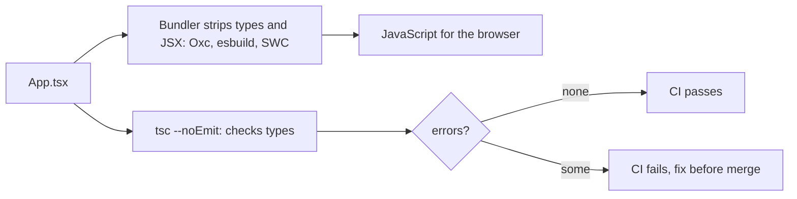

# Chapter 11 — TypeScript with React

**TypeScript** is JavaScript plus a type system (labels saying what kind of value each variable holds — string, number, an object of a certain shape) checked **before** the code runs. In React it turns a class of bugs — a missing prop, a misspelled variant, reading `user.name` while `user` can still be `null`, forgetting to handle one action in a reducer — into editor squiggles instead of broken screens in production. It also makes components self-documenting: the props type *is* the component's API.

This chapter assumes the TypeScript basics from the JavaScript Handbook ([Chapter 16 — types, narrowing, generics](../../../javascript/chapters/16-testing-and-typescript/README.md)) and applies them to props, children, events, state, reducers, refs, Hooks, context, generic components and discriminated-union props. "Wrong" examples show the **real compiler errors**.

> **Key term — narrowing and generics:** *Narrowing* means TypeScript shrinks a broad type after a check — after `if (user !== null)`, `user` is a `User`. *Generics* are types with a placeholder `<T>` filled in where used — `Array<string>` — so one piece of code works for many types and is still checked.

Code: [`code/`](code/). Each `.tsx` file **runs** (bundled with esbuild; React 19.3 in jsdom under Node.js) **and** is type-checked with `tsc` 7.0.2, `@types/react` 19.3, `strict` mode (all stricter checks on). The deliberately broken examples in `code/bad_types.tsx` are only type-checked.

---

## 11.1 Setup and how type-checking fits in

### What it is
| Piece | Role |
|---|---|
| `.tsx` files | TypeScript files that may contain JSX (`.ts` for files without JSX) |
| `@types/react`, `@types/react-dom` | Type definitions for React (React is written in JavaScript; these describe its API) |
| `tsconfig.json` | Compiler options: strictness, JSX mode, which files to check |

Start with `npm create vite@latest my-app -- --template react-ts`, or a framework such as Next.js, which asks whether you want TypeScript and configures it ([Chapter 1](../01-why-react-and-setup/README.md)).

### How it works — two separate jobs
1. **Removing types.** Browsers can't run TypeScript, so the bundler (Vite 8 uses Oxc, earlier Vite esbuild; Next.js uses SWC — Oxc and SWC are fast Rust compilers) strips types and turns JSX into function calls. Fast because it **does not check** anything.
2. **Checking types.** `tsc` reads all files and reports errors; `--noEmit` checks without writing files. Your editor runs the same checker continuously.

So **a project with type errors can still build and run**. Add `tsc --noEmit` to CI (the server that runs checks on every push/pull request) and often to the build (`"build": "tsc --noEmit && vite build"`) so errors block merges.



### The tsconfig options that matter for React
`code/tsconfig.check.json` (the `paths` line exists only because this book keeps npm packages in a shared folder; a normal project names the file `tsconfig.json`):

```jsonc
{
  "compilerOptions": {
    "target": "ES2022",
    "module": "ESNext",
    "moduleResolution": "bundler",     // resolve imports the way Vite/esbuild do
    "jsx": "react-jsx",                // the modern JSX transform: no `import React` needed
    "strict": true,                    // turns on strictNullChecks, noImplicitAny, ... - always use it
    "noEmit": true,                    // the bundler produces JS; tsc only checks
    "skipLibCheck": true,              // don't re-check .d.ts files in node_modules (faster)
    "allowImportingTsExtensions": true,
    "lib": ["ES2023", "DOM", "DOM.Iterable"],   // DOM types such as HTMLInputElement
    "types": [],
    "paths": { "*": ["../../../../.web-books/node_modules/@types/*", "../../../../.web-books/node_modules/*"] }
  },
  "include": ["*.tsx", "*.ts"],
  "exclude": ["bad_*.tsx"]
}
```
```bash
$ tsc --noEmit -p tsconfig.check.json && echo "0 type errors"
0 type errors
```

### Common mistakes
- Turning `strict` off to "get it compiling" — you lose most of the value, especially null checks.
- Using `any` ("anything, don't check") to silence an error — it switches checking off for that value *and everything it flows into*. Prefer `unknown` ("type not known yet; check before use") and narrow, or fix the type.
- Missing `@types/react`/`@types/react-dom`, or versions not matching your React major version (the first number in `19.3.0`, bumped on breaking changes).

---

## 11.2 Typing props

### What it is
Props are one object: describe it with a `type` (or `interface`) and annotate the destructured parameter.

`code/01_props_and_children.tsx` (part 1):
```tsx
type BadgeProps = {
  label: string;                        // required
  count?: number;                       // optional -> number | undefined inside the component
  tone?: 'info' | 'warning' | 'error';  // only these three strings are allowed
};
function Badge({ label, count = 0, tone = 'info' }: BadgeProps) {
  return <span className={`badge ${tone}`}>{label}: {count}</span>;
}

type AvatarProps = {
  user: { name: string; imageUrl: string };  // an object shape
  size?: number;
  style?: CSSProperties;                      // a style object, checked key by key
  onSelect?: (name: string) => void;          // a callback prop
};
function Avatar({ user, size = 32, style, onSelect }: AvatarProps) {
  return  onSelect?.(user.name)} />;
}
```

### How it works
1. Each `<Badge ...>` is checked against `BadgeProps` like an object literal.
2. `?` makes a prop optional; inside, its type includes `undefined` until a **default value** in the destructuring (`count = 0` → plain `number`).
3. A **union of string literals** (`'info' | 'warning' | 'error'`) means "one of these" — autocompleted, and typos are errors.
4. A callback prop is a **function type**: `(name: string) => void` = "called with a string, return ignored". Call optional callbacks with `onSelect?.(...)` (optional chaining).

### `type` or `interface`?
Both work. `interface` can `extends` and merge by re-declaring; `type` can express unions (`A | B`), which props often need (§11.9). Many teams use `type` everywhere; pick one convention per codebase.

### What about `React.FC`?
`const Badge: React.FC<BadgeProps> = ...` works. Since React 18's types `FC` no longer adds an implicit `children`, so the main objection is gone; still, annotating the props parameter is simpler, works with generics (§11.8), and is what most modern code does.

### Real-world examples
Design-system components use literal unions for `variant`/`size`/`tone`, so design tokens (the agreed named values for colours, spacing, sizes) are enforced by the compiler.

---

## 11.3 Typing children and extending native elements

### Which type for `children`?
| Type | Accepts | Use for |
|---|---|---|
| `ReactNode` | anything renderable: JSX, strings, numbers, `null`, `undefined`, booleans, arrays of these | **`children` and "slot" props** — the default |
| `ReactElement` | only a JSX element (`<Foo />`), not strings or `null` | a prop that must be one element (rare) |
| `JSX.Element` | type of a JSX expression (basically `ReactElement<any, any>`) | component return type, if you annotate it |
| `PropsWithChildren<P>` | adds `children?: ReactNode` to `P` | short way to accept optional children |

`code/01_props_and_children.tsx` (part 2):
```tsx
type CardProps = { title: string; children: ReactNode; footer?: ReactNode };
function Card({ title, children, footer }: CardProps) {
  return <section><h2>{title}</h2>{children}{footer && <footer>{footer}</footer>}</section>;
}
function Note({ children }: PropsWithChildren) { return <aside>{children}</aside>; }
```

### Extending a native element's props
A reusable `<Button>` should accept **everything** a `<button>` does — `type`, `disabled`, `aria-*` (accessibility attributes), `onClick` — without listing them. `ComponentProps<'button'>` is the built-in element's full props type:

```tsx
type ButtonProps = ComponentProps<'button'> & { variant?: 'primary' | 'ghost' };
function Button({ variant = 'primary', className, ...rest }: ButtonProps) {
  return <button className={[variant, className].filter(Boolean).join(' ')} {...rest} />;
}
```

```tsx
<Card title="Inbox" footer={<small>updated now</small>}>
  <Badge label="unread" count={3} tone="warning" />
  <Note>plain text child</Note>
  <Button type="submit" disabled aria-label="send">Send</Button>
  <Avatar user={{ name: 'Ada', imageUrl: '/ada.png' }} style={{ borderRadius: '50%' }} />
</Card>
```

Output:
```
<section>
<h2>Inbox</h2>
<span class="badge warning">unread: 3</span>
<aside>plain text child</aside>
<button class="primary" type="submit" disabled="" aria-label="send">Send</button>

<footer>
<small>updated now</small>
</footer>
</section>
```

Related: `ComponentProps<typeof MyComponent>` extracts **your** component's props (handy when a library doesn't export its props type); `ComponentPropsWithoutRef<'input'>` omits `ref`; `Omit<ComponentProps<'a'>, 'href'>` removes a prop so you can redefine it.

### Common mistakes
- `children: JSX.Element` — then `<Card>hello</Card>` or two children fail. Use `ReactNode`.
- Spreading `{...rest}` *before* your own props, or carelessly, so the caller's `className` overwrites yours. Merge deliberately, as above.

---

## 11.4 Typing events

### What it is
React's event objects (synthetic events, [Chapter 3](../03-state-and-events/README.md)) are generic over the **element** the handler is on, which makes `e.target.value` or `e.currentTarget.checked` type-safe.

| Event | Type | Typical element | Common props |
|---|---|---|---|
| `onChange` on input / select / textarea | `ChangeEvent<HTMLInputElement>` (etc.) | `HTMLInputElement`, `HTMLSelectElement`, `HTMLTextAreaElement` | `e.target.value`, `e.target.checked` |
| `onSubmit` | `SubmitEvent<HTMLFormElement>` (older code: `FormEvent`) | `HTMLFormElement` | `e.preventDefault()`, `e.submitter` |
| `onClick` | `MouseEvent<HTMLButtonElement>` | any element | `e.currentTarget`, `e.shiftKey`, `e.clientX` |
| `onKeyDown` | `KeyboardEvent<HTMLInputElement>` | any focusable element | `e.key`, `e.ctrlKey` |
| `onFocus` / `onBlur` | `FocusEvent<HTMLInputElement>` | | `e.relatedTarget` |

Import them from `react`, **not** the DOM (an unimported `MouseEvent`/`SubmitEvent` is the browser's native type, which differs).

**Version note:** recent `@types/react` 19 releases (here 19.3) type `onSubmit` with `SubmitEvent` and mark `FormEvent` **deprecated** (still compiles, flagged for removal; React never had a real "form event"). Most existing code uses `FormEvent<HTMLFormElement>`; prefer `SubmitEvent` in new code if your types have it.

### How it works
1. **Inline handlers need no annotation** — `onChange={e => setEmail(e.target.value)}` infers `e` from the prop's type (*contextual typing*).
2. **Separately declared handlers need a type** — annotate the parameter (`e: ChangeEvent<HTMLInputElement>`) or the function (`const h: ChangeEventHandler<HTMLSelectElement> = e => ...`).
3. Unsure? Write it inline and hover `e` to copy the exact type.

`code/02_events.tsx` (abridged):
```tsx
function handleEmail(e: ChangeEvent<HTMLInputElement>) {
  setEmail(e.target.value);                       // e.target is an HTMLInputElement -> .value is a string
}
const handlePlan: ChangeEventHandler<HTMLSelectElement> = e => setPlan(e.target.value); // type the whole function
function handleSubmit(e: SubmitEvent<HTMLFormElement>) {   // older code: FormEvent (now deprecated)
  e.preventDefault();
  console.log('submitted by the button:', e.submitter?.textContent);
  onSubmit({ email, plan });
}
function handleKey(e: KeyboardEvent<HTMLInputElement>) { if (e.key === 'Escape') setEmail(''); }
function handleHelp(e: MouseEvent<HTMLButtonElement>) {
  console.log(`help clicked at button "${e.currentTarget.textContent}" (shift: ${e.shiftKey})`);
}
// <form onSubmit={handleSubmit}> <input onChange={handleEmail} onKeyDown={handleKey} /> <select onChange={handlePlan}>
// <button type="button" onClick={handleHelp}>Help</button>
// <button type="submit" onClick={e => console.log('inline handler, e is', e.type)}>Sign up</button>
```

Output (type an email, choose Pro, shift-click Help, submit, press Escape):
```
help clicked at button "Help" (shift: true)
inline handler, e is click
submitted by the button: Sign up
submitted {"email":"ada@example.com","plan":"pro"}
after Escape, email = ""
```

### `target` vs `currentTarget`
`e.currentTarget` is the element the handler is on, typed as you declared (`HTMLButtonElement`). `e.target` is whatever was actually clicked (maybe an `<svg>` inside), so usually only `EventTarget`. For **change** events React types `e.target` as the input itself — why `e.target.value` works there.

### Form actions (React 19)
With `<form action={fn}>` ([Chapter 4](../04-forms-and-actions/README.md)) there's no event: `fn(formData: FormData)` (the browser's field-name/value object). `formData.get('email')` returns `FormDataEntryValue | null` (a `string` or `File`), so narrow: `String(formData.get('email') ?? '')`, or validate the whole object with a schema library such as Zod (checks real data against a declared shape).

---

## 11.5 Typing state and reducers

### `useState`
The type is **inferred** from the initial value; add a type argument when that value doesn't show the full picture:

| Code | Type | Why |
|---|---|---|
| `useState(0)` | `number` | inferred |
| `useState<User \| null>(null)` | `User \| null` | `null` alone infers type `null` forever |
| `useState<string[]>([])` | `string[]` | `[]` alone infers `never[]` — nothing could be added |
| `useState<'idle' \| 'saving' \| 'saved'>('idle')` | the union | `'idle'` alone infers `string` |
| `useState(() => loadDraft())` | return type of `loadDraft` | lazy initializer (run only on first render) is inferred too |

`code/03_state_and_reducer.tsx` (part 1, abridged):
```tsx
type User = { id: number; name: string };
function Profile() {
  const [count, setCount] = useState(0);                      // inferred: number
  const [user, setUser] = useState<User | null>(null);        // explicit: starts null, later a User
  const [tags, setTags] = useState<string[]>([]);             // [] alone would be never[]
  const [status, setStatus] = useState<'idle' | 'saving' | 'saved'>('idle');
  // <p>{user ? `${user.name} (#${user.id})` : 'signed out'} ...</p>
  // user.name without the check would not compile: 'user' is possibly 'null'
}
```

The setter's type is `Dispatch<SetStateAction<T>>`: it accepts a `T` or an updater `(prev: T) => T`. Use that name when passing a setter as a prop (`setUser: Dispatch<SetStateAction<User | null>>`), or simply `(u: User | null) => void` if the child never uses the updater form.

### `useReducer` with a discriminated union of actions
A **discriminated union** is a union of object types sharing one literal-typed field (the *discriminant*, here `type`). Checking it **narrows** the object to one member, so TypeScript knows which other fields exist.

`code/03_state_and_reducer.tsx` (part 2):
```tsx
type CartItem = { sku: string; qty: number };
type CartState = { items: CartItem[]; coupon: string | null };
type CartAction =
  | { type: 'add'; sku: string }
  | { type: 'remove'; sku: string }
  | { type: 'applyCoupon'; code: string }
  | { type: 'clear' };

function cartReducer(state: CartState, action: CartAction): CartState {
  switch (action.type) {
    case 'add': {
      const found = state.items.find(i => i.sku === action.sku);   // action.sku is known to exist here
      return {
        ...state,
        items: found
          ? state.items.map(i => (i.sku === action.sku ? { ...i, qty: i.qty + 1 } : i))
          : [...state.items, { sku: action.sku, qty: 1 }],
      };
    }
    case 'remove':      return { ...state, items: state.items.filter(i => i.sku !== action.sku) };
    case 'applyCoupon': return { ...state, coupon: action.code };  // action.code exists only here
    case 'clear':       return { items: [], coupon: null };
    default: {
      const unreachable: never = action;                           // compile error if a case is missing
      return unreachable;
    }
  }
}
// const [cart, dispatch] = useReducer(cartReducer, { items: [], coupon: null });
// dispatch accepts only CartAction objects: dispatch({ type: 'add', sku: 'MUG' })
```

Output (sign in, add mug twice, apply coupon, clear):
```
initial        signed out | 0 |  | idle  ||  empty coupon=none
after clicks   Ada (#7) | 1 | admin | saved  ||  MUGx2 coupon=SAVE10
after clear    Ada (#7) | 1 | admin | saved  ||  empty coupon=none
```

### How the `never` check works
In `default`, every handled member has been removed from `action`'s type; if all are handled, it's `never` and the assignment is fine. Add an action to `CartAction` and forget its `case`, and the assignment **fails to compile** (§11.10, error 9) — an **exhaustiveness check**.

`useReducer` infers state from the reducer, and `dispatch` accepts only valid actions. (React 19's types also allow `useReducer<CartState, [CartAction]>(...)`, but annotating the reducer is simpler.)

---

## 11.6 Typing refs

### DOM refs and value refs
| Purpose | Declaration | `.current` type |
|---|---|---|
| Point at a DOM element | `useRef<HTMLInputElement>(null)` | `HTMLInputElement \| null` |
| Hold a mutable value (timer ID, previous value) | `useRef<number \| null>(null)`, `useRef(0)` | what you declared |

In React 19's types `useRef` **always requires an argument** and returns a `RefObject<T>` with an assignable `current` (older types split read-only `RefObject` from `MutableRefObject`; `MutableRefObject` is now deprecated). DOM refs start `null` because the element doesn't exist until React attaches it after render — hence `ref.current?.focus()`.

### `ref` as a prop (React 19)
Function components receive `ref` as an **ordinary prop**; `forwardRef` isn't needed in new code ([Chapter 5](../05-effects-and-refs/README.md)). `ComponentProps<'input'>` already includes `ref?: Ref<HTMLInputElement>`, so a wrapper spreading its props forwards the ref. For a custom handle (an object of methods you expose instead of the DOM node), type the prop `Ref<YourHandle>` and fill it with `useImperativeHandle`.

`code/04_refs.tsx` (abridged):
```tsx
// 1. A DOM ref
const inputRef = useRef<HTMLInputElement>(null);
useEffect(() => { inputRef.current?.focus(); }, []);   // ?. because current is null until React attaches it

// 2. A value ref (not attached to JSX), read/written only in handlers
const intervalId = useRef<ReturnType<typeof setInterval> | null>(null);

// 3. ref as an ordinary prop - ComponentProps<'input'> includes `ref`
function TextField({ label, ...inputProps }: { label: string } & ComponentProps<'input'>) {
  return <label>{label} <input {...inputProps} /></label>;   // ref travels inside inputProps
}

// 4. Exposing a custom handle instead of the DOM node
export type VideoHandle = { play: () => void; pause: () => void };
function Video({ ref, src }: { ref?: Ref<VideoHandle>; src: string }) {
  const [state, setState] = useState('paused');
  useImperativeHandle(ref, () => ({ play: () => setState('playing'), pause: () => setState('paused') }), []);
  return <p>video {src}: {state}</p>;
}
// App: <TextField label="Name" ref={nameRef} placeholder="Ada" />, <Video ref={videoRef} src="intro.mp4" />, videoRef.current?.play()
```

Output:
```
focused after mount: search
stopwatch: stop timer
nameRef.current is INPUT with placeholder Ada
video intro.mp4: playing
```

`ReturnType<typeof setInterval>` gives the timer ID type of the current environment (a `number` in browsers, an object in Node).

### Common mistakes
- `useRef<HTMLInputElement>()` with no argument — error with React 19 types (§11.10).
- Wrong element type: `useRef<HTMLDivElement>(null)` on an `<input>` errors at `ref={...}`.
- Reading/writing `ref.current` **during render** — refs are for handlers and Effects; React Compiler's lint rules flag render-time ref access ([Chapter 10](../10-performance/README.md)).

---

## 11.7 Typing custom Hooks and Context

### Returning a tuple: `as const`
Returning `[on, toggle]` infers `(boolean | (() => void))[]` — each element could be either. `as const` makes a **readonly tuple** `readonly [boolean, () => void]` (fixed length, a type per position, unchangeable):

```tsx
function useToggle(initial = false) {
  const [on, setOn] = useState(initial);
  const toggle = useCallback(() => setOn(v => !v), []);
  return [on, toggle] as const;
}
```
Returning an **object** (`{ on, toggle }`) avoids the problem and is easier to extend — prefer it beyond two values.

### A generic Hook with a discriminated-union result
`code/05_hooks_and_context.tsx`:
```tsx
type FetchState<T> =
  | { status: 'loading' }
  | { status: 'error'; error: string }
  | { status: 'success'; data: T };

function useJson<T>(url: string): FetchState<T> {
  const [state, setState] = useState<FetchState<T>>({ status: 'loading' });
  useEffect(() => {
    let ignore = false;
    setState({ status: 'loading' });
    fetch(url)
      .then(r => (r.ok ? (r.json() as Promise<T>) : Promise.reject(new Error(`HTTP ${r.status}`))))
      .then(data => { if (!ignore) setState({ status: 'success', data }); })
      .catch((e: unknown) => { if (!ignore) setState({ status: 'error', error: e instanceof Error ? e.message : String(e) }); });
    return () => { ignore = true; };
  }, [url]);
  return state;
}
```
The caller picks `T` and *must* check `status` before touching `data`:
```tsx
const result = useJson<Todo>('/api/todos/1');
if (result.status === 'loading') return <p>loading...</p>;
if (result.status === 'error') return <p>error: {result.error}</p>;
// Here TypeScript knows result.data is a Todo.
```

Better than three fields (`data?`, `error?`, `loading`), which allow nonsense like "loading **and** error". In strict mode caught values are `unknown`; narrow with `instanceof Error`.

**`as Promise<T>` is not validation** — it's "trust me"; a different API shape goes unnoticed. At trust boundaries (network, `localStorage`, URL params) validate with a schema library such as Zod, which checks at runtime and produces the TypeScript type. TanStack Query is generic the same way (`useQuery<Todo>`, [Chapter 9](../09-routing-and-data-fetching/README.md)).

### Context that is never `null` for consumers
With no sensible default, use `null` plus a custom Hook that throws when the provider is missing — callers get the non-nullable type:

```tsx
type Auth = { user: string; logout: () => void };
const AuthContext = createContext<Auth | null>(null);

function useAuth(): Auth {                       // callers get Auth, never null
  const ctx = useContext(AuthContext);
  if (!ctx) throw new Error('useAuth must be used inside <AuthProvider>');
  return ctx;
}
function AuthProvider({ children }: { children: ReactNode }) {
  const [user, setUser] = useState('ada');
  // (in a real app, memoize this object - see Chapter 10, section 10.10)
  return <AuthContext value={{ user, logout: () => setUser('guest') }}>{children}</AuthContext>;
}
```

Output (fetch faked offline; second part renders `TodoTitle` without a provider):
```
loading...
guest: loaded from /api/todos/1 (#1)
without provider -> useAuth must be used inside <AuthProvider>
```

`createContext<Auth>({} as Auth)` compiles but lies: outside the provider it crashes later with a confusing `undefined is not a function`.

---

## 11.8 Generic components

### What it is
A **generic component** has a type parameter: `function List<T>(props: ListProps<T>)`. TypeScript **infers** `T` from the props and checks the rest against it — one `List` for books, users or strings, with `renderItem` always receiving the right type.

`code/06_generic_components.tsx` (abridged):
```tsx
type ListProps<T> = { items: T[]; getKey: (item: T) => Key; renderItem: (item: T) => ReactNode; emptyText?: string };
function List<T>({ items, getKey, renderItem, emptyText = 'Nothing here' }: ListProps<T>) {
  if (items.length === 0) return <p>{emptyText}</p>;
  return <ul>{items.map(item => <li key={getKey(item)}>{renderItem(item)}</li>)}</ul>;
}
// In an arrow function inside a .tsx file write <T,> so the parser doesn't read <T> as JSX:
const Count = <T,>({ items }: { items: T[] }) => <small>{items.length} items</small>;

// A select whose value type is a union of string literals, inferred from `options`
type SelectProps<V extends string> = { label: string; value: V; options: readonly { value: V; label: string }[]; onChange: (value: V) => void };
function Select<V extends string>({ label, value, options, onChange }: SelectProps<V>) {
  return <label>{label}{' '}<select value={value} onChange={e => onChange(e.target.value as V)}>
    {options.map(o => <option key={o.value} value={o.value}>{o.label}</option>)}</select></label>;
}

// A table whose columns may only name real keys of the row type
type Column<Row> = { key: keyof Row & string; header: string };
function Table<Row extends { id: number }>({ rows, columns }: { rows: Row[]; columns: Column<Row>[] }) { /* ... */ }

const SORTS = [{ value: 'title', label: 'Title' }, { value: 'year', label: 'Year' }] as const;
// App: const [sort, setSort] = useState<'title' | 'year'>('title');
<Select label="Sort by" value={sort} options={SORTS} onChange={setSort} />
<List items={sorted} getKey={b => b.id} renderItem={b => `${b.title} (${b.year})`} />
<List items={[] as string[]} getKey={s => s} renderItem={s => s} emptyText="No tags" />
<Table rows={books} columns={[{ key: 'title', header: 'Title' }, { key: 'year', header: 'Year' }]} />
```

Output (then the select changes to "year"):
```
list : Beloved (1987) | Dune (1965) | Neuromancer (1984)
year : Dune (1965) | Neuromancer (1984) | Beloved (1987)
other: No tags / 3 items
table: TitleYear | Dune1965 | Neuromancer1984 | Beloved1987
```

### How it works
1. `items={sorted}` is `Book[]`, so `T = Book`; `renderItem={b => ...}` is checked as `(item: Book) => ReactNode` — `b.title` autocompletes, `b.author` errors.
2. **Constraints** (`V extends string`, `Row extends { id: number }`) restrict `T` and let the component rely on them (`r.id` as key).
3. `keyof Row & string` is the union of `Row`'s property names (`'id' | 'title' | 'year'`), so a column for a missing field is a compile error (§11.10, error 8).
4. `as const` on `SORTS` keeps literals `'title'`/`'year'`, so `V = 'title' | 'year'` and `onChange={setSort}` type-checks.

### When not to use generics
A component that only handles one type is clearer with a plain props type. Generics pay off in reusable blocks: lists, tables, selects, comboboxes (text box with suggestion dropdown), form fields.

---

## 11.9 Discriminated unions for props

### The problem it solves
`{ status: string; error?: string; count?: number; onRetry?: () => void }` allows nonsense ("success" with an error, "error" without retry); consumers guess, components check defensively. A **union of props types**, one per case, makes invalid combinations **impossible to write**.

`code/07_union_props.tsx`:
```tsx
// 1. Each `status` value comes with exactly the props it needs
type StatusProps =
  | { status: 'loading' }
  | { status: 'error'; error: string; onRetry: () => void }
  | { status: 'success'; count: number };

function Status(props: StatusProps) {
  switch (props.status) {                    // narrow on the discriminant `status`
    case 'loading': return <p>Loading…</p>;
    case 'error':   return <p role="alert">{props.error} <button onClick={props.onRetry}>Retry</button></p>;
    case 'success': return <p>{props.count} results</p>;
  }
}

// 2. Either a link or a button
type LinkLike = { as: 'a'; href: string } & Omit<ComponentProps<'a'>, 'href'>;
type ButtonLike = { as?: 'button' } & ComponentProps<'button'>;
type ActionProps = (LinkLike | ButtonLike) & { children: ReactNode };

function Action(props: ActionProps) {
  if (props.as === 'a') {
    const { as: _as, ...rest } = props;       // here props is LinkLike
    return <a className="action" {...rest} />;
  }
  const { as: _as, ...rest } = props;         // here props is ButtonLike
  return <button className="action" type="button" {...rest} />;
}

// 3. "One or the other, not both": the `never` trick forbids the other prop
type ImageSource =
  | { src: string; icon?: never }
  | { icon: 'user' | 'star'; src?: never };
function Thumb(props: ImageSource & { alt: string }) {
  return props.src ?  : <span aria-label={props.alt}>[{props.icon}]</span>;
}
```

```tsx
<Status status="loading" />
<Status status="error" error="Network down" onRetry={() => {}} />
<Status status="success" count={42} />
<Action as="a" href="/docs">Docs</Action>
<Action onClick={() => {}}>Save</Action>
<Thumb src="/a.png" alt="avatar" />
<Thumb icon="star" alt="favourite" />
```

Output:
```
<p>Loading…</p>
<p role="alert">Network down <button>Retry</button>
</p>
<p>42 results</p>
<a class="action" href="/docs">Docs</a>
<button class="action" type="button">Save</button>

<span aria-label="favourite">[star]</span>
```

### How it works
1. The shared literal field (`status`, `as`) is the **discriminant**.
2. At the call site TypeScript picks the member whose discriminant matches and checks the rest: `<Status status="success" />` without `count` fails (§11.10, error 6).
3. Inside, checking the discriminant narrows `props`, so `props.error` exists only in the `'error'` branch.
4. Don't destructure in the parameter list (`function Status({ status, error })`) — destructuring before narrowing loses the link between fields. (Recent TypeScript narrows destructured `const`s in simple cases, but keeping `props` whole is the reliable pattern.)
5. `prop?: never` = "must not be passed" — the standard "exactly one of these".

### Real-world examples
- Libraries use `as`/`asChild` or link-vs-button unions so clickable things render correct, accessible HTML.
- Alert/toast `variant` unions; form fields where `type: 'select'` requires `options`; modals where `dismissible: true` requires `onClose`.

### In the interview
**30-second answer:** "I type props with a type alias on the destructured parameter, `children` as `ReactNode`, and extend native elements with `ComponentProps<'button'>`. Handlers use React's event types such as `ChangeEvent<HTMLInputElement>`, though inline handlers are inferred. For state I let inference work and add generics for `null` or empty arrays. Variant props use discriminated unions so invalid combinations don't compile; reducers get action unions with a `never` exhaustiveness check. Reusable lists and tables are generic components."

- *`ReactNode` vs `ReactElement` vs `JSX.Element`?* — `ReactNode` is anything renderable (children); the others are only a JSX element.
- *How do you type `ref` in React 19?* — A normal prop `ref?: Ref<HTMLInputElement>`, or free via `ComponentProps<'input'>`; no `forwardRef`.
- *Why not `any`?* — It disables checking and spreads; use `unknown` and narrow, or a proper type.

---

## 11.10 Reading type errors, and common mistakes

Errors follow one pattern: *"Type **A** (what you gave) is not assignable to type **B** (what was expected)"*, often followed by indented lines zooming in on the differing property. Read the **last** indented line first — usually the real reason.

`code/bad_types.tsx` collects twelve common mistakes (excluded from the normal check and runner):

```tsx
const e1 = <Badge />;                                   // 1. required prop missing
const e2 = <Badge label="x" tone="danger" />;           // 2. value outside the union

function Profile() {
  const [user] = useState<{ name: string } | null>(null);
  const [tags, setTags] = useState([]);
  setTags(['a']);                                       // 4. useState([]) without a type -> never[]
  return <p>{user.name} {tags.length}</p>;              // 3. user may be null
}

function Plan() {
  function handle(e: ChangeEvent<HTMLInputElement>) { console.log(e.target.value); }
  return <select onChange={handle} />;                  // 5. input handler on a <select>
}

const e6 = <Status status="success" />;                 // 6. 'success' requires count
const e7 = <Thumb src="/a.png" icon="star" />;          // 7. both src and icon
const e8 = <Table rows={[{ id: 1, title: 'Dune' }]} columns={[{ key: 'author', header: 'Author' }]} />;  // 8. no such key

type Action = { type: 'add'; sku: string } | { type: 'clear' };
function reducer(state: string[], action: Action): string[] {
  switch (action.type) {
    case 'add': return [...state, action.sku];
    default: { const unreachable: never = action; return unreachable; }   // 9. 'clear' not handled
  }
}
function Cart() { const [items, dispatch] = useReducer(reducer, []); dispatch({ type: 'remove' }); return <p>{items}</p>; }  // 10. unknown action

function Focus() {
  const ref = useRef<HTMLInputElement>();               // 11. React 19 types: useRef needs an argument
  return <input ref={ref} />;
}

const e12 = <Box>{{ title: 'not renderable' }}</Box>;   // 12. a plain object is not a ReactNode
```

Output of `tsc --noEmit -p tsconfig.bad.json` (real, unedited):
```
bad_types.tsx(7,13): error TS2741: Property 'label' is missing in type '{}' but required in type 'BadgeProps'.
bad_types.tsx(8,29): error TS2322: Type '"danger"' is not assignable to type '"error" | "info" | "warning" | undefined'.
bad_types.tsx(13,12): error TS2322: Type 'string' is not assignable to type 'never'.
bad_types.tsx(14,14): error TS18047: 'user' is possibly 'null'.
bad_types.tsx(19,18): error TS2322: Type '(e: ChangeEvent<HTMLInputElement, Element>) => void' is not assignable to type 'ChangeEventHandler<HTMLSelectElement, HTMLSelectElement>'.
  Types of parameters 'e' and 'event' are incompatible.
    Type 'ChangeEvent<HTMLSelectElement, HTMLSelectElement>' is not assignable to type 'ChangeEvent<HTMLInputElement, Element>'.
      Type 'HTMLSelectElement' is missing the following properties from type 'HTMLInputElement': accept, align, alt, capture, and 38 more.
bad_types.tsx(24,13): error TS2322: Type '{ status: "success"; }' is not assignable to type 'IntrinsicAttributes & StatusProps'.
  Property 'count' is missing in type '{ status: "success"; }' but required in type '{ status: "success"; count: number; }'.
bad_types.tsx(28,32): error TS2322: Type 'string' is not assignable to type '"star" | "user" | undefined'.
bad_types.tsx(32,65): error TS2322: Type '"author"' is not assignable to type '"id" | "title"'.
bad_types.tsx(38,22): error TS2322: Type '{ type: "clear"; }' is not assignable to type 'never'.
bad_types.tsx(41,81): error TS2322: Type '"remove"' is not assignable to type '"add" | "clear"'.
bad_types.tsx(44,15): error TS2554: Expected 1 arguments, but got 0.
bad_types.tsx(49,21): error TS2353: Object literal may only specify known properties, and 'title' does not exist in type 'Iterable<ReactNode> | Promise<AwaitedReactNode> | ReactElement<unknown, string | JSXElementConstructor<any>> | ReactPortal'.
```

### Decoding each error
| # | Error says | What it means | Fix |
|---|---|---|---|
| 1 | `Property 'label' is missing` | required prop not passed | pass it, or make it optional with a default |
| 2 | `"danger"` not assignable to the union | typo or unsupported variant | use an allowed value, or extend the union |
| 3 | `'user' is possibly 'null'` | state can still be `null` | narrow: `user ? ... : ...` or `user?.name` |
| 4 | `string` not assignable to `never` | `useState([])` inferred `never[]` | `useState<string[]>([])` |
| 5 | handler for `HTMLInputElement` on a `<select>` | wrong element type | `ChangeEvent<HTMLSelectElement>` (in `@types/react` 19 event types have a second type parameter for `target`, normally omitted) |
| 6 | `Property 'count' is missing ... required in type '{ status: "success"; count: number; }'` | chosen union member needs `count` | pass `count` |
| 7 | `string` not assignable to `"star" \| "user" \| undefined` on `icon` | with `src` given, no member fits both; the message points at one | pass only one of `src`/`icon` |
| 8 | `"author"` not assignable to `"id" \| "title"` | column names a field the row lacks | fix the key or add the field |
| 9 | `{ type: "clear" }` not assignable to `never` | exhaustiveness check caught an unhandled action | add `case 'clear'` |
| 10 | `"remove"` not assignable to `"add" \| "clear"` | unknown action dispatched | dispatch a valid one or add it to the union |
| 11 | `Expected 1 arguments, but got 0` | React 19 types require `useRef`'s initial value | `useRef<HTMLInputElement>(null)` |
| 12 | `'title' does not exist in type ... ReactNode ...` | rendering a plain object (would also crash at runtime) | render a field: `{post.title}` |

### Other common mistakes
- **`as` everywhere** — silences the checker without checking. Only when you truly know more (`e.target.value as V` above), never to hide a mismatch.
- **Non-null assertions** `user!.name` ("trust me, not null", unchecked) — same risk; narrow instead.
- **Duplicating existing types** — use `ComponentProps<typeof X>`, `ReturnType<typeof fn>`, `Parameters<...>`, or export the props type.
- **Hand-typed API responses trusted blindly** — validate at the boundary (Zod) and derive the type from the schema.
- **Over-engineered generics** — a one-type component doesn't need them.

### Self-check
1. Why does `useState([])` cause trouble? → Inferred `never[]`, so nothing can be added.
2. Type for `children`? → `ReactNode`.
3. All props of a native `<input>`? → `ComponentProps<'input'>`.
4. Make a reducer fail to compile on an unhandled action? → Assign `action` to a `never` variable in `default`.
5. React 19: how does a function component receive a ref? → Regular `ref` prop typed `Ref<T>`.
6. Does `tsc` run when Vite builds? → No; the bundler only strips types. Run `tsc --noEmit` in CI or the build script.

---

## Chapter 11 TL;DR

| Idea | Remember |
|---|---|
| Setup | `.tsx`, `@types/react(-dom)`, `strict: true`, `jsx: "react-jsx"`; bundler strips types, `tsc --noEmit` checks them (in CI) |
| Props | `function C({ a, b = 1 }: Props)`; `?` optional, defaults remove `undefined`; literal unions for variants; function types for callbacks |
| Children | `ReactNode`; `PropsWithChildren<P>`; native props via `ComponentProps<'button'>` & spread the rest |
| Events | Inline = inferred; otherwise `ChangeEvent<HTMLInputElement>`, `SubmitEvent<HTMLFormElement>` (older: `FormEvent`), `MouseEvent<...>`, `KeyboardEvent<...>` from `react`; `currentTarget` has your element's type |
| State | Infer; `useState<T \| null>(null)`, `useState<string[]>([])`, literal unions |
| Reducers | Action = discriminated union; `never` exhaustiveness check |
| Refs | `useRef<HTMLXxxElement>(null)`; argument required in React 19 types; `ref` is a prop typed `Ref<T>`; `useImperativeHandle` for custom handles |
| Hooks & Context | `as const` tuples or objects; generic Hooks with union results; `createContext<T \| null>(null)` + throwing `useX()` |
| Generic components | `List<T>` infers `T` from props; constraints with `extends`; `keyof`; `<T,>` in arrow functions |
| Union props | One member per valid combination; narrow before destructuring; `?: never` to forbid |
| Errors | Read "A is not assignable to B" bottom-up; avoid `any`, `as`, `!` as escape hatches |

Next: [Chapter 12 — Testing React](../12-testing-react/README.md).
