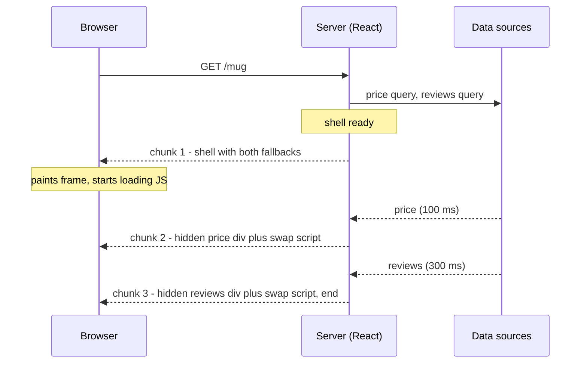
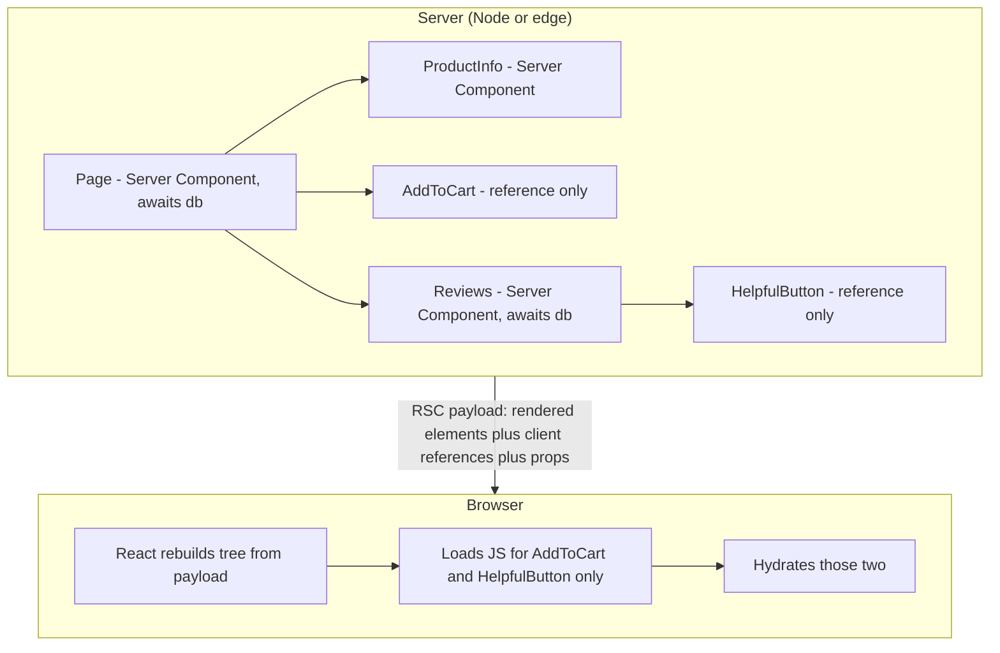
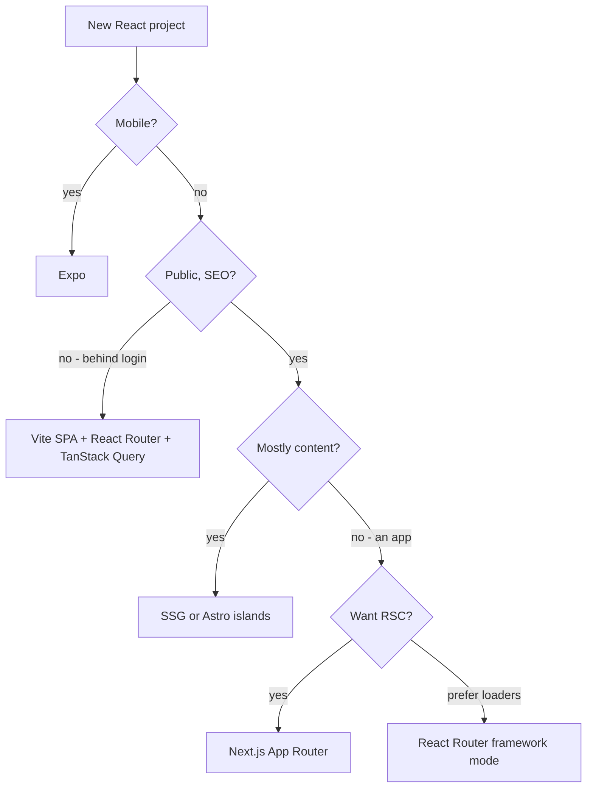

# Chapter 13 — Server Rendering and Frameworks

This chapter moves React onto the **server**: what the server sends (captured byte by byte), how the browser takes that HTML over (**hydration** — React attaching handlers and state to HTML already on screen), what breaks when the two disagree, how slow parts stream in later (as extra pieces of the same response), and how **React Server Components** run some components *only* on the server. Then the two frameworks that package this — **Next.js** 16 (App Router) and **React Router** 8 (framework mode) — and how to choose. Chapter 1 §1.4 introduced the vocabulary (MPA — multi-page app, a new HTML page per click; SPA/CSR — one page, JavaScript in the client draws every screen; SSR and SSG, recapped below) with a tiny `renderToString` + `hydrateRoot` example; this builds on it.

Code: [`code/`](code/) — React 19.3 on Node 24. Files `01`–`05` are runnable; `04_ssr_server_hydrate.jsx` starts a real `node:http` server, loads the page in headless Chrome (no window, script-driven) and takes this chapter's screenshots. Next.js and React Router snippets are **(not run)**: they need the framework's bundler. Background: Suspense and `use()` ([Chapter 9](../09-routing-and-data-fetching/README.md)), Effects ([Chapter 5](../05-effects-and-refs/README.md)), `useSyncExternalStore` and `useId` ([Chapter 7](../07-custom-hooks-and-hook-rules/README.md)), Form Actions ([Chapter 4](../04-forms-and-actions/README.md)); HTTP basics: [How the web works](../../../html-css/chapters/01-how-the-web-works/README.md).

---

## 13.1 Rendering strategies: CSR, SSR, SSG, ISR, streaming, PPR

### What it is
A **rendering strategy** answers, per page: *where* is HTML produced (browser or server) and *when* (build time — once before publishing — request time, or a mix)?

| Strategy | Where / when HTML is made | First HTML contains | Data freshness |
|---|---|---|---|
| **CSR** (client-side rendering, SPA) | Browser, after JS loads | Empty `<div id="root">` | Live (fetched by the browser) |
| **SSR** (server-side rendering) | Server, every request | Full content | Live per request |
| **SSG** (static site generation) | Build machine, once per deploy | Full content | As old as the last build |
| **ISR** (incremental static regeneration) | Build, then re-built in the background on a timer or on demand | Full content | Stale for at most N seconds, or until you invalidate |
| **Streaming SSR** | Server, per request, sent in pieces | Page frame + placeholders first, slow parts later | Live |
| **PPR** (partial prerendering) | Static shell at build + dynamic "holes" filled per request | Static shell with placeholders, holes streamed in | Mixed per section |
| **RSC** (React Server Components) | Some components run only on the server (build or request time) | Works *with* any of the above | Per component |

Restaurant analogy: CSR hands over a kit and recipe; SSR cooks each plate to order; SSG pre-plates sandwiches each morning, ISR re-makes the tray when it's over an hour old; streaming serves the starter now and the main when ready; PPR keeps pre-plated sides and cooks only the main.

### Why it matters
It decides how soon something appears (**FCP**, First Contentful Paint), how soon the main content appears (**LCP**, Largest Contentful Paint), when clicks work (hydration done), and data freshness. And cost: SSG pages are files on a **CDN** (Content Delivery Network — caching servers near users; [System Design Fundamentals](../../../system-design-patterns/modules/00-system-design-fundamentals/README.md)); SSR runs your code on every request.

### How ISR works
1. Generated at build and cached like SSG; requests served from cache.
2. After the revalidation window (say 60 s), the next request **still gets the stale page** but triggers a background re-render.
3. The new page replaces the cached copy. You can also invalidate on demand (e.g. an editor publishes).

This is **stale-while-revalidate** (also used by HTTP caches and TanStack Query, [Chapter 6](../06-state-management/README.md) §6.9): serve what you have, refresh behind the scenes. ISR is a framework feature (named by Next.js), not a React API.

### Trade-offs

| | CSR | SSR | SSG | ISR | Streaming SSR / PPR |
|---|---|---|---|---|---|
| Time to first content | Slow | Medium (waits for server render) | Fastest | Fastest | Fast (shell first) |
| Needs a server | No | Yes | No | Yes (for regeneration) | Yes |
| Per-user content in HTML | No | Yes | No | No | Yes (in the holes) |
| Good for | Dashboards behind login | Personalised pages | Docs, blogs | Catalogues, news | Fast frame + slow widgets |

### Common mistakes
- Thinking SSR makes pages *interactive* sooner — it makes them *visible* sooner; interactivity waits for JS and hydration (§13.4).
- SSG for per-user data (cart prices, "logged in as…") — use a dynamic hole or client fetch.
- Whole-app thinking — frameworks choose **per route**, and with PPR **per component**.

---

## 13.2 The server rendering APIs

### What it is
`react-dom/server` renders **per request**; `react-dom/static` renders **ahead of time** and waits for all data.

| Function | Package | Output | Waits for `<Suspense>` data? | Use it for |
|---|---|---|---|---|
| `renderToString(el)` | `react-dom/server` | A string | No — emits the fallback | Legacy code; simple SSR without async data |
| `renderToStaticMarkup(el)` | `react-dom/server` | A string, no hydration markers | No | Non-interactive HTML: emails, static snippets |
| `renderToPipeableStream(el, opts)` | `react-dom/server` (Node) | Node stream: `{ pipe, abort }` | Streams it later | **SSR on Node** (Express, `node:http`) |
| `renderToReadableStream(el, opts)` | `react-dom/server` (Web Streams) | `Promise<ReadableStream>` | Streams it later | SSR on edge runtimes, Deno, Bun, Cloudflare Workers |
| `prerenderToNodeStream(el, opts)` | `react-dom/static` | `{ prelude }` Node stream | **Yes — waits for everything** | SSG on Node |
| `prerender(el, opts)` | `react-dom/static` | `{ prelude, postponed }` Web stream | Yes (unless aborted) | SSG with Web Streams; partial prerendering |
| `resume(el, postponed)` / `resumeToPipeableStream` | `react-dom/server` | Web / Node stream | Streams it | Filling `prerender`'s holes at request time (§13.6) |
| `resumeAndPrerender` / `…ToNodeStream` | `react-dom/static` | `{ prelude, postponed }` | Yes | Continuing a postponed prerender at build time |

A **Node stream** / **Web stream** delivers data piece by piece (Node's format vs the browser standard); **Express** is a popular Node web-server library; **edge runtimes** are lightweight JS servers in many locations near users (e.g. **Cloudflare Workers**); **Deno** and **Bun** are Node.js alternatives.

Browser partner: **`hydrateRoot(domNode, element, options)`** from `react-dom/client` attaches React to existing server HTML (`createRoot` builds DOM from nothing).

### Seeing the string APIs
`code/01_render_to_string.jsx`:
```jsx
function Greeting({ name }) {
  const [likes] = useState(3);                      // state works: initial value is rendered
  return <p className="greet">Hello, {name}! Likes: {likes}</p>;
}
console.log('renderToString      :', renderToString(<Greeting name="Ada" />));
console.log('renderToStaticMarkup:', renderToStaticMarkup(<Greeting name="Ada" />));

const never = new Promise(() => {});               // data that never arrives
function Slow() { return <p>{use(never)}</p>; }
console.log(renderToString(<main><h1>Shop</h1><Suspense fallback={<p>Loading…</p>}><Slow /></Suspense></main>));
```

Output:
```
renderToString      : <p class="greet">Hello, <!-- -->Ada<!-- -->! Likes: <!-- -->3</p>
renderToStaticMarkup: <p class="greet">Hello, Ada! Likes: 3</p>
renderToString + pending Suspense:
  <main><h1>Shop</h1><!--$!--><template data-msg="Switched to client rendering because the server rendering aborted due to: …"></template><p>Loading…</p><!--/$--></main>
```

1. **Hooks run once on the server.** `useState` returns its initial value; Effects **never** run there and no handlers are attached.
2. **`<!-- -->` comments** separate adjacent text so hydration can match each text node. `renderToStaticMarkup` drops them, so its HTML can't be hydrated.
3. **`renderToString` cannot wait**: a suspended component yields the fallback marked `<!--$!-->` ("render on the client"), plus a dev-only hint to use a streaming API.

### Common mistakes
- `renderToString` in new code — data components only show the fallback on the server. Stream instead.
- `hydrateRoot` on `renderToStaticMarkup` output — no markers.
- Reading `window`, `document` or `localStorage` during render — `ReferenceError` on the server. Use Effects or handlers (§13.5).

---

## 13.3 Streaming SSR with `<Suspense>`

### What it is
**Streaming** sends one HTML response in pieces, cut at `<Suspense>` boundaries: everything **outside** pending boundaries is the **shell**, sent first with fallbacks; each boundary's content follows when ready, with a tiny inline script that swaps it in.

### The problem it solves
Plain SSR is all-or-nothing: one slow query (reviews taking 1.5 s) delays the **whole** page. Streaming lets fast parts leave at once, so the browser loads CSS/JS and even hydrates the shell while slow parts render.

### How it works
1. `renderToPipeableStream(<App />, options)` starts rendering.
2. When everything outside pending boundaries is rendered, **`onShellReady`** fires: set the HTTP status code and headers, then **`pipe(res)`** — the shell goes out with fallbacks.
3. As each boundary resolves, React writes a chunk: content in a **hidden `<div>`** plus a `<script>` that moves it into place and removes the fallback.
4. When all is done, **`onAllReady`** fires and the response ends.
5. **`onShellError`** — the shell failed (send an error page). **`onError`** — any error, including inside boundaries (log it). **`abort()`** — stop waiting; pending boundaries fall back to client rendering.

### Seeing every chunk
`code/02_stream_chunks.jsx` pipes into a fake response printing each chunk with its time; price takes 100 ms, reviews 300 ms:
```jsx
const pricePromise = later('$18', 100);                       // fast data
const reviewsPromise = later(['Great mug', 'Too small'], 300); // slow data
function Price() { return <b>{use(pricePromise)}</b>; }
function Reviews() { return <ul>{use(reviewsPromise).map(r => <li key={r}>{r}</li>)}</ul>; }
function Page() {
  return (
    <main>
      <h1>Trail Mug</h1>
      <Suspense fallback={<i>price…</i>}><Price /></Suspense>
      <Suspense fallback={<i>reviews…</i>}><Reviews /></Suspense>
    </main>
  );
}
const { pipe } = renderToPipeableStream(<Page />, {
  onShellReady() { console.log(`onShellReady @ ${ms()} -> pipe(res)`); pipe(res); },
  onAllReady()   { console.log(`onAllReady   @ ${ms()}`); },
  onError(e)     { console.error(e); },
});
```

Output (long scripts shortened; timings vary by a few ms):
```
onShellReady @    3 ms -> pipe(res)
chunk 1 @    5 ms: <main><h1>Trail Mug</h1><!--$?--><template id="B:0"></template><i>price…</i><!--/$--><!--$?--><template id="B:1"></template><i>reviews…</i><!--/$--></main><script>/* 74 chars of React's swap code */</script>
chunk 2 @  101 ms: <div hidden id="S:0"><b>$18</b></div><script>/* 862 chars of React's swap code */</script>
onAllReady   @  302 ms
chunk 3 @  302 ms: <div hidden id="S:1"><ul><li>Great mug</li><li>Too small</li></ul></div><script>$RC("B:1","S:1")</script>
end      @  302 ms
```

| Marker | Meaning |
|---|---|
| `<!--$?-->` … `<!--/$-->` | A boundary still **pending**; between them is the fallback |
| `<template id="B:0">` | Marks *where* boundary 0's content will go |
| `<div hidden id="S:0">` | Boundary 0's finished content ("segment"), sent later, hidden |
| `$RC("B:1","S:1")` | "React: complete boundary" — moves S:1 into B:1's place, removes the fallback |
| `<!--$-->` | A boundary **complete** when sent (no swap) |
| `<!--$!-->` | A boundary that **failed** on the server; the browser renders it |

Chunk 2 carries the helper defining `$RC`; chunk 3 only calls it. The shell left at 5 ms instead of 300 ms.



### Status codes, errors and crawlers
- The **status code** can only be set before the first byte — decide it in `onShellReady`. A later error inside a boundary can't change the 200; the boundary is client-rendered, and your error boundary shows if it fails again.
- **Crawlers** (search-engine bots) and static generation: wait for `onAllReady` so the whole document arrives at once.
- Always **`abort()` after a timeout**, or a hung query holds the connection open.
- Since React 19.2 the server briefly **batches reveals** of boundaries finishing close together, so they appear in one go instead of flickering in.

### Where to put boundaries
Wrap parts whose data is slow **and** not needed for the first view (reviews, recommendations, charts). Keep main content (title, price, article) in the shell, or LCP suffers. Many tiny boundaries "pop" piecemeal; group related slow parts.

### In the interview
**30-second answer:** "The shell — everything outside pending Suspense boundaries — is sent as soon as it's ready, with fallbacks. Each boundary's HTML follows in a hidden div plus a tiny swap script, so one slow query no longer blocks the page and the browser loads JS and hydrates the shell meanwhile. Status goes in `onShellReady`, logging in `onError`, crawlers wait for `onAllReady`, and a timeout calls `abort()`."

- *A component inside a boundary throws on the server?* — The boundary is marked for client rendering (`<!--$!-->`), the fallback stays, the browser tries; if it fails there too, the nearest error boundary shows.
- *Why no 404 after the shell is sent?* — The status line is the first thing in the response; once bytes are out it's fixed.
- *What's in `<div hidden id="S:1">`?* — A boundary's finished HTML, hidden until `$RC` moves it into place.

---

## 13.4 Hydration end to end

### What it is
**Hydration** is React in the browser "adopting" server-rendered DOM: it renders components in memory, checks the result matches the HTML, **reuses** those nodes, attaches handlers and runs Effects. The server builds and paints the house; hydration is the electrician — visible all along, switches work only after wiring.

### How it works
1. Server HTML includes a `<script>` for the client bundle (React adds it via `bootstrapScripts`).
2. The bundle calls **`hydrateRoot(document, <App {...sameProps} />)`** — the *same* tree with the *same* data as the server.
3. **Selective hydration**: the shell hydrates while boundaries still stream; a click in an unhydrated boundary moves it to the front; each streamed boundary hydrates on arrival.

### The full demo — server, stream, Chrome
`code/04_ssr_server_hydrate.jsx` bundles the browser entry `ssr_client.jsx` with esbuild, starts a `node:http` server streaming `shop_app.jsx` (reviews take 1.5 s), then drives headless Chrome: screenshot the shell, click, wait for reviews, click again. `code/shop_app.jsx` (key parts) renders the **whole document**:

```jsx
function AddToCart() {
  const [count, setCount] = useState(0);
  useEffect(() => { window.__hydrated = true; }, []);   // Effects never run on the server: proves hydration
  return <button onClick={() => setCount(c => c + 1)}>Add to cart ({count})</button>;
}
function Reviews({ reviewsPromise }) {
  const reviews = use(reviewsPromise);                  // suspends until the data is ready
  return <ul>{reviews.map(r => <Review key={r.id} r={r} />)}</ul>;
}
export default function App({ reviewsPromise }) {
  // <html><head>…</head><body>: product card with <AddToCart />, then
  // <Suspense fallback={<ReviewsSkeleton />}><Reviews reviewsPromise={reviewsPromise} /></Suspense>
}
```

Browser entry (`code/ssr_client.jsx`):
```jsx
import { hydrateRoot } from 'react-dom/client';
import App from './shop_app.jsx';
const reviewsPromise = fetch('/api/reviews').then(r => r.json());   // the browser needs the data too
hydrateRoot(document, <App reviewsPromise={reviewsPromise} />, {
  onRecoverableError(err) { console.error('recoverable:', err.message); },
});
```

Server (key part):
```jsx
const server = http.createServer((req, res) => {
  // /client.js and /api/reviews served directly; everything else:
  let didError = false;
  const { pipe, abort } = renderToPipeableStream(<App reviewsPromise={slowReviews()} />, {
    bootstrapScripts: ['/client.js'],          // React emits <script src="/client.js" async>
    onShellReady() { res.statusCode = didError ? 500 : 200; res.setHeader('content-type', 'text/html; charset=utf-8'); pipe(res); },
    onShellError() { res.statusCode = 500; res.end('<h1>Something went wrong</h1>'); },
    onError(err) { didError = true; console.error(err); },
  });
  setTimeout(abort, 10_000);                   // never hang forever on a slow data source
});
```

Output (timings vary):
```
[ 349 ms] server: GET / -> start rendering
[ 354 ms] server: onShellReady -> send shell (with fallback) now
[ 387 ms] browser: shell painted, reviews fallback visible
[ 402 ms] browser: shell hydrated while reviews still loading -> Add to cart (1), fallback still shown: true
[1852 ms] server: onAllReady -> reviews streamed, response ends
[1857 ms] browser: streamed reviews swapped in place of the fallback
[1883 ms] browser: after clicking Helpful -> ["Add to cart (1)","Helpful (5)","Helpful (1)"]
```


*Figure 13.1 — About 40 ms after the request: the shell is painted and hydrated ("Add to cart (1)" responded to a click) while the reviews boundary still shows its fallback.*


*Figure 13.2 — 1.5 s later: the reviews chunk replaced the skeleton; clicking "Helpful" on the first review changed 4 → 5, so the streamed part is hydrated too.*

Proven: the shell was **usable 1.4 s before the slow data** (selective hydration), the **streamed part hydrated too**, and hydration **reused the server DOM** (no blank page or flicker).

### The double-fetch problem (and how frameworks fix it)
`ssr_client.jsx` **fetches the reviews again** to render the same tree during hydration, though the server had them. Frameworks **serialize the server's data into the page** (as JSON-like text): Next.js embeds the RSC payload (§13.7), React Router embeds loader data. That, plus routing, per-route code splitting and CSS handling, is most of what a framework does — why react.dev recommends one for server rendering.

### Common mistakes
- `createRoot` instead of `hydrateRoot` on server HTML — React discards and rebuilds the DOM (a flash).
- A different tree or props on the client (§13.5).
- One giant `<Suspense>` around everything — empty shell.
- Forgetting the page is **not interactive** until the bundle loads — keep client JS small; use real `<a>` and `<form>` so basics work pre-hydration.

### In the interview
**30-second answer:** "`hydrateRoot` renders the same tree in the browser, matches it against the server HTML, reuses those nodes and attaches handlers and Effects. With streaming it's selective: the shell becomes interactive while boundaries load, and a click in an unhydrated boundary gets priority. The client must render exactly what the server did — hence frameworks serialize server data into the page."

- *Clicks between "visible" and "interactive"?* — Before the bundle runs they do nothing unless the element works without JS (links, forms). Once React runs, a click on a not-yet-hydrated part makes React hydrate it first and replay the event.
- *Why hydrate `document` rather than a `<div>`?* — Rendering the whole `<html>` lets React manage `<head>` tags too.
- *Which Hook proved hydration in the demo?* — `useEffect`; Effects never run on the server.

---

## 13.5 Hydration mismatches

### What it is
A **hydration mismatch**: the HTML React renders in the browser during hydration differs from what the server sent. React can't safely adopt mismatched DOM, so it discards that part and **re-renders it on the client** — costing performance, a visible flash, and an error log.

### Seeing one
`code/05_hydration_mismatch.jsx` renders on a pretend "server" (no `window`), then hydrates in jsdom:
```jsx
function BadBanner() {                       // BUG: output depends on the environment
  return <p>{isBrowser() ? 'Welcome back!' : 'Hello, guest'}</p>;
}
function GoodBanner() {                      // FIX 1: same first render, switch in an Effect
  const [mounted, setMounted] = useState(false);
  useEffect(() => setMounted(true), []);
  return <p>{mounted && isBrowser() ? 'Welcome back!' : 'Hello, guest'}</p>;
}
const subscribe = () => () => {};
function GoodBanner2() {                     // FIX 2: useSyncExternalStore with a server snapshot
  const inBrowser = useSyncExternalStore(subscribe, () => isBrowser(), () => false);
  return <p>{inBrowser ? 'Welcome back!' : 'Hello, guest'}</p>;
}
function Greeting() { use(browser()); return <p>Welcome back!</p>; }   // FIX 3 (React 19.3)
function GoodBanner3() { return <Suspense fallback={<p>Hello, guest</p>}><Greeting /></Suspense>; }
function Stamp({ now }) { return <time suppressHydrationWarning>{now}</time>; }
// each: renderToString on the "server", flip to "browser", hydrateRoot(..., { onRecoverableError })
```

Output:
```
BadBanner    server: <p>Hello, guest</p>          after hydrate: <p>Welcome back!</p>
   recoverable error: Hydration failed because the server rendered text didn't match the client. As a result this tree will be regenerated on the client. This can happen if a SSR-ed Client Component used:
GoodBanner   server: <p>Hello, guest</p>          after hydrate: <p>Welcome back!</p>
GoodBanner2  server: <p>Hello, guest</p>          after hydrate: <p>Welcome back!</p>
GoodBanner3  server: <!--$!--><template…><p>Hello, guest</p><!--/$-->
             after hydrate: <p>Welcome back!</p>  errors: 0
Stamp        server: <time>10:00:00</time>        after hydrate: <time>10:00:00</time>  errors: 0
```

1. `BadBanner` ends right only because React **gave up and re-rendered** on the client, reported via `onRecoverableError` (dev also logs a server/client diff).
2. Fixes 1 and 2 reach the same result **with no error**: hydration reproduces the server output, then a normal update changes it. `useSyncExternalStore`'s third argument (`getServerSnapshot`) is used on the server *and during hydration*.
3. **`use(browser())`** (React 19.3, from `react-dom`) suspends **only on the server**: the server sends the fallback marked `<!--$!-->` and the browser renders the real content — no mismatch.
4. `suppressHydrationWarning` silences the warning for **one element's own text/attributes**, one level deep, and React **keeps the server text** (`10:00:00`) — it doesn't patch it. Only for expected, harmless differences like timestamps.

### Common causes and fixes

| Cause | Example | Fix |
|---|---|---|
| Environment checks in render | `typeof window !== 'undefined' ? A : B` | Server version first; switch in `useEffect` or via `useSyncExternalStore` |
| Browser-only data | `localStorage.getItem('theme')` during render | Same; or a cookie (sent with every request) so the server knows it |
| Time, randomness, locale (language/region formatting) | `Date.now()`, `Math.random()`, `toLocaleDateString()` → `9/28/2026` vs `28/09/2026` | Compute on the server and pass as a prop; explicit `Intl` locale and `timeZone`; `useId` for IDs ([Chapter 7](../07-custom-hooks-and-hook-rules/README.md) §7.8 — derived from tree position, same on both sides) |
| Invalid HTML nesting | `<p><div/></p>`, `<a>` inside `<a>`, `<table>` without `<tbody>` | Fix the markup — the browser's HTML parser "repairs" it (e.g. closes `<p>` before `<div>`), so the DOM no longer matches |
| Different data | Client refetched newer data | Serialize server data into the page (frameworks do) |
| Browser extensions / proxies (middlemen that may alter traffic) | An extension injects attributes; a CDN minifier strips comments | React 19 tolerates unexpected tags inserted in `<head>`/`<body>`; don't let proxies rewrite HTML |

### When the difference is intentional
For genuinely browser-specific output (an "offline" badge, a window-size chart) use **two-pass rendering** — a neutral placeholder on the server and during hydration, the real thing after mount (Fix 1 or 2) — or, for a whole browser-only component, `use(browser())` in `<Suspense>` (Fix 3). Next.js also offers `dynamic(() => import('./Chart'), { ssr: false })` inside a Client Component.

### In the interview
**30-second answer:** "The client's first render didn't produce the server's HTML, so React can't adopt that DOM: it client-renders the tree and reports a recoverable error. Causes: environment checks, `localStorage`, dates, randomness, locale, invalid nesting, different data. Fix: make the first client render identical and switch after mount (an Effect, `useSyncExternalStore`'s server snapshot, or `use(browser())` in 19.3); `suppressHydrationWarning` only for single expected differences like timestamps."

- *Does `suppressHydrationWarning` fix the text?* — No: keeps the server's text and silences the warning, one level deep.
- *Why is `useId` safe for SSR?* — IDs derive from tree position, identical on server and client.
- *Why doesn't `GoodBanner` mismatch?* — Its first client render uses `mounted = false`, like the server.

---

## 13.6 Static generation and partial prerendering

### What it is
**Prerendering** renders before any request (at build). `prerenderToNodeStream` and `prerender` (`react-dom/static`) **wait for all Suspense data** and return finished HTML as `prelude`.

**Partial prerendering (PPR)** prerenders what it can, **stops** at per-request data (cart, cookies), saves a small "where I stopped" object (`postponed`), and at request time **`resume()`** renders only the holes. The static part sits on a CDN; the server does only dynamic work. `resume` arrived in React 19.2.

### Seeing both
`code/03_prerender_ssg.jsx`:
```jsx
// 1. SSG
const { prelude } = await prerenderToNodeStream(<Blog />);   // resolves only when everything is ready

// 2. PPR
let cart = new Promise(() => {});                 // per-user data: not available at build time
function Cart() { return <p>Cart: {use(cart)}</p>; }
function Store() {
  return (
    <main>
      <h1>Store</h1><p>Free shipping over $50</p>
      <Suspense fallback={<p>Cart: …</p>}><Cart /></Suspense>
    </main>
  );
}
const controller = new AbortController();
setTimeout(() => controller.abort(), 50);         // "build" stops waiting after 50 ms
const pre = await prerender(<Store />, { signal: controller.signal, onError() {} });
const saved = JSON.stringify(pre.postponed);      // store next to the prelude

cart = Promise.resolve('3 items');                // later, a real request: data is available
const rest = await resume(<Store />, JSON.parse(saved));
```

Output:
```
SSG (prerenderToNodeStream):
  <main><h1>Blog</h1><!--$--><ul><li>Packing list for a weekend hike</li><li>Choosing a camping stove</li></ul><!--/$--></main>

PPR prelude (cache on a CDN):
  <main><h1>Store</h1><p>Free shipping over $50</p><!--$?--><template id="B:0"></template><p>Cart: …</p><!--/$--></main><script>…</script>
postponed state: 610 bytes of JSON

resume() stream appended after the prelude:
  <div hidden id="S:0"><p>Cart: <!-- -->3 items</p></div><script>/* swap code */</script>
```

1. **SSG**: boundary `<!--$-->` (complete) — no fallback or swap script; CDN-ready.
2. **PPR**: the abort left the cart pending — prelude = shell with fallback; `postponed` records what's missing.
3. **`resume`** rendered **only** that boundary. At request time the server sends the cached prelude at once, then appends the resumed stream (§13.3's hidden-div-plus-swap).

### Where you meet this in practice
You rarely call these yourself. Next.js 16 **Cache Components** uses this model: static and `'use cache'` parts form the prerendered shell; anything reading cookies, headers or uncached data sits in `<Suspense>` and streams per request (§13.9). Static-site setups (React Router `prerender`, Astro, custom scripts) call `prerender*` at build.

### Common mistakes
- Prerendering per-user data into a static page — every visitor sees the first user's cart.
- Expecting `prerender` to be fast with slow data — it waits. Abort + PPR, or move slow data behind a request-time boundary.

---

## 13.7 React Server Components

### What it is
A **React Server Component (RSC)** runs **only** on the server (build or request time); its code never ships. It can be `async`, `await` a database query, read files and use secrets (API keys etc.); only its *output* is sent. A **Client Component** is what you've written all book: its code ships, it uses state, Effects and handlers, and SSR still pre-renders it to HTML. In an RSC app (e.g. Next.js App Router) components are **Server Components by default**; `'use client'` opts into client code (§13.8). Analogy: Server Components are cooks using the fridge (database) and knives (secrets), sending out only the plate; Client Components are the salt shaker the diner handles.

### RSC is not SSR
The most common confusion:

| | SSR | Server Components |
|---|---|---|
| Produces | **HTML** for the first load | A serialized **component tree** (the RSC payload) |
| Which components | All (client ones included) | Only Server Components |
| Code shipped to browser | All component code (for hydration) | None for Server Components |
| Runs again on navigation? | No — after load, navigation is client-side | Yes — new payload per route |
| State/Effects? | Yes (initial render only on the server) | No |
| `await` data in render? | Via Suspense + `use()` | Yes, directly (`async function`) |

**Complementary**: Next.js runs Server Components to get the payload, then SSR turns payload + Client Components into first-load HTML.

### How it works
1. The server renders the Server Component tree (awaiting data). At a Client Component React does **not** run it; it records a **reference** ("module `LikeButton.js`, export `default`") plus props.
2. The result is serialized into the **RSC payload**: rendered elements, client references, their props.
3. **First load**: SSR turns payload + Client Components into HTML and embeds the payload; the browser hydrates only Client Components.
4. **Client navigation**: the browser fetches the new route's payload (no HTML) and React merges it — **client state is preserved** where the tree is unchanged.



Conceptually the payload is rendered elements (`<main><h1>Trail Mug</h1>…<ul>…reviews…</ul>`) plus holes like *client ref `AddToCart.js#default`, props `{ productId: "mug-1" }`*; the real wire format is internal and version-dependent.

### Why it matters
- **Smaller bundles** — a Server Component using a 200 KB Markdown parser ships 0 KB of it, only the resulting elements.
- **No client–server waterfalls** (each request waiting on the previous) — instead of "load JS → Effect → fetch → render", the component awaits data where it lives.
- **Safe data access** — queries and API keys stay on the server.
- **Streaming built in** — async Server Components suspend, so `<Suspense>` streams as in §13.3.

### Code (Next.js 16 — not run)
```jsx
// app/products/[id]/page.jsx — a Server Component (no directive needed)
import { db } from '@/lib/db';
import AddToCart from './AddToCart';        // a Client Component
import { Suspense } from 'react';

export default async function ProductPage({ params }) {
  const { id } = await params;                         // Next.js 15+: params is a Promise
  const product = await db.product.findUnique({ where: { id } });   // direct DB access
  return (
    <main>
      <h1>{product.name}</h1>
      <p>{product.description}</p>
      <AddToCart productId={product.id} price={product.price} />   {/* serializable props only */}
      <Suspense fallback={<p>Loading reviews…</p>}>
        <Reviews productId={id} />                    {/* async Server Component, streams */}
      </Suspense>
    </main>
  );
}
async function Reviews({ productId }) {
  const reviews = await db.review.findMany({ where: { productId } });
  return <ul>{reviews.map(r => <li key={r.id}>{r.text}</li>)}</ul>;
}
```
`AddToCart.jsx` starts with `'use client'` and is an ordinary component with `useState` and `onClick`.

### What can cross the server → client boundary
Props from a Server to a Client Component must be **serializable** by React:

| Allowed | Not allowed |
|---|---|
| string, number, bigint, boolean, `null`, `undefined` | Ordinary functions (event handlers, callbacks) |
| Plain objects and arrays of allowed values | Class instances (e.g. an ORM — object-relational mapper — model object, a `class User`) |
| `Date`, `Map`, `Set`, typed arrays, `ArrayBuffer` | Objects with a `null` prototype |
| **JSX / React elements** (including Server Components as `children`) | Symbols not created with `Symbol.for` |
| **Promises** (read with `use()` on the client) | |
| **Server Functions** (`'use server'`, §13.8) | |

### Composition patterns
1. **Push `'use client'` to the leaves.** Keep pages/layouts as Server Components; make only interactive pieces (buttons, forms, menus) Client Components. The directive marks a module *and everything it imports* as client code, so placing it high ships the whole subtree.
2. **Pass Server Components *through* Client Components as `children`.** A Client Component can't *import* a Server Component, but can *render* one it receives as a prop — the server renders it first.
```jsx
// Modal.jsx — a Client Component (needs state)
'use client';
import { useState } from 'react';
export default function Modal({ children }) {
  const [open, setOpen] = useState(false);
  return <><button onClick={() => setOpen(!open)}>Cart</button>{open && children}</>;
}
```
```jsx
// page.jsx — a Server Component
import Modal from './Modal';
import Cart from './Cart';                 // a Server Component that awaits the database
export default function Page() {
  return <Modal><Cart /></Modal>;          // Cart runs on the server; Modal receives its output
}
```
3. **Context is created and read in Client Components.** Server Components can't call `createContext`, `useContext` or `use(Context)`. Define context in a `'use client'` file; since React 19.3 a Server Component may *render* it directly (`<UserContext value={user}>{children}</UserContext>`) — before, you needed a `'use client'` provider wrapping `children`.
4. **Stream data to the client with a promise**: start a fetch *without awaiting*, pass the promise as a prop; the Client Component calls `use(promise)` in `<Suspense>` ([Chapter 9](../09-routing-and-data-fetching/README.md)).
5. **Keep server code out of client bundles**: `import 'server-only'` in a data module makes the build fail if a Client Component imports it.

### When not to use RSC
- Highly interactive screens (editors, canvases, live-filter dashboards) that are nearly all client state.
- Pure static hosting — RSC can run at build time, but no per-request rendering.
- Without a framework: RSC needs deep bundler integration, and React's low-level RSC bundler APIs aren't covered by semver (breaking changes only in major versions). Next.js App Router is the complete implementation; React Router and TanStack Start support is still experimental.

### Common mistakes
- Thinking `'use server'` marks a Server Component — there's **no directive** for those; `'use server'` marks Server Functions.
- Passing an `onClick` from a Server to a Client Component — functions aren't serializable (unless Server Functions).
- `useState`/`useEffect` in a component running as a Server Component (no `'use client'` above) — build error.
- Assuming Server Components re-run on client state changes — only on a new server request (navigation, `router.refresh()`, revalidation after a Server Function).

### In the interview
**30-second answer:** "Server Components run only on the server, can be async, read data directly and ship zero JS — the browser gets their output as an RSC payload. Client Components (`'use client'`) ship JS and handle state and events. SSR is different: it turns the tree into first-load HTML; RSC decides which components exist in the browser at all. Together: RSC payload → SSR HTML → hydrate only Client Components. Props crossing must be serializable; functions cross only as Server Functions."

- *Can a Client Component render a Server Component?* — Not by importing it; yes if it receives it as `children` or another JSX prop from a Server Component.
- *Several Server Components sharing one query?* — Wrap the fetcher in React's `cache()` (per-request memoization; Server Components only).
- *Can a Server Component use `useState`?* — No — no state, Effects or handlers.

---

## 13.8 Directives: `'use client'` and `'use server'`

### What it is
A **directive** is a string literal at the top of a file (or function body), like `'use strict'`. RSC bundlers read them to decide what goes where. React defines exactly two:

| Directive | Where | Marks | Meaning |
|---|---|---|---|
| `'use client'` | Top of a **file** (before imports; comments allowed) | That module **and its imports** | "Client code starts here" — the server→client boundary |
| `'use server'` | Top of a **file**, or first line of an **async function** | Exported async functions (file), or that function | "A **Server Function**: callable from the client, runs on the server" |

`'use cache'` (and variants) is a **Next.js directive**, not React's (§13.9).

### `'use client'` rules
1. First statement in the file, single or double quotes (not backticks).
2. Marks a **module-graph boundary** (the web of files importing each other): the file and everything it imports becomes client code. Needed only at entry points that Server Components import.
3. Exports used by Server Components must be components or serializable values.
4. A directive-less `Button.jsx` is client code when imported from a `'use client'` file and server code when imported from a Server Component.
5. Libraries put `'use client'` on Hook-using entry points so Server Components can import them.

### `'use server'` — Server Functions
A **Server Function** runs on the server but is **called from client code** as if local: the bundler swaps it for a reference; a call POSTs the serialized arguments, runs the function, returns the serialized result. Used as a `<form action>` or with `useActionState` it's often called a **Server Action** (React's name for all of them until September 2024; Next.js still uses it). Form side: Chapter 4 §4.8.

```jsx
// app/actions.js — (Next.js 16 — not run)
'use server';
import { revalidatePath } from 'next/cache';
import { auth } from '@/lib/auth';
import { db } from '@/lib/db';

export async function addReview(prevState, formData) {
  const user = await auth();                                  // 1. authenticate
  if (!user) return { error: 'Please sign in' };
  const text = String(formData.get('text') ?? '').trim();     // 2. validate — never trust input
  if (text.length < 5) return { error: 'Review is too short' };
  await db.review.create({ data: { text, userId: user.id, productId: formData.get('productId') } });
  revalidatePath(`/products/${formData.get('productId')}`);   // 3. refresh server-rendered UI
  return { ok: true };
}
```
```jsx
// Inline Server Function inside a Server Component (not run)
export default async function Page() {
  async function subscribe(formData) {
    'use server';
    await db.newsletter.add(formData.get('email'));
  }
  return <form action={subscribe}><input name="email" type="email" /><button>Subscribe</button></form>;
}
```
Outside a form, wrap the call in a transition for a pending state: `startTransition(async () => { await like(postId); })` ([Chapter 7](../07-custom-hooks-and-hook-rules/README.md) §7.10).

### Security — treat every Server Function as a public API endpoint
(An **endpoint** is one server URL performing one operation; "public" = anyone can call it.)
- Anyone can call it with any arguments (the reference is in the page). **Authenticate and authorise inside**; a hidden button is no protection.
- **Validate** every argument (e.g. Zod, [Chapter 4](../04-forms-and-actions/README.md) §4.9).
- Values an inline Server Function captures (closes over) travel to the client and back (Next.js encrypts them) — never close over secrets; re-check anything important.
- Arguments and returns must be serializable (§13.7 table, plus `FormData`).

### Common mistakes
- `'use client'` on every file "to be safe" — all RSC benefits lost.
- `'use server'` on a file of private helpers — every exported async function becomes a public endpoint. Use `import 'server-only'`.
- Server Functions for **reading** — they're for mutations; read in Server Components or loaders.

### In the interview
**30-second answer:** "`'use client'` marks where the client module graph starts — that file and its imports ship to the browser. `'use server'` marks Server Functions: async functions that run on the server but are callable from the client, typically as form actions with progressive enhancement (the form works as plain HTML before JS loads). Server Components have no directive — they're the default. Each Server Function is a public POST endpoint: authenticate, authorise and validate inside."

- *Does `'use client'` mean no server rendering?* — No; Client Components are still pre-rendered by SSR; the directive means their code ships and hydrates.
- *Why wrap a Server Function call in `startTransition`?* — For `isPending` and a responsive UI; Actions are transitions.

---

## 13.9 Next.js App Router overview

### What it is
**Next.js** (by Vercel) is the framework react.dev lists first and the most complete Server Components implementation. The **App Router** (`app/`, since Next.js 13) is built on RSC, streaming and Server Functions; the older **Pages Router** (`pages/`, `getServerSideProps`) is supported but gets no new features. This describes **Next.js 16** (current major since October 2025; checked at 16.3; Node.js 20.9+). `npx create-next-app@latest` sets up TypeScript, Tailwind (utility-class CSS framework), ESLint, the App Router and Turbopack (Next.js's bundler).

### File-system routing
Folders define URL segments; special file names define what each renders.
```
app/
├── layout.jsx            ← root layout: <html><body>; layouts persist (keep state) across navigations
├── page.jsx              ← "/" — a page file makes the path public
├── loading.jsx           ← auto-wraps the page in <Suspense fallback={<Loading/>}>
├── error.jsx             ← error boundary for the segment ('use client'; gets error + retry)
├── not-found.jsx         ← UI for notFound()
├── products/
│   ├── page.jsx          ← "/products"
│   └── [id]/             ← dynamic segment
│       ├── page.jsx      ← "/products/42"   (params.id = "42")
│       └── AddToCart.jsx ← not a route: only page/route files are public
├── (marketing)/          ← route group: organises files, not part of the URL
│   └── about/page.jsx    ← "/about"
├── api/health/route.js   ← Route Handler: GET/POST functions returning Response
└── _components/          ← private folder (underscore): never routed
proxy.js                  ← runs before routes (was middleware.js before v16)
next.config.js
```
Also: `template.jsx` is a layout that re-mounts on every navigation; `[...slug]` / `[[...slug]]` are catch-all / optional catch-all segments.

### Pages, layouts and data (not run)
```jsx
// app/layout.jsx
export const metadata = { title: 'Hill & Trail', description: 'Outdoor gear' };  // <head> tags
export default function RootLayout({ children }) {
  return <html lang="en"><body><nav><a href="/">Home</a></nav>{children}</body></html>;
}

// app/products/page.jsx — Server Component fetching data
import Link from 'next/link';
export default async function Products({ searchParams }) {
  const { q = '' } = await searchParams;                    // Promise in Next.js 15+
  const products = await getProducts(q);                    // DB or fetch — on the server
  return <ul>{products.map(p => <li key={p.id}><Link href={`/products/${p.id}`}>{p.name}</Link></li>)}</ul>;
}
```
Per-page `<head>` data: `export async function generateMetadata({ params })`; `notFound()` (from `next/navigation`) renders `not-found.jsx`.

- **`<Link>`** (`next/link`) navigates client-side and **prefetches** routes that come into view.
- **`useRouter`, `usePathname`, `useSearchParams`** from `next/navigation` (Client Components only); `redirect()` and `notFound()` work on the server.
- **Mutations** use Server Functions (§13.8), then **`revalidatePath('/products')`** or tag-based **`revalidateTag('products', 'max')`**. Next.js 16 added **`updateTag(tag)`** (read-your-own-writes inside a Server Action — the user immediately sees what they saved) and **`refresh()`**.

### Rendering and caching in Next.js 16
1. **Previous model (default unless you opt in).** A route is static (prerendered) unless it uses request data (`cookies()`, `headers()`, `searchParams`) or uncached fetches. ISR per route:
```jsx
// app/blog/[id]/page.jsx (not run)
export const revalidate = 60;                      // ISR: regenerate at most every 60 s
export async function generateStaticParams() {     // which [id]s to build ahead of time
  const posts = await getPosts();
  return posts.map(p => ({ id: String(p.id) }));
}
```
2. **Cache Components** (`cacheComponents: true` in `next.config.js`, new in 16). Everything runs at request time **unless** cached with **`'use cache'`**. The build prerenders a **static shell** — static parts, cached parts, `<Suspense>` fallbacks — and dynamic parts stream per request: partial prerendering (§13.6), the default once enabled.
```jsx
// app/blog/page.jsx — with cacheComponents: true (not run)
import { Suspense } from 'react';
import { cookies } from 'next/headers';
import { cacheLife, cacheTag } from 'next/cache';

export default function BlogPage() {
  return (
    <>
      <h1>Our Blog</h1>                                   {/* static: in the shell */}
      <Posts />                                           {/* cached: in the shell */}
      <Suspense fallback={<p>Loading your preferences…</p>}>
        <Preferences />                                   {/* per request: streamed */}
      </Suspense>
    </>
  );
}
async function Posts() {
  'use cache';
  cacheLife('hours');                                     // how long the cached result lives
  cacheTag('posts');                                      // invalidate later with revalidateTag / updateTag
  const posts = await db.post.findMany();
  return <ul>{posts.map(p => <li key={p.id}>{p.title}</li>)}</ul>;
}
async function Preferences() {
  const theme = (await cookies()).get('theme')?.value ?? 'light';   // request data → must be inside Suspense
  return <p>Theme: {theme}</p>;
}
```
With Cache Components on, reading request or uncached data **outside** `<Suspense>` is reported in dev and at build, because the route could no longer produce a static shell.

### Other pieces worth knowing
| Feature | What it does |
|---|---|
| `proxy.js` (was `middleware.js`) | Redirects, rewrites (serve another URL's content silently) and auth checks before a route runs |
| `next/image`, `next/font` | Image resizing/lazy-loading; self-hosted fonts without layout shift |
| Parallel & intercepting routes (`@slot`, `(.)photo`) | Several pages in one layout; modals with their own URL |
| Static export (`output: 'export'`) | A plain static site (no server features) |

### Common mistakes
- `'use client'` on `layout.jsx`/`page.jsx` for one Hook — the whole subtree becomes client code. Extract the interactive bit.
- Forgetting `await params` / `await searchParams` / `await cookies()` — Promises since Next.js 15 (sync access removed in 16).
- Expecting fresh data after a mutation without `revalidatePath`/`revalidateTag`/`updateTag`.
- Following Next.js 13–14 tutorials on implicit fetch caching — 15 changed defaults; 16's Cache Components makes caching opt-in with `'use cache'`.

---

## 13.10 React Router framework mode

### What it is
React Router (maintained by Shopify; Remix's successor — Remix merged into it) has **declarative**, **data** (loaders/actions, [Chapter 9](../09-routing-and-data-fetching/README.md)) and **framework** modes. Framework mode adds a **Vite plugin** for SSR, prerendering, per-route code splitting, typed route modules and deployment adapters (packages targeting a hosting platform). **React Router 8** (June 2026) needs React 19.2.7+, Node 22.22+ and Vite 7+, is ESM-only (no CommonJS `require`), and drops `react-router-dom` (import from `react-router` and `react-router/dom`). Start with `npx create-react-router@latest`; [Chapter 9 §9.7](../09-routing-and-data-fetching/README.md) introduced it — here, server rendering.

### Structure (not run)
```ts
// app/routes.ts — the route config
import { type RouteConfig, index, route, layout } from '@react-router/dev/routes';
export default [
  index('routes/home.tsx'),
  layout('routes/shop-layout.tsx', [
    route('products/:id', 'routes/product.tsx'),
  ]),
] satisfies RouteConfig;
```
```tsx
// app/routes/product.tsx — a route module
import { Form, useNavigation } from 'react-router';
import type { Route } from './+types/product';        // generated types for this route

export async function loader({ params }: Route.LoaderArgs) {      // runs on the server (SSR / prerender)
  const product = await db.product.find(params.id);
  if (!product) throw new Response('Not found', { status: 404 });
  return { product };
}
export async function action({ request, params }: Route.ActionArgs) { // handles <Form method="post">
  const form = await request.formData();
  await db.review.create({ productId: params.id, text: String(form.get('text')) });
  return { ok: true };                               // loaders re-run automatically afterwards
}
export const meta = ({ loaderData }: Route.MetaArgs) => [{ title: loaderData.product.name }];
export default function Product({ loaderData }: Route.ComponentProps) { /* <h1>, <Form method="post"> with useNavigation() pending state */ }
export function ErrorBoundary() { return <p role="alert">Something went wrong.</p>; }
```
```ts
// react-router.config.ts — choose the rendering strategy
import type { Config } from '@react-router/dev/config';
export default {
  ssr: true,                                        // false = SPA (CSR only)
  async prerender() { return ['/', '/about']; },    // these URLs become static HTML at build
} satisfies Config;
```

### How it maps to this chapter
| Concept | React Router framework mode |
|---|---|
| SSR | `ssr: true`; `loader` runs on the server per request; HTML streams |
| SSG | `prerender` (boolean, array of paths, or async function) |
| CSR per route | `clientLoader` instead of `loader` (fetched in the browser) |
| Hydration data | Loader data serialized into the page — no double fetch (§13.4) |
| Mutations | `action` + `<Form>`; works without JS (progressive enhancement), then revalidates loaders |
| Streaming | Return a promise from the loader; read with `<Await>` or `use()` in `<Suspense>` |
| RSC | Experimental (`unstable_` APIs) in v8 — not yet for production |

### Next.js vs React Router at a glance
| | Next.js App Router | React Router framework mode |
|---|---|---|
| Data loading | `async` Server Components | `loader` / `clientLoader` per route |
| Mutations | Server Functions (`'use server'`) | `action` + `<Form>` |
| Server Components | Stable, central | Experimental |
| Bundler | Turbopack (webpack optional) | Vite |
| Mental model | React-specific (RSC, directives, caching) | Web standards (Request, Response, FormData, HTTP caching) |
| Can start as a SPA | Static export (limited) | Yes — `ssr: false`, add SSR later |

---

## 13.11 Choosing a framework

### The options (September 2026)
| Option | What it is | Pick it when |
|---|---|---|
| **Next.js** (App Router) | Full-stack, RSC-first, by Vercel | You want Server Components, SEO-heavy (search-ranking and link-preview sensitive) pages mixing static/dynamic content, one framework for front + back end |
| **React Router** (framework mode) | Full-stack, web-standard, Vite-based, by Shopify | You like loaders/actions and HTTP semantics, come from a React Router SPA, or deploy to many platforms |
| **Expo** | React Native (React for real mobile apps) framework for iOS, Android and web | A mobile app |
| **TanStack Start** | Newer full-stack framework on TanStack Router (type-safe routing, server functions, streaming); v1 release candidate, RSC experimental | End-to-end type safety, already on TanStack tools |
| **Astro** (not React-specific) | Content-site framework with React "islands" (small interactive parts in a static page) | Mostly static content with a few widgets |
| **Vite SPA** (no framework) | `npm create vite@latest` + React Router data mode + TanStack Query | Internal tools/dashboards behind a login, static hosting, no SEO needs |

react.dev recommends a framework (Next.js, React Router or Expo) for new apps, and Vite, Parcel or Rsbuild (frameworkless build tools) when none fits.



### Questions to ask
1. **Who must see content before JS runs?** Crawlers, link previews, slow phones → server rendering or SSG.
2. **Where will it run?** Static hosting → SPA or SSG; Node / serverless (code runs on demand on the provider's machines) / edge → any framework (check the adapter).
3. **How fresh must data be?** Static → SSG; hourly → ISR / `'use cache'`; per user → SSR or client fetching.
4. **What does the team know?** React Router data-mode teams move to framework mode easily.
5. **Hosting and lock-in.** All run on Node/Docker (portable app containers), but check self-hosting docs for ISR and caching if not using the vendor's platform.

### Common mistakes
- SSR for an internal dashboard "for performance" — a server to run, little gain.
- A SPA for an e-commerce catalogue — slow product pages, empty link previews.
- Choosing by popularity rather than deployment target.

### In the interview
**30-second answer:** "Requirements first. Public pages needing SEO and fast first paint → a framework: Next.js for Server Components and mixed static/cached/streamed content, React Router framework mode for loaders, actions and web standards or an existing React Router app. Internal tool behind a login → Vite SPA + React Router + TanStack Query. Mobile → Expo. Mostly static content → SSG or Astro."

- *What does a framework add over Vite + `react-dom/server`?* — Routing tied to data loading and code splitting, data serialization for hydration (no double fetch), caching/revalidation, server + client bundling and deployment adapters — what §13.4 would otherwise make you build.

---

## Chapter 13 TL;DR

| Idea | Remember |
|---|---|
| Strategies | CSR (browser), SSR (server per request), SSG (build), ISR (SSG + background refresh), streaming (frame now, slow parts later), PPR (static shell + streamed holes) — chosen per route |
| Server APIs | `renderToPipeableStream` / `renderToReadableStream` (SSR), `prerender*` (build), `resume*` (PPR), `hydrateRoot` in the browser; string APIs are legacy and can't wait for Suspense |
| Streaming | Shell first; boundaries arrive as hidden divs + `$RC`; status in `onShellReady`, crawlers on `onAllReady`, `abort` on timeout |
| Hydration | Same tree and data in `hydrateRoot`; reuses DOM; selective; visible ≠ interactive; frameworks avoid the double fetch |
| Mismatches | First client render = server HTML; Effect, `useSyncExternalStore` or `use(browser())`; fix nesting; `suppressHydrationWarning` for single expected differences |
| Server Components | Server-only, async, zero JS; RSC payload; not SSR; only serializable props cross; `'use client'` at the leaves; server output as `children` |
| Server Functions | `'use server'`; public endpoints → auth + validate; for mutations, not reads |
| Frameworks | Next.js 16 (`app/`, `proxy.js`, Turbopack, Cache Components + `'use cache'`), React Router 8 (`routes.ts`, loaders/actions, `ssr`/`prerender` config, RSC unstable); SPA for tools behind a login |

Next: [Chapter 14 — Patterns and Architecture](../14-patterns-and-architecture/README.md).
