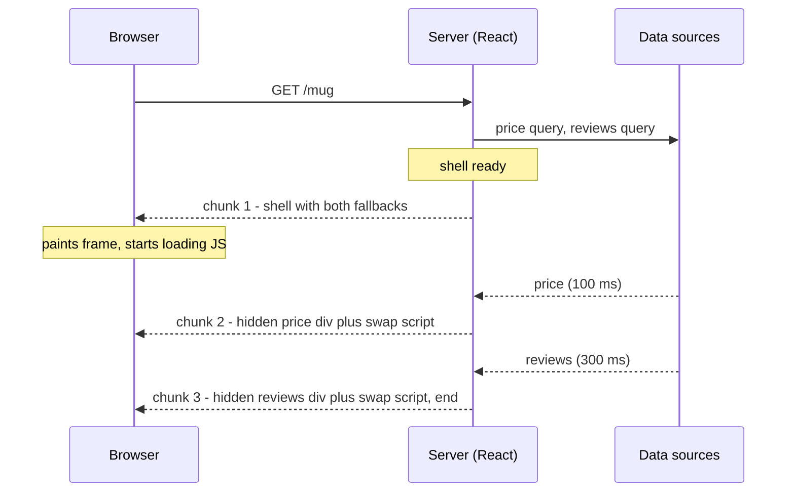
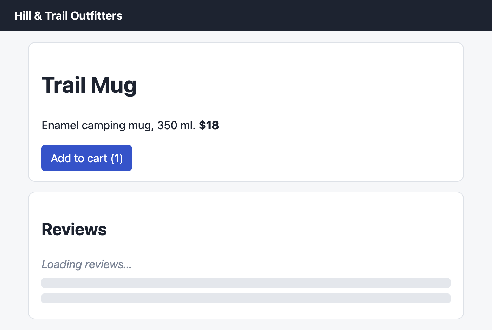
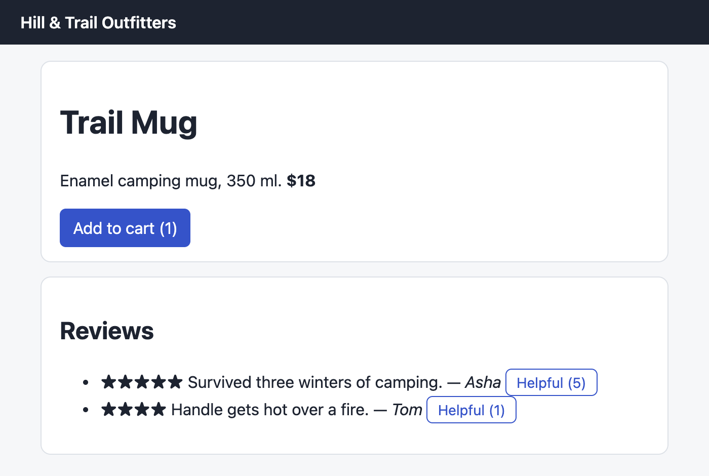
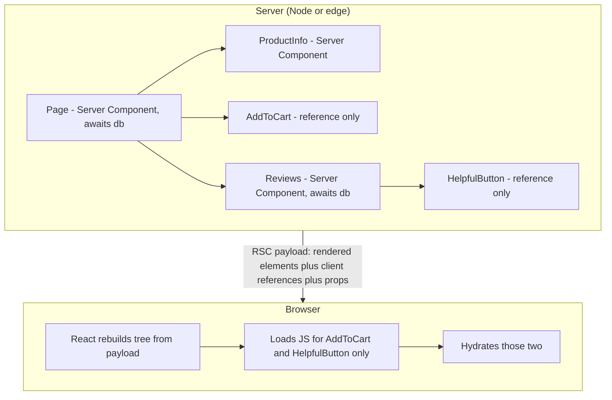
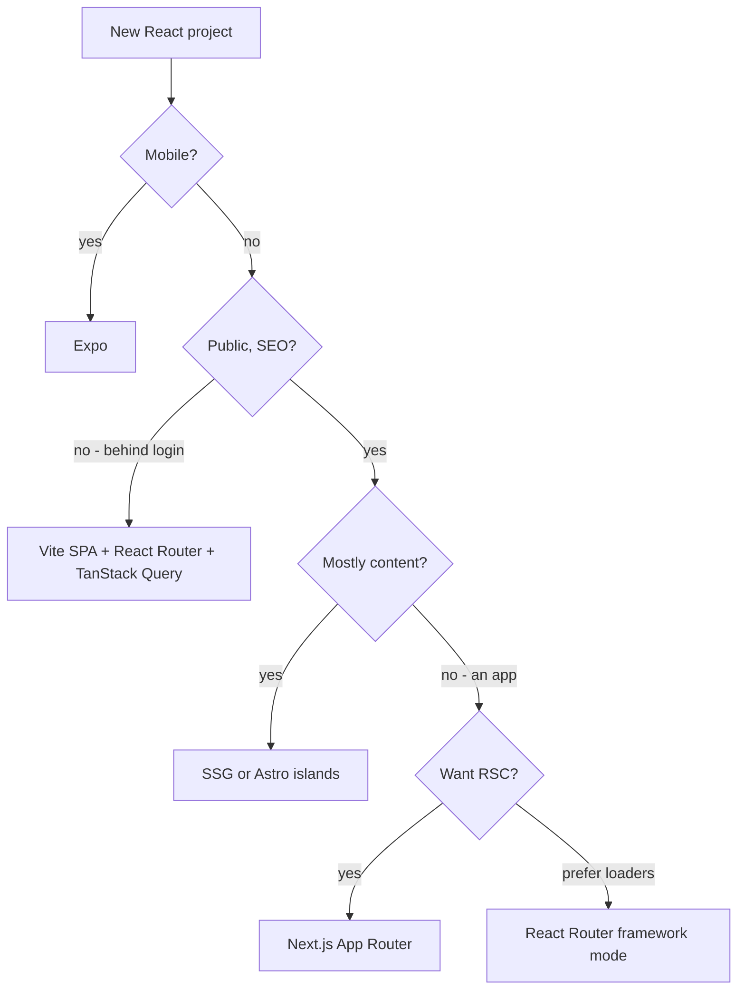

# Chapter 13 — Server Rendering and Frameworks

So far React has run only in the browser. This chapter moves it onto the **server** (a program on another computer that answers the browser's requests): what the server sends (captured byte by byte), how the browser takes that HTML over (**hydration** — React attaching its event handlers and state to HTML that is already on screen), what breaks when the two disagree, how slow parts stream in later (arrive as extra pieces of the same response), and how **React Server Components** run some components *only* on the server. Then we tour the two frameworks that package all this — **Next.js** 16 (App Router) and **React Router** 8 (framework mode) — and finish with how to choose.

Chapter 1 §1.4 already introduced the vocabulary (MPA — multi-page app, where every click loads a new HTML page from the server; SPA/CSR — single-page app, where one page loads and JavaScript in the client, i.e. the user's browser, draws every screen; SSR and SSG, recapped in the table below) with a tiny `renderToString` + `hydrateRoot` example. This chapter builds on it rather than repeating it.

**What you'll learn**

| # | Topic | You will be able to… |
|---|---|---|
| 13.1 | Rendering strategies: CSR, SSR, SSG, ISR, streaming, PPR | pick when and where each page's HTML is produced |
| 13.2 | The `react-dom/server` and `react-dom/static` APIs | choose the right server rendering function |
| 13.3 | Streaming SSR with `<Suspense>` | read a streamed response chunk by chunk and explain every marker |
| 13.4 | Hydration end to end | serve, stream and hydrate a real page in Chrome |
| 13.5 | Hydration mismatches | recognise the error, name the causes and fix them |
| 13.6 | Static generation and partial prerendering | prerender at build time and resume the dynamic part later |
| 13.7 | React Server Components | explain what runs where, what crosses the boundary and why |
| 13.8 | Directives: `'use client'` and `'use server'` | place boundaries correctly and secure Server Functions |
| 13.9 | Next.js App Router overview | read and write a basic App Router project |
| 13.10 | React Router framework mode | read a route module with loaders and actions |
| 13.11 | Choosing a framework | pick Next.js, React Router, Expo, TanStack Start or a plain Vite SPA |

Code: [`code/`](code/) — React 19.3 on Node 24. Files `01`–`05` are runnable. `04_ssr_server_hydrate.jsx` starts a real `node:http` server (Node's built-in web-server module), loads the page in headless Chrome (Chrome running without a window, driven by a script) and takes the screenshots in this chapter. Next.js and React Router snippets are marked **(not run)**: they need the framework's bundler (the build tool that packages source files into what the server and browser run). Background: Suspense (the component that shows a *fallback*, such as a spinner, while its children wait for data) and `use()` ([Chapter 9](../09-routing-and-data-fetching/README.md)), Effects ([Chapter 5](../05-effects-and-refs/README.md)), `useSyncExternalStore` and `useId` ([Chapter 7](../07-custom-hooks-and-hook-rules/README.md)), Form Actions ([Chapter 4](../04-forms-and-actions/README.md)). HTTP basics: the HTML & CSS book's [How the web works](../../../html-css/chapters/01-how-the-web-works/README.md).

---

## 13.1 Rendering strategies: CSR, SSR, SSG, ISR, streaming, PPR

### What it is
A **rendering strategy** answers two questions for each page: *where* is the HTML produced (browser or server) and *when* (at build time — once, when you run the build before publishing — at request time, when a visitor asks for the page, or some mix)? Chapter 1 covered the first four rows below; this chapter adds the last three.

| Strategy | Where / when HTML is made | First HTML contains | Data freshness |
|---|---|---|---|
| **CSR** (client-side rendering, SPA) | Browser, after JS loads | Empty `<div id="root">` | Live (fetched by the browser) |
| **SSR** (server-side rendering) | Server, every request | Full content | Live per request |
| **SSG** (static site generation) | Build machine, once per deploy (publishing a new version) | Full content | As old as the last build |
| **ISR** (incremental static regeneration) | Build, then re-built in the background on a timer or on demand | Full content | "Stale (out of date) for at most N seconds", or until you invalidate (mark the copy as outdated) |
| **Streaming SSR** | Server, per request, sent in pieces | Page frame + loading placeholders first, slow parts later | Live |
| **PPR** (partial prerendering) | Static shell at build time + dynamic "holes" filled per request | Static shell with placeholders, holes streamed in | Mixed per section |
| **RSC** (React Server Components) | Some components run only on the server (build or request time) | Works *with* any of the above | Per component |

Analogy — a restaurant. CSR hands the customer a kit and a recipe. SSR cooks each plate to order. SSG pre-plates sandwiches every morning; ISR re-makes the tray when it's over an hour old. Streaming serves the starter now and the main when ready. PPR keeps pre-plated sides and cooks only the main per order.

### Why it matters
It decides how soon something appears (**FCP**, First Contentful Paint), how soon the main content appears (**LCP**, Largest Contentful Paint), when clicks work (hydration done) and how fresh data is. It also decides cost: SSG pages are files on a **CDN** (Content Delivery Network — caching servers near the user; caching means keeping a ready copy to hand out again instead of rebuilding it; see [System Design Fundamentals](../../../system-design-patterns/modules/00-system-design-fundamentals/README.md)); SSR runs your code on every request.

### How ISR works
1. The page is generated at build time and cached, like SSG; requests are served from the cache.
2. After the revalidation window (say 60 s), the next request **still gets the stale page** but triggers a background re-render.
3. The new page replaces the cached copy; later visitors get fresh HTML.
4. You can also invalidate on demand (e.g. when an editor publishes).

This is the **stale-while-revalidate** idea (also used by HTTP caches — copies of responses kept by browsers and CDNs — and TanStack Query, [Chapter 6](../06-state-management/README.md) §6.9): serve what you have now, refresh behind the scenes. ISR is a framework feature (Next.js named it). It is not a React API (one of the functions React itself exposes).

### Trade-offs

| | CSR | SSR | SSG | ISR | Streaming SSR / PPR |
|---|---|---|---|---|---|
| Time to first content | Slow | Medium (waits for server render) | Fastest | Fastest | Fast (shell first) |
| Needs a server | No | Yes | No | Yes (for regeneration) | Yes |
| Per-user content in HTML | No | Yes | No | No | Yes (in the holes) |
| Good for | Dashboards (screens of live charts and numbers) behind login | Personalised pages | Docs, blogs | Catalogues, news | Fast frame + slow widgets |

### Common mistakes
- Thinking SSR makes pages *interactive* (responding to clicks and typing) sooner. It makes them *visible* sooner; interactivity still waits for JavaScript and hydration (§13.4).
- Using SSG for data that must be correct per user (prices in a cart, "logged in as…"). Put that in a dynamic hole or fetch it on the client.
- Treating strategies as whole-app choices. Modern frameworks choose **per route** (per URL path and the page it shows), and with PPR even **per component**.

### TL;DR
CSR = browser builds it; SSR = server per request; SSG = at build; ISR = SSG plus background refresh; streaming = send the frame now and slow parts later; PPR = static shell plus streamed dynamic holes.

---

## 13.2 The server rendering APIs

### What it is
React ships two server entry points (the import paths you load a feature from). `react-dom/server` renders **per request**. `react-dom/static` renders **ahead of time** and waits for all data.

| Function | Package | Output | Waits for `<Suspense>` data? | Use it for |
|---|---|---|---|---|
| `renderToString(el)` | `react-dom/server` | A string | No — emits the fallback | Legacy (old, kept for compatibility) code; simple SSR of pages without async data |
| `renderToStaticMarkup(el)` | `react-dom/server` | A string, no hydration markers | No | Non-interactive HTML: emails, static snippets |
| `renderToPipeableStream(el, opts)` | `react-dom/server` (Node) | Node stream: `{ pipe, abort }` | Streams it later | **SSR on Node** (Express, `node:http`) |
| `renderToReadableStream(el, opts)` | `react-dom/server` (Web Streams) | `Promise<ReadableStream>` | Streams it later | SSR on edge runtimes, Deno, Bun, Cloudflare Workers |
| `prerenderToNodeStream(el, opts)` | `react-dom/static` | `{ prelude }` Node stream | **Yes — waits for everything** | SSG on Node |
| `prerender(el, opts)` | `react-dom/static` | `{ prelude, postponed }` Web stream | Yes (unless aborted) | SSG with Web Streams; partial prerendering |
| `resume(el, postponed)` / `resumeToPipeableStream` | `react-dom/server` | Web / Node stream | Streams it | Filling the holes left by `prerender` at request time (§13.6) |
| `resumeAndPrerender` / `…ToNodeStream` | `react-dom/static` | `{ prelude, postponed }` | Yes | Continuing a postponed prerender at build time |

Terms in the table: a **Node stream** / **Web stream** is data delivered piece by piece (Node's own format vs. the browser-standard one); **Express** is a popular Node web-server library; **edge runtimes** are lightweight JavaScript servers running in many locations close to users; **Deno** and **Bun** are alternatives to Node.js; **Cloudflare Workers** is one such edge platform.

On the browser side there is one partner: **`hydrateRoot(domNode, element, options)`** from `react-dom/client`, which attaches React to existing server HTML (instead of `createRoot`, which builds DOM from nothing).

### Seeing the string APIs
`code/01_render_to_string.jsx`:

```jsx
function Greeting({ name }) {
  const [likes] = useState(3);                      // state works: initial value is rendered
  return <p className="greet">Hello, {name}! Likes: {likes}</p>;
}
console.log('renderToString      :', renderToString(<Greeting name="Ada" />));
console.log('renderToStaticMarkup:', renderToStaticMarkup(<Greeting name="Ada" />));

const never = new Promise(() => {});               // data that never arrives
function Slow() { return <p>{use(never)}</p>; }
const page = (
  <main>
    <h1>Shop</h1>
    <Suspense fallback={<p>Loading…</p>}><Slow /></Suspense>
  </main>
);
console.log(renderToString(page));                 // (output shortened in the file)
```

Output:
```
renderToString      : <p class="greet">Hello, <!-- -->Ada<!-- -->! Likes: <!-- -->3</p>
renderToStaticMarkup: <p class="greet">Hello, Ada! Likes: 3</p>
renderToString + pending Suspense:
  <main><h1>Shop</h1><!--$!--><template data-msg="Switched to client rendering because the server rendering aborted due to: …"></template><p>Loading…</p><!--/$--></main>
```

What each part teaches:
1. **Hooks run once on the server.** `useState` returns its initial value; Effects **never** run there and no event handlers are attached — the server only produces markup.
2. **`<!-- -->` comments** separate adjacent text pieces so hydration can match each text node (the DOM node that holds a run of plain text). `renderToStaticMarkup` drops them, so its HTML can't be hydrated.
3. **`renderToString` cannot wait.** A suspended component (one that is waiting for data) makes it emit the fallback marked `<!--$!-->` ("render this boundary on the client"), plus a development-only (shown only in dev builds, not in production) hint to use a streaming API.

### Common mistakes
- `renderToString` in new code — data components only ever show the fallback on the server. Use a streaming API.
- `hydrateRoot` on `renderToStaticMarkup` output — it lacks the markers hydration needs.
- Reading `window`, `document` or `localStorage` (the browser's small saved key-value store) during render — `ReferenceError` (the error for using a name that doesn't exist) on the server. Use Effects or handlers (§13.5).

### TL;DR
`renderToPipeableStream` (Node) or `renderToReadableStream` (Web Streams) for per-request SSR; `prerender*` for build time; `hydrateRoot` in the browser. The string APIs are legacy and don't support Suspense on the server.

---

## 13.3 Streaming SSR with `<Suspense>`

### What it is
**Streaming** sends one HTML response in several pieces. React cuts it at your `<Suspense>` boundaries: everything **outside** pending boundaries is the **shell**, sent first with fallbacks; each boundary's content follows when its data is ready, with a tiny inline script (JavaScript written directly in the HTML) that swaps it in.

### The problem it solves
Plain SSR is all or nothing: one slow query (a request for data, e.g. to a database; here reviews taking 1.5 s) delays the **whole** page. Streaming lets fast parts leave at once, so the browser loads CSS and JS, and even hydrates the shell, while slow parts still render.

### How it works
1. `renderToPipeableStream(<App />, options)` starts rendering at once.
2. When everything outside pending boundaries is rendered, React calls **`onShellReady`**: set status (the HTTP status code — a number such as 200 "OK" or 404 "Not found") and headers (key–value information sent before the page body), then **`pipe(res)`** — the shell goes out with fallbacks.
3. As each boundary's data resolves, React writes a chunk: the content in a **hidden `<div>`** plus a `<script>` that moves it into place and removes the fallback.
4. When all is done, **`onAllReady`** fires and the response ends.
5. **`onShellError`** — the shell itself failed (send an error page). **`onError`** — any error, including inside boundaries (log it). **`abort()`** — stop waiting; pending boundaries fall back to client rendering.

### Seeing every chunk
`code/02_stream_chunks.jsx` pipes into a fake response that prints each chunk and when it arrived. Price data takes 100 ms, reviews take 300 ms.

```jsx
const pricePromise = later('$18', 100);                       // fast data
const reviewsPromise = later(['Great mug', 'Too small'], 300); // slow data
function Price() { return <b>{use(pricePromise)}</b>; }
function Reviews() { return <ul>{use(reviewsPromise).map(r => <li key={r}>{r}</li>)}</ul>; }

function Page() {
  return (
    <main>
      <h1>Trail Mug</h1>
      <Suspense fallback={<i>price…</i>}><Price /></Suspense>
      <Suspense fallback={<i>reviews…</i>}><Reviews /></Suspense>
    </main>
  );
}
const res = new Writable({ write(chunk, _e, done) { console.log(`chunk ${++n} @ ${ms()}: ${chunk}`); done(); } /* ... */ });
const { pipe } = renderToPipeableStream(<Page />, {
  onShellReady() { console.log(`onShellReady @ ${ms()} -> pipe(res)`); pipe(res); },
  onAllReady()   { console.log(`onAllReady   @ ${ms()}`); },
  onError(e)     { console.error(e); },
});
```

Output (long scripts shortened by the program; timings vary by a few ms):
```
onShellReady @    3 ms -> pipe(res)
chunk 1 @    5 ms: <main><h1>Trail Mug</h1><!--$?--><template id="B:0"></template><i>price…</i><!--/$--><!--$?--><template id="B:1"></template><i>reviews…</i><!--/$--></main><script>/* 74 chars of React's swap code */</script>
chunk 2 @  101 ms: <div hidden id="S:0"><b>$18</b></div><script>/* 862 chars of React's swap code */</script>
onAllReady   @  302 ms
chunk 3 @  302 ms: <div hidden id="S:1"><ul><li>Great mug</li><li>Too small</li></ul></div><script>$RC("B:1","S:1")</script>
end      @  302 ms
```

| Marker | Meaning |
|---|---|
| `<!--$?-->` … `<!--/$-->` | A Suspense boundary that is still **pending**; what's between is the fallback |
| `<template id="B:0">` | Placeholder that marks *where* boundary 0's content will go |
| `<div hidden id="S:0">` | The finished content ("segment") for boundary 0, sent later and hidden |
| `$RC("B:1","S:1")` | "React: complete boundary" — moves segment S:1 into B:1's place, removes the fallback |
| `<!--$-->` | A boundary that was **complete** when sent (no swap needed) |
| `<!--$!-->` | A boundary that **failed** on the server; the browser renders it instead |

Chunk 2 carries the helper that defines `$RC`; chunk 3 only calls it. The shell left at 5 ms instead of waiting 300 ms.



### Status codes, errors and crawlers
- The HTTP **status code** can only be set before the first byte — decide it in `onShellReady`. A later error inside a boundary can't change the 200; the boundary is client-rendered instead, and your error boundary (a component that catches errors thrown below it and shows fallback UI) shows if it fails again.
- For **crawlers** (search-engine bots that download pages to index them) and static generation, wait for `onAllReady` so the whole document arrives at once.
- Always **`abort()` after a timeout**, or a hung query (one that never answers) holds the connection open.
- Since React 19.2 the server briefly **batches reveals** of boundaries that finish close together, so they appear in one go instead of flickering in one by one.

### Where to put boundaries
Wrap parts whose data is slow **and** not needed for the first view (reviews, recommendations, charts). Keep the main content (title, price, article text) in the shell, or LCP suffers. Many tiny boundaries make the page "pop" piece by piece; group related slow parts under one boundary.

### In the interview
**30-second answer:** "The shell — everything outside pending Suspense boundaries — is sent as soon as it's ready, with fallbacks. Each boundary's HTML follows in a hidden div plus a tiny swap script, so one slow query no longer blocks the page and the browser can load JS and hydrate the shell meanwhile. Status goes in `onShellReady`, logging in `onError`, crawlers wait for `onAllReady`, and a timeout calls `abort()`."

- *What if a component inside a boundary throws on the server?* — The boundary is marked for client rendering (`<!--$!-->`), the fallback stays, and the browser tries to render it; if it fails there too, the nearest error boundary shows.

### Self-check
1. What is the "shell"? → Everything outside pending Suspense boundaries — sent first, with fallbacks.
2. Why can't you return a 404 after the shell is sent? → The status line is the first thing in the response; once bytes are out it's fixed.
3. What does `<div hidden id="S:1">` contain? → The finished HTML of a boundary, hidden until `$RC` moves it into place.

### TL;DR
Streaming SSR = shell first, each Suspense boundary later with a swap script. Set status in `onShellReady`, wait for `onAllReady` for bots, always have an abort timeout.

---

## 13.4 Hydration end to end

### What it is
**Hydration** is React in the browser "adopting" the server-rendered DOM: it renders your components in memory, checks the result matches the existing HTML, **reuses** those DOM nodes (no re-creation), attaches event handlers and runs Effects. Analogy: the server builds and paints the house; hydration is the electrician. The house is visible all along, but the switches work only after wiring.

### How it works
1. The server HTML includes a `<script>` for your client bundle (the JavaScript file built for the browser; React adds it for you via the `bootstrapScripts` option).
2. The bundle calls **`hydrateRoot(document, <App {...sameProps} />)`** — the *same* component tree with the *same* data as the server.
3. React hydrates boundary by boundary (**selective hydration**): the shell hydrates while a boundary still streams, a click inside an unhydrated boundary moves it to the front, and each streamed boundary is hydrated when it arrives.

### The full demo — server, stream, Chrome
`code/04_ssr_server_hydrate.jsx` bundles the browser entry `ssr_client.jsx` with esbuild (a very fast bundler), starts a `node:http` server that streams `shop_app.jsx` (reviews take 1.5 s), then drives headless Chrome: screenshot the shell, click, wait for reviews, click again. The shared component (`code/shop_app.jsx`, key parts) renders the **whole document**:

```jsx
function AddToCart() {
  const [count, setCount] = useState(0);
  useEffect(() => { window.__hydrated = true; }, []);   // Effects never run on the server: proves hydration
  return <button onClick={() => setCount(c => c + 1)}>Add to cart ({count})</button>;
}
function Reviews({ reviewsPromise }) {
  const reviews = use(reviewsPromise);                  // suspends until the data is ready
  return <ul>{reviews.map(r => <Review key={r.id} r={r} />)}</ul>;
}
export default function App({ reviewsPromise }) {
  return (
    <html lang="en">
      <head><meta charSet="utf-8" /><title>Trail Mug — Shop</title><style>{css}</style></head>
      <body>
        <header>Hill &amp; Trail Outfitters</header>
        <main>
          <section className="card"><h1>Trail Mug</h1><p>Enamel camping mug, 350 ml. <b>$18</b></p><AddToCart /></section>
          <section className="card">
            <h2>Reviews</h2>
            <Suspense fallback={<ReviewsSkeleton />}><Reviews reviewsPromise={reviewsPromise} /></Suspense>
          </section>
        </main>
      </body>
    </html>
  );
}
```

The browser entry (`code/ssr_client.jsx`):
```jsx
import { hydrateRoot } from 'react-dom/client';
import App from './shop_app.jsx';
const reviewsPromise = fetch('/api/reviews').then(r => r.json());   // the browser needs the data too
hydrateRoot(document, <App reviewsPromise={reviewsPromise} />, {
  onRecoverableError(err) { console.error('recoverable:', err.message); },
});
```

The server (key part):
```jsx
const server = http.createServer((req, res) => {
  if (req.url === '/client.js')   { res.setHeader('content-type', 'text/javascript'); return res.end(clientJs); }
  if (req.url === '/api/reviews') { res.setHeader('content-type', 'application/json'); return res.end(JSON.stringify(REVIEWS)); }
  let didError = false;
  const { pipe, abort } = renderToPipeableStream(<App reviewsPromise={slowReviews()} />, {
    bootstrapScripts: ['/client.js'],          // React emits <script src="/client.js" async>
    onShellReady() {
      res.statusCode = didError ? 500 : 200;
      res.setHeader('content-type', 'text/html; charset=utf-8');
      pipe(res);
    },
    onShellError() { res.statusCode = 500; res.end('<h1>Something went wrong</h1>'); },
    onError(err) { didError = true; console.error(err); },
  });
  setTimeout(abort, 10_000);                   // never hang forever on a slow data source
});
// ... then puppeteer: goto (without waiting), wait for #reviews-fallback, click, screenshot, wait for .review, click, screenshot
```

Output (timings vary run to run):
```
[ 349 ms] server: GET / -> start rendering
[ 354 ms] server: onShellReady -> send shell (with fallback) now
[ 387 ms] browser: shell painted, reviews fallback visible
[ 402 ms] browser: shell hydrated while reviews still loading -> Add to cart (1), fallback still shown: true
[1852 ms] server: onAllReady -> reviews streamed, response ends
[1857 ms] browser: streamed reviews swapped in place of the fallback
[1883 ms] browser: after clicking Helpful -> ["Add to cart (1)","Helpful (5)","Helpful (1)"]
```


*Figure 13.1 — About 40 ms after the request: the shell is painted and hydrated ("Add to cart (1)" responded to a click) while the reviews boundary still shows its fallback.*


*Figure 13.2 — 1.5 s later: the reviews chunk replaced the skeleton (grey placeholder shapes shown while loading); clicking "Helpful" on the first review changed 4 → 5, so the streamed part is hydrated too.*

The run proves three things: the shell was **usable 1.4 s before the slow data** (selective hydration), the **streamed part hydrated too** (its button responds), and hydration **reused the server DOM** (no blank page or flicker).

### The double-fetch problem (and how frameworks fix it)
In `ssr_client.jsx` the browser **fetches the reviews a second time** to render the same tree during hydration, although the server already had them. Frameworks instead **serialize the server's data into the page** (serialize = turn data into text such as JSON so it can be sent or embedded) (Next.js embeds the RSC payload, §13.7; React Router embeds loader data). That, plus routing, per-route code splitting (cutting the JavaScript into chunks so each page loads only what it needs) and CSS handling, is most of what a framework does — which is why react.dev (React's official documentation) recommends one for server rendering.

### Common mistakes
- `createRoot` instead of `hydrateRoot` on server HTML — React discards the server DOM and rebuilds it (a flash).
- A different tree or props on the client (§13.5).
- One giant `<Suspense>` around everything, so the shell is empty.
- Forgetting the page is **not interactive** until the bundle loads — keep client JS small and use real `<a>` and `<form>` so basics work before hydration.

### In the interview
**30-second answer:** "`hydrateRoot` renders the same tree in the browser, matches it against the server HTML, reuses those nodes and attaches handlers and Effects. With streaming it's selective: the shell becomes interactive while boundaries still load, and a click in an unhydrated boundary gets priority. The client must render exactly what the server did — hence frameworks serialize server data into the page."

- *What happens to clicks between "visible" and "interactive"?* — Before the bundle runs they do nothing, unless the element works without JS (links, forms). Once React is running, a click on a not-yet-hydrated part makes React hydrate it first and then replay the event (deliver the saved click again).
- *Why hydrate `document` instead of a `<div>`?* — Rendering the whole `<html>` lets React manage `<head>` tags too.

### Self-check
1. Which Hook proved hydration in the demo, and why does it work? → `useEffect` — Effects never run on the server, only after hydration.
2. Why did "Add to cart" work before the reviews arrived? → Selective hydration: the shell hydrates independently of pending boundaries.
3. What is the double-fetch problem? → The client refetches data the server already used; frameworks embed it in the page instead.

### TL;DR
Server streams HTML → browser paints → bundle calls `hydrateRoot` with the same tree and data → React adopts the DOM boundary by boundary. Visible ≠ interactive.

---

## 13.5 Hydration mismatches

### What it is
A **hydration mismatch** happens when the HTML React renders in the browser during hydration differs from the HTML the server sent. React can't safely "adopt" DOM that doesn't match, so it throws away that part and **re-renders it on the client** — costing performance, causing a visible flash, and logging an error.

### Seeing one
`code/05_hydration_mismatch.jsx` renders on a pretend "server" (no `window`), then hydrates in jsdom:

```jsx
function BadBanner() {                       // BUG: output depends on the environment
  return <p>{isBrowser() ? 'Welcome back!' : 'Hello, guest'}</p>;
}
function GoodBanner() {                      // FIX 1: same first render, switch in an Effect
  const [mounted, setMounted] = useState(false);
  useEffect(() => setMounted(true), []);
  return <p>{mounted && isBrowser() ? 'Welcome back!' : 'Hello, guest'}</p>;
}
const subscribe = () => () => {};
function GoodBanner2() {                     // FIX 2: useSyncExternalStore with a server snapshot
  const inBrowser = useSyncExternalStore(subscribe, () => isBrowser(), () => false);
  return <p>{inBrowser ? 'Welcome back!' : 'Hello, guest'}</p>;
}
function Greeting() { use(browser()); return <p>Welcome back!</p>; }   // FIX 3 (React 19.3)
function GoodBanner3() { return <Suspense fallback={<p>Hello, guest</p>}><Greeting /></Suspense>; }
// each banner: renderToString on the "server", put the HTML in the DOM, flip to "browser",
// hydrateRoot(..., { onRecoverableError }) and print the result
function Stamp({ now }) { return <time suppressHydrationWarning>{now}</time>; }
```

Output:
```
BadBanner    server: <p>Hello, guest</p>          after hydrate: <p>Welcome back!</p>
   recoverable error: Hydration failed because the server rendered text didn't match the client. As a result this tree will be regenerated on the client. This can happen if a SSR-ed Client Component used:
GoodBanner   server: <p>Hello, guest</p>          after hydrate: <p>Welcome back!</p>
GoodBanner2  server: <p>Hello, guest</p>          after hydrate: <p>Welcome back!</p>
GoodBanner3  server: <!--$!--><template…><p>Hello, guest</p><!--/$-->
             after hydrate: <p>Welcome back!</p>  errors: 0
Stamp        server: <time>10:00:00</time>        after hydrate: <time>10:00:00</time>  errors: 0
```

Reading it:
1. `BadBanner` ends right only because React **gave up and re-rendered** the tree on the client, reported via `onRecoverableError` (development also logs a server/client diff).
2. Fixes 1 and 2 end in the same place **with no error**: hydration reproduces the server output, then a normal update changes it. `useSyncExternalStore` (a Hook for reading values that live outside React) uses its third argument (`getServerSnapshot`, which returns the value to use on the server) on the server *and during hydration*.
3. **`use(browser())`** (React 19.3, from `react-dom`) suspends **only on the server**: the server sends the nearest fallback marked "render on the client" (`<!--$!-->`) and the browser renders the real content — no mismatch, no error.
4. `suppressHydrationWarning` silences the warning for **one element's own text/attributes**, and React **keeps the server text** (`10:00:00`) — it does not patch it. Use it only for values that are expected to differ and are fine to be slightly stale, like a timestamp (a recorded date and time).

### Common causes and fixes

| Cause | Example | Fix |
|---|---|---|
| Environment checks in render | `typeof window !== 'undefined' ? A : B` | Render the server version first; switch in `useEffect` or with `useSyncExternalStore` |
| Browser-only data | `localStorage.getItem('theme')` during render | Same; or store the value in a cookie (a small value the browser sends to the server with every request) so the server knows it |
| Time, randomness, locale (language/region settings that decide date and number formats) | `Date.now()`, `Math.random()`, `toLocaleDateString()` → `9/28/2026` vs `28/09/2026` | Compute once on the server and pass as a prop; give `Intl` an explicit locale and `timeZone`; `useId` for IDs ([Chapter 7](../07-custom-hooks-and-hook-rules/README.md) §7.8) |
| Invalid HTML nesting | `<p><div/></p>`, `<a>` inside `<a>`, `<table>` without `<tbody>` | Fix the markup — the browser's parser (the code that reads HTML text and builds the DOM) "repairs" it, so the DOM no longer matches |
| Different data | Client refetched and got newer data | Serialize server data into the page (frameworks do this) |
| Browser extensions / proxies (servers in the middle that forward, and may alter, traffic) | An extension injects attributes; a CDN minifier (a tool that shrinks files by removing spaces and comments) strips comments | React 19 tolerates unexpected tags inserted in `<head>`/`<body>`; don't let proxies rewrite HTML |

### When the difference is intentional
Sometimes a component genuinely must show something different in the browser (a "you are offline" badge, a chart that needs the window size). Use **two-pass rendering** (render a neutral placeholder on the server and during hydration, then the real thing after mount, i.e. once the component is on the page — Fix 1 or 2), or, for a whole browser-only component, `use(browser())` inside `<Suspense>` (Fix 3). Next.js also offers `dynamic(() => import('./Chart'), { ssr: false })` inside a Client Component.

### In the interview
**30-second answer:** "The client's first render didn't produce the server's HTML, so React can't adopt that DOM: it client-renders the tree and reports a recoverable error. Causes: environment checks, `localStorage`, dates, randomness, locale, invalid nesting, different data. Fix: make the first client render identical and switch after mount (an Effect, `useSyncExternalStore`'s server snapshot, or `use(browser())` in 19.3); `suppressHydrationWarning` only for single expected differences like timestamps."

- *Does `suppressHydrationWarning` fix the text?* — No, it keeps the server's text and silences the warning, one level deep only.
- *Why is `useId` safe for SSR?* — It derives IDs from the component's position in the tree, which is the same on server and client.

### Self-check
1. Why does `GoodBanner` not mismatch? → Its first client render uses `mounted = false`, same as the server.
2. What does `getServerSnapshot` do during hydration? → Supplies the value used on the server so the first client render matches.
3. Why can `<p><div>x</div></p>` cause a mismatch? → The HTML parser closes the `<p>` before `<div>`, so the real DOM differs from React's tree.

### TL;DR
First client render must equal the server render. Move environment-dependent output behind an Effect, `useSyncExternalStore` or `use(browser())`; `suppressHydrationWarning` only for single expected differences.

---

## 13.6 Static generation and partial prerendering

### What it is
**Prerendering** means rendering ahead of any request (at build time). `react-dom/static`'s `prerenderToNodeStream` and `prerender` **wait for all Suspense data** and return the finished HTML as `prelude`.

**Partial prerendering (PPR)** prerenders what it can, **stops** at per-request data (cart, cookies), saves a small "where I stopped" object (`postponed`), and at request time **`resume()`** renders only the holes. The static part sits on a CDN; the server does only the dynamic work. `resume` arrived in React 19.2.

### Seeing both
`code/03_prerender_ssg.jsx`:

```jsx
// 1. SSG
const { prelude } = await prerenderToNodeStream(<Blog />);   // resolves only when everything is ready
console.log(await text(prelude));

// 2. PPR
let cart = new Promise(() => {});                 // per-user data: not available at build time
function Cart() { return <p>Cart: {use(cart)}</p>; }
function Store() {
  return (
    <main>
      <h1>Store</h1><p>Free shipping over $50</p>
      <Suspense fallback={<p>Cart: …</p>}><Cart /></Suspense>
    </main>
  );
}
const controller = new AbortController();
setTimeout(() => controller.abort(), 50);         // "build" stops waiting after 50 ms
const pre = await prerender(<Store />, { signal: controller.signal, onError() {} });
const saved = JSON.stringify(pre.postponed);      // store next to the prelude

cart = Promise.resolve('3 items');                // later, a real request: data is available
const rest = await resume(<Store />, JSON.parse(saved));
```

Output:
```
SSG (prerenderToNodeStream):
  <main><h1>Blog</h1><!--$--><ul><li>Packing list for a weekend hike</li><li>Choosing a camping stove</li></ul><!--/$--></main>

PPR prelude (cache on a CDN):
  <main><h1>Store</h1><p>Free shipping over $50</p><!--$?--><template id="B:0"></template><p>Cart: …</p><!--/$--></main><script>…</script>
postponed state: 610 bytes of JSON

resume() stream appended after the prelude:
  <div hidden id="S:0"><p>Cart: <!-- -->3 items</p></div><script>/* swap code */</script>
```

What happened:
1. **SSG**: the boundary is `<!--$-->` (complete) — no fallback, no swap script; ready for a CDN.
2. **PPR**: the abort left the cart boundary pending, so the prelude is a shell with a fallback and `postponed` records what's missing.
3. **`resume`** rendered **only** that boundary. At request time the server sends the cached prelude at once, then appends the resumed stream (the §13.3 hidden-div-plus-swap mechanism).

### Where you meet this in practice
You rarely call these APIs yourself. Next.js 16 with **Cache Components** uses exactly this model by default: static and `'use cache'` parts form the prerendered shell, and anything reading cookies, headers or uncached data must sit inside `<Suspense>` and streams at request time (§13.9). Static-site setups (React Router `prerender`, Astro, custom scripts) call the `prerender*` functions at build time.

### Common mistakes
- Prerendering per-user data into a static page — every visitor sees the first user's cart. Keep it in a dynamic hole.
- Expecting `prerender` to be fast for pages with slow data: it waits. Use an abort signal and PPR, or move slow data behind a boundary rendered at request time.

### TL;DR
`prerender*` waits for everything → static HTML. Abort it early → `prelude` + `postponed`; `resume()` fills the holes per request. That's PPR, and Next.js Cache Components is built on it.

---

## 13.7 React Server Components

### What it is
A **React Server Component (RSC)** runs **only** on the server — at build time or per request — and its code never ships to the browser. It can be `async`, `await` a database query, read files and use secrets (passwords, API keys and other values users must never see); only its *output* (the elements it returns) is sent. A **Client Component** is the kind you've written all book: its code ships, it can use state, Effects and handlers, and SSR still pre-renders it to HTML. In an RSC app (like the Next.js App Router) components are **Server Components by default**; `'use client'` opts into client code (§13.8).

Analogy: Server Components are the cooks in the kitchen — they use the fridge (database) and knives (secrets), and only the finished plate goes out. Client Components are the salt shaker on the table, which the diner handles directly.

### RSC is not SSR
This is the most common confusion.

| | SSR | Server Components |
|---|---|---|
| What it produces | **HTML** for the first page load | A serialized **component tree** (the RSC payload) |
| Which components | All of them (client ones included) | Only Server Components |
| Code shipped to browser | All component code (for hydration) | None for Server Components |
| Runs again on navigation? | No — after load, navigation is client-side | Yes — the server sends a new payload for the new route |
| Can use state/Effects? | Yes (initial render only on the server) | No |
| Can `await` data in render? | Via Suspense + `use()` | Yes, directly (`async function`) |

They are **complementary**: Next.js runs Server Components to get the payload, then SSR turns payload + Client Components into first-load HTML.

### How it works
1. The **server** renders the Server Component tree (awaiting their data). At a Client Component React does **not** run it; it records a **reference** ("module `LikeButton.js`, export `default`" — a module is one JavaScript file, an export is a value it makes available to other files) plus its props.
2. The result is serialized into the **RSC payload**: rendered elements, client references and their props.
3. On the **first load**, SSR turns payload + Client Components into HTML and embeds the payload; the browser hydrates only the Client Components.
4. On **client navigation**, the browser fetches the new route's payload (no HTML) and React merges it into the tree — **client state is preserved** where the tree is unchanged.



Conceptually the payload is already-rendered elements (`<main><h1>Trail Mug</h1>…<ul>…reviews…</ul>`) plus holes like *client ref `AddToCart.js#default`, props `{ productId: "mug-1" }`*; the real wire format (the exact bytes sent over the network) is internal and changes between versions.

### Why it matters
- **Smaller bundles** — a Server Component using a 200 KB Markdown parser (a library that turns Markdown, a simple text-formatting syntax, into HTML) ships 0 KB of it, only the resulting elements.
- **No client–server waterfalls** (requests that can only start after the previous one finishes, adding up their delays) — instead of "load JS → Effect → fetch → render", the component awaits data where it lives.
- **Safe data access** — database queries and API keys stay on the server.
- **Streaming built in** — async Server Components suspend, so `<Suspense>` streams as in §13.3.

### Code (Next.js 16 — not run)

```jsx
// app/products/[id]/page.jsx — a Server Component (no directive needed)
import { db } from '@/lib/db';
import AddToCart from './AddToCart';        // a Client Component
import { Suspense } from 'react';

export default async function ProductPage({ params }) {
  const { id } = await params;                         // Next.js 15+: params is a Promise
  const product = await db.product.findUnique({ where: { id } });   // direct DB access
  return (
    <main>
      <h1>{product.name}</h1>
      <p>{product.description}</p>
      <AddToCart productId={product.id} price={product.price} />   {/* serializable props only */}
      <Suspense fallback={<p>Loading reviews…</p>}>
        <Reviews productId={id} />                    {/* async Server Component, streams */}
      </Suspense>
    </main>
  );
}

async function Reviews({ productId }) {
  const reviews = await db.review.findMany({ where: { productId } });
  return <ul>{reviews.map(r => <li key={r.id}>{r.text}</li>)}</ul>;
}
```

`AddToCart.jsx` starts with `'use client'` and is an ordinary component with `useState` and `onClick`.

### What can cross the server → client boundary
Props passed from a Server Component to a Client Component must be **serializable** by React:

| Allowed | Not allowed |
|---|---|
| string, number, bigint, boolean, `null`, `undefined` | Ordinary functions (event handlers, callbacks) |
| Plain objects and arrays of allowed values | Class instances (e.g. an ORM — object-relational mapper, a library mapping database rows to objects — model object, a `class User`) |
| `Date`, `Map`, `Set`, typed arrays, `ArrayBuffer` | Objects with a `null` prototype |
| **JSX / React elements** (including Server Components as `children`) | Symbols not created with `Symbol.for` |
| **Promises** (read with `use()` on the client) | |
| **Server Functions** (`'use server'`, §13.8) | |

### Composition patterns
1. **Push `'use client'` to the leaves** (the components at the bottom of the tree). Keep pages and layouts as Server Components; make only the interactive pieces (buttons, forms, menus) Client Components. The directive marks a module *and everything it imports* as client code, so putting it high up ships the whole subtree (that component and everything below it).
2. **Pass Server Components *through* Client Components as `children`.** A Client Component cannot *import* a Server Component, but it can *render* one it receives as a prop — the server renders it first and passes the result.

```jsx
// Modal.jsx — a Client Component (needs state)
'use client';
import { useState } from 'react';
export default function Modal({ children }) {
  const [open, setOpen] = useState(false);
  return (
    <>
      <button onClick={() => setOpen(!open)}>Cart</button>
      {open && children}
    </>
  );
}
```

```jsx
// page.jsx — a Server Component
import Modal from './Modal';
import Cart from './Cart';                 // a Server Component that awaits the database
export default function Page() {
  return <Modal><Cart /></Modal>;          // Cart runs on the server; Modal receives its output
}
```

3. **Context is created and read in Client Components.** Server Components can't call `createContext`, `useContext` or `use(Context)`. Define the context in a `'use client'` file; since React 19.3 a Server Component may *render* it directly (`<UserContext value={user}>{children}</UserContext>`) — before 19.3 you needed a `'use client'` provider component wrapping `children`.
4. **Stream data to the client with a promise.** A Server Component can start a fetch *without awaiting* and pass the promise as a prop; the Client Component calls `use(promise)` inside `<Suspense>` ([Chapter 9](../09-routing-and-data-fetching/README.md)).
5. **Keep server code out of client bundles.** `import 'server-only'` at the top of a data module makes the build fail if a Client Component imports it.

### When not to use RSC
- Highly interactive screens (editors, canvases, live-filter dashboards) where nearly everything is client state anyway.
- Pure static hosting — RSC can run at build time, but there is no per-request rendering.
- Without a framework: RSC needs deep bundler integration, and React's low-level RSC bundler APIs are not covered by semver (semantic versioning — the promise that breaking changes only come with a new major version number). Next.js App Router is the complete implementation; React Router and TanStack Start support is still experimental (available but unstable and may change).

### Common mistakes
- Thinking `'use server'` marks a Server Component. It doesn't — there is **no directive** for Server Components; `'use server'` marks Server Functions.
- Passing an `onClick` from a Server Component to a Client Component — functions aren't serializable (unless they're Server Functions).
- Calling `useState`/`useEffect` in a component that runs as a Server Component (no `'use client'` above it) — the build errors.
- Assuming Server Components re-run when client state changes. They re-run only on a new server request (navigation, `router.refresh()`, or revalidation — re-fetching cached data so it is fresh — after a Server Function).

### In the interview
**30-second answer:** "Server Components run only on the server, can be async, read data directly and ship zero JS — the browser gets their output as an RSC payload. Client Components (`'use client'`) ship JS and handle state and events. SSR is different: it turns the tree into first-load HTML; RSC decides which components exist in the browser at all. Together: RSC payload → SSR HTML → hydrate only Client Components. Props crossing must be serializable; functions cross only as Server Functions."

- *Can a Client Component render a Server Component?* — Not by importing it, but yes if it receives it as `children` or another JSX prop from a Server Component.
- *How do several Server Components share one query without repeating it?* — Wrap the fetcher in React's `cache()` (per-request memoization — remembering a result so repeated calls reuse it; Server Components only).

### Self-check
1. Can a Server Component use `useState`? → No — no state, Effects or event handlers; only Client Components ship code.
2. Why can't you pass `onClick={() => …}` from server to client? → Functions aren't serializable; only Server Functions can cross.
3. How does `<Modal><Cart /></Modal>` keep `Cart` on the server? → The Server Component page renders `Cart` and passes the result as `children`.

### TL;DR
Server Components = server-only, async, zero JS, output sent as a payload. Client Components = `'use client'`, interactive. Default to server, push client to the leaves, pass server output as `children`, only serializable props cross.

---

## 13.8 Directives: `'use client'` and `'use server'`

### What it is
A **directive** is a string literal at the very top of a file (or function body), like `'use strict'` (the older directive that turns on JavaScript's strict mode). Bundlers that support RSC read them to decide what goes where. React defines exactly two:

| Directive | Where | Marks | Meaning |
|---|---|---|---|
| `'use client'` | Top of a **file** (before imports; comments allowed) | That module **and its imports** | "This is where client code starts" — the boundary from server to client |
| `'use server'` | Top of a **file**, or first line of an **async function** body | Exported async functions (file), or that one function | "This is a **Server Function**: callable from the client, runs on the server" |

`'use cache'` (and its variants) you'll see in Next.js is a **Next.js directive**, not a React one (§13.9).

### `'use client'` rules
1. It must be the first statement in the file, in single or double quotes (not backticks).
2. It marks a **module-graph boundary** (the module graph is the web of files importing one another): the file and everything it imports becomes client code. You don't need it in every client file — only at the entry points that Server Components import.
3. Exports that Server Components use must be components or serializable values.
4. A directive-less `Button.jsx` is client code when imported from a `'use client'` file and server code when imported from a Server Component.
5. Libraries put `'use client'` on Hook-using entry points so Server Components can import them.

### `'use server'` — Server Functions
A **Server Function** is an async function that runs on the server but is **called from client code** as if it were local: the bundler swaps it for a reference, and a call POSTs (sends with an HTTP POST request, the method used to submit data) the serialized arguments, runs the function and returns the serialized result. Used as a `<form action>` or with `useActionState` it is often called a **Server Action** (React's name for all of them until September 2024; Next.js still uses it). Chapter 4 §4.8 covered the form side.

```jsx
// app/actions.js — (Next.js 16 — not run)
'use server';
import { revalidatePath } from 'next/cache';
import { auth } from '@/lib/auth';
import { db } from '@/lib/db';

export async function addReview(prevState, formData) {
  const user = await auth();                                  // 1. authenticate
  if (!user) return { error: 'Please sign in' };
  const text = String(formData.get('text') ?? '').trim();     // 2. validate — never trust input
  if (text.length < 5) return { error: 'Review is too short' };
  await db.review.create({ data: { text, userId: user.id, productId: formData.get('productId') } });
  revalidatePath(`/products/${formData.get('productId')}`);   // 3. refresh server-rendered UI
  return { ok: true };
}
```

```jsx
// Inline Server Function inside a Server Component (not run)
export default async function Page() {
  async function subscribe(formData) {
    'use server';
    await db.newsletter.add(formData.get('email'));
  }
  return <form action={subscribe}><input name="email" type="email" /><button>Subscribe</button></form>;
}
```

Calling one outside a form (from a Client Component): wrap it in a transition (an update React may process in the background without blocking typing and clicks) so you get a pending state — `startTransition(async () => { await like(postId); })` ([Chapter 7](../07-custom-hooks-and-hook-rules/README.md) §7.10).

### Security — treat every Server Function as a public API endpoint
An **endpoint** is one URL on the server that performs one operation; "public" means anyone on the internet can call it.

- Anyone can call it with any arguments (the reference is in the page). **Authenticate and authorise inside** (check who the caller is, then check they are allowed to do this); a hidden button is not protection.
- **Validate** every argument (e.g. Zod, [Chapter 4](../04-forms-and-actions/README.md) §4.9).
- Values an inline Server Function captures from its component travel to the client and back (Next.js encrypts them — scrambles them so only the server can read them) — never close over secrets (capture them from the surrounding code in a closure), and re-check anything important.
- Arguments and return values must be serializable (the §13.7 table, plus `FormData`).

### Common mistakes
- Putting `'use client'` on every file "to be safe" — you lose all RSC benefits.
- `'use server'` on a file of private helpers — every exported async function becomes a public endpoint. Use `import 'server-only'` instead.
- Server Functions for **reading** data — they're designed for mutations (changes to data: create, update, delete); read in Server Components or loaders.

### In the interview
**30-second answer:** "`'use client'` marks where the client module graph starts — that file and its imports ship to the browser. `'use server'` marks Server Functions: async functions that run on the server but are callable from the client, typically as form actions (with progressive enhancement — the form works as plain HTML before JavaScript loads, and JavaScript improves it afterwards). Server Components have no directive — they're the default. Each Server Function is a public POST endpoint: authenticate, authorise and validate inside."

- *Does `'use client'` mean the component doesn't render on the server?* — No. Client Components are still pre-rendered to HTML by SSR; the directive means their code ships and they hydrate.
- *Why wrap a Server Function call in `startTransition`?* — To get `isPending` and keep the UI responsive; Actions are transitions.

### TL;DR
`'use client'` = start of client code (file + imports). `'use server'` = Server Function (callable from the client, runs on the server). No directive for Server Components. Server Functions are public endpoints: auth + validate.

---

## 13.9 Next.js App Router overview

### What it is
**Next.js** (by Vercel, a hosting company) is the framework react.dev lists first and the most complete Server Components implementation. Its **App Router** (`app/`, since Next.js 13) is built on RSC, streaming and Server Functions; the older **Pages Router** (`pages/`, `getServerSideProps`) is supported but gets no new features. This section describes **Next.js 16** (current major since October 2025; checked at 16.3; Node.js 20.9+). `npx create-next-app@latest` (`npx` runs a package's command without installing it first) sets up TypeScript, Tailwind (a CSS framework of small utility classes), ESLint (a linter that flags likely bugs), the App Router and Turbopack (Next.js's own bundler).

### File-system routing
Folders define URL segments (the parts between slashes, e.g. `products` and `42` in `/products/42`); special file names define what each segment renders.

```
app/
├── layout.jsx            ← root layout: <html><body>; layouts persist (keep state) across navigations
├── page.jsx              ← "/" — a page file makes the path public
├── loading.jsx           ← auto-wraps the page in <Suspense fallback={<Loading/>}>
├── error.jsx             ← error boundary for the segment ('use client'; gets error + retry)
├── not-found.jsx         ← UI for notFound()
├── products/
│   ├── page.jsx          ← "/products"
│   └── [id]/             ← dynamic segment
│       ├── page.jsx      ← "/products/42"   (params.id = "42")
│       └── AddToCart.jsx ← not a route: only page/route files are public
├── (marketing)/          ← route group: organises files, not part of the URL
│   └── about/page.jsx    ← "/about"
├── api/health/route.js   ← Route Handler: GET/POST functions returning Response
└── _components/          ← private folder (underscore): never routed
proxy.js                  ← runs before routes (was middleware.js before v16)
next.config.js
```

Also: `template.jsx` is a layout that re-mounts on every navigation; `[...slug]` and `[[...slug]]` are catch-all and optional catch-all segments (they match any number of further path parts).

### Pages, layouts and data (not run)

```jsx
// app/layout.jsx
export const metadata = { title: 'Hill & Trail', description: 'Outdoor gear' };  // <head> tags
export default function RootLayout({ children }) {
  return <html lang="en"><body><nav><a href="/">Home</a></nav>{children}</body></html>;
}

// app/products/page.jsx — Server Component fetching data
import Link from 'next/link';
export default async function Products({ searchParams }) {
  const { q = '' } = await searchParams;                    // Promise in Next.js 15+
  const products = await getProducts(q);                    // DB or fetch — on the server
  return (
    <ul>
      {products.map(p => <li key={p.id}><Link href={`/products/${p.id}`}>{p.name}</Link></li>)}
    </ul>
  );
}
```
Per-page `<head>` data comes from `export async function generateMetadata({ params })`, and `notFound()` (from `next/navigation`) renders `not-found.jsx`.

- **`<Link>`** from `next/link` does client-side navigation and **prefetches** (downloads ahead of a click) routes that come into view.
- **`useRouter`, `usePathname`, `useSearchParams`** come from `next/navigation` (Client Components only). `redirect()` and `notFound()` work on the server.
- **Mutations** use Server Functions (§13.8) and then **`revalidatePath('/products')`** or tag-based **`revalidateTag('products', 'max')`** so server-rendered pages show fresh data. Next.js 16 added **`updateTag(tag)`** (read-your-own-writes — after saving, the same user immediately sees what they saved — inside a Server Action) and **`refresh()`**.

### Rendering and caching in Next.js 16
Next.js 16 has two caching models:

1. **Previous model (default unless you opt in).** A route is static (prerendered at build) unless it uses request data (`cookies()`, `headers()`, `searchParams`) or uncached fetches. ISR is configured per route:

```jsx
// app/blog/[id]/page.jsx (not run)
export const revalidate = 60;                      // ISR: regenerate at most every 60 s
export async function generateStaticParams() {     // which [id]s to build ahead of time
  const posts = await getPosts();
  return posts.map(p => ({ id: String(p.id) }));
}
```

2. **Cache Components** (`cacheComponents: true` in `next.config.js`, new in 16). Everything runs at request time **unless** you cache it with the **`'use cache'`** directive. The build prerenders a **static shell** — static parts, cached parts and `<Suspense>` fallbacks — and dynamic parts stream per request. That's partial prerendering (§13.6), and it's the default behaviour once Cache Components is on.

```jsx
// app/blog/page.jsx — with cacheComponents: true (not run)
import { Suspense } from 'react';
import { cookies } from 'next/headers';
import { cacheLife, cacheTag } from 'next/cache';

export default function BlogPage() {
  return (
    <>
      <h1>Our Blog</h1>                                   {/* static: in the shell */}
      <Posts />                                           {/* cached: in the shell */}
      <Suspense fallback={<p>Loading your preferences…</p>}>
        <Preferences />                                   {/* per request: streamed */}
      </Suspense>
    </>
  );
}
async function Posts() {
  'use cache';
  cacheLife('hours');                                     // how long the cached result lives
  cacheTag('posts');                                      // invalidate later with revalidateTag / updateTag
  const posts = await db.post.findMany();
  return <ul>{posts.map(p => <li key={p.id}>{p.title}</li>)}</ul>;
}
async function Preferences() {
  const theme = (await cookies()).get('theme')?.value ?? 'light';   // request data → must be inside Suspense
  return <p>Theme: {theme}</p>;
}
```

With Cache Components on, reading request or uncached data **outside** `<Suspense>` is reported in development and at build, because the route could no longer produce a static shell.

### Other pieces worth knowing

| Feature | What it does |
|---|---|
| `proxy.js` (was `middleware.js`) | Redirects (send the browser to another URL), rewrites (serve another URL's content silently) and auth checks before a route runs |
| `next/image`, `next/font` | Image resizing/lazy-loading (load only when near the screen); self-hosted fonts without layout shift (content jumping as things load) |
| Parallel & intercepting routes (`@slot`, `(.)photo`) | Several pages in one layout; modals that have their own URL |
| Static export (`output: 'export'`) | Build a plain static site (no server features) |

### Common mistakes
- Adding `'use client'` to `layout.jsx` or `page.jsx` to use one Hook — the whole subtree becomes client code. Extract the interactive bit instead.
- Forgetting `await params` / `await searchParams` / `await cookies()` — they're Promises since Next.js 15 (sync access removed in 16).
- Expecting data to update after a mutation without revalidating (`revalidatePath`/`revalidateTag`/`updateTag`).
- Following Next.js 13–14 tutorials on implicit fetch caching — 15 changed the defaults and 16's Cache Components makes caching opt-in with `'use cache'`.

### TL;DR
App Router = folders are routes, `page`/`layout`/`loading`/`error` files, Server Components by default, Server Functions for mutations, revalidate to refresh. Next.js 16: `proxy.js`, Turbopack default, and opt-in Cache Components with `'use cache'` + PPR.

---

## 13.10 React Router framework mode

### What it is
React Router (maintained by Shopify; Remix's successor — Remix was a framework that merged into it) has three modes: **declarative**, **data** (loaders/actions, [Chapter 9](../09-routing-and-data-fetching/README.md)) and **framework**. Framework mode adds a **Vite plugin** (an add-on to the Vite build tool) for SSR, prerendering, per-route code splitting, typed route modules and deployment adapters (small packages that make the app run on a particular hosting platform). **React Router 8** (June 2026) needs React 19.2.7+, Node 22.22+ and Vite 7+, is ESM-only (ships only ES modules — the `import`/`export` format — not the older CommonJS `require`), and drops the `react-router-dom` package (import from `react-router` and `react-router/dom`). Start with `npx create-react-router@latest`; [Chapter 9 §9.7](../09-routing-and-data-fetching/README.md) gave the introduction, so here we focus on server rendering.

### Structure (not run)

```ts
// app/routes.ts — the route config
import { type RouteConfig, index, route, layout } from '@react-router/dev/routes';
export default [
  index('routes/home.tsx'),
  layout('routes/shop-layout.tsx', [
    route('products/:id', 'routes/product.tsx'),
  ]),
] satisfies RouteConfig;
```

```tsx
// app/routes/product.tsx — a route module
import { Form, useNavigation } from 'react-router';
import type { Route } from './+types/product';        // generated types for this route

export async function loader({ params }: Route.LoaderArgs) {      // runs on the server (SSR / prerender)
  const product = await db.product.find(params.id);
  if (!product) throw new Response('Not found', { status: 404 });
  return { product };
}

export async function action({ request, params }: Route.ActionArgs) { // handles <Form method="post">
  const form = await request.formData();
  await db.review.create({ productId: params.id, text: String(form.get('text')) });
  return { ok: true };                               // loaders re-run automatically afterwards
}

export const meta = ({ loaderData }: Route.MetaArgs) => [{ title: loaderData.product.name }];

export default function Product({ loaderData }: Route.ComponentProps) {
  const nav = useNavigation();
  return (
    <main>
      <h1>{loaderData.product.name}</h1>
      <Form method="post">
        <textarea name="text" />
        <button disabled={nav.state === 'submitting'}>Post review</button>
      </Form>
    </main>
  );
}

export function ErrorBoundary() { return <p role="alert">Something went wrong.</p>; }
```

```ts
// react-router.config.ts — choose the rendering strategy
import type { Config } from '@react-router/dev/config';
export default {
  ssr: true,                                        // false = SPA (CSR only)
  async prerender() { return ['/', '/about']; },    // these URLs become static HTML at build
} satisfies Config;
```

### How it maps to this chapter

| Concept | React Router framework mode |
|---|---|
| SSR | `ssr: true`; `loader` runs on the server per request; HTML streams |
| SSG | `prerender` (boolean, array of paths, or async function) |
| CSR per route | `clientLoader` instead of `loader` (data fetched in the browser) |
| Hydration data | Loader data is serialized into the page — no double fetch (§13.4) |
| Mutations | `action` + `<Form>`; works without JS (progressive enhancement), then revalidates loaders |
| Streaming | Return a promise from the loader and read it with `<Await>` or `use()` inside `<Suspense>` |
| RSC | Experimental (`unstable_` APIs) in v8 — not yet for production (the live app real users use) |

### Next.js vs React Router at a glance

| | Next.js App Router | React Router framework mode |
|---|---|---|
| Data loading | `async` Server Components | `loader` / `clientLoader` per route |
| Mutations | Server Functions (`'use server'`) | `action` + `<Form>` |
| Server Components | Stable, central | Experimental |
| Bundler | Turbopack (webpack, the older standard bundler, optional) | Vite |
| Mental model | React-specific (RSC, directives, caching) | Web standards (built-in browser objects: Request, Response, FormData, HTTP caching) |
| Can start as a SPA | Static export (limited) | Yes — `ssr: false`, add SSR later |

### TL;DR
React Router framework mode = `routes.ts` + route modules (`loader`, `action`, `meta`, `ErrorBoundary`, default component) + a config that picks SSR, SPA or prerendering. Web-standard, Vite-based, and an easy upgrade from data mode.

---

## 13.11 Choosing a framework

### The options (September 2026)

| Option | What it is | Pick it when |
|---|---|---|
| **Next.js** (App Router) | Full-stack (covers server and browser), RSC-first, by Vercel | You want Server Components, SEO-heavy (search engine optimisation: ranking and previewing well in search results) pages with mixed static/dynamic content, one framework for front + back end |
| **React Router** (framework mode) | Full-stack, web-standard, Vite-based, by Shopify | You like loaders/actions and HTTP semantics, are coming from a React Router SPA, or deploy to many platforms |
| **Expo** | React Native (React for real mobile apps) framework for iOS, Android and web | You're building a mobile app |
| **TanStack Start** | Newer full-stack framework on TanStack Router (type-safe routing, server functions, streaming); v1 release candidate (almost-final version), RSC experimental | You want end-to-end type safety and already use TanStack tools |
| **Astro** (not React-specific) | Content site framework with React "islands" (small interactive parts in an otherwise static page) | Mostly static content (docs, marketing) with a few interactive widgets |
| **Vite SPA** (no framework) | `npm create vite@latest` + React Router data mode + TanStack Query | Internal tools and dashboards behind a login, static hosting only, no SEO needs |

react.dev recommends a framework (Next.js, React Router or Expo) for new apps, and Vite, Parcel or Rsbuild (build tools without a framework) when none fits.



### Questions to ask
1. **Who must see content before JS runs?** Crawlers, link previews (the title/image card shown when a link is shared), slow phones → server rendering or SSG.
2. **Where will it run?** Static hosting → SPA or SSG; Node / serverless (your code runs on demand on the provider's machines; you manage no servers) / edge → any framework (check the adapter).
3. **How fresh must data be?** Static → SSG; hourly → ISR / `'use cache'`; per user → SSR or client fetching.
4. **What does the team know?** A team fluent in React Router data mode moves to framework mode easily.
5. **Hosting and lock-in** (being tied to one provider because moving is hard). All run on Node/Docker (a tool that packages an app with everything it needs into a portable container), but check self-hosting docs for ISR and caching if you won't use the vendor's platform.

### Common mistakes
- SSR for an internal dashboard "for performance" — a server to run, little gain.
- A SPA for an e-commerce catalogue — slow product pages, empty link previews.
- Choosing by popularity instead of by where it will be deployed.

### In the interview
**30-second answer:** "Requirements first. Public pages needing SEO and fast first paint → a framework: Next.js for Server Components and mixed static/cached/streamed content, React Router framework mode for loaders, actions and web standards or an existing React Router app. An internal tool behind a login → Vite SPA + React Router + TanStack Query. Mobile → Expo. Mostly static content → SSG or Astro."

- *What does a framework add over Vite + `react-dom/server`?* — Routing tied to data loading and code splitting, data serialization for hydration (no double fetch), caching/revalidation, server + client bundling and deployment adapters — what §13.4 would otherwise make you build.

### TL;DR
Public, SEO-sensitive app → Next.js or React Router framework mode. Behind a login → Vite SPA. Mobile → Expo. Mostly content → SSG/Astro. Decide from users, hosting and data freshness.

---

## Chapter 13 TL;DR

| Idea | Remember |
|---|---|
| Strategies | CSR, SSR, SSG, ISR, streaming, PPR — chosen per route |
| Server APIs | `renderToPipeableStream` / `renderToReadableStream` (SSR), `prerender*` (build), `resume*` (PPR); string APIs are legacy |
| Streaming | Shell first; boundaries arrive as hidden divs + `$RC`; status in `onShellReady`, crawlers on `onAllReady`, `abort` on timeout |
| Hydration | Same tree and data in `hydrateRoot`; reuses DOM; selective; visible ≠ interactive |
| Mismatches | First client render = server HTML; Effect, `useSyncExternalStore` or `use(browser())`; fix nesting |
| Server Components | Server-only, async, zero JS; RSC payload; not SSR; only serializable props cross; `'use client'` at the leaves |
| Server Functions | `'use server'`; public endpoints → auth + validate |
| Frameworks | Next.js 16 (`app/`, Cache Components), React Router 8 (loaders/actions, RSC unstable); SPA for tools behind a login |

Next: [Chapter 14 — Patterns and Architecture](../14-patterns-and-architecture/README.md).
