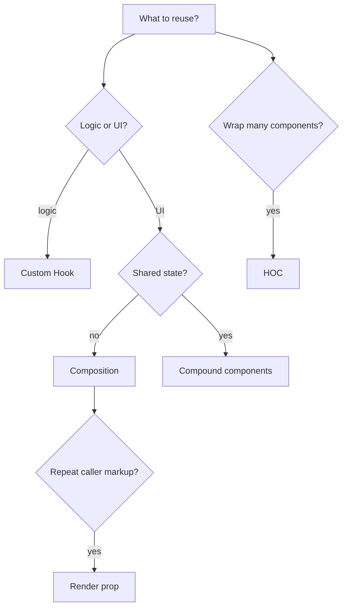
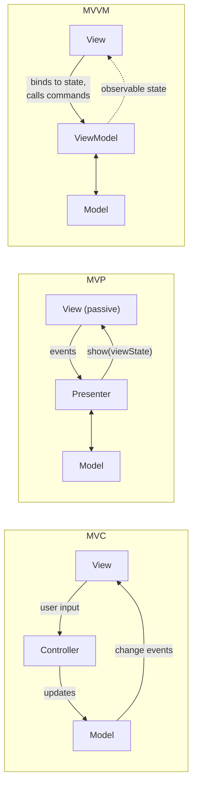

# Chapter 14 — Patterns and Architecture

This chapter is about **arranging** React's building blocks: the reusable patterns found in every codebase and component library — compound components, render props, higher-order components, custom Hooks, portals, error boundaries — how to make components **accessible** (usable by everyone, including screen-reader and keyboard-only users), how to organise **folders** as a project grows, and how a **design system** (a company's shared UI components, styles and usage rules) ties it together. Each pattern answers "how do I share *this* kind of thing?"; the short version: **composition and custom Hooks cover most needs**; the others are for specific jobs.

Code: [`code/`](code/) — React 19.3 in jsdom with Testing Library; every numbered file prints what a user (or screen reader) would get. Reusable modules: `Tabs.jsx`, `Dialog.jsx`, `ErrorBoundary.jsx`, `Button.jsx`; screenshots from `ds_demo.html` in headless Chrome. Background: composition and `children` ([Chapter 2](../02-components-and-props/README.md) §2.4), Context ([Chapter 6](../06-state-management/README.md)), custom Hooks and `useId` ([Chapter 7](../07-custom-hooks-and-hook-rules/README.md)), refs ([Chapter 5](../05-effects-and-refs/README.md)), Testing Library queries ([Chapter 12](../12-testing-react/README.md) §12.3). Accessibility fundamentals (landmarks — page regions like `<nav>`/`<main>`; ARIA — attributes describing elements to assistive tools; WCAG — the Web Content Accessibility Guidelines) are in the HTML & CSS book's [Chapter 3](../../../html-css/chapters/03-semantic-html-and-accessibility/README.md); general design patterns (decorator, observer, strategy…) in the LLD (low-level design) book's [structural](../../../lld/chapters/09-patterns-structural/README.md) and [behavioural](../../../lld/chapters/10-patterns-behavioral-1/README.md) chapters.

---

## 14.1 Composition first

### What it is
**Composition** builds a component from components you pass in (`children`, or JSX in named props called **slots**) instead of adding a configuration prop per variation. Introduced in Chapter 2 §2.4; here it's the baseline other patterns are compared against.

### The problem it solves — "prop explosion"
```jsx
<Card title="Trail Mug" subtitle="Enamel" showImage imageSrc="mug.png" imagePosition="left"
      showFooter footerButtonLabel="Buy" onFooterButtonClick={buy} compact highlighted />
```
Every need adds a prop, a branch and a test case, and callers can't do anything unforeseen (two footer buttons? a badge by the title?). The composed version exposes **structure**:
```jsx
<Card>
  <Card.Media src="mug.png" alt="Trail Mug" />
  <Card.Title>Trail Mug <Badge>New</Badge></Card.Title>
  <p>Enamel, 350 ml.</p>
  <Card.Footer><Button onClick={buy}>Buy</Button><Button variant="secondary">Save</Button></Card.Footer>
</Card>
```

### How to apply it
1. **`children`** for main content, **slot props** (`header={…}`, `actions={…}`) for secondary areas.
2. **Specialise by wrapping**, not flags: `function DangerDialog(props) { return <Dialog {...props} tone="danger" icon={<WarningIcon/>} />; }`.
3. Parts needing **shared state** (selected tab) → compound components (§14.4).
4. Pass elements down instead of data to avoid prop drilling (threading a prop through layers that don't use it) — middle layers just render `{children}`.

### When not to use it
Tiny fixed components (a `Price` formatter) are simpler with a couple of props. Composition pays when callers need different layouts.

---

## 14.2 Container / presentational

### What it is
One feature split in two:
- **Presentational** ("view") — everything via props, returns markup. No fetching, global state or Effects. Easy to reuse, test and show in Storybook (renders components in isolation in all their states).
- **Container** — knows *where data comes from*: fetches, reads context or a store, handles events, renders the presentational component.

The view is an actor reading whatever script it's handed; the container is the director choosing the script.

### History and today
Popular from 2015 (class components and Redux `connect`). After Hooks, its best-known advocate (Dan Abramov) noted he no longer recommends splitting *by rule*, since a custom Hook does the container's job without an extra component. Still valuable for:
1. **Design-system/shared UI** — visual components stay data-agnostic.
2. **Testing and Storybook** — render every visual state (loading, empty, error) via props.
3. **Server Components** ([Chapter 13](../13-server-rendering-and-frameworks/README.md) §13.7) — a Server Component "container" fetches and renders a Client Component "view"; the split is now an architectural boundary.

Runnable version in §14.3: `ProductSearch` (container) = `useProductSearch` (logic) + `ProductSearchView` (presentational).

### Common mistakes
- Mechanical `FooContainer` + `Foo` everywhere — twice the files. Split when the view is reused or has many states worth testing alone.
- A "presentational" component secretly calling `useContext(AuthContext)` — no longer reusable.

---

## 14.3 Extracting custom Hooks

### What it is
Moving stateful logic (state + Effects + derived values) out of a component into a **custom Hook** ([Chapter 7](../07-custom-hooks-and-hook-rules/README.md)); the component keeps only what it renders.

### Why it matters
The component becomes markup-only; the logic becomes **reusable** and **testable alone** with `renderHook`; the view becomes testable **without** mocking the network.

### How to do it (recipe)
1. Find state + Effects that work together (query → loading → results).
2. Move them into `function useX(inputs)` and **return only what the UI needs** (`{ status, results }`), not internal setters.
3. Pass dependencies in as parameters (the `search` function) — **dependency injection**: code receives what it relies on instead of importing it, so tests can hand in a fake.
4. The component calls the Hook and renders (optionally via a presentational component, §14.2).
5. Check behaviour didn't change (same test before and after).

`code/04_custom_hook_extraction.jsx` — before (abridged):
```jsx
function ProductSearchBefore() {
  const [query, setQuery] = useState('');
  const [results, setResults] = useState([]);
  const [status, setStatus] = useState('idle');
  useEffect(() => { /* if (!query) reset; else setStatus('loading'), api.search(query) with an ignore flag */ }, [query]);
  return (/* input + "Searching…" status + results list */);
}
```
After — Hook + view + thin container:
```jsx
export function useProductSearch(query, search = api.search) {        // logic, injectable dependency
  const [state, setState] = useState({ status: 'idle', results: [] });
  useEffect(() => {
    if (!query) { setState({ status: 'idle', results: [] }); return; }
    let ignore = false;                                               // ignore stale responses
    setState(s => ({ ...s, status: 'loading' }));
    search(query).then(results => { if (!ignore) setState({ status: 'done', results }); });
    return () => { ignore = true; };
  }, [query, search]);
  return state;
}
export function ProductSearchView({ query, onQueryChange, status, results }) {   // markup only
  return (
    <section>
      <label>Search <input value={query} onChange={e => onQueryChange(e.target.value)} /></label>
      {status === 'loading' && <p role="status">Searching…</p>}
      {status === 'done' && <ul>{results.map(r => <li key={r}>{r}</li>)}</ul>}
    </section>
  );
}
function ProductSearch() {                                             // wiring
  const [query, setQuery] = useState('');
  const { status, results } = useProductSearch(query);
  return <ProductSearchView query={query} onQueryChange={setQuery} status={status} results={results} />;
}
// tests: same user flow for both versions; then the Hook alone and the view alone
const { result, rerender } = renderHook(({ q }) => useProductSearch(q, fakeSearch), { initialProps: { q: '' } });
render(<ProductSearchView query="x" onQueryChange={() => {}} status="loading" results={[]} />);
```

Output:
```
before: Trail Mug, Trail Stove
after : Trail Mug, Trail Stove
hook, empty query : {"status":"idle","results":[]}
hook, "mug"       : {"status":"done","results":["mug result"]}
view in loading   : Searching… (no API needed)
```
Identical behaviour; the Hook tests with a fake search, the view's loading state renders directly. In a real app the Hook would wrap TanStack Query ([Chapter 9](../09-routing-and-data-fetching/README.md)) and add debouncing (`useDebounce`, Chapter 7 §7.5).

### Common mistakes
- A Hook returning 12 values including internal setters — callers depend on internals. Return a small, intention-revealing API.
- A "Hook" that calls no Hooks — that's a plain function; don't name it `use…`.
- Expecting two components calling one Hook to **share** state — each call has its own; share via context or a store ([Chapter 6](../06-state-management/README.md)).

### In the interview
**30-second answer:** "When a component mixes data logic and markup, I extract the logic into a custom Hook that takes inputs (and injectable dependencies) and returns a small API like `{ status, results }`. The component just renders, often via a presentational component. The logic becomes reusable and testable with `renderHook`, the view testable with plain props. Hooks share *logic*, not state."

---

## 14.4 Compound components

### What it is
Components designed to be used **together**, sharing state **implicitly** via a private context: `<Tabs>`, `<Tabs.List>`, `<Tabs.Tab>`, `<Tabs.Panel>`. The root owns state; parts read it — like HTML's `<select>`/`<option>`.

### The problem it solves
`<Tabs tabs={[{ label, content }]}>` can't handle custom layouts (tabs below the panel, an icon or badge in one tab, a shared panel) without ever more props. Compound components give callers the **structure** while the component keeps the **behaviour** (selection, keyboard, ARIA).

### How it works
1. The root holds `selected` and puts it plus `select` in a **context**.
2. Each part reads it with a small Hook that **throws a clear error** outside the root.
3. Parts attach as properties (`Tabs.Tab = Tab`) — one import for the family.
4. The root supports **uncontrolled** (`defaultValue`; keeps its own state) and **controlled** (`value` + `onValueChange`; parent owns it) use, like `<input>` ([Chapter 3](../03-state-and-events/README.md) §3.9).
5. It owns accessibility: roles, `aria-selected`, `aria-controls`, keyboard navigation.

`code/Tabs.jsx` (key parts):
```jsx
const TabsContext = createContext(null);
function useTabs(part) {
  const ctx = useContext(TabsContext);
  if (!ctx) throw new Error(`<Tabs.${part}> must be used inside <Tabs>`);
  return ctx;
}

export function Tabs({ defaultValue, value, onValueChange, children }) {
  const [inner, setInner] = useState(defaultValue);
  const selected = value ?? inner;                                     // controlled wins
  const select = (v) => { if (value === undefined) setInner(v); onValueChange?.(v); };
  const baseId = useId();                                              // stable ids for aria links
  return <TabsContext value={{ selected, select, baseId }}>{children}</TabsContext>;
}

function List({ label, children }) {
  const listRef = useRef(null);
  function onKeyDown(e) {                                              // arrows, Home, End
    const tabs = [...listRef.current.querySelectorAll('[role="tab"]')];
    const i = tabs.indexOf(document.activeElement);
    const next = { ArrowRight: i + 1, ArrowLeft: i - 1, Home: 0, End: tabs.length - 1 }[e.key];
    if (next === undefined) return;
    e.preventDefault();
    const tab = tabs[(next + tabs.length) % tabs.length];
    tab.focus(); tab.click();
  }
  return <div role="tablist" aria-label={label} ref={listRef} onKeyDown={onKeyDown}>{children}</div>;
}

function Tab({ value, children }) {
  const { selected, select, baseId } = useTabs('Tab');
  const isSelected = selected === value;
  return (
    <button role="tab" type="button" id={`${baseId}-tab-${value}`} aria-controls={`${baseId}-panel-${value}`}
      aria-selected={isSelected} tabIndex={isSelected ? 0 : -1} onClick={() => select(value)}>
      {children}
    </button>
  );
}

function Panel({ value, children }) {
  const { selected, baseId } = useTabs('Panel');
  if (selected !== value) return null;
  return <div role="tabpanel" id={`${baseId}-panel-${value}`} aria-labelledby={`${baseId}-tab-${value}`} tabIndex={0}>{children}</div>;
}
Tabs.List = List; Tabs.Tab = Tab; Tabs.Panel = Panel;
```

Usage (`code/01_compound_tabs.jsx`), checked with **role queries** (what assistive technology sees):
```jsx
<Tabs defaultValue="details">
  <Tabs.List label="Product information">
    <Tabs.Tab value="details">Details</Tabs.Tab>
    <Tabs.Tab value="reviews">Reviews</Tabs.Tab>
    <Tabs.Tab value="shipping">Shipping</Tabs.Tab>
  </Tabs.List>
  <Tabs.Panel value="details">Enamel mug, 350 ml.</Tabs.Panel>
  <Tabs.Panel value="reviews">4.5 stars from 12 reviews.</Tabs.Panel>
  <Tabs.Panel value="shipping">Ships in 2 days.</Tabs.Panel>
</Tabs>
```

Output (`*` = `aria-selected="true"`):
```
tablist name : Product information
start        : Details* | Reviews | Shipping  panel="Enamel mug, 350 ml."
click Reviews: Details | Reviews* | Shipping  panel="4.5 stars from 12 reviews."
ArrowRight   : Details | Reviews | Shipping*  panel="Ships in 2 days."  focus: Shipping
ArrowRight   : Details* | Reviews | Shipping  panel="Enamel mug, 350 ml."  (wrapped around)
End          : Details | Reviews | Shipping*  panel="Ships in 2 days."
panel labelled by its tab: Ships in 2 days.
tab stops    : -1,-1,0
controlled   : parent state: a | Panel A
misuse       : <Tabs.Tab> must be used inside <Tabs>
```

1. Selection, arrows (wrap-around), `End` — the keyboard behaviour of the WAI-ARIA Authoring Practices (W3C's guide to accessible widgets) "Tabs" pattern.
2. **Roving tabindex** (`-1,-1,0`): only the selected tab is in the Tab order; arrows move within the list — the widget is one Tab stop.
3. The panel's **accessible name** comes from its tab via `aria-labelledby` (and `aria-controls` links tab → panel, ids from `useId`).
4. Works **controlled** by a parent; misuse fails loudly.


*Figure 14.1 — The compound `Tabs` (and the `Button` from §14.12) in Chrome, styled with design tokens (§14.12) (`code/ds_demo.html`).*

### Trade-offs
| | Array/config prop (`tabs={[…]}`) | Compound components |
|---|---|---|
| Simple cases | Shortest to use | Slightly more JSX |
| Custom layout / content | Needs new props | Free — callers arrange parts |
| Type safety of structure | Easy (typed array) | Harder to enforce order/nesting |
| Implementation | Simple | Context + part Hooks |

### Real-world examples
Radix UI (`<Tabs.Root>`, `<Tabs.List>`, `<Tabs.Trigger>`, `<Tabs.Content>`), React Aria Components, Headless UI, Reach UI (accessible, mostly unstyled libraries) — and native `<select>`/`<option>`, `<table>`/`<tr>`, `<details>`/`<summary>`.

### Common mistakes
- `React.Children.map` + `cloneElement` (copy an element with changed props) to inject props — breaks once a caller wraps a part in a `<div>`. Context works at any depth.
- No error Hook — parts outside the root fail silently with `undefined` state.
- Rebuilding the context value each render in a large tree (performance — [Chapter 6](../06-state-management/README.md) §6.4; React Compiler handles it).

### In the interview
**30-second answer:** "Compound components are a family like `Tabs`, `Tabs.List`, `Tabs.Tab`, `Tabs.Panel` sharing state through a private context. The root owns the selected value — controlled or uncontrolled — and the parts read it, so callers control layout while the component controls behaviour and accessibility. I use context rather than `cloneElement` so parts nest at any depth, and throw a clear error if a part is used outside its root."

- *Why not `cloneElement`?* — Reaches only direct children, silently breaks with wrappers, and is a legacy API on react.dev.
- *Controlled and uncontrolled?* — Internal state for `defaultValue`, prefer `value` when defined, always call `onValueChange`.
- *Roving tabindex?* — Only the active item has `tabIndex=0`, others `-1`; arrows move focus within the group.

---

## 14.5 Render props

### What it is
A **render prop** is a prop whose value is a **function returning JSX**; the component owns behaviour/data and **calls your function** to decide what to render. Passed as `children`, it's "function as children".

### The problem it solves
Sharing behaviour while each caller chooses markup — before Hooks the main way to reuse stateful logic (React Router v4's `<Route render>`, Formik's `<Formik>{(form) => …}</Formik>`, Downshift). Still the right tool when the component must **control *where* and *how often*** your markup renders: lists (`renderItem`), virtualized rows, table `cell` renderers, empty/loading slots.

### Seeing it
`code/02_render_props.jsx`:
```jsx
function Disclosure({ defaultOpen = false, children }) {           // function as children
  const [open, setOpen] = useState(defaultOpen);
  return children({ open, toggle: () => setOpen(o => !o) });
}
function List({ items, renderItem, renderEmpty = () => <p>Nothing here.</p> }) {   // named render props
  if (items.length === 0) return renderEmpty();
  return <ul>{items.map((item, i) => <li key={item.id}>{renderItem(item, i)}</li>)}</ul>;
}
function useDisclosure(defaultOpen = false) {                         // the Hook equivalent
  const [open, setOpen] = useState(defaultOpen);
  return { open, toggle: () => setOpen(o => !o) };
}

<Disclosure>
  {({ open, toggle }) => (
    <><button aria-expanded={open} onClick={toggle}>Shipping details</button>{open && <p>Ships in 2 days.</p>}</>
  )}
</Disclosure>
<List items={products} renderItem={(p, i) => <>{i + 1}. {p.name} — ${p.price}</>} />
```

Output:
```
render prop, closed : <button aria-expanded="false">Shipping details</button>
render prop, open   : <button aria-expanded="true">Shipping details</button><p>Ships in 2 days.</p>
renderItem          : <ul><li>1. Trail Mug — $18</li><li>2. Camp Stove — $45</li></ul>
renderEmpty         : <p>No products match.</p>
same thing via Hook : <button aria-expanded="true">Shipping details</button><p>Ships in 2 days.</p>
```
`Disclosure` never decides the button's look; `List` decides *where* items go (inside `<li>`, keyed) but not what they show.

### Trade-offs
- ✔ Explicit about which values the caller gets; works in class components and anywhere JSX is allowed.
- ✘ Nesting several creates "callback pyramids" drifting right.
- ✘ A new function each render can defeat `memo` (React Compiler usually handles it).
- For **sharing stateful logic** only, a custom Hook is simpler (last output line).

### Common mistakes
- A render prop just to pass data one level — a normal prop or `children` suffices.
- Calling Hooks inside the render function — it's a plain callback, so the Rules of Hooks forbid it (the linter flags it); put stateful parts in a component.

---

## 14.6 Higher-order components (HOCs)

### What it is
A **higher-order component** is a function that **takes a component and returns a new one** rendering the original with extra props or behaviour: `const Enhanced = withSomething(Component)`. Named after higher-order functions ([JavaScript book, Chapter 4](../../../javascript/chapters/04-functions-scope-and-closures/README.md)); it's the OOP **decorator pattern** (wrap an object to add behaviour without changing it) ([LLD Chapter 9](../../../lld/chapters/09-patterns-structural/README.md)).

### Where you still meet them
Redux's `connect(mapState)(Component)`, React Router v5's `withRouter`, `React.memo(Component)` (HOC-like), analytics/feature-flag wrappers (flags toggle features without redeploying), auth guards. New code usually uses Hooks, but you must read and maintain HOCs.

### Seeing it
`code/03_hoc.jsx`:
```jsx
function withAuth(Component) {
  function WithAuth(props) {
    const user = useContext(UserContext);
    if (!user) return <p>Please sign in.</p>;
    return <Component {...props} user={user} />;          // pass everything through + inject one prop
  }
  WithAuth.displayName = `withAuth(${Component.displayName || Component.name})`;   // readable in DevTools
  return WithAuth;
}
function withRenderLog(Component) { /* logs each render with its props, same shape */ }
function OrderHistory({ user, limit }) { return <p>{user.name}'s last {limit} orders</p>; }
const ProtectedHistory = withRenderLog(withAuth(OrderHistory));   // apply once, at module level

// PITFALL demo: applying a HOC inside render
function Page({ bad }) {
  const [, force] = useState(0);
  const Wrapped = bad ? withNothing(Counter) : StableCounter;    // bad: a new component type every render
  return <><Wrapped /><button onClick={() => force(x => x + 1)}>re-render page</button></>;
}
```

Output:
```
displayName: withRenderLog(withAuth(OrderHistory))
  [log] withAuth(OrderHistory) rendered with {"limit":3}
signed out : Please sign in.
  [log] withAuth(OrderHistory) rendered with {"limit":3}
signed in  : Asha's last 3 orders
HOC at module    : count 2 -> after parent re-render: count 2
HOC inside render : count 2 -> after parent re-render: count 0
```
1. HOCs **compose** inside-out; `displayName` makes the chain readable in React DevTools.
2. Props flow through (`limit`); the HOC injects its own (`user`).
3. **Never create a HOC during render**: each call returns a *new component type*, so React unmounts the old and mounts a fresh one — state (`count 2`) lost ([Chapter 3](../03-state-and-events/README.md) §3.10).

### Common mistakes (the classic HOC problems)
| Problem | What happens | Fix |
|---|---|---|
| HOC applied inside render | Remount every render, state lost | Apply at module level |
| Prop name collisions | Two HOCs inject `data`; one silently wins | Namespacing (prefixed names), or Hooks |
| "Wrapper hell" | Deep anonymous wrappers in DevTools | `displayName`; Hooks |
| Static methods (functions attached to the component) lost | `Enhanced.someStatic` is undefined | Copy them (`hoist-non-react-statics`) |
| Refs | Before React 19, `ref` didn't pass through without `forwardRef` | React 19: `ref` is a normal prop for function components; spread it |
| Hidden dependencies | Reader can't see where `user` came from | A Hook call inside the component is explicit |

### In the interview
**30-second answer:** "A HOC takes a component and returns a wrapped one, for cross-cutting concerns (needs spanning many unrelated parts) like auth guards, logging or injecting store data — Redux's `connect` is the famous one. They compose but suffer prop collisions, implicit props, wrapper nesting, and must be created at module level or the component remounts every render. For new code I use a custom Hook; I'd still write a HOC to wrap *rendering* itself, like an auth guard around many route components."

---

## 14.7 Choosing a reuse pattern

| Need | Best fit | Why |
|---|---|---|
| Share **stateful logic** (fetching, form state, subscriptions) | **Custom Hook** | No extra components, explicit, composable |
| Share **UI structure** with flexible content | **Composition** (`children`, slots) | Simplest; no new concepts |
| A family of parts sharing **implicit state** (tabs, accordion, menu, select) | **Compound components** | Callers arrange parts; component owns behaviour + a11y |
| Component controls **where/how often** caller markup renders (lists, tables, virtualized rows) | **Render prop** (`renderItem`) | Component decides placement, caller decides content |
| Wrap **many components** with the same guard/behaviour, or legacy code | **HOC** | Works on components you don't own; decorator style |
| Render **outside** the parent's DOM box (modal, tooltip, toast) | **Portal** | Escapes `overflow`/`z-index` while staying in the React tree |
| **Contain crashes** of a subtree | **Error boundary** | The only way to catch render errors |



---

## 14.8 Portals

### What it is
**`createPortal(children, domNode)`** (from `react-dom`) renders `children` into a **different DOM node** — usually `document.body` — while they stay at the **same place in the React tree**: props, context, state and event bubbling behave as if the content were still inside its parent.

### The problem it solves
Modals, dropdowns, tooltips and toasts must sit **on top of everything**. Inside a card with `overflow: hidden` or a stacking context (a CSS layering group created by `transform`, `z-index` etc.; `z-index` only compares within one group) they're clipped or covered — CSS can't escape ancestors. Rendering at the end of `<body>` fixes that.

### How it works
1. React renders the portal's children as part of the parent's tree.
2. At commit it inserts their DOM nodes into `domNode`.
3. **Context** flows through (the React tree is unchanged).
4. **React events bubble through the React tree**, not the DOM: a click inside the portal triggers `onClick` on React ancestors that aren't DOM ancestors.

### Seeing it
`code/Dialog.jsx` — a modal with the accessibility essentials:
```jsx
export function Dialog({ open, onClose, title, children }) {
  const titleId = useId();
  const panelRef = useRef(null);
  const onEscape = useEffectEvent(() => onClose());     // latest onClose, without re-running the Effect
  useEffect(() => {
    if (!open) return;
    const previouslyFocused = document.activeElement;   // remember the trigger
    panelRef.current.focus();                           // move focus into the dialog
    const onKey = (e) => { if (e.key === 'Escape') onEscape(); };
    document.addEventListener('keydown', onKey);
    return () => {
      document.removeEventListener('keydown', onKey);
      previouslyFocused?.focus?.();                     // give focus back on close
    };
  }, [open]);                                          // re-runs only when opened/closed

  if (!open) return null;
  return createPortal(
    <div className="backdrop" onClick={(e) => { if (e.target === e.currentTarget) onClose(); }}>
      <div role="dialog" aria-modal="true" aria-labelledby={titleId} tabIndex={-1} ref={panelRef} className="dialog">
        <h2 id={titleId}>{title}</h2>
        {children}
        <button type="button" className="btn btn-secondary btn-sm" onClick={onClose}>Close</button>
      </div>
    </div>,
    document.body,
  );
}
```

`code/05_portal.jsx` opens it from a card with `overflow: hidden` whose `onClick` counts clicks (`bubbled`); the dialog contains `<ThemedText />` reading a theme context.

Output:
```
dialog DOM parent        : BODY (not inside .card)
inside .card?            : false
aria-modal               : true
focus moved into dialog  : true
context crosses portal   : theme from context: dark
React events bubble to the React parent: card onClick count 1 -> 2
Escape closes            : true
focus back on trigger    : true
```


*Figure 14.2 — The same `Dialog` in Chrome: rendered at the end of `<body>`, so no card's `overflow` or stacking can clip it.*

1. The dialog's DOM is under `<body>`, so `overflow: hidden` can't clip it; context still reaches `ThemedText`.
2. The click **inside the dialog** incremented the card's counter — React bubbling follows the component tree. A parent "click outside to close" handler fires for clicks inside the portal; check `e.target`, or `e.stopPropagation()` deliberately.
3. Focus moves in on open, returns to the trigger on close; Escape closes — the minimum modal keyboard behaviour. (This version doesn't trap Tab inside; the [Chapter 15 §15.13](../15-react-interview-and-machine-coding/README.md) modal adds that.) `useEffectEvent` (stable since React 19.2, [Chapter 5](../05-effects-and-refs/README.md)) lets the Escape listener call the latest `onClose` without re-running the Effect — otherwise a new arrow function each parent render would bounce focus back and forth.

### The native `<dialog>` alternative
`<dialog>` with `dialog.showModal()` (called from an Effect via a ref) renders in the browser's **top layer** — above everything, no portal — with Escape-to-close, an inert background (not clickable or focusable), focus moved in on open and **returned to the previously focused element on close** (HTML standard; all major browsers), for free. Supported in all modern browsers and often the simplest correct modal ([HTML & CSS book, Chapter 3](../../../html-css/chapters/03-semantic-html-and-accessibility/README.md)). Portals remain the tool for tooltips, popovers in older setups, toasts, and rendering into other containers (an iframe, a widget root). The Popover API (`popover` attribute) is another native option for non-modal pop-ups.

### Common mistakes
- A home-made modal without focus management — keyboard and screen-reader users end up "behind" it. Move focus in, trap it (or make the background `inert`), return it on close; for production use Radix Dialog, React Aria or `<dialog>`.
- Forgetting portal content still counts as a child for events.
- Rendering a portal during SSR — no `document` on the server; render after mount (or use `<dialog>`).

### In the interview
**30-second answer:** "`createPortal` renders children into another DOM node like `document.body` while keeping them in the same React tree. Modals and tooltips escape `overflow: hidden` and stacking contexts, while context, state and event bubbling still follow the React tree — a click inside a portal bubbles to React ancestors. For modals I also handle focus, Escape and `aria-modal`, or use native `<dialog>` with `showModal()`, which uses the top layer."

---

## 14.9 Error boundaries

### What it is
An **error boundary** catches errors thrown **while rendering** its descendants (including lifecycle methods and Effect setup during commit) and shows a **fallback UI** instead of the app vanishing. With no boundary, React 19 **unmounts the entire root** on an uncaught render error — a blank page. Boundaries must still be **class components** (no Hook equivalent of the two methods); write one once or use `react-error-boundary`. (Route-level boundaries: [Chapter 9](../09-routing-and-data-fetching/README.md); lazy-chunk failures: [Chapter 10](../10-performance/README.md) §10.8.)

### How it works
1. A descendant throws during render.
2. React finds the nearest boundary and calls **`static getDerivedStateFromError(error)`** — return state so the next render shows the fallback (pure, during render).
3. After commit, **`componentDidCatch(error, info)`** — for side effects such as logging; `info.componentStack` says where.
4. React 19 also calls the root's **`onCaughtError`** (caught by a boundary) or **`onUncaughtError`** (no boundary) — `createRoot`/`hydrateRoot` options, good for one central reporter. (`onRecoverableError` reports errors React recovered from itself, like hydration mismatches — Chapter 13 §13.5.)
5. To retry, reset the boundary's state — a "Try again" button, automatically when inputs change (**reset keys**), or by changing its `key`.

`code/ErrorBoundary.jsx`:
```jsx
export class ErrorBoundary extends Component {
  state = { error: null };
  static getDerivedStateFromError(error) { return { error }; }        // render the fallback next
  componentDidCatch(error, info) { this.props.onError?.(error, info); } // log (Sentry, console…)
  componentDidUpdate(prevProps) {                                     // reset when resetKeys change
    const { resetKeys = [] } = this.props;
    if (this.state.error && resetKeys.some((k, i) => !Object.is(k, prevProps.resetKeys?.[i]))) {
      this.setState({ error: null });
    }
  }
  reset = () => this.setState({ error: null });
  render() {
    if (this.state.error) return this.props.fallback({ error: this.state.error, reset: this.reset });
    return this.props.children;
  }
}
```

### What boundaries catch — and what they don't
`code/06_error_boundary.jsx` puts a price and a reviews widget in separate boundaries, plus an event handler that can fail:
```jsx
const root = createRoot(container, {
  onCaughtError(error) { console.log(`   onCaughtError   : "${error.message}"`); },
  onUncaughtError(error) { console.log(`   onUncaughtError : "${error.message}" -> whole root unmounted`); },
});
function ProductPrice({ product }) { return <p>Price: ${product.price.toFixed(2)}</p>; }   // throws on null
function Reviews() {
  const [error, setError] = useState(null);
  if (error) throw error;                                    // re-throw during render → boundary catches
  return <button onClick={() => {
    Promise.reject(new Error('network down')).catch(e => setError(e));   // async error moved into render
  }}>Load reviews</button>;
}
// in Shop:
<ErrorBoundary resetKeys={[id]} fallback={(p) => <Fallback {...p} />} onError={…}><ProductPrice product={product} /></ErrorBoundary>
<ErrorBoundary fallback={(p) => <Fallback {...p} />}><Reviews /></ErrorBoundary>
<button onClick={() => {
  try { JSON.parse('{bad json'); }                           // event-handler errors: NOT caught by boundaries
  catch { setImportMsg('Could not read the file'); }         // handle them yourself
}}>Import</button>
```

Output:
```
1. start              : Price: $18.00
   onCaughtError   : "Cannot read properties of null (reading 'price')"
   componentDidCatch: stack starts at ProductPrice
2. render error       : Could not show this part (Cannot read properties of null (reading 'price')). Try again
   onCaughtError   : "Cannot read properties of null (reading 'price')"
   componentDidCatch: stack starts at ProductPrice
3. reset, still broken: Could not show this part (Cannot read properties of null (reading 'price')). Try again
4. resetKeys changed  : Price: $21.00
5. handler error      : Could not read the file | price still fine: Price: $21.00
   onCaughtError   : "network down"
6. async error        : Could not show this part (network down). Try again | price still fine: Price: $21.00
7. no boundary        : container HTML = ""
```
- **Step 2**: contained — only the price area shows the fallback.
- **Step 3**: "Try again" re-rendered the same `null` data, so it failed again — reset helps only if something changed.
- **Step 4**: changing `id` (a reset key) cleared the error.
- **Step 5**: **event-handler** errors aren't render errors; boundaries never see them — catch and turn into state.
- **Step 6**: **async** errors (promises, timers) aren't caught unless moved into render by storing and re-throwing (TanStack Query's `throwOnError` and `use()` with a rejected promise do this).
- **Step 7**: no boundary → the whole root unmounts (browser: `onUncaughtError` called; tests: `act()` re-throws).

| Caught by error boundaries | Not caught |
|---|---|
| Errors during render of descendants | Event handlers (use `try/catch`) |
| Errors in lifecycle methods / Effects of descendants | Async code: `setTimeout`, promise callbacks (move into state and re-throw) |
| Rejected promises read with `use()` inside Suspense | Errors in the boundary itself (a parent boundary catches those) |
| Errors from `lazy()` chunk loading | Server-side rendering errors (fall back to client rendering, Chapter 13 §13.3) |

### Where to put boundaries
- **One at the top** (app shell): "Something went wrong — reload" instead of a blank page.
- **One per route** (Next.js `error.js`, React Router `ErrorBoundary` exports).
- **Around independent widgets** (chart, comments, third-party embed).
- Pair with `<Suspense>`: Suspense = "not ready yet", boundary = "failed".

### Common mistakes
- Expecting a boundary to catch `onClick` errors.
- A fallback that can itself throw (reads the same broken data).
- "Try again" that changes nothing — reset with a refetch or new input (reset keys).
- Swallowing errors without logging — report in `componentDidCatch` or `onCaughtError`.

### In the interview
**30-second answer:** "Error boundaries are class components with `getDerivedStateFromError` to show a fallback and `componentDidCatch` to log. They catch errors thrown while rendering their subtree — including `use()` rejections and lazy-loading failures — but not event handlers, async callbacks, SSR, or their own errors. Without one, React 19 unmounts the whole root. I place one at the top, per route and around risky widgets, reset them with reset keys, and report centrally via `createRoot`'s `onCaughtError`/`onUncaughtError`."

- *Why still a class?* — No Hook for `getDerivedStateFromError`/`componentDidCatch`; most teams use `react-error-boundary`, which wraps a class and adds `resetKeys` and a `useErrorBoundary` Hook to push async errors in.
- *Send an async error to a boundary?* — Store it in state and throw during render (or `showBoundary(error)` from `react-error-boundary`).
- *`getDerivedStateFromError` vs `componentDidCatch`?* — The first runs during render to choose the fallback (pure); the second after commit for side effects like logging.

---

## 14.10 Accessibility in React

### What it is
**Accessibility (a11y)** means people can use your UI however they perceive or operate it: screen readers, keyboard only, voice control, zoom, reduced motion. React renders the HTML you write; it adds (a) a few JSX spellings, (b) state-driven ARIA attributes, and (c) **focus management** in SPAs, which have no full page loads. Fundamentals (landmarks, headings, ARIA rules, WCAG 2.2): HTML & CSS book [Chapter 3](../../../html-css/chapters/03-semantic-html-and-accessibility/README.md); this is the React layer.

### React-specific rules
| Topic | In React |
|---|---|
| Labels | `<label htmlFor={id}>` (`for` is a JS keyword); ids from `useId()`, never hard-coded in reusable components (must be unique per page and match between server and client) |
| ARIA attributes | Hyphenated lower-case: `aria-label`, `aria-expanded={open}`; booleans render as `"true"`/`"false"` |
| Semantic elements first | `<button>`, `<a href>`, `<nav>`, `<main>`, `<h1>`–`<h6>`, `<ul>`: roles, keyboard support and focusability for free |
| Fragments (group children without a DOM element) | `<>…</>` instead of wrapper `<div>`s that break list/table semantics (`<ul>` must contain `<li>`) |
| Focus management | Refs move focus when UI changes: into dialogs, to the new page heading after client navigation, back to the trigger after closing |
| Announcements | Live region: `role="status"` (polite) or `role="alert"` (urgent), present in the DOM before the text changes |
| Icon-only buttons | Accessible name `aria-label="Remove item"`; hide the icon with `aria-hidden="true"` |
| Linting | `eslint-plugin-jsx-a11y` flags missing alt, click handlers on non-interactive elements, invalid ARIA |
| Automated audits | axe-core (browser extension, `vitest-axe`/`jest-axe`, Playwright's axe integration), Lighthouse (Chrome's page-quality report) |

### Checking it with role queries
`getByRole` finds elements as assistive technology does — by **role** and **accessible name**; if a test can't find your button by role, a screen-reader user can't either ([Chapter 12](../12-testing-react/README.md) §12.3). `code/07_a11y_checks.jsx` audits a bad and a good checkout:
```jsx
function BadCheckout({ onBuy }) {
  return (
    <div>
      <div className="title">Checkout</div>                  {/* looks like a heading, isn't one */}
                                        {/* no alt */}
      <input placeholder="Email" />                          {/* placeholder is not a label */}
      <div className="btn" onClick={onBuy}>Buy now</div>     {/* not focusable, no role */}
      <button><svg aria-hidden="true" /></button>            {/* icon-only: no name */}
    </div>
  );
}
function GoodCheckout({ onBuy }) {
  const emailId = useId(), errId = useId();
  // ... error + done state, submit() validates and calls onBuy ...
  return (
    <form onSubmit={submit} noValidate>
      <h1>Checkout</h1>
      
      <label htmlFor={emailId}>Email</label>
      <input id={emailId} name="email" type="email" aria-invalid={!!error} aria-describedby={error ? errId : undefined} />
      {error && <p id={errId}>{error}</p>}
      <button type="submit">Buy now</button>
      <button type="button" aria-label="Remove item"><svg aria-hidden="true" /></button>
      <p role="status">{done ? 'Order placed' : ''}</p>
    </form>
  );
}
```

Output:
```
--- bad
heading "Checkout"      : false
image with alt text     : missing
textbox named "Email"   : false
button named "Buy now"  : false
button names            : [""]
Tab key visits          : input -> button -> body (the "Buy now" div is never reached)
--- good
heading "Checkout"      : true
image with alt text     : Trail Mug, blue enamel
textbox named "Email"   : true
button named "Buy now"  : true
button names            : ["Buy now","Remove item"]
invalid email -> aria-invalid: true | description: "Enter a valid email"
valid email   -> bought: 1 | aria-invalid: false | status: Order placed
```
1. The bad version **looks** the same with CSS, but a screen reader gets no heading, an unnamed image, an unlabelled field, a nameless button — and the "Buy now" `div` (no button role) is **unreachable by Tab**.
2. In the good version every control has a role and name; the error is the field's **accessible description** (`aria-describedby`), and `aria-invalid` reflects state.
3. A real `<form>` + `<button type="submit">` makes **Enter** submit for free.
4. The `role="status"` live region announces "Order placed" without moving focus.

### Focus after client-side navigation
SPA link clicks swap content without a page load, so screen readers may not announce the new page and focus stays on the old link. Fixes: move focus to the new `<h1>` (`tabIndex={-1}`) in an Effect keyed on location, and update `document.title` (React 19 lets any component render `<title>`). Next.js announces route changes; React Router offers scroll restoration and you add focus handling.

### Common mistakes
- `<div onClick>` instead of `<button>` — no keyboard, role or focus (you'd need `role="button"`, `tabIndex={0}`, Enter/Space handlers — just use `<button>`).
- `outline: none` without a visible replacement — use `:focus-visible` styles (shown when focus should be visible, e.g. keyboard use).
- ARIA overuse (`role="button"` on a `<button>`, `aria-label` contradicting visible text). First rule of ARIA: native elements when they exist.
- Conditionally rendering the live region itself — only changes to an existing region are announced.
- Testing only with a mouse — Tab through every new screen.

### In the interview
**30-second answer:** "React renders whatever HTML I write, so accessibility is mostly semantic HTML: real buttons, links, headings and labels. The React-specific parts are `htmlFor`, `useId` for label/description ids, state-driven ARIA like `aria-expanded`, live regions for status messages, and focus management with refs — into dialogs, back to triggers, and to the heading after client-side navigation. I test with Testing Library role queries, which fail when elements lack roles or names, plus `eslint-plugin-jsx-a11y`, axe, and manual keyboard and screen-reader checks."

---

## 14.11 Folder structure

### What it is
File layout decides how easily people find code, how far changes ripple, and whether features can be deleted cleanly. React has **no opinion**; frameworks impose some (Next.js `app/`, React Router `app/routes/`). Start simple (Chapter 1 §1.6); grow deliberately.

### Three common layouts
**1. By type** — fine for small apps (< ~15 components):
```
src/
├── components/   Button.jsx, ProductCard.jsx, CartPanel.jsx, ...
├── hooks/        useCart.js, useProductSearch.js
├── pages/        Home.jsx, Product.jsx
├── services/     api.js
└── utils/        formatPrice.js
```
At scale one feature spreads over five folders and `components/` hits 200 files.

**2. By feature** — common for medium and large apps:
```
src/
├── app/                  ← app shell: providers, router, global styles
├── features/
│   ├── cart/
│   │   ├── components/   CartPanel.jsx, CartItem.jsx
│   │   ├── hooks/        useCart.js
│   │   ├── api.js        cart endpoints
│   │   ├── cart.test.jsx
│   │   └── index.js      ← public API: the only file other features import
│   └── catalog/ ...
└── shared/               ← feature-agnostic: ui/ (design system), lib/ (helpers), config
```
Everything "cart" lives together (**colocation**: files that change together, kept together — tests and styles too). Deleting a feature = deleting a folder.

**3. Framework routes + features** — thin route files importing from features:
```
app/
├── layout.jsx
├── products/[id]/page.jsx      ← fetch + compose: imports from features/catalog
└── cart/page.jsx
src/features/..., src/shared/...  (or inside app/ in private _folders)
```

### Rules that keep it healthy
1. **Dependency direction:** `app → features → shared`. Shared never imports features; features never import the app shell.
2. **Public APIs:** each feature exposes `index.js`; others import `features/cart`, never `features/cart/store.js`, so internals can change freely.
3. **Enforce, don't hope:** ESLint `no-restricted-imports` or `eslint-plugin-boundaries`, or monorepo tool path rules (a monorepo holds several apps/packages in one repository).
4. **Path aliases** (`@/features/cart` instead of `../../../`) via `tsconfig`/`jsconfig` `paths` and the bundler.
5. **Careful with barrel files** (`index.js` re-exporting everything): one per feature is fine; giant barrels slow dev servers and tests, can hurt tree-shaking (dropping unimported code) and create import cycles.

### Seeing a boundary check
`code/08_import_boundaries.mjs` scans the sample project in `code/feature-app/` and applies rules 1–2 — a miniature lint rule:
```js
if (fl === 'shared' && tl !== 'shared') problems.push([from, spec, 'shared/ must not import from ' + tl + '/']);
if (fl === 'features' && tl === 'app') problems.push([from, spec, 'features must not import app/']);
if (fl === 'features' && tl === 'features' && featureOf(from) !== featureOf(target)
    && target.split(path.sep).length > 2) {                    // deeper than features/<name>
  problems.push([from, spec, `deep import into feature "${featureOf(target)}" (use its index)`]);
}
```

Output (file tree abridged: `app/App.jsx`; `features/cart/{components/CartPanel.jsx, hooks/useCart.js, index.js, store.js}`; `features/catalog/{components/ProductCard.jsx, components/ProductList.jsx, index.js}`; `shared/{lib/formatPrice.js, ui/Button.jsx}`):
```
2 boundary violation(s):
  features/catalog/components/ProductList.jsx
    imports '../../cart/store.js' -> deep import into feature "cart" (use its index)
  shared/lib/formatPrice.js
    imports '../../features/cart' -> shared/ must not import from features/
```
`ProductCard.jsx` imports `useCart` from `'../../cart'` (the public index) and passes. The equivalent ESLint rule (not run):
```js
// eslint.config.js (excerpt)
rules: {
  'no-restricted-imports': ['error', { patterns: [
    { group: ['@/features/*/*'], message: 'Import features through their index (public API).' },
  ] }],
}
```

### Common mistakes
- A deep hierarchy on day one — start flat; add `features/` once two or three exist.
- `shared/`/`utils/` as a dumping ground — if one feature uses it, it belongs there.
- Circular imports between features — the shared piece belongs in `shared/`, or one feature should own it.

---

## 14.12 Design systems

### What it is
A **design system** is the shared set of decisions, components and docs that make a product look and behave consistently. In React, three layers:

| Layer | What it is | Example |
|---|---|---|
| **Design tokens** | Named values for design decisions: colours, spacing, radii, typography, shadows, motion | `--color-brand: #3553c9`, `--space-2: 8px` |
| **Primitives / components** | Accessible building blocks using the tokens | `Button`, `Tabs`, `Dialog`, `TextField`, `Menu` |
| **Patterns and docs** | How to combine them, when to use which | "Destructive actions use `variant="danger"` and a confirm dialog" |

### Why it matters
Consistency (one Button, not 14), speed (assemble, don't rebuild), accessibility solved once (focus, ARIA, keyboard in every `Menu`), and themeability (change tokens → rebrand or dark mode — [Chapter 8](../08-styling/README.md) §8.8).

### Tokens in practice
`code/ds.css` defines tokens as CSS custom properties (`--something`, read with `var(--something)`); components use only tokens:
```css
:root {
  --color-brand: #3553c9; --color-danger: #c62f3b; --color-border: #dde1e7;
  --radius-md: 8px; --space-1: 4px; --space-2: 8px; --space-3: 12px; --space-4: 16px;
  --focus-ring: 0 0 0 3px #9db0ff;
}
.btn-primary { background: var(--color-brand); color: var(--color-brand-text); }
.btn:focus-visible, .tab:focus-visible { outline: none; box-shadow: var(--focus-ring); }
.tab[aria-selected="true"] { color: var(--color-brand); border-bottom-color: var(--color-brand); }
```
The Tabs style keys off **`aria-selected`** — styling from accessibility state keeps visuals and semantics in sync.

### A primitive: `Button`
`code/Button.jsx`:
```jsx
const variants = { primary: 'btn-primary', secondary: 'btn-secondary', danger: 'btn-danger' };
const sizes = { sm: 'btn-sm', md: 'btn-md' };

export function Button({ variant = 'primary', size = 'md', className = '', type = 'button', ref, ...rest }) {
  return <button ref={ref} type={type} className={`btn ${variants[variant]} ${sizes[size]} ${className}`.trim()} {...rest} />;
}
```
`code/09_design_system_button.jsx`:
```jsx
<Button>Add to cart</Button>
<Button variant="secondary" size="sm" disabled>Save for later</Button>
<Button variant="danger" aria-label="Delete Trail Mug" ref={ref}>×</Button>
<Button type="submit" className="wide">Pay</Button>
```
Output:
```
<button type="button" class="btn btn-primary btn-md">Add to cart</button>
<button type="button" class="btn btn-secondary btn-sm" disabled="">Save for later</button>
<button type="button" class="btn btn-danger btn-md" aria-label="Delete Trail Mug">×</button>
<button type="submit" class="btn btn-primary btn-md wide">Pay</button>
ref points at the DOM node: true BUTTON
found by accessible name  : true
```
Design choices worth copying:
1. **A small, closed set of variants** (`primary | secondary | danger`) — the system decides what's allowed (a TypeScript union, [Chapter 11](../11-typescript-with-react/README.md) §11.9).
2. **Safe defaults**: `type="button"` avoids accidental submits (a `<button>` in a form defaults to `submit`).
3. **Pass native props through** (`disabled`, `aria-*`, `onClick`) with `...rest`, plus an extra `className`.
4. **`ref` is a normal prop in React 19** — no `forwardRef`, so focus management and popover positioning work ([Chapter 5](../05-effects-and-refs/README.md) §5.10).

### Build or adopt?
Few teams should build complex widgets (menus, comboboxes, date pickers) from scratch — keyboard and ARIA details take long to get right.

| Approach | Examples | You get | You still do |
|---|---|---|---|
| **Headless / unstyled primitives** | Radix UI Primitives, React Aria (Adobe), Headless UI, Base UI | Behaviour, keyboard, ARIA, focus — no styles | All visual design (with your tokens) |
| **Copy-in components** | shadcn/ui (source copied into your repo; built on headless primitives + Tailwind) | Styled, editable source you own | Maintaining the copied code |
| **Full component libraries** | MUI, Chakra UI, Mantine, Ant Design | Styled, themed, many components | Theming to your brand; accept their look/API |
| **Build your own** | Large companies' internal systems | Full control | Everything, including accessibility and docs |

Common modern stack: tokens (CSS variables or Tailwind theme) + headless primitives + your styled wrappers (`Button`, `Dialog`) exported from `shared/ui`, documented in **Storybook**, tested with Testing Library plus visual-regression tests (before/after screenshot comparison).

### API conventions for design-system components
- **Controlled + uncontrolled** (`value`/`defaultValue`/`onValueChange`), as in §14.4.
- **Compound parts** for complex widgets (`Dialog.Title`, `Menu.Item`).
- **Composition over configuration** (§14.1).
- **Polymorphism** to render as another element: an `as` prop (`<Button as="a" href="/cart">`) or Radix's `asChild` (merge behaviour onto the single child). Keep it limited — `<Button as="div">` loses button semantics.
- **Accessible by default**: correct roles, names required for icon-only components, visible focus.

### Common mistakes
- Every team adding "just one more" variant — the system fragments; changes go through its owners.
- Hard-coded colours instead of tokens — dark mode and rebrands become rewrites.
- Wrapping a headless library and dropping its accessibility props (not spreading `...rest`, losing `ref`).

### In the interview
**30-second answer:** "A design system is tokens — named colours, spacing, type — plus accessible primitives built on them, plus usage docs. In React I'd expose components like `Button` with a closed set of variants, safe defaults, native props and `ref` passed through, and compound APIs for complex widgets. Rather than hand-rolling menus and dialogs I'd build on headless primitives like Radix or React Aria, style them with our tokens, document them in Storybook and test with Testing Library and visual regression."

---

## 14.13 Client architecture patterns: MVC, MVP, MVVM, VIPER — and where React fits

### What it is
One level above components, every UI codebase (web, iOS, Android, desktop) must decide **where logic lives** between data and pixels. The classic answers all split a screen into a **Model** (data and business rules — e.g. "a cart total includes tax" — no UI), a **View** (what the user sees) and a connecting part; they differ in **who talks to whom** and **how much the view knows**. You'll hear them in mobile interviews, Angular/Vue/SwiftUI/Android codebases, and "how does React compare?" questions. Restaurant analogy: model = kitchen and recipes, view = the guest's table; in **MVC** a head waiter takes orders and the table watches the kitchen's pass; in **MVP** a waiter carries and arranges every plate (passive table); in **MVVM** the table has a self-updating display board.

### The problem it solves
Without a pattern, screens become "massive view controllers" (iOS's per-screen class) mixing network calls, formatting, validation, navigation and drawing — testable only by UI tests. Each pattern moves logic **out of the view** into something testable with plain function calls, and makes pieces replaceable.

### How it works — the four classics



| | **MVC** (Smalltalk, 1979) | **MVP** (1990s; Android before 2017) | **MVVM** (Microsoft WPF, 2005; Android Jetpack, SwiftUI, Vue, Angular) | **VIPER** (iOS, 2014) |
|---|---|---|---|---|
| Parts | Model, View, Controller | Model, **passive** View, Presenter | Model, View, ViewModel | **V**iew, **I**nteractor, **P**resenter, **E**ntity, **R**outer |
| Who updates the view | the view observes (subscribes to) the model (or, in web/iOS variants, the controller pushes) | the presenter calls methods on a view interface | the view **binds** to observable ViewModel state; the ViewModel never references the view | presenter → view |
| Business logic | model / controller | presenter + model | ViewModel + model | **Interactor** (use cases); presenter only formats; **Router** owns navigation |
| Testing without UI | controller and model | presenter, with a fake view | ViewModel, with no view | every part separately |
| Weak spot | controllers grow huge ("Massive View Controller" on iOS) | view-interface boilerplate | binding "magic"; ViewModels can grow huge | many files per screen; heavy for small apps |

**MVC** was invented for Smalltalk-80 (Trygve Reenskaug); server frameworks (Rails, Spring MVC, ASP.NET MVC) reused the name for request → controller → model → rendered template — related, not the same. **MVP** makes the view as dumb as possible so the presenter is unit-tested against a fake view. **MVVM** replaces explicit `view.show(...)` calls with **data binding**: the view declares "this label shows `vm.total`" and the framework re-renders on change. **VIPER** is Clean Architecture (business rules never depend on UI or database) for one iOS screen: use cases in the interactor, plain entities, a router for navigation.

Two newer patterns matter more for React:
- **Unidirectional data flow** (Facebook's **Flux**, 2014; **Redux**; the **Elm Architecture**): the view dispatches an **action**, a pure **reducer** computes the next state, the view re-renders. One direction, so every change is traceable and replayable ([Chapter 6](../06-state-management/README.md) — `useReducer`, Redux Toolkit, Zustand). It appeared because two-way bindings with many models updating many views made changes hard to trace.
- **MVI** (Model–View–Intent, Android/Kotlin): MVVM with a single immutable state object and reducer-style updates — essentially Redux on mobile.

### How React fits
React began as "the V in MVC"; today's usage maps onto these patterns without the names:

| Classic role | In a React codebase |
|---|---|
| View | function components returning JSX — ideally presentational, props in ([14.2](#142-container--presentational)) |
| ViewModel / Presenter | a **custom Hook** owning state and exposing display-ready values plus commands ([14.3](#143-extracting-custom-hooks)): `const { lines, totalText, add } = useCartViewModel()` |
| Binding | React re-renders from state — one-way binding, `UI = f(state)` |
| Model / store | server state in TanStack Query or a loader ([Chapter 9](../09-routing-and-data-fetching/README.md)); client state in `useReducer`, Context or an external store read with `useSyncExternalStore` |
| Controller / Interactor | event handlers, reducers, service modules; with Server Components and Server Actions ([Chapter 13](../13-server-rendering-and-frameworks/README.md)) some moves to the server |
| Router | React Router / Next.js routing |

"Is React MVC or MVVM?" — "React is a view library with one-way data flow. A custom Hook plays the ViewModel role, reducers or a store give Flux-style unidirectional updates, and the component is a pure view of that state."

### Seeing it: [`code/10_client_architectures.jsx`](code/10_client_architectures.jsx)
One tiny cart ("Add Mug", "Add Tent", a total) built four ways — MVC (a model object the view subscribes to with `useSyncExternalStore`), MVP (a plain-JS presenter pushing view state into a passive view), MVVM (a `useCartViewModel` Hook) and a reducer — all rendering the same `CartView`; then each architecture's logic is tested without rendering:
```text
MVC     : Mug $8.50, Tent $120.00 | Total: $128.50
MVP     : Mug $8.50, Tent $120.00 | Total: $128.50
MVVM    : Mug $8.50, Tent $120.00 | Total: $128.50
Reducer : Mug $8.50, Tent $120.00 | Total: $128.50
MVP presenter test, fake view got   : {"lines":["Tent $120.00"],"totalText":"$120.00"}
MVVM view-model test, state         : {"lines":["Mug $8.50"],"totalText":"$8.50"}
Reducer test, replaying 2 actions   : 2 items
all assertions passed
```
Presenter tested with a fake view, ViewModel Hook with `renderHook`, reducer as a pure function (same state + action → same next state) — the shared payoff.

### When not to use it
- VIPER-style layering on a five-screen app — a component + custom Hook per feature is enough.
- Imperative (step-by-step) `view.show()` MVP in React — state-driven rendering already gives the binding MVP simulates (the demo does it only for comparison).
- One global store for everything "because Redux" — server state in a query cache, local state local ([Chapter 6](../06-state-management/README.md)).

### Common mistakes
- **Saying React "is MVC"** → it's a view library; the patterns describe arranging state and logic around it.
- **ViewModels that know about the view** (DOM nodes, refs) → expose state and commands only.
- **Fat views** → formatting (`$8.50`), validation and derived values belong in the Hook/presenter/selector (function deriving a value from stored state).
- **Two-way binding everywhere** → hard to trace who changed what; prefer one-way flow with explicit events.

### In the interview
**30-second answer:** "All separate Model and View and differ in the middle piece. In MVC a controller handles input and updates the model, and the view observes the model. In MVP a presenter does the work and pushes formatted data into a passive view through an interface, so it's easy to unit-test. In MVVM the view binds to observable state on a ViewModel, which never references the view. VIPER splits an iOS screen into View, Interactor, Presenter, Entity and Router. React is a view library with one-way data flow: components are views, custom Hooks act as ViewModels, reducers or stores give Flux-style unidirectional updates."

- *MVP vs MVVM?* → MVP's presenter holds a view reference and calls it; MVVM's ViewModel exposes state the view binds to, with no reference back.
- *Why Flux/Redux?* → Two-way bindings and many models updating many views made changes hard to trace; action → reducer → state → view is predictable and replayable.
- *What does VIPER's R own?* → Navigation between screens.

Sources: Trygve Reenskaug, "MVC — Xerox PARC 1978-79" notes; Martin Fowler, "GUI Architectures" (2006) and "Presentation Model" (2004); John Gossman, "Introduction to Model/View/ViewModel pattern" (Microsoft, 2005); objc.io issue 13, "Architecting iOS Apps with VIPER" (2014); Flux documentation (Meta); Redux documentation ("Three Principles"); Elm guide ("The Elm Architecture"); Android Developers "Guide to app architecture"; React docs (`useSyncExternalStore`, reusing logic with custom Hooks).

---

## Chapter 14 TL;DR

| Idea | Remember |
|---|---|
| Composition | `children` and slots beat boolean-prop explosions; specialise by wrapping |
| Container / presentational | Props-in views; data access in a Hook, container or Server Component — where it helps, not by rule |
| Custom Hook extraction | Logic → `useX(inputs)` with a small return API; injectable deps; test with `renderHook`; Hooks share logic, not state |
| Compound components | Root owns state in a private context; parts read it; controlled + uncontrolled; roving tabindex; throw on misuse |
| Render props | A function prop the component calls to render; best for lists/tables/slots; Hooks for logic |
| HOCs | `withX(Component)`; module level only; pass props through; `displayName`; mostly legacy |
| Portals | DOM elsewhere, React tree unchanged — context and event bubbling follow React; manage focus; consider `<dialog>` |
| Error boundaries | Class with `getDerivedStateFromError` + `componentDidCatch`; render errors only (not handlers/async); reset keys; root `onCaughtError`/`onUncaughtError` |
| Accessibility | Semantic elements, `htmlFor` + `useId`, state-driven ARIA, live regions, focus with refs; test by role |
| Folder structure | Small: by type. Growing: by feature with public `index.js`; `app → features → shared`; enforce with lint; thin framework route files |
| Design systems | Tokens + accessible primitives + docs; closed variants, safe defaults, pass-through props and `ref`, headless libraries, Storybook |
| Client architectures | MVC (view observes model), MVP (presenter drives passive view), MVVM (view binds to ViewModel), VIPER (use-case layers + router), Flux (one-way); React: custom Hook ≈ ViewModel, reducers = unidirectional |

Next: [Chapter 15 — React Interview and Machine Coding](../15-react-interview-and-machine-coding/README.md).
