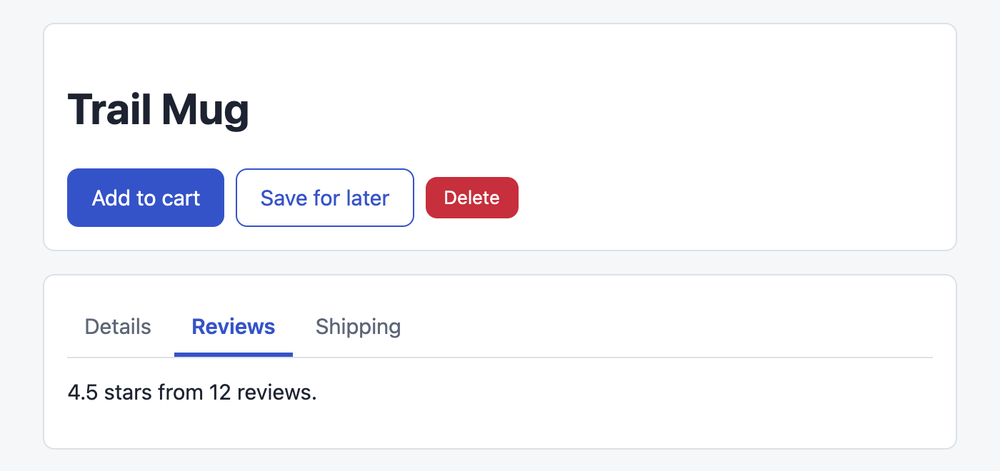
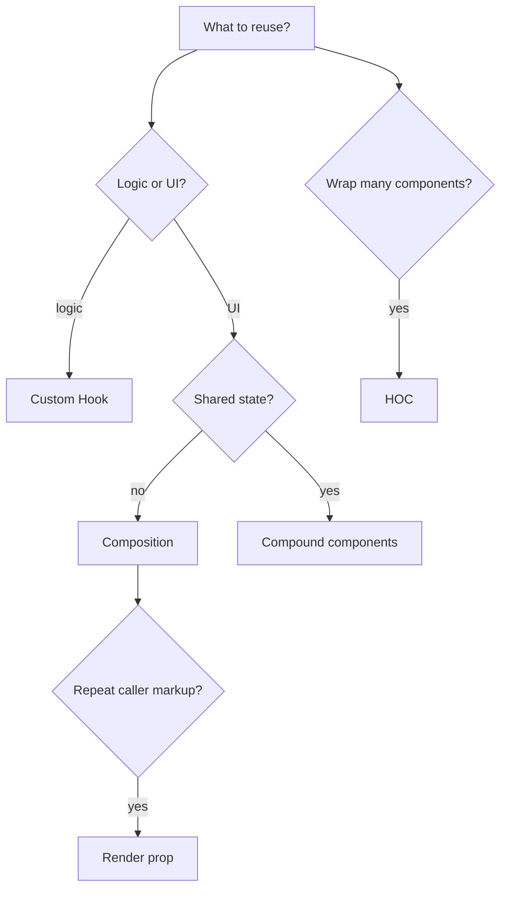
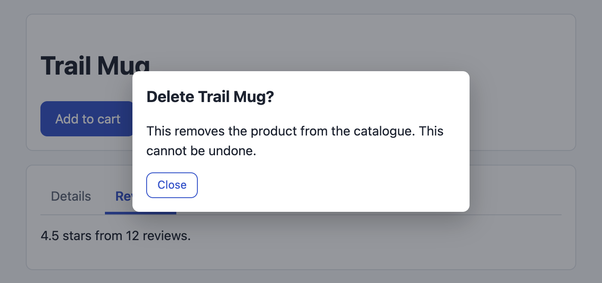
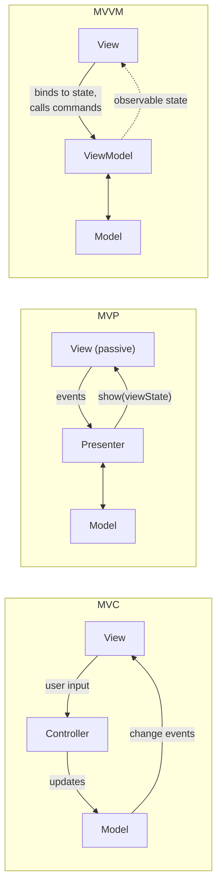

# Chapter 14 — Patterns and Architecture

You now know every React building block. This chapter is about **arranging** them: the reusable patterns you'll meet in every codebase and component library (compound components, render props, higher-order components, custom Hooks, portals, error boundaries), how to make components **accessible**, how to organise **folders** so a project stays navigable as it grows, and how a **design system** ties it all together.

Each pattern answers one question — "how do I share *this* kind of thing?" — so for each one you'll see the problem, a runnable implementation, and when a simpler tool is better. The short version, which the chapter justifies: **composition and custom Hooks cover most needs**; the other patterns are for specific jobs.

**What you'll learn**

| # | Topic | You will be able to… |
|---|---|---|
| 14.1 | Composition first | build flexible components with `children` and slots instead of many boolean props |
| 14.2 | Container / presentational | separate "where data comes from" from "how it looks" |
| 14.3 | Extracting custom Hooks | refactor a tangled component into a Hook + a view, and test each |
| 14.4 | Compound components | build `<Tabs>` / `<Tabs.Tab>` / `<Tabs.Panel>` that share state implicitly |
| 14.5 | Render props | let callers decide the markup while you own the behaviour |
| 14.6 | Higher-order components | read and write HOCs, and avoid their traps |
| 14.7 | Choosing a reuse pattern | pick between Hooks, render props, HOCs and compound components |
| 14.8 | Portals | render modals and tooltips outside the parent's DOM |
| 14.9 | Error boundaries | contain crashes, reset them, and know what they can't catch |
| 14.10 | Accessibility in React | write accessible JSX and check it with Testing Library role queries |
| 14.11 | Folder structure | organise by feature, define public APIs, enforce boundaries |
| 14.12 | Design systems | tokens, primitives, headless libraries and a `Button` with variants |
| 14.13 | Client architecture patterns | compare MVC, MVP, MVVM, VIPER and unidirectional flow, and explain where React fits |

Code: [`code/`](code/) — React 19.3 in jsdom with Testing Library; every numbered file prints what a user (or a screen reader) would get. Reusable modules: `Tabs.jsx`, `Dialog.jsx`, `ErrorBoundary.jsx`, `Button.jsx`. The screenshots come from `ds_demo.html` in headless Chrome. Background: composition and `children` ([Chapter 2](../02-components-and-props/README.md) §2.4), Context ([Chapter 6](../06-state-management/README.md)), custom Hooks and `useId` ([Chapter 7](../07-custom-hooks-and-hook-rules/README.md)), refs ([Chapter 5](../05-effects-and-refs/README.md)), Testing Library queries ([Chapter 12](../12-testing-react/README.md) §12.3). Accessibility fundamentals (landmarks, ARIA, WCAG) are in the HTML & CSS book's [Chapter 3](../../../html-css/chapters/03-semantic-html-and-accessibility/README.md); general design patterns (decorator, observer, strategy) in the LLD book's [structural](../../../lld/chapters/09-patterns-structural/README.md) and [behavioural](../../../lld/chapters/10-patterns-behavioral-1/README.md) pattern chapters.

---

## 14.1 Composition first

### What it is
**Composition** means building a component out of other components you pass in (`children`, or JSX in named props called **slots**) instead of adding a configuration prop for every variation. Chapter 2 §2.4 introduced it; here it's the baseline every other pattern is compared against.

### The problem it solves — "prop explosion"
A component that tries to handle every case through props grows like this:

```jsx
<Card title="Trail Mug" subtitle="Enamel" showImage imageSrc="mug.png" imagePosition="left"
      showFooter footerButtonLabel="Buy" onFooterButtonClick={buy} compact highlighted />
```

Every new need adds a prop, a branch inside `Card`, and a test case. Callers can't do anything the author didn't foresee (two buttons in the footer? a badge next to the title?).

The composed version exposes **structure** and lets callers fill it:

```jsx
<Card>
  <Card.Media src="mug.png" alt="Trail Mug" />
  <Card.Title>Trail Mug <Badge>New</Badge></Card.Title>
  <p>Enamel, 350 ml.</p>
  <Card.Footer><Button onClick={buy}>Buy</Button><Button variant="secondary">Save</Button></Card.Footer>
</Card>
```

### How to apply it
1. Use **`children`** for the main content and **slot props** (`header={…}`, `actions={…}`) for secondary areas.
2. Make **specialised components by wrapping**, not by flags: `function DangerDialog(props) { return <Dialog {...props} tone="danger" icon={<WarningIcon/>} />; }`.
3. When parts need **shared state** (which tab is selected), move to compound components (§14.4).
4. Pass elements down instead of data to avoid prop drilling (Chapter 2 §2.4) — the middle layers just render `{children}`.

### When not to use it
For tiny, fixed components (a `Price` that formats a number) a couple of plain props are simpler. Composition pays off when callers genuinely need different layouts.

### TL;DR
Prefer `children` and slots over growing lists of boolean props. Specialise by wrapping. Composition is the default; the patterns below solve the cases it doesn't.

---

## 14.2 Container / presentational

### What it is
A split of one feature into two components:
- **Presentational** ("view") component — receives everything as props and returns markup. No fetching, no global state, no Effects. Easy to reuse, test and show in Storybook.
- **Container** component — knows *where data comes from*: fetches, reads context or a store, handles events, and renders the presentational component with props.

Analogy: the presentational component is an actor who reads whatever script they're handed; the container is the director who decides which script.

### History and today
The pattern became popular in 2015 (class components, Redux `connect`). Once Hooks arrived, its best-known advocate (Dan Abramov) added a note saying he no longer recommends splitting components this way *by rule*, because a custom Hook now does the container's job without an extra component. The idea is still valuable in three places:
1. **Design-system and shared UI** — visual components should stay data-agnostic.
2. **Testing and Storybook** — you can render every visual state (loading, empty, error) by passing props.
3. **Server Components** ([Chapter 13](../13-server-rendering-and-frameworks/README.md) §13.7) — a Server Component "container" fetches data and renders a Client Component "view". The split is now an architectural boundary.

The runnable version is part of §14.3: `ProductSearch` (container) = `useProductSearch` (logic) + `ProductSearchView` (presentational).

### Common mistakes
- Splitting everything mechanically into `FooContainer` + `Foo` — twice the files, little benefit. Split when the view is reused or has many states worth testing alone.
- A "presentational" component that secretly calls `useContext(AuthContext)` — then it isn't reusable anymore.

### TL;DR
Keep visual components props-in/markup-out; put data access in a Hook or a container (or a Server Component). Do it where reuse or testing benefits, not everywhere.

---

## 14.3 Extracting custom Hooks

### What it is
Moving stateful logic (state + Effects + derived values) out of a component into a **custom Hook** (a function whose name starts with `use` and which calls other Hooks — [Chapter 7](../07-custom-hooks-and-hook-rules/README.md)). The component keeps only what it renders.

### Why it matters
- The component becomes readable — markup only.
- The logic becomes **reusable** (another screen can call `useProductSearch`) and **testable on its own** with `renderHook`.
- The view becomes testable **without** mocking the network.

### How to do it (recipe)
1. Find a group of state + Effects that work together (here: query → loading → results).
2. Move them into `function useX(inputs)` and **return only what the UI needs** (`{ status, results }`), not setters for internal details.
3. Pass dependencies in as parameters (the `search` function) so tests can substitute them.
4. Make the component call the Hook and render. Optionally split the markup into a presentational component (§14.2).
5. Check the behaviour didn't change (same test before and after).

`code/04_custom_hook_extraction.jsx` — before:

```jsx
function ProductSearchBefore() {
  const [query, setQuery] = useState('');
  const [results, setResults] = useState([]);
  const [status, setStatus] = useState('idle');
  useEffect(() => {
    if (!query) { setResults([]); setStatus('idle'); return; }
    let ignore = false;
    setStatus('loading');
    api.search(query).then(r => { if (!ignore) { setResults(r); setStatus('done'); } });
    return () => { ignore = true; };
  }, [query]);
  return (
    <section>
      <label>Search <input value={query} onChange={e => setQuery(e.target.value)} /></label>
      {status === 'loading' && <p role="status">Searching…</p>}
      {status === 'done' && <ul>{results.map(r => <li key={r}>{r}</li>)}</ul>}
    </section>
  );
}
```

After — Hook + view + thin container:

```jsx
export function useProductSearch(query, search = api.search) {        // logic, injectable dependency
  const [state, setState] = useState({ status: 'idle', results: [] });
  useEffect(() => {
    if (!query) { setState({ status: 'idle', results: [] }); return; }
    let ignore = false;                                               // ignore stale responses
    setState(s => ({ ...s, status: 'loading' }));
    search(query).then(results => { if (!ignore) setState({ status: 'done', results }); });
    return () => { ignore = true; };
  }, [query, search]);
  return state;
}

export function ProductSearchView({ query, onQueryChange, status, results }) {   // markup only
  return (
    <section>
      <label>Search <input value={query} onChange={e => onQueryChange(e.target.value)} /></label>
      {status === 'loading' && <p role="status">Searching…</p>}
      {status === 'done' && <ul>{results.map(r => <li key={r}>{r}</li>)}</ul>}
    </section>
  );
}

function ProductSearch() {                                             // wiring
  const [query, setQuery] = useState('');
  const { status, results } = useProductSearch(query);
  return <ProductSearchView query={query} onQueryChange={setQuery} status={status} results={results} />;
}

// tests: same user flow for both versions; then the Hook alone and the view alone
const { result, rerender } = renderHook(({ q }) => useProductSearch(q, fakeSearch), { initialProps: { q: '' } });
render(<ProductSearchView query="x" onQueryChange={() => {}} status="loading" results={[]} />);
```

Output:
```
before: Trail Mug, Trail Stove
after : Trail Mug, Trail Stove
hook, empty query : {"status":"idle","results":[]}
hook, "mug"       : {"status":"done","results":["mug result"]}
view in loading   : Searching… (no API needed)
```

The behaviour is identical, and now the Hook can be tested with a fake search function and the view's loading state rendered directly. In a real app the Hook would typically wrap TanStack Query ([Chapter 9](../09-routing-and-data-fetching/README.md)) and add debouncing (`useDebounce`, Chapter 7 §7.5).

### Common mistakes
- A Hook that returns 12 values including internal setters — the caller now depends on internals. Return a small, intention-revealing API.
- Extracting a "Hook" that uses no Hooks — that's a plain function; don't name it `use…`.
- Expecting two components calling the same Hook to **share** state. Each call has its own state; share via context or a store ([Chapter 6](../06-state-management/README.md)).

### In the interview
**30-second answer:** "When a component mixes data logic and markup, I extract the logic into a custom Hook that takes inputs (and injectable dependencies) and returns a small API like `{ status, results }`. The component just renders, often via a presentational component. That makes the logic reusable and testable with `renderHook`, and the view testable with plain props. Hooks share *logic*, not state."

### TL;DR
Logic → `useSomething(inputs)` returning a small API; markup → a props-only view; a thin component wires them. Same behaviour, easier to test and reuse.

---

## 14.4 Compound components

### What it is
A set of components designed to be used **together**, sharing state **implicitly** through a private context: `<Tabs>`, `<Tabs.List>`, `<Tabs.Tab>`, `<Tabs.Panel>`. The parent owns the state; the children read it. Analogy: HTML's `<select>` and `<option>` — you arrange the options, the select knows which one is chosen.

### The problem it solves
A single `<Tabs tabs={[{ label, content }]}>` component with an array prop can't handle custom layouts (tabs below the panel, an icon in one tab, a badge, a panel shared by two tabs) without more and more props. Compound components give callers the **structure** (composition) while the component keeps the **behaviour** (selection, keyboard, ARIA).

### How it works
1. The root (`Tabs`) holds the state (`selected`) and puts it plus a `select` function in a **context**.
2. Each part (`Tab`, `Panel`) reads the context with a small Hook that **throws a clear error** when used outside the root.
3. Parts are attached as properties (`Tabs.Tab = Tab`) so one import gives the whole family.
4. The root supports **uncontrolled** (`defaultValue`) and **controlled** (`value` + `onValueChange`) use — the same convention as `<input>` ([Chapter 3](../03-state-and-events/README.md) §3.9).
5. The component owns accessibility: roles, `aria-selected`, `aria-controls`, keyboard navigation.

`code/Tabs.jsx` (key parts):

```jsx
const TabsContext = createContext(null);
function useTabs(part) {
  const ctx = useContext(TabsContext);
  if (!ctx) throw new Error(`<Tabs.${part}> must be used inside <Tabs>`);
  return ctx;
}

export function Tabs({ defaultValue, value, onValueChange, children }) {
  const [inner, setInner] = useState(defaultValue);
  const selected = value ?? inner;                                     // controlled wins
  const select = (v) => { if (value === undefined) setInner(v); onValueChange?.(v); };
  const baseId = useId();                                              // stable ids for aria links
  return <TabsContext value={{ selected, select, baseId }}>{children}</TabsContext>;
}

function List({ label, children }) {
  const listRef = useRef(null);
  function onKeyDown(e) {                                              // arrows, Home, End
    const tabs = [...listRef.current.querySelectorAll('[role="tab"]')];
    const i = tabs.indexOf(document.activeElement);
    const next = { ArrowRight: i + 1, ArrowLeft: i - 1, Home: 0, End: tabs.length - 1 }[e.key];
    if (next === undefined) return;
    e.preventDefault();
    const tab = tabs[(next + tabs.length) % tabs.length];
    tab.focus(); tab.click();
  }
  return <div role="tablist" aria-label={label} ref={listRef} onKeyDown={onKeyDown}>{children}</div>;
}

function Tab({ value, children }) {
  const { selected, select, baseId } = useTabs('Tab');
  const isSelected = selected === value;
  return (
    <button role="tab" type="button" id={`${baseId}-tab-${value}`} aria-controls={`${baseId}-panel-${value}`}
      aria-selected={isSelected} tabIndex={isSelected ? 0 : -1} onClick={() => select(value)}>
      {children}
    </button>
  );
}

function Panel({ value, children }) {
  const { selected, baseId } = useTabs('Panel');
  if (selected !== value) return null;
  return <div role="tabpanel" id={`${baseId}-panel-${value}`} aria-labelledby={`${baseId}-tab-${value}`} tabIndex={0}>{children}</div>;
}
Tabs.List = List; Tabs.Tab = Tab; Tabs.Panel = Panel;
```

Usage and checks (`code/01_compound_tabs.jsx`) — every check uses **role queries**, i.e. what assistive technology sees:

```jsx
<Tabs defaultValue="details">
  <Tabs.List label="Product information">
    <Tabs.Tab value="details">Details</Tabs.Tab>
    <Tabs.Tab value="reviews">Reviews</Tabs.Tab>
    <Tabs.Tab value="shipping">Shipping</Tabs.Tab>
  </Tabs.List>
  <Tabs.Panel value="details">Enamel mug, 350 ml.</Tabs.Panel>
  <Tabs.Panel value="reviews">4.5 stars from 12 reviews.</Tabs.Panel>
  <Tabs.Panel value="shipping">Ships in 2 days.</Tabs.Panel>
</Tabs>
// user.click(getByRole('tab', { name: 'Reviews' })), user.keyboard('{ArrowRight}'), '{End}', ...
```

Output (`*` = `aria-selected="true"`):
```
tablist name : Product information
start        : Details* | Reviews | Shipping  panel="Enamel mug, 350 ml."
click Reviews: Details | Reviews* | Shipping  panel="4.5 stars from 12 reviews."
ArrowRight   : Details | Reviews | Shipping*  panel="Ships in 2 days."  focus: Shipping
ArrowRight   : Details* | Reviews | Shipping  panel="Enamel mug, 350 ml."  (wrapped around)
End          : Details | Reviews | Shipping*  panel="Ships in 2 days."
panel labelled by its tab: Ships in 2 days.
tab stops    : -1,-1,0
controlled   : parent state: a | Panel A
misuse       : <Tabs.Tab> must be used inside <Tabs>
```

What it shows:
1. Selection, arrow keys (with wrap-around), `End` — the keyboard behaviour the WAI-ARIA Authoring Practices "Tabs" pattern describes.
2. **Roving tabindex** (`tab stops: -1,-1,0`): only the selected tab is in the Tab-key order; arrows move within the list. The whole widget is one Tab stop.
3. The panel is findable by its **accessible name**, which comes from its tab via `aria-labelledby`.
4. The same component works **controlled** by a parent.
5. Misuse fails loudly with a helpful message.


*Figure 14.1 — The compound `Tabs` (and the `Button` from §14.12) rendered in Chrome with design tokens (`code/ds_demo.html`).*

### Trade-offs

| | Array/config prop (`tabs={[…]}`) | Compound components |
|---|---|---|
| Simple cases | Shortest to use | Slightly more JSX |
| Custom layout / content | Needs new props | Free — callers arrange parts |
| Type safety of structure | Easy (typed array) | Harder to enforce order/nesting |
| Implementation | Simple | Context + part Hooks |

### Real-world examples
Radix UI (`<Tabs.Root>`, `<Tabs.List>`, `<Tabs.Trigger>`, `<Tabs.Content>`), React Aria Components, Headless UI, Reach UI — and native HTML's `<select>`/`<option>`, `<table>`/`<tr>`, `<details>`/`<summary>`.

### Common mistakes
- Relying on `React.Children.map` + `cloneElement` to inject props — breaks as soon as a caller wraps a part in a `<div>` or another component. Context works at any depth.
- Forgetting the error Hook — parts used outside the root then fail silently with `undefined` state.
- Rebuilding the context value object every render in a large tree (a perf consideration — [Chapter 6](../06-state-management/README.md) §6.4; React Compiler handles it).

### In the interview
**30-second answer:** "Compound components are a family like `Tabs`, `Tabs.List`, `Tabs.Tab`, `Tabs.Panel` that share state through a private context. The root owns the selected value — controlled or uncontrolled — and the parts read it, so callers control layout while the component controls behaviour and accessibility. I use context rather than `cloneElement` so parts can be nested at any depth, and I throw a clear error if a part is used outside its root."

- *Why not `cloneElement`?* — It only reaches direct children and silently breaks with wrappers; it's also listed as a legacy API on react.dev.
- *How do you support both controlled and uncontrolled?* — Keep internal state for `defaultValue`, but prefer the `value` prop when it's defined, and always call `onValueChange`.

### Self-check
1. How do `Tab` and `Panel` know which tab is selected? → They read the root's context.
2. What is a roving tabindex? → Only the active item has `tabIndex=0`; others `-1`; arrow keys move focus within the group.
3. What links a panel to its tab for screen readers? → `aria-labelledby` (panel → tab) and `aria-controls` (tab → panel), with ids from `useId`.

### TL;DR
Root owns state in context; parts read it; callers arrange the parts. Support controlled + uncontrolled, own the ARIA and keyboard behaviour, and throw on misuse.

---

## 14.5 Render props

### What it is
A **render prop** is a prop whose value is a **function that returns JSX**. The component owns some behaviour or data and **calls your function** to decide what to render. When the function is passed as `children`, it's called "function as children".

### The problem it solves
Sharing behaviour while letting each caller choose the markup — before Hooks this was the main way to reuse stateful logic (e.g. React Router v4's `<Route render>`, Formik's `<Formik>{(form) => …}</Formik>`, Downshift). Today it's still the right tool when a component must **control *where* and *how often*** your markup is rendered: lists (`renderItem`), virtualized rows, tables (`cell` renderers), and empty/loading slots.

### Seeing it
`code/02_render_props.jsx`:

```jsx
function Disclosure({ defaultOpen = false, children }) {           // function as children
  const [open, setOpen] = useState(defaultOpen);
  return children({ open, toggle: () => setOpen(o => !o) });
}

function List({ items, renderItem, renderEmpty = () => <p>Nothing here.</p> }) {   // named render props
  if (items.length === 0) return renderEmpty();
  return <ul>{items.map((item, i) => <li key={item.id}>{renderItem(item, i)}</li>)}</ul>;
}

function useDisclosure(defaultOpen = false) {                         // the Hook equivalent
  const [open, setOpen] = useState(defaultOpen);
  return { open, toggle: () => setOpen(o => !o) };
}

<Disclosure>
  {({ open, toggle }) => (
    <>
      <button aria-expanded={open} onClick={toggle}>Shipping details</button>
      {open && <p>Ships in 2 days.</p>}
    </>
  )}
</Disclosure>
<List items={products} renderItem={(p, i) => <>{i + 1}. {p.name} — ${p.price}</>} />
```

Output:
```
render prop, closed : <button aria-expanded="false">Shipping details</button>
render prop, open   : <button aria-expanded="true">Shipping details</button><p>Ships in 2 days.</p>
renderItem          : <ul><li>1. Trail Mug — $18</li><li>2. Camp Stove — $45</li></ul>
renderEmpty         : <p>No products match.</p>
same thing via Hook : <button aria-expanded="true">Shipping details</button><p>Ships in 2 days.</p>
```

`Disclosure` never decides what the button looks like; `List` decides *where* each item goes (inside `<li>`, with a key) but not what it shows.

### Trade-offs
- ✔ Explicit: you see exactly which values the caller receives.
- ✔ Works in class components and anywhere JSX is allowed.
- ✘ Nesting several render-prop components creates "callback pyramids".
- ✘ A new function every render can defeat `memo` on the component (React Compiler usually handles it).
- For **sharing stateful logic** only, a custom Hook is simpler (last line of the output).

### Common mistakes
- Using a render prop just to pass data one level down — a normal prop or `children` is enough.
- Calling Hooks inside the render function — it's a plain callback, not a component, so the Rules of Hooks forbid it (the linter flags it) and it breaks as soon as the call becomes conditional. Put stateful parts in a component.

### TL;DR
A render prop is "give me a function and I'll call it to render". Reach for it when the component decides placement and repetition of caller markup (lists, tables, slots); share plain logic with a Hook.

---

## 14.6 Higher-order components (HOCs)

### What it is
A **higher-order component** is a function that **takes a component and returns a new component** that renders the original with extra props or behaviour: `const Enhanced = withSomething(Component)`. The name mirrors higher-order functions ([JavaScript book, Chapter 4](../../../javascript/chapters/04-functions-scope-and-closures/README.md)); the idea is the **decorator pattern** from OOP ([LLD Chapter 9](../../../lld/chapters/09-patterns-structural/README.md)).

### Where you still meet them
Older code and some libraries: Redux's `connect(mapState)(Component)`, React Router v5's `withRouter`, `React.memo(Component)` (technically a HOC-like wrapper), analytics/feature-flag wrappers, and auth guards. New code usually uses Hooks instead, but you must be able to read and maintain HOCs.

### Seeing it
`code/03_hoc.jsx`:

```jsx
function withAuth(Component) {
  function WithAuth(props) {
    const user = useContext(UserContext);
    if (!user) return <p>Please sign in.</p>;
    return <Component {...props} user={user} />;          // pass everything through + inject one prop
  }
  WithAuth.displayName = `withAuth(${Component.displayName || Component.name})`;   // readable in DevTools
  return WithAuth;
}

function withRenderLog(Component) { /* logs each render with its props, same shape */ }

function OrderHistory({ user, limit }) { return <p>{user.name}'s last {limit} orders</p>; }
const ProtectedHistory = withRenderLog(withAuth(OrderHistory));   // apply once, at module level

// PITFALL demo: applying a HOC inside render
function Page({ bad }) {
  const [, force] = useState(0);
  const Wrapped = bad ? withNothing(Counter) : StableCounter;    // bad: a new component type every render
  return <><Wrapped /><button onClick={() => force(x => x + 1)}>re-render page</button></>;
}
```

Output:
```
displayName: withRenderLog(withAuth(OrderHistory))
  [log] withAuth(OrderHistory) rendered with {"limit":3}
signed out : Please sign in.
  [log] withAuth(OrderHistory) rendered with {"limit":3}
signed in  : Asha's last 3 orders
HOC at module    : count 2 -> after parent re-render: count 2
HOC inside render : count 2 -> after parent re-render: count 0
```

What it shows:
1. HOCs **compose** from the inside out, and `displayName` makes the wrapper chain readable in React DevTools.
2. Props flow through (`limit`), and the HOC injects its own (`user`).
3. **Never create a HOC during render.** Each call returns a *new component type*, so React unmounts the old one and mounts a fresh one — state (`count 2`) is lost ([Chapter 3](../03-state-and-events/README.md) §3.10).

### Common mistakes (the classic HOC problems)

| Problem | What happens | Fix |
|---|---|---|
| HOC applied inside render | Remount every render, state lost | Apply at module level |
| Prop name collisions | Two HOCs both inject `data`; one silently wins | Namespacing, or use Hooks |
| "Wrapper hell" | Deep trees of anonymous wrappers in DevTools | `displayName`; Hooks |
| Static methods lost | `Enhanced.someStatic` is undefined | Copy them (`hoist-non-react-statics`) |
| Refs | Before React 19, `ref` didn't pass through without `forwardRef` | React 19: `ref` is a normal prop for function components; spread it through |
| Hidden dependencies | Reader can't see where `user` came from | A Hook call inside the component is explicit |

### In the interview
**30-second answer:** "A HOC is a function that takes a component and returns a wrapped one, used for cross-cutting concerns like auth guards, logging or injecting store data — Redux's `connect` is the famous example. They compose but have downsides: prop collisions, implicit props, wrapper nesting, and they must be created at module level or the component remounts every render. For new code I'd use a custom Hook; I'd still write a HOC when I need to wrap *rendering* itself, like an auth guard around many route components."

### TL;DR
`withX(Component)` → new component with extra props/behaviour. Apply once at module level, pass props through, set `displayName`. Prefer Hooks for new logic reuse.

---

## 14.7 Choosing a reuse pattern

| Need | Best fit | Why |
|---|---|---|
| Share **stateful logic** (fetching, form state, subscriptions) | **Custom Hook** | No extra components, explicit, composable |
| Share **UI structure** with flexible content | **Composition** (`children`, slots) | Simplest; no new concepts |
| A family of parts sharing **implicit state** (tabs, accordion, menu, select) | **Compound components** | Callers arrange parts; component owns behaviour + a11y |
| Component controls **where/how often** caller markup renders (lists, tables, virtualized rows) | **Render prop** (`renderItem`) | The component decides placement, the caller decides content |
| Wrap **many components** with the same guard/behaviour, or legacy code | **HOC** | Works on components you don't own; decorator style |
| Render **outside** the parent's DOM box (modal, tooltip, toast) | **Portal** | Escapes `overflow`/`z-index` while staying in the React tree |
| **Contain crashes** of a subtree | **Error boundary** | The only way to catch render errors |



---

## 14.8 Portals

### What it is
**`createPortal(children, domNode)`** (from `react-dom`) renders `children` into a **different DOM node** — usually `document.body` — while they stay in the **same place in the React tree**. So the DOM location changes, but props, context, state and event bubbling behave as if the content were still inside its parent.

### The problem it solves
Modals, dropdowns, tooltips and toasts must visually sit **on top of everything**. If rendered inside a card with `overflow: hidden` or inside a stacking context (`transform`, `z-index`), they get clipped or covered — CSS can't escape its ancestors. Rendering them at the end of `<body>` fixes that.

### How it works
1. React renders the portal's children as usual (they're part of the parent component's tree).
2. At commit, it inserts their DOM nodes into `domNode` instead of the parent's DOM node.
3. **Context** flows through (the React tree is unchanged).
4. **React events bubble through the React tree**, not the DOM tree: a click inside the portal triggers `onClick` handlers on React ancestors, even though in the DOM they aren't ancestors.

### Seeing it
`code/Dialog.jsx` — a modal with the accessibility essentials:

```jsx
export function Dialog({ open, onClose, title, children }) {
  const titleId = useId();
  const panelRef = useRef(null);
  const onEscape = useEffectEvent(() => onClose());     // latest onClose, without re-running the Effect
  useEffect(() => {
    if (!open) return;
    const previouslyFocused = document.activeElement;   // remember the trigger
    panelRef.current.focus();                           // move focus into the dialog
    const onKey = (e) => { if (e.key === 'Escape') onEscape(); };
    document.addEventListener('keydown', onKey);
    return () => {
      document.removeEventListener('keydown', onKey);
      previouslyFocused?.focus?.();                     // give focus back on close
    };
  }, [open]);                                          // re-runs only when opened/closed

  if (!open) return null;
  return createPortal(
    <div className="backdrop" onClick={(e) => { if (e.target === e.currentTarget) onClose(); }}>
      <div role="dialog" aria-modal="true" aria-labelledby={titleId} tabIndex={-1} ref={panelRef} className="dialog">
        <h2 id={titleId}>{title}</h2>
        {children}
        <button type="button" className="btn btn-secondary btn-sm" onClick={onClose}>Close</button>
      </div>
    </div>,
    document.body,
  );
}
```

`code/05_portal.jsx` opens it from inside a card with `overflow: hidden` and an `onClick` counter:

```jsx
function ProductCard() {
  const [open, setOpen] = useState(false);
  const [bubbled, setBubbled] = useState(0);
  return (
    <div className="card" style={{ overflow: 'hidden' }} onClick={() => setBubbled(n => n + 1)}>
      <button onClick={() => setOpen(true)}>Delete product</button>
      <span data-testid="bubbled">{bubbled}</span>
      <Dialog open={open} onClose={() => setOpen(false)} title="Delete Trail Mug?">
        <p>This cannot be undone.</p>
        <ThemedText />
      </Dialog>
    </div>
  );
}
```

Output:
```
dialog DOM parent        : BODY (not inside .card)
inside .card?            : false
aria-modal               : true
focus moved into dialog  : true
context crosses portal   : theme from context: dark
React events bubble to the React parent: card onClick count 1 -> 2
Escape closes            : true
focus back on trigger    : true
```


*Figure 14.2 — The same `Dialog` in Chrome: rendered at the end of `<body>`, so no card's `overflow` or stacking can clip it.*

Reading the output:
1. The dialog's DOM lives under `<body>`, outside `.card` — so `overflow: hidden` can't clip it.
2. Context from above the card still reaches `ThemedText` inside the portal.
3. The click **inside the dialog** incremented the card's counter: React bubbling follows the component tree. This surprises people — e.g. a "click outside to close" handler on a parent fires for clicks inside the portal. Check `e.target`, or stop propagation deliberately.
4. Focus moves in on open and returns to the trigger on close; Escape closes it — the minimum keyboard behaviour for a modal. (This small version doesn't trap Tab inside; the modal build in [Chapter 15 §15.13](../15-react-interview-and-machine-coding/README.md) adds that.) `useEffectEvent` (stable since React 19.2, [Chapter 5](../05-effects-and-refs/README.md)) lets the Escape listener call the latest `onClose` without re-running the Effect — otherwise a parent passing a new arrow function each render would bounce focus back and forth.

### The native `<dialog>` alternative
HTML's `<dialog>` element with `dialog.showModal()` (call it from an Effect via a ref) renders in the browser's **top layer** — above everything without a portal — and gives you Escape-to-close, an inert background, focus moved into the dialog on open and **returned to the previously focused element on close** (specified in the HTML standard and implemented in all major browsers) for free. It's supported in all modern browsers and is often the simplest correct modal ([HTML & CSS book, Chapter 3](../../../html-css/chapters/03-semantic-html-and-accessibility/README.md)). Portals are still the tool for tooltips, popovers in older setups, toasts, and rendering into other containers (e.g. an iframe or a widget root). The Popover API (`popover` attribute) is another native option for non-modal pop-ups.

### Common mistakes
- A home-made modal without focus management — keyboard and screen-reader users end up "behind" the dialog. Move focus in, trap it (or make the background `inert`), return it on close. Use a library (Radix Dialog, React Aria) or `<dialog>` for production.
- Forgetting portal content still counts as a child for events (point 3 above).
- Rendering a portal during SSR: `document` doesn't exist on the server. Render portals only after mount (or use `<dialog>`).

### In the interview
**30-second answer:** "`createPortal` renders children into another DOM node, like `document.body`, while keeping them in the same React tree. That lets modals and tooltips escape `overflow: hidden` and stacking contexts, while context, state and even event bubbling still follow the React tree — a click inside a portal bubbles to React ancestors. For modals I'd also handle focus, Escape and `aria-modal`, or use native `<dialog>` with `showModal()`, which uses the top layer."

### TL;DR
Portal = DOM elsewhere, React tree unchanged: context and events follow the component tree. Use for overlays; add focus management; consider native `<dialog>`.

---

## 14.9 Error boundaries

### What it is
An **error boundary** is a component that catches errors thrown **while rendering** its descendants (including in lifecycle methods and Effects' setup during commit) and shows a **fallback UI** instead of letting the whole app disappear. Without any boundary, React 19 **unmounts the entire root** on an uncaught render error — a blank page.

Error boundaries must still be **class components** — there's no Hook equivalent of the two methods involved. You write one once (or use the `react-error-boundary` package) and use it everywhere. (Route-level boundaries in React Router are covered in [Chapter 9](../09-routing-and-data-fetching/README.md); lazy-chunk failures in [Chapter 10](../10-performance/README.md) §10.8.)

### How it works
1. A descendant throws during render.
2. React finds the nearest boundary above it and calls **`static getDerivedStateFromError(error)`** — return new state so the next render shows the fallback.
3. After commit, React calls **`componentDidCatch(error, info)`** — log it; `info.componentStack` tells you where.
4. React 19 also calls the root's **`onCaughtError`** (for errors caught by a boundary) or **`onUncaughtError`** (no boundary) — options of `createRoot`/`hydrateRoot`, useful for one central error reporter. (`onRecoverableError` reports errors React recovered from itself, like hydration mismatches — Chapter 13 §13.5.)
5. To try again, reset the boundary's state — manually (a "Try again" button) or automatically when some input changes (**reset keys**), or by changing the boundary's `key`.

`code/ErrorBoundary.jsx`:

```jsx
export class ErrorBoundary extends Component {
  state = { error: null };
  static getDerivedStateFromError(error) { return { error }; }        // render the fallback next
  componentDidCatch(error, info) { this.props.onError?.(error, info); } // log (Sentry, console…)
  componentDidUpdate(prevProps) {                                     // reset when resetKeys change
    const { resetKeys = [] } = this.props;
    if (this.state.error && resetKeys.some((k, i) => !Object.is(k, prevProps.resetKeys?.[i]))) {
      this.setState({ error: null });
    }
  }
  reset = () => this.setState({ error: null });
  render() {
    if (this.state.error) return this.props.fallback({ error: this.state.error, reset: this.reset });
    return this.props.children;
  }
}
```

### What boundaries catch — and what they don't
`code/06_error_boundary.jsx` puts a price and a reviews widget in separate boundaries, and has an event handler that can fail:

```jsx
const root = createRoot(container, {
  onCaughtError(error) { console.log(`   onCaughtError   : "${error.message}"`); },
  onUncaughtError(error) { console.log(`   onUncaughtError : "${error.message}" -> whole root unmounted`); },
});

function ProductPrice({ product }) { return <p>Price: ${product.price.toFixed(2)}</p>; }   // throws on null

function Reviews() {
  const [error, setError] = useState(null);
  if (error) throw error;                                    // re-throw during render → boundary catches
  return <button onClick={() => {
    Promise.reject(new Error('network down')).catch(e => setError(e));   // async error moved into render
  }}>Load reviews</button>;
}

// in Shop:
<ErrorBoundary resetKeys={[id]} fallback={(p) => <Fallback {...p} />} onError={…}>
  <ProductPrice product={product} />
</ErrorBoundary>
<ErrorBoundary fallback={(p) => <Fallback {...p} />}><Reviews /></ErrorBoundary>
<button onClick={() => {
  try { JSON.parse('{bad json'); }                           // event-handler errors: NOT caught by boundaries
  catch { setImportMsg('Could not read the file'); }         // handle them yourself
}}>Import</button>
```

Output:
```
1. start              : Price: $18.00
   onCaughtError   : "Cannot read properties of null (reading 'price')"
   componentDidCatch: stack starts at ProductPrice
2. render error       : Could not show this part (Cannot read properties of null (reading 'price')). Try again
   onCaughtError   : "Cannot read properties of null (reading 'price')"
   componentDidCatch: stack starts at ProductPrice
3. reset, still broken: Could not show this part (Cannot read properties of null (reading 'price')). Try again
4. resetKeys changed  : Price: $21.00
5. handler error      : Could not read the file | price still fine: Price: $21.00
   onCaughtError   : "network down"
6. async error        : Could not show this part (network down). Try again | price still fine: Price: $21.00
7. no boundary        : container HTML = ""
```

Reading it:
1. **Step 2** — the render error is contained: only the price area shows the fallback; the rest of the page works.
2. **Step 3** — "Try again" re-renders the same broken data, so it fails again. Resetting only helps if something changed.
3. **Step 4** — changing `id` (a reset key) cleared the error, and the new product renders.
4. **Step 5** — errors in **event handlers** aren't render errors; boundaries never see them. Catch them and turn them into state.
5. **Step 6** — **async** errors (promises, timers) aren't caught either, unless you move them into render by storing and re-throwing them (TanStack Query's `throwOnError` and `use()` with a rejected promise do this for you).
6. **Step 7** — with no boundary at all, React unmounts the whole root: the container is empty. (In a browser, `onUncaughtError` would be called; in tests, `act()` re-throws the error instead.)

| Caught by error boundaries | Not caught |
|---|---|
| Errors during render of descendants | Event handlers (use `try/catch`) |
| Errors in lifecycle methods / Effects of descendants | Async code: `setTimeout`, promise callbacks (move into state and re-throw) |
| Rejected promises read with `use()` inside Suspense | Errors in the boundary itself (a parent boundary catches those) |
| Errors from `lazy()` chunk loading | Server-side rendering errors (they fall back to client rendering, Chapter 13 §13.3) |

### Where to put boundaries
- **One at the top** (app shell): "Something went wrong — reload" instead of a blank page.
- **One per route** (frameworks do this: `error.js` in Next.js, `ErrorBoundary` exports in React Router).
- **One around independent widgets** (a chart, a comments panel, a third-party embed) so one failure doesn't take down the page.
- Pair them with `<Suspense>`: Suspense handles "not ready yet", the error boundary handles "failed".

### Common mistakes
- Expecting a boundary to catch `onClick` errors.
- A fallback that can itself throw (e.g. reads the same broken data).
- A "Try again" that doesn't change anything — reset together with a refetch or new input (reset keys).
- Swallowing errors without logging: always report in `componentDidCatch` or `onCaughtError`.

### In the interview
**30-second answer:** "Error boundaries are class components with `getDerivedStateFromError` to show a fallback and `componentDidCatch` to log. They catch errors thrown while rendering their subtree — including `use()` rejections and lazy-loading failures — but not event handlers, async callbacks, SSR, or their own errors. Without one, React 19 unmounts the whole root. I place one at the top, per route and around risky widgets, reset them with reset keys, and in React 19 I report centrally via `createRoot`'s `onCaughtError`/`onUncaughtError`."

- *Why still a class?* — There's no Hook for `getDerivedStateFromError`/`componentDidCatch`; most teams use `react-error-boundary`, which wraps a class and adds `resetKeys` and a `useErrorBoundary` Hook to push async errors in.
- *How do you send an async error to a boundary?* — Store it in state and throw it during render (or `showBoundary(error)` from `react-error-boundary`).

### Self-check
1. Why did "Try again" in step 3 fail? → The data was still `null`; reset re-rendered the same failing input.
2. Which error in the demo did no boundary catch? → The `JSON.parse` error in the event handler.
3. What happens without any boundary in React 19? → The whole root unmounts; `onUncaughtError` is called.
4. What's the difference between `getDerivedStateFromError` and `componentDidCatch`? → The first runs during render to choose the fallback (pure); the second runs after commit for side effects like logging.

### TL;DR
Class component with `getDerivedStateFromError` + `componentDidCatch`; catches render-time errors below it only. Handle event/async errors yourself (or re-throw via state). Place at root, per route, per risky widget; reset with keys; report via `onCaughtError`.

---

## 14.10 Accessibility in React

### What it is
**Accessibility (a11y)** means people can use your UI regardless of how they perceive or operate it: screen readers, keyboard only, voice control, zoom, reduced motion. React doesn't make a page accessible or inaccessible by itself — it renders the HTML you write. What React adds is (a) a few JSX spellings, (b) state-driven ARIA attributes, and (c) **focus management** in single-page apps, where there are no full page loads. The fundamentals (landmarks, headings, ARIA rules, WCAG 2.2) are in the HTML & CSS book's [Chapter 3](../../../html-css/chapters/03-semantic-html-and-accessibility/README.md); this section is the React-specific layer.

### React-specific rules

| Topic | In React |
|---|---|
| Labels | `<label htmlFor={id}>` (`for` is a JS keyword); generate ids with `useId()`, never hard-code them in reusable components |
| ARIA attributes | Stay hyphenated and lower-case: `aria-label`, `aria-expanded={open}`; booleans render as `"true"`/`"false"` |
| Semantic elements first | `<button>`, `<a href>`, `<nav>`, `<main>`, `<h1>`–`<h6>`, `<ul>`: they come with roles, keyboard support and focusability for free |
| Fragments | Use `<>…</>` instead of wrapper `<div>`s that break list/table semantics (`<ul>` must contain `<li>`) |
| Focus management | Use refs to move focus when UI changes: into dialogs, to a new page heading after client-side navigation, back to the trigger after closing |
| Announcements | Status messages in a live region: `role="status"` (polite) or `role="alert"` (urgent), present in the DOM before the text changes |
| Icon-only buttons | Give an accessible name: `aria-label="Remove item"`, and hide the icon with `aria-hidden="true"` |
| Linting | `eslint-plugin-jsx-a11y` flags missing alt text, click handlers on non-interactive elements, invalid ARIA |
| Automated audits | axe-core (browser extension, `vitest-axe`/`jest-axe`, Playwright's axe integration), Lighthouse |

### Checking it with role queries
Testing Library's `getByRole` finds elements the way assistive technology does — by **role** and **accessible name**. If a test can't find your button by role, a screen-reader user can't either ([Chapter 12](../12-testing-react/README.md) §12.3). `code/07_a11y_checks.jsx` audits the same checkout written badly and well:

```jsx
function BadCheckout({ onBuy }) {
  return (
    <div>
      <div className="title">Checkout</div>                  {/* looks like a heading, isn't one */}
                                        {/* no alt */}
      <input placeholder="Email" />                          {/* placeholder is not a label */}
      <div className="btn" onClick={onBuy}>Buy now</div>     {/* not focusable, no role */}
      <button><svg aria-hidden="true" /></button>            {/* icon-only: no name */}
    </div>
  );
}

function GoodCheckout({ onBuy }) {
  const emailId = useId(), errId = useId();
  // ... error + done state, submit() validates and calls onBuy ...
  return (
    <form onSubmit={submit} noValidate>
      <h1>Checkout</h1>
      
      <label htmlFor={emailId}>Email</label>
      <input id={emailId} name="email" type="email" aria-invalid={!!error} aria-describedby={error ? errId : undefined} />
      {error && <p id={errId}>{error}</p>}
      <button type="submit">Buy now</button>
      <button type="button" aria-label="Remove item"><svg aria-hidden="true" /></button>
      <p role="status">{done ? 'Order placed' : ''}</p>
    </form>
  );
}
// audit(): getByRole('heading', { name: 'Checkout' }), getByRole('img'), getByRole('textbox', { name: 'Email' }),
//          getByRole('button', { name: 'Buy now' }), computeAccessibleName(each button), user.tab() ×3
```

Output:
```
--- bad
heading "Checkout"      : false
image with alt text     : missing
textbox named "Email"   : false
button named "Buy now"  : false
button names            : [""]
Tab key visits          : input -> button -> body (the "Buy now" div is never reached)
--- good
heading "Checkout"      : true
image with alt text     : Trail Mug, blue enamel
textbox named "Email"   : true
button named "Buy now"  : true
button names            : ["Buy now","Remove item"]
invalid email -> aria-invalid: true | description: "Enter a valid email"
valid email   -> bought: 1 | aria-invalid: false | status: Order placed
```

What the audit shows:
1. The bad version **looks** the same with CSS, but a screen reader gets no heading, an unnamed image, an unlabeled field, a nameless button — and the "Buy now" `div` is **not reachable with the Tab key** at all.
2. In the good version every control has a role and a name; the error message is linked as the field's **accessible description** (`aria-describedby`), and `aria-invalid` reflects state.
3. A real `<form>` + `<button type="submit">` makes **Enter** submit — keyboard support without extra code.
4. The `role="status"` live region announces "Order placed" to screen readers without moving focus.

### Focus after client-side navigation
In an SPA, clicking a link swaps content without a page load, so screen readers may not announce the new page and focus stays on the old link. Common fixes: move focus to the new page's `<h1>` (with `tabIndex={-1}`) in an Effect keyed on the location, and update `document.title` (in React 19 you can render `<title>` in any component). Frameworks help: Next.js announces route changes; React Router offers scroll restoration and you add focus handling.

### Common mistakes
- `<div onClick>` instead of `<button>` — no keyboard, no role, no focus. If you truly must, you need `role="button"`, `tabIndex={0}` and Enter/Space handlers — just use `<button>`.
- Removing focus outlines (`outline: none`) without a visible replacement — use `:focus-visible` styles.
- ARIA overuse: `role="button"` on a `<button>`, or `aria-label` that contradicts visible text. The first rule of ARIA: use native elements when they exist.
- Conditional rendering that removes the live region itself — screen readers only announce changes to a region that already exists.
- Testing only with a mouse. Tab through every new screen at least once.

### In the interview
**30-second answer:** "React renders whatever HTML I write, so accessibility is mostly semantic HTML: real buttons, links, headings and labels. The React-specific parts are `htmlFor`, `useId` for label/description ids, ARIA attributes driven by state like `aria-expanded`, live regions for status messages, and focus management with refs — into dialogs, back to triggers, and to the heading after client-side navigation. I test with role queries in Testing Library, which fail when elements lack roles or names, plus `eslint-plugin-jsx-a11y`, axe, and manual keyboard and screen-reader checks."

### Self-check
1. Why can't `getByRole('button', { name: 'Buy now' })` find the `<div onClick>`? → A `div` has no button role (and isn't focusable).
2. How does the error message become part of what a screen reader reads for the input? → `aria-describedby` points at its id, making it the accessible description.
3. Why use `useId` instead of `id="email"`? → Reusable components may render many times per page; ids must be unique and match between server and client.
4. What must exist before a status message changes for it to be announced? → The live region element (`role="status"`).

### TL;DR
Semantic elements first; `htmlFor` + `useId`; ARIA from state; live regions for updates; manage focus with refs; test with role queries, jsx-a11y and axe, and the keyboard.

---

## 14.11 Folder structure

### What it is
How you arrange files decides how easily people find code, how far a change ripples, and whether features can be deleted cleanly. React itself has **no opinion** (the React docs have long said so); frameworks impose some (Next.js `app/`, React Router `app/routes/`). Start simple (Chapter 1 §1.6); grow deliberately.

### Three common layouts

**1. By type** — fine for small apps (< ~15 components):
```
src/
├── components/   Button.jsx, ProductCard.jsx, CartPanel.jsx, ...
├── hooks/        useCart.js, useProductSearch.js
├── pages/        Home.jsx, Product.jsx
├── services/     api.js
└── utils/        formatPrice.js
```
Problem at scale: one feature is spread over five folders; `components/` grows to 200 files.

**2. By feature** — the common choice for medium and large apps:
```
src/
├── app/                  ← app shell: providers, router, global styles
├── features/
│   ├── cart/
│   │   ├── components/   CartPanel.jsx, CartItem.jsx
│   │   ├── hooks/        useCart.js
│   │   ├── api.js        cart endpoints
│   │   ├── cart.test.jsx
│   │   └── index.js      ← public API: the only file other features import
│   └── catalog/ ...
└── shared/               ← feature-agnostic: ui/ (design system), lib/ (helpers), config
```
Everything about "cart" lives together (**colocation**: keep files that change together, close together — including tests and styles). Deleting a feature = deleting a folder.

**3. Framework routes + features** — in Next.js / React Router, route files stay thin and import from features:
```
app/
├── layout.jsx
├── products/[id]/page.jsx      ← fetch + compose: imports from features/catalog
└── cart/page.jsx
src/features/..., src/shared/...  (or inside app/ in private _folders)
```

### Rules that keep it healthy
1. **Dependency direction:** `app → features → shared`. Shared code never imports features; features never import the app shell.
2. **Public APIs:** each feature exposes an `index.js`; others import `features/cart`, never `features/cart/store.js`. Internals can then change freely.
3. **Enforce, don't hope:** ESLint `no-restricted-imports` or `eslint-plugin-boundaries`, or path rules in your monorepo tool.
4. **Path aliases** (`@/features/cart`) instead of `../../../`: configure in `tsconfig`/`jsconfig` `paths` and your bundler.
5. **Be careful with barrel files** (`index.js` re-exporting everything): one per feature is fine; giant barrels that re-export a whole library slow dev servers and tests and can hurt tree-shaking and create import cycles.

### Seeing a boundary check
`code/08_import_boundaries.mjs` scans the sample project in `code/feature-app/` and applies rules 1–2 — a miniature version of what a lint rule does:

```js
if (fl === 'shared' && tl !== 'shared') problems.push([from, spec, 'shared/ must not import from ' + tl + '/']);
if (fl === 'features' && tl === 'app') problems.push([from, spec, 'features must not import app/']);
if (fl === 'features' && tl === 'features' && featureOf(from) !== featureOf(target)
    && target.split(path.sep).length > 2) {                    // deeper than features/<name>
  problems.push([from, spec, `deep import into feature "${featureOf(target)}" (use its index)`]);
}
```

Output:
```
src/
  app/
    App.jsx
  features/
    cart/
      components/
        CartPanel.jsx
      hooks/
        useCart.js
      index.js
      store.js
    catalog/
      components/
        ProductCard.jsx
        ProductList.jsx
      index.js
  shared/
    lib/
      formatPrice.js
    ui/
      Button.jsx

2 boundary violation(s):
  features/catalog/components/ProductList.jsx
    imports '../../cart/store.js' -> deep import into feature "cart" (use its index)
  shared/lib/formatPrice.js
    imports '../../features/cart' -> shared/ must not import from features/
```

`ProductCard.jsx` imports `useCart` from `'../../cart'` (the public index) and passes; `ProductList.jsx` reaches into `cart/store.js` and fails; `formatPrice.js` in `shared/` depends on a feature and fails. The equivalent ESLint rule (not run):

```js
// eslint.config.js (excerpt)
rules: {
  'no-restricted-imports': ['error', { patterns: [
    { group: ['@/features/*/*'], message: 'Import features through their index (public API).' },
  ] }],
}
```

### Common mistakes
- Designing a deep folder hierarchy on day one. Start flat; introduce `features/` when two or three features exist.
- A `shared/` or `utils/` folder that becomes a dumping ground — if only one feature uses it, it belongs in that feature.
- Circular imports between features — usually a sign that the shared piece belongs in `shared/` or that one feature should own it.

### TL;DR
Small: by type. Growing: by feature with colocated tests/styles, an `index.js` public API per feature, `app → features → shared` direction, enforced by lint. Frameworks: thin route files that compose features.

---

## 14.12 Design systems

### What it is
A **design system** is the shared set of decisions, components and documentation a product uses to look and behave consistently. In a React codebase it usually has three layers:

| Layer | What it is | Example |
|---|---|---|
| **Design tokens** | Named values for design decisions: colours, spacing, radii, typography, shadows, motion | `--color-brand: #3553c9`, `--space-2: 8px` |
| **Primitives / components** | Accessible building blocks using the tokens | `Button`, `Tabs`, `Dialog`, `TextField`, `Menu` |
| **Patterns and docs** | How to combine them, when to use which, usage rules | "Destructive actions use `variant="danger"` and a confirm dialog" |

### Why it matters
Consistency (one Button, not 14), speed (teams assemble instead of rebuilding), accessibility solved once (focus, ARIA, keyboard in every `Menu`), and themeability (change tokens → rebrand or dark mode — [Chapter 8](../08-styling/README.md) §8.8).

### Tokens in practice
`code/ds.css` defines tokens as CSS custom properties and components use only tokens:

```css
:root {
  --color-brand: #3553c9; --color-danger: #c62f3b; --color-border: #dde1e7;
  --radius-md: 8px; --space-1: 4px; --space-2: 8px; --space-3: 12px; --space-4: 16px;
  --focus-ring: 0 0 0 3px #9db0ff;
}
.btn-primary { background: var(--color-brand); color: var(--color-brand-text); }
.btn:focus-visible, .tab:focus-visible { outline: none; box-shadow: var(--focus-ring); }
.tab[aria-selected="true"] { color: var(--color-brand); border-bottom-color: var(--color-brand); }
```

Notice the Tabs style keys off **`aria-selected`** — styling from the accessibility state keeps visuals and semantics in sync.

### A primitive: `Button`
`code/Button.jsx`:
```jsx
const variants = { primary: 'btn-primary', secondary: 'btn-secondary', danger: 'btn-danger' };
const sizes = { sm: 'btn-sm', md: 'btn-md' };

export function Button({ variant = 'primary', size = 'md', className = '', type = 'button', ref, ...rest }) {
  return <button ref={ref} type={type} className={`btn ${variants[variant]} ${sizes[size]} ${className}`.trim()} {...rest} />;
}
```

`code/09_design_system_button.jsx`:
```jsx
<Button>Add to cart</Button>
<Button variant="secondary" size="sm" disabled>Save for later</Button>
<Button variant="danger" aria-label="Delete Trail Mug" ref={ref}>×</Button>
<Button type="submit" className="wide">Pay</Button>
```

Output:
```
<button type="button" class="btn btn-primary btn-md">Add to cart</button>
<button type="button" class="btn btn-secondary btn-sm" disabled="">Save for later</button>
<button type="button" class="btn btn-danger btn-md" aria-label="Delete Trail Mug">×</button>
<button type="submit" class="btn btn-primary btn-md wide">Pay</button>
ref points at the DOM node: true BUTTON
found by accessible name  : true
```

Design choices worth copying:
1. **A small, closed set of variants** (`primary | secondary | danger`) instead of free colours — the system decides what's allowed (typed as a union in TypeScript, [Chapter 11](../11-typescript-with-react/README.md) §11.9).
2. **Safe defaults**: `type="button"` avoids accidental form submits (a native `<button>` inside a form defaults to `submit`).
3. **Pass native props through** (`disabled`, `aria-*`, `onClick`) with `...rest`, and allow an extra `className` — callers never lose HTML features.
4. **`ref` is a normal prop in React 19** — no `forwardRef` needed, so focus management and popover positioning work ([Chapter 5](../05-effects-and-refs/README.md) §5.10).

### Build or adopt?
Few teams should build complex widgets (menus, comboboxes, date pickers) from scratch — the keyboard and ARIA details take a long time to get right. Common approaches:

| Approach | Examples | You get | You still do |
|---|---|---|---|
| **Headless / unstyled primitives** | Radix UI Primitives, React Aria (Adobe), Headless UI, Base UI | Behaviour, keyboard, ARIA, focus — no styles | All the visual design (with your tokens) |
| **Copy-in components** | shadcn/ui (source copied into your repo, built on headless primitives + Tailwind) | Styled, editable source you own | Maintenance of the copied code |
| **Full component libraries** | MUI, Chakra UI, Mantine, Ant Design | Styled, themed, many components | Theming to your brand; accept their look/API |
| **Build your own** | Large companies' internal systems | Full control | Everything, including accessibility and docs |

A common modern stack: tokens (CSS variables or Tailwind theme) + headless primitives + your own styled wrappers (`Button`, `Dialog`) exported from `shared/ui`, documented in **Storybook** (a workshop app that renders each component in isolation with its states), and tested with Testing Library plus visual-regression tests.

### API conventions for design-system components
- **Controlled + uncontrolled** (`value`/`defaultValue`/`onValueChange`) like the Tabs in §14.4.
- **Compound parts** for complex widgets (`Dialog.Title`, `Menu.Item`).
- **Composition over configuration** (§14.1): slots and children rather than dozens of props.
- **Polymorphism** when a component must render as another element: an `as` prop (`<Button as="a" href="/cart">`) or Radix's `asChild` (merge the component's behaviour onto its single child). Keep it limited — a `<Button as="div">` loses button semantics.
- **Accessible by default**: correct roles, names required for icon-only components, visible focus.

### Common mistakes
- Letting every team add "just one more" variant — the system fragments. Changes go through the system's owners.
- Components that hard-code colours instead of tokens — dark mode and rebrands become rewrites.
- Wrapping a headless library and accidentally dropping its accessibility props (not spreading `...rest`, losing `ref`).

### In the interview
**30-second answer:** "A design system is tokens — named colours, spacing, type — plus accessible primitives built on them, plus usage docs. In React I'd expose components like `Button` with a closed set of variants, safe defaults, native props and `ref` passed through, and compound APIs for complex widgets. Rather than hand-rolling menus and dialogs, I'd build on headless primitives like Radix or React Aria and style them with our tokens, document them in Storybook and test with Testing Library and visual regression."

### TL;DR
Tokens → accessible primitives → documented patterns. Closed variants, safe defaults, pass-through props and `ref`. Build on headless primitives; style with tokens; document in Storybook.

---

## 14.13 Client architecture patterns: MVC, MVP, MVVM, VIPER — and where React fits

### What it is
Sections 14.1–14.12 organised *components*. One level up, every UI codebase — web, iOS, Android, desktop — must answer the same question: **where does the logic live** between the data and the pixels? The classic answers have three-letter names. They all split a screen into a **Model** (data and business rules, no UI), a **View** (what the user sees) and a third part that connects them; they differ in **who talks to whom** and **how much the view knows**. You will hear these names in mobile interviews, in Angular/Vue/SwiftUI/Android codebases, and in "how does React compare?" questions.

Analogy: a restaurant. The **model** is the kitchen and its recipes, the **view** is the table the guest sees. In **MVC** a head waiter takes orders and the table watches the kitchen's pass directly; in **MVP** a waiter carries every plate and arranges it (the table is passive); in **MVVM** the table has a display board that updates itself whenever the kitchen's state changes.

### The problem it solves
Without a pattern, screens become "massive view controllers": network calls, formatting, validation, navigation and drawing in one class that only a UI test can exercise. Each pattern moves logic **out of the view** into something you can test with plain function calls, and makes each piece replaceable.

### How it works — the four classics



| | **MVC** (Smalltalk, 1979) | **MVP** (1990s; Android before 2017) | **MVVM** (Microsoft WPF, 2005; Android Jetpack, SwiftUI, Vue, Angular) | **VIPER** (iOS, 2014) |
|---|---|---|---|---|
| Parts | Model, View, Controller | Model, **passive** View, Presenter | Model, View, ViewModel | **V**iew, **I**nteractor, **P**resenter, **E**ntity, **R**outer |
| Who updates the view | the view observes the model (or, in web/iOS variants, the controller pushes) | the presenter calls methods on a view interface | the view **binds** to observable ViewModel state; the ViewModel never references the view | presenter → view |
| Business logic | model / controller | presenter + model | ViewModel + model | **Interactor** (use cases); presenter only formats; **Router** owns navigation |
| Testing without UI | controller and model | presenter, with a fake view | ViewModel, with no view at all | every part separately |
| Weak spot | controllers grow huge ("Massive View Controller" on iOS) | lots of view-interface boilerplate | binding "magic"; ViewModels can grow huge too | many files per screen; heavy for small apps |

**MVC** was invented for Smalltalk-80 (Trygve Reenskaug); server frameworks (Rails, Spring MVC, ASP.NET MVC) reused the name for request → controller → model → rendered template, which is related but not the same thing. **MVP** makes the view as dumb as possible so the presenter can be unit-tested against a fake view. **MVVM** replaces the presenter's explicit `view.show(...)` calls with **data binding**: the view declares "this label shows `vm.total`", and the framework re-renders when it changes. **VIPER** is Clean Architecture applied to one iOS screen: use-case logic in the interactor, plain data entities, and a router for screen-to-screen navigation.

Two newer patterns matter even more for React:

- **Unidirectional data flow** (Facebook's **Flux**, 2014; **Redux**; the **Elm Architecture**): the view dispatches an **action**, a pure **reducer** computes the next state, and the view re-renders from state. Data moves in one direction only, so every change is traceable and replayable ([Chapter 6](../06-state-management/README.md) — `useReducer`, Redux Toolkit, Zustand).
- **MVI** (Model–View–Intent, Android/Kotlin): MVVM with a single immutable state object and reducer-style updates — essentially Redux on mobile.

### How React fits
React began as "the V in MVC", but the way it is used today maps onto these patterns without their names:

| Classic role | In a React codebase |
|---|---|
| View | function components returning JSX — ideally presentational, props in ([14.2](#142-container--presentational)) |
| ViewModel / Presenter | a **custom Hook** that owns state and exposes display-ready values plus commands ([14.3](#143-extracting-custom-hooks)): `const { lines, totalText, add } = useCartViewModel()` |
| Binding | React re-renders from state — it is one-way binding with the view as a function of state, `UI = f(state)` |
| Model / store | server state in TanStack Query or a loader ([Chapter 9](../09-routing-and-data-fetching/README.md)); client state in `useReducer`, Context or an external store read with `useSyncExternalStore` |
| Controller / Interactor | event handlers, reducers and service modules; with Server Components and Server Actions ([Chapter 13](../13-server-rendering-and-frameworks/README.md)) some of it moves to the server |
| Router | React Router / Next.js routing |

So when an interviewer asks "is React MVC or MVVM?", a good answer is: "React is a view library with one-way data flow. A custom Hook plays the ViewModel role, reducers or a store give Flux-style unidirectional updates, and the component is a pure view of that state."

### Seeing it: [`code/10_client_architectures.jsx`](code/10_client_architectures.jsx)
One tiny cart ("Add Mug", "Add Tent", a total) built four ways — MVC (a model object the view subscribes to with `useSyncExternalStore`), MVP (a plain-JS presenter pushing view state into a passive view), MVVM (a `useCartViewModel` Hook) and a reducer — all rendering the same `CartView`. The same clicks give the same screen; then each architecture's logic is tested without rendering a component:

```text
MVC     : Mug $8.50, Tent $120.00 | Total: $128.50
MVP     : Mug $8.50, Tent $120.00 | Total: $128.50
MVVM    : Mug $8.50, Tent $120.00 | Total: $128.50
Reducer : Mug $8.50, Tent $120.00 | Total: $128.50
MVP presenter test, fake view got   : {"lines":["Tent $120.00"],"totalText":"$120.00"}
MVVM view-model test, state         : {"lines":["Mug $8.50"],"totalText":"$8.50"}
Reducer test, replaying 2 actions   : 2 items
all assertions passed
```

The presenter is tested with a fake view object, the ViewModel Hook with `renderHook`, and the reducer as a pure function — the shared payoff of all these patterns.

### When not to use it
- Don't bolt VIPER-style layering onto a five-screen app; a component + custom Hook per feature is enough.
- Don't copy MVP into React with imperative `view.show()` calls everywhere; React's state-driven rendering already gives you the binding MVP was simulating (the demo does it only for comparison).
- Don't put everything in one global store "because Redux"; keep server state in a query cache and local state local ([Chapter 6](../06-state-management/README.md)).

### Common mistakes
- **Saying React "is MVC"** → it is a view library; the patterns describe how you arrange state and logic around it.
- **ViewModels that know about the view** (DOM nodes, component refs) → they must expose state and commands only.
- **Fat views** → formatting (`$8.50`), validation and derived values belong in the Hook/presenter/selector, not inline JSX.
- **Two-way binding everywhere** → hard to trace who changed what; prefer one-way flow with explicit events.

### In the interview
**30-second answer:** "All of them separate Model and View and differ in the middle piece. In MVC a controller handles input and updates the model, and the view observes the model. In MVP a presenter does all the work and pushes formatted data into a passive view through an interface, so it is easy to unit-test. In MVVM the view binds to observable state on a ViewModel, which never references the view. VIPER splits an iOS screen into View, Interactor, Presenter, Entity and Router. React is a view library with one-way data flow: components are views, custom Hooks act as ViewModels, and reducers or stores give Flux-style unidirectional updates."

- *MVP vs MVVM?* → MVP's presenter holds a view reference and calls it; MVVM's ViewModel exposes state and the view binds to it, with no reference back.
- *Why did Flux/Redux appear?* → Two-way bindings and many models updating many views made changes hard to trace; a single direction (action → reducer → state → view) makes them predictable and replayable.

### Self-check
1. Which pattern makes the view completely passive? → MVP.
2. In React, what usually plays the ViewModel role? → A custom Hook returning display-ready state and commands.
3. What does the R in VIPER own? → Navigation between screens (routing).
4. Why is a reducer easy to test? → It is a pure function: same state and action → same next state.

### TL;DR
MVC: controller → model → view observes. MVP: presenter drives a passive view (testable with a fake view). MVVM: view binds to a ViewModel's observable state (no view reference). VIPER: View-Interactor-Presenter-Entity-Router for large iOS screens. Flux/Redux/MVI: one-way action → reducer → state → view. React = views as functions of state + custom Hooks as ViewModels + reducers/stores for unidirectional updates.

Sources: Trygve Reenskaug, "MVC — Xerox PARC 1978-79" notes; Martin Fowler, "GUI Architectures" (2006) and "Presentation Model" (2004); John Gossman, "Introduction to Model/View/ViewModel pattern" (Microsoft, 2005); objc.io issue 13, "Architecting iOS Apps with VIPER" (2014); Flux documentation (Meta); Redux documentation ("Three Principles"); Elm guide ("The Elm Architecture"); Android Developers "Guide to app architecture"; React docs (`useSyncExternalStore`, reusing logic with custom Hooks).

---

## Chapter 14 TL;DR

| Idea | Remember |
|---|---|
| Composition | `children` and slots beat boolean-prop explosions; specialise by wrapping |
| Container / presentational | Props-in views; data access in a Hook, container or Server Component — where it helps, not by rule |
| Custom Hook extraction | Logic → `useX(inputs)` with a small return API; injectable deps; test with `renderHook` |
| Compound components | Root owns state in a private context; parts read it; controlled + uncontrolled; throw on misuse |
| Render props | A function prop the component calls to render; best for lists/tables/slots; Hooks for logic |
| HOCs | `withX(Component)`; module level only; pass props through; `displayName`; mostly legacy |
| Portals | DOM elsewhere, React tree unchanged — context and event bubbling follow React; manage focus; consider `<dialog>` |
| Error boundaries | Class with `getDerivedStateFromError` + `componentDidCatch`; render errors only; reset keys; root `onCaughtError`/`onUncaughtError` |
| Accessibility | Semantic elements, `htmlFor` + `useId`, state-driven ARIA, live regions, focus with refs; test by role |
| Folder structure | By feature with public `index.js`; `app → features → shared`; enforce with lint |
| Design systems | Tokens + accessible primitives + docs; closed variants, safe defaults, pass-through props, headless libraries |
| Client architectures | MVC (view observes model), MVP (presenter drives passive view), MVVM (view binds to ViewModel), VIPER (use-case layers + router), Flux (one-way); React: custom Hook ≈ ViewModel, reducers = unidirectional |

Next: [Chapter 15 — React Interview and Machine Coding](../15-react-interview-and-machine-coding/README.md).
