# Chapter 15 — React Interview and Machine Coding

A front-end React interview usually has two technical parts. The **concepts round** asks "why" questions — why keys matter, why an Effect ran twice, why a memoized child still re-rendered — and listens for a precise mental model. The **machine-coding round** has you build a small widget (autocomplete, modal, tabs…) in 45–90 minutes while explaining your choices: how you split the problem, where state lives, whether the keyboard works, how you handle awkward cases.

Part one is **53 questions with short, correct answers** for React 19, each linked to the section that teaches it; the most-disputed answers are *proved* by a runnable program. Part two is **eight machine-coding builds**, done as in the room: requirements → component tree → state design → code → a React Testing Library + `user-event` test → a Chrome screenshot → follow-ups and edge cases.

**What you'll learn**

| # | Topic | You will be able to… |
|---|---|---|
| 15.1 | How the rounds work | follow a repeatable method and time plan for a machine-coding round |
| 15.2–15.9 | 53 interview questions | answer rendering, state, effects, refs, forms, context, performance, Suspense, transitions, Server Components, hydration, error boundaries, portals, testing and accessibility questions in 30 seconds |
| 15.10 | Todo list with filters | use a reducer, derived state, inline editing and `localStorage` persistence |
| 15.11 | Autocomplete | debounce input, abort stale requests, build the ARIA combobox keyboard pattern |
| 15.12 | Infinite scroll | load pages with `IntersectionObserver` and never fire duplicate requests |
| 15.13 | Modal dialog | render through a portal, trap focus, close on Escape, restore focus |
| 15.14 | Tabs | implement the ARIA tabs pattern with a roving `tabIndex` and arrow keys |
| 15.15 | Star rating | build on native radio buttons so keyboard and screen readers work for free |
| 15.16 | Pagination | write a pure page-range function with ellipses and a controlled pager |
| 15.17 | Multi-step form wizard | validate per step, wire errors to fields, move focus correctly |
| 15.18 | Other common prompts | map ten more prompts to the techniques in this chapter |

Code: [`code/`](code/) — React 19.3 in jsdom (a browser-like DOM that runs in Node). Each build is one component file (`todo.jsx`, `autocomplete.jsx`, …) plus a test file (`02_todo.test.jsx`, …) that uses Node's built-in test runner (`node:test`), React Testing Library and `@testing-library/user-event`, exactly like [Chapter 12](../12-testing-react/README.md). The screenshots come from [`code/machine-coding.html`](code/machine-coding.html): open it directly to see all eight builds, or add `#todo`, `#autocomplete`, `#infinite`, `#modal`, `#tabs`, `#stars`, `#pagination` or `#wizard` to see one. Run everything with `bash tools_run_js.sh react` from the repository root.

---

## 15.1 How React interviews are run

### What it is
Most companies run some mix of these rounds for a React role:

| Round | What happens | What is really being tested |
|---|---|---|
| Concepts / "React internals" | 30–60 minutes of questions, often with a snippet: "what does this log?" | A correct mental model of rendering, state and effects |
| Machine coding (UI build) | Build a widget in 45–90 minutes, in a sandbox or your own editor | Decomposition, state design, working code, accessibility, testing, talking while coding |
| JavaScript | Closures, the event loop, `this`, and implement-from-scratch utilities such as `debounce` | The language under React — see [JavaScript Handbook Chapter 17](../../../javascript/chapters/17-javascript-for-interviews/README.md) |
| Front-end system design | Design a news feed, a chat app, a design system | Data flow, caching, rendering strategy (CSR/SSR/RSC), performance, accessibility at scale |

### The machine-coding method
The same seven steps work for every build in this chapter. Say each step out loud; interviewers score the process, not only the final code.

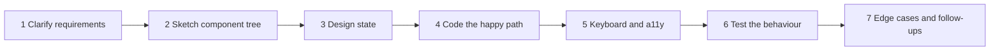

1. **Clarify requirements** (3–5 min): what must work, then the quiet requirements — keyboard, screen readers, mobile, loading/error states, data size, browsers. Write a checklist; agree what's out of scope.
2. **Sketch the component tree** (2–3 min): who renders whom, props down, callbacks up.
3. **Design state** (3–5 min). List every piece of data, then ask of each: *can it be computed from something else?* (then it is derived, not state — [§3.8](../03-state-and-events/README.md#38-derived-state--choosing-the-minimal-state)); *who needs it?* (the closest common parent owns it — [§3.7](../03-state-and-events/README.md#37-lifting-state-up)); *does it belong outside React?* (server data, URL, `localStorage`).
4. **Code the happy path** (20–30 min): something on screen early, then grow it; prefer native elements (`<button>`, `<input type="radio">`, `<form>`), which bring keyboard and screen-reader behaviour.
5. **Keyboard and accessibility** (5–10 min): Tab order, visible focus, Escape, arrows where the pattern expects them, labels, roles, `aria-*` state.
6. **Test** (5–10 min): one or two user-like tests — find by role and label, act with `user-event`, assert what the user sees ([§12.4](../12-testing-react/README.md#124-user-event--interacting-like-a-user)).
7. **Edge cases and follow-ups** (the rest): empty, loading, error, huge lists, fast typing, double clicks, unmount mid-request, "how would this scale?".

| 60-minute budget | Minutes |
|---|---|
| Requirements + tree + state | 10 |
| Happy path | 25 |
| Keyboard + a11y | 8 |
| Test | 7 |
| Edge cases, discussion | 10 |

### Common mistakes
- Coding before agreeing requirements, then building the wrong thing.
- Storing derived values in state (a `filteredTodos` array next to `todos`) and then fighting to keep them in sync.
- `<div onClick>` instead of `<button>`: not focusable, no Enter/Space, no role.
- Silence. The interviewer can't give credit for reasoning they didn't hear.
- Leaving no time to talk about edge cases — the part that separates "works" from "senior".

---

## 15.2 Interview questions: rendering, reconciliation and keys

### How to use sections 15.2–15.9
Each answer takes about 30 seconds to say and links to the section that teaches it. Where an answer is often disputed, [`code/01_interview_facts.jsx`](code/01_interview_facts.jsx) proves it and its real output is shown. Answer aloud first, then check.

**Q1. What happens, step by step, when you call a state setter?**
Nothing changes immediately. (1) **Trigger** — the update is queued and a re-render scheduled; (2) **render** — React calls the component (and its children) and compares the new element tree with the previous one (reconciliation); (3) **commit** — React applies only the differences to the DOM, runs layout effects, the browser paints, then `useEffect` Effects run. → [§10.1](../10-performance/README.md#101-the-render-cycle-trigger--render--commit), [§1.3](../01-why-react-and-setup/README.md#13-rendering-the-virtual-dom-and-reconciliation-brief)

**Q2. What is the difference between the render phase and the commit phase? Which one must be pure?**
The **render phase** calls components to compute the UI. It must be **pure** (same inputs → same JSX, no side effects) because React may call it twice, pause it or discard it (concurrent rendering, StrictMode). The **commit phase** applies DOM changes and runs effects, once per committed update; side effects belong there or in event handlers. → [§2.5](../02-components-and-props/README.md#25-pure-components), [§10.1](../10-performance/README.md#101-the-render-cycle-trigger--render--commit)

**Q3. What is reconciliation? Is "the virtual DOM" still the right way to describe React?**
Reconciliation compares the previous element tree with the next to find the DOM changes. A general tree diff is O(n³); React makes it O(n) with two rules: **a different element type means a different subtree** (`<div>` → `<section>`, or `ComponentA` → `ComponentB`, destroys the old subtree and its state), and **keys identify list children** across renders. "Virtual DOM" is an older name for the in-memory element tree; today's docs speak of *rendering* and *committing*, and the idea that matters is identity by *type + position + key*. → [§1.3](../01-why-react-and-setup/README.md#13-rendering-the-virtual-dom-and-reconciliation-brief), [§3.10](../03-state-and-events/README.md#310-state-is-tied-to-a-position-in-the-tree)

**Q4. Why do lists need keys, and why is the array index a bad key?**
A key tells React which item is which between renders, so the right DOM nodes and **state** move with it. With index keys, inserting at the top or re-sorting gives key `0` to a different item, which then inherits the first row's DOM and state (typed text, a checked box, focus). Use a stable ID from the data; index keys only for static lists. Never `Math.random()` — new keys every render remount every item. → [§2.8](../02-components-and-props/README.md#28-rendering-lists-and-keys)

**Q5. What does changing a component's `key` do?**
React treats it as a **different instance**: the old one unmounts (state gone, Effects cleaned up) and a new one mounts fresh — the idiomatic way to reset a form when the selected user changes: `<Profile key={userId} />`.
```
# a different key = a new component instance = fresh state
  Draft state initialised
  (same key: no new initialisation)
  Draft state initialised
```
→ [§3.10](../03-state-and-events/README.md#310-state-is-tied-to-a-position-in-the-tree)

**Q6. When does a component re-render?**
When its own **state** changes, its **parent re-renders** (children re-render by default, props changed or not), or a **context** it reads changes. "Props changed" is not a separate trigger — props change only because the parent re-rendered. A re-render with identical output commits nothing to the DOM. → [§10.2](../10-performance/README.md#102-when-components-re-render)

**Q7. Why does `{items.length && <List />}` sometimes render a `0`?**
`&&` returns its left side when it is falsy, and React renders the number `0`. Use a boolean (`items.length > 0 && …`) or a ternary; `false`, `null`, `undefined` and `true` render nothing. → [§2.7](../02-components-and-props/README.md#27-conditional-rendering)

---

## 15.3 Interview questions: state, events and forms

**Q8. I call `setCount(count + 1)` three times in one click. Why does the count go up by one?**
State is a **snapshot**: within one render `count` is a constant, so all three calls queue "replace with 1". An **updater function** builds on the queued value: `setCount(c => c + 1)` three times gives +3. The handler still sees the old value after calling the setter.
```
# snapshot + batching: three setN(n + 1) vs three setN(m => m + 1)
  render n=0
  handler still sees n=0
  render n=1
  render n=4
```
One render per click — that is **batching** (Q9). → [§3.3](../03-state-and-events/README.md#33-state-as-a-snapshot), [§3.5](../03-state-and-events/README.md#35-updater-functions--queueing-updates)

**Q9. What is batching? Did React 18 change it?**
React applies all updates queued during an event in **one** re-render. Before React 18 only React event handlers were batched; since React 18 (`createRoot`) batching is **automatic everywhere** — timeouts, promises, native listeners. To force a synchronous DOM update (rare: scrolling to a just-added item, focusing a heading that must already show new text) use `flushSync` from `react-dom`. → [§3.4](../03-state-and-events/README.md#34-batching)

**Q10. Why must state be updated immutably?**
React detects change with `Object.is(old, new)`; a mutated object is the same reference, so React may skip the render, and `memo` and dependency checks miss it too. Mutation also breaks snapshots. Create new objects/arrays (spread, `map`, `filter`, `toSorted`, `with`) or use Immer for deep updates. → [§3.6](../03-state-and-events/README.md#36-updating-objects-and-arrays-immutably)

**Q11. What is "derived state", and what's wrong with copying props into state?**
Anything **computable** from props or state during render — a filtered list, a count, "is the form valid". Store the minimum and compute the rest, or two copies drift apart. `useState(prop)` uses only the prop's **first** value; use the prop directly, name it `initialX` to make that explicit, or reset with a `key`. → [§3.8](../03-state-and-events/README.md#38-derived-state--choosing-the-minimal-state)

**Q12. Where should a piece of state live?**
As **low** as possible but **high enough** that all its users are below it — the closest common parent ("lifting state up"), passing down the value and a callback. Colocation keeps re-renders small; lifting avoids out-of-sync copies. → [§3.7](../03-state-and-events/README.md#37-lifting-state-up), [§6.1](../06-state-management/README.md#61-kinds-of-state--and-where-each-belongs)

**Q13. Controlled vs uncontrolled inputs — which should I use?**
**Controlled**: `value` from state plus `onChange`; React is the source of truth, so you can validate or format per keystroke. **Uncontrolled**: the DOM keeps the value (`defaultValue`) and you read it with a ref or `FormData` on submit — less code, fewer re-renders. Controlled when the UI reacts to each keystroke; uncontrolled for submit-and-read forms, especially with React 19 form Actions (`<form action={fn}>` receives `FormData` and resets uncontrolled fields after success). Don't switch one input between the two — starting with `value={undefined}` and later passing a string triggers a warning. → [§4.2](../04-forms-and-actions/README.md#42-controlled-vs-uncontrolled-inputs), [§4.4](../04-forms-and-actions/README.md#44-form-actions--form-actionfn)

**Q14. What do `useActionState`, `useFormStatus` and `useOptimistic` do?**
- `useActionState(action, initialState)` → `[state, formAction, isPending]`: the action's return value (e.g. validation errors) becomes state.
- `useFormStatus()`, called in a component *inside* a `<form>`, → `{ pending, data, method, action }` — ideal for a reusable submit button.
- `useOptimistic(state, updateFn)` shows a temporary value while an async action runs, then falls back to the real state when it finishes or fails.
→ [§4.5](../04-forms-and-actions/README.md#45-useactionstate--the-result-of-the-last-submission), [§4.6](../04-forms-and-actions/README.md#46-useformstatus--status-of-the-parent-form), [§4.7](../04-forms-and-actions/README.md#47-useoptimistic--instant-feedback-automatic-rollback)

**Q15. How are React events different from DOM events?**
Handlers get a **synthetic event**, a cross-browser wrapper with the usual interface (`target`, `preventDefault()`, `stopPropagation()`). Since React 17 listeners sit on the **root container**, not `document`, and events propagate through the **React** tree (portals — Q49). `onChange` fires on every keystroke (like the DOM `input` event). Returning `false` doesn't prevent default; call `e.preventDefault()`. → [§3.1](../03-state-and-events/README.md#31-responding-to-events)

---

## 15.4 Interview questions: effects and refs

**Q16. What is `useEffect` for — and when is it the wrong tool?**
Effects **synchronise a component with an external system**: a request tied to what's on screen, a subscription, a timer, a non-React widget, `document.title`. Wrong tool for computing from props/state (do it in render), reacting to a user action (event handler), resetting state on a prop change (`key`) or passing data up (lift state). Each unnecessary Effect costs an extra render and invites bugs. → [§5.1](../05-effects-and-refs/README.md#51-where-side-effects-belong), [§5.6](../05-effects-and-refs/README.md#56-you-might-not-need-an-effect)

**Q17. What do no array, `[]` and `[a, b]` mean as the second argument?**
No array: after **every** commit. `[]`: after mount only (cleanup on unmount). `[a, b]`: after mount and whenever `a` or `b` changed (`Object.is`). Dependencies aren't a choice — every reactive value the Effect reads must be listed (`react-hooks/exhaustive-deps` checks). Objects or functions created during render are new each time and re-run the Effect every render; create them inside the Effect or memoize them. → [§5.5](../05-effects-and-refs/README.md#55-dependencies-in-depth)

**Q18. When does cleanup run, and in what order do Effects run?**
Cleanup runs **before the Effect re-runs** (seeing the *old* values of its own render) and on **unmount**. Children's Effects run before their parent's, and all layout effects before any passive `useEffect`.
```
# effect order: child before parent, layout before passive, cleanup sees OLD values
  child  layout setup   v=1
  child  effect setup   v=1
  parent effect setup   v=1
  --- re-render with v=2
  child  layout cleanup v=1
  child  layout setup   v=2
  child  effect cleanup v=1
  parent effect cleanup v=1
  child  effect setup   v=2
  parent effect setup   v=2
```
→ [§5.3](../05-effects-and-refs/README.md#53-cleanup--undo-what-setup-did)

**Q19. Why does my Effect run twice, and my component render twice, in development?**
`<StrictMode>` (in most project templates) deliberately runs, **in development only**, component bodies, initialisers and updaters twice and each Effect's **setup → cleanup → setup** on mount (since React 19, ref callbacks too). It surfaces impure renders and missing cleanups: whatever breaks would also break on a real remount (navigation, `<Activity>`, fast refresh). Fix the cleanup — don't disable StrictMode or add "has run" flags. Production runs everything once.
```
# StrictMode (development only): render twice, effects setup -> cleanup -> setup
  effect setup
  effect cleanup
  effect setup
  component function called 2 times for one mount
```
→ [§5.4](../05-effects-and-refs/README.md#54-strictmodes-double-run-development-only)

**Q20. What race condition can happen when you fetch in an Effect, and how do you prevent it?**
If `userId` goes 1 → 2 quickly, the response for 1 can arrive **after** the one for 2 and overwrite it. In the cleanup, set an `ignore` flag the `.then` checks, or abort with an `AbortController` (`fetch(url, { signal })`). Better: TanStack Query or router loaders, which also cache and de-duplicate. Build 2 (§15.11) tests this race. → [§5.7](../05-effects-and-refs/README.md#57-fetching-data-in-effects-and-race-conditions), [§7.6](../07-custom-hooks-and-hook-rules/README.md#76-usefetch--loading-error-success-and-no-races)

**Q21. `useEffect` vs `useLayoutEffect`?**
`useLayoutEffect` runs after the DOM update but **before the browser paints**, so you can measure (a tooltip's height) and re-position without flicker. It blocks painting — use it only for measure-then-position; everything else goes in `useEffect`, which normally runs after paint. → [§5.11](../05-effects-and-refs/README.md#511-uselayouteffect--before-the-browser-paints)

**Q22. `useRef` vs `useState`?**
Both persist across renders. Setting state **re-renders**; changing `ref.current` does **not** and is visible immediately (no snapshot). Refs hold values that don't affect output — timer IDs, an `AbortController`, "request in flight" flags, DOM nodes. Don't read or write `ref.current` during render (except lazy initialisation): render must stay a pure function of props and state.
```
# changing ref.current does not re-render; state does
  render (ref=0)
  (clicked ref++ twice: no renders logged)
  render (ref=2)
```
→ [§5.8](../05-effects-and-refs/README.md#58-useref-for-values), [§5.9](../05-effects-and-refs/README.md#59-refs-to-dom-nodes)

**Q23. How do you pass a ref to your own component in React 19?**
As an ordinary prop: `function Input({ ref, ...props }) { return <input ref={ref} {...props} /> }`. `forwardRef` is no longer needed (it still works; deprecation is planned). Ref callbacks may return a **cleanup function**. To expose a limited API (only `focus()`), use `useImperativeHandle`. → [§5.10](../05-effects-and-refs/README.md#510-passing-refs-to-your-own-components)

**Q24. What problem does `useEffectEvent` solve?**
An Effect sometimes needs the *latest* value without re-running when it changes — a chat connection that logs with the current theme, an interval calling the latest `onTick`. As a dependency it reconnects on every change; left out it goes stale. `useEffectEvent(fn)` (stable since React 19.2) returns a non-reactive function that always sees the latest props/state, callable only from Effects. → [§7.7](../07-custom-hooks-and-hook-rules/README.md#77-hooks-that-take-callbacks--useeffectevent)

---

## 15.5 Interview questions: hooks, context and state management

**Q25. What are the Rules of Hooks, and why do they exist?**
Call Hooks only at the **top level** of components and custom Hooks — not in conditions, loops, nested functions or after an early `return`. React stores Hook state in a list matched **by call order**; if the order changes, state attaches to the wrong Hook. `use()` is the exception: allowed in `if` and loops (still only in components/Hooks). → [§7.1](../07-custom-hooks-and-hook-rules/README.md#71-what-a-hook-really-is), [§7.2](../07-custom-hooks-and-hook-rules/README.md#72-the-rules-of-hooks)

**Q26. What is a custom Hook? Do two components using the same Hook share state?**
A function named `use…` that calls other Hooks, to reuse **stateful logic** (`useDebouncedValue`, `useLocalStorage`). It shares logic, **not state**: each call has its own state, as if written inline. To share state, lift it or use context or a store. → [§7.3](../07-custom-hooks-and-hook-rules/README.md#73-custom-hooks--reusing-stateful-logic)

**Q27. `useState` or `useReducer`?**
`useState` for simple independent values. `useReducer` when values change together, the next state depends on the previous in several ways, or you want the logic in one **pure, testable function** with named actions (`{ type: 'toggled', id }`) — easy to move into Redux or Zustand later. Build 1 uses one. → [§6.2](../06-state-management/README.md#62-usereducer--consolidate-update-logic)

**Q28. Is Context a state-management tool?**
No — Context is a **transport** that passes a value to any depth; the state still lives in `useState`/`useReducer` in a provider. Good for theme, current user, locale, a reducer's `dispatch`. React 19 renders `<ThemeContext value={...}>` directly (`.Provider` still works). → [§6.3](../06-state-management/README.md#63-context--pass-data-deeply-without-props), [§6.5](../06-state-management/README.md#65-reducer--context--a-store-with-only-react)

**Q29. What is the performance problem with Context, and how do you fix it?**
When a provider's `value` changes (`Object.is`), **every** consumer re-renders, `memo` or not. An inline `value={{ user, setUser }}` is a new object each render, so consumers re-render even when nothing changed:
```
# memo does not stop context updates; a new object value re-renders every consumer
  Label rendered (dark)
  Plain rendered
  --- parent re-renders, nothing really changed
  Label rendered (dark)
```
(`Plain` and `Label` are both memoized; only `Label` reads the context, and only it re-rendered.) Fixes: memoize the value (`useMemo`, or let the React Compiler); **split** contexts (state vs dispatch, fast vs slow); move state down; or use an external store with selectors (Zustand, Redux, `useSyncExternalStore`) for high-frequency shared state. → [§6.4](../06-state-management/README.md#64-context-performance-caveats)

**Q30. How do you choose a state-management approach?**
First classify the state:

| Kind | Put it in |
|---|---|
| UI state used by one component | `useState` / `useReducer` |
| Shared by a few nearby components | Lift to the common parent |
| Needed deep in the tree, changes rarely | Context (+ reducer) |
| Client state shared widely, changes often | Zustand or Redux Toolkit (selectors limit re-renders) |
| Server data (cache of the backend) | TanStack Query, router loaders, or Server Components |
| Shareable/bookmarkable (filters, page, tab) | The URL (search params) |
| Form fields | Form Actions, or a form library (React Hook Form) for big forms |

→ [§6.6](../06-state-management/README.md#66-when-to-reach-for-a-library), [§6.10](../06-state-management/README.md#610-choosing--comparison-and-decision-flow)

**Q31. Why treat server data differently from client state?**
Server data is a **cache** of something you don't own: it goes stale, is shared, and needs loading/error states, de-duplication, refetching, pagination and invalidation. Hand-writing that with `useEffect` + `useState` is subtle; TanStack Query (or loaders/RSC) solves it once. Keep `useState`/stores for true client state. → [§6.9](../06-state-management/README.md#69-tanstack-query--server-state), [§9.8](../09-routing-and-data-fetching/README.md#98-tanstack-query-basics)

**Q32. What is `useSyncExternalStore` for?**
Subscribing to a store **outside** React (`navigator.onLine`, a hand-written store, a library) safely under concurrent rendering — no "tearing", where parts of the screen show different versions. You pass `subscribe`, `getSnapshot` and optionally `getServerSnapshot`; Zustand and React Redux use it internally. → [§7.9](../07-custom-hooks-and-hook-rules/README.md#79-usesyncexternalstore--subscribing-to-outside-data)

---

## 15.6 Interview questions: performance and the React Compiler

**Q33. What does `memo` do, and when doesn't it help?**
`memo(Component)` skips a re-render caused by the parent when every prop is `Object.is`-equal to last time. It doesn't help with new objects/functions each render (`style={{…}}`, `onClick={() => …}`), a changed context, the component's own state changes, or cheap components (the comparison costs too). → [§10.4](../10-performance/README.md#104-memo--skipping-a-childs-re-render)

**Q34. `useMemo` vs `useCallback`?**
Both cache between renders until a dependency changes. `useMemo(() => compute(a), [a])` caches a **value**; `useCallback(fn, [a])` caches the **function** itself (= `useMemo(() => fn, [a])`). They are hints — React may drop the cache. Use them for measured slow calculations or when identity matters (a `memo` child, an Effect dependency). → [§10.5](../10-performance/README.md#105-usecallback-and-usememo-for-stable-props), [§10.6](../10-performance/README.md#106-usememo-for-expensive-calculations)

**Q35. What is the React Compiler, and does it make `memo`/`useMemo`/`useCallback` obsolete?**
A build-time tool (v1.0 stable since October 2025) that inserts memoization of values, callbacks and JSX automatically, more finely than people do by hand. With it, manual memoization is rarely needed; the Hooks remain escape hatches (e.g. to control an Effect's dependencies). It assumes the Rules of React (pure render, no mutation), skips code it can't prove safe, and doesn't fix slow algorithms, huge DOMs or big bundles. → [§10.7](../10-performance/README.md#107-react-compiler)

**Q36. A page feels slow. How do you investigate?**
Measure first: React DevTools **Profiler** (what rendered, why, how long), the browser Performance panel, and a **production** build (dev is slower and StrictMode doubles renders). Usual causes: state too high (a keystroke re-renders the page), new objects breaking `memo`, over-eager context values, expensive render calculations, long lists, big bundles. → [§10.3](../10-performance/README.md#103-measure-first-devtools-profiler-and-profiler), [§10.10](../10-performance/README.md#1010-common-performance-bugs)

**Q37. How does code splitting work in React?**
`const Chart = lazy(() => import('./Chart.jsx'))` puts `Chart` in a separate file downloaded on first render; `<Suspense fallback={…}>` covers the wait. Split by route first, then heavy rarely-used widgets (editors, charts). → [§10.8](../10-performance/README.md#108-code-splitting-with-lazy-and-suspense)

**Q38. How do you render 10,000 rows?**
**Virtualize**: render only rows in or near the viewport, with spacers for the rest (TanStack Virtual, react-window). Or paginate (Build 7) or scroll infinitely (Build 3). Keep keys stable and rows cheap. → [§10.9](../10-performance/README.md#109-list-virtualization)

---

## 15.7 Interview questions: Suspense, `use()` and transitions

**Q39. What is Suspense, and what can "suspend"?**
`<Suspense fallback={<Spinner />}>` shows the fallback until everything inside is ready. What suspends: `lazy()` components, `use(promise)` on a pending promise, and Suspense-enabled sources (`useSuspenseQuery`, framework loaders, async Server Components) — **not** data fetched in `useEffect`. Nested boundaries let parts load independently. → [§9.11](../09-routing-and-data-fetching/README.md#911-suspense-and-use)

**Q40. What does `use()` do, and how is it different from other Hooks?**
`use(resource)` reads a **promise** (suspends until it resolves; a rejection goes to the nearest error boundary) or a **context**, and may be called in `if` and loops. In a Client Component the promise must be **cached or created outside render** (from a Server Component, loader or cache) — one created during render is new each time, so the component suspends forever. → [§9.11](../09-routing-and-data-fetching/README.md#911-suspense-and-use)

**Q41. `useTransition` vs `useDeferredValue`?**
Both mark work **non-urgent** so typing stays responsive. `useTransition` → `[isPending, startTransition]`: wrap a **state update you control** (tab switch, filter, navigation) and React renders it interruptibly in the background; in React 19 the function may be async (an "Action"). `useDeferredValue(value)` suits a value handed to you (a prop): the slow part renders with an older copy that catches up when React has time. Neither is for a controlled input's own value, which must update urgently. → [§7.10](../07-custom-hooks-and-hook-rules/README.md#710-usetransition--non-urgent-updates), [§7.11](../07-custom-hooks-and-hook-rules/README.md#711-usedeferredvalue--let-part-of-the-ui-lag-behind)

**Q42. When content is already on screen and a new update suspends, does the user see the fallback again?**
Not in a **transition**: React keeps the old content (dim it with `isPending`) until the new content is ready. Without a transition the nearest fallback reappears — which is why routers wrap navigations in transitions. → [§9.11](../09-routing-and-data-fetching/README.md#911-suspense-and-use), [§9.12](../09-routing-and-data-fetching/README.md#912-loading-and-error-states-that-users-like)

---

## 15.8 Interview questions: server rendering, hydration and Server Components

**Q43. CSR, SSR, SSG, streaming — what's the difference?**
**CSR**: an almost empty page plus JS; the browser builds the UI. **SSR**: HTML rendered per request, visible before JS loads, then hydrated. **SSG**: HTML rendered once at build time, served as files. **Streaming SSR**: HTML sent in chunks as each `<Suspense>` boundary is ready, so a slow part doesn't hold back the page. → [§1.4](../01-why-react-and-setup/README.md#14-spa-vs-mpa-vs-ssr-and-ssg), [§13.1](../13-server-rendering-and-frameworks/README.md#131-rendering-strategies-csr-ssr-ssg-isr-streaming-ppr), [§13.3](../13-server-rendering-and-frameworks/README.md#133-streaming-ssr-with-suspense)

**Q44. What is hydration, and what causes a hydration mismatch?**
Hydration (`hydrateRoot`) makes server HTML interactive: React renders the same tree in the browser, **adopts** the existing DOM and attaches handlers, expecting the first client render to match the server exactly. Mismatches come from `Date.now()`, `Math.random()`, `window`/`localStorage` checks in render, locale formatting, invalid nesting (`<div>` in `<p>`) or extensions editing the DOM; React reports a recoverable error and client-renders that part. Fixes: render the same on both sides and switch after hydration (an Effect, or React 19.3's `use(browser())` inside Suspense); `useId` for IDs; `suppressHydrationWarning` only for a single unavoidable difference like a timestamp. → [§13.4](../13-server-rendering-and-frameworks/README.md#134-hydration-end-to-end), [§13.5](../13-server-rendering-and-frameworks/README.md#135-hydration-mismatches)

**Q45. What are React Server Components, and how do they differ from Client Components?**
**Server Components** run only on the server (per request or at build), can be `async` and read data directly, and **ship no code** — only their output. No state, Effects, handlers or browser APIs. **Client Components** are the React you know: pre-rendered to HTML, then hydrated and run in the browser. `'use client'` marks the **boundary** — that module and its imports become client code. Server → Client props must be **serializable** (data, JSX, promises, Server Functions — not ordinary functions or class instances). A Client Component can't import a Server Component but can receive one as `children`. → [§13.7](../13-server-rendering-and-frameworks/README.md#137-react-server-components), [§13.8](../13-server-rendering-and-frameworks/README.md#138-directives-use-client-and-use-server)

**Q46. What does `'use server'` mean? Is it how you mark a Server Component?**
No — Server Components are the default and need no directive. `'use server'` marks **Server Functions**: async functions that run on the server but are callable from the client (`<form action>`, or in a transition). Each becomes a network endpoint, so validate input and check authorisation inside, like any public API. → [§4.8](../04-forms-and-actions/README.md#48-server-functions-and-progressive-enhancement-overview), [§13.8](../13-server-rendering-and-frameworks/README.md#138-directives-use-client-and-use-server)

**Q47. What goes wrong if you put `'use client'` at the top of the root layout?**
Everything it imports becomes client code: no zero-JS static parts, no direct data access, a bigger bundle. Push `'use client'` down to interactive **leaves** (a like button, a search box); keep pages and layouts as Server Components. → [§13.8](../13-server-rendering-and-frameworks/README.md#138-directives-use-client-and-use-server), [§13.9](../13-server-rendering-and-frameworks/README.md#139-nextjs-app-router-overview)

---

## 15.9 Interview questions: error boundaries, portals, patterns, testing and accessibility

**Q48. What do error boundaries catch — and what don't they?**
A **class** component with `static getDerivedStateFromError` (show a fallback) and `componentDidCatch` (log); there's no Hook version, so many apps use `react-error-boundary`. It catches errors thrown while **rendering**, in lifecycle methods and in Effects **below** it — **not** in event handlers, async code you started (`setTimeout`, a `.then` outside render), server rendering, or itself. Handle handler errors with `try/catch` + state; to route an async error to a boundary, throw it during render (a rejected `use(promise)`) or inside `startTransition`. React 19 adds root `onCaughtError` / `onUncaughtError` for reporting.
```
# error boundaries catch render errors, not event-handler errors
  render error -> Fallback: render failed
  click error -> reached window 'error' event: click failed
  boundary fallback shown after the click? false
```
→ [§14.9](../14-patterns-and-architecture/README.md#149-error-boundaries), [§9.12](../09-routing-and-data-fetching/README.md#912-loading-and-error-states-that-users-like)

**Q49. What is a portal, and how do events behave inside one?**
`createPortal(children, domNode)` renders into a **different DOM node** (usually `document.body`) while keeping the same place in the **React** tree — for modals, tooltips and toasts that must escape `overflow: hidden` or a stacking context. Context still flows in, and events **bubble through React parents**, not DOM parents:
```
# events from a portal bubble through the REACT tree, not the DOM tree
  DOM parent of the button: <body>, inside the React parent's div? false
  React parent onClick fired
```
→ [§14.8](../14-patterns-and-architecture/README.md#148-portals), Build 4 (§15.13)

**Q50. Compound components, render props, HOCs, custom Hooks — when would you use each?**
**Custom Hooks** — the default for sharing *logic*. **Compound components** (`<Tabs><Tabs.List/><Tabs.Panel/></Tabs>`, state via context) — flexible *markup*, common in design systems. **Render props** (a function prop) — the caller decides what to render with the component's data; still handy for lists and virtualization. **HOCs** (`withAuth(Page)`) — wrap a component to inject props; mostly replaced by Hooks but common in older code. → [§2.4](../02-components-and-props/README.md#24-composition), [§14.4](../14-patterns-and-architecture/README.md#144-compound-components)–[§14.7](../14-patterns-and-architecture/README.md#147-choosing-a-reuse-pattern)

**Q51. What is the philosophy of React Testing Library?**
The closer a test is to how people use the UI, the more confidence it gives. Find elements as a user or screen reader would — **role and accessible name first** (`getByRole('button', { name: 'Save' })`), then label and text, `data-testid` last — act with `user-event` (real key presses, focus, clicks) and assert on what's visible. Skip implementation details (state, Hook calls, class names) so tests survive refactors. Use `findBy…`/`waitFor` for async UI; fake the network at the boundary (a function prop, or MSW), not your own modules. → [§12.1](../12-testing-react/README.md#121-what-to-test-and-the-testing-library-philosophy), [§12.3](../12-testing-react/README.md#123-queries-and-their-priority), [§12.4](../12-testing-react/README.md#124-user-event--interacting-like-a-user), [§12.6](../12-testing-react/README.md#126-mocking-fetch-and-when-to-use-msw)

**Q52. How do you make React components accessible?**
**Semantic HTML** first (`<button>`, `<a href>`, `<label>`, `<fieldset>`, headings, `<dialog>`) — roles, focus and keyboard for free. Label every input (`htmlFor` + `useId`). Manage **focus** on big changes (into a dialog and back, to a new step's heading, to the first invalid field). Support expected keys (Escape closes, arrows inside tabs/menus/listboxes). ARIA only for what HTML can't say (`aria-expanded`, `aria-current`, `aria-invalid`, `aria-describedby`, live regions) — no ARIA beats wrong ARIA. Check with `eslint-plugin-jsx-a11y`, role-based tests, a keyboard and a screen reader. → [§7.8](../07-custom-hooks-and-hook-rules/README.md#78-useid--ids-for-accessibility), [§14.10](../14-patterns-and-architecture/README.md#1410-accessibility-in-react), [HTML & CSS Chapter 3](../../../html-css/chapters/03-semantic-html-and-accessibility/README.md)

**Q53. How would you type a component's props, children and events in TypeScript?**
Props with a `type`/`interface` and destructuring (`function Button({ variant = 'primary', ...rest }: ButtonProps)`); children as `React.ReactNode`; native props via `React.ComponentProps<'button'>`; events as `React.ChangeEvent<HTMLInputElement>` or inferred from inline handlers; refs as `useRef<HTMLInputElement>(null)`; mutually exclusive props as **discriminated unions**. → [§11.2](../11-typescript-with-react/README.md#112-typing-props), [§11.4](../11-typescript-with-react/README.md#114-typing-events), [§11.9](../11-typescript-with-react/README.md#119-discriminated-unions-for-props)

### Self-check (15.2–15.9)
1. A child component is wrapped in `memo`, receives no props, and reads a context whose provider passes `value={{ theme }}`. Its parent re-renders. Does the child re-render? → Yes: the provider creates a new object, so the context value changed by `Object.is`, and context updates go around `memo` (Q29).
2. Why is `key={Math.random()}` worse than `key={index}`? → Index keys only misbehave when the list reorders; random keys remount every item on every render, losing state and focus and wasting work (Q4).
3. What single change stops a stale fetch response from overwriting a newer one? → Cleanup in the Effect that aborts the request or sets an `ignore` flag (Q20).
4. Can a Server Component pass `onClick={() => …}` to a Client Component? → No — ordinary functions aren't serializable. Pass data, or a Server Function marked `'use server'` (Q45–Q46).
5. An error thrown in an `onClick` handler — which error boundary shows it? → None; boundaries only catch errors during rendering, lifecycles and Effects. Catch it in the handler and put the error in state (Q48).

---

## 15.10 Build 1 — Todo list with filters

### Requirements
The prompt: *"Build a todo app: add, complete, delete, filter by All / Active / Completed."* Clarifying questions turn that into:

| Functional | Quiet requirements (ask about them) |
|---|---|
| Add a todo (Enter or button); ignore blank input | Keyboard-only use works; every control has an accessible name |
| Toggle done; delete | Survives a page reload (`localStorage`) |
| Filter: all / active / completed | Counter text is announced ("2 items left") |
| Edit a title (double-click or ✎); Enter saves, Escape cancels, empty deletes | Toggle-all and "Clear completed" |

A simpler version of this app (no reducer, no editing) is built step by step in [§3.11](../03-state-and-events/README.md#311-putting-it-together--a-to-do-app); this is the interview-grade version.

### Component tree
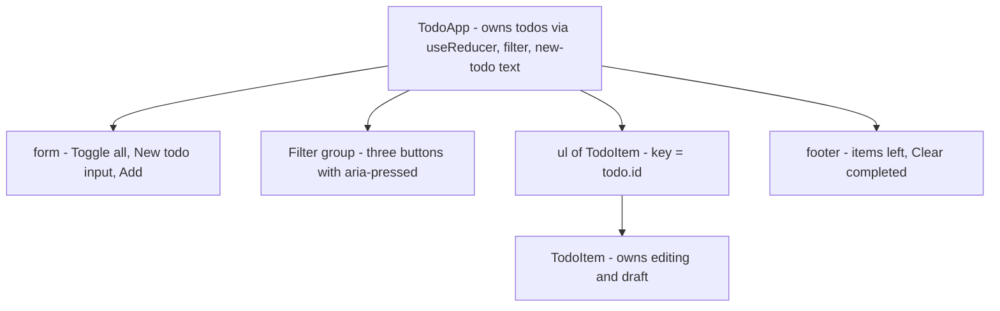

### State design

| Data | Kind | Owner | Why |
|---|---|---|---|
| `todos` | state (`useReducer`) | `TodoApp` | many kinds of change → one pure reducer; the list and the counter both need it |
| `filter` | state | `TodoApp` | UI choice (a follow-up could move it to the URL) |
| `text` | state | `TodoApp` | controlled "New todo" input |
| `editing`, `draft` | state | each `TodoItem` | only that row cares — colocated, so typing re-renders one row |
| `visible`, `left` | **derived** | computed in render | never stored, so never out of sync |
| next ID | ref | `TodoApp` | needed by handlers only, never displayed |

### Code
`code/todo.jsx`:
```jsx
// Machine coding 1 — todo list with filters, inline editing and localStorage persistence.
import { useEffect, useReducer, useRef, useState } from 'react';

export const FILTERS = {
  all: () => true,
  active: (t) => !t.done,
  completed: (t) => t.done,
};

// All todo changes live in one pure function: easy to read, easy to unit-test.
export function todosReducer(todos, action) {
  switch (action.type) {
    case 'added':
      return [...todos, { id: action.id, title: action.title, done: false }];
    case 'toggled':
      return todos.map((t) => (t.id === action.id ? { ...t, done: !t.done } : t));
    case 'edited':
      return todos.map((t) => (t.id === action.id ? { ...t, title: action.title } : t));
    case 'deleted':
      return todos.filter((t) => t.id !== action.id);
    case 'toggledAll': {
      const allDone = todos.every((t) => t.done);
      return todos.map((t) => ({ ...t, done: !allDone }));
    }
    case 'clearedCompleted':
      return todos.filter((t) => !t.done);
    default:
      throw new Error(`Unknown action: ${action.type}`);
  }
}

function loadTodos(storageKey) {
  try {
    return JSON.parse(localStorage.getItem(storageKey)) ?? [];
  } catch {
    return [];                                    // corrupt JSON or storage blocked
  }
}

function TodoItem({ todo, dispatch }) {
  const [editing, setEditing] = useState(false);
  const [draft, setDraft] = useState(todo.title);
  const inputRef = useRef(null);
  const cancelled = useRef(false);                // Escape must win over the blur that follows

  useEffect(() => {
    if (editing) { inputRef.current.focus(); inputRef.current.select(); }   // ready to type over
  }, [editing]);

  function startEdit() {
    cancelled.current = false;
    setDraft(todo.title);
    setEditing(true);
  }

  function finish() {
    if (cancelled.current) { cancelled.current = false; return; }
    const title = draft.trim();
    if (!title) dispatch({ type: 'deleted', id: todo.id });   // emptying a todo deletes it
    else dispatch({ type: 'edited', id: todo.id, title });
    setEditing(false);
  }

  if (editing) {
    return (
      <li className="editing">
        <input
          ref={inputRef}
          aria-label={`Edit ${todo.title}`}
          value={draft}
          onChange={(e) => setDraft(e.target.value)}
          onBlur={finish}
          onKeyDown={(e) => {
            if (e.key === 'Enter') finish();
            if (e.key === 'Escape') { cancelled.current = true; setEditing(false); }
          }}
        />
      </li>
    );
  }
  return (
    <li className={todo.done ? 'done' : undefined}>
      <input
        type="checkbox"
        aria-label={todo.title}
        checked={todo.done}
        onChange={() => dispatch({ type: 'toggled', id: todo.id })}
      />
      <span className="title" onDoubleClick={startEdit}>{todo.title}</span>
      <button className="icon" aria-label={`Edit ${todo.title}`} onClick={startEdit}>✎</button>
      <button className="icon" aria-label={`Delete ${todo.title}`} onClick={() => dispatch({ type: 'deleted', id: todo.id })}>✕</button>
    </li>
  );
}

export default function TodoApp({ storageKey = 'todos' }) {
  const [todos, dispatch] = useReducer(todosReducer, storageKey, loadTodos);   // lazy init: read storage once
  const [filter, setFilter] = useState('all');
  const [text, setText] = useState('');
  const nextId = useRef(Math.max(0, ...todos.map((t) => t.id)) + 1);

  useEffect(() => {
    localStorage.setItem(storageKey, JSON.stringify(todos));                   // sync to an external system
  }, [storageKey, todos]);

  const visible = todos.filter(FILTERS[filter]);          // derived — never stored
  const left = todos.filter((t) => !t.done).length;

  function handleSubmit(e) {
    e.preventDefault();
    const title = text.trim();
    if (!title) return;
    dispatch({ type: 'added', id: nextId.current++, title });
    setText('');
  }

  return (
    <section className="card todo" aria-labelledby="todo-h">
      <h2 id="todo-h">Todos</h2>
      <form onSubmit={handleSubmit} className="row">
        {todos.length > 0 && (
          <button type="button" className="icon" aria-label="Toggle all" onClick={() => dispatch({ type: 'toggledAll' })}>⌄</button>
        )}
        <input aria-label="New todo" placeholder="What needs to be done?" value={text} onChange={(e) => setText(e.target.value)} />
        <button>Add</button>
      </form>

      <div className="row" role="group" aria-label="Filter">
        {Object.keys(FILTERS).map((name) => (
          <button key={name} className="chip" aria-pressed={filter === name} onClick={() => setFilter(name)}>
            {name}
          </button>
        ))}
      </div>

      {visible.length === 0
        ? <p className="muted">{todos.length === 0 ? 'Nothing to do yet.' : `No ${filter} todos.`}</p>
        : <ul className="list">{visible.map((t) => <TodoItem key={t.id} todo={t} dispatch={dispatch} />)}</ul>}

      <footer className="row between">
        <span role="status">{left} {left === 1 ? 'item' : 'items'} left</span>
        {left < todos.length && <button onClick={() => dispatch({ type: 'clearedCompleted' })}>Clear completed</button>}
      </footer>
    </section>
  );
}
```

What to point out while coding:
- **Reducer** actions name *what happened* (`added`, `toggled`); the reducer is pure, so it's unit-tested without rendering (first test below).
- **Lazy initialiser**: `useReducer(reducer, storageKey, loadTodos)` reads `localStorage` once. The **Effect** writes back after each change — syncing with an external system, exactly what Effects are for ([§7.4](../07-custom-hooks-and-hook-rules/README.md#74-uselocalstorage--state-that-survives-a-reload) makes it `useLocalStorage`).
- **Keys** are IDs, so filtering never moves the edit box to another item.
- **Escape vs blur**: removing the focused edit input can fire `blur`, which would call `finish()` and save; the `cancelled` ref makes Escape win.

### Test
`code/02_todo.test.jsx` (key parts):
```jsx
test('edit: Enter saves, Escape cancels, empty text deletes', async () => {
  const user = userEvent.setup();
  render(<TodoApp />);
  await user.type(screen.getByRole('textbox', { name: 'New todo' }), 'Wash car{Enter}');

  await user.dblClick(screen.getByText('Wash car'));
  const edit = screen.getByRole('textbox', { name: 'Edit Wash car' });
  assert.equal(document.activeElement, edit);                // focused automatically
  await user.clear(edit);
  await user.type(edit, 'Wash bike{Enter}');
  assert.deepEqual(titles(), ['Wash bike']);

  await user.click(screen.getByRole('button', { name: 'Edit Wash bike' }));
  await user.type(screen.getByRole('textbox', { name: 'Edit Wash bike' }), ' NOPE{Escape}');
  assert.deepEqual(titles(), ['Wash bike']);                // unchanged
  // ... clearing the text and pressing Enter deletes the todo
});

test('persists to localStorage and restores on the next mount', async () => {
  // ... add "Survive reload", tick it, unmount
  render(<TodoApp storageKey="t1" />);                      // a "reload"
  const item = screen.getByRole('listitem');
  assert.equal(within(item).getByRole('checkbox').checked, true);
  console.log('    stored JSON:', localStorage.getItem('t1'));
});
```
Output:
```
✔ reducer: toggledAll ticks everything, or unticks if all are done
✔ adds with Enter, ignores blank input, clears the box
✔ toggle + filters + clear completed
✔ edit: Enter saves, Escape cancels, empty text deletes
    stored JSON: [{"id":1,"title":"Survive reload","done":true}]
✔ persists to localStorage and restores on the next mount
ℹ tests 5
ℹ pass 5
ℹ fail 0
```

### In the browser

*Figure 15.1 — `TodoApp` in Chrome, restored from `localStorage`. The strike-through, the count and the "Clear completed" button are all derived from the one `todos` array.*

### Follow-ups and edge cases
- **Persist to a server** → send each change to the API, showing it at once with `useOptimistic` and rolling back on failure ([§4.7](../04-forms-and-actions/README.md#47-useoptimistic--instant-feedback-automatic-rollback)), or a TanStack Query mutation with invalidation ([§9.10](../09-routing-and-data-fetching/README.md#910-mutations-invalidation-and-optimistic-updates)).
- **Shareable filter** → keep it in the URL (`?filter=active`) via the router's search params ([Chapter 9](../09-routing-and-data-fetching/README.md)).
- **Two tabs open** → listen for the `storage` event (fired in *other* tabs) and dispatch a `replaced` action, or subscribe with `useSyncExternalStore`.
- **10,000 todos** → virtualize; `memo(TodoItem)` with stable callbacks (or the React Compiler) stops every row re-rendering as you type.
- **Undo** → a `past` stack in the reducer state; `undo` pops it.
- **IDs** → `crypto.randomUUID()` in real apps; a counter ref is fine in an interview if you say why.

---

## 15.11 Build 2 — Autocomplete (debounce, abort, keyboard)

### Requirements

| Functional | Quiet requirements |
|---|---|
| Suggestions appear as the user types | Don't call the API on every keystroke — **debounce** (300 ms) |
| Click or Enter selects a suggestion | Ignore **stale responses** (a slow answer for "ap" must not replace "apr") |
| ArrowUp/ArrowDown move the highlight, wrapping at the ends; Escape closes | Screen readers announce the list and the highlighted option (ARIA **combobox** pattern) |
| Loading, empty and error states | The matching part of each suggestion is highlighted |

The data source is a prop, `search(query, { signal })` → promise of strings, so the component is API-independent and easy to test.

### Component tree
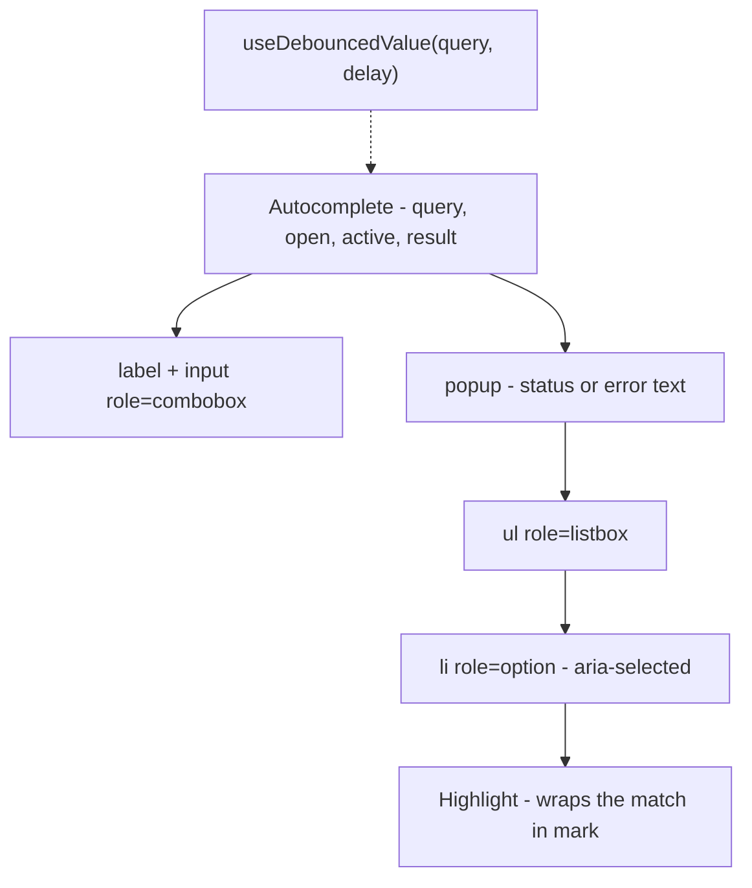

### State design

| Data | Kind | Why |
|---|---|---|
| `query` | state | controlled input — must update on every keystroke (urgent) |
| `debounced` | state inside `useDebouncedValue` | the value that actually triggers a search, 300 ms after typing stops |
| `result` = `{ status, items, for }` | state | one object so status and items can't disagree; `for` remembers which query the items belong to |
| `open` | state | the user can close the list (Escape, blur, selection) without clearing the query |
| `active` | state | index of the highlighted option, `-1` for none |
| `showList`, `items` shown | derived | e.g. no list when the query is shorter than `minChars` |
| option IDs | `useId` | unique on the page, stable between server and client |

**Debounce — why a Hook, not a `debounce()` wrapper?** A debounced *function* ([JavaScript Chapter 17 — Debounce](../../../javascript/chapters/17-javascript-for-interviews/README.md#debounce), [Throttle](../../../javascript/chapters/17-javascript-for-interviews/README.md#throttle)) must survive re-renders (`useRef`/`useMemo`) and be cancelled on unmount. Debouncing the *value* in an Effect is shorter: each keystroke's cleanup clears the previous timeout ([§7.5](../07-custom-hooks-and-hook-rules/README.md#75-usedebounce--wait-until-the-user-stops)).

### Code
`code/autocomplete.jsx`:
```jsx
import { useEffect, useId, useState } from 'react';

export function useDebouncedValue(value, delay) {
  const [debounced, setDebounced] = useState(value);
  useEffect(() => {
    const id = setTimeout(() => setDebounced(value), delay);
    return () => clearTimeout(id);                  // a new keystroke cancels the pending update
  }, [value, delay]);
  return debounced;
}

function Highlight({ text, query }) {
  const i = text.toLowerCase().indexOf(query.toLowerCase());
  if (i === -1 || !query) return text;
  return <>{text.slice(0, i)}<mark>{text.slice(i, i + query.length)}</mark>{text.slice(i + query.length)}</>;
}

export default function Autocomplete({ search, onSelect, label = 'Search', delay = 300, minChars = 1 }) {
  const [query, setQuery] = useState('');
  const [open, setOpen] = useState(false);
  const [active, setActive] = useState(-1);                 // highlighted option index, -1 = none
  const [result, setResult] = useState({ status: 'idle', items: [], for: '' });
  const debounced = useDebouncedValue(query.trim(), delay);
  const id = useId();
  const listId = `${id}-list`;

  useEffect(() => {
    if (debounced.length < minChars) return;
    const controller = new AbortController();
    setResult((r) => ({ ...r, status: 'loading' }));
    search(debounced, { signal: controller.signal })
      .then((items) => { setResult({ status: 'success', items, for: debounced }); setActive(-1); })
      .catch((err) => { if (err.name !== 'AbortError') setResult({ status: 'error', items: [], for: debounced }); });
    return () => controller.abort();                        // newer query (or unmount) cancels this one
  }, [debounced, minChars, search]);

  const tooShort = query.trim().length < minChars;
  const items = tooShort ? [] : result.items;
  const showList = open && !tooShort;

  function choose(item) {
    setQuery(item);
    setOpen(false);
    setActive(-1);
    onSelect?.(item);
  }

  function handleKeyDown(e) {
    if (e.key === 'ArrowDown' || e.key === 'ArrowUp') {
      e.preventDefault();                                   // keep the caret where it is
      setOpen(true);
      if (items.length === 0) return;
      const step = e.key === 'ArrowDown' ? 1 : -1;
      setActive((i) => (i + step + items.length) % items.length);   // wraps around both ends
    } else if (e.key === 'Enter' && showList && active >= 0) {
      e.preventDefault();                                   // don't submit a surrounding form
      choose(items[active]);
    } else if (e.key === 'Escape') {
      setOpen(false);
      setActive(-1);
    }
  }

  return (
    <div className="card ac">
      <label htmlFor={`${id}-input`}>{label}</label>
      <input
        id={`${id}-input`}
        role="combobox"
        aria-expanded={showList}
        aria-controls={listId}
        aria-autocomplete="list"
        aria-activedescendant={showList && active >= 0 ? `${id}-opt-${active}` : undefined}
        autoComplete="off"
        value={query}
        onChange={(e) => { setQuery(e.target.value); setOpen(true); setActive(-1); }}
        onKeyDown={handleKeyDown}
        onBlur={() => setOpen(false)}
      />
      {showList && (
        <div className="popup">
          {result.status === 'loading' && <p className="muted" role="status">Searching…</p>}
          {result.status === 'error' && <p className="error" role="alert">Something went wrong. Keep typing to retry.</p>}
          {result.status === 'success' && items.length === 0 && <p className="muted" role="status">No matches for “{result.for}”</p>}
          <ul id={listId} role="listbox" aria-label={`${label} suggestions`}>
            {items.map((item, i) => (
              <li
                key={item}
                id={`${id}-opt-${i}`}
                role="option"
                aria-selected={i === active}
                onMouseDown={(e) => e.preventDefault()}     // keep focus in the input so blur doesn't close first
                onMouseEnter={() => setActive(i)}
                onClick={() => choose(item)}
              >
                <Highlight text={item} query={result.for} />
              </li>
            ))}
          </ul>
        </div>
      )}
    </div>
  );
}
```

How the tricky parts work:
1. **Debounce → search**: `query` changes every keystroke; `debounced` only after `delay` ms of quiet, and only then does the search Effect run.
2. **Abort**: each search Effect owns an `AbortController`. When `debounced` changes, React runs the old Effect's **cleanup** first, aborting the old request (its `AbortError` is ignored), so an old response can never overwrite a newer one ([§5.7](../05-effects-and-refs/README.md#57-fetching-data-in-effects-and-race-conditions)). Note the ordering: the abort happens when the *debounced* value changes, not on the keystroke — a response for "ap" that lands during the pause after typing "r" is still shown (labelled by `result.for`) until the "apr" results replace it.
3. **Focus stays in the input.** Options are never focused; `aria-activedescendant` names the active one (the WAI-ARIA combobox pattern), so the user keeps typing.
4. **Mouse vs blur.** Clicking an option would blur the input and close the list *before* the click lands; `onMouseDown={e => e.preventDefault()}` prevents the blur.
5. **Enter** selects only when an option is highlighted, with `preventDefault()` so a surrounding `<form>` doesn't submit.

### Test
`code/03_autocomplete.test.jsx` uses a fake `search` whose requests the test resolves **by hand**, so it can make answers arrive out of order:
```jsx
function fakeSearch() {
  const calls = [];
  const search = (q, { signal }) => new Promise((resolve, reject) => {
    const call = { q, signal, resolve: () => resolve(FRUITS.filter((f) => f.toLowerCase().includes(q.toLowerCase()))) };
    signal.addEventListener('abort', () => reject(new DOMException('aborted', 'AbortError')));
    calls.push(call);
  });
  return { search, calls };
}

test('abort: a newer query cancels the older request, so stale results never show', async () => {
  const user = userEvent.setup();
  const { search, calls } = fakeSearch();
  render(<Autocomplete search={search} delay={50} label="Fruit" />);
  const box = screen.getByRole('combobox');
  await user.type(box, 'ap');
  await waitFor(() => assert.equal(calls.length, 1));      // request #1 ("ap") is in flight
  await user.type(box, 'r');
  await waitFor(() => assert.equal(calls.length, 2));      // request #2 ("apr") started
  assert.equal(calls[0].signal.aborted, true);             // ...and #1 was aborted by the effect cleanup
  calls[1].resolve();                                      // the answers arrive OUT of order:
  await waitFor(() => assert.deepEqual(options(), ['Apricot']));
  calls[0].resolve();                                      // the late answer for "ap" must be ignored
  await new Promise((r) => setTimeout(r, 20));
  assert.deepEqual(options(), ['Apricot']);
});

test('keyboard: arrows move (and wrap), Enter selects, Escape closes', async () => {
  // ... type "ap", resolve, 5 options
  await user.keyboard('{ArrowDown}{ArrowDown}');
  const second = screen.getAllByRole('option')[1];
  assert.equal(box.getAttribute('aria-activedescendant'), second.id);   // focus stays in the input
  await user.keyboard('{ArrowUp}{ArrowUp}');                // 1 -> 0 -> wraps to the last
  await user.keyboard('{ArrowDown}{Enter}');                // wraps to the first, selects it
  assert.deepEqual(picked, ['Apple']);
  // ... Escape closes and sets aria-expanded="false"
});
```
Output:
```
✔ debounce: typing quickly sends ONE request, for the final text
✔ abort: a newer query cancels the older request, so stale results never show
✔ keyboard: arrows move (and wrap), Enter selects, Escape closes
✔ mouse: clicking an option selects it (mousedown does not blur the input first)
✔ empty and error states
ℹ tests 5
ℹ pass 5
ℹ fail 0
```

The tests pass short real delays (10–100 ms) as a prop, so no fake timers are needed.

### In the browser
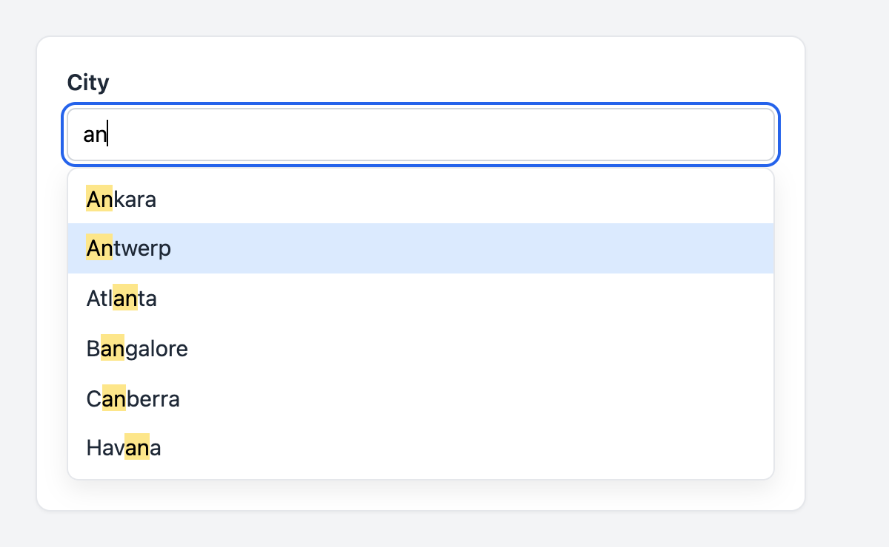
*Figure 15.2 — After typing "an" and pressing ArrowDown twice. The matching text is wrapped in `<mark>`; the blue row is the option named by `aria-activedescendant`, while keyboard focus stays in the input.*

### Follow-ups and edge cases
- **Cache results** → a `Map` of query → results in a ref (or TanStack Query keyed by the query), so Backspace shows earlier results instantly.
- **Why not throttle?** → throttle fires at most once per interval *while* typing (scroll/resize); debounce waits for a pause (search). Both are in [JavaScript §17.3](../../../javascript/chapters/17-javascript-for-interviews/README.md#173-implement-from-scratch-classics).
- **Huge result lists** → cap results (top 10) or render them from `useDeferredValue(query)` ([§7.11](../07-custom-hooks-and-hook-rules/README.md#711-usedeferredvalue--let-part-of-the-ui-lag-behind)).
- **Active option out of view** → in an Effect on `active`, `scrollIntoView({ block: 'nearest' })` the option.
- **Selecting searches the chosen text** → harmless here (the list is closed), or skip when `query` equals the last selection.
- **Highlighting user input** → never `dangerouslySetInnerHTML`; splitting the string and rendering `<mark>` in JSX, as `Highlight` does, is XSS-safe.
- **Rate limits** → debounce plus `minChars`, caching and server-side limits.

---

## 15.12 Build 3 — Infinite scroll

### Requirements

| Functional | Quiet requirements |
|---|---|
| Show the first page, load the next when the user nears the bottom | **Never** send two requests for the same page (fast scrolling, observer firing twice) |
| Show "Loading more…"; stop at the end with a message | If one page doesn't fill the box, keep loading until it does |
| On failure, show an error with Retry | Don't update state after unmount; work inside a scrollable box, not only the window |

### How it works
An **`IntersectionObserver`** tells you when an element (here an invisible 1-pixel **sentinel** after the last item) enters a **root** (the scroll box) — no `scroll` listeners, no layout reads on every scroll event. `rootMargin: '200px'` grows the root so loading starts 200 px *before* the user reaches the end.

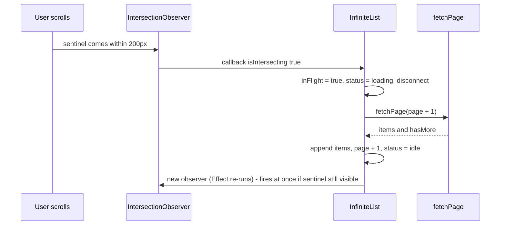

### State design

| Data | Kind | Why |
|---|---|---|
| `items` | state | the growing list |
| `page` | state | last page loaded |
| `status` | state `'idle' \| 'loading' \| 'error'` | one variable, so "loading and error at once" is impossible |
| `hasMore` | state | stop observing at the end |
| `inFlight` | ref | a **synchronous** guard: `status` only changes on the next render, but a ref changes immediately |
| `mounted` | ref | ignore a response that arrives after unmount |
| scroller, sentinel | refs to DOM nodes | the observer needs real elements |

### Code
`code/infinite-list.jsx`:
```jsx
import { useEffect, useRef, useState } from 'react';

export default function InfiniteList({ fetchPage, renderItem = (item) => item.name, rootMargin = '200px' }) {
  const [items, setItems] = useState([]);
  const [page, setPage] = useState(0);                      // last page loaded (0 = none yet)
  const [status, setStatus] = useState('idle');             // 'idle' | 'loading' | 'error'
  const [hasMore, setHasMore] = useState(true);
  const scrollerRef = useRef(null);
  const sentinelRef = useRef(null);
  const mounted = useRef(false);
  const inFlight = useRef(false);                           // sync guard: state updates aren't instant

  useEffect(() => {
    mounted.current = true;
    return () => { mounted.current = false; };              // late responses after unmount are dropped
  }, []);

  // Re-created whenever status/page/hasMore change. A new observer reports the sentinel's current
  // state immediately, so if page N didn't fill the box, page N+1 loads without any scrolling.
  useEffect(() => {
    if (status !== 'idle' || !hasMore) return;              // never two requests at once, stop at the end
    const observer = new IntersectionObserver(
      ([entry]) => {
        if (!entry.isIntersecting || inFlight.current) return;
        inFlight.current = true;
        observer.disconnect();
        setStatus('loading');
        fetchPage(page + 1).then(
          (res) => {
            inFlight.current = false;
            if (!mounted.current) return;
            setItems((prev) => [...prev, ...res.items]);
            setPage(page + 1);
            setHasMore(res.hasMore);
            setStatus('idle');
          },
          () => { inFlight.current = false; if (mounted.current) setStatus('error'); },
        );
      },
      { root: scrollerRef.current, rootMargin },           // start loading 200px before the end
    );
    observer.observe(sentinelRef.current);
    return () => observer.disconnect();
  }, [status, page, hasMore, fetchPage, rootMargin]);

  return (
    <section className="card feed" aria-labelledby="feed-h">
      <h2 id="feed-h">Feed <small className="muted">({items.length} loaded)</small></h2>
      <div className="scroller" ref={scrollerRef} tabIndex={0} aria-label="Feed items">
        <ul className="list" aria-busy={status === 'loading'}>
          {items.map((item) => <li key={item.id}>{renderItem(item)}</li>)}
        </ul>
        <div ref={sentinelRef} aria-hidden="true" className="sentinel" />
        {status === 'loading' && <p role="status" className="muted">Loading more…</p>}
        {status === 'error' && (
          <p role="alert" className="error">
            Couldn’t load more. <button onClick={() => setStatus('idle')}>Retry</button>
          </p>
        )}
        {!hasMore && <p className="muted">You’ve reached the end.</p>}
      </div>
    </section>
  );
}
```

Design notes:
- **The Effect is the loop.** It observes only while `status === 'idle'` and `hasMore`. After each page the dependencies change, cleanup disconnects the old observer and a new one immediately reports whether the sentinel is visible — so short pages chain until the box is full.
- **Why `inFlight` too?** An observer callback can run several times before React re-renders with `status: 'loading'`; state is a snapshot (Q8), a ref isn't.
- **Retry** sets `status` back to `'idle'`, so the Effect observes again.
- **`aria-busy`** and a `role="status"` message tell screen-reader users more is coming.

### Test
jsdom does no layout, so it has no `IntersectionObserver`. The test installs a tiny fake and an `intersect()` helper that plays the part of the user scrolling:
```jsx
const observers = new Set();
class FakeIntersectionObserver {
  constructor(callback, options) { this.callback = callback; this.options = options; this.targets = []; }
  observe(el) { this.targets.push(el); observers.add(this); }
  unobserve(el) { this.targets = this.targets.filter((t) => t !== el); }
  disconnect() { this.targets = []; observers.delete(this); }
}
globalThis.IntersectionObserver = window.IntersectionObserver = FakeIntersectionObserver;

async function intersect() {                   // "scroll" until the sentinel is visible
  await act(async () => {
    for (const o of [...observers]) o.callback(o.targets.map((target) => ({ target, isIntersecting: true })), o);
    await new Promise((r) => setTimeout(r, 0));
  });
}

test('no duplicate requests while one is in flight', async () => {
  // ... fetchPage that never resolves until release() is called
  render(<InfiniteList fetchPage={fetchPage} />);
  const [o] = observers;
  await act(async () => {                      // the observer fires three times quickly
    for (let i = 0; i < 3; i++) o.callback([{ isIntersecting: true }], o);
  });
  assert.equal(screen.getByRole('status').textContent, 'Loading more…');
  assert.deepEqual(calls, [1]);
  // ...
});
```
Output:
```
✔ loads the next page each time the sentinel becomes visible, then stops
✔ no duplicate requests while one is in flight
✔ error shows Retry, and Retry resumes loading
ℹ tests 3
ℹ pass 3
ℹ fail 0
```

Without the `inFlight` ref this test fails with `calls` = `[1, 1, 1]` — three requests for page 1, the classic infinite-scroll bug.

### In the browser
In Chrome the real `IntersectionObserver` drives it. The demo page scrolls the box to the bottom twice:

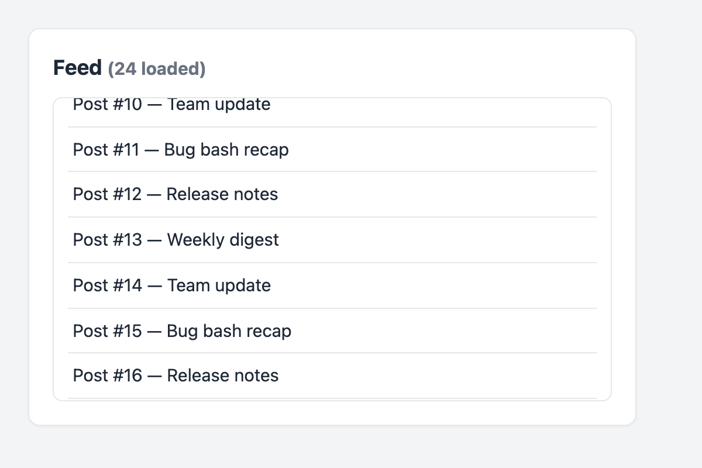
*Figure 15.3 — The real `IntersectionObserver` in Chrome: two scrolls to the bottom loaded pages 2 and 3 (24 posts). The third page arrived while the box still showed posts 10–16, so the user never waits at the bottom.*

### Follow-ups and edge cases
- **Library** → TanStack Query's `useInfiniteQuery` handles pages, caching and `hasNextPage`; an observer still calls `fetchNextPage()` ([§9.9](../09-routing-and-data-fetching/README.md#99-query-keys-pagination-and-dependent-queries)).
- **Thousands of items** → add virtualization ([§10.9](../10-performance/README.md#109-list-virtualization)).
- **Cursor vs page numbers** → inserts while scrolling shift page numbers (duplicates, gaps); use a cursor (`?after=<lastId>`) and de-duplicate by `id`.
- **Back-navigation** → cache the data (TanStack Query) and restore `scrollTop`, or open details in a modal that keeps the list mounted.
- **Accessibility** → the footer becomes unreachable; offer a "Load more" button too (it can be the sentinel) and announce new items via `role="status"`.
- **Abort on unmount** → pass an `AbortSignal` to `fetchPage` and abort in a mount-only Effect's cleanup.

---

## 15.13 Build 4 — Modal dialog (portal, focus trap, Escape)

### Requirements

| Functional | Quiet requirements (the real test) |
|---|---|
| Open from a button, show a title, content and actions | Rendered at the top level so no parent's `overflow` or `z-index` clips it |
| Close with Cancel, Escape, or a click on the backdrop | Focus moves **into** the dialog on open and **back** to the opener on close |
| A destructive confirm: "type the name to enable Delete" | **Tab** and **Shift+Tab** cycle inside the dialog; the page behind doesn't scroll |
| | Screen readers announce a dialog with its title: `role="dialog"`, `aria-modal`, `aria-labelledby` |

### Component tree
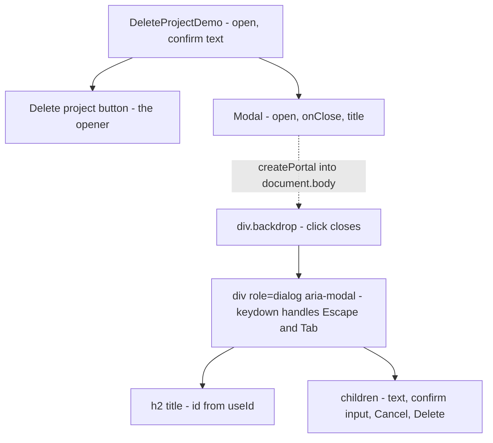

### State design
The `Modal` is **controlled**: the parent owns `open` and passes `onClose`. That lets the parent decide what closing means (reset the confirm text, save a draft) and makes the modal reusable. The modal itself holds no state — only refs (the dialog node, and the element that had focus before opening, captured inside the Effect).

### Code
`code/modal.jsx`:
```jsx
// Machine coding 4 — modal dialog: portal, focus trap, Escape, backdrop click, focus restore, scroll lock.
import { useEffect, useId, useRef, useState } from 'react';
import { createPortal } from 'react-dom';

const FOCUSABLE = 'a[href], button:not([disabled]), input:not([disabled]), select:not([disabled]), textarea:not([disabled]), [tabindex]:not([tabindex="-1"])';

export function Modal({ open, onClose, title, children }) {
  const dialogRef = useRef(null);
  const titleId = useId();

  useEffect(() => {
    if (!open) return;
    const previouslyFocused = document.activeElement;          // usually the button that opened us
    const first = dialogRef.current.querySelector(FOCUSABLE);
    (first ?? dialogRef.current).focus();                       // move focus INTO the dialog
    const { overflow } = document.body.style;
    document.body.style.overflow = 'hidden';                    // stop the page behind from scrolling
    return () => {
      document.body.style.overflow = overflow;
      previouslyFocused?.focus?.();                             // give focus back on close
    };
  }, [open]);

  if (!open) return null;

  function handleKeyDown(e) {
    if (e.key === 'Escape') {
      e.stopPropagation();                                      // a parent modal shouldn't close too
      onClose();
      return;
    }
    if (e.key !== 'Tab') return;
    const nodes = [...dialogRef.current.querySelectorAll(FOCUSABLE)];
    if (nodes.length === 0) { e.preventDefault(); return; }
    const first = nodes[0];
    const last = nodes[nodes.length - 1];
    const outside = !nodes.includes(document.activeElement);    // e.g. the dialog box itself, after a click on its text
    if (e.shiftKey && (outside || document.activeElement === first)) { e.preventDefault(); last.focus(); }
    else if (!e.shiftKey && (outside || document.activeElement === last)) { e.preventDefault(); first.focus(); }
  }

  return createPortal(
    <div className="backdrop" onMouseDown={(e) => { if (e.target === e.currentTarget) onClose(); }}>
      <div
        ref={dialogRef}
        role="dialog"
        aria-modal="true"
        aria-labelledby={titleId}
        tabIndex={-1}
        className="dialog"
        onKeyDown={handleKeyDown}
      >
        <h2 id={titleId}>{title}</h2>
        {children}
      </div>
    </div>,
    document.body,                                              // escape parents' overflow/z-index
  );
}
```

`DeleteProjectDemo` in the same file (the page used by the tests and the screenshot) owns `open` and the confirm text, and passes `onClose={close}` to `Modal`; Delete is `disabled` until the input says "Apollo".

Walk-through:
1. **Portal**: `createPortal(…, document.body)` puts the DOM at the end of `<body>`, but React-wise the modal is still a child of `DeleteProjectDemo`, so state, context and event bubbling work normally (Q49).
2. **Focus in, focus back**: the Effect runs when `open` becomes `true`: it remembers `document.activeElement` (the opener), focuses the first focusable element, and its **cleanup** — which runs when `open` becomes `false` or the modal unmounts — restores focus and the body's `overflow`.
3. **Focus trap**: Tab on the last focusable element wraps to the first; Shift+Tab on the first wraps to the last. If focus is on none of them — clicking the dialog's text focuses the `tabIndex={-1}` box itself — Shift+Tab would otherwise leave the dialog, so it also wraps. The list is re-queried on every key press, so it stays right when Delete becomes enabled.
4. **Escape** closes; `stopPropagation()` stops an outer modal (if any) from closing too.
5. **Backdrop**: close only when the mousedown target *is* the backdrop, not a child — otherwise selecting text inside the dialog and releasing outside would close it.

### Test
`code/05_modal.test.jsx` (key parts):
```jsx
test('renders into document.body through a portal, labelled by its title', async () => {
  const { container, dialog } = await openModal();
  assert.equal(container.contains(dialog), false);        // not inside the component's own DOM
  assert.equal(document.body.contains(dialog), true);
  assert.equal(dialog.getAttribute('aria-modal'), 'true');
  assert.equal(document.body.style.overflow, 'hidden');    // background scroll locked
});

test('focus moves in, and Tab / Shift+Tab stay trapped inside', async () => {
  const { user } = await openModal();
  assert.equal(document.activeElement, screen.getByRole('textbox'));   // first focusable element
  await user.tab();
  assert.equal(focused(), 'Cancel');
  await user.tab();                                        // Delete is disabled, so Cancel is last:
  assert.equal(document.activeElement, screen.getByRole('textbox'));   // wraps to the first
  await user.tab({ shift: true });                         // Shift+Tab on the first wraps to the last
  assert.equal(focused(), 'Cancel');
  // ... type "Apollo": Delete becomes the last element in the cycle
});

test('Escape closes and focus returns to the button that opened it', async () => {
  const { user, trigger } = await openModal();
  await user.keyboard('{Escape}');
  assert.equal(screen.queryByRole('dialog'), null);
  assert.equal(document.activeElement, trigger);
  assert.equal(document.body.style.overflow, '');          // scroll lock removed
});
```
Output:
```
✔ renders into document.body through a portal, labelled by its title
✔ focus moves in, and Tab / Shift+Tab stay trapped inside
✔ Escape closes and focus returns to the button that opened it
✔ clicking the backdrop closes; clicking inside does not
✔ the confirm flow: Delete stays disabled until the name is typed
ℹ tests 5
ℹ pass 5
ℹ fail 0
```

`user.tab()` respects `preventDefault()` on the `keydown`, like a browser, so the trap is genuinely tested.

### In the browser

*Figure 15.4 — The modal in Chrome, rendered into `<body>` over a dimmed page. "Delete" stays disabled (and outside the focus cycle) until the full name is typed.*

### Follow-ups and edge cases
- **Why not native `<dialog>`?** → In real apps, prefer it: `showModal()` uses the browser's **top layer** (no portal or z-index), makes the page behind **inert**, closes on Escape (a `cancel` event) and returns focus to the opener on close (HTML standard behaviour, in all major browsers). Call `showModal()`/`close()` in an Effect when `open` changes and listen for `close` to sync React state. Interviewers still ask for the hand-built version to see you know what the browser does.
- **Screen readers can reach the page behind** a hand-built modal; `aria-modal="true"` helps, but `inert` on the app root is the robust fix (`<dialog>` does it for you).
- **Nested modals** → keep a stack; only the top one handles Escape (the `stopPropagation` above) and traps focus.
- **Exit animations** → keep it mounted in a `closing` state until `transitionend`.
- **SSR** → no `document` on the server; create the portal only after mount.
- **Focusable detection** → the selector misses `contenteditable`, `<details>` and similar; `focus-trap` or Radix/React Aria handle the long tail.

---

## 15.14 Build 5 — Accessible tabs

### Requirements

| Functional | Quiet requirements (WAI-ARIA tabs pattern) |
|---|---|
| A row of tabs; clicking one shows its panel | `role="tablist"`, `role="tab"` with `aria-selected` and `aria-controls`, `role="tabpanel"` with `aria-labelledby` |
| Optional initial tab and `onChange` callback | **One** Tab-key stop for the whole tab row (roving `tabIndex`), then Tab moves into the panel |
| Disabled tabs are skipped | ArrowLeft/ArrowRight move between tabs and wrap; Home/End jump to the ends |
| Switching tabs keeps what the user typed in other panels | Selection follows focus ("automatic activation") |

### Component tree
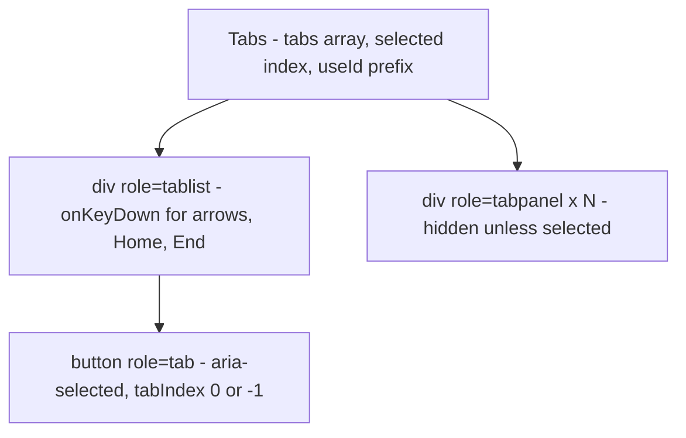

### State design
Only one piece of state: `selected` (an index). The IDs that connect each tab to its panel come from `useId`, so two `Tabs` on one page never clash. `tabRefs` (an array of DOM nodes filled by **ref callbacks**) lets the keyboard handler move focus. The `tabs` array is a prop, so what is shown is derived from it.

**Roving tabindex** — what it is: in a composite widget (tabs, toolbar, radio group, menu), only the *current* item has `tabIndex={0}`; the others have `-1`. Tab enters the widget at the current item and the next Tab leaves it; arrow keys move *within* it. Keyboard users don't have to press Tab through every tab to reach the content.

### Code
`code/tabs.jsx`:
```jsx
// Machine coding 5 — accessible tabs (WAI-ARIA tabs pattern, automatic activation, roving tabindex).
import { useId, useRef, useState } from 'react';

export default function Tabs({ tabs, defaultIndex = 0, onChange, label }) {
  const [selected, setSelected] = useState(defaultIndex);
  const tabRefs = useRef([]);                               // one DOM node per tab, for focus()
  const id = useId();

  function select(i) {
    setSelected(i);
    tabRefs.current[i].focus();
    onChange?.(i);
  }

  // Find the next enabled tab in `step` direction, wrapping around the ends.
  function nextEnabled(from, step) {
    for (let k = 1; k <= tabs.length; k++) {
      const i = (from + step * k + tabs.length) % tabs.length;
      if (!tabs[i].disabled) return i;
    }
    return from;
  }

  function handleKeyDown(e) {
    const moves = {
      ArrowRight: () => nextEnabled(selected, 1),
      ArrowLeft: () => nextEnabled(selected, -1),
      Home: () => nextEnabled(-1, 1),                      // first enabled
      End: () => nextEnabled(tabs.length, -1),             // last enabled
    };
    if (!moves[e.key]) return;
    e.preventDefault();                                     // Home/End would scroll the page
    select(moves[e.key]());
  }

  return (
    <div className="card tabs">
      <div role="tablist" aria-label={label} onKeyDown={handleKeyDown}>
        {tabs.map((tab, i) => (
          <button
            key={tab.label}
            ref={(el) => { tabRefs.current[i] = el; }}
            role="tab"
            id={`${id}-tab-${i}`}
            aria-selected={i === selected}
            aria-controls={`${id}-panel-${i}`}
            tabIndex={i === selected ? 0 : -1}                // roving tabindex: only one tab stop
            disabled={tab.disabled}
            onClick={() => select(i)}
          >
            {tab.label}
          </button>
        ))}
      </div>
      {tabs.map((tab, i) => (
        <div
          key={tab.label}
          role="tabpanel"
          id={`${id}-panel-${i}`}
          aria-labelledby={`${id}-tab-${i}`}
          tabIndex={0}
          hidden={i !== selected}                           // keep panels mounted: their state survives
        >
          {tab.content}
        </div>
      ))}
    </div>
  );
}
```

Notes:
- `select(i)` sets state **and** focuses the tab, so focus and selection stay together.
- `nextEnabled` walks one direction with wrap-around, skipping disabled tabs; `Home`/`End` reuse it by starting just outside the ends; `preventDefault()` stops them scrolling the page.
- Panels use `hidden` instead of conditional rendering, so **inactive panels stay mounted** and keep their state (the last test proves it). For heavy panels render only the active one and accept losing its state.

### Test
`code/06_tabs.test.jsx` (key parts):
```jsx
test('arrow keys move selection AND focus, wrap, and skip disabled tabs', async () => {
  const user = userEvent.setup();
  const changes = [];
  render(<Tabs tabs={TABS} label="Account" onChange={(i) => changes.push(i)} />);
  await user.click(screen.getByRole('tab', { name: 'Overview' }));
  await user.keyboard('{ArrowRight}');
  assert.equal(selectedTab(), 'Billing');
  assert.equal(document.activeElement.textContent, 'Billing');
  await user.keyboard('{ArrowRight}');                       // Audit log is disabled -> Members
  assert.equal(selectedTab(), 'Members');
  await user.keyboard('{ArrowRight}');                       // wraps to the start
  assert.equal(selectedTab(), 'Overview');
  // ... ArrowLeft wraps to the end, Home, End
});

test('Tab key: one stop for the whole tablist, then into the panel', async () => {
  const user = userEvent.setup();
  render(<><button>before</button><Tabs tabs={TABS} label="Account" defaultIndex={1} /></>);
  await user.tab();                                          // "before"
  await user.tab();
  assert.equal(document.activeElement.textContent, 'Billing');   // the SELECTED tab, not the first
  await user.tab();
  assert.equal(document.activeElement.getAttribute('role'), 'tabpanel');
});
```
Output:
```
✔ ARIA wiring: tablist > tab[aria-selected], tabpanel labelled by its tab
✔ arrow keys move selection AND focus, wrap, and skip disabled tabs
✔ Tab key: one stop for the whole tablist, then into the panel
✔ panels stay mounted, so typed text survives switching tabs
ℹ tests 4
ℹ pass 4
ℹ fail 0
```

Note `getByRole('tabpanel')` finds exactly one panel: elements with `hidden` are removed from the accessibility tree, and Testing Library's role queries ignore them by default — just like a screen reader.

### In the browser
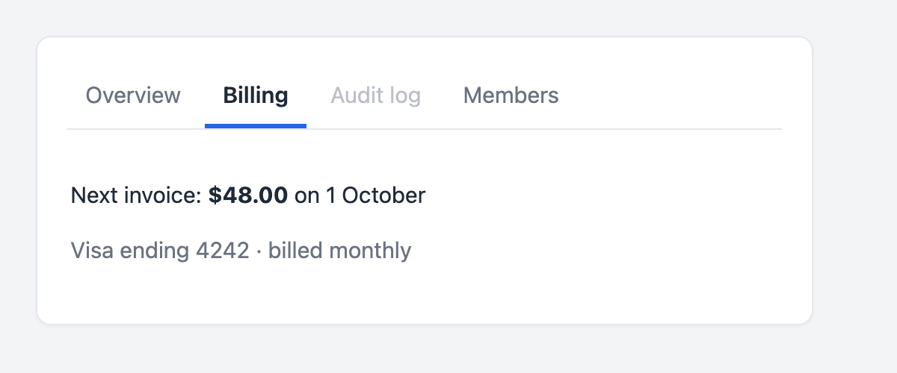
*Figure 15.5 — `Tabs` with the second tab selected and a disabled third tab that arrow keys skip.*

### Follow-ups and edge cases
- **Manual activation** (slow panels) → arrows only *move focus*, Enter/Space selects; keep a separate `focused` index.
- **Controlled version** (e.g. synced with `?tab=billing`) → use the `value` prop when given, else internal state.
- **Compound API** (`<Tabs><TabList><Tab/></TabList><TabPanel/></Tabs>`) → share `selected` and the ID prefix through context ([§14.4](../14-patterns-and-architecture/README.md#144-compound-components)).
- **Disabled tabs** → ARIA guidance allows keeping them *focusable* with `aria-disabled="true"` so screen-reader users discover them; native `disabled`, used here, removes them from focus. Say which you chose.
- **Heavy panels that keep state** → React 19.2's `<Activity mode="hidden">` hides content and unmounts its Effects while keeping state, and can pre-render at low priority.
- **Vertical tabs** → `aria-orientation="vertical"` and ArrowUp/ArrowDown.

---

## 15.15 Build 6 — Star rating

### Requirements

| Functional | Quiet requirements |
|---|---|
| 5 stars; click to rate; show "3 of 5" | Works with the keyboard: Tab to the group, arrows to change |
| Hover previews a rating without committing it | Screen readers announce the group name, each star's label ("3 stars") and which one is checked |
| Clear the rating | Read-only mode for showing an average (one image with text alternative) |
| Controlled: parent owns the number | `max` configurable |

### The key design decision
A rating is **one choice out of N** — a **radio group**. Real `<input type="radio">` elements, hidden with the standard `visually-hidden` CSS (still focusable and announced), give you one Tab stop, arrow keys, the checked state and correct screen-reader output for free. `<span onClick>` stars give none of that.

### Component tree and state
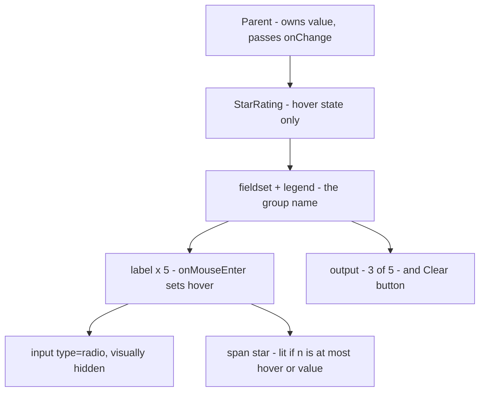

| Data | Kind | Owner |
|---|---|---|
| `value` | prop (controlled) | parent |
| `hover` | state | `StarRating` — purely visual preview |
| `shown = hover ?? value` | derived | computed in render |
| group `name` | `useId` | radios in one group share a name |

### Code
`code/star-rating.jsx`:
```jsx
// Machine coding 6 — star rating built on native radio buttons (keyboard + screen readers for free).
import { useId, useState } from 'react';

export default function StarRating({ value, onChange, max = 5, label = 'Rating', readOnly = false }) {
  const [hover, setHover] = useState(null);                 // preview while the pointer is over a star
  const name = useId();
  const shown = hover ?? value;                            // what the stars display right now

  if (readOnly) {
    return (
      <span className="stars" role="img" aria-label={`${label}: ${value} out of ${max}`}>
        {Array.from({ length: max }, (_, i) => <span key={i} className={i < value ? 'star on' : 'star'} aria-hidden="true">★</span>)}
      </span>
    );
  }

  return (
    <fieldset className="stars" onMouseLeave={() => setHover(null)}>
      <legend>{label}</legend>
      {Array.from({ length: max }, (_, i) => {
        const n = i + 1;
        return (
          <label key={n} onMouseEnter={() => setHover(n)}>
            <input
              type="radio"
              className="visually-hidden"
              name={name}
              value={n}
              checked={value === n}
              onChange={() => onChange(n)}
              aria-label={`${n} ${n === 1 ? 'star' : 'stars'}`}
            />
            <span className={n <= shown ? 'star on' : 'star'} aria-hidden="true">★</span>
          </label>
        );
      })}
      <output className="muted">{value ? `${value} of ${max}` : 'Not rated'}</output>
      {value > 0 && <button type="button" className="link" onClick={() => onChange(0)}>Clear</button>}
    </fieldset>
  );
}
```

### Test
`code/07_star_rating.test.jsx` (key parts). One jsdom gap: `user-event` calls `CSS.escape()` to find the other radios of a group, and jsdom has no `CSS` object, so the test adds a minimal stand-in.
```jsx
window.CSS ??= { escape: (s) => s.replace(/[^\w-]/g, (c) => `\\${c}`) };

test('hover previews without changing the value; leaving restores it', async () => {
  const user = userEvent.setup();
  render(<Harness initial={4} />);
  const labels = document.querySelectorAll('fieldset label');
  await user.hover(labels[1]);                               // pointer over star 2
  assert.equal(lit(), 2);
  assert.equal(screen.getByText('4 of 5').tagName, 'OUTPUT');   // value unchanged
  await user.unhover(screen.getByRole('group'));
  assert.equal(lit(), 4);
});

test('keyboard: arrow keys move between stars like any radio group', async () => {
  const user = userEvent.setup();
  render(<Harness initial={2} />);
  await user.tab();                                          // focus lands on the CHECKED radio
  assert.equal(document.activeElement, screen.getByRole('radio', { name: '2 stars' }));
  await user.keyboard('{ArrowRight}');
  assert.equal(screen.getByRole('radio', { name: '3 stars' }).checked, true);
  await user.keyboard('{ArrowLeft}{ArrowLeft}');
  assert.equal(lit(), 1);
});
```
Output:
```
✔ clicking a star selects it; the group is a labelled set of radios
✔ hover previews without changing the value; leaving restores it
✔ keyboard: arrow keys move between stars like any radio group
✔ Clear resets to 0; read-only mode is a single image with a text alternative
ℹ tests 4
ℹ pass 4
ℹ fail 0
```

The component has **no keyboard code at all**; the keyboard test passes because native radios already behave that way.

### In the browser
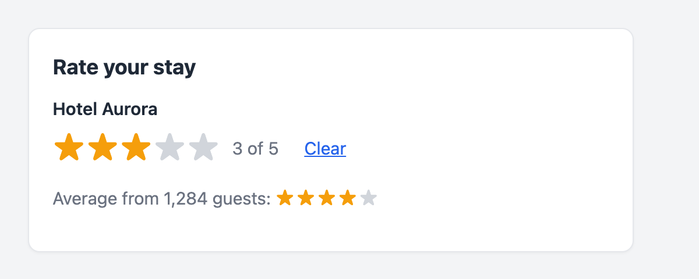
*Figure 15.6 — An interactive rating (3 of 5) and a read-only average rendered as one `role="img"` with the label "Average: 4 out of 5".*

### Follow-ups and edge cases
- **Half stars** → 10 radios (0.5…5), each half drawn by clipping; a read-only 4.3 can be an 86%-wide overlay.
- **Visible focus** → the radio is hidden, so style the star after it (`input:focus-visible + .star`, as the demo CSS does).
- **Uncontrolled version** → `defaultValue` + internal state, and a `name` so a `<form>` submits it (Form Actions read it from `FormData`).
- **Touch devices** have no hover; the preview simply doesn't happen.
- **Why `<fieldset>`/`<legend>`?** → they give the group its accessible name ("Food" in the test, "Hotel Aurora" in the demo); `role="radiogroup"` + `aria-labelledby` is the ARIA alternative.

---

## 15.16 Build 7 — Pagination

### Requirements

| Functional | Quiet requirements |
|---|---|
| Show 10 rows per page; Previous / Next; numbered page buttons | For many pages show `1 … 4 5 6 … 20`, with first and last always visible |
| Choose rows per page (5/10/25) | The number of buttons stays constant so they don't jump under the mouse |
| "21–25 of 47" range text | `<nav aria-label="Pagination">`, `aria-current="page"`, disabled ends |
| | Never show an empty page when the data shrinks (e.g. after filtering) |

### Split the problem in two
1. A **pure function** `getPageRange(current, total, siblings)` returning what to draw, e.g. `[1, '…', 9, 10, 11, '…', 20]` — easy to test with a table of cases (the heart of every "usePagination" Hook).
2. A **controlled** `<Pagination page totalPages onPageChange>` that draws it; the table owns `page` and `pageSize`.

### Component tree and state
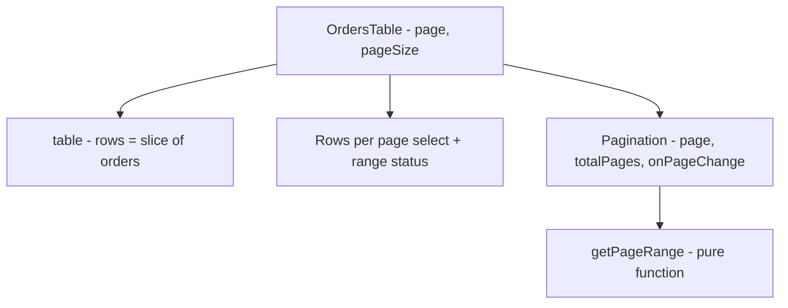

| Data | Kind | Why |
|---|---|---|
| `page`, `pageSize` | state in `OrdersTable` | user choices |
| `totalPages`, `rows`, range text | derived | from `orders.length`, `page`, `pageSize` |
| `current = min(page, totalPages)` | derived (clamped) | if the list shrinks, show the last real page — no Effect needed to "fix" state |

### Code
`code/pagination.jsx`:
```jsx
// Machine coding 7 — pagination: a pure page-range function, a controlled <Pagination>, and a table using it.
import { useState } from 'react';

export const DOTS = '…';

// Pages to show: always first and last, `siblings` on each side of the current page, DOTS for gaps.
// The result always has the same length once there are enough pages, so buttons don't jump around.
export function getPageRange(current, total, siblings = 1) {
  const range = (a, b) => Array.from({ length: b - a + 1 }, (_, i) => a + i);
  const slots = siblings * 2 + 5;                           // first, last, current, 2 dots, siblings
  if (total <= slots) return range(1, total);

  const left = Math.max(current - siblings, 1);
  const right = Math.min(current + siblings, total);
  const showLeftDots = left > 3;                            // a gap of at least 2 pages before `left`
  const showRightDots = right < total - 2;

  if (!showLeftDots) return [...range(1, 3 + 2 * siblings), DOTS, total];
  if (!showRightDots) return [1, DOTS, ...range(total - (2 + 2 * siblings), total)];
  return [1, DOTS, ...range(left, right), DOTS, total];
}

export function Pagination({ page, totalPages, onPageChange, siblings = 1 }) {
  if (totalPages <= 1) return null;
  return (
    <nav aria-label="Pagination">
      <ul className="pager">
        <li><button onClick={() => onPageChange(page - 1)} disabled={page === 1} aria-label="Previous page">‹</button></li>
        {getPageRange(page, totalPages, siblings).map((p, i) =>
          p === DOTS
            ? <li key={`dots-${i}`} aria-hidden="true" className="dots">{DOTS}</li>
            : (
              <li key={p}>
                <button onClick={() => onPageChange(p)} aria-current={p === page ? 'page' : undefined} aria-label={`Page ${p}`}>
                  {p}
                </button>
              </li>
            ))}
        <li><button onClick={() => onPageChange(page + 1)} disabled={page === totalPages} aria-label="Next page">›</button></li>
      </ul>
    </nav>
  );
}

// Client-side pagination of an in-memory list.
export default function OrdersTable({ orders, initialPageSize = 10 }) {
  const [page, setPage] = useState(1);
  const [pageSize, setPageSize] = useState(initialPageSize);
  const totalPages = Math.max(1, Math.ceil(orders.length / pageSize));
  const current = Math.min(page, totalPages);               // clamp, e.g. after the list shrinks
  const rows = orders.slice((current - 1) * pageSize, current * pageSize);

  return (
    <section className="card">
      <h2>Orders</h2>
      <table>
        <thead><tr><th>#</th><th>Customer</th><th>Total</th></tr></thead>
        <tbody>{rows.map((o) => <tr key={o.id}><td>{o.id}</td><td>{o.customer}</td><td>${o.total.toFixed(2)}</td></tr>)}</tbody>
      </table>
      <div className="row between">
        <label>
          Rows per page{' '}
          <select value={pageSize} onChange={(e) => { setPageSize(Number(e.target.value)); setPage(1); }}>
            {[5, 10, 25].map((n) => <option key={n} value={n}>{n}</option>)}
          </select>
        </label>
        <span className="muted" role="status">
          {orders.length === 0 ? 'No orders' : `${(current - 1) * pageSize + 1}–${Math.min(current * pageSize, orders.length)} of ${orders.length}`}
        </span>
      </div>
      <Pagination page={current} totalPages={totalPages} onPageChange={setPage} />
    </section>
  );
}
```

How `getPageRange` thinks: with `siblings = 1` there are 7 slots — first, last, current, one neighbour each side, and two places that are either a page or `…`. A `…` only replaces **two or more** hidden pages (showing `1 … 3` would hide just page 2, so the function shows `1 2 3` instead). Near the start it shows the first five pages, near the end the last five, otherwise the current page with its neighbours.

### Test
`code/08_pagination.test.jsx` (key parts):
```jsx
test('getPageRange: first/last always shown, dots for gaps, constant length', () => {
  const cases = [[1, 5], [3, 7], [1, 20], [4, 20], [5, 20], [10, 20], [16, 20], [17, 20], [20, 20]];
  for (const [page, total] of cases) console.log(`    page ${String(page).padStart(2)} of ${total}:`, getPageRange(page, total).join(' '));
  assert.deepEqual(getPageRange(10, 20), [1, '…', 9, 10, 11, '…', 20]);
  assert.deepEqual(getPageRange(10, 20, 2), [1, '…', 8, 9, 10, 11, 12, '…', 20]);
  for (let p = 1; p <= 20; p++) assert.equal(getPageRange(p, 20).length, 7);   // nothing jumps
});

test('clamps the page when the data shrinks under it', async () => {
  const user = userEvent.setup();
  const { rerender } = render(<OrdersTable orders={orders} />);
  await user.click(screen.getByRole('button', { name: 'Page 5' }));
  rerender(<OrdersTable orders={orders.slice(0, 12)} />);                // e.g. a filter was applied
  assert.equal(screen.getByRole('status').textContent, '11–12 of 12');   // page 2, not an empty page 5
  // ... an empty list shows "No orders" and no pager
});
```
Output:
```
    page  1 of 5: 1 2 3 4 5
    page  3 of 7: 1 2 3 4 5 6 7
    page  1 of 20: 1 2 3 4 5 … 20
    page  4 of 20: 1 2 3 4 5 … 20
    page  5 of 20: 1 … 4 5 6 … 20
    page 10 of 20: 1 … 9 10 11 … 20
    page 16 of 20: 1 … 15 16 17 … 20
    page 17 of 20: 1 … 16 17 18 19 20
    page 20 of 20: 1 … 16 17 18 19 20
✔ getPageRange: first/last always shown, dots for gaps, constant length
    pager on page 5 of 5: ‹ 1 2 3 4 5 ›
✔ Next / Previous / page buttons, aria-current and disabled ends
    pager with 5 per page: ‹ 1 2 3 4 5 … 10 ›
✔ changing rows-per-page goes back to page 1
✔ clamps the page when the data shrinks under it
ℹ tests 4
ℹ pass 4
ℹ fail 0
```

### In the browser
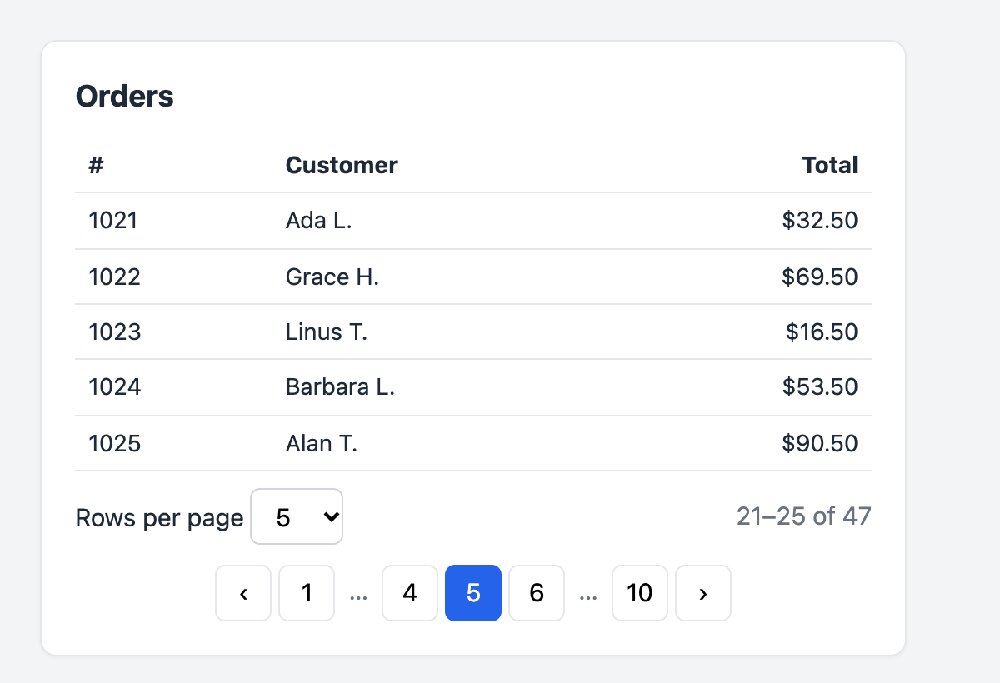
*Figure 15.7 — Page 5 of 10 with five rows per page: first and last pages, the current page with one neighbour each side, and ellipses for the gaps.*

### Follow-ups and edge cases
- **Server-side pagination** → the API returns one page plus a total (`?page=5&limit=5` or a cursor); TanStack Query keyed by `['orders', page, pageSize]` with `placeholderData: keepPreviousData` keeps the old page visible while the next loads ([§9.9](../09-routing-and-data-fetching/README.md#99-query-keys-pagination-and-dependent-queries)).
- **Page in the URL** (`?page=5`) → shareable links and a working Back button.
- **Offset vs cursor** → offsets allow "jump to page 17" but slow down on deep pages and shift on inserts; cursors are stable and fast but only next/previous.
- **Clamping keeps the stored page** → `page` stays 5 while page 2 is shown, so if the data grows back before the user pages again, the view jumps to 5. Resetting to page 1 whenever the filter changes (as rows-per-page does) avoids it.
- **Focus after a page change** → move focus to the table heading and scroll to it, so screen-reader users hear the new rows.
- **Huge counts** → counting is expensive; show "Next" without a total, or an estimate.

---

## 15.17 Build 8 — Multi-step form wizard with validation

### Requirements

| Functional | Quiet requirements |
|---|---|
| Three steps: Account (email, password) → Profile (name, plan) → Review → Create account | Validate **per step** when Next is pressed; don't advance while errors exist |
| Back keeps everything entered | Errors tied to fields: `aria-invalid`, `aria-describedby`; focus moves to the **first** invalid field |
| A step indicator | The indicator marks the current step with `aria-current="step"`; on step change, focus moves to the new step's heading |
| Submit shows a pending state and a success or error message | No double submit; a failed submit can be retried |

### Component tree
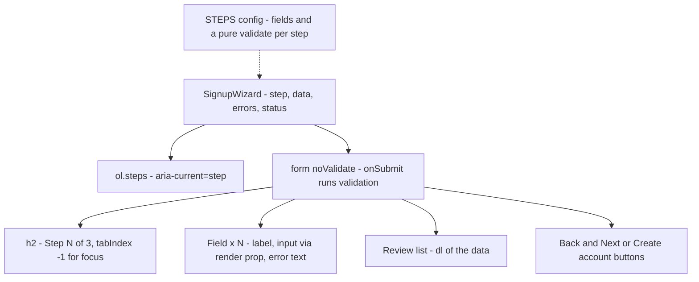

### State design

| Data | Kind | Why |
|---|---|---|
| `data` | one state object for **all** steps | Back/Next never lose input; the Review step and the submit read one object |
| `step` | state | which step is showing |
| `errors` | state `{ field: message }` | set on Next; a field's error clears as the user edits it |
| `status` | state `'editing' \| 'submitting' \| 'done' \| 'failed'` | one variable instead of several booleans |
| step definitions (`STEPS`) | constant outside the component | fields + a **pure** `validate(data)` per step — testable without rendering |

The wizard is one `<form>`, so Enter in any field "clicks" the submit button — Next on steps 1–2, Create account on step 3. `noValidate` turns off the browser's validation bubbles so messages are consistent and accessible; `type="email"` and `autoComplete` still help mobile keyboards and password managers.

### Code
`code/wizard.jsx`:
```jsx
// Machine coding 8 — multi-step form wizard: one data object, per-step validation, focus management.
import { useRef, useState } from 'react';
import { flushSync } from 'react-dom';

// Each step lists its fields and a pure validate(data) -> { field: message }.
export const STEPS = [
  {
    title: 'Account',
    fields: ['email', 'password'],
    validate: (d) => ({
      ...(!d.email ? { email: 'Email is required' } : !/^[^\s@]+@[^\s@]+\.[^\s@]+$/.test(d.email) ? { email: 'Enter an email like name@example.com' } : {}),
      ...(d.password.length < 8 ? { password: 'Use at least 8 characters' } : {}),
    }),
  },
  {
    title: 'Profile',
    fields: ['name', 'plan'],
    validate: (d) => ({
      ...(!d.name.trim() ? { name: 'Name is required' } : {}),
      ...(!d.plan ? { plan: 'Choose a plan' } : {}),
    }),
  },
  { title: 'Review', fields: [], validate: () => ({}) },
];

const INITIAL = { email: '', password: '', name: '', plan: '' };

function Field({ name, label, error, children }) {
  const errorId = `${name}-error`;
  return (
    <div className="field">
      <label htmlFor={name}>{label}</label>
      {children({ id: name, name, 'aria-invalid': error ? true : undefined, 'aria-describedby': error ? errorId : undefined })}
      {error && <p id={errorId} className="error">{error}</p>}
    </div>
  );
}

export default function SignupWizard({ onSubmit, initialStep = 0, initialData = INITIAL }) {
  const [step, setStep] = useState(initialStep);
  const [data, setData] = useState(initialData);
  const [errors, setErrors] = useState({});
  const [status, setStatus] = useState('editing');          // 'editing' | 'submitting' | 'done' | 'failed'
  const formRef = useRef(null);
  const headingRef = useRef(null);

  function goTo(next) {
    flushSync(() => {                                        // update the DOM now...
      setErrors({});
      setStep(next);
    });
    headingRef.current.focus();                              // ...so the focused heading already has the new
  }                                                          // text when a screen reader announces it

  const update = (field) => (e) => {
    setData((d) => ({ ...d, [field]: e.target.value }));
    if (errors[field]) setErrors(({ [field]: _gone, ...rest }) => rest);   // clear that error as they fix it
  };

  async function handleSubmit(e) {
    e.preventDefault();
    const found = STEPS[step].validate(data);
    if (Object.keys(found).length > 0) {
      setErrors(found);
      const firstBad = STEPS[step].fields.find((f) => found[f]);
      formRef.current.elements[firstBad].focus();          // take the user to the first problem
      return;
    }
    if (step < STEPS.length - 1) { goTo(step + 1); return; }
    setStatus('submitting');
    try {
      await onSubmit(data);
      setStatus('done');
    } catch {
      setStatus('failed');
    }
  }

  if (status === 'done') return <section className="card"><h2>Welcome, {data.name}!</h2><p>Your {data.plan} account is ready.</p></section>;

  return (
    <section className="card wizard">
      <ol className="steps">
        {STEPS.map((s, i) => (
          <li key={s.title} aria-current={i === step ? 'step' : undefined} className={i < step ? 'complete' : undefined}>{s.title}</li>
        ))}
      </ol>
      <form ref={formRef} onSubmit={handleSubmit} noValidate>
        <h2 ref={headingRef} tabIndex={-1}>Step {step + 1} of {STEPS.length}: {STEPS[step].title}</h2>

        {step === 0 && (
          <>
            <Field name="email" label="Email" error={errors.email}>
              {(p) => <input {...p} type="email" autoComplete="email" value={data.email} onChange={update('email')} />}
            </Field>
            <Field name="password" label="Password" error={errors.password}>
              {(p) => <input {...p} type="password" autoComplete="new-password" value={data.password} onChange={update('password')} />}
            </Field>
          </>
        )}
        {step === 1 && (
          <>
            <Field name="name" label="Full name" error={errors.name}>
              {(p) => <input {...p} autoComplete="name" value={data.name} onChange={update('name')} />}
            </Field>
            <Field name="plan" label="Plan" error={errors.plan}>
              {(p) => (
                <select {...p} value={data.plan} onChange={update('plan')}>
                  <option value="">Choose…</option><option value="free">Free</option><option value="pro">Pro</option>
                </select>
              )}
            </Field>
          </>
        )}
        {step === 2 && (
          <dl className="summary">
            <dt>Email</dt><dd>{data.email}</dd>
            <dt>Name</dt><dd>{data.name}</dd>
            <dt>Plan</dt><dd>{data.plan}</dd>
          </dl>
        )}

        {status === 'failed' && <p role="alert" className="error">Sign-up failed. Please try again.</p>}
        <div className="row between">
          <button type="button" onClick={() => goTo(step - 1)} disabled={step === 0 || status === 'submitting'}>Back</button>
          <button type="submit" disabled={status === 'submitting'}>
            {step < STEPS.length - 1 ? 'Next' : status === 'submitting' ? 'Creating account…' : 'Create account'}
          </button>
        </div>
      </form>
    </section>
  );
}
```

Focus management, the part most candidates skip:
- **On a validation error**, focus jumps to the first invalid field, whose error is read out via `aria-describedby`.
- **On a step change**, `goTo` updates state inside `flushSync` so the DOM already shows the new step, then focuses the `<h2>` (`tabIndex={-1}`), announced as "Step 2 of 3: Profile". Doing it in the handler, not an Effect, keeps it off the first mount (and StrictMode's double run).
- **While submitting**, both buttons are disabled (implicit Enter submission is blocked too) and the label reads "Creating account…", so nothing submits twice.

### Test
`code/09_wizard.test.jsx` (key parts):
```jsx
test('Next on an empty step shows errors, marks fields invalid and focuses the first one', async () => {
  const user = userEvent.setup();
  render(<SignupWizard onSubmit={async () => {}} />);
  await user.click(next());
  assert.equal(heading(), 'Step 1 of 3: Account');                   // did not advance
  const email = screen.getByLabelText('Email');
  assert.equal(email.getAttribute('aria-invalid'), 'true');
  assert.equal(screen.getByText('Email is required').id, email.getAttribute('aria-describedby'));
  assert.equal(document.activeElement, email);
  // ... typing clears the error; "ada" then shows the format message
});

test('full journey: steps, Back keeps data, review, submitting state, success', async () => {
  // ... fill Account, Next
  assert.equal(heading(), 'Step 2 of 3: Profile');
  assert.equal(document.activeElement, screen.getByRole('heading', { level: 2 }));   // focus moved to the step
  await user.click(screen.getByRole('button', { name: 'Back' }));
  assert.equal(screen.getByLabelText('Email').value, 'ada@example.com');   // nothing lost
  // ... Profile errors, fix them, Review, Create account
  assert.equal(screen.getByRole('button', { name: 'Creating account…' }).disabled, true);   // no double submit
  finish();
  assert.equal((await screen.findByRole('heading', { name: 'Welcome, Ada Lovelace!' })).tagName, 'H2');
});
```
Output:
```
✔ validators are pure functions: easy to unit-test on their own
✔ Next on an empty step shows errors, marks fields invalid and focuses the first one
    review: Email=ada@example.com, Name=Ada Lovelace, Plan=pro
✔ full journey: steps, Back keeps data, review, submitting state, success
✔ a failed submit shows an alert and lets the user retry
ℹ tests 4
ℹ pass 4
ℹ fail 0
```

### In the browser

*Figure 15.8 — Pressing Next with an incomplete email and no password: both fields are marked invalid, each message is linked to its field, and focus (blue ring) is on the first problem.*

### Follow-ups and edge cases
- **React 19 form Actions** → `<form action={createAccount}>` with `useActionState` for server errors and `useFormStatus` for the pending button ([§4.5](../04-forms-and-actions/README.md#45-useactionstate--the-result-of-the-last-submission)); Actions reset only *uncontrolled* fields, so these controlled ones keep their values.
- **Big forms** → React Hook Form with a Zod schema per step; `trigger(['email', 'password'])` validates one step ([§4.9](../04-forms-and-actions/README.md#49-form-libraries--react-hook-form-and-zod-overview)).
- **Validate again on the server** — client validation is convenience, not security.
- **Save progress** → `data` (without the password!) in `sessionStorage`, or `step` in the URL so refresh and Back work.
- **Conditional steps** (e.g. "Company details" for Pro) → compute the visible steps from `data`.
- **IDs** → field names as `id`s clash with two wizards on a page; prefix with `useId()`.
- **Async validation** ("email already taken") → a debounced check on blur or Next, with a pending state on the field.
- **A failed submit, then Back** → the "Sign-up failed" alert stays visible on earlier steps; reset `status` to `'editing'` in `goTo` if that bothers you.

---

## 15.18 Other common prompts — which techniques they need

| Prompt | Core state | Techniques from this chapter |
|---|---|---|
| Accordion | `openIds` (a `Set`, or one ID) | `<button aria-expanded aria-controls>`; or native `<details>`/`<summary>`; like Tabs |
| Dropdown / menu button | `open`, `active` | Autocomplete's keyboard handling + Modal's Escape/click-outside + focus return |
| Toast notifications | queue of `{ id, text }` | portal, `role="status"` live region, timers cleared in Effect cleanup |
| Tooltip / popover | `open` | portal, `useLayoutEffect` to measure and position, `aria-describedby`; or the native Popover API |
| Countdown / stopwatch | `startedAt`, `elapsed` | `setInterval` in an Effect with cleanup; compute from timestamps, not by counting ticks |
| Image carousel | `index` | wrap-around like Tabs; pause autoplay on hover/focus; `aria-roledescription="carousel"` |
| File explorer / nested tree | `expanded` set; tree data as a prop | recursive components with keys; ARIA `tree` roles and arrow keys |
| Sortable, filterable data table | `sort`, `filters`, `page` | all derived with `useMemo` if large; Pagination; URL state |
| Kanban board (drag and drop) | columns → card IDs | normalised state in a reducer; `@dnd-kit` or native drag events; keyboard alternative |
| OTP / PIN input | array of digits | refs array to move focus; paste handling; `autoComplete="one-time-code"` |
| Progress bar / file upload | `progress`, `status` | `<progress>` element; abort with `AbortController` |
| Chat window | messages; `status` per message | `useOptimistic` for sending; auto-scroll with a ref; virtualise long histories |

---

## Chapter 15 TL;DR

| Idea | Remember |
|---|---|
| Machine-coding method | Requirements → tree → state → happy path → keyboard/a11y → test → edge cases; talk throughout |
| State design | Minimal state, derive the rest; colocate, lift only when shared; one `status` value, not several booleans |
| Rendering & keys | Trigger → render (pure) → commit; identity = type + position + key; stable ID keys; new key = fresh instance |
| State updates | Snapshot per render; batched everywhere since React 18; updater functions build on queued values |
| Effects | Only to sync with outside systems; cleanup runs before re-run and on unmount; StrictMode runs setup → cleanup → setup in dev |
| Refs | Mutable, don't re-render, not for render output; `ref` is a normal prop in React 19 |
| Context | A transport, not a store; every consumer re-renders on a new value; split or memoize |
| Performance | Measure first; `memo`/`useMemo`/`useCallback` or the React Compiler; virtualize long lists; split code with `lazy` |
| Concurrency | Suspense shows fallbacks; `use()` reads cached promises; transitions keep old UI while new UI loads |
| Server | SSR → HTML then hydrate; mismatches from non-deterministic render; Server Components ship no JS; `'use client'` marks the boundary, `'use server'` marks Server Functions |
| Errors & portals | Boundaries catch render/Effect errors, not event handlers; portal events bubble through the React tree |
| Testing | Roles and labels, `user-event`, assert what users see; fake the network at the boundary |
| Autocomplete | Debounced value + Effect with `AbortController`; `aria-activedescendant`; `mousedown` preventDefault |
| Infinite scroll | Sentinel + `IntersectionObserver` inside the scroll box; ref guard against duplicate requests |
| Modal | Portal, focus in/trap/restore, Escape, backdrop mousedown; prefer native `<dialog>` in production |
| Tabs, stars, pagination, wizard | Roving tabindex; native radios; pure range function + clamping; per-step pure validators and focus management |

Next: [Chapter 16 — Cheat Sheets and Glossary](../16-cheatsheet-and-glossary/README.md).
