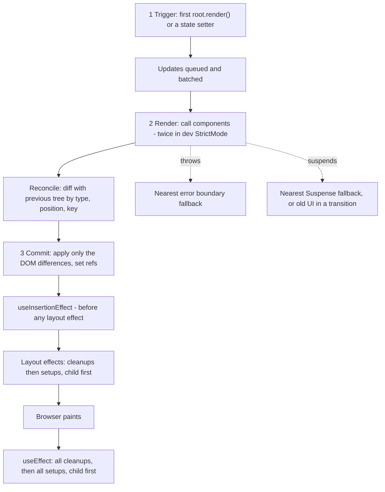

# Chapter 16 — Cheat Sheets and Glossary

This last chapter squeezes Chapters 1–15 into pages you can scan in a minute. There is one **cheat sheet** per area (JSX, components, every Hook, state, the render/commit lifecycle, Effects, refs, forms, state management, routing and data, performance, styling, TypeScript, testing, server rendering, patterns, accessibility), a **"common errors and fixes"** table built from the real messages React printed in earlier chapters, an **index of the 53 interview questions** in Chapter 15, a **"where to go next"** plan, and an alphabetical **glossary** of 532 terms, each linked to the section that explains it properly.

Nothing here is new: follow a line's link for the full explanation. Every technical term — including acronyms such as SSR, RSC, CI or ARIA — is defined once, in the glossary ([§16.21](#1621-glossary-az)); the sheets don't repeat definitions. **§9.5** means Chapter 9, section 5.

**How to use it:** read a sheet, cover the right-hand column, say the answer, then look. Before an interview, if you can't define a glossary term in one sentence, follow its link.

**How the facts were checked.** Every concrete behaviour quoted on these sheets — batching, updater queues, key resets, StrictMode double calls, Effect order, default values, error messages — is asserted by [`code/01_cheatsheet_checks.jsx`](code/01_cheatsheet_checks.jsx). It runs React 19.3 in jsdom (plus React Router 8.4 and TanStack Query 5.104) and fails loudly if React behaves differently from a sheet. Run it with `bash tools_run_js.sh react` from the repository root. Real output (abridged):

```text
OK   16.1 JSX rules
OK   16.2 components and props
OK   16.3 hooks table (identity, lazy init, memo caches, useId, deferred value)
OK   16.4 state: snapshot, updaters, batching, bail-out, immutability, position & key
OK   16.5 render/commit lifecycle order
OK   16.6 effects: dependency arrays, cleanup, StrictMode double run
OK   16.7 refs: no re-render, null during first render, callback cleanup, ref as a prop
OK   16.8 forms: FormData rules, form actions, useActionState, useFormStatus, useOptimistic
OK   16.9 context: default, nearest provider, memo does not block it, use() may be conditional
OK   16.10 React Router params and ranking; TanStack Query defaults and de-duplication
OK   16.11 performance: memo, unstable props, children from above, useMemo, lazy
OK   16.14 testing: get/query/find semantics, role + name, user-event vs fireEvent
OK   16.15 server rendering: markers, no effects on the server, suspended boundaries, hydration reuse, use(browser()), resume APIs
OK   16.16 patterns: portals bubble through React, boundaries catch render errors only, HOC in render remounts
OK   16.18 common errors: the exact messages React 19.3 produces
all 15 cheat-sheet checks passed (React 19.3.0)
```

(It also prints every error message quoted in §16.18. §16.12 Styling, §16.13 TypeScript and §16.17 Accessibility summarise results Chapters 8, 11 and 14 verified with a real browser, `tsc` and role queries, so they have no separate check.)

---

## 16.1 JSX rules

| Rule | Write | Not | Why |
|---|---|---|---|
| One root element | `<>…</>` or `<div>…</div>` | two siblings at the top | A function returns one value; JSX becomes one object |
| Close every tag | ``, `<br />`, `<input />` | `` | JSX is stricter than HTML |
| camelCase attributes | `className`, `htmlFor`, `onClick`, `tabIndex` | `class`, `for`, `onclick` | Attributes become JS object keys; `class`/`for` are reserved. `aria-*` and `data-*` keep dashes |
| `{}` holds an **expression** | `{user.name}`, `{a ? b : c}`, `{list.map(…)}` | `{if (…) …}` | Statements (`if`, `for`, `const`) go above the `return` |
| Strings in quotes, everything else in braces | `alt="text"`, `size={50}`, `admin` (= `true`) | `size="50"` for a number | Quotes always pass a string |
| `style` is an object | `style={{ fontSize: 14, lineHeight: 1.5 }}` → `font-size:14px;line-height:1.5` | `style="font-size:14px"` | Numbers get `px`, except unitless properties (`lineHeight`, `zIndex`, `opacity`, `flexGrow`) |
| Comments | `{/* note */}` | `<!-- note -->` | JSX is JavaScript |
| Keyed fragment | `<Fragment key={id}>…</Fragment>` | `<key={id}>` | The short `<>` takes no props |

**What renders what**

| Value in `{}` | Screen shows |
|---|---|
| `null`, `undefined`, `true`, `false` | nothing |
| `0`, `NaN` | "0", "NaN" — the **`{count && <Badge/>}` trap**; write `count > 0 &&` |
| `''` | an empty text node (invisible) |
| strings, numbers | the text, **HTML-escaped** (`<script>` shows as text — built-in XSS protection) |
| arrays of elements | each element (give each a `key`) |
| a plain object | throws *"Objects are not valid as a React child"* |

**Remember**
- JSX compiles to `jsx(type, props)` / `createElement(type, props, ...children)` and returns an **immutable element object** `{ type, props, key }`. Since React 17 (automatic runtime) you don't `import React`. [§1.8](../01-why-react-and-setup/README.md#18-jsx)
- Capitalised tag = your component (`<Profile />`); lowercase = HTML tag (`<profile>` is just an unknown element, and React warns). [§1.7](../01-why-react-and-setup/README.md#17-your-first-component), [§2.1](../02-components-and-props/README.md#21-function-components)
- Raw HTML only through `dangerouslySetInnerHTML={{ __html: sanitised }}`. React 19 replaces a `javascript:` URL in `href` with one that throws. [§1.8](../01-why-react-and-setup/README.md#18-jsx)
- Conditional rendering: `if` + early `return` for big branches, `? :` for either/or, `&&` with a **boolean** on the left, `null` for nothing. [§2.7](../02-components-and-props/README.md#27-conditional-rendering)

---

## 16.2 Components and props

```jsx
// A component: capitalised function, one props object in, JSX out, declared at module top level.
export function Avatar({ person, size = 100, className, ...rest }) {   // destructure, default, collect the rest
  return ;
}
<Avatar person={ada} size={50} />         // strings in quotes, other values in braces
```

| Topic | Rule |
|---|---|
| Name and place | Capitalised; defined at **module top level**, never inside another component (a new type every render → state and DOM reset) [§1.7](../01-why-react-and-setup/README.md#17-your-first-component) |
| Use | `<Profile />`, never `Profile()` — calling it directly gives it no place in the tree and its Hooks belong to the caller [§2.1](../02-components-and-props/README.md#21-function-components) |
| Props | One **read-only** object from the parent; frozen in development (mutating throws `TypeError: Cannot assign to read only property`) [§2.2](../02-components-and-props/README.md#22-props) |
| Defaults | Destructuring default `({ size = 100 })` applies when the prop is **missing or `undefined`** — not for `null` or `0`. `defaultProps`/`propTypes` are gone for function components in React 19 [§2.2](../02-components-and-props/README.md#22-props) |
| Special props | `key` is consumed by React (`props.key` is `undefined`); `children` = whatever is nested; `ref` is an ordinary prop in React 19 [§2.2](../02-components-and-props/README.md#22-props), [§5.10](../05-effects-and-refs/README.md#510-passing-refs-to-your-own-components) |
| Forwarding | `({ variant, ...rest }) => <button {...rest} />`; later props override earlier ones [§2.2](../02-components-and-props/README.md#22-props) |
| `children` | Anything renderable; render it as `{children}` to build wrappers (`Card`, `Layout`) [§2.3](../02-components-and-props/README.md#23-the-children-prop) |
| Composition | Pass JSX as `children` or **slot** props (`header={…}`) instead of inheritance or boolean-prop explosions; first cure for prop drilling [§2.4](../02-components-and-props/README.md#24-composition), [§14.1](../14-patterns-and-architecture/README.md#141-composition-first) |
| Purity | Same props/state/context → same JSX; no changes to outside variables during render (local mutation of values created in this render is fine) [§2.5](../02-components-and-props/README.md#25-pure-components) |
| Size | One job per component; extract when JSX has a name, repeats, has its own logic or needs its own state [§2.6](../02-components-and-props/README.md#26-keeping-components-small) |
| Lists | `items.map(i => <Row key={i.id} … />)`; key on the outermost element returned by `map` [§2.8](../02-components-and-props/README.md#28-rendering-lists-and-keys) |

**Keys in one table** [§2.8](../02-components-and-props/README.md#28-rendering-lists-and-keys), [§3.10](../03-state-and-events/README.md#310-state-is-tied-to-a-position-in-the-tree)

| Key choice | Result |
|---|---|
| Stable ID from the data | Correct: items keep DOM, state and focus when moved |
| Array index | OK only for static lists; on insert/sort/filter, state stays at the **position** (the "note moves to Eggs" bug) |
| `Math.random()` / `crypto.randomUUID()` in JSX | Every item remounts every render — slow, loses input focus |
| Missing | Warning, index used implicitly |
| Duplicate | Warning, items duplicated or dropped |
| Changing the key of one component on purpose | Fresh instance: the idiomatic way to **reset** state (`<Profile key={userId} />`) |

---

## 16.3 Every Hook in one table

"Since" = the React version that made it stable. All Hooks follow the Rules of Hooks (top level of a component or custom Hook, same order every render) — except `use`, which may be called in `if`/loops (not in `try/catch`). [§7.2](../07-custom-hooks-and-hook-rules/README.md#72-the-rules-of-hooks)

| Hook | Signature | What it's for | Gotchas | Since |
|---|---|---|---|---|
| `useState` | `const [v, setV] = useState(init \| () => init)` | Memory that changes with interaction; setter schedules a re-render | Value is a snapshot; initial value used on first render only; pass a function for lazy init; setter identity is stable; `Object.is`-equal value → bail-out [§3.2](../03-state-and-events/README.md#32-state-a-components-memory--usestate) | 16.8 |
| `useReducer` | `const [s, dispatch] = useReducer(reducer, initialArg, init?)` | Many related updates in one pure `(state, action) => next` | Reducer must be pure (StrictMode calls it twice); `dispatch` is stable; throw on unknown actions [§6.2](../06-state-management/README.md#62-usereducer--consolidate-update-logic) | 16.8 |
| `useContext` | `const v = useContext(Ctx)` | Read the nearest provider's value | Default only when **no** provider; re-renders on every value change, even through `memo` [§6.3](../06-state-management/README.md#63-context--pass-data-deeply-without-props), [§6.4](../06-state-management/README.md#64-context-performance-caveats) | 16.8 |
| `use` | `const v = use(promise \| Ctx)` | Read a promise (suspends; rejection → error boundary) or a context | Promise must be cached/created outside render — a new promise each render triggers "suspended by an uncached promise"; allowed in `if`/loops [§9.11](../09-routing-and-data-fetching/README.md#911-suspense-and-use) | 19.0 |
| `useRef` | `const r = useRef(init)` → `{ current }` | Values that don't affect rendering (timer IDs, DOM nodes, instances) | Changing `r.current` never re-renders; don't read/write it during render (except lazy init); DOM refs are `null` until commit [§5.8](../05-effects-and-refs/README.md#58-useref-for-values), [§5.9](../05-effects-and-refs/README.md#59-refs-to-dom-nodes) | 16.8 |
| `useImperativeHandle` | `useImperativeHandle(ref, () => api, deps?)` | Expose a limited API (`focus`, `clear`) instead of the DOM node | Pair with `ref` as a prop (React 19) [§5.10](../05-effects-and-refs/README.md#510-passing-refs-to-your-own-components) | 16.8 |
| `useEffect` | `useEffect(() => { setup; return cleanup }, deps?)` | Synchronise with an external system after commit | No array = every commit; `[]` = mount only; `[a]` = when `a` changes (`Object.is`); setup can't be `async`; doesn't run on the server [§5.2](../05-effects-and-refs/README.md#52-useeffect-basics) | 16.8 |
| `useLayoutEffect` | same as `useEffect` | Measure layout and fix it **before paint** (no flicker) | Blocks painting; does nothing during SSR; default to `useEffect` [§5.11](../05-effects-and-refs/README.md#511-uselayouteffect--before-the-browser-paints) | 16.8 |
| `useInsertionEffect` | same shape | CSS-in-JS libraries inserting `<style>` before layout effects | Not for app code [§5.11](../05-effects-and-refs/README.md#511-uselayouteffect--before-the-browser-paints) | 18.0 |
| `useEffectEvent` | `const onX = useEffectEvent(fn)` | Non-reactive logic inside an Effect that must see the **latest** props/state | Call only from Effects; never list it in dependencies; don't pass it to other components [§5.5](../05-effects-and-refs/README.md#55-dependencies-in-depth), [§7.7](../07-custom-hooks-and-hook-rules/README.md#77-hooks-that-take-callbacks--useeffectevent) | 19.2 |
| `useMemo` | `const v = useMemo(() => calc(a), [a])` | Cache an expensive result (~1 ms+) or keep an object's identity stable | Must be pure; a cache, not a guarantee; unstable deps make it useless [§10.6](../10-performance/README.md#106-usememo-for-expensive-calculations), [§10.5](../10-performance/README.md#105-usecallback-and-usememo-for-stable-props) | 16.8 |
| `useCallback` | `const fn = useCallback(fn, [a])` | Same function identity for `memo` children / Effect deps | = `useMemo(() => fn, deps)`; missing deps → stale closure [§10.5](../10-performance/README.md#105-usecallback-and-usememo-for-stable-props) | 16.8 |
| `useTransition` | `const [isPending, startTransition] = useTransition()` | Mark updates non-urgent; keep old UI during Suspense | Can't wrap a controlled input's value; since 19 the callback may be `async` (an Action) — updates **after an `await`** need their own `startTransition` [§7.10](../07-custom-hooks-and-hook-rules/README.md#710-usetransition--non-urgent-updates) | 18.0 |
| `useDeferredValue` | `const d = useDeferredValue(v, initial?)` | A lagging copy of a value for a slow child | Needs `memo` on the slow child; not a debounce (no timer, no fewer requests); `initialValue` added in 19 [§7.11](../07-custom-hooks-and-hook-rules/README.md#711-usedeferredvalue--let-part-of-the-ui-lag-behind) | 18.0 |
| `useId` | `const id = useId()` | IDs for `htmlFor`/`aria-*` that match between server and client | One call + suffixes (`${id}-hint`); never for list keys; format is not stable API [§7.8](../07-custom-hooks-and-hook-rules/README.md#78-useid--ids-for-accessibility) | 18.0 |
| `useSyncExternalStore` | `useSyncExternalStore(subscribe, getSnapshot, getServerSnapshot?)` | Subscribe to data outside React without tearing | `getSnapshot` must return the **same** value if nothing changed (else "should be cached" + infinite loop); keep `subscribe` stable [§7.9](../07-custom-hooks-and-hook-rules/README.md#79-usesyncexternalstore--subscribing-to-outside-data) | 18.0 |
| `useDebugValue` | `useDebugValue(label)` | Label a custom Hook in React DevTools | Library Hooks only [§7.3](../07-custom-hooks-and-hook-rules/README.md#73-custom-hooks--reusing-stateful-logic) | 16.8 |
| `useActionState` | `const [state, action, isPending] = useActionState(fn, initial, permalink?)` | Result of the last Action (errors, success) + pending flag | `fn(prevState, payload)` — previous state comes **first**; calls are queued; manual dispatch must be inside `startTransition` [§4.5](../04-forms-and-actions/README.md#45-useactionstate--the-result-of-the-last-submission) | 19.0 |
| `useFormStatus` (`react-dom`) | `const { pending, data, method, action } = useFormStatus()` | Status of the **parent** `<form>` from any child | Always `pending: false` in the component that renders the `<form>`; import from `react-dom` [§4.6](../04-forms-and-actions/README.md#46-useformstatus--status-of-the-parent-form) | 19.0 |
| `useOptimistic` | `const [opt, addOpt] = useOptimistic(value, reducer?)` | Show the expected result while an Action runs | Call `addOpt` inside an Action/transition; rolls back automatically when the Action ends; reducer must be pure [§4.7](../04-forms-and-actions/README.md#47-useoptimistic--instant-feedback-automatic-rollback) | 19.0 |

**Related non-Hook APIs:** `memo` [§10.4](../10-performance/README.md#104-memo--skipping-a-childs-re-render), `lazy` + `<Suspense>` [§10.8](../10-performance/README.md#108-code-splitting-with-lazy-and-suspense), `startTransition` (standalone) [§7.10](../07-custom-hooks-and-hook-rules/README.md#710-usetransition--non-urgent-updates), `createContext` / `<Ctx value>` [§6.3](../06-state-management/README.md#63-context--pass-data-deeply-without-props), `createPortal` [§14.8](../14-patterns-and-architecture/README.md#148-portals), `flushSync` [§3.4](../03-state-and-events/README.md#34-batching), `<Profiler>` [§10.3](../10-performance/README.md#103-measure-first-devtools-profiler-and-profiler), `<StrictMode>` [§5.4](../05-effects-and-refs/README.md#54-strictmodes-double-run-development-only), `<Activity>` (19.2) [§5.4](../05-effects-and-refs/README.md#54-strictmodes-double-run-development-only), `cache()` for Server Components [§13.7](../13-server-rendering-and-frameworks/README.md#137-react-server-components). Library Hooks (React Router, TanStack Query, Redux, Zustand) are in §16.9 and §16.10.

---

## 16.4 State update rules

| Rule | Example | Result |
|---|---|---|
| State is a **snapshot** per render | `setN(n + 1); console.log(n)` | Logs the old value; a timeout created in that render also sees the old value forever [§3.3](../03-state-and-events/README.md#33-state-as-a-snapshot) |
| Plain value = **replace** | three × `setN(n + 1)` from 0 | **1** |
| Updater = **compute from the queued value** | three × `setN(m => m + 1)` from 0 | **3** |
| Mixed queue, processed in order | `setN(n + 5); setN(m => m + 1)` from 0 | **6** |
| Last replace wins | `setN(m => m + 1); setN(n + 5)` from 0 | **5** [§3.5](../03-state-and-events/README.md#35-updater-functions--queueing-updates) |
| **Batching** | several setters in one event — also inside `setTimeout`, promises, native listeners (React 18+) | **one** re-render [§3.4](../03-state-and-events/README.md#34-batching) |
| Opt out of batching | `flushSync(() => setItems(next))` | DOM updated before the next line (e.g. to scroll to a new item) |
| Same value | `setN(n)` | Bail-out: no re-render of that subtree (React may call the component once more and discard it) [§3.2](../03-state-and-events/README.md#32-state-a-components-memory--usestate), [§10.1](../10-performance/README.md#101-the-render-cycle-trigger--render--commit) |
| Never mutate | `p.name = 'x'; setP(p)` | Same reference → **no re-render**, stale screen. Use `setP({ ...p, name: 'x' })` [§3.6](../03-state-and-events/README.md#36-updating-objects-and-arrays-immutably) |
| State lives at a **position** | same component type at the same place | State kept, even with different props |
| … | different type at that place, or a **different `key`** | State destroyed, fresh instance [§3.10](../03-state-and-events/README.md#310-state-is-tied-to-a-position-in-the-tree) |

**Immutable update recipes** [§3.6](../03-state-and-events/README.md#36-updating-objects-and-arrays-immutably)

| Goal | Use (returns new) | Avoid (mutates) |
|---|---|---|
| Change a field | `{ ...obj, field: v }`; nested: copy every level `{ ...u, address: { ...u.address, zip } }` | `obj.field = v` |
| Add | `[...arr, x]`, `[x, ...arr]` | `push`, `unshift` |
| Insert at `i` | `arr.toSpliced(i, 0, x)` or `[...arr.slice(0, i), x, ...arr.slice(i)]` | `splice` |
| Remove | `arr.filter(it => it.id !== id)` | `splice`, `pop`, `shift` |
| Update one | `arr.map(it => it.id === id ? { ...it, done: true } : it)`, `arr.with(i, x)` | `arr[i] = x` |
| Sort / reverse | `toSorted()`, `toReversed()`, or `[...arr].sort()` | `sort()`, `reverse()` in place |
| Deep changes | Immer: `produce(draft => { draft.a.b = 1 })`, `useImmer` | hand-copying 4 levels |

**Choosing what to store** [§3.8](../03-state-and-events/README.md#38-derived-state--choosing-the-minimal-state), [§6.1](../06-state-management/README.md#61-kinds-of-state--and-where-each-belongs)
- Keep the **minimal** state; compute the rest in render (full names, totals, filtered lists, "is valid").
- Store **IDs**, not copies of objects; don't mirror props into state (`useState(prop)` only reads the first value — name it `initialX` if that's the intent).
- One `status: 'idle' | 'sending' | 'sent'` instead of contradictory booleans.
- State as **low as possible, as high as necessary**: lift shared state to the closest common parent [§3.7](../03-state-and-events/README.md#37-lifting-state-up).
- `useState` for independent values; `useReducer` when many handlers change the same state in related ways [§6.2](../06-state-management/README.md#62-usereducer--consolidate-update-logic).

---

## 16.5 The render and commit lifecycle

Every update goes **trigger → render → commit**. "Re-render" means *React called your function again* — the DOM changes only where the output differs. [§10.1](../10-performance/README.md#101-the-render-cycle-trigger--render--commit), [§1.3](../01-why-react-and-setup/README.md#13-rendering-the-virtual-dom-and-reconciliation-brief)



What the check program observed for a `Parent` → `Child` pair when a prop changes from 1 to 2 (§16.5 check):

| Step | Order |
|---|---|
| Mount | render parent → render child → child **layout** setup → child **effect** setup → parent **effect** setup |
| Update | render parent → render child → child layout cleanup (v=1) → child layout setup (v=2) → child effect cleanup (v=1) → parent effect cleanup (v=1) → child effect setup (v=2) → parent effect setup (v=2) |
| Unmount | every remaining cleanup runs, with the values of the render that created it |

| Phase | Must be | What happens there |
|---|---|---|
| Render | **Pure** — may run twice, be paused (concurrent rendering) or thrown away | Call components, compute JSX and derived values |
| Commit | Runs once per committed update | DOM mutations, refs set, layout effects |
| After paint | — | `useEffect` setups (subscriptions, fetching, logging) |

**What triggers a re-render** — own state change; **parent re-rendered** (all children by default, props are *not* compared unless `memo`); a **context** it reads changed; a subscribed **external store** changed. Not: mutating props, changing `ref.current`, changing a plain variable. [§10.2](../10-performance/README.md#102-when-components-re-render)

---

## 16.6 Effects: decision guide

**Ask "why does this code run?"** [§5.1](../05-effects-and-refs/README.md#51-where-side-effects-belong), [§5.6](../05-effects-and-refs/README.md#56-you-might-not-need-an-effect)

Go down the list and stop at the first "yes":

| # | Question | If yes |
|---|---|---|
| 1 | Can it be computed from props or state? | Compute it during render (`useMemo` only if expensive) |
| 2 | Is it caused by a specific user action (click, submit)? | Event handler or form Action |
| 3 | Must **all** state reset when a prop changes? | Give the component a `key` |
| 4 | Is it reading data that lives outside React and changes on its own? | `useSyncExternalStore` |
| 5 | Is it fetching server data? | TanStack Query or a router loader — or an Effect **with cleanup** |
| 6 | Must it stay in sync with an external system while the component is on screen? | `useEffect` with a cleanup |
| 7 | None of the above | Probably no Effect at all |

**You might not need an Effect** [§5.6](../05-effects-and-refs/README.md#56-you-might-not-need-an-effect)

| You want to… | Instead of an Effect |
|---|---|
| Compute a value from props/state | A variable in render (an Effect costs an extra render and a stale frame) |
| Cache an expensive calculation | `useMemo` |
| Reset all state when `userId` changes | `<Profile key={userId} />` |
| Adjust some state when a prop changes | Derive it (store an ID, look the object up) |
| Run logic because the user clicked/submitted | The event handler / form Action |
| Chain updates (A → B → C) | Compute all next state in one handler |
| Notify the parent of a change | Call its callback in the same handler, or lift the state |
| Initialise the app once | Module-level code or a `didInit` flag |
| Subscribe to an external store | `useSyncExternalStore` |

**What legitimately needs an Effect:** sockets and connections, browser events (`resize`, `online`, key shortcuts), timers while visible, non-React widgets (maps, video, `dialog.showModal()`), `document.title`, logging an impression because something was shown, fetching (with cleanup).

**Dependencies** [§5.5](../05-effects-and-refs/README.md#55-dependencies-in-depth)

| Situation | Fix |
|---|---|
| The linter wants a value you don't want to react to | Don't silence it — split the logic: reactive part in the Effect, non-reactive part in `useEffectEvent` |
| Object/function created in render is a dependency | New every render → Effect runs every render. Create it **inside** the Effect or outside the component; depend on primitives |
| Interval reads state | `setCount(c => c + 1)` so `count` isn't a dependency |
| Two unrelated jobs in one Effect | Two Effects |
| Can be left out | setters, `dispatch`, refs, module constants |

**Cleanup pairs** [§5.3](../05-effects-and-refs/README.md#53-cleanup--undo-what-setup-did): `connect`/`disconnect` · `setInterval`/`clearInterval` · `addEventListener`/`removeEventListener` (same function reference) · `subscribe`/`unsubscribe` · `new AbortController` + `fetch(url, { signal })`/`controller.abort()` · `observer.observe`/`observer.disconnect` · `showModal`/`close`.

**StrictMode (development only)** — you opt in by wrapping the app in `<StrictMode>`, which Vite and most templates do — calls component bodies, state initialisers, updaters and reducers **twice**, runs every Effect **setup → cleanup → setup** on mount, and re-runs ref callbacks. Production runs once. The fix for a visible double is a correct cleanup, never a "has run" flag. [§5.4](../05-effects-and-refs/README.md#54-strictmodes-double-run-development-only), [§2.5](../02-components-and-props/README.md#25-pure-components)

**Fetching in an Effect** [§5.7](../05-effects-and-refs/README.md#57-fetching-data-in-effects-and-race-conditions), [§7.6](../07-custom-hooks-and-hook-rules/README.md#76-usefetch--loading-error-success-and-no-races): loading/error/success in one `status` value; `ignore` flag or `AbortController` in cleanup (else the slower old response wins); check `res.ok` (`fetch` doesn't reject on 404); ignore `AbortError`. For real apps prefer TanStack Query or loaders (cache, dedupe, retries, no waterfalls).

---

## 16.7 Refs

| | `useState` | `useRef` |
|---|---|---|
| Returns | `[value, setValue]` | `{ current }` — the same object every render |
| Changing it | setter → **re-render** | `ref.current = x` → **no re-render**, visible immediately |
| Read during render? | Yes (a snapshot) | No — except lazy init `if (r.current === null) r.current = new Engine()` |
| Use for | anything shown on screen | timer IDs, DOM nodes, `AbortController`, third-party instances, "in flight" flags |

[§5.8](../05-effects-and-refs/README.md#58-useref-for-values)

**DOM refs** [§5.9](../05-effects-and-refs/README.md#59-refs-to-dom-nodes), [§5.10](../05-effects-and-refs/README.md#510-passing-refs-to-your-own-components)
- `const inputRef = useRef(null)` + `<input ref={inputRef} />` → `inputRef.current` is the node **after commit** (`null` during the first render), `null` again after removal.
- Good uses: focus, scroll into view, measure (`getBoundingClientRect` in `useLayoutEffect`), media `play()`, `dialog.showModal()`, non-React libraries. Not for changing text/classes React renders.
- Lists: one ref holding a `Map` + a **ref callback** per item. In React 19 a ref callback may **return a cleanup**; use a block body (`ref={n => { x = n; }}`), because an implicit-return arrow now looks like a cleanup to TypeScript.
- To scroll to an item you just added: `flushSync(() => setItems(next))`, then scroll.

**Refs to your own components**

| React 19 | Legacy |
|---|---|
| `function Field({ ref, ...p }) { return <input ref={ref} {...p} /> }` | `forwardRef((props, ref) => …)` — still works, planned for deprecation |
| `useImperativeHandle(ref, () => ({ focus, clear }))` to expose a limited API | same |
| `<Fragment ref={r}>` (19.3) → `FragmentInstance` with `focus()`, `addEventListener`, `observeUsing` | wrapper `<div>` just to hold a ref |

---

## 16.8 Forms and Actions (React 19)

**Two ways to own a field** [§4.2](../04-forms-and-actions/README.md#42-controlled-vs-uncontrolled-inputs), [§3.9](../03-state-and-events/README.md#39-controlled-inputs-basics)

| | Controlled | Uncontrolled |
|---|---|---|
| Value lives in | React state: `value={v}` + `onChange` (`checked` for boxes/radios) | The DOM: `defaultValue` / `defaultChecked` |
| Read it | From state | `FormData` on submit, or a ref |
| Re-renders | Every keystroke | None while typing |
| Good for | Live formatting, limits, dependent fields, counters | Most "fill in and submit" forms; pairs with form Actions |
| Traps | `value` without `onChange` → read-only + warning; `useState()` (undefined) → "uncontrolled to controlled" warning — start with `''` | Changing `defaultValue` later does nothing (remount with `key`); fields without `name` are skipped |

`<input type="file">` is always uncontrolled. React's `onChange` fires on every keystroke (like the DOM `input` event).

**`FormData` rules** [§4.1](../04-forms-and-actions/README.md#41-how-a-form-submission-works): only fields with a `name` are sent · every value is a **string** (`Number(fd.get('age'))`) · an **unchecked** checkbox is **absent** · a checked box without `value` sends `"on"` · `getAll('topic')` for repeated names · `Object.fromEntries(fd)` keeps only the last of repeated names · disabled fields are skipped.

**The React 19 form toolkit**

| API | Shape | Remember |
|---|---|---|
| Form Action | `<form action={fn}>` → `fn(formData)` | React prevents navigation, runs `fn` in a Transition (may be async), **resets uncontrolled fields after success**; throwing goes to the error boundary — return expected errors instead [§4.4](../04-forms-and-actions/README.md#44-form-actions--form-actionfn) |
| `formAction` | `<button formAction={saveDraft}>` | Per-button override of the form's action [§4.4](../04-forms-and-actions/README.md#44-form-actions--form-actionfn) |
| `useActionState` | `const [state, action, isPending] = useActionState(async (prev, formData) => next, initial)` | Return errors **and** submitted values (use them as `defaultValue`s so a failed submit doesn't wipe the form); calls queue sequentially [§4.5](../04-forms-and-actions/README.md#45-useactionstate--the-result-of-the-last-submission) |
| `useFormStatus` | `const { pending, data } = useFormStatus()` (from `react-dom`) | Only in a **child** of the `<form>` — perfect for a reusable Submit button [§4.6](../04-forms-and-actions/README.md#46-useformstatus--status-of-the-parent-form) |
| `useOptimistic` | `const [opt, add] = useOptimistic(real, (cur, x) => …)` | Call `add` inside the Action; update the real state on success; rollback is automatic [§4.7](../04-forms-and-actions/README.md#47-useoptimistic--instant-feedback-automatic-rollback) |
| `requestFormReset(form)` | from `react-dom`, inside a Transition | Reset by hand [§4.4](../04-forms-and-actions/README.md#44-form-actions--form-actionfn) |
| Server Function | `'use server'` async function used as `action` | Works before hydration (progressive enhancement); arguments must be serializable; authenticate and validate inside [§4.8](../04-forms-and-actions/README.md#48-server-functions-and-progressive-enhancement-overview), [§13.8](../13-server-rendering-and-frameworks/README.md#138-directives-use-client-and-use-server) |

**Validation** [§4.3](../04-forms-and-actions/README.md#43-validation): three layers — HTML constraints (`required`, `type="email"`, `minLength`, `pattern`), a **pure `validate(values)`** computed during render, and **server validation (mandatory)**. Show errors on blur or after the first submit, then live while fixing; `aria-invalid="true"` + `aria-describedby` to the message; focus the first invalid field; `noValidate` hands the UI to you while `validity` keeps working. Big forms: React Hook Form + Zod (`zodResolver`), with the same schema on the server [§4.9](../04-forms-and-actions/README.md#49-form-libraries--react-hook-form-and-zod-overview).

---

## 16.9 Context and choosing state management

**Context in three steps** [§6.3](../06-state-management/README.md#63-context--pass-data-deeply-without-props): `const Ctx = createContext(default)` → `<Ctx value={v}>…</Ctx>` (React 19; `<Ctx.Provider>` still works) → `useContext(Ctx)` or `use(Ctx)` (conditional allowed). Nearest provider wins; the default applies **only when there is no provider** (a provider with `value={undefined}` gives `undefined`).

**Context performance** [§6.4](../06-state-management/README.md#64-context-performance-caveats), [§10.10](../10-performance/README.md#1010-common-performance-bugs)

| Problem | Fix |
|---|---|
| `value={{ user, setUser }}` is a new object every render → every consumer re-renders, `memo` can't stop it | `useMemo` the value (`useCallback` for functions) — or let the React Compiler do it |
| Consumers that need only actions re-render when data changes | Split into a state context and an actions/dispatch context |
| One big context with unrelated values | One context per concern |
| High-frequency values (typing, mouse, timers) | Keep local, or use a store with selectors |

**Reducer + context store** [§6.5](../06-state-management/README.md#65-reducer--context--a-store-with-only-react): `useReducer` in a provider component, two contexts (state, dispatch), and `useTasks()` / `useTasksDispatch()` Hooks that **throw** outside the provider (use `null` as the default so the check is possible).

**Where does this state live?** [§6.1](../06-state-management/README.md#61-kinds-of-state--and-where-each-belongs), [§6.10](../06-state-management/README.md#610-choosing--comparison-and-decision-flow)

| Kind of state | Examples | Home |
|---|---|---|
| Local UI | open/closed, current tab, input text | `useState` in the component |
| Complex local | wizard, editor | `useReducer` |
| Shared by nearby components | selected item | Lift to the closest common parent |
| App-wide, changes rarely | theme, locale, current user | Context |
| App-wide, changes often, read by many | cart, editor document, dashboard filters | **Zustand** (small, no provider) or **Redux Toolkit** (structure, DevTools, middleware) |
| Server data | lists, profiles, search results | **TanStack Query** / RTK Query / router loaders / Server Components |
| Shareable / bookmarkable | filters, sort, page, selected ID | The **URL** (`useSearchParams`, route params) |
| Form fields | values, errors, pending | Form Actions + `useActionState`, or React Hook Form |
| Derived | totals, filtered lists | **Not state** — compute in render |

**Library essentials** [§6.7](../06-state-management/README.md#67-redux-toolkit), [§6.8](../06-state-management/README.md#68-zustand)

| Redux Toolkit | Zustand |
|---|---|
| `createSlice({ name, initialState, reducers })` → reducer + action creators; reducers may "mutate" (Immer) — mutate the draft **or** return new state, not both | `const useStore = create((set, get) => ({ n: 0, inc: () => set(s => ({ n: s.n + 1 })) }))` — `set` merges one level |
| `configureStore` adds thunks, DevTools, mutation/serializability checks | No provider; `useStore.getState()/setState()/subscribe()` work outside React |
| `useSelector(sel)` re-renders only when the selected value changes; `useDispatch()` | `useStore(s => s.n)`; several values → wrap in `useShallow` |
| Selector returning a new array/object → re-render on every dispatch; memoise with `createSelector` | Selector returning a new object without `useShallow` → "Maximum update depth exceeded" loop |
| Async: `createAsyncThunk` (pending/fulfilled/rejected) or **RTK Query** | Middleware: `persist`, `devtools`, `immer` |

---

## 16.10 Routing (React Router v8) and TanStack Query

**React Router v8** — one package (`npm i react-router`; `react-router-dom` is gone), requires React 19.2.7+ and Node 22.22+, ESM-only, middleware on by default. `RouterProvider` comes from `react-router/dom`. [§9.2](../09-routing-and-data-fetching/README.md#92-react-router-v8-and-its-three-modes)

| Mode | You write | You get |
|---|---|---|
| Declarative | `<BrowserRouter><Routes><Route path element/></Routes></BrowserRouter>` | Matching, links, params |
| Data | `createBrowserRouter([{ path, Component, loader, action, ErrorBoundary, children }])` + `<RouterProvider>` | + loaders, actions, pending UI, route error boundaries, fetchers, middleware |
| Framework | `app/routes.ts` + route modules + Vite plugin | + SSR / SPA / prerender, per-route code splitting, generated types [§13.10](../13-server-rendering-and-frameworks/README.md#1310-react-router-framework-mode) |

| Task | API [§9.3](../09-routing-and-data-fetching/README.md#93-routes-links-and-url-parameters-declarative-mode)–[§9.7](../09-routing-and-data-fetching/README.md#97-middleware-lazy-routes-and-framework-mode) |
|---|---|
| Dynamic segment | `path="/products/:id"` → `useParams()` → `{ id: '42' }` (**always strings**) |
| Ranking | Static segments beat `:params`, which beat `*` — order in the file doesn't matter; `path="*"` = 404 |
| Links | `<Link to>`; `<NavLink>` gets `isActive` (`end` for exact); relative links resolve against the **route**, `..` = parent route |
| Query string | `const [params, setParams] = useSearchParams()` — shareable UI state |
| Navigate in code | `const navigate = useNavigate(); navigate('/x')`, `navigate(-1)`, `{ replace: true }`; or render `<Navigate to>` |
| Layouts | Parent renders `<Outlet />`; `index` route for the default child; pathless route for shared UI; `<Outlet context>` + `useOutletContext()` |
| Load before render | `loader({ params, request, context })` → `useLoaderData()`; loaders of all matched routes run **in parallel**; `useNavigation().state` = `'idle' \| 'loading' \| 'submitting'` |
| Errors | `throw data('Not found', { status: 404 })` → route `ErrorBoundary`, check `isRouteErrorResponse(error)` |
| Writes | `<Form method="post">` → route `action` → `return data({ errors }, { status: 400 })` (`useActionData`) or `redirect('/list')`; loaders **revalidate** automatically |
| Without navigating | `useFetcher()` — `fetcher.Form`, `fetcher.state`, `fetcher.data` |
| Guards, logging | `middleware: [fn]` with `await next()`; `createContext()` + `context.get/set` (UX only — the server still authorises) |
| Code splitting | `{ path, lazy: () => import('./route.jsx') }` |
| Tests | `MemoryRouter initialEntries` / `createMemoryRouter` |

**TanStack Query essentials** [§6.9](../06-state-management/README.md#69-tanstack-query--server-state), [§9.8](../09-routing-and-data-fetching/README.md#98-tanstack-query-basics)–[§9.10](../09-routing-and-data-fetching/README.md#910-mutations-invalidation-and-optimistic-updates)

| Concept | Remember |
|---|---|
| Setup | One `QueryClient` created **once** (module scope or `useState(() => new QueryClient())`), `<QueryClientProvider client>` |
| Read | `useQuery({ queryKey: ['product', id], queryFn })` — every input of `queryFn` goes in the key; `queryFn` must **throw** on failure (check `res.ok`) |
| Defaults | `staleTime` **0** (stale at once → background refetch on mount, window focus, reconnect), `gcTime` **5 min**, **3 retries** in the browser with backoff |
| Flags | `isPending` = no data yet · `isFetching` = request in flight (incl. background) · `isLoading` = both · `isError`, `error`, `refetch()` |
| Dedupe & cache | Same key at the same time → one request; remount within `staleTime` → no request |
| Keys | Arrays, compared by value, hierarchical: invalidating `['products']` also hits `['products', 7]` |
| Reuse | `queryOptions({ queryKey, queryFn })` shared by `useQuery`, `useSuspenseQuery`, `ensureQueryData`, `prefetchQuery` |
| Pagination / dependent | `placeholderData: keepPreviousData` (`isPlaceholderData`) · `enabled: !!id` · `useInfiniteQuery` for "load more" |
| Writes | `useMutation({ mutationFn, onSuccess: () => qc.invalidateQueries({ queryKey }) })` |
| Optimistic | `onMutate`: `cancelQueries` → snapshot → `setQueryData` → return rollback · `onError`: restore · `onSettled`: invalidate |
| With a router | Loader calls `queryClient.ensureQueryData(opts)` (critical) or `prefetchQuery` (non-critical); component reads the same `opts` [§9.13](../09-routing-and-data-fetching/README.md#913-putting-it-together--loaders--tanstack-query) |
| Tests | New `QueryClient` per test with `retry: false` [§12.6](../12-testing-react/README.md#126-mocking-fetch-and-when-to-use-msw) |

**Suspense and `use()`** [§9.11](../09-routing-and-data-fetching/README.md#911-suspense-and-use): `<Suspense fallback>` shows a placeholder while `lazy` code, `use(promise)` or Suspense-enabled data (`useSuspenseQuery`, loaders, async Server Components) isn't ready — data fetched in `useEffect` does **not** suspend. A **transition** keeps already-visible content instead of flashing the fallback. Pair each important boundary with an error boundary. Loading UX: skeletons for first loads, old content + progress bar for navigation, nothing for fast refreshes, inline errors for validation, Retry buttons for failures [§9.12](../09-routing-and-data-fetching/README.md#912-loading-and-error-states-that-users-like).

---

## 16.11 Performance: checklist, memo and the React Compiler

**Checklist — in this order, stop when fast enough** [§10.11](../10-performance/README.md#1011-a-performance-checklist)
1. Reproduce with a **production build**, CPU throttled, realistic data.
2. Find the slow interaction: React DevTools **Profiler** (enable "why did this render"), "Highlight updates", Chrome Performance panel with React tracks (19.2+).
3. Slow **load**: bundle analyser → `lazy` routes and heavy widgets, images, SSR/SSG.
4. Slow **interaction**, too much re-renders → **structure first**: colocate state, pass JSX as `children`, stable keys, split/memoise context; then `memo` + stable props, or the React Compiler.
5. One slow component → `useMemo` the calculation (≥ ~1 ms) or fix the algorithm.
6. Too many DOM nodes → virtualize (TanStack Virtual, react-window) or paginate.
7. Typing lags behind results → `useDeferredValue` / `useTransition` with a `memo`'d slow child.
8. Measure again; keep only changes that made a measurable difference.

**`memo` rules** [§10.4](../10-performance/README.md#104-memo--skipping-a-childs-re-render), [§10.5](../10-performance/README.md#105-usecallback-and-usememo-for-stable-props)
- `memo(C)` skips a re-render **caused by the parent** when every prop is `Object.is`-equal. It does not block the component's own state changes or context changes.
- Inline objects, arrays, functions and JSX (`style={{…}}`, `onAdd={() => …}`, `children`) are new every render → `memo` does nothing (V2 in §10.4). Stabilise with `useCallback`/`useMemo`, module constants, or primitives.
- Don't bother for cheap components or props that change anyway; a custom `arePropsEqual` that ignores a callback causes stale closures.
- Free wins without `memo`: state moved down, and **elements passed as `children` from above** keep their identity (the check in §16.11 shows `Shell` re-rendering with 0 child renders).

**The four common performance bugs** [§10.10](../10-performance/README.md#1010-common-performance-bugs): component declared inside a component (remount every render) · unstable keys · a new context object each render · state owned too high (every keystroke re-renders the page). Also: Effects that set state every render, fetch waterfalls, huge images/libraries, development builds in production.

**React Compiler** [§10.7](../10-performance/README.md#107-react-compiler)
| Fact | Detail |
|---|---|
| What | Build-time Babel plugin (`babel-plugin-react-compiler`); v1.0 stable 7 October 2025; best on React 19 (17/18 need `react-compiler-runtime`) |
| Does | Memoizes values, callbacks and JSX per component with a cache (`useMemoCache` from `react/compiler-runtime`) — `memo`/`useMemo`/`useCallback` become mostly unnecessary |
| Needs | The Rules of React: pure render, no mutation of props/state, no `ref.current` during render — it **skips** components that break them |
| Verify | "Memo ✨" badge in React DevTools; lint rules ship in `eslint-plugin-react-hooks` |
| Escape hatches | `"use no memo"` directive; keep `useMemo`/`useCallback` when an Effect dependency's identity must be guaranteed |
| Doesn't fix | Slow algorithms, huge DOM trees, big bundles |

**Code splitting** [§10.8](../10-performance/README.md#108-code-splitting-with-lazy-and-suspense): `const Chart = lazy(() => import('./Chart.jsx'))` at **module level**, rendered inside `<Suspense fallback>` with an error boundary for failed chunks; `lazy` needs a **default export** (map named ones: `.then(m => ({ default: m.Chart }))`); preload on hover/focus by calling the same `import()`.

**Virtualization math** (fixed rows) [§10.9](../10-performance/README.md#109-list-virtualization): `first = floor(scrollTop / rowHeight) − overscan`, `count = ceil(height / rowHeight) + 2 × overscan`, absolutely positioned rows inside a spacer `items.length × rowHeight` tall — 300 px / 30 px rows / overscan 3 → **16 DOM rows** for 10,000 items.

---

## 16.12 Styling

| Approach | Write | Scoping | Runtime | Pick when [§8.10](../08-styling/README.md#810-choosing-an-approach) |
|---|---|---|---|---|
| Plain CSS | `import './Card.css'`, `className="card"` | **None** — imports are global; BEM or `@layer` | none | Content sites, small apps |
| Inline `style` | `` style={{ width: `${p}%` }} `` | Per element | tiny | Truly dynamic values, ideally setting a CSS variable (`style={{ '--progress': … }}`); no `:hover`/media queries |
| CSS Modules | `Card.module.css`, `className={styles.card}` | Automatic per file (`composes`, `:global`) | none | Teams that like writing CSS |
| Tailwind v4 | `className="p-4 rounded-xl hover:bg-blue-700"` | Nothing to scope | none | Fast iteration; configure tokens with `@theme` |
| Runtime CSS-in-JS | `` styled.button`…` `` (styled-components, Emotion) | Automatic | **yes** | Existing codebases; styled-components is in maintenance mode (March 2025); awkward with Server Components |
| Zero-runtime CSS-in-JS | vanilla-extract, StyleX, Panda | Automatic | none | Typed, colocated styles without the runtime |

**Rules worth memorising** [§8.3](../08-styling/README.md#83-inline-styles--the-style-prop)–[§8.8](../08-styling/README.md#88-theming-and-dark-mode)
- `style` numbers get `px` except unitless properties; vendor prefixes are capitalised (`WebkitLineClamp`, but `msTransform`); inline styles beat stylesheets (only `!important` overrides them).
- Build class strings with `clsx`; always accept a `className` prop; use variant maps, not ternary chains. Tailwind: write **complete** class names (`bg-${color}-500` is never generated); resolve conflicts with `tailwind-merge`.
- Theming: tokens as CSS custom properties on `:root`, overridden under `[data-theme="dark"]`; a provider writes the attribute; a blocking `<head>` script prevents the flash of the wrong theme; `color-scheme` for native controls; CSS recolours without re-rendering components.
- React 19 hoists `<link rel="stylesheet" precedence>` and `<style href precedence>` into `<head>` and de-duplicates them.
- Component libraries: styled kits (MUI, Mantine) for speed; headless (Radix, React Aria, Headless UI) for custom design with accessibility; copy-in (shadcn/ui) to own the code [§8.9](../08-styling/README.md#89-component-libraries).

---

## 16.13 TypeScript + React types

Bundlers (Oxc, esbuild, SWC) only **strip** types; `tsc --noEmit` **checks** them — run it in CI. Use `strict: true` and `"jsx": "react-jsx"`. [§11.1](../11-typescript-with-react/README.md#111-setup-and-how-type-checking-fits-in)

| Need | Type / pattern |
|---|---|
| Props | `type Props = { label: string; count?: number; tone?: 'info' \| 'error' }; function Badge({ label, count = 0 }: Props)` [§11.2](../11-typescript-with-react/README.md#112-typing-props) |
| Callback prop | `onSelect?: (id: string) => void`, called as `onSelect?.(id)` |
| Children, slots | `children: ReactNode` (anything renderable) · `PropsWithChildren<P>` · `ReactElement` only when it must be one element [§11.3](../11-typescript-with-react/README.md#113-typing-children-and-extending-native-elements) |
| Native element props | `ComponentProps<'button'> & { variant?: 'primary' \| 'ghost' }` (includes `ref`) · `ComponentPropsWithoutRef<'input'>` · `ComponentProps<typeof MyComp>` |
| Change event | `ChangeEvent<HTMLInputElement>` / `HTMLSelectElement` / `HTMLTextAreaElement` — or `ChangeEventHandler<…>` [§11.4](../11-typescript-with-react/README.md#114-typing-events) |
| Submit | `SubmitEvent<HTMLFormElement>` in recent `@types/react` 19 (`FormEvent` still compiles, now deprecated) |
| Click, keys, focus | `MouseEvent<HTMLButtonElement>`, `KeyboardEvent<HTMLInputElement>`, `FocusEvent<…>` — imported from `react`, not the DOM globals |
| Inline handler | No annotation — contextually typed |
| State | Inferred from the initial value; add `<T>` for `useState<User \| null>(null)`, `useState<string[]>([])` (else `never[]`), literal unions [§11.5](../11-typescript-with-react/README.md#115-typing-state-and-reducers) |
| Setter as a prop | `Dispatch<SetStateAction<T>>` |
| Reducer actions | Discriminated union `{ type: 'add'; sku: string } \| { type: 'clear' }` + `const _: never = action` in `default` [§11.5](../11-typescript-with-react/README.md#115-typing-state-and-reducers) |
| DOM ref | `useRef<HTMLInputElement>(null)` → `current: HTMLInputElement \| null`; React 19 types **require** an argument [§11.6](../11-typescript-with-react/README.md#116-typing-refs) |
| `ref` prop / handle | `ref?: Ref<HTMLInputElement>`; custom handle `Ref<Handle>` + `useImperativeHandle` |
| Tuple from a Hook | `return [on, toggle] as const` — or return an object [§11.7](../11-typescript-with-react/README.md#117-typing-custom-hooks-and-context) |
| Context with no default | `createContext<Auth \| null>(null)` + `useAuth(): Auth` that throws outside the provider |
| Generic component | `function List<T>({ items, renderItem }: { items: T[]; renderItem: (t: T) => ReactNode })`; `<T,>` in arrow functions; constraints with `extends`; field names with `keyof T & string` [§11.8](../11-typescript-with-react/README.md#118-generic-components) |
| Mutually exclusive props | Union per case; `prop?: never` forbids a prop; narrow `props` before destructuring [§11.9](../11-typescript-with-react/README.md#119-discriminated-unions-for-props) |
| Untrusted data | `unknown` + narrowing, or a Zod schema — `as T` is not validation [§11.7](../11-typescript-with-react/README.md#117-typing-custom-hooks-and-context) |

Read type errors bottom-up: *"Type A is not assignable to type B"*, then the last indented line names the property that differs [§11.10](../11-typescript-with-react/README.md#1110-reading-type-errors-and-common-mistakes).

---

## 16.14 Testing: query priority and user-event

**Philosophy** [§12.1](../12-testing-react/README.md#121-what-to-test-and-the-testing-library-philosophy): render → find like a user → act like a user → assert on what the user sees. Don't assert on state, props, Hook calls or class names.

**Query priority** (Testing Library) [§12.3](../12-testing-react/README.md#123-queries-and-their-priority)
1. `getByRole(role, { name })` — almost everything (`button`, `link`, `heading` + `level`, `textbox`, `checkbox`, `combobox`, `dialog`, `alert`, `status`, `list`/`listitem`…)
2. `getByLabelText` — form fields
3. `getByPlaceholderText` — only if there's truly no label
4. `getByText` — non-interactive text
5. `getByDisplayValue` — a field by its current value
6. `getByAltText`, `getByTitle`
7. `getByTestId` — last resort

| Variant | 0 matches | 1 | 2+ | Waits? | Use to… |
|---|---|---|---|---|---|
| `getBy…` | throws | element | throws | no | find what must be there now |
| `queryBy…` | `null` | element | throws | no | assert absence |
| `findBy…` | rejects | element | rejects | yes (default 1000 ms) | wait for something to appear |
| `getAllBy…` / `queryAllBy…` / `findAllBy…` | throws / `[]` / rejects | array | array | as above | several |

**user-event** [§12.4](../12-testing-react/README.md#124-user-event--interacting-like-a-user): `const user = userEvent.setup();` then **`await`** `user.click`, `user.type(el, 'hi{Enter}')`, `user.keyboard('{Escape}')`, `user.tab()`, `user.selectOptions`, `user.clear`, `user.upload`, `user.hover`. It produces the full sequence (focus, keydown, input, keyup…), respects `disabled` and focus order; `fireEvent` dispatches exactly one event (keep it for `scroll` and custom events).

**Async** [§12.5](../12-testing-react/README.md#125-async-tests): `await screen.findByRole(…)` (appear) · `await waitForElementToBeRemoved(() => screen.queryByText('Loading…'))` (disappear) · `await waitFor(() => assertion)` (anything else — assertions only inside) · never `sleep`. Forgetting `await` → passes by accident + `act(...)` warning.

**Everything else** [§12.6](../12-testing-react/README.md#126-mocking-fetch-and-when-to-use-msw)–[§12.9](../12-testing-react/README.md#129-setting-up-vitest-or-jest-in-a-real-project): mock the **network boundary** (MSW, or `mock.method(globalThis, 'fetch')` / `vi.spyOn` returning real `Response`s) and cover success, HTTP error, network error and races · Hooks through a component or `renderHook` + `act` + `result.current` · fake timers for debounce (`advanceTimers` option for user-event) · a `renderWithProviders` with `wrapper` creating a **fresh** store / `QueryClient` per test · Vitest: `environment: 'jsdom'`, `globals: true`, setup file importing `@testing-library/jest-dom/vitest` · jsdom has no layout (sizes are 0; `IntersectionObserver`, `matchMedia` need mocks).

---

## 16.15 Rendering strategies and directives

| Strategy | HTML made where / when | First HTML has | Needs a server | Good for |
|---|---|---|---|---|
| **CSR** (SPA) | Browser, after JS loads | empty `<div id="root">` | No (static hosting) | Dashboards and tools behind a login |
| **SSR** | Server, every request | full content | Yes | Personalised or fast-changing public pages |
| **SSG** | Build machine, once per deploy | full content | No (CDN) | Docs, blogs, marketing |
| **ISR** | Build, then re-built in the background after a window or on demand (framework feature) | full content, stale for at most N s | Yes | Catalogues, news |
| **Streaming SSR** | Server, in chunks per `<Suspense>` boundary | shell + fallbacks, slow parts later | Yes | Fast frame, slow widgets |
| **PPR** | Static shell at build + dynamic holes per request (`prerender` → `postponed` → `resume`) | static shell with placeholders | Yes | Mixed static/per-user pages (Next.js Cache Components) |
| **RSC** | Some components run **only** on the server (build or request) | works with any row above | Yes (or build time) | Data-heavy pages with little interactivity; zero JS for server parts |

[§1.4](../01-why-react-and-setup/README.md#14-spa-vs-mpa-vs-ssr-and-ssg), [§13.1](../13-server-rendering-and-frameworks/README.md#131-rendering-strategies-csr-ssr-ssg-isr-streaming-ppr), [§13.6](../13-server-rendering-and-frameworks/README.md#136-static-generation-and-partial-prerendering)

**Server APIs** [§13.2](../13-server-rendering-and-frameworks/README.md#132-the-server-rendering-apis)

| Function | Package | Waits for Suspense data? | Use |
|---|---|---|---|
| `renderToString` | `react-dom/server` | No — emits the fallback marked `<!--$!-->` (client renders it) | Legacy / simple pages |
| `renderToStaticMarkup` | `react-dom/server` | No; no hydration markers (`<!-- -->`) | Emails, static snippets (can't be hydrated) |
| `renderToPipeableStream` | `react-dom/server` (Node) | Streams later | SSR on Node: status in `onShellReady`, `onAllReady` for crawlers, always `abort()` on a timeout |
| `renderToReadableStream` | `react-dom/server` (Web Streams) | Streams later | Edge, Deno, Bun, Workers |
| `prerenderToNodeStream` / `prerender` | `react-dom/static` | **Yes** | SSG; `prerender` + abort → PPR |
| `resume` / `resumeToPipeableStream` | `react-dom/server` (Web / Node) | Streams | Fill PPR holes per request |
| `resumeAndPrerender` / `resumeAndPrerenderToNodeStream` | `react-dom/static` | **Yes** | Continue a postponed prerender at build time |
| `hydrateRoot(domNode, <App/>)` | `react-dom/client` | — | Adopt server HTML in the browser (never `createRoot` on server HTML) |

**Streaming markers** [§13.3](../13-server-rendering-and-frameworks/README.md#133-streaming-ssr-with-suspense): `<!--$-->` complete boundary · `<!--$?-->` pending (fallback inside) · `<!--$!-->` failed on the server → client renders it · `<template id="B:0">` where content will go · `<div hidden id="S:0">` finished content · `$RC("B:0","S:0")` swap script.

**Hydration** [§13.4](../13-server-rendering-and-frameworks/README.md#134-hydration-end-to-end), [§13.5](../13-server-rendering-and-frameworks/README.md#135-hydration-mismatches): same tree + same data on the client; React **reuses** the DOM and attaches handlers; streaming allows **selective hydration** (the shell is interactive before slow parts arrive; clicked boundaries hydrate first); visible ≠ interactive. Mismatch sources: `window`/`localStorage` checks, `Date.now()`, `Math.random()`, locale/time zone, invalid nesting (`<div>` in `<p>`), refetched data, extensions. Fix: render the server version first and switch after mount (`useEffect` flag, or `useSyncExternalStore` with `getServerSnapshot`); for a whole browser-only component, `use(browser())` (React 19.3, `react-dom`) inside `<Suspense>` — it suspends only on the server, so the client renders it; `useId` for IDs; `suppressHydrationWarning` only for one expected difference (it keeps the **server** text). Hooks run on the server once; **Effects never run on the server**.

**Server vs Client Components** [§13.7](../13-server-rendering-and-frameworks/README.md#137-react-server-components)

| | Server Component | Client Component |
|---|---|---|
| Marked by | Nothing — the default in RSC frameworks | A `'use client'` entry file (and everything it imports) |
| Runs | Server only (build or request) | Server for SSR HTML **and** the browser |
| Code shipped | None | Yes |
| Can | be `async`, `await` a database, use secrets and files | use state, Effects, event handlers, browser APIs, context |
| Can't | use state, Effects, handlers, `createContext`/`useContext`/`use(Ctx)` — but since 19.3 it may **render** a context provider imported from a `'use client'` module | import a Server Component (but can render one passed as `children`) |

**Crossing the boundary** — props from server to client must be serializable: primitives (strings, numbers, booleans, `null`, `undefined`, bigint), plain objects/arrays, `Date`, `Map`, `Set`, typed arrays, JSX, **promises** (read with `use`), **Server Functions**. Not: ordinary functions, class instances, null-prototype objects, local symbols.

**Directives** [§13.8](../13-server-rendering-and-frameworks/README.md#138-directives-use-client-and-use-server)

| Directive | Where | Means |
|---|---|---|
| `'use client'` | First statement of a **file** | Start of client code: the module and its imports ship to the browser. Push it to the leaves |
| `'use server'` | Top of a file, or first line of an `async` function | **Server Function**: runs on the server, callable from the client (a public POST endpoint — authenticate, authorise, validate) |
| *(none)* | — | Server Component (there is **no** "use server component" directive) |
| `'use cache'` | Next.js only | Cache a function/component under Cache Components [§13.9](../13-server-rendering-and-frameworks/README.md#139-nextjs-app-router-overview) |
| `'use no memo'` | Component/file | Opt out of the React Compiler [§10.7](../10-performance/README.md#107-react-compiler) |
| `import 'server-only'` | Module | Build fails if a Client Component imports it |

**Frameworks** [§13.9](../13-server-rendering-and-frameworks/README.md#139-nextjs-app-router-overview)–[§13.11](../13-server-rendering-and-frameworks/README.md#1311-choosing-a-framework): **Next.js 16** App Router — folders are routes; `page`, `layout`, `loading`, `error` (client), `not-found`, `route` files; `await params`; `revalidatePath`/`revalidateTag`/`updateTag`; `proxy.js` (was `middleware.js`); opt-in Cache Components. **React Router 8 framework mode** — `routes.ts`, route modules with `loader`/`clientLoader`/`action`/`ErrorBoundary`, `ssr`/`prerender` config, RSC experimental. **TanStack Start** — full-stack on TanStack Router, v1 release candidate, RSC experimental. **Choose**: public + SEO → Next.js or React Router framework; behind a login → Vite SPA + React Router + TanStack Query; mobile → Expo; mostly content → SSG/Astro.

---

## 16.16 Patterns

| Need | Pattern | Shape | Watch out |
|---|---|---|---|
| Flexible UI structure | **Composition** | `children` + slot props | Prefer to growing lists of boolean props [§14.1](../14-patterns-and-architecture/README.md#141-composition-first) |
| Share **stateful logic** | **Custom Hook** | `useProductSearch(query)` → small API | Shares logic, not state; name `use…` only if it calls Hooks [§7.3](../07-custom-hooks-and-hook-rules/README.md#73-custom-hooks--reusing-stateful-logic), [§14.3](../14-patterns-and-architecture/README.md#143-extracting-custom-hooks) |
| Separate data from looks | **Container / presentational** | Hook or Server Component + props-only view | Not by rule — where reuse/testing benefits [§14.2](../14-patterns-and-architecture/README.md#142-container--presentational) |
| Parts sharing implicit state | **Compound components** | `<Tabs><Tabs.List><Tabs.Tab/></Tabs.List><Tabs.Panel/></Tabs>` via private context | Throw a clear error outside the root; support controlled + uncontrolled [§14.4](../14-patterns-and-architecture/README.md#144-compound-components) |
| Component decides where/how often caller markup renders | **Render prop** | `renderItem={(item) => …}`, `children` as a function | Callback pyramids; a Hook is simpler for logic only [§14.5](../14-patterns-and-architecture/README.md#145-render-props) |
| Wrap many components with the same behaviour | **HOC** | `withAuth(Page)` | Create at module level (in render → remount every time); `displayName`; prop collisions [§14.6](../14-patterns-and-architecture/README.md#146-higher-order-components-hocs) |
| Escape `overflow`/stacking | **Portal** | `createPortal(node, document.body)` | Events bubble through the **React** tree; manage focus; read the latest `onClose` in the Escape-key Effect with `useEffectEvent`; consider native `<dialog>` [§14.8](../14-patterns-and-architecture/README.md#148-portals) |
| Contain crashes | **Error boundary** | Class with `getDerivedStateFromError` + `componentDidCatch` (or `react-error-boundary`) | Catches render/lifecycle/Effect errors below it, `use()` rejections and `lazy` failures — **not** event handlers, async callbacks, SSR or itself [§14.9](../14-patterns-and-architecture/README.md#149-error-boundaries) |
| Wait for code/data | **Suspense boundary** | `<Suspense fallback>` | Pair with an error boundary; transitions keep old UI [§9.11](../09-routing-and-data-fetching/README.md#911-suspense-and-use) |
| Organise files | **By feature** | `features/cart/index.js` public API; `app → features → shared` | Enforce with lint; avoid giant barrels [§14.11](../14-patterns-and-architecture/README.md#1411-folder-structure) |
| Consistency | **Design system** | Tokens → accessible primitives → docs; closed variants, `type="button"` default, pass-through props and `ref` | Build on headless primitives [§14.12](../14-patterns-and-architecture/README.md#1412-design-systems) |

React 19 root error options: `createRoot(el, { onCaughtError, onUncaughtError, onRecoverableError })`. With **no** boundary, an uncaught render error unmounts the **whole root** [§14.9](../14-patterns-and-architecture/README.md#149-error-boundaries).

---

## 16.17 Accessibility checklist

[§14.10](../14-patterns-and-architecture/README.md#1410-accessibility-in-react), [§7.8](../07-custom-hooks-and-hook-rules/README.md#78-useid--ids-for-accessibility), [§4.3](../04-forms-and-actions/README.md#43-validation)
- [ ] **Semantic elements first**: `<button>` (not `<div onClick>`), `<a href>`, `<nav>`, `<main>`, headings in order, lists, `<form>` + `type="submit"` (Enter works for free).
- [ ] Every input has a **label**: `<label htmlFor={id}>` with `id` from `useId()` (never hard-coded in reusable components); placeholders aren't labels.
- [ ] Images have `alt` (empty `alt=""` for decoration); icon-only buttons have `aria-label` and `aria-hidden="true"` on the icon.
- [ ] ARIA driven by state and spelled with dashes: `aria-expanded={open}`, `aria-selected`, `aria-current`, `aria-controls`, `aria-invalid`, `aria-describedby`. First rule of ARIA: use a native element when one exists.
- [ ] **Live regions** (`role="status"` polite, `role="alert"` urgent) exist in the DOM *before* their text changes.
- [ ] **Focus management** with refs: into a dialog on open, trapped (or background `inert`), back to the trigger on close; to the first invalid field on a failed submit; to the new page's `<h1>` (`tabIndex={-1}`) after client-side navigation.
- [ ] Keyboard patterns: Escape closes, arrow keys move inside tabs/menus/listboxes (roving `tabIndex`), everything reachable with Tab, visible `:focus-visible` styles (never remove outlines without a replacement).
- [ ] Contrast ≥ 4.5:1 for normal text (WCAG 2.2), in both themes; don't signal errors by colour alone.
- [ ] Update `document.title` (React 19 lets any component render `<title>`).
- [ ] Test with `getByRole(role, { name })`, `eslint-plugin-jsx-a11y`, axe (`vitest-axe`, Playwright), and a real keyboard + screen reader.
- [ ] Complex widgets (menus, comboboxes, date pickers): use headless libraries (Radix, React Aria) rather than hand-rolling ARIA.

---

## 16.18 Common errors and fixes

Every message below appeared in the output of an earlier chapter's program. The React, Testing Library and props messages are reproduced verbatim by the check program at the top of this chapter (first sentence shown); the Hook-order warning comes from Chapter 7's run and the TypeScript errors from Chapter 11's `tsc` run.

| Message (React 19.3, development) | Usual cause | Fix | Read |
|---|---|---|---|
| *Too many re-renders. React limits the number of renders to prevent an infinite loop.* | A setter called **during render** — often `onClick={setOpen(true)}` or `onClick={handle()}` | Pass a function: `onClick={() => setOpen(true)}`; move logic to a handler | [§3.1](../03-state-and-events/README.md#31-responding-to-events) |
| *Objects are not valid as a React child (found: object with keys {…}).* | Rendering an object (`{user}`, a `Date`, a Promise) | Render a field `{user.name}`, format it, or `map` an array | [§1.8](../01-why-react-and-setup/README.md#18-jsx) |
| *Each child in a list should have a unique "key" prop.* | `map` without `key`, or key on the wrong element | `key={item.id}` on the outermost element returned by `map` | [§2.8](../02-components-and-props/README.md#28-rendering-lists-and-keys) |
| *Encountered two children with the same key, `1`.* | Duplicate IDs, or keys built from non-unique fields | Use a truly unique, stable ID | [§2.8](../02-components-and-props/README.md#28-rendering-lists-and-keys) |
| *The tag &lt;profile&gt; is unrecognized in this browser.* | Component name starts with a lowercase letter | Capitalise: `Profile` | [§2.1](../02-components-and-props/README.md#21-function-components) |
| *Invalid DOM property `class`. Did you mean `className`?* | HTML attribute names in JSX | `className`, `htmlFor`, camelCase events | [§1.8](../01-why-react-and-setup/README.md#18-jsx) |
| *Unsupported style property @media (max-width: 600px).* | Selectors/media queries in the `style` object | Use CSS (a class, CSS Module, Tailwind variant) | [§8.3](../08-styling/README.md#83-inline-styles--the-style-prop) |
| *You provided a `value` prop to a form field without an `onChange` handler.* | Controlled `value` with no handler → read-only field | Add `onChange`, or use `defaultValue`, or `readOnly` | [§3.9](../03-state-and-events/README.md#39-controlled-inputs-basics) |
| *A component is changing an uncontrolled input to be controlled.* | `value` was `undefined`/`null`, later a string | Initialise with `''` | [§4.2](../04-forms-and-actions/README.md#42-controlled-vs-uncontrolled-inputs) |
| *Rendered more hooks than during the previous render.* / *Rendered fewer hooks than expected. This may be caused by an accidental early return statement.* | A Hook inside an `if`, loop, or after an early `return` | Call every Hook unconditionally at the top; put the condition inside the Hook | [§7.2](../07-custom-hooks-and-hook-rules/README.md#72-the-rules-of-hooks) |
| *React has detected a change in the order of Hooks called by …* | Same count, different Hook kinds between renders (conditional Hooks) | Same fix — stable call order | [§7.2](../07-custom-hooks-and-hook-rules/README.md#72-the-rules-of-hooks) |
| *Invalid hook call. Hooks can only be called inside of the body of a function component.* | Hook called in a plain function, handler or module scope; calling a Hook outside `renderHook` in tests; **two copies of React** in the bundle | Call Hooks only in components/custom Hooks; dedupe React (`npm ls react`) | [§7.2](../07-custom-hooks-and-hook-rules/README.md#72-the-rules-of-hooks), [§12.7](../12-testing-react/README.md#127-testing-custom-hooks) |
| *The result of getSnapshot should be cached to avoid an infinite loop* → *Maximum update depth exceeded.* | `useSyncExternalStore` `getSnapshot` returns a new object each call (same with a Zustand selector returning a new object) | Return the same reference until the store changes; select primitives; `useShallow` | [§7.9](../07-custom-hooks-and-hook-rules/README.md#79-usesyncexternalstore--subscribing-to-outside-data), [§6.8](../06-state-management/README.md#68-zustand) |
| *A component was suspended by an uncached promise.* | `use(fetch(...))` — a new promise on every render | Create the promise once (cache, loader, Server Component prop) or use `useSuspenseQuery` | [§9.11](../09-routing-and-data-fetching/README.md#911-suspense-and-use) |
| *Element type is invalid. Received a promise that resolves to: undefined. Lazy element type must resolve to a class or function.* | `lazy(() => import('./X'))` where `X` has no **default** export | `.then(m => ({ default: m.X }))` | [§10.8](../10-performance/README.md#108-code-splitting-with-lazy-and-suspense) |
| *Hydration failed because the server rendered text didn't match the client.* | Render output differs between server and client (`window`, dates, random, locale, invalid nesting) | Same first render; switch after mount; `useId`; fix the HTML nesting | [§13.5](../13-server-rendering-and-frameworks/README.md#135-hydration-mismatches) |
| *An update to T inside a test was not wrapped in act(...).* | Something updated state after the test stopped waiting (missing `await`, un-awaited timer or fetch) | `await findBy…` / `waitFor`; `act` around direct Hook calls and fake-timer advances | [§12.2](../12-testing-react/README.md#122-your-first-component-test), [§12.5](../12-testing-react/README.md#125-async-tests) |
| *React has blocked a javascript: URL as a security precaution.* (in the rewritten `href`) | A `javascript:` URL in `href` | Validate URLs; use a button with a handler | [§1.8](../01-why-react-and-setup/README.md#18-jsx) |
| `TypeError: Cannot assign to read only property 'title' of object` | Mutating props (frozen in development) | Ask the parent via a callback, or use local state | [§2.2](../02-components-and-props/README.md#22-props) |
| `Cannot read properties of null (reading 'price')` inside a boundary | Rendering before data exists / missing provider | Handle loading states; error boundary + reset keys; context Hook that throws a clear message | [§14.9](../14-patterns-and-architecture/README.md#149-error-boundaries), [§6.5](../06-state-management/README.md#65-reducer--context--a-store-with-only-react) |
| `useTasks must be used inside <TasksProvider>` *(your own message)* | Component rendered outside its provider | Wrap the tree (or the test) in the provider | [§6.5](../06-state-management/README.md#65-reducer--context--a-store-with-only-react), [§12.8](../12-testing-react/README.md#128-providers-routers-and-custom-render) |
| RTL: *Unable to find an accessible element with the role "button" and name "…"* | Wrong name — or the element isn't accessible (a `<div onClick>`, an unlabelled icon button) | Read the printed role list; fix the query **or** the markup | [§12.3](../12-testing-react/README.md#123-queries-and-their-priority), [§14.10](../14-patterns-and-architecture/README.md#1410-accessibility-in-react) |
| RTL: *Found multiple elements with the role "button"* | Query not specific enough; DOM left over from a previous test | Add `{ name }`, use `within()`, run `cleanup` after each test | [§12.3](../12-testing-react/README.md#123-queries-and-their-priority), [§12.2](../12-testing-react/README.md#122-your-first-component-test) |
| TS2322 *Type 'string' is not assignable to type 'never'.* | `useState([])` inferred `never[]` | `useState<string[]>([])` | [§11.10](../11-typescript-with-react/README.md#1110-reading-type-errors-and-common-mistakes) |
| TS18047 *'user' is possibly 'null'.* | Using nullable state without narrowing | `user ? … : …`, `user?.name` | [§11.10](../11-typescript-with-react/README.md#1110-reading-type-errors-and-common-mistakes) |
| TS2554 *Expected 1 arguments, but got 0.* | `useRef<HTMLInputElement>()` with React 19 types | `useRef<HTMLInputElement>(null)` | [§11.10](../11-typescript-with-react/README.md#1110-reading-type-errors-and-common-mistakes) |
| TS2741 *Property 'label' is missing in type '{}' but required in type 'BadgeProps'.* | Required prop not passed | Pass it, or make it optional with a default | [§11.10](../11-typescript-with-react/README.md#1110-reading-type-errors-and-common-mistakes) |

**Silent bugs (no message at all)** — the ones to recognise by symptom:

| Symptom | Cause | Fix |
|---|---|---|
| Counter goes up by 1 instead of 3 | Snapshot + plain values | Updater functions [§3.5](../03-state-and-events/README.md#35-updater-functions--queueing-updates) |
| Screen doesn't update after "changing" state | Mutation, same reference | New object/array [§3.6](../03-state-and-events/README.md#36-updating-objects-and-arrays-immutably) |
| Typed text jumps to another row | Index keys + insert/sort | Stable IDs [§2.8](../02-components-and-props/README.md#28-rendering-lists-and-keys) |
| Input loses focus on every keystroke | Component defined inside a component, or random keys | Top-level components, stable keys [§10.10](../10-performance/README.md#1010-common-performance-bugs) |
| Effect runs twice in development | StrictMode double run | Correct cleanup [§5.4](../05-effects-and-refs/README.md#54-strictmodes-double-run-development-only) |
| Old search results overwrite new ones | Fetch race | `AbortController` / ignore flag [§5.7](../05-effects-and-refs/README.md#57-fetching-data-in-effects-and-race-conditions) |
| `memo` child still re-renders | Inline object/function props, or context | Stable props, split/memoise context [§10.4](../10-performance/README.md#104-memo--skipping-a-childs-re-render) |
| Interval always sees the first value | Stale closure (`[]` deps) | Updater, or `useEffectEvent` [§7.7](../07-custom-hooks-and-hook-rules/README.md#77-hooks-that-take-callbacks--useeffectevent) |
| Changing a prop doesn't reset the child's state | Same type at same position keeps state | `key` [§3.10](../03-state-and-events/README.md#310-state-is-tied-to-a-position-in-the-tree) |
| Clicks inside a modal trigger the parent's "click outside" | Portal events bubble through React | Check `e.target`, or stop propagation deliberately [§14.8](../14-patterns-and-architecture/README.md#148-portals) |
| Error in `onClick` doesn't show the fallback | Boundaries don't catch handler errors | `try/catch` → state [§14.9](../14-patterns-and-architecture/README.md#149-error-boundaries) |
| Page reloads on submit, state lost | No `preventDefault` / no function `action` | `e.preventDefault()` or `<form action={fn}>` [§4.1](../04-forms-and-actions/README.md#41-how-a-form-submission-works) |
| 404 when refreshing `/products/3` in an SPA | Server doesn't fall back to `index.html` | Configure the fallback [§9.3](../09-routing-and-data-fetching/README.md#93-routes-links-and-url-parameters-declarative-mode) |

---

## 16.19 Interview question index

The 53 questions of Chapter 15, grouped as there. Each link opens the section that holds the question; the question numbers are in bold there.

| Area | Questions |
|---|---|
| Rendering, reconciliation, keys | [Q1](../15-react-interview-and-machine-coding/README.md#152-interview-questions-rendering-reconciliation-and-keys) what happens after a setter · [Q2](../15-react-interview-and-machine-coding/README.md#152-interview-questions-rendering-reconciliation-and-keys) render vs commit, which must be pure · [Q3](../15-react-interview-and-machine-coding/README.md#152-interview-questions-rendering-reconciliation-and-keys) reconciliation and "virtual DOM" · [Q4](../15-react-interview-and-machine-coding/README.md#152-interview-questions-rendering-reconciliation-and-keys) why keys, why not the index · [Q5](../15-react-interview-and-machine-coding/README.md#152-interview-questions-rendering-reconciliation-and-keys) changing a component's `key` · [Q6](../15-react-interview-and-machine-coding/README.md#152-interview-questions-rendering-reconciliation-and-keys) when a component re-renders · [Q7](../15-react-interview-and-machine-coding/README.md#152-interview-questions-rendering-reconciliation-and-keys) why `{items.length && …}` renders 0 |
| State, events, forms | [Q8](../15-react-interview-and-machine-coding/README.md#153-interview-questions-state-events-and-forms) three `setCount(count + 1)` · [Q9](../15-react-interview-and-machine-coding/README.md#153-interview-questions-state-events-and-forms) batching and React 18 · [Q10](../15-react-interview-and-machine-coding/README.md#153-interview-questions-state-events-and-forms) immutability · [Q11](../15-react-interview-and-machine-coding/README.md#153-interview-questions-state-events-and-forms) derived state, props copied into state · [Q12](../15-react-interview-and-machine-coding/README.md#153-interview-questions-state-events-and-forms) where state should live · [Q13](../15-react-interview-and-machine-coding/README.md#153-interview-questions-state-events-and-forms) controlled vs uncontrolled · [Q14](../15-react-interview-and-machine-coding/README.md#153-interview-questions-state-events-and-forms) `useActionState`, `useFormStatus`, `useOptimistic` · [Q15](../15-react-interview-and-machine-coding/README.md#153-interview-questions-state-events-and-forms) React vs DOM events |
| Effects and refs | [Q16](../15-react-interview-and-machine-coding/README.md#154-interview-questions-effects-and-refs) what `useEffect` is for · [Q17](../15-react-interview-and-machine-coding/README.md#154-interview-questions-effects-and-refs) no array vs `[]` vs `[a, b]` · [Q18](../15-react-interview-and-machine-coding/README.md#154-interview-questions-effects-and-refs) cleanup timing and Effect order · [Q19](../15-react-interview-and-machine-coding/README.md#154-interview-questions-effects-and-refs) why things run twice in development · [Q20](../15-react-interview-and-machine-coding/README.md#154-interview-questions-effects-and-refs) fetch race conditions · [Q21](../15-react-interview-and-machine-coding/README.md#154-interview-questions-effects-and-refs) `useEffect` vs `useLayoutEffect` · [Q22](../15-react-interview-and-machine-coding/README.md#154-interview-questions-effects-and-refs) `useRef` vs `useState` · [Q23](../15-react-interview-and-machine-coding/README.md#154-interview-questions-effects-and-refs) refs to your own components in React 19 · [Q24](../15-react-interview-and-machine-coding/README.md#154-interview-questions-effects-and-refs) `useEffectEvent` |
| Hooks, context, state management | [Q25](../15-react-interview-and-machine-coding/README.md#155-interview-questions-hooks-context-and-state-management) Rules of Hooks · [Q26](../15-react-interview-and-machine-coding/README.md#155-interview-questions-hooks-context-and-state-management) custom Hooks share state? · [Q27](../15-react-interview-and-machine-coding/README.md#155-interview-questions-hooks-context-and-state-management) `useState` or `useReducer` · [Q28](../15-react-interview-and-machine-coding/README.md#155-interview-questions-hooks-context-and-state-management) is Context state management? · [Q29](../15-react-interview-and-machine-coding/README.md#155-interview-questions-hooks-context-and-state-management) Context performance · [Q30](../15-react-interview-and-machine-coding/README.md#155-interview-questions-hooks-context-and-state-management) choosing an approach · [Q31](../15-react-interview-and-machine-coding/README.md#155-interview-questions-hooks-context-and-state-management) server vs client state · [Q32](../15-react-interview-and-machine-coding/README.md#155-interview-questions-hooks-context-and-state-management) `useSyncExternalStore` |
| Performance and the Compiler | [Q33](../15-react-interview-and-machine-coding/README.md#156-interview-questions-performance-and-the-react-compiler) `memo` · [Q34](../15-react-interview-and-machine-coding/README.md#156-interview-questions-performance-and-the-react-compiler) `useMemo` vs `useCallback` · [Q35](../15-react-interview-and-machine-coding/README.md#156-interview-questions-performance-and-the-react-compiler) React Compiler · [Q36](../15-react-interview-and-machine-coding/README.md#156-interview-questions-performance-and-the-react-compiler) investigating a slow page · [Q37](../15-react-interview-and-machine-coding/README.md#156-interview-questions-performance-and-the-react-compiler) code splitting · [Q38](../15-react-interview-and-machine-coding/README.md#156-interview-questions-performance-and-the-react-compiler) 10,000 rows |
| Suspense, `use()`, transitions | [Q39](../15-react-interview-and-machine-coding/README.md#157-interview-questions-suspense-use-and-transitions) what can suspend · [Q40](../15-react-interview-and-machine-coding/README.md#157-interview-questions-suspense-use-and-transitions) `use()` · [Q41](../15-react-interview-and-machine-coding/README.md#157-interview-questions-suspense-use-and-transitions) `useTransition` vs `useDeferredValue` · [Q42](../15-react-interview-and-machine-coding/README.md#157-interview-questions-suspense-use-and-transitions) fallback on a suspending update |
| Server rendering and RSC | [Q43](../15-react-interview-and-machine-coding/README.md#158-interview-questions-server-rendering-hydration-and-server-components) CSR/SSR/SSG/streaming · [Q44](../15-react-interview-and-machine-coding/README.md#158-interview-questions-server-rendering-hydration-and-server-components) hydration and mismatches · [Q45](../15-react-interview-and-machine-coding/README.md#158-interview-questions-server-rendering-hydration-and-server-components) Server vs Client Components · [Q46](../15-react-interview-and-machine-coding/README.md#158-interview-questions-server-rendering-hydration-and-server-components) `'use server'` · [Q47](../15-react-interview-and-machine-coding/README.md#158-interview-questions-server-rendering-hydration-and-server-components) `'use client'` on the root layout |
| Errors, portals, patterns, testing, a11y, TS | [Q48](../15-react-interview-and-machine-coding/README.md#159-interview-questions-error-boundaries-portals-patterns-testing-and-accessibility) what error boundaries catch · [Q49](../15-react-interview-and-machine-coding/README.md#159-interview-questions-error-boundaries-portals-patterns-testing-and-accessibility) portals and event bubbling · [Q50](../15-react-interview-and-machine-coding/README.md#159-interview-questions-error-boundaries-portals-patterns-testing-and-accessibility) compound vs render props vs HOCs vs Hooks · [Q51](../15-react-interview-and-machine-coding/README.md#159-interview-questions-error-boundaries-portals-patterns-testing-and-accessibility) Testing Library philosophy · [Q52](../15-react-interview-and-machine-coding/README.md#159-interview-questions-error-boundaries-portals-patterns-testing-and-accessibility) accessible components · [Q53](../15-react-interview-and-machine-coding/README.md#159-interview-questions-error-boundaries-portals-patterns-testing-and-accessibility) typing props, children, events |

**Machine-coding builds** (each with requirements, state design, code, an RTL test and a screenshot): [§15.10](../15-react-interview-and-machine-coding/README.md#1510-build-1--todo-list-with-filters) todo list with filters · [§15.11](../15-react-interview-and-machine-coding/README.md#1511-build-2--autocomplete-debounce-abort-keyboard) autocomplete (debounce, abort, combobox keyboard) · [§15.12](../15-react-interview-and-machine-coding/README.md#1512-build-3--infinite-scroll) infinite scroll (`IntersectionObserver`) · [§15.13](../15-react-interview-and-machine-coding/README.md#1513-build-4--modal-dialog-portal-focus-trap-escape) modal (portal, focus trap, Escape) · [§15.14](../15-react-interview-and-machine-coding/README.md#1514-build-5--accessible-tabs) accessible tabs (roving tabindex) · [§15.15](../15-react-interview-and-machine-coding/README.md#1515-build-6--star-rating) star rating (native radios) · [§15.16](../15-react-interview-and-machine-coding/README.md#1516-build-7--pagination) pagination (pure range function) · [§15.17](../15-react-interview-and-machine-coding/README.md#1517-build-8--multi-step-form-wizard-with-validation) multi-step form wizard · [§15.18](../15-react-interview-and-machine-coding/README.md#1518-other-common-prompts--which-techniques-they-need) ten more prompts mapped to techniques. The method: requirements → component tree → state design → happy path → keyboard/a11y → test → edge cases [§15.1](../15-react-interview-and-machine-coding/README.md#151-how-react-interviews-are-run).

---

## 16.20 Where to go next

**Step 1 — Lock in the core (1–2 weeks).** Rebuild three of the Chapter 15 builds from a blank file without looking, with tests. If you get stuck, the sheets in this chapter tell you which section to reread. Make sure you can explain snapshot + updaters, keys, Effects vs handlers and Context re-renders out loud — they are the most common interview topics.

**Step 2 — Build one real app (2–4 weeks).** Something with routing, server data, a form and auth — for example a reading list or a small shop:
- Vite + React Router data mode + TanStack Query + one form with `useActionState`, deployed as an SPA;
- then move it to a framework (React Router framework mode or Next.js App Router) and compare SSR, loaders vs Server Components, and the bundle size;
- add TypeScript (`strict`), Vitest + Testing Library tests, and turn on the React Compiler.

**Step 3 — Go deeper where your job needs it.**

| Direction | Read / do next |
|---|---|
| Framework work | Next.js docs (App Router, Cache Components), React Router framework docs; Chapter 13 again |
| Performance | React DevTools Profiler on your own app; web.dev on Core Web Vitals (LCP, INP, CLS) and the last chapter of the HTML & CSS book ([critical rendering path](../../../html-css/chapters/14-performance-seo-interview-and-cheatsheet/README.md#141-the-critical-rendering-path), [Core Web Vitals](../../../html-css/chapters/14-performance-seo-interview-and-cheatsheet/README.md#143-core-web-vitals-lcp-inp-cls)); [responsive images](../../../html-css/chapters/04-images-media-and-embeds/README.md) |
| Design systems / accessibility | WAI-ARIA Authoring Practices patterns; Radix / React Aria source; the HTML & CSS book's [accessibility chapter](../../../html-css/chapters/03-semantic-html-and-accessibility/README.md) |
| JavaScript depth | The JavaScript book: [closures](../../../javascript/chapters/04-functions-scope-and-closures/README.md), [async and the event loop](../../../javascript/chapters/12-asynchronous-javascript/README.md), its [cheat sheets](../../../javascript/chapters/18-cheatsheet-and-glossary/README.md) |
| Front-end system design | Component architecture and machine coding in the LLD book: [UI components case](../../../lld/chapters/20-case-components/README.md), [machine coding](../../../lld/chapters/21-case-machine-coding/README.md) |
| Mobile | Expo (React Native) — the same components-and-Hooks model on iOS and Android |

**Step 4 — Keep up to date.** Primary sources, in this order: **react.dev** (Learn + Reference + the blog, where every release and deprecation is announced), the React GitHub releases, then the docs of the libraries you use (React Router, TanStack Query, Redux Toolkit, Zustand, Testing Library, Next.js). Check the date on any tutorial: anything using class components, Create React App, `ReactDOM.render`, `forwardRef` for new code, or `useFormState` predates the React 19 era this book teaches.

---

## 16.21 Glossary (A–Z)

Each term links to the section that explains it.

**A**

- **AbortController** — Browser object whose `signal` is passed to `fetch`; calling `abort()` cancels the request — the usual cleanup for fetches in Effects. [§5.7](../05-effects-and-refs/README.md#57-fetching-data-in-effects-and-race-conditions)
- **Accessibility (a11y)** — Making a UI usable by everyone, including people using screen readers, only a keyboard, zoom or voice control; "a11y" counts the 11 letters between a and y. [§14.10](../14-patterns-and-architecture/README.md#1410-accessibility-in-react)
- **Accessibility tree** — The simplified version of the page the browser gives to assistive technology: each element's role, name and state. [§15.14](../15-react-interview-and-machine-coding/README.md#1514-build-5--accessible-tabs)
- **Accessible description** — Extra text a screen reader reads after an element's name, usually linked with `aria-describedby` (e.g. a field's error). [§14.10](../14-patterns-and-architecture/README.md#1410-accessibility-in-react)
- **Accessible name** — What assistive technology announces for an element — a button's text, an input's label, `aria-label`/`aria-labelledby`, an image's `alt`; what `getByRole(role, { name })` matches. [§12.3](../12-testing-react/README.md#123-queries-and-their-priority)
- **`act()`** — Test helper that makes React finish every pending render and Effect before the next line runs; RTL wraps its helpers in it, so you call it only for direct updates (e.g. `renderHook` calls, fake timers). [§12.2](../12-testing-react/README.md#122-your-first-component-test)
- **Action** — In React 19, a function run inside a Transition — passed to `<form action>`, `formAction`, or `startTransition(async …)`; React tracks its pending state. [§4.4](../04-forms-and-actions/README.md#44-form-actions--form-actionfn)
- **Action (React Router)** — A route's function for writes; `<Form method="post">` calls it, then the router re-runs loaders (revalidation). [§9.6](../09-routing-and-data-fetching/README.md#96-actions-form-and-fetchers)
- **Action (reducer)** — A plain object describing what happened, e.g. `{ type: 'added', text }`, sent to a reducer with `dispatch`. [§6.2](../06-state-management/README.md#62-usereducer--consolidate-update-logic)
- **Action creator** — A function returning an action object; Redux Toolkit's `createSlice` generates them (`added('p1')` → `{ type: 'cart/added', payload: 'p1' }`). [§6.7](../06-state-management/README.md#67-redux-toolkit)
- **`<Activity>`** — React 19.2 component that hides a subtree while keeping its state; one of the real remounts StrictMode's double run prepares you for. [§5.4](../05-effects-and-refs/README.md#54-strictmodes-double-run-development-only)
- **Alt text** — The `alt` attribute: a text alternative read instead of an image (empty `alt=""` for decorative images). [§14.10](../14-patterns-and-architecture/README.md#1410-accessibility-in-react)
- **`any`** — TypeScript type meaning "don't check this"; it switches checking off for everything it touches — prefer `unknown`. [§11.1](../11-typescript-with-react/README.md#111-setup-and-how-type-checking-fits-in)
- **API** — Application Programming Interface: the functions, props or URLs a library, component or server offers to the code that uses it. [§11.2](../11-typescript-with-react/README.md#112-typing-props)
- **App Router** — Next.js's routing system in the `app/` folder (since Next.js 13), built on Server Components, streaming and Server Functions. [§13.9](../13-server-rendering-and-frameworks/README.md#139-nextjs-app-router-overview)
- **ARIA** — Accessible Rich Internet Applications: HTML attributes (`role`, `aria-*`) that tell assistive technology what an element is and its state; use only when native HTML can't say it. [§14.10](../14-patterns-and-architecture/README.md#1410-accessibility-in-react)
- **`aria-activedescendant`** — Attribute on a focused input naming the id of the highlighted option, so focus stays in the input while screen readers announce the option (combobox pattern). [§15.11](../15-react-interview-and-machine-coding/README.md#1511-build-2--autocomplete-debounce-abort-keyboard)
- **`aria-describedby`** — Links an element to text that describes it (e.g. a field's error message), making that text its accessible description. [§4.3](../04-forms-and-actions/README.md#43-validation)
- **`aria-invalid`** — Attribute set to `true` on a field whose value failed validation, so screen readers announce it. [§4.3](../04-forms-and-actions/README.md#43-validation)
- **`aria-live` / live region** — An element (`role="status"` or `role="alert"`) whose text changes are announced; it must already exist before the text changes. [§14.10](../14-patterns-and-architecture/README.md#1410-accessibility-in-react)
- **`as const`** — TypeScript suffix that keeps literal values and makes arrays readonly tuples, e.g. a Hook returning `[on, toggle] as const`. [§11.7](../11-typescript-with-react/README.md#117-typing-custom-hooks-and-context)
- **Assertion** — A check in a test that fails it if a condition is false, e.g. `assert.equal(a, b)` or `expect(el).toBeDisabled()`. [§12.2](../12-testing-react/README.md#122-your-first-component-test)
- **Assistive technology** — Software or hardware that helps disabled people use computers — screen readers, voice control, switch devices. [§12.3](../12-testing-react/README.md#123-queries-and-their-priority)
- **Astro** — Content-site framework that ships static HTML with small interactive "islands" (which can be React components). [§13.11](../13-server-rendering-and-frameworks/README.md#1311-choosing-a-framework)
- **async / await** — JavaScript syntax for promises: an `async` function returns a promise, and `await` pauses it until a promise settles. [§12.5](../12-testing-react/README.md#125-async-tests)
- **Auth guard** — A wrapper (component, HOC, loader or middleware) that shows its content only to signed-in or allowed users. [§14.6](../14-patterns-and-architecture/README.md#146-higher-order-components-hocs)
- **Authentication / authorisation** — Authentication checks *who* the user is (sign-in); authorisation checks *what* they may do. Server Functions must do both. [§13.8](../13-server-rendering-and-frameworks/README.md#138-directives-use-client-and-use-server)
- **Automatic batching** — Since React 18, all state updates from one event — including in timeouts, promises and native listeners — are combined into one re-render. [§3.4](../03-state-and-events/README.md#34-batching)
- **Automatic JSX runtime** — The React 17+ compile mode that imports `jsx` from `react/jsx-runtime` for you, so files don't need `import React`. [§1.8](../01-why-react-and-setup/README.md#18-jsx)
- **axe** — Automated accessibility checker (axe-core) used as a browser extension or in tests (`vitest-axe`, `jest-axe`, Playwright). [§14.10](../14-patterns-and-architecture/README.md#1410-accessibility-in-react)
- **axios** — A popular HTTP client library, an alternative to `fetch`. [§12.6](../12-testing-react/README.md#126-mocking-fetch-and-when-to-use-msw)

**B**

- **Babel** — JavaScript compiler that translates JSX, TypeScript and modern syntax into plain JavaScript; the React Compiler is a Babel plugin. [§12.9](../12-testing-react/README.md#129-setting-up-vitest-or-jest-in-a-real-project)
- **Bail-out** — When a setter receives a value `Object.is`-equal to the current state, React skips re-rendering that component and its children. [§3.2](../03-state-and-events/README.md#32-state-a-components-memory--usestate)
- **Barrel file** — An `index.js` that re-exports a module's contents; one per feature is fine, giant ones slow tools and hurt tree-shaking. [§14.11](../14-patterns-and-architecture/README.md#1411-folder-structure)
- **`baseDuration`** — `<Profiler>` value: estimated time for a full re-render of the subtree — compare with `actualDuration` to see what memoization saves. [§10.3](../10-performance/README.md#103-measure-first-devtools-profiler-and-profiler)
- **BEM** — Block__Element--Modifier CSS naming convention that avoids clashes in global stylesheets. [§8.2](../08-styling/README.md#82-plain-css-files)
- **Big-O notation** — Shorthand for how work grows with input size: O(n) grows in step with n, O(n³) with its cube. [§1.3](../01-why-react-and-setup/README.md#13-rendering-the-virtual-dom-and-reconciliation-brief)
- **Blur** — The event fired when an element loses focus (the opposite of `focus`). [§15.10](../15-react-interview-and-machine-coding/README.md#1510-build-1--todo-list-with-filters)
- **Boilerplate** — Repetitive set-up code that must be written but adds little meaning. [§6.7](../06-state-management/README.md#67-redux-toolkit)
- **Brittle test** — A test that breaks on harmless changes (renamed state, new class name) even though the feature still works. [§12.10](../12-testing-react/README.md#1210-good-tests-bad-tests-and-the-bigger-picture)
- **`browser()`** — React 19.3 `react-dom` function for `use(browser())`: suspends only on the server, so the nearest `<Suspense>` fallback is sent and the client renders the real content — no hydration mismatch. [§13.5](../13-server-rendering-and-frameworks/README.md#135-hydration-mismatches)
- **Build (build time)** — The step before publishing that bundles, compiles and optimises your code; "build time" means it happens then, not when a user requests a page. [§1.5](../01-why-react-and-setup/README.md#15-setting-up-a-react-project)
- **Bundle / chunk** — The JavaScript file(s) a bundler produces for the browser; a chunk is one piece of a split bundle, loaded on demand. [§10.8](../10-performance/README.md#108-code-splitting-with-lazy-and-suspense)
- **Bundle analyser** — A tool that draws a map of what is inside your bundle (e.g. `rollup-plugin-visualizer`) so you can see which libraries take space. [§10.8](../10-performance/README.md#108-code-splitting-with-lazy-and-suspense)
- **Bundler** — Tool (Vite, which bundles with Rolldown since Vite 8; esbuild; webpack; Turbopack) that combines modules into files for the browser and splits chunks for `import()`. [§10.8](../10-performance/README.md#108-code-splitting-with-lazy-and-suspense)
- **Business logic** — The rules of the product itself (prices, permissions, validation) as opposed to UI code. [§14.13](../14-patterns-and-architecture/README.md#1413-client-architecture-patterns-mvc-mvp-mvvm-viper--and-where-react-fits)

**C**

- **Cache** — A stored copy of a result kept so it can be reused instead of fetched or computed again. [§6.9](../06-state-management/README.md#69-tanstack-query--server-state)
- **Cache Components** — Next.js 16 opt-in model: everything is dynamic unless cached with `'use cache'`; the build prerenders a static shell (PPR). [§13.9](../13-server-rendering-and-frameworks/README.md#139-nextjs-app-router-overview)
- **Callback** — A function you pass to other code to be called later (`onClick`, `renderItem`, `.then(fn)`). [§11.2](../11-typescript-with-react/README.md#112-typing-props)
- **camelCase** — Writing compound names with capitals inside (`onClick`, `className`); JSX attributes and style properties use it. [§1.8](../01-why-react-and-setup/README.md#18-jsx)
- **Canary (release)** — React's pre-release channel where new APIs appear before they are stable. [§4.5](../04-forms-and-actions/README.md#45-useactionstate--the-result-of-the-last-submission)
- **Capture phase** — The first half of DOM event propagation, from the root down to the target; React handlers ending in `Capture` (`onClickCapture`) run then. [§3.1](../03-state-and-events/README.md#31-responding-to-events)
- **Cascade (CSS)** — CSS's rules for deciding which declaration wins when several match: origin, layer, specificity, then source order. [§8.1](../08-styling/README.md#81-the-styling-landscape)
- **Cascade layers (`@layer`)** — A CSS feature for deciding which group of rules wins regardless of specificity. [§8.1](../08-styling/README.md#81-the-styling-landscape)
- **CDN** — Content Delivery Network: caching servers around the world that serve files from a location near the user. [§13.1](../13-server-rendering-and-frameworks/README.md#131-rendering-strategies-csr-ssr-ssg-isr-streaming-ppr)
- **Children (`children` prop)** — Whatever is nested between a component's tags; render it with `{children}` to build wrappers. [§2.3](../02-components-and-props/README.md#23-the-children-prop)
- **CI** — Continuous integration: a server that automatically runs type checks, linters and tests on every push or pull request. [§11.1](../11-typescript-with-react/README.md#111-setup-and-how-type-checking-fits-in)
- **Class component** — Legacy component style (`class X extends Component` with `render()`); still required for error boundaries. [§2.1](../02-components-and-props/README.md#21-function-components)
- **Clean Architecture** — A layering style where business rules don't depend on the UI, database or frameworks; VIPER applies it to iOS screens. [§14.13](../14-patterns-and-architecture/README.md#1413-client-architecture-patterns-mvc-mvp-mvvm-viper--and-where-react-fits)
- **Cleanup function** — The function an Effect's setup returns; it undoes the setup and runs before the next setup and on unmount. [§5.3](../05-effects-and-refs/README.md#53-cleanup--undo-what-setup-did)
- **Client Component** — A component whose code ships to the browser (marked by a `'use client'` entry point); may use state, Effects and events. [§13.7](../13-server-rendering-and-frameworks/README.md#137-react-server-components)
- **Client-side routing** — Changing screens without a page load: the router intercepts links, updates the URL with the History API, and renders the matching route. [§9.1](../09-routing-and-data-fetching/README.md#91-client-side-routing)
- **`clientLoader`** — React Router framework-mode export that loads a route's data in the browser instead of on the server. [§13.10](../13-server-rendering-and-frameworks/README.md#1310-react-router-framework-mode)
- **Closure** — A function that remembers the variables of the render that created it — why handlers see a state snapshot. [§3.3](../03-state-and-events/README.md#33-state-as-a-snapshot)
- **`clsx`** — Tiny helper that builds a `className` string from strings, conditions and objects, dropping falsy values. [§8.5](../08-styling/README.md#85-composing-class-names-from-props)
- **Code splitting** — Splitting the bundle into chunks loaded on demand, e.g. `lazy(() => import('./Chart'))`. [§10.8](../10-performance/README.md#108-code-splitting-with-lazy-and-suspense)
- **Codebase** — All the source code of a project. [§14.1](../14-patterns-and-architecture/README.md#141-composition-first)
- **Codemod** — An automated script that rewrites code for you, e.g. to migrate from `forwardRef` to `ref` as a prop. [§5.10](../05-effects-and-refs/README.md#510-passing-refs-to-your-own-components)
- **Colocation** — Keeping state, files and tests next to where they are used, so changes stay local and re-renders small. [§14.11](../14-patterns-and-architecture/README.md#1411-folder-structure)
- **Combobox** — A text input paired with a popup list of options (autocomplete); has its own ARIA keyboard pattern. [§15.11](../15-react-interview-and-machine-coding/README.md#1511-build-2--autocomplete-debounce-abort-keyboard)
- **Commit phase** — The step where React applies DOM changes, sets refs and runs layout effects; runs once per committed update. [§10.1](../10-performance/README.md#101-the-render-cycle-trigger--render--commit)
- **Compiler** — A program that reads code and checks and/or translates it (e.g. `tsc`, Babel, the React Compiler). [§11.1](../11-typescript-with-react/README.md#111-setup-and-how-type-checking-fits-in)
- **Component** — A capitalised JavaScript function that takes props and returns JSX (or `null`). [§1.7](../01-why-react-and-setup/README.md#17-your-first-component)
- **Component instance** — One rendered use of a component at a position in the tree, with its own state. [§3.10](../03-state-and-events/README.md#310-state-is-tied-to-a-position-in-the-tree)
- **Component library** — A package of ready-made components (styled kits like MUI, headless ones like Radix, or copy-in ones like shadcn/ui). [§8.9](../08-styling/README.md#89-component-libraries)
- **Component tree** — The hierarchy of components React renders; visible in React DevTools, not in the DOM. [§1.7](../01-why-react-and-setup/README.md#17-your-first-component)
- **`ComponentProps<'button'>`** — TypeScript helper giving every prop a native element (or `typeof MyComponent`) accepts, including `ref`. [§11.3](../11-typescript-with-react/README.md#113-typing-children-and-extending-native-elements)
- **Composite widget** — One control made of several focusable items (tabs, toolbar, radio group, menu); usually uses a roving tabindex. [§15.14](../15-react-interview-and-machine-coding/README.md#1514-build-5--accessible-tabs)
- **Composition** — Building UIs by nesting components and passing JSX (`children`, slots) instead of inheritance or many boolean props. [§2.4](../02-components-and-props/README.md#24-composition)
- **Compound components** — A family like `Tabs`/`Tabs.Tab`/`Tabs.Panel` that shares state through a private context. [§14.4](../14-patterns-and-architecture/README.md#144-compound-components)
- **Concurrent rendering** — React 18+ ability to prepare UI in the background, pause it for urgent work, and discard stale work. [§7.10](../07-custom-hooks-and-hook-rules/README.md#710-usetransition--non-urgent-updates)
- **Container / presentational** — Splitting "where data comes from" (container, Hook or Server Component) from "how it looks" (props-only view). [§14.2](../14-patterns-and-architecture/README.md#142-container--presentational)
- **Context** — `createContext` + `<Ctx value>` + `useContext`/`use`: passes a value to any depth without prop drilling; a transport, not a store. [§6.3](../06-state-management/README.md#63-context--pass-data-deeply-without-props)
- **Contextual typing** — TypeScript inferring a value's type from where it is used, e.g. an inline `onChange={e => …}` handler. [§11.4](../11-typescript-with-react/README.md#114-typing-events)
- **Controlled component / controlled input** — A component or form field whose value comes from props/state: `value={state}` + `onChange` (or `value`/`onValueChange` in design systems). [§3.9](../03-state-and-events/README.md#39-controlled-inputs-basics)
- **Cookie** — A small named value the browser stores and sends to the server with every request to that site. [§13.5](../13-server-rendering-and-frameworks/README.md#135-hydration-mismatches)
- **Coverage** — Which lines of code ran during the tests; a guide to untested code, not a goal in itself. [§12.9](../12-testing-react/README.md#129-setting-up-vitest-or-jest-in-a-real-project)
- **CPU throttling** — A DevTools setting that slows the computer down on purpose to mimic a slow phone while you measure performance. [§10.3](../10-performance/README.md#103-measure-first-devtools-profiler-and-profiler)
- **Crawler** — A search-engine or link-preview bot that downloads pages to read them; it may not run your JavaScript. [§13.3](../13-server-rendering-and-frameworks/README.md#133-streaming-ssr-with-suspense)
- **Create React App (CRA)** — The old official starter tool (2016); deprecated for new apps in February 2025 in favour of frameworks or Vite. [§1.5](../01-why-react-and-setup/README.md#15-setting-up-a-react-project)
- **`createRoot`** — `react-dom/client` API that creates a React root for a DOM element; `root.render(<App />)` starts rendering. [§1.6](../01-why-react-and-setup/README.md#16-project-structure)
- **`createSlice`** — Redux Toolkit function that generates a reducer and action creators; its reducers use Immer. [§6.7](../06-state-management/README.md#67-redux-toolkit)
- **Cross-cutting concern** — A need that touches many unrelated parts of an app — auth, logging, analytics. [§14.6](../14-patterns-and-architecture/README.md#146-higher-order-components-hocs)
- **CSR / SPA** — Client-side rendering in a single-page application: one near-empty HTML page; JavaScript renders every screen and handles navigation in the browser. [§1.4](../01-why-react-and-setup/README.md#14-spa-vs-mpa-vs-ssr-and-ssg)
- **CSS custom property** — A CSS variable (`--accent: #36c`, read with `var(--accent)`); the usual home for design tokens and themes. [§8.8](../08-styling/README.md#88-theming-and-dark-mode)
- **CSS Modules** — `*.module.css` files whose class names are renamed per file, so `styles.card` can't clash. [§8.4](../08-styling/README.md#84-css-modules)
- **CSS-in-JS** — Writing styles in JavaScript; runtime libraries (styled-components, Emotion) inject styles while rendering, zero-runtime ones extract CSS at build. [§8.7](../08-styling/README.md#87-css-in-js)
- **Cursor (pagination)** — A marker for "the last item I saw" used to request the next page (`?after=<id>`); stable when items are inserted. [§15.12](../15-react-interview-and-machine-coding/README.md#1512-build-3--infinite-scroll)
- **Custom Hook** — A function named `useSomething` that calls other Hooks; shares logic, never state. [§7.3](../07-custom-hooks-and-hook-rules/README.md#73-custom-hooks--reusing-stateful-logic)

**D**

- **`dangerouslySetInnerHTML`** — The only way to insert a raw HTML string in React; bypasses escaping, so sanitise the HTML first. [§1.8](../01-why-react-and-setup/README.md#18-jsx)
- **Dark mode** — A light-on-dark colour theme, usually driven by CSS custom properties and the user's OS setting. [§8.8](../08-styling/README.md#88-theming-and-dark-mode)
- **Data binding** — Connecting UI to data so one updates when the other changes; one-way (state → view, React) or two-way (both directions). [§14.13](../14-patterns-and-architecture/README.md#1413-client-architecture-patterns-mvc-mvp-mvvm-viper--and-where-react-fits)
- **Data router** — React Router set-up (`createBrowserRouter` + `<RouterProvider>`) that enables loaders, actions and fetchers. [§9.2](../09-routing-and-data-fetching/README.md#92-react-router-v8-and-its-three-modes)
- **Debounce** — Wait until input has been quiet for N ms before acting (e.g. searching). [§7.5](../07-custom-hooks-and-hook-rules/README.md#75-usedebounce--wait-until-the-user-stops)
- **Declarative UI** — Describing *what* the screen should look like for the current state and letting React work out the DOM changes — the opposite of imperative step-by-step DOM code. [§1.2](../01-why-react-and-setup/README.md#12-declarative-ui)
- **Decorator pattern** — Wrapping an object or function to add behaviour without changing it; HOCs are decorators for components. [§14.6](../14-patterns-and-architecture/README.md#146-higher-order-components-hocs)
- **Deduplication** — Merging identical simultaneous requests into one (TanStack Query, router loaders). [§6.9](../06-state-management/README.md#69-tanstack-query--server-state)
- **`defaultValue`** — Starting value of an uncontrolled input; the DOM owns the value afterwards. [§4.2](../04-forms-and-actions/README.md#42-controlled-vs-uncontrolled-inputs)
- **Deno / Bun** — JavaScript runtimes that are alternatives to Node.js. [§13.2](../13-server-rendering-and-frameworks/README.md#132-the-server-rendering-apis)
- **Dependency (package)** — A library your project relies on, listed in `package.json` and installed into `node_modules`. [§1.5](../01-why-react-and-setup/README.md#15-setting-up-a-react-project)
- **Dependency array** — The second argument of `useEffect`/`useMemo`/`useCallback`: every reactive value the callback reads; compared with `Object.is`. [§5.5](../05-effects-and-refs/README.md#55-dependencies-in-depth)
- **Dependency injection** — Passing the things code relies on (a `search` function, an API client) in as parameters, so tests can hand in fakes. [§14.3](../14-patterns-and-architecture/README.md#143-extracting-custom-hooks)
- **Deploy** — Publishing a new version of an app to the servers or CDN that real users reach. [§13.1](../13-server-rendering-and-frameworks/README.md#131-rendering-strategies-csr-ssr-ssg-isr-streaming-ppr)
- **Deployment adapter** — A small package that makes a framework app run on a particular hosting platform. [§13.10](../13-server-rendering-and-frameworks/README.md#1310-react-router-framework-mode)
- **Deprecated** — Still works but marked as outdated and likely to be removed; avoid in new code. [§11.4](../11-typescript-with-react/README.md#114-typing-events)
- **Derived state** — A value computed from props/state during render instead of being stored; never kept in `useState`. [§3.8](../03-state-and-events/README.md#38-derived-state--choosing-the-minimal-state)
- **Design pattern** — A named, reusable solution to a common design problem (decorator, observer, strategy…). [§14.6](../14-patterns-and-architecture/README.md#146-higher-order-components-hocs)
- **Design system** — Tokens + accessible primitives + usage docs shared across a product. [§14.12](../14-patterns-and-architecture/README.md#1412-design-systems)
- **Design tokens** — Named design values (colours, spacing, radii) usually stored as CSS custom properties. [§8.8](../08-styling/README.md#88-theming-and-dark-mode)
- **Destructuring** — JavaScript syntax that unpacks properties or array items into variables: `function Card({ title })`, `const [a, b] = arr`. [§2.2](../02-components-and-props/README.md#22-props)
- **Deterministic** — Giving the same result every run — a property good tests need (no real network, time or randomness). [§12.10](../12-testing-react/README.md#1210-good-tests-bad-tests-and-the-bigger-picture)
- **Dev server** — The local server you run while developing (`npm run dev`); serves your code with instant updates (HMR). [§1.5](../01-why-react-and-setup/README.md#15-setting-up-a-react-project)
- **`<dialog>`** — Native HTML modal element; `showModal()` puts it in the top layer, makes the page inert, closes on Escape and restores focus. [§14.8](../14-patterns-and-architecture/README.md#148-portals)
- **Directive** — A string literal at the top of a file or function (`'use client'`, `'use server'`) that bundlers read. [§13.8](../13-server-rendering-and-frameworks/README.md#138-directives-use-client-and-use-server)
- **Discriminated union** — A TypeScript union of object types sharing a literal field (e.g. `status`) that narrows to one member. [§11.9](../11-typescript-with-react/README.md#119-discriminated-unions-for-props)
- **Dispatch** — Sending an action to a reducer: `dispatch({ type: 'added' })`; stable identity. [§6.2](../06-state-management/README.md#62-usereducer--consolidate-update-logic)
- **Docker** — A tool that packages an app with everything it needs into a portable container that runs the same anywhere. [§13.11](../13-server-rendering-and-frameworks/README.md#1311-choosing-a-framework)
- **DOM** — Document Object Model: the browser's tree of objects representing the page, which React updates for you. [§1.3](../01-why-react-and-setup/README.md#13-rendering-the-virtual-dom-and-reconciliation-brief)
- **Double fetch** — When the client refetches data the server already used for SSR; frameworks serialize data into the page instead. [§13.4](../13-server-rendering-and-frameworks/README.md#134-hydration-end-to-end)
- **Dynamic segment** — Part of a route path that matches any value (`:id` in React Router, `[id]` in Next.js), read with `useParams()` / `params`. [§9.3](../09-routing-and-data-fetching/README.md#93-routes-links-and-url-parameters-declarative-mode)

**E**

- **E2E test** — End-to-end test: drives the whole app in a real browser (Playwright, Cypress); slow, so used for a few critical flows. [§12.1](../12-testing-react/README.md#121-what-to-test-and-the-testing-library-philosophy)
- **Edge case** — An unusual situation at the limits — empty data, errors, huge lists, very fast input — that interviewers probe. [§15.1](../15-react-interview-and-machine-coding/README.md#151-how-react-interviews-are-run)
- **Edge runtime** — A lightweight JavaScript server environment running in many locations close to users (e.g. Cloudflare Workers). [§13.2](../13-server-rendering-and-frameworks/README.md#132-the-server-rendering-apis)
- **Effect** — Code in `useEffect` that runs after commit to synchronise a component with an external system. [§5.2](../05-effects-and-refs/README.md#52-useeffect-basics)
- **Effect Event** — A function created by `useEffectEvent`: called from Effects, always sees the latest props/state, and is not a dependency. [§5.5](../05-effects-and-refs/README.md#55-dependencies-in-depth)
- **Encapsulation** — Hiding a component's internals and exposing only a chosen interface (e.g. `useImperativeHandle` instead of the raw DOM node). [§5.10](../05-effects-and-refs/README.md#510-passing-refs-to-your-own-components)
- **Endpoint** — One URL on a server that performs one operation (e.g. `POST /api/reviews`); every Server Function is a public one. [§13.8](../13-server-rendering-and-frameworks/README.md#138-directives-use-client-and-use-server)
- **Entry point** — The file where a program or bundle starts (`main.jsx`), or a module where client code begins (`'use client'`). [§1.6](../01-why-react-and-setup/README.md#16-project-structure)
- **Error boundary** — A class component with `getDerivedStateFromError`/`componentDidCatch` that shows a fallback when a descendant throws while rendering. [§14.9](../14-patterns-and-architecture/README.md#149-error-boundaries)
- **esbuild / Oxc / SWC** — Very fast compilers (written in Go or Rust) that bundlers use to strip TypeScript types and transform JSX; they don't type-check. [§11.1](../11-typescript-with-react/README.md#111-setup-and-how-type-checking-fits-in)
- **Escape hatch** — A lower-level tool for when the automatic way doesn't fit (refs, Effects, manual `useMemo` with the Compiler). [§15.6](../15-react-interview-and-machine-coding/README.md#156-interview-questions-performance-and-the-react-compiler)
- **Escaping / sanitising** — Escaping turns `<` into text so it can't run (JSX does it for every string); sanitising strips dangerous parts from HTML you must insert raw. [§1.8](../01-why-react-and-setup/README.md#18-jsx)
- **ESLint** — The standard JavaScript linter; `eslint-plugin-react-hooks` and `eslint-plugin-jsx-a11y` add React rules. [§7.2](../07-custom-hooks-and-hook-rules/README.md#72-the-rules-of-hooks)
- **ESM** — ES modules: JavaScript's standard `import`/`export` module format (as opposed to older CommonJS `require`). [§13.10](../13-server-rendering-and-frameworks/README.md#1310-react-router-framework-mode)
- **Event bubbling** — An event travelling from the target element up through its ancestors; `stopPropagation()` ends it. React events bubble through the React tree, even out of portals. [§3.1](../03-state-and-events/README.md#31-responding-to-events)
- **Event delegation** — React attaches one listener per event type at the root container and dispatches to your handlers. [§3.1](../03-state-and-events/README.md#31-responding-to-events)
- **Event handler** — A function passed as an `on…` prop; the right place for side effects caused by a user action. [§3.1](../03-state-and-events/README.md#31-responding-to-events)
- **Event loop** — The JavaScript mechanism that runs one task at a time and then picks the next queued callback (timers, promises, events). [§15.1](../15-react-interview-and-machine-coding/README.md#151-how-react-interviews-are-run)
- **`exhaustive-deps`** — `eslint-plugin-react-hooks` rule that checks dependency arrays of Effects, `useMemo` and `useCallback`. [§5.5](../05-effects-and-refs/README.md#55-dependencies-in-depth)
- **Exhaustiveness check** — Assigning a value to `never` in a `default` branch so an unhandled union case becomes a compile error. [§11.5](../11-typescript-with-react/README.md#115-typing-state-and-reducers)
- **Expo** — React Native framework for building iOS, Android and web apps with React. [§13.11](../13-server-rendering-and-frameworks/README.md#1311-choosing-a-framework)
- **Exponential backoff** — Retrying a failed request after waits that grow each time (1 s, 2 s, 4 s…); TanStack Query does this by default. [§6.9](../06-state-management/README.md#69-tanstack-query--server-state)
- **Express** — A popular Node.js web-server library. [§13.2](../13-server-rendering-and-frameworks/README.md#132-the-server-rendering-apis)
- **External store** — Data that lives outside React and changes on its own (browser APIs, Zustand, Redux); read it with `useSyncExternalStore`. [§7.9](../07-custom-hooks-and-hook-rules/README.md#79-usesyncexternalstore--subscribing-to-outside-data)
- **External system** — Anything React doesn't control — network, timers, browser APIs, third-party widgets; what Effects synchronise with. [§5.1](../05-effects-and-refs/README.md#51-where-side-effects-belong)

**F**

- **Fake timers** — Test replacements for `setTimeout`/`setInterval` that you advance by hand, so time-based code runs instantly. [§12.7](../12-testing-react/README.md#127-testing-custom-hooks)
- **Fallback** — What `<Suspense>` (a spinner, a skeleton) or an error boundary (an error message) shows instead of its children. [§9.11](../09-routing-and-data-fetching/README.md#911-suspense-and-use)
- **Falsy** — Values JavaScript treats as false: `false`, `0`, `''`, `null`, `undefined`, `NaN` — why `{0 && …}` renders 0. [§2.7](../02-components-and-props/README.md#27-conditional-rendering)
- **Fast refresh** — React's HMR flavour: edits to a component appear instantly while its state is kept where possible. [§1.5](../01-why-react-and-setup/README.md#15-setting-up-a-react-project)
- **Feature flag** — A switch that turns a feature on or off for some users without deploying new code. [§14.6](../14-patterns-and-architecture/README.md#146-higher-order-components-hocs)
- **`fetch`** — The browser's built-in function for HTTP requests; returns a promise of a `Response` and does **not** reject on 404/500 — check `res.ok`. [§5.7](../05-effects-and-refs/README.md#57-fetching-data-in-effects-and-race-conditions)
- **Fetcher** — React Router `useFetcher()`: submit or load without navigating (like buttons, inline edits). [§9.6](../09-routing-and-data-fetching/README.md#96-actions-form-and-fetchers)
- **Fiber** — React's internal record for each component instance, holding its Hook slots; also the name of the reconciler since React 16. [§7.1](../07-custom-hooks-and-hook-rules/README.md#71-what-a-hook-really-is)
- **`findBy…` / `waitFor`** — Async Testing Library helpers: `findBy` retries a query until an element appears, `waitFor` retries any assertion (default 1000 ms). [§12.5](../12-testing-react/README.md#125-async-tests)
- **`fireEvent`** — Testing Library helper that dispatches exactly one DOM event; prefer `user-event` for user actions. [§12.2](../12-testing-react/README.md#122-your-first-component-test)
- **Flaky test** — A test that sometimes passes and sometimes fails without any code change — usually from real timers, network or shared state. [§12.5](../12-testing-react/README.md#125-async-tests)
- **Flamegraph** — Profiler chart where each bar is a component and its width shows how long it took to render. [§10.3](../10-performance/README.md#103-measure-first-devtools-profiler-and-profiler)
- **`flushSync`** — `react-dom` function that commits a state update synchronously, opting out of batching; use sparingly. [§3.4](../03-state-and-events/README.md#34-batching)
- **Flux** — Facebook's 2014 one-way data-flow architecture (action → dispatcher → store → view) that inspired Redux. [§14.13](../14-patterns-and-architecture/README.md#1413-client-architecture-patterns-mvc-mvp-mvvm-viper--and-where-react-fits)
- **Focus** — Which element currently receives keyboard input; moved with Tab or with `element.focus()`. [§14.10](../14-patterns-and-architecture/README.md#1410-accessibility-in-react)
- **Focus management** — Moving keyboard focus in code when the UI changes — into a dialog, back to its trigger, to a new heading or the first invalid field. [§14.10](../14-patterns-and-architecture/README.md#1410-accessibility-in-react)
- **Focus trap** — Keeping Tab and Shift+Tab cycling inside an open modal so keyboard users can't wander behind it. [§15.13](../15-react-interview-and-machine-coding/README.md#1513-build-4--modal-dialog-portal-focus-trap-escape)
- **`:focus-visible`** — CSS selector for showing a focus ring only when it helps (e.g. keyboard use); never remove outlines without it. [§14.10](../14-patterns-and-architecture/README.md#1410-accessibility-in-react)
- **`<Form>` (React Router)** — Router form that serialises fields, calls the route `action`, then revalidates loaders. [§9.6](../09-routing-and-data-fetching/README.md#96-actions-form-and-fetchers)
- **Form Action** — React 19 `<form action={fn}>`: React prevents navigation, calls `fn(formData)` in a Transition, and resets uncontrolled fields after success. [§4.4](../04-forms-and-actions/README.md#44-form-actions--form-actionfn)
- **`formAction`** — Prop on a submit button that overrides the form's action for that button. [§4.4](../04-forms-and-actions/README.md#44-form-actions--form-actionfn)
- **`FormData`** — Browser object holding a form's name/value pairs; values are strings, unchecked boxes are missing, `getAll` for repeated names. [§4.1](../04-forms-and-actions/README.md#41-how-a-form-submission-works)
- **Formik** — An older, controlled-input form library; React Hook Form is the common modern choice. [§4.9](../04-forms-and-actions/README.md#49-form-libraries--react-hook-form-and-zod-overview)
- **`forwardRef`** — Legacy API to pass a ref to a function component; React 19 passes `ref` as a normal prop instead. [§5.10](../05-effects-and-refs/README.md#510-passing-refs-to-your-own-components)
- **Fragment** — `<>…</>` or `<Fragment key>`: groups children without adding a DOM node. [§1.8](../01-why-react-and-setup/README.md#18-jsx)
- **Fragment ref** — React 19.3: a `ref` on `<Fragment>` gives an instance with `focus()`, `addEventListener`, `observeUsing` for its children. [§5.10](../05-effects-and-refs/README.md#510-passing-refs-to-your-own-components)
- **Framework** — A library that also decides your project's structure and tooling — for React: Next.js, React Router framework mode, Expo. [§1.5](../01-why-react-and-setup/README.md#15-setting-up-a-react-project)
- **Framework mode** — React Router's full-stack mode: route modules, SSR/prerendering, per-route code splitting, type generation. [§9.7](../09-routing-and-data-fetching/README.md#97-middleware-lazy-routes-and-framework-mode)
- **Front end / back end** — The front end is the code that runs in the browser (the UI); the back end is the server side — APIs, databases, business logic. [§15.5](../15-react-interview-and-machine-coding/README.md#155-interview-questions-hooks-context-and-state-management)
- **Full-stack** — Covering both the server (back end) and the browser (front end) parts of an app. [§13.11](../13-server-rendering-and-frameworks/README.md#1311-choosing-a-framework)

**G**

- **`gcTime`** — defined in the Routing and TanStack Query sheet, [§16.10](#1610-routing-react-router-v8-and-tanstack-query).
- **Generic component** — A component with a type parameter, e.g. `List<T>`, whose `T` is inferred from props. [§11.8](../11-typescript-with-react/README.md#118-generic-components)
- **Generics (TypeScript)** — Types with a placeholder parameter (`<T>`) filled in where they're used, so one function or component works for many types and stays checked. [§11.8](../11-typescript-with-react/README.md#118-generic-components)
- **`getDerivedStateFromError`** — Static error-boundary method that returns state so the next render shows the fallback. [§14.9](../14-patterns-and-architecture/README.md#149-error-boundaries)
- **`getServerSnapshot`** — Third argument of `useSyncExternalStore`: the value used on the server and during hydration. [§7.9](../07-custom-hooks-and-hook-rules/README.md#79-usesyncexternalstore--subscribing-to-outside-data)
- **git / repository** — git is the version-control tool that records a project's history; a repository (repo) is the folder it tracks. [§1.5](../01-why-react-and-setup/README.md#15-setting-up-a-react-project)
- **gzip** — A compression format servers use to shrink files in transit; bundle sizes are often quoted "gzipped". [§1.1](../01-why-react-and-setup/README.md#11-what-react-is)

**H**

- **Happy path** — The normal flow where everything goes right; build it first, then handle edge cases. [§15.1](../15-react-interview-and-machine-coding/README.md#151-how-react-interviews-are-run)
- **Headless browser** — A real browser (e.g. Chrome) run without a window, controlled by a script, for tests and screenshots. [§13.4](../13-server-rendering-and-frameworks/README.md#134-hydration-end-to-end)
- **Headless UI library** — Components that provide behaviour and accessibility but no styles (Radix, React Aria, Headless UI, Base UI). [§8.9](../08-styling/README.md#89-component-libraries)
- **Higher-order component (HOC)** — A function that takes a component and returns a wrapped one (`withAuth(Page)`); must be created at module level. [§14.6](../14-patterns-and-architecture/README.md#146-higher-order-components-hocs)
- **HMR** — Hot Module Replacement: the dev server swaps an edited module in the running page, keeping state. [§1.5](../01-why-react-and-setup/README.md#15-setting-up-a-react-project)
- **Hook** — A function starting with `use` that lets a component use a React feature; called at the top level only. [§7.1](../07-custom-hooks-and-hook-rules/README.md#71-what-a-hook-really-is)
- **Host element** — A built-in element such as `<div>` or `<button>` (lowercase in JSX), as opposed to your own components. [§2.1](../02-components-and-props/README.md#21-function-components)
- **HTML** — HyperText Markup Language: the tags (`<button>`, `<p>`) that describe a page's structure; React produces it for you. [HTML & CSS Ch 1](../../../html-css/chapters/01-how-the-web-works/README.md)
- **HTTP** — The request/response protocol browsers and servers use; each response has a status code (200 OK, 404 Not Found, 500 error). [HTML & CSS Ch 1](../../../html-css/chapters/01-how-the-web-works/README.md)
- **HTTP headers** — Key–value information sent before a request's or response's body (content type, cookies, caching rules). [§13.3](../13-server-rendering-and-frameworks/README.md#133-streaming-ssr-with-suspense)
- **HTTP methods (GET / POST)** — The verb of an HTTP request: GET reads data, POST submits data (forms, Server Function calls). [§4.1](../04-forms-and-actions/README.md#41-how-a-form-submission-works)
- **Hydration / `hydrateRoot`** — React in the browser adopting server-rendered HTML: `hydrateRoot` (`react-dom/client`) renders the same tree, reuses the existing DOM instead of creating it, and attaches handlers. [§13.4](../13-server-rendering-and-frameworks/README.md#134-hydration-end-to-end)
- **Hydration mismatch** — The client's first render differs from the server HTML; React client-renders that tree and reports a recoverable error. [§13.5](../13-server-rendering-and-frameworks/README.md#135-hydration-mismatches)

**I**

- **iframe** — An HTML element that embeds another page inside the current one. [§14.8](../14-patterns-and-architecture/README.md#148-portals)
- **Immer** — Library that lets you "mutate" a draft and produces a new immutable state with structural sharing; used by Redux Toolkit. [§3.6](../03-state-and-events/README.md#36-updating-objects-and-arrays-immutably)
- **Immutability / mutation** — Mutating changes a value in place; React state must be immutable — create new objects/arrays so `Object.is` sees the change (a mutated object is the same reference, so the change is hidden). [§3.6](../03-state-and-events/README.md#36-updating-objects-and-arrays-immutably)
- **Imperative code** — Code that gives step-by-step commands ("create this node, set this text") instead of describing the result. [§1.2](../01-why-react-and-setup/README.md#12-declarative-ui)
- **Implementation details** — How code works inside (state names, Hook calls, class names), as opposed to what users see; good tests ignore them. [§12.1](../12-testing-react/README.md#121-what-to-test-and-the-testing-library-philosophy)
- **Import cycle** — Files importing each other in a loop (A → B → A); a sign of a misplaced shared piece. [§14.11](../14-patterns-and-architecture/README.md#1411-folder-structure)
- **Impression** — An analytics record that something was shown to the user — one of the few things legitimately logged from an Effect. [§5.6](../05-effects-and-refs/README.md#56-you-might-not-need-an-effect)
- **In flight** — A request that has been sent but not yet answered. [§15.4](../15-react-interview-and-machine-coding/README.md#154-interview-questions-effects-and-refs)
- **Index route** — A child route with `index` that renders at the parent's exact URL. [§9.4](../09-routing-and-data-fetching/README.md#94-nested-routes-and-layouts)
- **`index.html` / `main.jsx`** — In a Vite app, the HTML page with the root `<div>` and the script that calls `createRoot(...).render(<App />)`. [§1.6](../01-why-react-and-setup/README.md#16-project-structure)
- **Inert** — State (the `inert` attribute, or a modal `<dialog>`) in which part of the page can't be clicked, focused or read by screen readers. [§14.8](../14-patterns-and-architecture/README.md#148-portals)
- **Infinite scroll** — Loading the next page automatically as the user nears the bottom, usually with an `IntersectionObserver` sentinel; `useInfiniteQuery` manages the pages. [§15.12](../15-react-interview-and-machine-coding/README.md#1512-build-3--infinite-scroll)
- **Integration test** — A test of several units working together — in React, usually a component tree rendered with RTL. [§12.1](../12-testing-react/README.md#121-what-to-test-and-the-testing-library-philosophy)
- **`IntersectionObserver`** — Browser API that reports when an element enters or leaves a scroll area; used for infinite scroll and lazy-loading. [§15.12](../15-react-interview-and-machine-coding/README.md#1512-build-3--infinite-scroll)
- **Invalidation** — Marking cached queries stale so they refetch: `queryClient.invalidateQueries({ queryKey })`. [§9.10](../09-routing-and-data-fetching/README.md#910-mutations-invalidation-and-optimistic-updates)
- **`isFetching`** — defined in the Routing and TanStack Query sheet, [§16.10](#1610-routing-react-router-v8-and-tanstack-query).
- **Island** — A small interactive component inside an otherwise static HTML page (Astro's model). [§13.11](../13-server-rendering-and-frameworks/README.md#1311-choosing-a-framework)
- **`isPending`** — TanStack Query: no data yet. `useTransition`/`useActionState`: the transition or Action is still running. [§9.8](../09-routing-and-data-fetching/README.md#98-tanstack-query-basics)
- **ISR** — defined in the rendering and directives sheet, [§16.15](#1615-rendering-strategies-and-directives).

**J**

- **`javascript:` URL** — A link whose `href` runs code; React 19 blocks it as a security precaution. [§1.8](../01-why-react-and-setup/README.md#18-jsx)
- **Jest / Vitest** — JavaScript test runners that find test files, run them and report results; Vitest is the natural choice for Vite projects. [§12.9](../12-testing-react/README.md#129-setting-up-vitest-or-jest-in-a-real-project)
- **jest-dom** — `@testing-library/jest-dom`: readable DOM matchers such as `toBeInTheDocument()` and `toBeDisabled()`. [§12.2](../12-testing-react/README.md#122-your-first-component-test)
- **Jotai / MobX / Valtio / Recoil** — Other state libraries: Jotai (small independent "atoms"), MobX and Valtio (observable/proxy objects you mutate), Recoil (atoms; no longer maintained). [§6.10](../06-state-management/README.md#610-choosing--comparison-and-decision-flow)
- **jsdom** — A JavaScript implementation of the DOM used to run component tests in Node; no layout or painting. [§12.9](../12-testing-react/README.md#129-setting-up-vitest-or-jest-in-a-real-project)
- **JSON** — JavaScript Object Notation: the text format for sending data (`{"id": 1}`); `JSON.stringify` and `JSON.parse` convert to and from it. [§5.7](../05-effects-and-refs/README.md#57-fetching-data-in-effects-and-race-conditions)
- **JSX** — HTML-like syntax in JavaScript that compiles to `jsx()`/`createElement` calls returning element objects. [§1.8](../01-why-react-and-setup/README.md#18-jsx)

**K**

- **Key** — A string/number that identifies an element among its siblings; also resets a component when it changes. [§2.8](../02-components-and-props/README.md#28-rendering-lists-and-keys)
- **`keyof`** — TypeScript operator giving the union of an object type's property names, e.g. for a table's column keys. [§11.8](../11-typescript-with-react/README.md#118-generic-components)

**L**

- **Landmark** — A page region with a role (`<header>`, `<nav>`, `<main>`, `<footer>`) that screen-reader users can jump between. [§14.10](../14-patterns-and-architecture/README.md#1410-accessibility-in-react)
- **Layout (route)** — A parent route that renders shared UI and an `<Outlet />` for the matching child. [§9.4](../09-routing-and-data-fetching/README.md#94-nested-routes-and-layouts)
- **Layout shift** — Content jumping around as images, fonts or data load; measured by the CLS Core Web Vital. [§13.9](../13-server-rendering-and-frameworks/README.md#139-nextjs-app-router-overview)
- **`lazy` / lazy-loading** — Lazy-loading loads something (code, an image) only when about to be needed; `lazy(() => import('./X'))` is a component whose code loads on first render — needs a default export and a `<Suspense>` above it. [§10.8](../10-performance/README.md#108-code-splitting-with-lazy-and-suspense)
- **Lazy initialiser** — A function passed to `useState`/`useReducer` that React calls only on the first render to compute the starting state. [§3.2](../03-state-and-events/README.md#32-state-a-components-memory--usestate)
- **LCP / FCP** — Largest / First Contentful Paint: when the main content / anything at all first appears on screen — loading-speed metrics. [§13.1](../13-server-rendering-and-frameworks/README.md#131-rendering-strategies-csr-ssr-ssg-isr-streaming-ppr)
- **Legacy** — Old but kept for compatibility (class components, `renderToString`, `forwardRef`); avoid in new code. [§13.2](../13-server-rendering-and-frameworks/README.md#132-the-server-rendering-apis)
- **Lifecycle methods** — Class-component methods React calls at set moments (`componentDidMount`, `componentDidCatch`…); Hooks replaced them except for error boundaries. [§14.9](../14-patterns-and-architecture/README.md#149-error-boundaries)
- **Lifting state up** — Moving shared state to the closest common parent and passing it down with a callback. [§3.7](../03-state-and-events/README.md#37-lifting-state-up)
- **Lighthouse** — Chrome's built-in audit that scores performance, accessibility, SEO and best practices. [§14.10](../14-patterns-and-architecture/README.md#1410-accessibility-in-react)
- **Linter** — A tool that reads code without running it and flags likely bugs and bad patterns (ESLint). [§7.2](../07-custom-hooks-and-hook-rules/README.md#72-the-rules-of-hooks)
- **Listbox** — An ARIA role for a list of selectable options, as in a combobox's popup. [§15.11](../15-react-interview-and-machine-coding/README.md#1511-build-2--autocomplete-debounce-abort-keyboard)
- **Literal type** — A TypeScript type that is one exact value (`'info'`, `42`); unions of them describe allowed variants. [§11.2](../11-typescript-with-react/README.md#112-typing-props)
- **Loader** — React Router data-mode function that loads a route's data before it renders; read with `useLoaderData()`. [§9.5](../09-routing-and-data-fetching/README.md#95-loaders--data-before-render-data-mode)
- **Local mutation** — Mutating values created during the same render (a local array) — allowed inside a pure component. [§2.5](../02-components-and-props/README.md#25-pure-components)
- **Locale** — Language and region settings (`en-US`, `de-DE`) that decide date, number and currency formats. [§13.5](../13-server-rendering-and-frameworks/README.md#135-hydration-mismatches)
- **`localStorage` / `sessionStorage`** — Browser key-value string storage; `localStorage` survives reloads, `sessionStorage` is cleared when the tab closes. Not available on the server. [§7.4](../07-custom-hooks-and-hook-rules/README.md#74-uselocalstorage--state-that-survives-a-reload)
- **Lockfile** — `package-lock.json` (or the pnpm/yarn equivalent): records exact installed versions so every machine gets the same ones; commit it. [§1.5](../01-why-react-and-setup/README.md#15-setting-up-a-react-project)
- **LTS** — Long-Term Support: a Node.js release line that gets fixes for years; the recommended version to install. [§1.5](../01-why-react-and-setup/README.md#15-setting-up-a-react-project)

**M**

- **Main thread** — The single browser thread that runs JavaScript, layout and painting; long work there makes the page unresponsive. [§7.4](../07-custom-hooks-and-hook-rules/README.md#74-uselocalstorage--state-that-survives-a-reload)
- **Matcher** — An assertion helper such as `toBeDisabled()` or `toHaveTextContent()` (jest-dom). [§12.2](../12-testing-react/README.md#122-your-first-component-test)
- **Media query** — CSS rule that applies only under conditions such as screen width (`@media (max-width: 600px)`); not possible in the `style` prop. [§8.3](../08-styling/README.md#83-inline-styles--the-style-prop)
- **`memo`** — Wraps a component so it skips re-rendering when its parent re-renders with shallow-equal props. [§10.4](../10-performance/README.md#104-memo--skipping-a-childs-re-render)
- **Memoization** — Caching a function's result for given inputs so repeated calls reuse it; React does it with `memo`, `useMemo`, `useCallback` and the React Compiler. [§10.5](../10-performance/README.md#105-usecallback-and-usememo-for-stable-props)
- **`MemoryRouter`** — React Router router that keeps history in memory instead of the address bar — used in tests. [§12.8](../12-testing-react/README.md#128-providers-routers-and-custom-render)
- **Middleware (React Router)** — Functions that run before a route's loaders/actions and can wrap them with `await next()`; on by default in v8. [§9.7](../09-routing-and-data-fetching/README.md#97-middleware-lazy-routes-and-framework-mode)
- **Middleware (Redux)** — Code between `dispatch` and the reducer (thunks, logging). [§6.7](../06-state-management/README.md#67-redux-toolkit)
- **Minification** — Shrinking code by removing spaces, comments and long names; part of a production build. [§13.5](../13-server-rendering-and-frameworks/README.md#135-hydration-mismatches)
- **Mock** — A controllable fake that replaces a real dependency (network, timer, module) in a test and records how it was called. [§12.6](../12-testing-react/README.md#126-mocking-fetch-and-when-to-use-msw)
- **Modal** — A dialog that sits on top of the page and blocks the rest until closed; needs a focus trap, Escape and focus restore. [§14.8](../14-patterns-and-architecture/README.md#148-portals)
- **Module** — One JavaScript file with its own scope that shares values through `export` and `import`. [§13.7](../13-server-rendering-and-frameworks/README.md#137-react-server-components)
- **Module graph** — The web of files importing one another; `'use client'` marks where the client part of it starts. [§13.8](../13-server-rendering-and-frameworks/README.md#138-directives-use-client-and-use-server)
- **Monorepo** — One repository holding several apps or packages, with tools to build and enforce boundaries between them. [§14.11](../14-patterns-and-architecture/README.md#1411-folder-structure)
- **Mount / unmount / remount** — A component instance being created and inserted into the tree / removed from it (running every cleanup); a remount replaces it with a fresh instance, losing state — caused by a new `key` or component type. [§5.2](../05-effects-and-refs/README.md#52-useeffect-basics)
- **MPA** — Multi-page application: every navigation loads a new HTML page from the server. [§1.4](../01-why-react-and-setup/README.md#14-spa-vs-mpa-vs-ssr-and-ssg)
- **MSW** — Mock Service Worker: intercepts HTTP requests at the network level for tests and development. [§12.6](../12-testing-react/README.md#126-mocking-fetch-and-when-to-use-msw)
- **Mutation (TanStack Query)** — A server write run with `useMutation`; not cached by key; followed by invalidation or a cache update. [§9.10](../09-routing-and-data-fetching/README.md#910-mutations-invalidation-and-optimistic-updates)
- **MVC** — Model–View–Controller: a controller handles input and updates the model, and the view observes the model. [§14.13](../14-patterns-and-architecture/README.md#1413-client-architecture-patterns-mvc-mvp-mvvm-viper--and-where-react-fits)
- **MVI** — Model–View–Intent (Android/Kotlin): MVVM with one immutable state object and reducer-style updates — Redux on mobile. [§14.13](../14-patterns-and-architecture/README.md#1413-client-architecture-patterns-mvc-mvp-mvvm-viper--and-where-react-fits)
- **MVP** — Model–View–Presenter: a presenter does the work and pushes display data into a passive view through an interface. [§14.13](../14-patterns-and-architecture/README.md#1413-client-architecture-patterns-mvc-mvp-mvvm-viper--and-where-react-fits)
- **MVVM** — Model–View–ViewModel: the view binds to observable state on a ViewModel, which never references the view; in React a custom Hook plays that role. [§14.13](../14-patterns-and-architecture/README.md#1413-client-architecture-patterns-mvc-mvp-mvvm-viper--and-where-react-fits)

**N**

- **Narrowing** — TypeScript shrinking a broad type after a check — after `if (user)` or `switch (action.type)` it knows the specific type. [§11.5](../11-typescript-with-react/README.md#115-typing-state-and-reducers)
- **`never`** — TypeScript type with no possible values; used for exhaustiveness checks and `prop?: never` to forbid a prop. [§11.5](../11-typescript-with-react/README.md#115-typing-state-and-reducers)
- **Next.js** — Vercel's full-stack React framework; its App Router is the most complete Server Components implementation. [§13.9](../13-server-rendering-and-frameworks/README.md#139-nextjs-app-router-overview)
- **Node.js** — The program that runs JavaScript outside a browser — dev servers, build tools, tests and SSR run on it. [§1.5](../01-why-react-and-setup/README.md#15-setting-up-a-react-project)
- **`node_modules`** — The folder where npm installs dependencies; never commit it (commit the lockfile instead). [§1.5](../01-why-react-and-setup/README.md#15-setting-up-a-react-project)
- **Non-null assertion (`!`)** — TypeScript `value!` claims a value isn't `null`/`undefined` without checking; narrow instead. [§11.10](../11-typescript-with-react/README.md#1110-reading-type-errors-and-common-mistakes)
- **Normalised state** — Storing each item once by ID and referring to it by ID elsewhere, like database tables, to avoid duplicated data. [§15.18](../15-react-interview-and-machine-coding/README.md#1518-other-common-prompts--which-techniques-they-need)
- **`noValidate`** — Form attribute that turns off the browser's validation bubbles while keeping the `validity` API. [§4.3](../04-forms-and-actions/README.md#43-validation)
- **npm** — Node's package manager: installs libraries listed in `package.json` (alternatives: pnpm, yarn, bun). [§1.5](../01-why-react-and-setup/README.md#15-setting-up-a-react-project)
- **`npx`** — Runs a package's command (e.g. `npx create-next-app`) without installing it globally first. [§13.9](../13-server-rendering-and-frameworks/README.md#139-nextjs-app-router-overview)

**O**

- **`Object.is`** — The comparison React uses for state, dependencies and `memo` props: same value for primitives, same reference for objects. [§3.6](../03-state-and-events/README.md#36-updating-objects-and-arrays-immutably)
- **Observer pattern** — Objects subscribe to a subject and are notified when it changes — the idea behind stores, `useSyncExternalStore` and MVC views. [§14.13](../14-patterns-and-architecture/README.md#1413-client-architecture-patterns-mvc-mvp-mvvm-viper--and-where-react-fits)
- **Offset pagination** — Asking for "skip N, take M" items; allows jumping to page 17 but shifts when items are inserted (compare cursor pagination). [§15.16](../15-react-interview-and-machine-coding/README.md#1516-build-7--pagination)
- **OOP** — Object-oriented programming: organising code as objects (classes) that combine data and behaviour. [§14.6](../14-patterns-and-architecture/README.md#146-higher-order-components-hocs)
- **Optimistic update** — Showing the expected result before the server confirms it, rolling back on failure (`useOptimistic`, `onMutate`). [§4.7](../04-forms-and-actions/README.md#47-useoptimistic--instant-feedback-automatic-rollback)
- **Optional chaining (`?.`)** — JavaScript operator that stops and returns `undefined` if the value before it is `null`/`undefined`: `onSelect?.(id)`, `user?.name`. [§11.2](../11-typescript-with-react/README.md#112-typing-props)
- **Origin** — Protocol + domain + port (`https://shop.example`); browser storage and many security rules are per origin. [§7.4](../07-custom-hooks-and-hook-rules/README.md#74-uselocalstorage--state-that-survives-a-reload)
- **ORM** — Object-relational mapper: a library that maps database rows to objects in code. [§13.7](../13-server-rendering-and-frameworks/README.md#137-react-server-components)
- **OTP** — One-time password: a short code sent by SMS or email; `autoComplete="one-time-code"` lets phones fill it. [§15.18](../15-react-interview-and-machine-coding/README.md#1518-other-common-prompts--which-techniques-they-need)
- **Outlet** — `<Outlet />`: where a layout route renders its matched child route. [§9.4](../09-routing-and-data-fetching/README.md#94-nested-routes-and-layouts)
- **Overscan** — Extra rows rendered above and below the visible window of a virtualized list to avoid blank gaps. [§10.9](../10-performance/README.md#109-list-virtualization)

**P**

- **`package.json`** — The project file listing its name, scripts (`npm run dev`) and dependencies. [§1.6](../01-why-react-and-setup/README.md#16-project-structure)
- **Pagination** — Showing a long list one page at a time (page numbers, or a cursor for "next"); can be client-side or server-side. [§15.16](../15-react-interview-and-machine-coding/README.md#1516-build-7--pagination)
- **Paint** — The browser drawing pixels on screen after layout; `useLayoutEffect` runs before it, `useEffect` usually after. [§5.11](../05-effects-and-refs/README.md#511-uselayouteffect--before-the-browser-paints)
- **Partial prerendering (PPR)** — defined in the rendering and directives sheet, [§16.15](#1615-rendering-strategies-and-directives).
- **Path alias** — A short import name mapped to a folder (`@/features/cart` instead of `../../../features/cart`). [§14.11](../14-patterns-and-architecture/README.md#1411-folder-structure)
- **Payload** — The data carried by a request, response or action (e.g. the JSON body of a POST). [§12.10](../12-testing-react/README.md#1210-good-tests-bad-tests-and-the-bigger-picture)
- **Pending UI** — What the user sees while something loads: old content + indicator, skeletons, or disabled buttons. [§9.12](../09-routing-and-data-fetching/README.md#912-loading-and-error-states-that-users-like)
- **Performance panel** — Chrome DevTools tab that records everything the browser did over time; React 19.2+ adds React tracks to it. [§10.3](../10-performance/README.md#103-measure-first-devtools-profiler-and-profiler)
- **Polling** — Asking the server again every few seconds to see if data changed. [§12.5](../12-testing-react/README.md#125-async-tests)
- **Polymorphic component** — A component that can render as a different element (an `as="a"` prop, or Radix's `asChild`). [§14.12](../14-patterns-and-architecture/README.md#1412-design-systems)
- **Popover** — A small floating panel anchored to an element (menus, tooltips); the native Popover API (`popover` attribute) is one way to build it. [§14.8](../14-patterns-and-architecture/README.md#148-portals)
- **Portal / `createPortal`** — `react-dom` API rendering children into another DOM node while keeping them in the same React tree, so context and events still follow the React tree. [§14.8](../14-patterns-and-architecture/README.md#148-portals)
- **Position (in the tree)** — Where a component sits among its parent's children; React keys state to type + position + key. [§3.10](../03-state-and-events/README.md#310-state-is-tied-to-a-position-in-the-tree)
- **Prefetch** — Loading code or data before the user asks for it (on hover, or when a link scrolls into view). [§13.9](../13-server-rendering-and-frameworks/README.md#139-nextjs-app-router-overview)
- **Preflight** — Tailwind's CSS reset, which removes default styles such as heading sizes. [§8.6](../08-styling/README.md#86-tailwind-css)
- **Prerender** — Rendering HTML ahead of time; `react-dom/static` `prerender*` waits for all Suspense data. [§13.6](../13-server-rendering-and-frameworks/README.md#136-static-generation-and-partial-prerendering)
- **`preventDefault()`** — Event method that stops the browser's built-in action — a form submit reloading the page, a link navigating, Home scrolling. [§3.1](../03-state-and-events/README.md#31-responding-to-events)
- **Primitive (value)** — A simple value — string, number, boolean, `null`, `undefined`, bigint, symbol — compared by value, unlike objects compared by reference. [§5.5](../05-effects-and-refs/README.md#55-dependencies-in-depth)
- **Production build** — The optimised version of an app real users get: minified, without development checks; always measure performance on it. [§10.3](../10-performance/README.md#103-measure-first-devtools-profiler-and-profiler)
- **Profiler** — React DevTools tab (and `<Profiler onRender>` component) that records which components rendered, why, and how long. [§10.3](../10-performance/README.md#103-measure-first-devtools-profiler-and-profiler)
- **Progressive enhancement** — The basic feature works with plain HTML; JavaScript makes it nicer (forms with Server Functions work before hydration). [§4.8](../04-forms-and-actions/README.md#48-server-functions-and-progressive-enhancement-overview)
- **Promise** — An object standing for a result that arrives later; it resolves with a value or rejects with an error. [§9.11](../09-routing-and-data-fetching/README.md#911-suspense-and-use)
- **Prop drilling** — Passing a prop through components that don't use it, only to reach a deep child; fixed by composition or context. [§2.4](../02-components-and-props/README.md#24-composition)
- **Props** — The read-only object of inputs a parent passes to a component. [§2.2](../02-components-and-props/README.md#22-props)
- **`PropsWithChildren<P>`** — TypeScript helper that adds `children?: ReactNode` to a props type. [§11.3](../11-typescript-with-react/README.md#113-typing-children-and-extending-native-elements)
- **Provider** — The component that supplies a context value (`<Ctx value={…}>`) to everything inside it; consumers read the nearest one. [§6.3](../06-state-management/README.md#63-context--pass-data-deeply-without-props)
- **Proxy** — A server in the middle that forwards (and may change) requests and responses; also Next.js 16's `proxy.js`, code that runs before routes. [§13.5](../13-server-rendering-and-frameworks/README.md#135-hydration-mismatches)
- **Pseudo-class** — A CSS selector for a state, such as `:hover` or `:focus-visible`; not available in the `style` prop. [§8.3](../08-styling/README.md#83-inline-styles--the-style-prop)
- **Pure function / pure component** — Output depends only on inputs and nothing outside changes; a pure component returns the same JSX for the same props, state and context (reducers, validators and `getPageRange` are pure functions). [§2.5](../02-components-and-props/README.md#25-pure-components)

**Q**

- **Query function** — TanStack Query `queryFn`: async function that returns data or throws (check `res.ok`). [§6.9](../06-state-management/README.md#69-tanstack-query--server-state)
- **Query key** — Array that identifies cached data, e.g. `['product', id]`; every input of the query function belongs in it. [§9.9](../09-routing-and-data-fetching/README.md#99-query-keys-pagination-and-dependent-queries)
- **`QueryClient`** — defined in the Routing and TanStack Query sheet, [§16.10](#1610-routing-react-router-v8-and-tanstack-query).
- **`queryOptions`** — defined in the Routing and TanStack Query sheet, [§16.10](#1610-routing-react-router-v8-and-tanstack-query).

**R**

- **Race condition (fetch)** — A slower, older response arriving last and overwriting newer data; fixed with an ignore flag or `AbortController` in cleanup. [§5.7](../05-effects-and-refs/README.md#57-fetching-data-in-effects-and-race-conditions)
- **Radix UI / React Aria** — Headless component libraries (Radix by WorkOS, React Aria by Adobe) that supply keyboard, focus and ARIA behaviour without styles. [§14.12](../14-patterns-and-architecture/README.md#1412-design-systems)
- **Rate limit** — A cap on how many requests a client may send per time window; debounce and caching help stay under it. [§15.11](../15-react-interview-and-machine-coding/README.md#1511-build-2--autocomplete-debounce-abort-keyboard)
- **React Compiler** — Build-time Babel plugin (1.0 since October 2025) that inserts memoization automatically. [§10.7](../10-performance/README.md#107-react-compiler)
- **React DevTools** — Browser extension to inspect the component tree, props, state and profile renders. [§10.3](../10-performance/README.md#103-measure-first-devtools-profiler-and-profiler)
- **React element** — A plain immutable object (`{ type, props, key }`) describing a piece of UI; what JSX creates. [§1.3](../01-why-react-and-setup/README.md#13-rendering-the-virtual-dom-and-reconciliation-brief)
- **React Hook Form** — Form library that manages big forms with uncontrolled inputs and refs. [§4.9](../04-forms-and-actions/README.md#49-form-libraries--react-hook-form-and-zod-overview)
- **React Native** — React for real iOS and Android apps, rendering native views instead of DOM elements. [§13.11](../13-server-rendering-and-frameworks/README.md#1311-choosing-a-framework)
- **React Redux** — The bindings (`<Provider>`, `useSelector`, `useDispatch`) that connect a Redux store to React components. [§6.7](../06-state-management/README.md#67-redux-toolkit)
- **React Router** — The most used React router; v8 has declarative, data and framework modes and ships as one `react-router` package. [§9.2](../09-routing-and-data-fetching/README.md#92-react-router-v8-and-its-three-modes)
- **React Testing Library (RTL)** — Helpers to render components into jsdom, query them like a user (by role, label, text) and assert on the DOM. [§12.1](../12-testing-react/README.md#121-what-to-test-and-the-testing-library-philosophy)
- **Reactive value** — Anything declared in the component body that can change between renders: props, state, and values computed from them. [§5.2](../05-effects-and-refs/README.md#52-useeffect-basics)
- **`ReactNode`** — TypeScript type for anything React can render (elements, strings, numbers, `null`, arrays); the type for `children`. [§11.3](../11-typescript-with-react/README.md#113-typing-children-and-extending-native-elements)
- **Read-your-own-writes** — Guarantee that after you save something, your next read shows it (Next.js `updateTag`). [§13.9](../13-server-rendering-and-frameworks/README.md#139-nextjs-app-router-overview)
- **Reconciliation** — Comparing the new element tree with the previous one to find the minimal DOM changes. [§1.3](../01-why-react-and-setup/README.md#13-rendering-the-virtual-dom-and-reconciliation-brief)
- **Recursive component** — A component that renders itself for each nested level (file trees, comment threads). [§15.18](../15-react-interview-and-machine-coding/README.md#1518-other-common-prompts--which-techniques-they-need)
- **Redirect** — Sending the user to another URL (`redirect('/list')` in a loader/action, `redirect()` in Next.js). [§9.6](../09-routing-and-data-fetching/README.md#96-actions-form-and-fetchers)
- **Reducer** — A pure function `(state, action) => nextState`. [§6.2](../06-state-management/README.md#62-usereducer--consolidate-update-logic)
- **Redux** — A state-management library with one central store changed by dispatching actions to reducers; write it with Redux Toolkit. [§6.7](../06-state-management/README.md#67-redux-toolkit)
- **Redux Toolkit (RTK)** — The official way to write Redux: `createSlice`, `configureStore`, `createAsyncThunk`, RTK Query. [§6.7](../06-state-management/README.md#67-redux-toolkit)
- **Ref** — A `{ current }` object from `useRef` that persists across renders; changing it doesn't re-render. [§5.8](../05-effects-and-refs/README.md#58-useref-for-values)
- **Ref callback** — A function passed as `ref`; called with the node on attach; in React 19 may return a cleanup. [§5.9](../05-effects-and-refs/README.md#59-refs-to-dom-nodes)
- **Refactor** — Restructuring code without changing what it does; good tests keep passing through it. [§12.1](../12-testing-react/README.md#121-what-to-test-and-the-testing-library-philosophy)
- **Reference (identity)** — For objects, *which* object it is in memory; two equal-looking objects are different references, so `Object.is` says they differ. [§3.6](../03-state-and-events/README.md#36-updating-objects-and-arrays-immutably)
- **Regular expression (regex)** — A pattern for matching text, e.g. `/save/i` (case-insensitive "save"). [§12.3](../12-testing-react/README.md#123-queries-and-their-priority)
- **Remix** — A React framework that merged into React Router; React Router framework mode is its successor. [§13.10](../13-server-rendering-and-frameworks/README.md#1310-react-router-framework-mode)
- **Render (phase)** — React calling component functions to compute the next element tree; must be pure; may repeat or be discarded. [§10.1](../10-performance/README.md#101-the-render-cycle-trigger--render--commit)
- **Render prop** — A prop whose value is a function returning JSX, called by the component to decide what to render. [§14.5](../14-patterns-and-architecture/README.md#145-render-props)
- **Renderer** — The package that turns React's element tree into a real output: `react-dom` for browsers, React Native for mobile. [§1.1](../01-why-react-and-setup/README.md#11-what-react-is)
- **`renderHook`** — RTL helper that runs a Hook inside a hidden test component; read `result.current`. [§12.7](../12-testing-react/README.md#127-testing-custom-hooks)
- **Rendering strategy** — Where and when a page's HTML is produced: CSR, SSR, SSG, ISR, streaming, PPR — chosen per route. [§13.1](../13-server-rendering-and-frameworks/README.md#131-rendering-strategies-csr-ssr-ssg-isr-streaming-ppr)
- **`renderToPipeableStream`** — defined in the rendering and directives sheet, [§16.15](#1615-rendering-strategies-and-directives).
- **`renderToString`** — defined in the rendering and directives sheet, [§16.15](#1615-rendering-strategies-and-directives).
- **Reserved word** — A word the language keeps for itself (`class`, `for`), so JSX uses `className` and `htmlFor` instead. [§1.8](../01-why-react-and-setup/README.md#18-jsx)
- **Reset keys** — Values that, when changed, clear an error boundary's error state. [§14.9](../14-patterns-and-architecture/README.md#149-error-boundaries)
- **`ResizeObserver` / `matchMedia`** — Browser APIs that report an element's size changes / whether a CSS media query matches; missing in jsdom. [§12.9](../12-testing-react/README.md#129-setting-up-vitest-or-jest-in-a-real-project)
- **`revalidatePath` / `revalidateTag`** — Next.js functions that mark cached server-rendered data stale after a mutation so the next request shows fresh data. [§13.9](../13-server-rendering-and-frameworks/README.md#139-nextjs-app-router-overview)
- **Revalidation** — Re-running loaders (React Router) or refetching/regenerating cached data so the UI shows fresh data. [§9.5](../09-routing-and-data-fetching/README.md#95-loaders--data-before-render-data-mode)
- **Role (ARIA)** — What kind of thing an element is to assistive technology — `button`, `link`, `dialog`, `tab`…; the first thing `getByRole` matches. [§12.3](../12-testing-react/README.md#123-queries-and-their-priority)
- **Route** — A URL pattern plus the screen (and data) shown for it. [§9.1](../09-routing-and-data-fetching/README.md#91-client-side-routing)
- **Route module** — In React Router framework mode, one file per route exporting `loader`, `action`, `meta`, `ErrorBoundary` and the component. [§13.10](../13-server-rendering-and-frameworks/README.md#1310-react-router-framework-mode)
- **Router** — The library that maps URLs to screens and handles navigation (React Router, Next.js routing). [§9.1](../09-routing-and-data-fetching/README.md#91-client-side-routing)
- **Roving tabindex** — Only the active item in a group has `tabIndex=0`; arrow keys move focus within the group. [§14.4](../14-patterns-and-architecture/README.md#144-compound-components)
- **RSC payload** — The serialized output of Server Components (rendered elements + client references + props) sent to the browser. [§13.7](../13-server-rendering-and-frameworks/README.md#137-react-server-components)
- **RTK Query** — Redux Toolkit's data-fetching and caching layer, similar in purpose to TanStack Query. [§6.7](../06-state-management/README.md#67-redux-toolkit)
- **Rules of Hooks** — Call Hooks only at the top level of components/custom Hooks, and only from React functions. [§7.2](../07-custom-hooks-and-hook-rules/README.md#72-the-rules-of-hooks)
- **Rules of React** — Components and Hooks are pure, props/state are immutable, Hooks follow their rules — assumptions the React Compiler relies on. [§10.7](../10-performance/README.md#107-react-compiler)
- **Runtime** — Two meanings: *when* the program is running (as opposed to compile/build time), and the environment that runs it (Node.js, a browser, an edge runtime). [§11.7](../11-typescript-with-react/README.md#117-typing-custom-hooks-and-context)

**S**

- **Sandbox (code)** — An online editor that runs your code in the browser, often used in interviews. [§15.1](../15-react-interview-and-machine-coding/README.md#151-how-react-interviews-are-run)
- **Sass** — A CSS preprocessor that added variables and nesting before CSS had them; still common, no longer necessary. [§8.1](../08-styling/README.md#81-the-styling-landscape)
- **Scheduler** — React's internal part that decides which pending work to run first (urgent updates before transitions). [§10.3](../10-performance/README.md#103-measure-first-devtools-profiler-and-profiler)
- **Schema** — A description of the expected data shape that a library such as Zod checks real data against at runtime. [§4.9](../04-forms-and-actions/README.md#49-form-libraries--react-hook-form-and-zod-overview)
- **Scope (CSS)** — Limiting which elements a style rule can affect; plain CSS is global, CSS Modules and CSS-in-JS scope automatically. [§8.1](../08-styling/README.md#81-the-styling-landscape)
- **Screen reader** — Software that reads the page aloud and lets blind or low-vision users navigate it by headings, landmarks and controls. [§14.10](../14-patterns-and-architecture/README.md#1410-accessibility-in-react)
- **Search params** — The `?key=value` part of a URL; read/write with `useSearchParams()` for shareable UI state. [§9.3](../09-routing-and-data-fetching/README.md#93-routes-links-and-url-parameters-declarative-mode)
- **Secrets** — Values users must never see — API keys, database passwords; they may live only in server code. [§13.7](../13-server-rendering-and-frameworks/README.md#137-react-server-components)
- **Selective hydration** — With streaming, React hydrates boundaries independently and prioritises one the user interacts with. [§13.4](../13-server-rendering-and-frameworks/README.md#134-hydration-end-to-end)
- **Selector** — A function that reads part of a store (`state => state.cart.total`); components re-render only when its result changes. [§6.7](../06-state-management/README.md#67-redux-toolkit)
- **Semantic HTML** — Using the element that means what you show (`<button>`, `<nav>`, `<h1>`), which brings roles, focus and keyboard support for free. [§14.10](../14-patterns-and-architecture/README.md#1410-accessibility-in-react)
- **Semver** — Semantic versioning: MAJOR.MINOR.PATCH, where only a new major version may contain breaking changes. [§13.7](../13-server-rendering-and-frameworks/README.md#137-react-server-components)
- **Sentinel** — An invisible element placed after the last list item; when it scrolls into view, the next page loads. [§15.12](../15-react-interview-and-machine-coding/README.md#1512-build-3--infinite-scroll)
- **SEO** — Search engine optimisation: making pages rank and preview well in search results — a main reason to render HTML on the server. [§13.11](../13-server-rendering-and-frameworks/README.md#1311-choosing-a-framework)
- **Serialization** — Turning data into text (such as JSON) so it can be sent over the network or embedded in a page; functions and class instances can't be serialized. [§13.7](../13-server-rendering-and-frameworks/README.md#137-react-server-components)
- **Server Component** — A component that runs only on the server, can be `async`, and ships no JavaScript; can't create or read context, but since 19.3 may render a provider imported from a `'use client'` module. [§13.7](../13-server-rendering-and-frameworks/README.md#137-react-server-components)
- **Server Function / Server Action** — An async function marked `'use server'` that runs on the server but can be called from the client; a public endpoint. "Server Action" is the older (and Next.js) name, used for one passed as a form action or called in a transition. [§13.8](../13-server-rendering-and-frameworks/README.md#138-directives-use-client-and-use-server)
- **Server state** — A client-side cache of data owned by a server; needs fetching, caching, invalidation — a TanStack Query job. [§6.1](../06-state-management/README.md#61-kinds-of-state--and-where-each-belongs)
- **`server-only`** — Package you import at the top of a module so the build fails if Client Component code imports it. [§13.7](../13-server-rendering-and-frameworks/README.md#137-react-server-components)
- **Serverless** — Hosting where your code runs on demand on the provider's machines, with no server for you to manage. [§13.11](../13-server-rendering-and-frameworks/README.md#1311-choosing-a-framework)
- **Service Worker** — A background browser script that sits between the page and the network; MSW uses one to fake responses in the browser. [§12.6](../12-testing-react/README.md#126-mocking-fetch-and-when-to-use-msw)
- **shadcn/ui** — Copy-in component collection: the source is copied into your repo (built on headless primitives + Tailwind) and you own it. [§14.12](../14-patterns-and-architecture/README.md#1412-design-systems)
- **Shallow comparison** — Comparing each top-level property with `Object.is`, as `memo` does with props. [§10.4](../10-performance/README.md#104-memo--skipping-a-childs-re-render)
- **Shell (streaming)** — Everything outside pending Suspense boundaries, sent first with fallbacks in place. [§13.3](../13-server-rendering-and-frameworks/README.md#133-streaming-ssr-with-suspense)
- **Side effect** — Anything code does besides computing its return value: DOM changes, requests, timers, logging. [§5.1](../05-effects-and-refs/README.md#51-where-side-effects-belong)
- **Single source of truth** — Each piece of data is owned (stored) in exactly one place; everything else reads it or derives from it. [§3.7](../03-state-and-events/README.md#37-lifting-state-up)
- **Singleton** — Exactly one shared instance of something for the whole app (e.g. a Zustand store created at module level). [§6.8](../06-state-management/README.md#68-zustand)
- **Skeleton** — Grey placeholder shapes in the final layout shown during a first load; avoids layout shift. [§9.12](../09-routing-and-data-fetching/README.md#912-loading-and-error-states-that-users-like)
- **Slot** — A named prop that receives JSX (`header={…}`), next to `children`. [§2.4](../02-components-and-props/README.md#24-composition)
- **Snapshot (state)** — The fixed state values of one render; setters request a new render but never change the variable you hold. [§3.3](../03-state-and-events/README.md#33-state-as-a-snapshot)
- **Snapshot test** — A test that saves rendered output to a file and fails when it changes; brittle when large — prefer explicit assertions. [§12.10](../12-testing-react/README.md#1210-good-tests-bad-tests-and-the-bigger-picture)
- **Specificity (CSS)** — The weight of a selector (ids > classes > elements) that decides which rule wins when several match. [§8.1](../08-styling/README.md#81-the-styling-landscape)
- **Spread syntax (`...`)** — Copies all properties or items into a new object/array (`{ ...state, done: true }`) or onto JSX (`{...rest}`). [§3.6](../03-state-and-events/README.md#36-updating-objects-and-arrays-immutably)
- **SSG** — defined in the rendering and directives sheet, [§16.15](#1615-rendering-strategies-and-directives).
- **SSR** — defined in the rendering and directives sheet, [§16.15](#1615-rendering-strategies-and-directives).
- **Stacking context** — A CSS layering group (created by `z-index`, `transform` and similar); `z-index` only compares elements inside the same group — why modals use portals. [§14.8](../14-patterns-and-architecture/README.md#148-portals)
- **Stale closure** — A function that keeps reading values from an old render (missing dependency, or a timer set up once). [§3.3](../03-state-and-events/README.md#33-state-as-a-snapshot)
- **Stale-while-revalidate** — Serve cached data now and refresh it in the background (TanStack Query, ISR, HTTP caches). [§6.9](../06-state-management/README.md#69-tanstack-query--server-state)
- **`staleTime`** — defined in the Routing and TanStack Query sheet, [§16.10](#1610-routing-react-router-v8-and-tanstack-query).
- **State** — Data a component remembers between renders that changes over time; setting it schedules a re-render. [§3.2](../03-state-and-events/README.md#32-state-a-components-memory--usestate)
- **State machine** — A model with a fixed set of states and allowed transitions (idle → loading → success/error); XState is a library for it. [§6.6](../06-state-management/README.md#66-when-to-reach-for-a-library)
- **State updater** — A function passed to a setter, `setN(n => n + 1)`, computed from the queued value. [§3.5](../03-state-and-events/README.md#35-updater-functions--queueing-updates)
- **Static hosting** — Serving pre-built files (HTML, JS, CSS) with no code running per request — enough for SPAs and SSG. [§1.4](../01-why-react-and-setup/README.md#14-spa-vs-mpa-vs-ssr-and-ssg)
- **Status code (HTTP)** — The number at the start of every HTTP response: 2xx success, 3xx redirect, 4xx client error (404), 5xx server error. [§13.3](../13-server-rendering-and-frameworks/README.md#133-streaming-ssr-with-suspense)
- **Store** — A central object that holds state outside components and notifies subscribers when it changes (Redux, Zustand). [§6.6](../06-state-management/README.md#66-when-to-reach-for-a-library)
- **Storybook** — A workshop app that renders each component on its own in all its states, for development, docs and visual tests. [§14.12](../14-patterns-and-architecture/README.md#1412-design-systems)
- **Stream (Node / Web)** — Data delivered piece by piece instead of all at once; Node has its own stream type, browsers and edge runtimes use Web Streams. [§13.2](../13-server-rendering-and-frameworks/README.md#132-the-server-rendering-apis)
- **Streaming SSR** — defined in the rendering and directives sheet, [§16.15](#1615-rendering-strategies-and-directives).
- **Strict mode (TypeScript)** — `"strict": true` in `tsconfig.json`, turning on null checks and the other strict checks; always use it (not the same as React's `<StrictMode>`). [§11.1](../11-typescript-with-react/README.md#111-setup-and-how-type-checking-fits-in)
- **`StrictMode`** — Development-only checks you opt into by wrapping the app (Vite and most templates do): renders twice, runs Effects setup→cleanup→setup on mount, re-runs ref callbacks. [§5.4](../05-effects-and-refs/README.md#54-strictmodes-double-run-development-only)
- **Structural sharing** — Reusing unchanged parts of an old object in a new version (Immer, TanStack Query). [§3.6](../03-state-and-events/README.md#36-updating-objects-and-arrays-immutably)
- **Styled component kits (MUI, Chakra UI, Mantine, Ant Design)** — Full component libraries with their own look and theming system. [§8.9](../08-styling/README.md#89-component-libraries)
- **Subscription** — A registration to be told when something changes, undone by unsubscribing (in an Effect's cleanup). [§5.3](../05-effects-and-refs/README.md#53-cleanup--undo-what-setup-did)
- **Subtree** — A component and everything rendered below it. [§3.10](../03-state-and-events/README.md#310-state-is-tied-to-a-position-in-the-tree)
- **`suppressHydrationWarning`** — Silences a hydration mismatch warning for one element's own text/attributes; keeps the server value. [§13.5](../13-server-rendering-and-frameworks/README.md#135-hydration-mismatches)
- **Suspense** — `<Suspense fallback>` shows a placeholder while something inside (lazy code, `use(promise)`, suspense-enabled data) isn't ready. [§9.11](../09-routing-and-data-fetching/README.md#911-suspense-and-use)
- **Synchronous** — Happening immediately, in the same step, before the next line of code runs (the opposite of asynchronous). [§3.4](../03-state-and-events/README.md#34-batching)
- **Synthetic event** — React's cross-browser wrapper around a native event, with the same interface; `e.nativeEvent` gives the original. [§3.1](../03-state-and-events/README.md#31-responding-to-events)

**T**

- **Tabs (ARIA pattern)** — `tablist` > `tab` + `tabpanel` roles with `aria-selected`/`aria-controls`, arrow keys and a roving tabindex. [§15.14](../15-react-interview-and-machine-coding/README.md#1514-build-5--accessible-tabs)
- **Tagged template literal** — A template string passed to a function (`` styled.button`…` ``), used by runtime CSS-in-JS libraries. [§8.7](../08-styling/README.md#87-css-in-js)
- **Tailwind CSS** — Utility-first CSS framework; generates only the classes it finds in your source; v4 configures with `@theme`. [§8.6](../08-styling/README.md#86-tailwind-css)
- **`tailwind-merge`** — Helper that merges Tailwind class strings so the later conflicting class wins (`p-2` + `p-4` → `p-4`). [§8.6](../08-styling/README.md#86-tailwind-css)
- **TanStack Query** — Server-state library: caching, de-duplication, background refetch, retries, mutations and invalidation. [§6.9](../06-state-management/README.md#69-tanstack-query--server-state)
- **TanStack Router** — Type-safe router from the TanStack family; the base of TanStack Start. [§13.11](../13-server-rendering-and-frameworks/README.md#1311-choosing-a-framework)
- **TanStack Start** — Full-stack React framework built on TanStack Router (type-safe routes, server functions, streaming); v1 release candidate, RSC experimental. [§13.11](../13-server-rendering-and-frameworks/README.md#1311-choosing-a-framework)
- **Tearing** — Different parts of the UI showing different versions of the same external data in one render; prevented by `useSyncExternalStore`. [§7.9](../07-custom-hooks-and-hook-rules/README.md#79-usesyncexternalstore--subscribing-to-outside-data)
- **Ternary** — The conditional expression `cond ? a : b`, used in JSX for either/or rendering. [§2.7](../02-components-and-props/README.md#27-conditional-rendering)
- **Test double** — Any stand-in for a real dependency in a test — mock, stub, fake or spy. [§12.6](../12-testing-react/README.md#126-mocking-fetch-and-when-to-use-msw)
- **Test suite** — A named group of related tests (`describe` block) or all of a project's tests. [§12.2](../12-testing-react/README.md#122-your-first-component-test)
- **Theming** — Switching a whole app's look (light/dark, brands) by changing token values in one place. [§8.8](../08-styling/README.md#88-theming-and-dark-mode)
- **Third-party library** — Code written by someone else that you install as a dependency. [§12.10](../12-testing-react/README.md#1210-good-tests-bad-tests-and-the-bigger-picture)
- **Throttle** — Run a function at most once per time interval while events keep coming (scroll, resize) — compare debounce, which waits for a pause. [§15.11](../15-react-interview-and-machine-coding/README.md#1511-build-2--autocomplete-debounce-abort-keyboard)
- **Thunk** — A function dispatched to a Redux store for async logic; `createAsyncThunk` dispatches pending/fulfilled/rejected. [§6.7](../06-state-management/README.md#67-redux-toolkit)
- **Toast** — A brief pop-up message that disappears on its own; announced through a live region and often rendered in a portal. [§14.8](../14-patterns-and-architecture/README.md#148-portals)
- **Tooltip** — A small hint box shown on hover or focus, positioned with a layout effect and rendered in a portal. [§14.8](../14-patterns-and-architecture/README.md#148-portals)
- **Top layer** — Browser layer above all page content where modal `<dialog>`s and popovers render, so no `z-index` or `overflow` can clip them. [§14.8](../14-patterns-and-architecture/README.md#148-portals)
- **Transition** — A non-urgent state update (`startTransition`) React can render in the background and interrupt; keeps old UI during suspense. [§7.10](../07-custom-hooks-and-hook-rules/README.md#710-usetransition--non-urgent-updates)
- **Tree-shaking** — Removing unused exports from a bundle at build time. [§14.11](../14-patterns-and-architecture/README.md#1411-folder-structure)
- **Trust boundary** — A place where data from outside your code enters (network, storage, URL); validate it there. [§11.7](../11-typescript-with-react/README.md#117-typing-custom-hooks-and-context)
- **`tsc`** — The TypeScript compiler; `tsc --noEmit` type-checks a project without writing files — run it in CI. [§11.1](../11-typescript-with-react/README.md#111-setup-and-how-type-checking-fits-in)
- **Tuple** — A fixed-length array whose positions have their own types, e.g. `[boolean, () => void]` from `useToggle`. [§11.7](../11-typescript-with-react/README.md#117-typing-custom-hooks-and-context)
- **Turbopack / webpack** — Bundlers: webpack is the long-standing standard; Turbopack is its Rust successor and Next.js 16's default. [§13.9](../13-server-rendering-and-frameworks/README.md#139-nextjs-app-router-overview)
- **Type assertion (`as`)** — Telling TypeScript "trust me, this is type T" without any check; not validation — use sparingly. [§11.10](../11-typescript-with-react/README.md#1110-reading-type-errors-and-common-mistakes)
- **Type inference** — TypeScript working out a type automatically from the value, e.g. `useState(0)` → `number`. [§11.5](../11-typescript-with-react/README.md#115-typing-state-and-reducers)
- **TypeScript** — JavaScript plus static types checked before the code runs; files with JSX use the `.tsx` extension. [§11.1](../11-typescript-with-react/README.md#111-setup-and-how-type-checking-fits-in)

**U**

- **Uncontrolled input** — A form field whose value lives in the DOM (`defaultValue`), read with `FormData` or a ref. [§4.2](../04-forms-and-actions/README.md#42-controlled-vs-uncontrolled-inputs)
- **Unidirectional data flow** — Data moves one way: state → view → action → new state (Flux, Redux, React's props-down/events-up). [§14.13](../14-patterns-and-architecture/README.md#1413-client-architecture-patterns-mvc-mvp-mvvm-viper--and-where-react-fits)
- **Union type** — A TypeScript type that is one of several options: `'info' | 'error'`, `User | null`. [§11.2](../11-typescript-with-react/README.md#112-typing-props)
- **Unit test** — A test of one small piece in isolation, such as a reducer or formatter; fastest kind of test. [§12.1](../12-testing-react/README.md#121-what-to-test-and-the-testing-library-philosophy)
- **`unknown`** — TypeScript's safe "some value" type: you must narrow it (`typeof`, `instanceof`, a schema) before using it. [§11.1](../11-typescript-with-react/README.md#111-setup-and-how-type-checking-fits-in)
- **URL** — A web address (`https://shop.example/products/3?sort=price`); its path picks the route and its search params can hold shareable state. [§9.1](../09-routing-and-data-fetching/README.md#91-client-side-routing)
- **`use`** — defined in the Hook table, [§16.3](#163-every-hook-in-one-table).
- **`'use cache'`** — defined in the rendering and directives sheet, [§16.15](#1615-rendering-strategies-and-directives).
- **`'use client'`** — defined in the rendering and directives sheet, [§16.15](#1615-rendering-strategies-and-directives).
- **`'use no memo'`** — defined in the rendering and directives sheet, [§16.15](#1615-rendering-strategies-and-directives).
- **`'use server'`** — defined in the rendering and directives sheet, [§16.15](#1615-rendering-strategies-and-directives).
- **`useActionState`** — defined in the Hook table, [§16.3](#163-every-hook-in-one-table).
- **`useCallback`** — defined in the Hook table, [§16.3](#163-every-hook-in-one-table).
- **`useContext`** — defined in the Hook table, [§16.3](#163-every-hook-in-one-table).
- **`useDeferredValue`** — defined in the Hook table, [§16.3](#163-every-hook-in-one-table).
- **`useEffect`** — defined in the Hook table, [§16.3](#163-every-hook-in-one-table).
- **`useEffectEvent`** — defined in the Hook table, [§16.3](#163-every-hook-in-one-table).
- **`useFormStatus`** — defined in the Hook table, [§16.3](#163-every-hook-in-one-table).
- **`useId`** — defined in the Hook table, [§16.3](#163-every-hook-in-one-table).
- **`useImperativeHandle`** — defined in the Hook table, [§16.3](#163-every-hook-in-one-table).
- **`useInsertionEffect`** — defined in the Hook table, [§16.3](#163-every-hook-in-one-table).
- **`useLayoutEffect`** — defined in the Hook table, [§16.3](#163-every-hook-in-one-table).
- **`useLoaderData`** — defined in the Routing and TanStack Query sheet, [§16.10](#1610-routing-react-router-v8-and-tanstack-query).
- **`useMemo`** — defined in the Hook table, [§16.3](#163-every-hook-in-one-table).
- **`useMutation`** — defined in the Routing and TanStack Query sheet, [§16.10](#1610-routing-react-router-v8-and-tanstack-query).
- **`useNavigate`** — defined in the Routing and TanStack Query sheet, [§16.10](#1610-routing-react-router-v8-and-tanstack-query).
- **`useNavigation`** — defined in the Routing and TanStack Query sheet, [§16.10](#1610-routing-react-router-v8-and-tanstack-query).
- **`useOptimistic`** — defined in the Hook table, [§16.3](#163-every-hook-in-one-table).
- **`useParams`** — defined in the Routing and TanStack Query sheet, [§16.10](#1610-routing-react-router-v8-and-tanstack-query).
- **`useQuery`** — defined in the Routing and TanStack Query sheet, [§16.10](#1610-routing-react-router-v8-and-tanstack-query).
- **user-event** — `@testing-library/user-event`: simulates full user interactions (focus, keys, pointer) — async, `await` each call. [§12.4](../12-testing-react/README.md#124-user-event--interacting-like-a-user)
- **`useReducer`** — defined in the Hook table, [§16.3](#163-every-hook-in-one-table).
- **`useRef`** — defined in the Hook table, [§16.3](#163-every-hook-in-one-table).
- **`useSearchParams`** — defined in the Routing and TanStack Query sheet, [§16.10](#1610-routing-react-router-v8-and-tanstack-query).
- **`useState`** — defined in the Hook table, [§16.3](#163-every-hook-in-one-table).
- **`useSuspenseQuery`** — TanStack Query Hook that suspends instead of returning a pending state; `data` is always defined. [§9.11](../09-routing-and-data-fetching/README.md#911-suspense-and-use)
- **`useSyncExternalStore`** — defined in the Hook table, [§16.3](#163-every-hook-in-one-table).
- **`useTransition`** — defined in the Hook table, [§16.3](#163-every-hook-in-one-table).
- **Utility-first CSS** — Styling by composing single-purpose classes in markup (Tailwind). [§8.6](../08-styling/README.md#86-tailwind-css)

**V**

- **Variant** — A named visual option of a component (`variant="primary" | "danger"`), chosen from a small closed set. [§14.12](../14-patterns-and-architecture/README.md#1412-design-systems)
- **Vendor prefix** — Browser-specific property prefixes such as `-webkit-`; in React's `style` object written as `WebkitLineClamp`. [§8.3](../08-styling/README.md#83-inline-styles--the-style-prop)
- **Vercel** — The company that makes Next.js and a hosting platform for it. [§13.9](../13-server-rendering-and-frameworks/README.md#139-nextjs-app-router-overview)
- **Viewport** — The visible area of the browser window (or of a scroll box). [§10.9](../10-performance/README.md#109-list-virtualization)
- **VIPER** — View–Interactor–Presenter–Entity–Router: an iOS screen architecture that splits use-case logic, formatting and navigation. [§14.13](../14-patterns-and-architecture/README.md#1413-client-architecture-patterns-mvc-mvp-mvvm-viper--and-where-react-fits)
- **Virtual DOM** — Informal name for React's in-memory element tree that is diffed against the previous one. [§1.3](../01-why-react-and-setup/README.md#13-rendering-the-virtual-dom-and-reconciliation-brief)
- **Virtualization (windowing)** — Rendering only the visible rows of a long list plus overscan inside a full-height spacer; libraries: TanStack Virtual, react-window. [§10.9](../10-performance/README.md#109-list-virtualization)
- **Visual-regression test** — Comparing screenshots before and after a change to catch unintended visual differences. [§14.12](../14-patterns-and-architecture/README.md#1412-design-systems)
- **`visually-hidden`** — A standard CSS class that hides an element from sight but keeps it available to screen readers and keyboard focus. [§15.15](../15-react-interview-and-machine-coding/README.md#1515-build-6--star-rating)
- **Vite** — Build tool and dev server with native-ES-module dev serving and HMR; common for React SPAs. Vite 8 strips types/JSX with Oxc (earlier versions: esbuild). [§1.5](../01-why-react-and-setup/README.md#15-setting-up-a-react-project)

**W**

- **WAI-ARIA Authoring Practices** — The W3C guide describing how accessible widgets (tabs, combobox, dialog, menu) should behave with the keyboard and ARIA. [§14.4](../14-patterns-and-architecture/README.md#144-compound-components)
- **Waterfall** — Requests that start one after another because each waits for the previous render (fetch-in-Effect chains). [§9.5](../09-routing-and-data-fetching/README.md#95-loaders--data-before-render-data-mode)
- **WCAG** — Web Content Accessibility Guidelines: the standard accessibility checklist (e.g. text contrast ≥ 4.5:1); current version 2.2. [§14.10](../14-patterns-and-architecture/README.md#1410-accessibility-in-react)
- **WebSocket** — A connection kept open so the server can push messages to the browser; opened in an Effect and closed in its cleanup. [§5.6](../05-effects-and-refs/README.md#56-you-might-not-need-an-effect)
- **Widget** — A self-contained interactive piece of UI (tabs, autocomplete, date picker). [§15.1](../15-react-interview-and-machine-coding/README.md#151-how-react-interviews-are-run)
- **`within`** — Testing Library helper that limits queries to one element's subtree. [§12.3](../12-testing-react/README.md#123-queries-and-their-priority)
- **`wrapper` (test render option)** — RTL `render`/`renderHook` option that wraps the UI in providers (router, store, query client). [§12.8](../12-testing-react/README.md#128-providers-routers-and-custom-render)

**X**

- **XSS** — Cross-site scripting: an attack where text supplied by one user runs as code in another user's browser; JSX escapes text to prevent it, `dangerouslySetInnerHTML` bypasses that. [§1.8](../01-why-react-and-setup/README.md#18-jsx)

**Z**

- **`z-index`** — CSS property that sets stacking order between positioned elements within the same stacking context. [§14.8](../14-patterns-and-architecture/README.md#148-portals)
- **Zero-runtime CSS-in-JS** — Libraries (vanilla-extract, StyleX, Panda) that let you write styles in TypeScript but extract plain CSS at build time. [§8.7](../08-styling/README.md#87-css-in-js)
- **Zod** — Schema library: describe data once, `parse`/`safeParse` it at runtime and infer TypeScript types. [§4.9](../04-forms-and-actions/README.md#49-form-libraries--react-hook-form-and-zod-overview)
- **Zustand** — Small store library: `create((set, get) => …)` returns a Hook read with selectors; no provider. [§6.8](../06-state-management/README.md#68-zustand)

---

## Chapter 16 TL;DR

| Sheet | The one line to remember |
|---|---|
| JSX | One root, closed tags, camelCase attributes, `{expressions}`, `style` objects; `0 &&` renders 0; objects can't be children |
| Components | Capitalised, top-level, pure; props read-only; composition over configuration; stable keys |
| Hooks | Top level, same order; `use` is the exception; 19 added `use`, `useActionState`, `useFormStatus`, `useOptimistic`; 19.2 added `useEffectEvent` |
| State | Snapshot per render; updaters for queued changes; batched everywhere; never mutate; position + key decide identity |
| Lifecycle | Trigger → render (pure) → commit → layout effects → paint → Effects; children's Effects before parents' |
| Effects | Only for external systems; cleanup mirrors setup; StrictMode double run in dev; derive, key or handle instead where possible |
| Refs | Mutable box, no re-render, not during render; `ref` is a prop in 19 |
| Forms | Uncontrolled + form Action + `useActionState` by default; controlled when every keystroke matters; validate on the server |
| State homes | Local → lifted → context (rare changes) → Zustand/RTK (busy); server data → TanStack Query; shareable → URL |
| Data & routing | Loaders start fetching early; the query cache avoids refetching; transitions keep old UI |
| Performance | Measure, fix structure, then memoize (or the Compiler), split code, virtualize |
| Server | SSR/SSG/ISR/streaming/PPR per route; RSC ships no JS; `'use client'` marks the boundary, `'use server'` marks Server Functions |
| Testing | Roles and names, `user-event`, `findBy`, mock the network, fresh providers per test |
| Errors | Read the message, find it in §16.18, follow the link |

This is the end of the React Handbook. Next: build something (the plan in [§16.20](#1620-where-to-go-next)) — and when you forget a detail, come back to these sheets. Then continue with the [LLD Handbook's front-end machine-coding case](../../../lld/chapters/21-case-machine-coding/README.md), the [HTML & CSS Handbook](../../../html-css/chapters/01-how-the-web-works/README.md), or go back to the [book's front page](../../README.md) or [Chapter 1](../01-why-react-and-setup/README.md) for a second pass.
