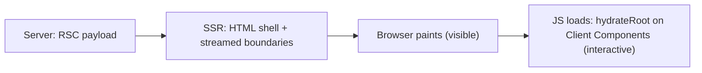
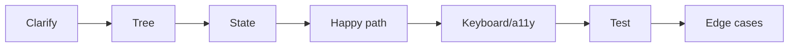

# React Handbook — Interview Edition


## How to use this edition
The night-before companion to the full *React Handbook* (React 19.3). Every chapter is squeezed into one page or two of facts, questions and traps; nothing here is new — each line comes from the full book, where the explanation, runnable code and real output live.

| Section in each chapter | Use it to… |
|---|---|
| **Must-know** | Recite the definitions. If one feels shaky, open the full chapter. |
| **Key facts & numbers** | Memorise the tables: defaults, versions, comparisons. |
| **Code to remember** | Write these from memory on a blank page (≤10 lines each). |
| **In the interview** | Say each answer aloud in under 30 seconds. |
| **Gotchas** | The "what does this log / why is this broken" traps. |
| **TL;DR** | The one-line summary to say first. |

**Plans.** *One evening:* the Top 25 below, then every TL;DR and every Gotchas list. *Two evenings:* add all "In the interview" blocks and Chapter 15's eight builds. *Morning of:* the Last-minute checklist at the end. For machine-coding rounds rehearse the seven-step method (Ch 15) and rebuild at least two builds from a blank file.

Versions assumed throughout: React 19.3, React Router 8, Next.js 16, React Compiler 1.0 (Oct 2025); CRA deprecated (Feb 2025).

## Top 25 questions across the book
| # | Question | One-line answer | Ch |
|---|---|---|---|
| 1 | What happens when you call a setter? | Update queued → render (pure) → commit minimal DOM diff → paint → Effects | 1, 15 |
| 2 | How does reconciliation work? | O(n) diff: different type = new subtree; keys match list items; identity = type + position + key | 1 |
| 3 | Why keys, and why not index? | Keys carry state/DOM with the item; index keys misattach state on reorder/insert; never random | 2 |
| 4 | Why does `{count && <X/>}` show 0? | `&&` returns the falsy `0`, which renders; use `count > 0 &&` | 2 |
| 5 | Why do three `setN(n+1)` add 1? | State is a snapshot; use `setN(p => p + 1)` | 3 |
| 6 | What is batching? | All updates in one event → one render; automatic everywhere since React 18 | 3 |
| 7 | Why immutable updates? | React compares by reference (`Object.is`); mutation skips renders and breaks memo | 3 |
| 8 | Derived state? | Compute from props/state in render; don't store or sync with Effects | 3 |
| 9 | How to reset a component's state? | Change its `key` | 3 |
| 10 | Controlled vs uncontrolled? | React state owns value vs DOM owns it; React 19 Actions favour uncontrolled | 4 |
| 11 | `useActionState` / `useFormStatus` / `useOptimistic`? | Last action result `(prev, formData)`; parent form pending (child, `react-dom`); temporary value with auto rollback | 4 |
| 12 | What is `useEffect` for? | Syncing with external systems; cleanup before re-run and on unmount | 5 |
| 13 | Why does my Effect run twice? | Dev-only StrictMode setup → cleanup → setup to expose missing cleanups | 5 |
| 14 | Fetch race conditions? | `AbortController` or ignore flag in cleanup; better TanStack Query/loaders | 5 |
| 15 | `useRef` vs `useState`? | Ref persists without re-rendering; state re-renders | 5 |
| 16 | Rules of Hooks — why? | Hook state is matched by call order; top level, React functions only | 7 |
| 17 | Custom Hooks share state? | No — they share logic; each call has its own state | 7 |
| 18 | Is Context a state manager? | No, a transport; all consumers re-render on a new value, through `memo` | 6 |
| 19 | How to choose state management? | Server → query cache; shareable → URL; local → hooks; rare global → context; busy global → Zustand/RTK | 6 |
| 20 | `memo` / `useMemo` / `useCallback` / Compiler? | Skip on shallow-equal props / cache value / cache function; Compiler auto-memoizes at build time | 10 |
| 21 | `useTransition` vs `useDeferredValue`? | Wrap an update you own vs defer a value you receive; neither is a debounce | 7 |
| 22 | Suspense and `use()`? | Fallback while lazy/`use(promise)` pending; promise must be cached; transitions keep old UI | 9 |
| 23 | Hydration and mismatches? | Browser adopts server HTML; first client render must match; switch after mount | 13 |
| 24 | Server vs Client Components? | Server: async, zero JS, no state; `'use client'` marks the boundary; `'use server'` = Server Functions | 13 |
| 25 | What don't error boundaries catch? | Event handlers, async callbacks, SSR, their own errors | 14 |

## 1. Why React, and Setting Up
What React is, declarative UI, render/commit and reconciliation, rendering strategies, project setup and JSX.

### Must-know
- **React** — a UI *library* (not a framework): components (functions returning JSX) + `react-dom` to render them. Routing, data and build come from the ecosystem or a framework.
- **Declarative** — describe what the UI looks like for the current state (UI = f(state)); React works out the DOM steps. Imperative = list the steps yourself.
- **Re-render** — React calls your component function again; the DOM changes only where output differs.
- **Render vs commit** — render = call components to compute the new element tree (pure, may be repeated or discarded); commit = mutate the DOM, attach refs, run layout effects.
- **Reconciliation** — O(n) diff using two heuristics: different element types produce different trees; keys identify list items across renders.
- **Hydration** — React in the browser adopting server-generated HTML: reuses the DOM, attaches handlers and state.
- **Hydration mismatch** — server and client render different output (`Date.now()`, `Math.random()`, `window` checks during render).
- **Component** — capitalised function returning JSX, defined at **module top level**, used as `<Name />`.
- **JSX** — compiles to `jsx('h1', {className:'x', children:'Hi'})` calls that return plain immutable element objects. Automatic runtime (React 17+) means no `import React` needed.
- **Fragment** — `<>…</>` groups children without an extra DOM node; use `<Fragment key={id}>` when a list needs a key.

### Key facts & numbers
| Strategy | First content | Navigation | SEO | Server needed | Typical use |
|---|---|---|---|---|---|
| MPA | Fast | Full reload | Good | Yes | Wikipedia, classic admin |
| SPA / CSR | Slow (wait for JS) | Instant | Weaker | No (static) | Dashboards behind login |
| SSR | Fast | App-like after hydration | Good | Yes (Node/edge) | E-commerce, news |
| SSG | Fastest (CDN) | App-like after hydration | Good | No | Docs, blogs, marketing |

| JSX rule | Why |
|---|---|
| One root element (or `<>`) | A function returns one value |
| Close every tag (``) | JSX is stricter than HTML |
| camelCase attrs: `className`, `htmlFor`, `onClick` (`aria-*`/`data-*` keep dashes) | Attributes become JS object keys; `class`/`for` are reserved |
| `{}` holds expressions only (no `if`/`for`) | Use ternary, `&&`, `.map()` or a variable above `return` |
| `style={{ fontSize: 14 }}` | Style is an object; numbers get `px` |

- React runtime ≈ 60–70 KB gzipped. CRA deprecated **February 2025**.
- New app: a framework (Next.js / React Router / Expo); SPA or learning: `npm create vite@latest app -- --template react`.
- Entry point: `createRoot(document.getElementById('root')).render(<StrictMode><App/></StrictMode>)` — create the root once.
- Renders nothing: `null`, `undefined`, `true`, `false`. Renders: `0` and `NaN`. Objects throw "Objects are not valid as a React child".

### In the interview
**Q:** What does "React is declarative" mean? **A:** I describe the UI for the current state; on change React re-runs the component, diffs the new output against the old and applies only the differences — removing the class of bugs where part of the screen isn't updated.

**Q:** Explain the update cycle. **A:** Trigger → render (call components, build element tree) → commit (apply minimal DOM diff). Same type at same position = keep and update; different type = replace; lists matched by key.

**Q:** Why can changing a wrapper from `<div>` to `<section>` lose input text? **A:** A different type at the same position destroys and recreates the subtree, including its state.

**Q:** Does the virtual DOM make React faster than hand-written DOM code? **A:** Not necessarily — hand-tuned DOM code does less work. The benefit is good-enough performance automatically while writing declarative code.

**Q:** SPA vs SSR vs SSG? **A:** SPA ships an empty shell and renders in the browser (simple hosting, slow first paint, weaker SEO); SSR renders HTML per request then hydrates; SSG renders at build time. Frameworks choose per route.

**Q:** Why Vite over CRA? **A:** The dev server serves native ES modules and compiles only what the browser requests, so startup and HMR stay fast; production is still fully bundled. HMR = swap the changed module in the running page, keeping state.

**Q:** Is JSX safe from XSS? **A:** Values in braces are escaped. Risks: `dangerouslySetInnerHTML`, user-supplied `href` URLs (React 19 blocks `javascript:` URLs, but validate anyway) and third-party HTML.

### Gotchas
- Defining a component inside another → new type every render → state reset, inputs lose focus. Move it to module level.
- Calling a component as a function `{Profile()}` → no identity in the tree, Hook rules broken. Use `<Profile />`.
- Lowercase component name renders an unknown HTML tag. Capitalise.
- `return` alone on its line returns `undefined` — start `(` on the return line.
- `src="{avatar}"` is the literal string; use `src={avatar}`.
- SSR makes content *visible* sooner, not *interactive* sooner (that waits for JS + hydration).
- Don't remove `<StrictMode>` to "fix" doubled logs — the doubles reveal bugs.

### TL;DR
React = components + React DOM; trigger → render → commit with a keyed, type-based diff. Pick CSR/SSR/SSG per route; start with a framework or Vite.

## 2. Components and Props
Function components, props, `children`, composition, purity, conditional rendering, lists and keys.

### Must-know
- **Component** — capitalised function `(props) => JSX`; may return JSX, string/number, array or `null`. Only host elements it returns reach the DOM.
- **Props** — one **read-only** object from the parent; one-way data flow: data down via props, events up via callback props.
- **Defaults** — destructuring defaults `({ size = 100 })`. `defaultProps` is **ignored** on function components in React 19.
- **`children`** — nested JSX arrives as `props.children`; **slots** = JSX passed in named props (`icon={<Star />}`).
- **Composition** — nesting components instead of inheritance; the first cure for prop drilling (top component creates the deep child and passes it through as children).
- **Purity** — same props/state/context → same JSX; no mutation of anything that existed before render. Local mutation of values created in this render is fine.
- **StrictMode** — double-renders in development to expose impure components.
- **Presentational vs feature** — presentational take props and render UI; feature components know the data and wire things together.
- **Key** — stable, sibling-unique identity used to match list items across renders; consumed by React (not readable as `props.key`).

### Key facts & numbers
| Condition pattern | Use for |
|---|---|
| `if` / early `return` | Large branches |
| `cond ? <A/> : <B/>` | Either-or |
| `cond && <A/>` | Show or nothing — **boolean on the left** |
| `return null` | Render nothing |

| Key choice | Verdict |
|---|---|
| Item ID from data / UUID created with the item | Correct |
| Array index | Only for static lists (never reordered/filtered/prepended, no per-item state) |
| `Math.random()` / `crypto.randomUUID()` in JSX | Never — remounts every item each render |

| Spread `{...props}` | List props explicitly |
|---|---|
| Thin wrappers around native elements (`Button`, `Input`); later props override earlier | Feature components — clear API |

### Code to remember
```jsx
function Button({ variant = 'primary', ...rest }) {
  return <button className={`btn ${variant}`} {...rest} />;
}
const list = items.map(item => <Row key={item.id} id={item.id} {...item} />);
```

### In the interview
**Q:** What are props and why are they read-only? **A:** Read-only inputs from the parent. The parent owns the data; if a child mutated it, siblings would show stale values and React couldn't know to re-render.

**Q:** Why do keys matter? **A:** React matches items between renders by key, so it can move DOM nodes and keep state with the right item. Index keys break on reorder/filter/prepend — state stays at the position, not with the item.

**Q:** Do keys need to be globally unique? **A:** No — only among siblings.

**Q:** Why does `{count && <Badge />}` show "0"? **A:** `&&` returns its falsy left operand and 0 is renderable. Use `count > 0 &&`.

**Q:** Composition vs Context? **A:** Composition (children/slots) first; Context when many components at different depths need the same value (theme, auth, locale).

**Q:** Why must components be pure? **A:** React may render several times or discard a render; side effects go in event handlers, or Effects for syncing external systems.

**Q:** Can a prop be a component? **A:** Yes — an element (`icon={<Star />}`) or a type (`as={Link}`) rendered as `<Icon />` after capitalising.

### Gotchas
- `size="50"` is a string → `size={50}`.
- `function Avatar(person, size)` → forgot braces; props arrive as one object.
- Copying a prop into state ignores later parent updates.
- `items.sort()` mutates the parent's array → `items.toSorted()` or `[...items].sort()`.
- Key on the `<li>` inside the child instead of on the element returned from `map` → warning persists.
- Multiple siblings per item → `<Fragment key={id}>` (short `<>` can't take a key).

### TL;DR
Props flow down read-only; callbacks flow up. Compose with `children`. Render must be pure. `map` + stable ID keys; boolean on the left of `&&`.

## 3. State and Events
Event handlers, `useState`, snapshots, batching, updaters, immutable updates, lifting state, derived state, controlled inputs, state position and `key`.

### Must-know
- **Handler** — function passed as an `on…` prop: **pass, don't call** (`onClick={handle}`; `() => handle(id)` for args). Handlers are *the* place for side effects.
- **SyntheticEvent** — React's wrapper mirroring the native event. `e.target` = where the event started; `e.currentTarget` = element whose handler runs.
- **`stopPropagation`** stops bubbling; **`preventDefault`** stops the browser default (form submit reload).
- **`useState`** — `[value, setValue]`; memory that persists between renders, private per instance, identified by Hook call order. Setter schedules a re-render.
- **Lazy initialiser** — `useState(fn)` calls `fn` once; `useState(fn())` runs every render.
- **Snapshot** — state is a constant within one render; setters never change the variable you hold.
- **Batching** — all setter calls in one event → one re-render (everywhere since React 18); `flushSync` opts out.
- **Updater function** — `setX(prev => next)` builds on the queued value; plain `setX(v)` replaces.
- **Immutability** — React compares by reference (`Object.is`); mutating and setting the same object may not re-render.
- **Lifting state up** — move shared state to the closest common parent; pass value + callback down. "As low as possible, as high as necessary."
- **Derived state** — compute from props/state in render; don't store. Store IDs, not copies; one `status` over contradictory booleans.
- **Controlled input** — `value={state}` + `onChange`; checkbox uses `checked` / `e.target.checked`. Initialise with `''`.
- **State position** — same type + same position = state kept; different type or different `key` = reset. Use `key` to reset on purpose.

### Key facts & numbers
| Value | Where it belongs |
|---|---|
| Never changes | Constant outside the component |
| From the parent | Props (don't copy into state) |
| Computable from props/state | Variable in render |
| Persists but must not re-render (timer ID, DOM node) | `useRef` |
| Shared by distant components | Lift up → context/store |
| Server data | TanStack Query |

| Immutable update | Code |
|---|---|
| Object field | `{ ...obj, key: v }` |
| Add / remove | `[...arr, x]`, `arr.filter(i => i.id !== id)` |
| Replace one | `arr.map(i => i.id === id ? {...i, done: true} : i)` or `arr.with(idx, v)` |
| Sort / insert | `toSorted()`, `toSpliced()` |
| Deep | Copy every level, or Immer (structural sharing) |

| Controlled | Uncontrolled |
|---|---|
| Instant validation, formatting, dependent fields; re-render per keystroke | Less code; DOM holds value; read on submit via `FormData`/refs; first-class with React 19 Actions |

### Code to remember
```jsx
const [n, setN] = useState(0);
function addThree() {           // from 0 → 3; three setN(n + 1) → 1
  setN(p => p + 1); setN(p => p + 1); setN(p => p + 1);
}
// setN(n + 5); setN(m => m + 1)  from 0 → 6
// setN(m => m + 1); setN(n + 5)  from 0 → 5 (last replace wins)
```

### In the interview
**Q:** Why not a local variable instead of state? **A:** Locals reset every render and changing them doesn't trigger one.

**Q:** Why do three `setCount(count + 1)` calls add 1? **A:** They all read the same snapshot; use the updater form to chain.

**Q:** Why must state be immutable? **A:** React detects change by reference; mutation may skip the re-render and breaks snapshots and memoisation.

**Q:** Is `[...arr]` a deep copy? **A:** No — shallow; elements are shared.

**Q:** Should an Effect update derived state? **A:** No — extra render and a flash of stale UI. Compute during render (`useMemo` if expensive).

**Q:** How do you reset a component's state when a prop changes? **A:** Give it a `key` that changes (e.g. `key={userId}`); different props alone don't reset state.

**Q:** When do you lift state? **A:** When siblings need the same data — closest common parent owns it; children become controlled. If it goes too high, use composition or context.

### Gotchas
- `onClick={handle()}` calls it during render → pass the function.
- Clickable `<div>` → use `<button>` (keyboard + screen reader).
- Forgetting `preventDefault` in `onSubmit` → page reload, state lost.
- `arr.push(x); setArr(arr)` → no re-render.
- `setCount(count++)` → passes the old value.
- Side effects inside an updater → may run twice.
- Stale closure: a timer created once reads an old snapshot → updater or ref.
- `value` without `onChange` → read-only + warning; `value={undefined}` then string → "uncontrolled to controlled" warning.
- `selected` on `<option>` → put `value` on `<select>`.

### TL;DR
State = per-instance snapshot; setters queue a batched re-render. Use updaters to chain, never mutate, keep minimal state and derive the rest, and use `key` to reset.

## 4. Forms and Actions
Form submission, controlled vs uncontrolled, validation, React 19 form Actions, `useActionState`, `useFormStatus`, `useOptimistic`, Server Functions, React Hook Form + Zod.

### Must-know
- **`FormData`** — reads fields by **`name`**; unchecked boxes are missing; all values are strings (`Number(fd.get('age'))`); `getAll` for repeated names.
- **Controlled vs uncontrolled** — React state owns the value (`value` + `onChange`, re-render per keystroke) vs the DOM owns it (`defaultValue`, read via `FormData`/ref). File inputs are always uncontrolled.
- **Action** (React 19) — a function run inside a **Transition**, e.g. passed to `action`/`formAction` or called in `startTransition`.
- **Form Action** — `<form action={fn}>`: React prevents navigation, calls `fn(formData)` in a Transition (async allowed), **auto-resets uncontrolled fields after success**; `formAction` on a button overrides per button; uncaught errors → error boundary.
- **`useActionState`** — `const [state, action, isPending] = useActionState(async (prev, formData) => next, initial)`; the natural place to return validation errors or success.
- **`useFormStatus`** — from **`react-dom`**, called in a **child** of the form: `{ pending, data, method, action }`. Ideal for a reusable Submit button.
- **`useOptimistic`** — `useOptimistic(realValue, reducer)` shows the expected result while an Action runs; when it ends React drops the optimistic value (success → real data takes over; failure → automatic rollback).
- **Server Function** — `'use server'` function run on the server but called like a local function; as a form action it enables **progressive enhancement** (form works before JS loads).
- **React Hook Form + Zod** — RHF manages big forms with uncontrolled inputs; Zod defines rules once for client and server; `zodResolver` connects them.

### Key facts & numbers
| | `onSubmit` + `preventDefault` | `action={fn}` |
|---|---|---|
| Version | Any | React 19+ |
| Input | Full event | `FormData` only |
| Pending / reset / optimistic / progressive enhancement | Manual | Built in |
| Fits | Controlled fields | Uncontrolled fields |

| When to show errors | Use for |
|---|---|
| On every change | Only positive feedback (password strength) |
| On blur (touched) | Most fields |
| On submit only | Short forms (login) |
| On blur, then live while fixing | Default recommendation |

| `useActionState` rule | Detail |
|---|---|
| Signature | Action receives **`(prevState, payload)`** — prev first |
| Queue | Dispatches run **sequentially**, not in parallel |
| Reset | No built-in reset: return `initialState` or remount with `key` |
| Errors | Throwing cancels queued actions and shows the error boundary → return errors |
| Manual dispatch | Wrap in `startTransition` |
| Server Functions | `initialState` and payload must be serializable |

### Code to remember
```jsx
function Submit() {                       // child of <form>
  const { pending } = useFormStatus();    // from 'react-dom'
  return <button disabled={pending}>{pending ? 'Saving…' : 'Save'}</button>;
}
const [state, formAction, isPending] = useActionState(async (prev, fd) => {
  const email = fd.get('email');
  if (!email.includes('@')) return { error: 'Invalid email', email };
  await save(email); return { ok: true };
}, { error: null });
// <form action={formAction}><input name="email" defaultValue={state.email} /><Submit/></form>
```

### In the interview
**Q:** Controlled or uncontrolled in React 19? **A:** Default to uncontrolled fields with a form Action; use controlled where the UI must react while typing (formatting, counters, dependent fields).

**Q:** How do you validate a form? **A:** Layered: HTML constraints, a pure `validate()` for custom/cross-field rules, and **always** server validation. Derive errors, show after blur/submit, `aria-invalid` + `aria-describedby`, focus the first invalid field; Zod to share rules.

**Q:** What does `<form action={fn}>` do? **A:** Prevents navigation, passes `FormData`, runs in a Transition so pending state is visible to `useFormStatus`/`useActionState`, and resets uncontrolled fields after success.

**Q:** How does `useOptimistic` roll back? **A:** The optimistic value lives only for the Action's duration; if the real state wasn't updated, the old value shows again.

**Q:** How do you keep user input after a failed server validation with uncontrolled fields? **A:** Return the submitted values from the action and use them as `defaultValue`s.

**Q:** What must you do inside a Server Function? **A:** Treat it as a public API endpoint: authenticate, authorise and validate; arguments/returns must be serializable.

**Q:** How do you reset an uncontrolled form? **A:** `form.reset()` (a successful Action does it automatically) or change the form's `key`.

### Gotchas
- Writing `async (formData) => …` for `useActionState` → you get the previous state as "formData".
- `useFormStatus` in the same component as `<form>` → always `pending: false`; import from `react-dom`, not `react`.
- Throwing expected errors ("email taken") shows the error boundary → return them.
- Missing `name` attributes → `FormData` silently empty.
- Changing `defaultValue` doesn't update the field → remount with `key` or go controlled.
- `useOptimistic` setter must be called inside an Action; its reducer must be pure; show a "sending" marker.
- Don't use optimistic UI for payments/bookings or unpredictable server results.
- Disabling Submit until valid hides *why* — allow submit and show errors.
- `'use server'` marks server-callable functions, not Server Components.

### TL;DR
React 19 forms: `<form action>` + `useActionState` (prev, formData) + `useFormStatus` in a child + `useOptimistic`; return errors, validate on the server, prefer uncontrolled fields.

## 5. Effects and Refs
Where side effects belong, `useEffect` and cleanup, StrictMode's double run, dependencies, "you might not need an Effect", fetch races, `useRef`, DOM refs, `ref` as a prop, `useLayoutEffect`.

### Must-know
- **Where code goes** — pure calculation → render; caused by a user action → event handler; needed because the component is on screen, to sync with something outside React → **Effect**.
- **`useEffect`** — synchronises with an external system. Setup runs **after commit** (normally after paint); cleanup runs before the next setup and on unmount. Think start-sync / stop-sync, not lifecycle.
- **Cleanup** — a function that exactly undoes setup: disconnect, clear timer, remove listener, abort. It sees the *old* render's values.
- **StrictMode double run** — dev-only setup → cleanup → setup on mount; exposes missing cleanups. Fix the cleanup; never suppress.
- **Dependencies** — every reactive value the Effect reads, compared with `Object.is`. Never lie to the linter; reduce deps by changing code.
- **`useEffectEvent`** (stable since 19.2) — non-reactive logic read from an Effect ("connected, show a toast with the current theme"). Call only from Effects; don't list in deps; don't pass to other components.
- **`useRef`** — stable `{ current }` box that persists; mutating it **doesn't re-render**. For timer IDs, DOM nodes, third-party instances. Don't read/write during render.
- **DOM ref** — `ref={r}` → `r.current` is the node after commit (`null` during first render). Lists: ref callback + `Map`; React 19 ref callbacks may **return a cleanup**.
- **`ref` as a prop** (React 19) — `function Field({ ref }) { return <input ref={ref} /> }`; `forwardRef` is legacy. `useImperativeHandle` exposes a limited API (e.g. `focus`). React 19.3 adds refs on `<Fragment>`.
- **`useLayoutEffect`** — runs after DOM update, **before paint**; for measure-then-adjust without flicker. Blocks painting; does nothing on the server.

### Key facts & numbers
| Dependency array | Runs |
|---|---|
| none | After every render |
| `[]` | On mount only (plus dev double run) |
| `[a, b]` | When `a` or `b` changes (`Object.is`) |

| Reduce deps by… | Example |
|---|---|
| Move object/function inside the Effect | Build `options` inside setup |
| Updater function | `setCount(c => c + 1)` removes `count` |
| Split Effects | One Effect per sync concern |
| `useEffectEvent` | Read latest non-reactive values |

| You might not need an Effect | Instead |
|---|---|
| Derived data (filtered list, total) | Compute in render (`useMemo` if expensive) |
| Reset all state on prop change | `key` |
| Logic caused by an event (POST on submit) | Event handler |
| Notifying the parent | Call its callback in the same handler |
| Chains of Effects setting state | Compute everything in one handler |
| Subscribing to an external store | `useSyncExternalStore` |

### Code to remember
```jsx
useEffect(() => {
  const ctrl = new AbortController();
  setStatus('loading');
  fetch(`/api/cities?q=${q}`, { signal: ctrl.signal })
    .then(r => { if (!r.ok) throw new Error(r.status); return r.json(); })
    .then(data => { setCities(data); setStatus('done'); })
    .catch(e => { if (e.name !== 'AbortError') setStatus('error'); });
  return () => ctrl.abort();          // stale response can't overwrite a newer one
}, [q]);
```

### In the interview
**Q:** Explain `useEffect`. **A:** Syncs with an external system after commit; cleanup before the next run and on unmount; deps decide when it re-runs.

**Q:** Why can't the setup be `async`? **A:** It must return nothing or a cleanup, not a promise — define an async function inside and call it.

**Q:** Why does my Effect run twice in development? **A:** StrictMode mounts, cleans up and mounts again to verify the cleanup mirrors setup; not in production.

**Q:** How do you avoid fetch race conditions? **A:** An `ignore` flag set in cleanup or an `AbortController` aborted in cleanup; plus loading/error states and `response.ok`. In production prefer TanStack Query or loaders (caching, dedup, retries, no waterfalls).

**Q:** `useRef` vs `useState`? **A:** Ref persists without re-rendering — for non-visual values; anything on screen belongs in state.

**Q:** `useEffect` vs `useLayoutEffect`? **A:** `useEffect` is the default and doesn't block paint; `useLayoutEffect` runs before paint to measure and reposition without flicker.

**Q:** Where does "POST analytics on submit" go vs "log page view"? **A:** Submit → handler; page view → Effect.

### Gotchas
- `removeEventListener('x', () => fn())` removes nothing → keep the function in a variable.
- Cleanup for something that can't be undone (one-off POST) → belongs in a handler.
- Showing "AbortError" after cancellation → filter it out.
- Storing fetched data *and* a filtered copy → store data, derive the filter.
- The online `usePrevious` (ref written in Effect, read in render) breaks the ref rule → store previous value in state.
- Editing DOM that React manages via refs → conflicts; use refs for focus, scroll, measurement, third-party widgets.

### TL;DR
Effects sync with the outside world and must clean up; most "Effects" should be render calculations, `key` resets or handler code. Refs are non-rendering boxes and DOM handles.

## 6. State Management
Kinds of state, `useReducer`, Context and its performance, reducer + context, Redux Toolkit, Zustand, TanStack Query, choosing.

### Must-know
- **Kinds of state** — local, complex local, shared client, server, URL, form, derived. Each has a home; keep state as local as possible; never store what you can derive.
- **`useReducer`** — `const [state, dispatch] = useReducer(reducer, initial, init?)`. Reducer = **pure** `(state, action) => next`; `dispatch` is **stable**; third arg is a once-only initialiser.
- **Actions describe events** — `{ type: 'task_completed', id }`, not setters. One user action = one dispatch. No fetch, `Date.now()` or random IDs in reducers (StrictMode runs them twice).
- **Context** — `createContext(default)` → `<Ctx value={v}>` (older: `.Provider`) → `useContext(Ctx)` or `use(Ctx)`. Nearest provider wins; default used when none.
- **`use(Context)`** — can be called conditionally (after early returns, in loops); `useContext` follows Hook rules.
- **Context performance** — all consumers re-render when the value's **identity** changes; no selectors. Memoise the value, split state from dispatch, split by concern.
- **Reducer + context** — provider with `useReducer` + separate state and dispatch contexts + `useX()` Hooks that throw outside the provider = dependency-free store.
- **Redux Toolkit** — `createSlice` (reducers + action creators, **Immer** so `state.count++` is safe), `configureStore` (thunks, DevTools, checks), `useSelector` (re-renders only when the selected value changes), `useDispatch`, `createAsyncThunk`, `createSelector`, **RTK Query** for server data.
- **Zustand** — `const useStore = create((set, get) => ({ ...state, ...actions }))`; select `useStore(s => s.count)`; `useShallow` for multiple values; **no provider**; `getState/setState/subscribe` outside React; `persist`/`devtools` middleware.
- **TanStack Query** — server-state cache: `useQuery({ queryKey: [...vars], queryFn })`, `useMutation` + `invalidateQueries`. The key must include every variable.

### Key facts & numbers
| State kind | Home |
|---|---|
| Server data | Query cache (TanStack Query / RTK Query) |
| Shareable UI (filters, page) | URL |
| Local | `useState` / `useReducer` |
| Rarely-changing app-wide (theme, locale, auth) | Context |
| Frequently-changing shared client | Zustand (simple) / Redux Toolkit (structure, tooling) |

| TanStack Query | Default / meaning |
|---|---|
| `staleTime` | **0** — how long data counts as fresh |
| `gcTime` | **5 min** — how long unused data stays in memory |
| Retries | **3** |
| Refetch triggers | Window focus, reconnect, mount (when stale) |
| `isPending` vs `isFetching` | No data yet vs any request in flight (incl. background) |

| Redux Toolkit | Zustand |
|---|---|
| Structured, conventions for big teams, great DevTools (time travel) | Tiny API, almost no boilerplate |
| Needs `<Provider>` | No provider; module singleton (store-per-provider for SSR/tests) |
| More files/concepts; overkill for small apps | Fewer conventions; easy to grow a giant store |

### Code to remember
```jsx
function reducer(state, action) {
  switch (action.type) {
    case 'added':   return [...state, { id: action.id, text: action.text, done: false }];
    case 'toggled': return state.map(t => t.id === action.id ? { ...t, done: !t.done } : t);
    case 'deleted': return state.filter(t => t.id !== action.id);
    default: throw new Error('Unknown action ' + action.type);
  }
}
```

### In the interview
**Q:** When `useReducer` over `useState`? **A:** Many handlers update the same state or transitions are complex; the reducer centralises logic and is unit-testable without React.

**Q:** Can a reducer fetch data? **A:** No — pure. Fetch in a handler/Effect and dispatch the result.

**Q:** Why is Context not a state manager? **A:** It only delivers a value; every consumer re-renders when the value changes; no selectors or middleware.

**Q:** Why might a Redux component re-render on every dispatch? **A:** Its selector returns a new object/array each call; use `createSelector` or select primitives.

**Q:** Redux vs Zustand? **A:** Both selector-based. RTK for large teams wanting structure, DevTools and RTK Query; Zustand when that is overkill.

**Q:** What is server state and why a library? **A:** A cache of data someone else owns — needs fetching, caching, dedup, refetching, invalidation. With TanStack Query most "global state" disappears.

**Q:** `staleTime` vs `gcTime`? **A:** Freshness (stale triggers refetch) vs how long unused cache entries live.

**Q:** How do you choose state management? **A:** Classify: server → query cache; shareable → URL; local → hooks; rare global → context; busy global → Zustand/RTK.

### Gotchas
- `value={{ user, setUser }}` inline in a provider → new object each render → all consumers re-render; memoise or split.
- Query key `['user']` for every id → users overwrite each other's cache.
- Copying query `data` into state/Redux → lose updates; derive in render.
- `new QueryClient()` in a component body → new cache each render; create once.
- Non-serializable data in Redux breaks DevTools/persistence/SSR.
- Form input text rarely belongs in Redux.
- Reading `state` right after `dispatch` → old snapshot.

### TL;DR
Classify state first. Reducers are pure and event-based; Context is for rarely-changing values; stores add selectors; server data belongs in a query cache.

## 7. Custom Hooks and the Rules of Hooks
How Hooks work, the two rules, custom Hooks (`useLocalStorage`, `useDebounce`, `useFetch`), `useEffectEvent`, `useId`, `useSyncExternalStore`, `useTransition`, `useDeferredValue`.

### Must-know
- **How Hooks work** — React stores Hook state in a per-component list matched by **call order**; change the count/order and values land in the wrong slots ("Rendered more/fewer hooks").
- **Rules of Hooks** — (1) call only at the **top level** (no `if`, loops, after early return, in `try`, in handlers); (2) only from components and custom Hooks. Enforced by `eslint-plugin-react-hooks`.
- **`use`** — may be called conditionally because it stores nothing in a Hook slot (reads a promise or context).
- **Custom Hook** — function named `useX` that calls other Hooks; shares **logic, not state** (each call independent). The `use` prefix lets the linter check it.
- **`useEffectEvent`** (19.2) — latest callback inside an Effect without re-subscribing; older code used the "latest ref" pattern.
- **`useId`** — SSR-safe unique ID per component for `htmlFor` / `aria-*`; **never for keys**.
- **`useSyncExternalStore(subscribe, getSnapshot, getServerSnapshot)`** — official way to read mutable outside data; prevents **tearing** (parts of UI showing different store versions in one render). Zustand and React Redux use it.
- **`useTransition`** — `[isPending, startTransition]`; marks updates non-urgent, interruptible by urgent input; old UI stays while pending. Async callback = an **Action** (React 19).
- **`useDeferredValue(v)`** — urgent render with the old value, background render with the new one; pair with `memo`; `initialValue` in 19.

### Key facts & numbers
| Hook | Wraps | Use when |
|---|---|---|
| `useTransition` | The **update** (you own the setter) | Tab switch, filtering, navigation |
| `useDeferredValue` | A **value** (e.g. received as a prop) | Slow list behind fast input |
| Debounce | Time | Reduce network requests |

| `useLocalStorage` concern | Note |
|---|---|
| SSR | No `localStorage` on the server → hydration mismatch; render default then load in Effect, or `useSyncExternalStore` + `getServerSnapshot` |
| Same key, same tab | Instances don't see each other (`storage` event fires only in *other* tabs) |
| Size | ~5 MB per origin, strings only, synchronous |
| Security | Readable by any script — no tokens or personal data |

### Code to remember
```jsx
function useDebounce(value, delay = 300) {
  const [debounced, setDebounced] = useState(value);
  useEffect(() => {
    const id = setTimeout(() => setDebounced(value), delay);
    return () => clearTimeout(id);
  }, [value, delay]);
  return debounced;
}
```
```jsx
function useInterval(callback, ms) {
  const onTick = useEffectEvent(callback);
  useEffect(() => { const id = setInterval(() => onTick(), ms); return () => clearInterval(id); }, [ms]);
}
```

### In the interview
**Q:** State the Rules of Hooks and why. **A:** Top level only, React functions only — order must be identical every render because state is matched by position.

**Q:** How do you conditionally run an Effect? **A:** Always call `useEffect`; put the `if` inside and include the condition in deps.

**Q:** Other causes of "Invalid hook call"? **A:** Calling a Hook outside a component, or two copies of React in the bundle.

**Q:** Do two components using a custom Hook share state? **A:** No — each call has its own state; share via lifting, context or a store.

**Q:** Custom Hooks vs HOCs / render props? **A:** Hooks compose without extra tree nesting and make data flow explicit; the others are rarely needed now.

**Q:** Write `useFetch`. **A:** One `{status, data, error}` state, fetch in an Effect keyed on URL, AbortController aborted in cleanup, check `res.ok` (fetch doesn't reject on 404); prefer TanStack Query in production.

**Q:** What if `getSnapshot` returns a new array each call? **A:** Infinite re-render loop; React warns it "should be cached".

**Q:** Is `useTransition` a debounce? **A:** No timer — it runs ASAP at lower priority and yields to urgent work; it can't control a text input's value.

### Gotchas
- Early `return <Spinner/>` above a Hook → move all Hooks above the first return.
- Hook in `.map()` → extract an `<Item>` component.
- Silencing `exhaustive-deps` almost always hides a stale-value bug.
- Naming a Hook `getUser` → linter can't check; use `useUser`.
- Debounce without cleanup → every keystroke fires; debouncing the input's own value → caret lag; `debounce(fn)` inline in render → new timer each render.
- `useDeferredValue` without `memo` on the slow child gains nothing; deferring a new object each render defeats it; it doesn't reduce requests.
- External store updates can't be transitions → React falls back to a blocking render.

### TL;DR
Hooks are matched by call order, so call them unconditionally. Custom Hooks share logic; `useSyncExternalStore` for outside data; transitions/deferred values keep input responsive but aren't debounces.

## 8. Styling React Apps
Plain CSS, inline styles, CSS Modules, class composition, Tailwind v4, CSS-in-JS, theming and dark mode, component libraries.

### Must-know
- **Plain CSS** — `className` + imported CSS file; imports are **global**, so scope with a naming convention (BEM) or `@layer`. Modern CSS has native nesting, cascade layers and custom properties.
- **Inline `style`** — camelCase object; numbers → `px` except **unitless** props (`lineHeight`, `zIndex`, `opacity`, `flexGrow`); custom properties (`'--accent'`) pass through; **no** `:hover`, pseudo-elements, media queries or keyframes. Best for dynamic values, ideally via CSS variables.
- **CSS Modules** — `Card.module.css` + `styles.card`; class names renamed to be local; real CSS, zero runtime, works with Server Components; `composes`, `:global`.
- **Class composition** — `clsx`/`cx`; accept a `className` prop; variant maps instead of ternary chains.
- **Tailwind CSS v4** — utility-first classes in JSX; the build **scans source text** and generates only used CSS; theme configured in CSS with **`@theme`**; conflicts resolved with `tailwind-merge`.
- **CSS-in-JS** — runtime (styled-components, Emotion): convenient, dynamic from props, but render cost, bigger bundles, clash with Server Components. Zero-runtime (vanilla-extract, StyleX, Panda) output static CSS.
- **Theming** — tokens as CSS variables overridden by `[data-theme=dark]`; provider resolves light/dark/system and writes the attribute; a **head script** prevents the flash; `color-scheme` for native controls; `light-dark()`.
- **Component libraries** — styled kit (speed) vs headless (custom design + accessibility) vs copy-in (shadcn/ui, own the code). Accessibility is the reason not to hand-roll complex widgets.

### Key facts & numbers
| Approach | Scoped | Runtime | Works with RSC | Dynamic values |
|---|---|---|---|---|
| Plain CSS | No (global) | None | Yes | CSS variables |
| Inline style | Element | None | Yes | Direct (no hover/media) |
| CSS Modules | Yes | None | Yes | CSS variables / inline |
| Tailwind | Utility classes | None | Yes | Arbitrary values / CSS variables |
| Runtime CSS-in-JS | Yes | Yes | Friction | Props |
| Zero-runtime CSS-in-JS | Yes | None | Yes | Build-time tokens |

- WCAG 2.2 contrast: **4.5:1** for normal text (dark themes too).

### In the interview
**Q:** Compare styling approaches. **A:** Global CSS is simple but needs conventions; CSS Modules scope per file with zero runtime; Tailwind generates only used utilities; runtime CSS-in-JS adds render cost and doesn't fit Server Components; inline styles only for truly dynamic values.

**Q:** How do you implement dark mode? **A:** CSS-variable tokens, `[data-theme=dark]` overrides, a provider for the toggle, a head script against flash, `color-scheme` for native controls.

**Q:** CSS Modules vs Tailwind? **A:** Both scoped and zero-runtime; Modules keep semantic CSS in CSS files, Tailwind keeps styling in markup with a token scale. Team preference decides.

**Q:** Why `className`, not `class`? **A:** `class` is reserved in JavaScript, and it matches the DOM property `element.className`.

**Q:** Why does `` `bg-${color}-500` `` not work in Tailwind? **A:** The scanner reads source text and never sees the full class, so no CSS is generated — map to complete class names.

### Gotchas
- `Card.css` without `.module` → nothing scoped, `styles` empty.
- `className="card"` with CSS Modules → no style (real name is renamed); typo `styles.tittle` → silently `undefined`.
- `px-2 px-4` → winner decided by generated CSS order, not attribute order → `tailwind-merge`.
- Tailwind Preflight resets headings/lists — intended; style explicitly.
- Hard-coded colours ignore the theme; reading `localStorage` during SSR crashes → client or cookie.
- Dark mode is not just inverted colours: adjust shadows, borders, accents.
- Mixing two styled kits; fighting a styled kit with overrides (go headless); leaking a library's API (wrap it once in your own `<Button>`).

### TL;DR
Pick a zero-runtime scoped approach (CSS Modules or Tailwind), use CSS variables for themes and dynamic values, and lean on headless libraries for accessible widgets.

## 9. Routing and Data Fetching
Client-side routing, React Router 8 (declarative, data, framework modes), layouts, loaders, actions, fetchers, middleware, TanStack Query, mutations, Suspense and `use()`, loading UX.

### Must-know
- **Client-side routing** — History API + route matching; the URL is shareable state. The server must return `index.html` for every app path (else refresh on `/products/3` 404s).
- **React Router 8** — one package: `npm i react-router`; `RouterProvider` from `react-router/dom`; middleware on by default.
- **Routes** — `path`, `:param` (`useParams`, **strings**), `?search` (`useSearchParams`), `*` for 404, `<Link>`/`<NavLink>`, `useNavigate` in code.
- **Nesting** — parent renders `<Outlet/>`; `index` route = default child; pathless routes for shared layouts; relative links; `useOutletContext`.
- **Loader** — runs **before render**, in parallel for all matched routes; `useLoaderData()`; `useNavigation()` for pending UI; `throw data(msg, {status})` handled by a route `ErrorBoundary`.
- **Action** — `<Form method="post">` → route `action` → return errors (`useActionData`) or `redirect`; loaders **revalidate automatically**; `useFetcher` for submissions that shouldn't navigate.
- **Middleware** — before/after hooks around loaders (auth guards, logging, context via `createContext` + `context.get/set`). `lazy` splits route code.
- **TanStack Query** — caches by key, dedupes, retries, background-refetches stale data on mount/focus/reconnect. `staleTime` 0, `gcTime` 5 min.
- **Query keys** — every input in the key, general → specific; `queryOptions` for reuse; `keepPreviousData` for pagination; `enabled` for dependent queries; `useInfiniteQuery` for infinite lists.
- **Optimistic mutation** — cancel → snapshot → set → rollback on error → invalidate on settle.
- **`use(promise)`** — suspends until resolved; needs `<Suspense>` + an error boundary; the promise must be **cached**, never created in render. `useSuspenseQuery` = Suspense with a cache.

### Key facts & numbers
| RR mode | You write | Adds | Use when |
|---|---|---|---|
| Declarative | `<BrowserRouter>` + `<Routes>`/`<Route>` | Matching, links, params | Simple SPAs, own data fetching |
| Data | Route objects → `createBrowserRouter` + `<RouterProvider>` | Loaders, actions, pending, error boundaries, fetchers, middleware | Data tied to navigation |
| Framework | Route modules + Vite plugin | SSR, per-route splitting, typegen, pre-rendering | Full-stack (Remix successor) |

| Loading UX | Show |
|---|---|
| First load | Skeleton |
| Navigation | Old content + pending indicator (transition) |
| Fast refresh | Nothing |
| Background refetch fails with cached data | Data + subtle warning |
| Validation error | Inline |
| Empty | Separate "No results" state |

### Code to remember
```jsx
const router = createBrowserRouter([{ path: '/', Component: Layout, children: [
  { index: true, Component: Home },
  { path: 'products/:id', Component: Product,
    loader: ({ params }) => qc.ensureQueryData(productQuery(params.id)) },
]}]);
// Product: const { data } = useSuspenseQuery(productQuery(useParams().id));
```

### In the interview
**Q:** Why loaders instead of fetching in `useEffect`? **A:** Loaders start at navigation, before render, in parallel — removing render-then-fetch waterfalls; pending and errors are handled by the router.

**Q:** Why both a loader and TanStack Query? **A:** The loader removes the waterfall; the query cache removes repeated requests and keeps data fresh (shared `queryOptions`, `ensureQueryData` in the loader, `useSuspenseQuery` in the component).

**Q:** Why not Redux for server data? **A:** You'd hand-write caching, dedupe, refetching and invalidation.

**Q:** `isPending` vs `isFetching`? **A:** No data yet vs any request in flight, including background refetch.

**Q:** What happens on window focus? **A:** Stale queries with mounted observers refetch.

**Q:** Where do filters/page number live? **A:** In search params — shareable, survives refresh.

**Q:** How do you avoid flashing Suspense fallbacks on navigation? **A:** Wrap the update in a transition so old content stays visible.

### Gotchas
- `<a href>` inside the app → full reload; use `<Link>` (keep `<a>` for external).
- `navigate()` during render → call in handlers/Effects or render `<Navigate>`.
- Query function that doesn't throw on HTTP errors → check `res.ok`.
- `isLoading` to test for data → use `isPending` or check `data`.
- Turning off refetching because it's noisy → raise `staleTime`.
- One global spinner; `catch {}` swallowing errors → stuck in "Loading…".
- Creating a promise in render for `use()` → infinite suspend; cache it.

### TL;DR
Router data mode for fetch-on-navigation, TanStack Query for caching, Suspense + error boundaries for states, URL for shareable UI state.

## 10. Performance
The render cycle, re-render triggers, the Profiler, `memo`, `useCallback`/`useMemo`, React Compiler, `lazy` code splitting, virtualization, common bugs, checklist.

### Must-know
- **Render cycle** — trigger → render (call components) → commit (DOM diff) → effects. A re-render is a function call, not a DOM update.
- **Re-render triggers** — own state, **parent re-render**, context it reads, subscribed external store. Props are *not* compared unless `memo`. Setting state to an identical value bails out. Ref changes never re-render.
- **Children from above** — elements passed as `children` keep identity, so they're skipped when the wrapper re-renders (free optimisation).
- **Measure first** — DevTools "highlight updates" + Profiler ("why did this render?"), Performance tracks (19.2+), `<Profiler onRender>`; compare `actualDuration` vs `baseDuration`. Profile a production (profiling) build with CPU throttling.
- **`memo`** — skip re-render when props are shallow-equal (`Object.is`). Doesn't stop own-state or context updates. A performance **hint**, not a guarantee.
- **`useCallback` / `useMemo`** — cache a function / computed value until deps change. Matter only when the reference is compared (by `memo`, Effect deps, a caller). Cache calculations **≥ ~1 ms**.
- **React Compiler** — build-time Babel plugin, **v1.0 stable October 2025**; auto-memoizes values, callbacks and JSX; requires the Rules of React; `"use no memo"` escape hatch; "Memo ✨" badge in DevTools.
- **Code splitting** — `const Page = lazy(() => import('./Page'))` at **module level** + `<Suspense fallback>` + error boundary; needs a `default` export; split by route/heavy widget; preload on intent; `startTransition` to avoid fallback flashes.
- **Virtualization** — render visible rows + overscan in a full-height spacer; `first = floor(scrollTop / rowHeight) − overscan`. 10,000 items → ~16 DOM rows. Production: TanStack Virtual / react-window.

### Key facts & numbers
| Plain list | Virtualized |
|---|---|
| DOM grows with data | Constant (~visible rows) |
| Ctrl+F finds any row | Only rendered rows |
| Screen readers see all | Need `aria-setsize` / `aria-posinset` |
| < a few hundred rows | Thousands of rows, feeds, logs |

| Perf bug | Fix |
|---|---|
| Component defined inside component | Move to module level |
| Unstable / random keys | Stable IDs |
| Context value recreated each render | Memoize or split context |
| State too high | Colocate / move down |
| Effect-driven render loops | Compute in render / handler |

**Order of fixes:** structure first (colocate, children, keys) → memoization → specialised tools.

### Code to remember
```jsx
const Row = memo(function Row({ item, onSelect }) { /* ... */ });
function List({ items }) {
  const [sel, setSel] = useState(null);
  const onSelect = useCallback(id => setSel(id), []);   // stable for memo
  return items.map(it => <Row key={it.id} item={it} onSelect={onSelect} />);
}
```

### In the interview
**Q:** When does a component re-render? **A:** Own state, parent re-render, context change, external store change; props only matter with `memo`.

**Q:** Why can `memo` make things slower? **A:** It compares props every parent render; if they always differ you pay for comparison *and* render.

**Q:** Does `memo` stop context updates? **A:** No.

**Q:** What does React Compiler do? **A:** Auto-memoizes components and Hooks at build time based on static dependency analysis; manual memo Hooks become escape hatches. It doesn't fix slow algorithms, big DOM or bundle size.

**Q:** Why doesn't `memo` fix a 10,000-row list? **A:** The cost is DOM node count and initial render, not repeated re-renders — virtualize.

**Q:** How would you speed up a slow React page? **A:** Measure (prod build, throttling, Profiler); load time → bundle analysis + `lazy`; interactions → structural fixes, then `memo`/Compiler; virtualize long lists; memoize expensive calcs; transitions for non-urgent updates.

**Q:** Why must `lazy` be declared at module level? **A:** Inside a component each render creates a new type → remount and lost state.

### Gotchas
- `memo` + inline objects/functions/JSX props → always re-renders; `<MemoCard><p>hi</p></MemoCard>` → new `children` each render.
- Deep-equality `arePropsEqual` on big data can cost more than the render.
- `useCallback(() => save(draft), [])` → stale closure; unstable deps (`opts` new each render) → cache never hits.
- `useMemo` isn't a guaranteed cache and doesn't speed up the first render; its function must be pure.
- Splitting everything → many requests and waterfalls.
- Virtual list without fixed viewport height never scrolls; no overscan → blank flashes.
- Treating every re-render as a bug — a 0.1 ms render isn't worth optimising.

### TL;DR
Measure, then fix structure (colocate state, children, stable keys, stable context) before `memo`; use the Compiler, split code by route, virtualize long lists.

## 11. TypeScript with React
Setup, typing props, children, events, state, reducers, refs, Hooks, Context, generic components, discriminated-union props, reading type errors.

### Must-know
- **Setup** — `.tsx`, `@types/react` + `@types/react-dom` (matching React major), `strict: true`, `jsx: "react-jsx"`. The bundler **strips** types; `tsc --noEmit` **checks** them (run in CI).
- **Props** — `function C({ a, b = 1 }: Props)`; `?` optional; defaults remove `undefined`; literal unions for variants; function types for callbacks.
- **Children** — `ReactNode` (anything renderable) — not `JSX.Element`/`ReactElement` (a single element only). `PropsWithChildren<P>` helper.
- **Extend native elements** — `ComponentProps<'button'> & { variant: … }`, spread the rest (includes `ref` in React 19).
- **Events** — inline handlers are inferred; standalone: `ChangeEvent<HTMLInputElement>`, `SubmitEvent<HTMLFormElement>` (older: `FormEvent`), `MouseEvent`, `KeyboardEvent` from `react`; or `XxxEventHandler<…>`. `currentTarget` has your element's type.
- **State** — let `useState` infer; add `<T>` for `null`, `[]` and literal unions (`useState([])` alone is `never[]`).
- **Reducers** — actions as a **discriminated union**; `default: const x: never = action` makes missing cases compile errors.
- **Refs** — `useRef<HTMLInputElement>(null)` for DOM; **argument required** in React 19 types; `ref` is a normal prop typed `Ref<T>`; `forwardRef` not needed.
- **Hooks & Context** — tuples need `as const` (or return an object); `createContext<T | null>(null)` + a `useX()` that throws outside the provider.
- **Generic components** — `function List<T>(props: ListProps<T>)`; T inferred from props; constrain with `extends`, `keyof T` for field names; `<T,>` for arrow functions in `.tsx`.
- **Union props** — one member per valid prop combination with a shared literal discriminant; narrow before reading; `?: never` forbids a prop.

### Key facts & numbers
| Type | Meaning / use |
|---|---|
| `ReactNode` | Anything renderable → `children` |
| `ReactElement` / `JSX.Element` | Only a JSX element |
| `ComponentProps<'input'>` / `ComponentProps<typeof X>` | Reuse native / existing props |
| `Ref<T>` | `ref` prop type in React 19 |
| `unknown` | Safe alternative to `any` — narrow before use |

### Code to remember
```tsx
type Action = { type: 'add'; sku: string } | { type: 'clear' };
function reducer(state: string[], action: Action): string[] {
  switch (action.type) {
    case 'add': return [...state, action.sku];
    case 'clear': return [];
    default: { const unreachable: never = action; return unreachable; }
  }
}
type ButtonProps = ComponentProps<'button'> & { variant?: 'primary' | 'ghost' };
```

### In the interview
**Q:** How do you type props and children? **A:** Type alias on the destructured parameter, `children: ReactNode`, native elements via `ComponentProps<'button'>`.

**Q:** `ReactNode` vs `ReactElement` vs `JSX.Element`? **A:** `ReactNode` is anything renderable (strings, arrays, null…); the other two are just a JSX element.

**Q:** How do you type `ref` in React 19? **A:** A normal prop `ref?: Ref<HTMLInputElement>`, or free from `ComponentProps<'input'>`.

**Q:** Why avoid `any`? **A:** It disables checking for that value and everything it flows into; use `unknown` and narrow.

**Q:** How do you prevent invalid prop combinations? **A:** Discriminated unions — invalid combos don't compile (`<Status status="success" />` without `count` errors).

**Q:** How do you read a TS error? **A:** "Type A (given) is not assignable to type B (expected)" — read the last indented line first.

### Gotchas
- Turning `strict` off → lose null checks.
- `children: JSX.Element` → a string or two children fail.
- Spreading `{...rest}` after your own props lets the caller's `className` overwrite yours — merge deliberately.
- `useRef<HTMLDivElement>(null)` on an `<input>` → type error; reading `ref.current` during render.
- `as` and `!` silence the checker without checking; narrow instead.
- Hand-typing API responses and trusting them → validate at the boundary (Zod) and derive types.
- Generics for a single-type component → over-engineering.

### TL;DR
`strict` TS, `ReactNode` children, `ComponentProps` for native props, discriminated unions for reducers and variant props, `useRef<T>(null)`, no `any`.

## 12. Testing React
Testing Library philosophy, queries and priority, `user-event`, async tests, mocking `fetch`/MSW, testing Hooks, providers and custom render, Vitest/Jest setup.

### Must-know
- **Philosophy** — test what users see and do: render → find like a user → act like a user → assert on the DOM. Don't test state, props or internal calls.
- **Basic test** — `render` → `screen.getByRole(...)` → interact → assert; `cleanup` automatic in Jest/Vitest.
- **Query priority** — role (+ accessible name) → label → placeholder → text → display value → alt → title → **test ID last**.
- **`getBy` / `queryBy` / `findBy`** — throws if missing (must exist now) / returns `null` (assert absence) / promise that retries (async appearance). `All` variants for many; `within` to scope.
- **`user-event`** — `const user = userEvent.setup(); await user.click/type/selectOptions/keyboard/tab(...)`; prefer over `fireEvent`.
- **Async** — `await findBy…` for appearing, `waitForElementToBeRemoved` for disappearing, `waitFor(() => assertion)` for the rest. **Never sleep.**
- **Network** — mock at the boundary (MSW, or a `fetch` spy returning real `Response`s); cover success, HTTP error (`res.ok` false), network error, races.
- **Hooks** — test through a component, or `renderHook` + `act` + `result.current` (in `@testing-library/react` since RTL 13.1); `rerender` for new args; fake timers for time.
- **`act`** — flushes React updates and effects before assertions; RTL helpers already wrap it — you need it for direct updates (`renderHook` calls, advancing fake timers).
- **Providers** — one `renderWithProviders` using a `wrapper`: `MemoryRouter` with `initialEntries`, context, a **fresh** store/query client per test.

### Key facts & numbers
| Setup | Config |
|---|---|
| Vitest | `environment: 'jsdom'`, `globals: true`, setup file importing jest-dom |
| Jest | `jest-environment-jsdom`, Babel/TS transform, `setupFilesAfterEnv` |
| Fake timers + user-event | `userEvent.setup({ advanceTimers: vi.advanceTimersByTime })` |

### Code to remember
```jsx
test('adds a todo', async () => {
  const user = userEvent.setup();
  render(<TodoApp />);
  await user.type(screen.getByRole('textbox', { name: /new todo/i }), 'Milk');
  await user.click(screen.getByRole('button', { name: 'Add' }));
  expect(screen.getByRole('listitem')).toHaveTextContent('Milk');
});
```

### In the interview
**Q:** How do you test React components? **A:** RTL + Vitest/Jest; find by role/name, interact with user-event, assert on the DOM; await async UI; mock the network at the boundary.

**Q:** Why prefer `getByRole`? **A:** Matches how users and assistive tech find elements, doubles as an accessibility check, survives markup refactors.

**Q:** How do you test a component that fetches? **A:** Mock with MSW or a `fetch` spy, `await findBy…` the loaded UI, also test loading and error states.

**Q:** When do you need `act`? **A:** Only for updates outside RTL helpers (e.g. `renderHook` calls, fake timer advances).

**Q:** How do you test a debounced Hook? **A:** `renderHook` with fake timers, `act(() => vi.advanceTimersByTime(300))`, read `result.current` again.

### Gotchas
- `container.querySelector('.btn')` → `getByRole('button', { name })`.
- `getByText` to assert absence throws → `queryByText(...) === null`.
- `getBy` for later elements → `findBy`; don't wrap `findBy` in `waitFor`.
- Actions inside `waitFor` → only assertions there (it may run many times).
- Missing `await` on `findBy`/`waitFor`/`user.*` → passes by accident + `act` warning.
- Destructuring `result.current` once → stale; re-read after each `act`.
- Leaving fake timers on → reset in `afterEach`.
- Importing `renderHook` from `@testing-library/react-hooks` (React ≤17 only).

### TL;DR
Test behaviour like a user: role queries, user-event, `findBy` for async, network mocked at the boundary, fresh providers per test; few snapshots, E2E for critical paths.

## 13. Server Rendering and Frameworks
Rendering strategies, server APIs, streaming SSR, hydration and mismatches, SSG and PPR, Server Components, directives, Next.js App Router, React Router framework mode, choosing a framework.

### Must-know
- **Strategies** — CSR (browser builds it), SSR (server per request), SSG (at build), **ISR** (SSG + background refresh), **streaming** (frame now, slow parts later), **PPR** (static shell + streamed dynamic holes). Chosen per route, with PPR per component.
- **Server APIs** — `renderToPipeableStream` (Node) / `renderToReadableStream` (Web Streams) for SSR; `prerender*` for build; `resume*` for PPR; `hydrateRoot` in the browser. `renderToString` is legacy (no server Suspense — shows fallbacks).
- **Streaming SSR** — the **shell** (outside pending boundaries) is sent first with fallbacks; each Suspense boundary follows as a hidden div + swap script (`$RC`). Status in `onShellReady`, crawlers wait for `onAllReady`, log in `onError`, `abort()` on timeout.
- **Hydration** — `hydrateRoot` renders the same tree with the same data, adopts the server DOM, attaches handlers/Effects. **Selective**: the shell is interactive while boundaries load; clicks on an unhydrated boundary make React hydrate it first and replay the event. **Visible ≠ interactive.**
- **Hydration mismatch** — first client render ≠ server HTML → React client-renders the tree and reports a recoverable error. Fix by switching after mount: Effect, `useSyncExternalStore` server snapshot, or **`use(browser())`** (19.3). `suppressHydrationWarning` keeps server text, silences one level deep.
- **Server Components (RSC)** — run only on the server, can be `async`, read data directly, ship **zero JS**; output sent as an **RSC payload**. No directive — they're the default. Share a query across them with `cache()`.
- **Client Components** — `'use client'` marks a **module-graph boundary** (file + its imports ship to the browser); still pre-rendered by SSR, then hydrated.
- **Server Functions** — `'use server'`; async functions callable from the client, for **mutations** (not reads); each is a **public POST endpoint** → auth + validate. Use `import 'server-only'` for private helpers.
- **RSC vs SSR** — SSR makes first-load HTML; RSC decides which components exist in the browser at all. Together: RSC payload → SSR HTML → hydrate only Client Components.
- **Next.js App Router** — folders are routes; `page`/`layout`/`loading`/`error` files; Server Components by default; revalidate with `revalidatePath`/`revalidateTag`/`updateTag`. **Next.js 16**: `proxy.js`, Turbopack default, opt-in **Cache Components** with `'use cache'` + PPR; `params`/`searchParams`/`cookies()` are Promises (since 15; sync removed in 16).
- **React Router framework mode** — `routes.ts` + route modules (`loader`, `action`, `meta`, `ErrorBoundary`, default component); config picks SSR, SPA or prerender; Vite-based.

### Key facts & numbers
| | CSR | SSR | SSG | ISR | Streaming / PPR |
|---|---|---|---|---|---|
| First content | Slow | Medium | Fastest | Fastest | Fast (shell first) |
| Server needed | No | Yes | No | Yes | Yes |
| Per-user HTML | No | Yes | No | No | Yes (holes) |
| Good for | Dashboards behind login | Personalised pages | Docs, blogs | Catalogues, news | Fast frame + slow widgets |

| Need | Choose |
|---|---|
| Public, SEO, fast first paint | Next.js or React Router framework mode |
| Internal tool behind login | Vite SPA + React Router + TanStack Query |
| Mobile | Expo |
| Mostly static content | SSG / Astro |



### In the interview
**Q:** How does streaming SSR work? **A:** Shell first with fallbacks; each boundary's HTML later with a swap script, so one slow query doesn't block the page and hydration can start early.

**Q:** What causes hydration mismatches and how do you fix them? **A:** Environment checks, `localStorage`, dates, randomness, locale, invalid nesting, different data. Make the first client render identical; switch after mount.

**Q:** Why is `useId` SSR-safe? **A:** IDs derive from tree position, identical on server and client.

**Q:** Server Components vs Client Components? **A:** Server: async, data access, zero JS. Client: state, events, browser APIs. Default to server, push `'use client'` to the leaves, pass server output as `children`.

**Q:** Can a Client Component render a Server Component? **A:** Not by importing it — only if it receives it as `children`/a JSX prop from a Server Component.

**Q:** Does `'use client'` mean no server rendering? **A:** No — still SSR'd to HTML; it means the code ships and hydrates.

**Q:** What does a framework add over Vite + `react-dom/server`? **A:** Routing tied to data and code splitting, data serialization for hydration (no double fetch), caching/revalidation, bundling for server + client, deployment adapters.

**Q:** Component throws inside a boundary on the server? **A:** Boundary marked for client rendering, fallback stays, browser retries; if it fails there too, the nearest error boundary shows.

### Gotchas
- `createRoot` on server HTML → discards and rebuilds the DOM (flash); use `hydrateRoot`.
- `hydrateRoot` on `renderToStaticMarkup` output → no hydration markers.
- `window`/`localStorage` during render → `ReferenceError` on the server.
- One giant `<Suspense>` → empty shell.
- Per-user data in SSG/prerender → everyone sees the first user's cart.
- `'use server'` doesn't mark Server Components; `onClick` from Server to Client Component isn't serializable.
- `useState` in a component without `'use client'` above → build error.
- Server Components re-run only on a new server request (navigation, `router.refresh()`, revalidation).
- `'use client'` on `layout`/`page` or every file → lose RSC benefits.
- SSR for an internal dashboard; SPA for an e-commerce catalogue.

### TL;DR
Stream a shell, hydrate selectively, keep the first client render identical to the server. Server Components by default, `'use client'` at the leaves, Server Functions are public endpoints.

## 14. Patterns and Architecture
Composition, container/presentational, custom Hook extraction, compound components, render props, HOCs, portals, error boundaries, accessibility, folder structure, design systems.

### Must-know
- **Composition first** — `children` and slots beat growing lists of boolean props; specialise by wrapping.
- **Container / presentational** — props-in/markup-out views; data access in a Hook, container or Server Component — where reuse or testing benefits, not by rule.
- **Custom Hook extraction** — logic → `useX(inputs)` returning a small, intention-revealing API (`{ status, results }`); injectable deps; test with `renderHook`.
- **Compound components** — `Tabs`, `Tabs.List`, `Tabs.Tab`, `Tabs.Panel` share state via a **private context**; root owns state (controlled + uncontrolled); parts throw a clear error outside the root.
- **Render props** — a function prop the component calls to render; best when the component decides placement/repetition of caller markup (lists, tables, slots). Hooks for plain logic.
- **HOC** — `withX(Component)` returns a wrapped component (e.g. Redux `connect`, auth guards). Apply at **module level**, pass props through, set `displayName`. Mostly legacy — prefer Hooks.
- **Portal** — `createPortal(children, node)` renders DOM elsewhere (escapes `overflow: hidden`, stacking contexts) but the **React tree is unchanged**: context and **event bubbling follow React ancestors**.
- **Error boundary** — class with `getDerivedStateFromError` (fallback) + `componentDidCatch` (log). Catches render-time errors below it — including `use()` rejections and lazy-load failures. **Not**: event handlers, async callbacks, SSR, its own errors. Without one, React 19 unmounts the whole root. `react-error-boundary` adds `resetKeys` and `useErrorBoundary`/`showBoundary`. Root options: `onCaughtError` / `onUncaughtError`.
- **Accessibility** — semantic elements first; `<label htmlFor>` + `useId`; ARIA from state (`aria-expanded={open}`); live regions (`role="status"` polite / `role="alert"` urgent) present before text changes; focus management with refs; `eslint-plugin-jsx-a11y`, axe.
- **Folder structure** — small: by type; growing: **by feature** with colocated tests/styles, a public `index.js` per feature, `app → features → shared` dependency direction enforced by lint; path aliases; careful with giant barrel files.
- **Design system** — tokens → accessible primitives → documented patterns; closed variants, safe defaults, pass-through props and `ref`; build on headless primitives (Radix, React Aria); Storybook.

### Key facts & numbers
| Reuse pattern | Best for | Downside |
|---|---|---|
| Custom Hook | Sharing stateful logic | Doesn't share state |
| Compound components | Flexible layout of a widget family | Harder to enforce structure |
| Render props | Component controls where caller markup goes | Callback pyramids |
| HOC | Cross-cutting wrapping (auth, logging) | Prop collisions, wrapper hell, hidden deps |
| Config/array prop | Simple fixed cases | New props for every variation |

| Error boundary catches | Doesn't catch |
|---|---|
| Render errors in subtree, `use()` rejections, `lazy` load failures | Event handlers, async callbacks, SSR, its own errors |

### Code to remember
```jsx
const TabsCtx = createContext(null);
function useTabs() { const c = useContext(TabsCtx); if (!c) throw new Error('Tabs.* must be inside <Tabs>'); return c; }
function Tabs({ value, defaultValue, onValueChange, children }) {
  const [inner, setInner] = useState(defaultValue);
  const selected = value ?? inner;                        // controlled wins
  const select = v => { if (value === undefined) setInner(v); onValueChange?.(v); };
  return <TabsCtx value={{ selected, select }}>{children}</TabsCtx>;
}
```

### In the interview
**Q:** Why context rather than `cloneElement` for compound components? **A:** `cloneElement` only reaches direct children and breaks with wrappers; it's a legacy API. Context works at any depth.

**Q:** Controlled + uncontrolled support? **A:** Internal state for `defaultValue`; prefer `value` when defined; always call `onValueChange`.

**Q:** HOC vs Hook? **A:** HOCs compose but cause prop collisions, implicit props, wrapper nesting; Hooks are explicit. HOC still fits when wrapping rendering (guards).

**Q:** How do events behave in a portal? **A:** They bubble through React ancestors, not DOM ancestors.

**Q:** Why are error boundaries still classes? **A:** No Hook for `getDerivedStateFromError`/`componentDidCatch`; teams use `react-error-boundary`.

**Q:** How do you send an async error to a boundary? **A:** Store it in state and throw during render, or `showBoundary(error)`.

**Q:** How do you make a modal accessible? **A:** Move focus in, trap it (or `inert` background), Escape closes, `aria-modal`, return focus to the trigger — or native `<dialog>` with `showModal`, or Radix/React Aria.

**Q:** How do you structure a large React app? **A:** By feature with public APIs, `app → features → shared`, lint-enforced boundaries, thin route files.

### Gotchas
- `FooContainer` + `Foo` for everything → twice the files, little gain; a "presentational" component calling `useContext` isn't reusable.
- A Hook that uses no Hooks → plain function, don't name it `use…`.
- Hooks inside a render-prop callback → breaks the Rules of Hooks.
- HOC applied inside render → remount every render.
- Error boundary fallback that throws; "Try again" without changing input → use reset keys; always log.
- `<div onClick>` → `<button>`; `outline: none` without `:focus-visible`; ARIA overuse; conditionally rendering the live region itself.
- Portals during SSR → `document` doesn't exist; render after mount.
- `shared/`/`utils/` dumping ground; circular feature imports.
- Design system components that hard-code colours or drop `...rest`/`ref`.

### Must-know — client architecture patterns (§14.13)
| Pattern | Middle piece | View updated by | Test without UI |
|---|---|---|---|
| **MVC** | Controller handles input → Model | view observes the model | controller + model |
| **MVP** | Presenter formats data | presenter calls a **passive** view interface | presenter with a fake view |
| **MVVM** | ViewModel: observable state + commands, no view reference | view **binds** to state | ViewModel alone |
| **VIPER** | Interactor (use cases) + Presenter + Router (navigation), Entities | presenter | every part |
| **Flux / Redux / MVI** | pure reducer | action → reducer → state → view (one-way) | reducer as a pure function |

- **React** — a view library with one-way flow, `UI = f(state)`; a **custom Hook ≈ ViewModel**, `useReducer`/Redux = unidirectional, stores via `useSyncExternalStore`.

**Q:** MVP vs MVVM? **A:** MVP's presenter holds the view and calls it; MVVM's ViewModel only exposes state and the view binds to it.

**Q:** Is React MVC? **A:** No — it is the view layer; Hooks play the ViewModel role and reducers/stores give Flux-style one-way updates.

### TL;DR
Compose first, extract Hooks for logic, compound components via context for widget families; boundaries per route; accessibility is semantic HTML + focus + ARIA from state; organise by feature.

## 15. React Interview and Machine Coding
How React interviews run, the machine-coding method, the 53 questions (condensed), and the 8 builds as requirements → state design → key code idea → edge cases.

### Must-know
- **Rounds** — concepts ("what does this log?"), machine coding (45–90 min widget build), JavaScript (closures, event loop, `debounce` from scratch), front-end system design (feed, chat, design system).
- **Machine-coding method** — 1 clarify requirements (incl. quiet ones: keyboard, screen readers, loading/error, data size) → 2 sketch component tree → 3 design state (derivable? who needs it? outside React?) → 4 happy path with native elements → 5 keyboard + a11y → 6 one or two user-like tests → 7 edge cases. **Talk throughout** — interviewers score process.
- **State design rules** — minimal state, derive the rest; colocate, lift only when shared; one `status` value, not several booleans; refs for values handlers need but the screen doesn't.

### Key facts & numbers
| 60-minute budget | Minutes |
|---|---|
| Requirements + tree + state | 10 |
| Happy path | 25 |
| Keyboard + a11y | 8 |
| Test | 7 |
| Edge cases, discussion | 10 |



### In the interview
The 53 questions of §15.2–15.9, condensed (ones already answered in Ch 1–14 above are merged there; these are the extras and the "what does this log" facts):

**Q:** What happens when you call a state setter? **A:** Nothing immediately: the update is queued → render (call components, reconcile) → commit (DOM diff, layout effects), browser paints, then `useEffect` runs.

**Q:** Why is reconciliation O(n) and not O(n³)? **A:** Two heuristics — a different element type means a different subtree; keys identify list children. Identity = **type + position + key**. "Virtual DOM" is the older name for the in-memory element tree.

**Q:** What does changing `key` do? **A:** Different instance: old unmounts (state gone, Effects cleaned up), new mounts fresh — `<Profile key={userId} />`.

**Q:** What is batching; did React 18 change it? **A:** All updates in one event → one render. Before 18 only React handlers were batched; with `createRoot` it's automatic everywhere (timeouts, promises, native listeners). `flushSync` forces a synchronous update.

**Q:** What's wrong with `useState(prop)`? **A:** It uses only the prop's first value. Use the prop directly, name it `initialX`, or reset with `key`.

**Q:** React events vs DOM events? **A:** Synthetic event wrapper; since React 17 listeners sit on the **root container** (not `document`); propagate through the React tree; `onChange` fires every keystroke; returning `false` doesn't prevent default.

**Q:** Effect order? **A:** Children's Effects before the parent's; all layout effects before passive ones; cleanup runs before re-run with the **old** values, and on unmount.

**Q:** What does StrictMode double? **A:** Dev only: component bodies, initialisers, updaters run twice; Effects setup → cleanup → setup; since React 19 ref callbacks too. Fix cleanups; don't add "has run" flags.

**Q:** `useRef` vs `useState` precisely? **A:** Both persist; state re-renders and is a snapshot; `ref.current` changes immediately and doesn't re-render.

**Q:** Is Context a state manager? **A:** No, a transport; state lives in `useState`/`useReducer` in a provider. React 19 renders `<ThemeContext value>` directly.

**Q:** What can suspend? **A:** `lazy()` components, `use(pending promise)`, Suspense-enabled sources (`useSuspenseQuery`, framework loaders, async Server Components) — **not** data fetched in `useEffect`.

**Q:** Does the fallback reappear when on-screen content re-suspends? **A:** Not inside a transition — old content stays (dim it with `isPending`); without a transition the nearest fallback shows. Routers wrap navigations in transitions.

**Q:** `'use client'` on the root layout? **A:** Everything becomes client code — bigger bundle, no zero-JS parts, no direct data access. Push it to leaves.

**Q:** Error thrown in an `onClick` — which boundary shows it? **A:** None; boundaries catch rendering, lifecycle and Effect errors. Catch in the handler and put the error in state (or throw it inside `startTransition` / via a rejected `use(promise)`).

**Q:** Memoized child, no props, reads context with `value={{ theme }}`; parent re-renders — does the child re-render? **A:** Yes: new object → context changed → context updates bypass `memo`.

**Q:** Why is `key={Math.random()}` worse than index? **A:** Index only misbehaves on reorder; random remounts every item every render.

**Q:** Can a Server Component pass `onClick={() => …}` to a Client Component? **A:** No — not serializable. Pass data or a `'use server'` Server Function.

### Build 1 — Todo list with filters
- **Requirements:** add (Enter/button, ignore blank), toggle, delete, filter All/Active/Completed, edit (double-click; Enter saves, Escape cancels, empty deletes). Quiet: keyboard-only, accessible names, persist to `localStorage`, announced counter ("2 items left"), toggle-all, clear completed.
- **State design:** `todos` via `useReducer` in `TodoApp` (many kinds of change → one pure reducer); `filter` and new-todo `text` state in `TodoApp`; `editing`/`draft` **colocated** in each `TodoItem`; `visible` and `left` **derived**; next ID in a ref.
- **Key code idea:** event-named actions (`added`, `toggled`) in a pure, unit-testable reducer; lazy initialiser `useReducer(reducer, storageKey, loadTodos)` reads storage once, an Effect writes back; ID keys so filtering never moves the edit box; a `cancelled` ref so Escape beats the blur-save; filter buttons with `aria-pressed`.
- **Edge cases:** server persistence with `useOptimistic` or a TanStack mutation; filter in the URL; two tabs → `storage` event dispatches `replaced`; 10,000 todos → virtualize + `memo(TodoItem)`; undo via a `past` stack; `crypto.randomUUID()` for real IDs.

### Build 2 — Autocomplete (debounce, abort, keyboard)
- **Requirements:** suggestions as you type, click/Enter selects, ArrowUp/Down with wrap, Escape closes, loading/empty/error states, highlighted match. Quiet: **debounce 300 ms**, ignore **stale responses**, ARIA **combobox** pattern. Data source is a prop `search(query, { signal })`.
- **State design:** `query` (urgent, controlled); `debounced` inside `useDebouncedValue`; `result = { status, items, for }` as one object; `open`; `active` index (−1 = none); `showList` derived; option IDs from `useId`.
- **Key code idea:** debounce the *value* in an Effect (cleanup clears the timeout); a search Effect keyed on `debounced` owns an `AbortController` aborted in cleanup (ignore `AbortError`); focus stays in the input and **`aria-activedescendant`** names the active option; `onMouseDown={e => e.preventDefault()}` on options stops blur from closing the list before the click; Enter selects only with a highlighted option and `preventDefault` so a surrounding form doesn't submit; `Highlight` splits the string and renders `<mark>` in JSX (XSS-safe).
- **Edge cases:** cache query → results in a ref `Map` or TanStack Query; debounce vs throttle (pause vs at-most-once per interval); cap results or `useDeferredValue`; `scrollIntoView({ block: 'nearest' })` for the active option; rate limits → debounce + `minChars` + caching.

### Build 3 — Infinite scroll
- **Requirements:** first page, load the next near the bottom, "Loading more…", end message, error + Retry. Quiet: **never two requests for the same page**, keep loading until the box is full, no state updates after unmount, works inside a scroll box.
- **State design:** `items`, `page`, `status` (`'idle' | 'loading' | 'error'`), `hasMore` as state; `inFlight` **ref** (synchronous guard — state changes only next render); `mounted` ref; refs to the scroller and sentinel.
- **Key code idea:** an **`IntersectionObserver`** on a 1-px sentinel after the last item, `root` = scroll box, `rootMargin: '200px'` to prefetch. The Effect observes only while `status === 'idle'` and `hasMore`; after each page deps change, cleanup disconnects, and the new observer fires at once if the sentinel is still visible — so short pages chain. Retry resets `status` to `'idle'`. `aria-busy` + `role="status"`.
- **Edge cases:** `useInfiniteQuery` + observer calling `fetchNextPage()`; virtualize thousands; **cursor** (`?after=<lastId>`) over page numbers when inserts shift pages, de-dupe by `id`; restore scroll on back-navigation; offer a "Load more" button for keyboard users; abort on unmount.

### Build 4 — Modal dialog (portal, focus trap, Escape)
- **Requirements:** open from a button; title, content, actions; close by Cancel, Escape, backdrop click; destructive "type the name to enable Delete". Quiet: rendered at top level (no clipping), focus **in** on open and **back** to the opener on close, Tab/Shift+Tab cycle inside, background doesn't scroll, `role="dialog"` + `aria-modal` + `aria-labelledby`.
- **State design:** **controlled** — parent owns `open` and passes `onClose`; the modal holds only refs (dialog node, previously focused element).
- **Key code idea:** `createPortal(…, document.body)` (React tree unchanged, so events bubble to React parents); an Effect on `open` saves `document.activeElement`, focuses the first focusable element, locks body `overflow`, and its **cleanup** restores focus and overflow; keydown traps Tab (last → first, Shift+Tab first → last, re-querying focusables each press); Escape closes with `stopPropagation` for nested modals; backdrop closes only when the **mousedown target is the backdrop** (text selection dragging out won't close it).
- **Edge cases:** prefer native `<dialog>` + `showModal()` in production (top layer, inert background, Escape via `cancel`, focus return); `inert` on the app root; nested modal stack; exit animation via a `closing` state; SSR → portal after mount; long-tail focusables → `focus-trap`/Radix/React Aria.

### Build 5 — Accessible tabs
- **Requirements:** click a tab to show its panel, optional initial tab + `onChange`, skip disabled tabs, keep typed input in other panels. Quiet (WAI-ARIA tabs): `tablist`/`tab` (`aria-selected`, `aria-controls`)/`tabpanel` (`aria-labelledby`), **one Tab stop** for the row, ArrowLeft/Right wrap, Home/End, automatic activation.
- **State design:** one state — `selected` index; IDs from `useId`; `tabRefs` array filled by ref callbacks; tab list derived from the `tabs` prop.
- **Key code idea:** **roving tabindex** — current tab `tabIndex={0}`, others `-1`; `nextEnabled` walks with wrap-around skipping disabled tabs (Home/End start just outside the ends), then `.focus()` via `tabRefs`; `preventDefault` so Home/End don't scroll; panels use **`hidden`** instead of conditional rendering so inactive panels stay mounted and keep state.
- **Edge cases:** manual activation (separate `focused` index, Enter/Space selects); controlled version (`?tab=billing`); compound API via context; disabled-but-focusable with `aria-disabled`; heavy panels → `<Activity mode="hidden">` (19.2); vertical tabs with `aria-orientation`.

### Build 6 — Star rating
- **Requirements:** 5 stars, click to rate, "3 of 5", hover preview, clear, controlled, configurable `max`. Quiet: Tab to the group + arrows, announced group name / star labels / checked state, read-only mode.
- **State design:** `value` is a **prop** (parent owns it); `hover` is the only state (visual preview); `shown = hover ?? value` derived; group `name` from `useId`.
- **Key code idea:** a rating is **one of N → a radio group**: real `<input type="radio">` visually hidden inside `<label>`s in a `<fieldset>` + `<legend>` — one Tab stop, arrows, checked state and screen-reader output for free; `checked={value === n}`, `onChange={() => onChange(n)}`; `onMouseLeave` on the fieldset resets hover; Clear calls `onChange(0)`.
- **Edge cases:** half stars (10 radios, clipped halves; read-only average as a percent-width overlay); visible focus via `input:focus-visible + .star`; uncontrolled version with `defaultValue` + `name` for `FormData`; no hover on touch; `role="radiogroup"` + `aria-labelledby` as the ARIA alternative.

### Build 7 — Pagination
- **Requirements:** 10 rows/page, Previous/Next, numbered buttons, rows-per-page (5/10/25), "21–25 of 47". Quiet: `1 … 4 5 6 … 20` with first/last always visible, **constant button count**, `<nav aria-label="Pagination">`, `aria-current="page"`, disabled ends, never an empty page when data shrinks.
- **State design:** `page` and `pageSize` state in the table; `totalPages = max(1, ceil(n / pageSize))`, rows slice and range text **derived**; `current = min(page, totalPages)` **clamped** in render — no Effect to "fix" state.
- **Key code idea:** split into a **pure `getPageRange(current, total, siblings)`** (with `siblings = 1` → 7 slots; `…` only replaces two or more hidden pages; near the ends show the first/last five) tested with a table of cases, plus a **controlled** `<Pagination page totalPages onPageChange>`; changing page size resets to page 1.
- **Edge cases:** server pagination keyed `['orders', page, pageSize]` with `keepPreviousData`; page in the URL; offset (jump anywhere, slow deep, shifts on insert) vs cursor (stable, next/prev only); clamping keeps the stored page → reset to 1 on filter change; move focus to the table heading after a page change; huge counts → no total or an estimate.

### Build 8 — Multi-step form wizard with validation
- **Requirements:** Account → Profile → Review → Create account; validate per step on Next; Back keeps input; step indicator; pending + success/error on submit. Quiet: `aria-invalid` + `aria-describedby`, focus the first invalid field, `aria-current="step"`, focus the new step heading, no double submit, retry after failure.
- **State design:** one `data` object for **all** steps; `step`; `errors` `{ field: message }` (set on Next, cleared as the field is edited); `status` `'editing' | 'submitting' | 'done' | 'failed'`; `STEPS` config constant outside the component with fields and a **pure `validate(data)`** per step.
- **Key code idea:** one `<form noValidate>` so Enter triggers Next/Create; on errors focus the first invalid field; `goTo` updates state inside **`flushSync`** then focuses the `<h2 tabIndex={-1}>` ("Step 2 of 3: Profile") — in the handler, not an Effect, so it doesn't fire on mount; both buttons disabled while submitting.
- **Edge cases:** React 19 `<form action>` + `useActionState` + `useFormStatus` (Actions reset only uncontrolled fields); React Hook Form + Zod per step (`trigger([...])`); validate again on the server; save progress in `sessionStorage` (never the password) or step in the URL; conditional steps derived from `data`; prefix IDs with `useId`; async "email taken" check debounced on blur/Next.

### Other prompts — core state → technique
| Prompt | Core state | Technique |
|---|---|---|
| Accordion | `openIds` Set or one ID | `<button aria-expanded aria-controls>` or `<details>` |
| Dropdown / menu | `open`, `active` | Autocomplete keys + Modal Escape/click-outside + focus return |
| Toasts | queue `{ id, text }` | Portal, `role="status"`, timers cleared in cleanup |
| Tooltip / popover | `open` | Portal, `useLayoutEffect` to position, `aria-describedby`, Popover API |
| Countdown / stopwatch | `startedAt`, `elapsed` | Interval in Effect; compute from timestamps, not tick counts |
| Carousel | `index` | Wrap-around; pause on hover/focus; `aria-roledescription="carousel"` |
| Nested tree | `expanded` set | Recursive components; ARIA `tree` + arrows |
| Data table | `sort`, `filters`, `page` | Derive (`useMemo` if large), Pagination, URL state |
| Kanban | columns → card IDs | Normalised reducer; `@dnd-kit`; keyboard alternative |
| OTP input | digits array | Refs array for focus; paste; `autoComplete="one-time-code"` |
| Chat | messages + per-message status | `useOptimistic`, auto-scroll ref, virtualize history |

### Gotchas
- Coding before agreeing requirements; silence while coding; no time left for edge cases.
- Storing `filteredTodos` next to `todos` → derive it.
- `<div onClick>` / `<span onClick>` stars → native `<button>` / radios.
- Several booleans (`isLoading`, `isError`) → one `status`.
- Using state as a synchronous guard against double requests → use a ref.

### TL;DR
Clarify → tree → minimal state → happy path → keyboard/a11y → test → edge cases, out loud. Each build has one trick: reducer + derived filter, debounced value + abort + activedescendant, sentinel observer + ref guard, portal + focus trap/restore, roving tabindex, native radios, pure range + clamp, per-step pure validators + focus.

## 16. Cheat Sheets and Glossary
Every Hook in one table, the common-errors table and the silent bugs — the night-before sheet.

### Must-know
- All Hooks follow the Rules of Hooks — except **`use`**, which may be called in `if`/loops (not in `try/catch`).
- React 19 added `use`, `useActionState`, `useFormStatus` (`react-dom`), `useOptimistic`; 19.2 added `useEffectEvent` and `<Activity>`.
- Related non-Hook APIs: `memo`, `lazy` + `<Suspense>`, standalone `startTransition`, `createContext` / `<Ctx value>`, `createPortal`, `flushSync`, `<Profiler>`, `<StrictMode>`, `<Activity>`, `cache()` (Server Components).
- Lifecycle order: trigger → render (pure) → commit → layout effects → paint → Effects; children's Effects before parents'.

### Key facts & numbers
| Hook | For | Gotcha | Since |
|---|---|---|---|
| `useState` | Memory that triggers re-render | Snapshot; lazy init with a function; `Object.is`-equal → bail-out | 16.8 |
| `useReducer` | Related updates in a pure reducer | Pure (run twice in StrictMode); `dispatch` stable | 16.8 |
| `useContext` | Nearest provider's value | Default only with **no** provider; re-renders through `memo` | 16.8 |
| `use` | Read a promise (suspends) or context | Promise must be cached; allowed in `if`/loops | 19.0 |
| `useRef` | Non-rendering values, DOM nodes | No re-render; not during render; `null` until commit | 16.8 |
| `useImperativeHandle` | Expose a limited API | Pair with `ref` prop | 16.8 |
| `useEffect` | Sync with external system after commit | Not `async`; not on server | 16.8 |
| `useLayoutEffect` | Measure/fix before paint | Blocks paint; nothing on SSR | 16.8 |
| `useInsertionEffect` | CSS-in-JS `<style>` injection | Not for app code | 18.0 |
| `useEffectEvent` | Latest values inside an Effect | Only call from Effects; never in deps | 19.2 |
| `useMemo` / `useCallback` | Cache value / function identity | A cache, not a guarantee; missing deps → stale | 16.8 |
| `useTransition` | Non-urgent updates, Actions | Not for input value; updates after `await` need own `startTransition` | 18.0 |
| `useDeferredValue` | Lagging copy for a slow child | Needs `memo`; not a debounce; `initialValue` in 19 | 18.0 |
| `useId` | SSR-safe `htmlFor`/`aria-*` IDs | Never for keys | 18.0 |
| `useSyncExternalStore` | Subscribe to outside stores, no tearing | Cached snapshot; stable `subscribe` | 18.0 |
| `useDebugValue` | Label a custom Hook in DevTools | Library Hooks | 16.8 |
| `useActionState` | Last Action result + `isPending` | `fn(prevState, payload)`; queued | 19.0 |
| `useFormStatus` | Parent form status | In a child; from `react-dom` | 19.0 |
| `useOptimistic` | Expected result during Action | Call inside Action; auto rollback | 19.0 |

| Error message (dev) | Usual cause → fix |
|---|---|
| *Too many re-renders* | Setter called during render (`onClick={setOpen(true)}`) → pass a function |
| *Objects are not valid as a React child* | Rendering an object/Date/Promise → render a field |
| *Each child in a list should have a unique "key"* | Missing key / key on wrong element → `key={item.id}` on outermost mapped element |
| *Encountered two children with the same key* | Duplicate IDs → truly unique stable ID |
| *The tag &lt;profile&gt; is unrecognized* | Lowercase component → capitalise |
| *Invalid DOM property `class`* | HTML attribute names → `className`, `htmlFor` |
| *`value` prop … without an `onChange`* | Controlled without handler → `onChange`, `defaultValue` or `readOnly` |
| *Changing an uncontrolled input to be controlled* | `value` undefined then string → init `''` |
| *Rendered more/fewer hooks* | Conditional Hook / early return → Hooks unconditionally at top |
| *Invalid hook call* | Hook outside component, or two copies of React → `npm ls react` |
| *getSnapshot should be cached* → *Maximum update depth* | New object each snapshot/selector → same reference, `useShallow` |
| *Suspended by an uncached promise* | `use(fetch(...))` in render → cache/loader/`useSuspenseQuery` |
| *Lazy element type must resolve to a class or function* | No default export → `.then(m => ({ default: m.X }))` |
| *Hydration failed … text didn't match* | Non-deterministic render → same first render, switch after mount |
| *Not wrapped in act(...)* | Missing `await` in test → `findBy`/`waitFor` |
| *Cannot assign to read only property* | Mutating props (frozen in dev) → callback to parent |
| TS2322 `never` / TS18047 null / TS2554 `useRef` | `useState<string[]>([])` / narrow / `useRef<T>(null)` |

| Silent bug symptom | Cause → fix |
|---|---|
| +1 instead of +3 | Snapshot → updater functions |
| Screen doesn't update | Mutation → new object |
| Typed text jumps rows | Index keys → stable IDs |
| Input loses focus each keystroke | Nested component definition / random keys |
| Old search results win | Fetch race → abort/ignore flag |
| `memo` child still re-renders | Inline props or context → stabilise/split |
| Interval sees first value | Stale closure → updater / `useEffectEvent` |
| Prop change doesn't reset child | Same type + position → `key` |
| Click in modal triggers parent's "click outside" | Portal events bubble through React → check `e.target` |
| 404 on refresh in SPA | No `index.html` fallback on the server |

### In the interview
**Q:** Which Hook can be called conditionally? **A:** `use` only (not inside `try/catch`).

**Q:** What did React 19 add? **A:** Actions with `useActionState`, `useFormStatus`, `useOptimistic`, `use()`, `ref` as a prop, ref-callback cleanups, `<Ctx value>` as provider; 19.2 `useEffectEvent`, `<Activity>`; 19.3 Fragment refs and `use(browser())`.

### Gotchas
- `useFormStatus` import is `react-dom`, not `react`.
- `useDeferredValue` and `useTransition` are not debounces.
- `useId` output format is not a stable API — never parse it.

### TL;DR
One table of Hooks, one table of errors, one table of silent bugs — read the message, map it to the cause.

## Last-minute checklist
- [ ] Trigger → render (pure) → commit → layout effects → paint → Effects; children's Effects first.
- [ ] Identity = type + position + key; new `key` = fresh instance; never define components inside components.
- [ ] Keys: stable IDs; index only for static lists; never `Math.random()`.
- [ ] `&&` with a number renders `0`; objects can't be children.
- [ ] State is a snapshot; updaters chain; batching everywhere since 18; `flushSync` opts out.
- [ ] Never mutate; spread / `map` / `filter` / `toSorted` / `with`; Immer for deep.
- [ ] Minimal state, derive the rest; one `status`, not several booleans.
- [ ] Effects only for external systems; cleanup mirrors setup; no `async` setup; StrictMode double run is dev-only.
- [ ] Fetch in Effect → `AbortController` in cleanup + `res.ok`; production → TanStack Query / loaders.
- [ ] Refs don't re-render and aren't read in render; `ref` is a prop in 19; `useImperativeHandle` for limited APIs.
- [ ] Rules of Hooks: top level, React functions only; `use` is the exception.
- [ ] Context re-renders all consumers on a new value, through `memo` → memoise/split or use a selector store.
- [ ] TanStack Query: key includes every variable; `staleTime` 0, `gcTime` 5 min, 3 retries; `isPending` vs `isFetching`.
- [ ] Forms: `<form action>`, `useActionState(prev, formData)`, `useFormStatus` in a child from `react-dom`, `useOptimistic` inside an Action; validate on the server.
- [ ] Performance: measure → structure → `memo`/Compiler → `lazy` at module level → virtualize.
- [ ] `useTransition` wraps updates, `useDeferredValue` wraps values; neither debounces.
- [ ] SSR: shell streams first, selective hydration, visible ≠ interactive; mismatches from non-deterministic render.
- [ ] RSC: server by default, `'use client'` at leaves, only serializable props, `'use server'` = public endpoint.
- [ ] Error boundaries: class, render/Effect errors only; portals bubble through the React tree.
- [ ] Testing: `getByRole` + name, `user-event`, `await findBy`, never sleep, mock the network.
- [ ] Accessibility: native elements, `htmlFor` + `useId`, ARIA from state, focus management, live regions.
- [ ] Machine coding: clarify → tree → state → happy path → keyboard/a11y → test → edge cases — out loud.
