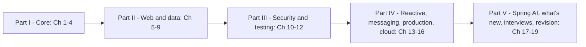

# Spring Handbook

One place to learn Spring from your first Boot application to confident production work on the back end, and to prepare for Spring interviews, without switching between platforms. The book targets **Spring Boot 4.1.1**, **Spring Framework 7.0** and **Java 25**, and marks version facts where they matter ("Boot 4.0", "Framework 7", "since Boot 3.2"), so you can tell what is new and what a Boot 3 code base still does differently. Each topic combines, in one explanation:
- **the official documentation**: the Spring Framework 7 and Spring Boot 4.1 reference guides and API docs (docs.spring.io), plus the Spring Security, Spring Data, Spring Kafka, Spring Cloud and Spring AI references,
- **release notes and migration guides**: the Boot 4.0 / 4.1 release notes and migration guide, the Framework 7 "What's New" pages and the spring.io blog, used to check every version fact,
- **real-world examples** from the services and tools Spring developers work with every day.

Every chapter is written for a first-time learner and defines each term the first time it appears. Every code example is a small Maven project built on `spring-boot-starter-parent` 4.1.1 whose behaviour is **proved by tests**; the **real output** of `mvn verify` appears under the code. Every chapter was independently reviewed for accuracy.

> Personal study notes, written in my own words. Not for redistribution.

## Who it's for
| Reader | What you get |
|---|---|
| Java developers new to Spring | Spring taught from zero (Ch 1–7): the container, configuration, proxies, REST, data access — every term defined. You need the Java basics first (see the beginner path) |
| Spring Boot 2/3 developers moving to Boot 4 | A "what changed" route: modular starters, Jackson 3, JSpecify null-safety, API versioning, HTTP service clients, `RestTestClient`, `@MockitoBean`, core `@Retryable`, Security 7's lambda-only DSL, Undertow removal (Ch 17 plus the sections it links to) |
| Back-end and microservices developers | JPA and transactions done right, caching, security with JWT/OAuth2, WebFlux vs virtual threads (measured), Kafka with dead-letter topics and outbox, Actuator/Micrometer/tracing, Spring Cloud Gateway and Resilience4j (Ch 7–16) |
| Interview candidates | 168 Spring interview questions, each linked to the section that teaches it, five "tricky answer" proofs, a project walkthrough template and debugging scenarios (Ch 18); cheat sheets with machine-checked defaults and a 343-term glossary (Ch 19) |

## How to use it
Every topic follows the same rhythm: *what it is → why it matters → how it works → code with real output → trade-offs → common mistakes → real-world use → in the interview → self-check → TL;DR*. To review, skim the TL;DRs. To check you really learned a topic, answer the self-check questions without looking back.

**Beginner path (you know Java, not Spring):**
0. **Java first.** Spring leans on classes and interfaces, annotations, generics, lambdas, records, exceptions and a little concurrency. If these are shaky, work through the [Java Handbook](../java/README.md) Ch 1–12 first (Ch 14–15 before Spring's async and virtual-thread sections), and [Java Ch 18](../java/chapters/18-testing-build-and-tooling/README.md) for Maven and JUnit.
1. **Ch 1 → 2 → 3 → 4**: the first app, the container and dependency injection, configuration and auto-configuration, proxies. These four explain almost every "Spring magic" question later.
2. **Ch 5 → 6 → 7 → 8**: build a REST API, call other APIs, then store data with JDBC, transactions and JPA. Keep the [SQL Handbook](../sql/README.md) nearby for Ch 7–8.
3. **Ch 10 → 12**: secure and test what you built. Then pick the back-end path below. Keep Ch 19 open as a quick reference.

**Spring Boot developer upgrading to Boot 4:**
1. **Ch 17 §17.12–17.16** first: the Boot 3 → 4 migration table (starters, Jackson 3, testing, null-safety, property renames), Framework 6 → 7, Security 6 → 7, and what Boot 4.1 adds.
2. Then the sections those tables link to: modularization (§3.14), Jackson 3 (§5.5), API versioning (§5.9), HTTP service interfaces (§6.6), JSpecify (§2.13), `BeanRegistrar` (§2.14), core resilience (§4.7), `RestTestClient` and test starters (§12.3, §12.9), the Security 7 DSL (§10.3).
3. Check yourself with the **§19.13** migration checklist.

**Back-end and microservices path:**
1. Data: **Ch 7** (transactions and their pitfalls, proved on PostgreSQL), **Ch 8** (N+1, locking, Flyway), **Ch 9** (Data JDBC, MongoDB/Redis, caching).
2. Security: **Ch 10–11** (filter chain, CSRF/CORS, JWT resource servers, OAuth2 login, BFF).
3. Concurrency and messaging: **Ch 13** (Reactor, WebFlux, R2DBC, a measured WebFlux-vs-virtual-threads comparison), **Ch 14** (`@Async`, `@Scheduled`, Kafka, outbox, RabbitMQ).
4. Running it: **Ch 15** (Actuator, metrics, tracing, structured logs, graceful shutdown, AOT cache, native images), **Ch 16** (Config Server, discovery, Gateway, Resilience4j, contract tests). Pair Ch 16 with the [microservices patterns notes](../microservices-patterns/00-index.md).

**Interview path (you already use Spring):**
1. Skim the TL;DRs of Ch 2–4, 7 and 10 (DI, auto-configuration, proxies, transactions, security) — most "why doesn't this work?" questions live there.
2. Work through **Ch 18**: answer each question out loud before reading the answer; follow the link when an answer surprises you. Practise the §18.16 project walkthrough and the §18.17 debugging scenarios.
3. The night before, review with **Ch 19** (annotations, properties, starters, propagation table, §19.14 interview index, glossary).



## Versions
Everything is pinned by one number: the parent `spring-boot-starter-parent` **4.1.1**. Its BOM (`spring-boot-dependencies-4.1.1`) chooses the rest:

| Component | Version in the Boot 4.1.1 BOM |
|---|---|
| Java | 17 minimum; this book compiles with `<java.version>25</java.version>` and runs on JDK 25+ |
| Spring Framework | 7.0.9 (Jakarta EE 11: Servlet 6.1, JPA 3.2, Bean Validation 3.1) |
| Spring Security | 7.1.1 (Authorization Server now included) |
| Spring Data | 2026.0 release train (JPA, JDBC, MongoDB, Redis, R2DBC, REST) |
| Hibernate ORM / Hibernate Validator | 7.4.5 / 9.1.3 |
| Jackson | 3.1.5 (`tools.jackson.*`; annotations stay in `com.fasterxml.jackson.annotation`) |
| Tomcat / Jetty | 11.0.24 / 12.1.12 (Undertow removed in Boot 4) |
| HikariCP / H2 / PostgreSQL JDBC | 7.0.2 / 2.4.240 / 42.7.13 |
| Reactor | 2025.0 train (Reactor Core 3.8) |
| Micrometer / Micrometer Tracing / OpenTelemetry | 1.17.1 / 1.7.1 / 1.62.0 |
| Spring for Apache Kafka / kafka-clients / Spring AMQP | 4.1.1 / 4.2.1 / 4.1.1 |
| Flyway / Liquibase | 12.4.0 / 5.0.3 |
| JUnit / Mockito / AssertJ / Awaitility | 6.0.3 / 5.23.0 / 3.27.7 / 4.3.0 |
| Testcontainers | 2.0.5 |
| Caffeine / Lettuce | 3.2.4 / 7.5.2 |
| **Not in the Boot BOM** (import their own BOM or set a version) | Spring Cloud 2025.1.x "Oakwood" (2025.1.2+ for Boot 4.1), Spring AI 2.0.x, springdoc-openapi 3.x, Resilience4j `resilience4j-spring-boot4` 2.4.0 |

Details and links per component: [§19.2](chapters/19-cheatsheet-and-glossary/README.md#192-versions-at-a-glance).

## What's in here
| Path | Purpose |
|---|---|
| `Spring-Handbook.pdf` | The whole book as one PDF, with a cover and a table of contents (built by `tools/regen_pdfs.sh`). |
| `interview/Spring-Interview-Edition.pdf` | **Interview Edition** (~18k words, 41 pages): every chapter's must-know terms, comparison tables, top questions and gotchas for fast revision. Source: `interview/INTERVIEW.md`. |
| `chapters/NN-name/README.md` + `ChapterNN-Notes.pdf` | One chapter (Markdown source and its PDF). |
| `chapters/NN-name/code/<project>/` | Runnable examples: one small Maven project per topic group, with tests that print and assert what the chapter shows. |
| `tools/` | `regen_pdfs.sh` (rebuild all PDFs) and `md2pdf.mjs` (Markdown → PDF). See [tools/README.md](tools/README.md). |

## Chapters
| # | Chapter | In one line | PDF |
|---|---|---|---|
| **Part I — Core** | | | |
| 01 | [The Spring Ecosystem and Your First App](chapters/01-spring-ecosystem-and-first-app/README.md) | What Spring and Boot are, the ecosystem, history and versions, start.spring.io, project layout, starters, `@SpringBootApplication`, running, DevTools, a first REST endpoint and its tests | `Chapter01-Notes.pdf` |
| 02 | [IoC and Dependency Injection](chapters/02-ioc-and-dependency-injection/README.md) | The container, defining beans, injection types, how Spring picks a bean, scopes, the lifecycle, post-processors, circular dependencies, lazy init, `@Conditional` and profiles, events, JSpecify, `BeanRegistrar` | `Chapter02-Notes.pdf` |
| 03 | [Configuration and Auto-configuration](chapters/03-configuration-and-auto-configuration/README.md) | Property sources and precedence (proved), relaxed binding, `@Value` vs `@ConfigurationProperties`, profiles, config import, how auto-configuration and its conditions work, a custom starter, Boot 4 modularization | `Chapter03-Notes.pdf` |
| 04 | [AOP and Proxies](chapters/04-aop-and-proxies/README.md) | AOP vocabulary, `@Aspect` and pointcuts, JDK vs CGLIB proxies, proxy limitations proved (self-invocation and friends), features built on proxies, Framework 7 `@Retryable` and `@ConcurrencyLimit` | `Chapter04-Notes.pdf` |
| **Part II — Web and data** | | | |
| 05 | [Spring MVC and REST APIs](chapters/05-spring-mvc-and-rest/README.md) | `DispatcherServlet` flow, controllers and mappings, Jackson 3, validation, Problem Details (RFC 9457), content negotiation, Framework 7 API versioning, CORS, uploads, filters vs interceptors, springdoc | `Chapter05-Notes.pdf` |
| 06 | [REST Clients and HTTP Interfaces](chapters/06-rest-clients-and-http-interfaces/README.md) | Choosing a client, `RestClient`, error handling, timeouts, interceptors, `@HttpExchange` service interfaces and Boot 4 client groups, client-side versioning and retries, testing clients, `RestTemplate`/`WebClient` status | `Chapter06-Notes.pdf` |
| 07 | [Data Access with JDBC and Transactions](chapters/07-data-access-jdbc-and-transactions/README.md) | `DataSource` and HikariCP, `JdbcClient`, schema init, exception translation, how `@Transactional` works, propagation (all seven), rollback rules, isolation, pitfalls, `TransactionTemplate` — on real PostgreSQL | `Chapter07-Notes.pdf` |
| 08 | [Spring Data JPA and Hibernate](chapters/08-spring-data-jpa-and-hibernate/README.md) | Entities and ids, the persistence context, relationships, fetch types, N+1 measured and fixed, repositories and queries, pagination, projections, auditing, locking, open-in-view, Flyway | `Chapter08-Notes.pdf` |
| 09 | [Spring Data beyond JPA, and Caching](chapters/09-spring-data-beyond-jpa-and-caching/README.md) | The Spring Data family, Data JDBC aggregates, Data REST, Flyway vs Liquibase, MongoDB and Redis, the caching abstraction and its pitfalls, choosing a data technology | `Chapter09-Notes.pdf` |
| **Part III — Security and testing** | | | |
| 10 | [Spring Security 1: Fundamentals](chapters/10-spring-security-1-fundamentals/README.md) | The filter chain, the Security 7 lambda DSL, authentication, password hashing, authorization and 401 vs 403, method security, CSRF, CORS, sessions, headers, `spring-security-test` | `Chapter10-Notes.pdf` |
| 11 | [Spring Security 2: Tokens and OAuth2](chapters/11-spring-security-2-tokens-and-oauth2/README.md) | JWT and bearer tokens, OAuth 2.0/OIDC, a JWT resource server, claims to authorities, opaque tokens, multi-tenancy, OAuth2 login, token relay, refresh and revocation, the BFF pattern, Authorization Server, rate limiting | `Chapter11-Notes.pdf` |
| 12 | [Testing Spring Applications](chapters/12-testing-spring-apps/README.md) | The test pyramid, Boot 4 test starters, unit tests, `@SpringBootTest`, slices, `MockMvcTester`, `RestTestClient`, `@MockitoBean`, context caching measured, `@DynamicPropertySource`, Testcontainers and `@ServiceConnection` | `Chapter12-Notes.pdf` |
| **Part IV — Reactive, messaging, production and cloud** | | | |
| 13 | [Reactive Programming and Spring WebFlux](chapters/13-reactive-and-webflux/README.md) | Reactive Streams, `Mono`/`Flux` and operators, `StepVerifier`, errors, backpressure, schedulers, WebFlux controllers and functional routes, SSE, `WebClient`, R2DBC, virtual threads vs WebFlux measured | `Chapter13-Notes.pdf` |
| 14 | [Messaging, Async and Scheduling](chapters/14-messaging-async-and-scheduling/README.md) | Events and `@TransactionalEventListener`, `@Async` and executors (virtual threads), `@Scheduled`, Kafka producers/consumers/`@EmbeddedKafka`, dead-letter topics, `@RetryableTopic`, idempotence and transactions, the outbox, RabbitMQ | `Chapter14-Notes.pdf` |
| 15 | [Observability and Production](chapters/15-observability-and-production/README.md) | Actuator, health groups and probes, Micrometer metrics, the Observation API, tracing, structured logging, graceful shutdown, virtual threads, extracted jars/AOT cache/native images, a production checklist | `Chapter15-Notes.pdf` |
| 16 | [Spring Cloud and Microservices](chapters/16-spring-cloud-and-microservices/README.md) | Release trains, Config Server, discovery (Eureka, Consul, Kubernetes), LoadBalancer, OpenFeign vs HTTP interface clients, Gateway, Resilience4j breaker/retry/rate limiter, tracing across services, contract testing | `Chapter16-Notes.pdf` |
| **Part V — What's new, interviews and revision** | | | |
| 17 | [Spring AI and What's New in Boot 4 / Framework 7](chapters/17-spring-ai-and-whats-new/README.md) | Spring AI 2.0 (`ChatClient`, prompts, advisors, memory, structured output, tools, RAG, MCP) tested offline with a fake model; Boot 3 → 4, Framework 6 → 7 and Security 6 → 7 migration tables; what Boot 4.1 adds | `Chapter17-Notes.pdf` |
| 18 | [Spring Interview Questions](chapters/18-spring-interview-questions/README.md) | 168 questions from core to production, each linked to its teaching section; five tricky answers proved by tests; an "explain your project" template; debugging scenarios | `Chapter18-Notes.pdf` |
| 19 | [Cheat Sheet and Glossary](chapters/19-cheatsheet-and-glossary/README.md) | Versions, annotations, starters, key properties, `@Transactional`, scopes, Security DSL snippets, test slices, Reactor operators, Actuator endpoints, tool choice, migration checklist, interview index, machine-checked proofs, 343-term glossary | `Chapter19-Notes.pdf` |

Each chapter's PDF sits next to its README: `chapters/NN-name/ChapterNN-Notes.pdf`.

## Colour code (in the PDFs)
Section headings are coloured by their role, so you can scan a page for the part you need:

| Colour | Headings |
|---|---|
| Green | **What it is**, analogies, overviews |
| Red / coral | **The problem it solves** |
| Blue | **How it works**, walkthroughs |
| Amber | **Trade-offs**, comparisons, **When not to use it** |
| Bright red | **Common mistakes**, pitfalls |
| Violet | **Real-world examples** |
| Pink | **In the interview**, 30-second answers (boxed), follow-ups |
| Teal | **Self-check** |
| Yellow | **TL;DR** (boxed) |

Code blocks are syntax-highlighted, and Mermaid diagrams are rendered as images.

## Running the code
Every example is a Maven project with `spring-boot-starter-parent` **4.1.1** as its parent and `<java.version>25</java.version>`. You need **JDK 25 or newer** and **Maven 3.6.3 or newer** (the outputs in the book come from OpenJDK 26 and Maven 3.9.14); dependencies come from Maven Central (cached in `~/.m2`). The tests are the demos: they print what the chapter shows and assert it. The shared runner lives one level up, in the notes root.

```bash
# from the notes root — build and test every project (OK / FAIL / SKIP per project)
bash tools_run_spring.sh spring

# only some chapters (second argument = chapter glob)
bash tools_run_spring.sh spring '07-*'
bash tools_run_spring.sh spring '1[0-2]-*'

# one project by hand
cd spring/chapters/08-spring-data-jpa-and-hibernate/code/jpa-demos
mvn -q -B -ntp verify
```
- **What the runner does:** for every `chapters/*/code/*/pom.xml` it runs `mvn -q -B -ntp verify` (ten-minute limit each) and prints the last lines of the log on failure. Test classes are named `*Tests`/`*Test`, so Surefire runs them.
- **Databases:** most examples use in-memory **H2**. Chapter 7's `tx-demos` uses a real **PostgreSQL** — the notes' private server on `jdbc:postgresql://127.0.0.1:5544/`, user `postgres`, no password. Start it from the notes root with `bash tools_pg.sh start` before running Chapter 7. The tests create their own `spring_ch07_*` database and drop it afterwards; no other server is touched.
- **Kafka** (Chapter 14) runs on an in-process broker with `@EmbeddedKafka` — no Docker needed.
- **Not run here (Docker or an external service needed)** — these projects contain a `.tools_run_skip` file; the runner skips them, and they were checked with `mvn -q compile`:
  - `09-spring-data-beyond-jpa-and-caching/code/nosql` — MongoDB and Redis through Testcontainers.
  - `12-testing-spring-apps/code/testcontainers-demo` — PostgreSQL through Testcontainers and `@ServiceConnection`.
  - `14-messaging-async-and-scheduling/code/rabbit-orders` — needs a running RabbitMQ broker.
  - Also shown as configuration only: container images with buildpacks and GraalVM native images (Ch 15), Eureka/Consul and Spring Cloud Contract (Ch 16), a real IdP for OAuth2 login (Ch 11), and real LLM providers (Ch 17 — everything above the model runs against a fake `ChatModel`).
- **Extra script:** `chapters/15-observability-and-production/code/aot-cache-demo.sh` compares startup time of a fat jar, an extracted jar and an extracted jar with a JDK AOT cache (JDK 25+).
- At the last full run: **40 OK, 3 SKIP, 0 FAIL** (43 projects).

Timings (startup, request rates, cache hits) depend on the machine; the chapters that measure things say what they ran on (an Apple M4 Pro, macOS). Your numbers will differ, but the pattern should not. `target/` folders are not kept — the first build recreates them.

## Rebuilding the PDFs
Requires Node 18+ and Google Chrome (the path is set in `tools/md2pdf.mjs`). The script installs `tools/node_modules` on first run.

```bash
bash tools/regen_pdfs.sh      # every ChapterNN-Notes.pdf + Spring-Handbook.pdf (cover title "Spring Handbook")

# one chapter only
node tools/md2pdf.mjs chapters/07-data-access-jdbc-and-transactions/Chapter07-Notes.pdf chapters/07-data-access-jdbc-and-transactions/README.md
```
`md2pdf.mjs` reports any Mermaid errors or broken images.

## Sources
- **Reference documentation (docs.spring.io):** the Spring Framework 7.0 and Spring Boot 4.1 reference guides, API docs and the Boot "Common Application Properties" appendix; the Spring Security 7, Spring Data (JPA, JDBC, MongoDB, Redis, R2DBC, REST), Spring for Apache Kafka, Spring AMQP, Spring Cloud (Config, Gateway, OpenFeign, LoadBalancer, Contract) and Spring AI references; Project Reactor's reference guide.
- **Release notes and migration guides:** the Spring Boot 4.0 and 4.1 release notes and the Boot 4.0 migration guide (GitHub wiki), the Spring Framework 7 "What's New" and upgrade notes, Spring Security 7 migration notes, the Spring Cloud release-train compatibility table and the **spring.io blog** announcements, used to verify every "since" label and version number.
- **Other official docs:** Hibernate ORM 7 user guide, Jackson 3 release notes, Micrometer and OpenTelemetry docs, Resilience4j, springdoc-openapi, Testcontainers, Flyway, the relevant JEPs (openjdk.org/jeps) and RFCs (RFC 9457 Problem Details, OAuth 2.0/OIDC, JWT).
- **The metadata in the jars themselves:** property names, defaults and deprecations were checked against `spring-configuration-metadata.json` in the Boot 4.1.1 jars, and many defaults are asserted by the Chapter 19 proof tests.
- No DesignGurus course is used for this book. Everything is explained in my own words; no text is reproduced.

## Companion books
| Book | Read it for |
|---|---|
| [Java Handbook](../java/README.md) | The language underneath Spring: OOP, generics, lambdas and streams, exceptions, concurrency and virtual threads, Maven and JUnit — read it first if you are new to Java |
| [SQL Handbook](../sql/README.md) | The database side of Ch 7–9: queries, schema design, indexes, transactions and isolation levels (PostgreSQL) |
| [LLD Handbook](../lld/README.md) | Object-oriented design, SOLID and the design patterns Spring is built from (proxy, template method, factory, observer, strategy) |
| [Microservices patterns notes](../microservices-patterns/00-index.md) | Strangler fig, API gateway, BFF, service discovery, circuit breaker, bulkhead, retry, saga, event-driven, CQRS, config externalization — the designs behind Ch 14–16 |
| [System design patterns notes](../system-design-patterns/README.md) | Caching, sharding, replication, messaging and the other building blocks of the systems Spring services live in |
| [AI & GenAI Handbook](../ai/README.md) | LLMs, prompting, RAG, agents and tool use — the concepts behind Spring AI in Ch 17 |
