# Spring — Capstone Projects

## How to use this book

A **capstone** is a project big enough to force you to combine several chapters at once: the container, configuration, the web layer, data access, security, tests and operations. Reading a chapter teaches you a tool. Building a capstone teaches you when to reach for it, how it breaks, and how to explain your choice in an interview. This book holds **40 design briefs**, ordered from a weekend REST API to a multi-tenant SaaS with its own identity provider.

Every brief targets the same stack as the handbook: **Spring Boot 4.1.1** (which brings **Spring Framework 7**, Spring Security 7 and the Spring Data 2026.0 train), **Java 25**, and **Jakarta EE 11** (Servlet 6.1, JPA 3.2, Bean Validation 3.1). Projects that need libraries outside the Boot BOM (Spring Cloud 2025.1 "Oakwood", Spring AI 2.0, Spring Modulith 2.0, Resilience4j, Bucket4j, ShedLock) say so. Where a brief relies on something new in Boot 4 or Framework 7 — API versioning, HTTP service client groups, `@Retryable`/`@ConcurrencyLimit`, `RestTestClient`, Authorization Server inside Spring Security — it is labelled, and the handbook chapter that proves it is linked.

**How to pick a project.**
- New to Spring: start with projects 1–5 in order. Each adds one idea (REST, persistence, outbound HTTP, JPA, configuration).
- Comfortable with Boot 3: jump to the projects tagged with a Boot 4 / Framework 7 feature (3, 21, 33, 34) and to the testing suite (20) to learn the new APIs on something real.
- Preparing for a back-end interview: pick one project from each band and finish all milestones — interviewers ask about depth on one system much more than about breadth.
- Preparing for a senior or architect interview: do 26–40, especially the trade-off sections, and practise the "In the interview" answers aloud.

**How to use a brief.**
1. Read *What it is*, *The problem it solves* and *Requirements*. Write the non-functional numbers on a sticky note — they decide most design choices.
2. Sketch the architecture yourself before reading the diagram, then compare.
3. Build the **milestones in order**. Each has a "done when" check: do not move on until it is true and covered by a test.
4. Read *Deep dive* when you reach the hard milestone, not before — it will make more sense once you have hit the problem.
5. Only then attempt the **stretch goals**.
6. Finish by answering *In the interview* without looking, and by writing a one-page README for your project (what, why, how to run, trade-offs).

**Colour code (in the PDF).** Section headings are coloured by role, the same way as in the handbook: green for **What it is**, coral for **The problem it solves**, violet for **Real-world examples**, amber for **Trade-offs**, pink for **In the interview**, teal for **Self-check** and a yellow box for **TL;DR**. Requirements, architecture and deep-dive headings use the blue "how it works" colour.

**Level legend.**

| Level | You should already know | Typical size |
|---|---|---|
| Beginner | Java basics, one Spring Boot "hello" app (Ch 1) | 1–2 weekends, one service, H2 or PostgreSQL |
| Intermediate | Ch 1–8 and some of 9–14 | 1–3 weeks, one service plus a broker, cache or IdP |
| Advanced | most of the handbook | 2–4 weeks, several services or hard consistency, security or performance goals |

**A note on what you get.** The briefs describe **what** to build and **why** each piece is there. They deliberately contain almost no code: you write it. When a brief names a class or property, look it up in the linked chapter, read the Javadoc, and write a test that proves it behaves the way the brief claims. That is the habit the handbook teaches, and it is the habit interviewers look for.

## Project map

| # | Project | Level | Time | Prerequisites (chapters) |
|---|---|---|---|---|
| 1 | Notes REST API | Beginner | 1 weekend | Ch 1, 5, 12 |
| 2 | URL Shortener | Beginner | 1 weekend | Ch 5, 7 |
| 3 | Weather Client with RestClient and HTTP Interfaces | Beginner | 1 weekend | Ch 3, 6 |
| 4 | Todo App with Spring Data JPA | Beginner | 1–2 weekends | Ch 5, 8 |
| 5 | Config-driven Greeting Service | Beginner | 1 weekend | Ch 2, 3 |
| 6 | Scheduled Daily Sales Report | Beginner | 1 weekend | Ch 7, 14 |
| 7 | Bookstore Catalog API with Problem Details and OpenAPI | Beginner | 1–2 weekends | Ch 5, 8 |
| 8 | Expense Tracker with JdbcClient and Flyway | Beginner | 1–2 weekends | Ch 7, 8 |
| 9 | Audit-log Spring Boot Starter | Beginner | 1–2 weekends | Ch 2, 3, 4 |
| 10 | Uptime Monitor | Beginner | 1–2 weekends | Ch 6, 14, 15 |
| 11 | Blog Platform with Spring Security and JWT | Intermediate | 2 weeks | Ch 8, 10, 11 |
| 12 | Photo Journal with OAuth2 Login and a Resource Server | Intermediate | 2 weeks | Ch 10, 11 |
| 13 | E-commerce Cart and Checkout | Intermediate | 2–3 weeks | Ch 7, 8 |
| 14 | Product Catalog Cache with Redis | Intermediate | 1–2 weeks | Ch 9, 15 |
| 15 | File Upload and Media Service | Intermediate | 2 weeks | Ch 5, 6, 14 |
| 16 | Event-driven Notifications with Kafka | Intermediate | 2–3 weeks | Ch 14, 12 |
| 17 | Image Job Queue with RabbitMQ | Intermediate | 2 weeks | Ch 14 |
| 18 | Bulk CSV Import with Spring Batch | Intermediate | 2 weeks | Ch 7, 14 |
| 19 | Live Dashboard with WebFlux and SSE | Intermediate | 2 weeks | Ch 13 |
| 20 | Testcontainers Integration Test Suite | Intermediate | 1–2 weeks | Ch 12, 9, 14 |
| 21 | Versioned Public API (Framework 7) | Intermediate | 1–2 weeks | Ch 5, 6 |
| 22 | Rate-limited API with Bucket4j and Redis | Intermediate | 1–2 weeks | Ch 9, 11 |
| 23 | Concert Seat Reservation | Intermediate | 2 weeks | Ch 7, 8 |
| 24 | Webhook Delivery Service | Intermediate | 2–3 weeks | Ch 4, 6, 14 |
| 25 | Feature-flag Service | Intermediate | 2 weeks | Ch 3, 9, 13 |
| 26 | Multi-tenant SaaS Project Tracker | Advanced | 3–4 weeks | Ch 7, 8, 11 |
| 27 | Microservices Shop with Gateway, Config and Discovery | Advanced | 4 weeks | Ch 6, 16 |
| 28 | Order Saga with a Transactional Outbox | Advanced | 3–4 weeks | Ch 7, 14, 16 |
| 29 | Observability with Micrometer and OpenTelemetry | Advanced | 2–3 weeks | Ch 15, 16 |
| 30 | Spring AI RAG Documentation Assistant | Advanced | 3 weeks | Ch 17 |
| 31 | Modular Monolith with Spring Modulith | Advanced | 3 weeks | Ch 2, 14, 16 |
| 32 | GraalVM Native Image Function | Advanced | 2 weeks | Ch 3, 15 |
| 33 | Resilient Travel Search Aggregator (Framework 7 resilience) | Advanced | 2–3 weeks | Ch 4, 6, 16 |
| 34 | Identity Provider with Spring Authorization Server | Advanced | 3–4 weeks | Ch 10, 11 |
| 35 | Event-sourced Wallet Ledger with CQRS | Advanced | 4 weeks | Ch 7, 9, 14 |
| 36 | AI Support Agent with Tools and MCP | Advanced | 3 weeks | Ch 17 |
| 37 | Zero-downtime Deployments on Kubernetes | Advanced | 2–3 weeks | Ch 8, 15 |
| 38 | Distributed Job Scheduler | Advanced | 3 weeks | Ch 7, 14 |
| 39 | Payments API with Idempotency Keys | Advanced | 3 weeks | Ch 5, 7, 14 |
| 40 | Backend-for-Frontend with Token Relay | Advanced | 3 weeks | Ch 6, 11, 16 |

## 1. Notes REST API
**Level:** Beginner · **Time:** 1 weekend · **Prerequisites:** Ch 1, Ch 5, Ch 12

### What it is
A small HTTP service that lets a client create, read, update, delete and search short text notes. It is the "hello world" of back-end work, but done properly: correct status codes, input validation, consistent error bodies, pagination, and tests that prove every behaviour. A **REST API** (Representational State Transfer) is an API where each URL names a *resource* (here `/api/notes/42`) and the HTTP method says what to do with it (`GET` reads, `POST` creates, `PUT` replaces, `PATCH` changes part, `DELETE` removes).

### The problem it solves
Almost every Spring job starts with "add an endpoint". Doing that well needs a surprising number of decisions: what status code to return when a note is missing, what a validation error looks like, how a client pages through 10,000 notes, and how to test all of it quickly. This project builds the reflexes once, on a domain so simple that the only hard part is the craft.

### Real-world examples
- The official [Spring tutorial "Building REST services with Spring"](https://spring.io/guides/tutorials/rest) walks through the same controller-service-repository shape and status codes you will use here.
- The [Spring "Building a RESTful Web Service" guide](https://spring.io/guides/gs/rest-service) is the smallest possible version; compare it with your finished project to see what "production-shaped" adds.

### Requirements
**Functional**
- `POST /api/notes` creates a note (`title` 1–100 characters, `body` up to 10,000 characters, optional `tags`) and returns **201 Created** with a `Location` header.
- `GET /api/notes/{id}` returns one note or **404**. `GET /api/notes?q=&tag=&page=&size=` lists notes, newest first, filtered by text and tag.
- `PUT /api/notes/{id}` replaces, `DELETE /api/notes/{id}` returns **204 No Content**.
- Every error uses **Problem Details** (RFC 9457): a JSON body with `type`, `title`, `status`, `detail`.

**Non-functional**
- p95 latency under 50 ms for a list of 20 notes on a laptop with in-memory storage.
- Page size capped at 100, so no request can ask for the whole table.
- Full test suite (unit + web slice) runs in under 10 seconds.

### The architecture
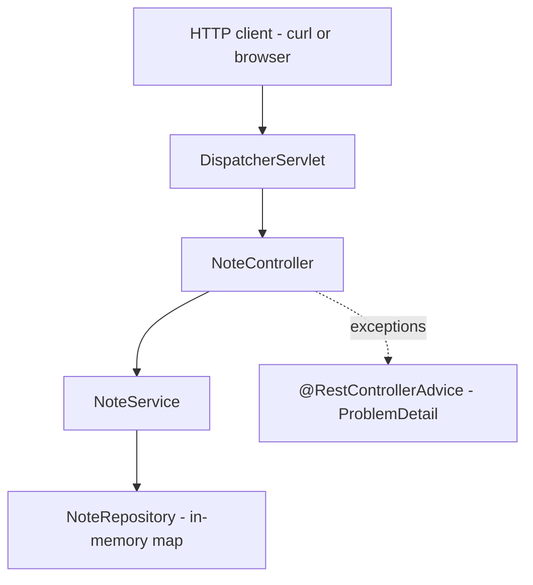
- **DispatcherServlet** — Spring MVC's front controller: one servlet that receives every request and routes it to the right handler method.
- **NoteController** — a `@RestController` that maps URLs to methods, binds JSON to Java records and returns `ResponseEntity` with the right status.
- **NoteService** — the business rules (trim titles, stamp timestamps, enforce limits). Keeping them out of the controller makes them unit-testable without HTTP.
- **NoteRepository** — an interface with one in-memory implementation (`ConcurrentHashMap`). Project 4 swaps it for Spring Data JPA without touching the controller.
- **Exception handler** — a `@RestControllerAdvice` that turns `NoteNotFoundException` into a 404 `ProblemDetail`.

### Data model
| Type | Fields | Notes |
|---|---|---|
| `Note` (record) | `id: long`, `title`, `body`, `tags: Set<String>`, `createdAt`, `updatedAt: Instant` | immutable; updates create a new record |
| `CreateNoteRequest` | `title`, `body`, `tags` | carries Bean Validation annotations (`@NotBlank`, `@Size`) |
| `Page<Note>`-like response | `content`, `page`, `size`, `totalElements` | your own record, so the JSON shape is stable |

### Tech stack
| Component | Choice | Why |
|---|---|---|
| Web | `spring-boot-starter-webmvc` (Boot 4 name for the old `-web`) | Servlet stack, Jackson 3 JSON included |
| Validation | `spring-boot-starter-validation` | Hibernate Validator 9 implements Bean Validation 3.1 |
| Tests | `spring-boot-starter-webmvc-test` | `@WebMvcTest`, `MockMvcTester`, `RestTestClient` |
| Ids | `AtomicLong` | simplest correct generator for one process |

### Milestones
1. **Skeleton.** Generate the project on start.spring.io with Boot 4.1.1 and Java 25; add a `GET /api/notes` returning an empty list. *Done when* `mvn verify` passes and `curl` prints `[]`.
2. **CRUD.** Add create/read/update/delete with correct statuses. *Done when* a `@WebMvcTest` asserts 201 + `Location`, 200, 204 and 404.
3. **Validation and errors.** Add `@Valid` and a `@RestControllerAdvice`. *Done when* an empty title returns 400 with a Problem Details body naming the field.
4. **Search and pagination.** Add `q`, `tag`, `page`, `size`. *Done when* a test with 25 notes shows page 2 of size 10 returns notes 11–20 in newest-first order.
5. **Full-stack test.** One `@SpringBootTest(webEnvironment = RANDOM_PORT)` test using `RestTestClient` (new in Framework 7) exercises the whole flow. *Done when* it passes in CI.

### Deep dive: the hard parts
- **201 and the `Location` header.** A create should tell the client where the new resource lives. Build it with `ServletUriComponentsBuilder.fromCurrentRequest().path("/{id}")` so it works behind any context path. Return `ResponseEntity.created(uri).body(note)`.
- **PUT vs PATCH.** `PUT` replaces the whole resource, so a missing `tags` field means "no tags". `PATCH` changes only the fields sent. Mixing them up is a classic bug: clients that send partial `PUT`s silently wipe data. Pick one meaning per endpoint and test it.
- **Thread safety of the in-memory store.** Two simultaneous `PUT`s can interleave. `ConcurrentHashMap.compute` makes "read, change, write" atomic for one key. Plain `get` then `put` does not.
- **Stable error shape.** Spring Boot can produce `ProblemDetail` for its own exceptions (`spring.mvc.problemdetails.enabled=true`). Your own exceptions need a handler. Add a `type` URI per error kind so clients can switch on it rather than parse text.

### Testing strategy
- **Unit tests** for `NoteService` with a fake repository — no Spring context, milliseconds each.
- **Web slice** (`@WebMvcTest(NoteController.class)` + `@MockitoBean NoteService`) for status codes, JSON shape and validation messages. `@MockitoBean` replaced the removed `@MockBean` in Boot 4.
- **One full-stack test** with `RestTestClient` on a random port to prove the pieces are wired together.

### Trade-offs, scaling and failure modes
- In-memory storage loses everything on restart and cannot be shared by two instances; it is fine here because the repository interface hides it.
- Offset pagination (`page=500`) gets slower as the offset grows in a real database; keyset ("give me notes older than this id") pagination scales better. Note it for project 4.
- Text search with `contains` is O(n). Beyond a few thousand notes you want a database index or a search engine.

### Stretch goals
- Add `ETag` headers and support `If-None-Match` (304 Not Modified) on `GET /api/notes/{id}`.
- Add `PATCH` with JSON Merge Patch (RFC 7396).
- Publish an OpenAPI document with springdoc-openapi (its Boot 4 line) and browse it in Swagger UI.

### Skills practised
- [Ch 1 — The Spring ecosystem and your first app](../chapters/01-spring-ecosystem-and-first-app/README.md): project layout, starters, running.
- [Ch 5 — Spring MVC and REST APIs](../chapters/05-spring-mvc-and-rest/README.md): mappings, `ResponseEntity`, validation, Problem Details.
- [Ch 12 — Testing Spring applications](../chapters/12-testing-spring-apps/README.md): `@WebMvcTest`, `MockMvcTester`, `RestTestClient`, `@MockitoBean`.

### In the interview
**Q:** Why return 201 instead of 200 on create? / **A:** 201 tells the client a new resource exists, and the `Location` header says where. Clients and caches can act on that without parsing the body.

**Q:** Where does validation happen and what does the client see? / **A:** `@Valid` on the request body triggers Bean Validation before the method runs. A `MethodArgumentNotValidException` becomes a 400 Problem Details response listing the failing fields.

**Q:** Why separate controller and service in such a small app? / **A:** The controller deals with HTTP; the service deals with rules. That lets me unit-test the rules without HTTP and swap the web layer or storage independently.

**Q:** How do you test a controller without starting the whole app? / **A:** `@WebMvcTest` starts only the MVC slice; I replace the service with `@MockitoBean` and assert with `MockMvcTester`.

### TL;DR
A tiny CRUD API built the right way: correct status codes, validated input, Problem Details errors, pagination and three layers of tests — the template every later project reuses.

## 2. URL Shortener
**Level:** Beginner · **Time:** 1 weekend · **Prerequisites:** Ch 5, Ch 7

### What it is
A service that turns a long URL into a short code (`https://sho.rt/aZ3k9`) and **redirects** anyone who visits the short link to the original. It also counts clicks. A **redirect** is an HTTP response with status 301, 302, 307 or 308 and a `Location` header; the browser follows it automatically.

### The problem it solves
Long links break in emails, are hard to type and leak tracking parameters. Shorteners make links short, editable and measurable. As a learning project it is ideal: two endpoints, a real database table, a uniqueness problem, and a read-heavy workload that makes you think about indexes and caching.

### Real-world examples
- [Kutt](https://github.com/thedevs-network/kutt) is an open-source shortener with custom domains, link statistics and a REST API — a good reference for the feature list.
- [YOURLS](https://github.com/YOURLS/YOURLS) is a long-lived self-hosted shortener; its plugin system shows which features users actually ask for (custom keywords, expiry, stats).

### Requirements
**Functional**
- `POST /api/links {url, customCode?, expiresAt?}` → 201 with the short code and short URL.
- `GET /{code}` → redirect to the target, or 404 if unknown, or 410 Gone if expired.
- `GET /api/links/{code}/stats` → total clicks and clicks per day for the last 30 days.
- Reject non-HTTP(S) targets and URLs longer than 2,048 characters.

**Non-functional**
- Redirect p95 under 20 ms with a warm cache; reads outnumber writes about 100 to 1.
- Codes of 7 characters from a 62-symbol alphabet (`[0-9a-zA-Z]`) give 62^7, about 3.5 trillion codes.
- A click must never block the redirect: counting is best-effort.

### The architecture
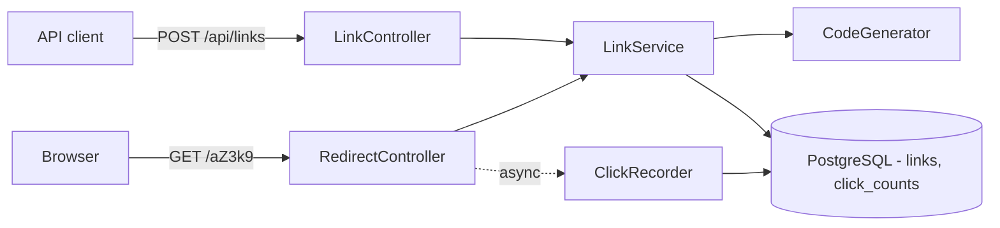
- **RedirectController** — handles `GET /{code}` and returns `302 Found` (or `301`, see deep dive) with `Location`.
- **LinkController** — the JSON API for creating links and reading stats.
- **LinkService** — validates URLs, generates or checks custom codes, enforces expiry.
- **CodeGenerator** — produces candidate codes (random base62 or an encoded sequence).
- **ClickRecorder** — increments counters off the request path (an `@Async` method or a batched in-memory counter flushed every few seconds).
- **PostgreSQL** — the system of record, accessed with `JdbcClient`.

### Data model
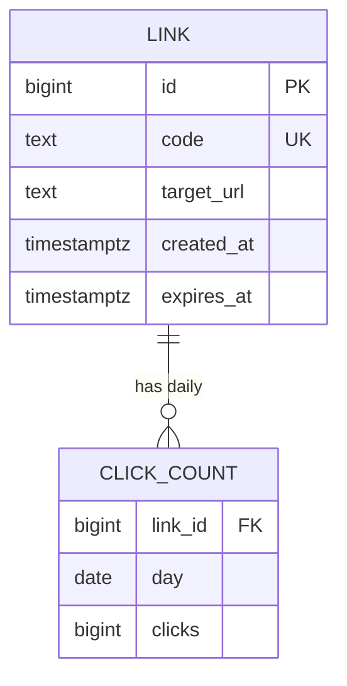
`CLICK_COUNT` has a composite primary key (`link_id`, `day`) so each day's counter is one row updated with `INSERT ... ON CONFLICT DO UPDATE SET clicks = clicks + ?` — an **upsert**, meaning insert-or-update in one atomic statement.

### Tech stack
| Component | Choice | Why |
|---|---|---|
| Web | `spring-boot-starter-webmvc` | redirects are plain MVC responses |
| Data | `spring-boot-starter-jdbc` + `JdbcClient` | two tables, hand-written SQL is clearer than an ORM |
| Database | PostgreSQL (H2 in tests is acceptable here) | unique index on `code`, `ON CONFLICT` upserts |
| Async | `@EnableAsync` + virtual threads | click counting off the request thread |

### Milestones
1. **Create and redirect.** Random 7-character codes stored in a table with a unique index. *Done when* a test creates a link and `GET /{code}` returns 302 with the right `Location`.
2. **Collisions and custom codes.** Retry generation on a unique-key violation (`DuplicateKeyException`); return 409 Conflict if a custom code is taken. *Done when* a test forces a collision with a fake generator and still succeeds.
3. **Validation and expiry.** Reject `javascript:` URLs, enforce length, return 410 for expired links. *Done when* each case has a test.
4. **Click stats.** Asynchronous counter with daily rows. *Done when* 1,000 parallel redirects in a test produce exactly 1,000 counted clicks after the flush.
5. **Cache hot links.** Add `@Cacheable("links")` with Caffeine for code → target lookups. *Done when* a test shows the second redirect does not hit the database.

### Deep dive: the hard parts
- **Generating unique codes.** Random codes are simple and unguessable, but can collide; the unique index is the real guarantee, and the code retries on `DuplicateKeyException` (Spring's translated exception from [Ch 7](../chapters/07-data-access-jdbc-and-transactions/README.md)). The alternative — base62-encoding a database sequence — never collides but makes codes guessable and sequential, which leaks how many links you have.
- **301 vs 302.** A 301 (Moved Permanently) is cached by browsers forever, so later clicks never reach you: fast, but you lose counts and cannot change the target. A 302 (Found) reaches you every time. Most shorteners that sell analytics use 302 or 307.
- **Counting without slowing redirects.** Writing a row per click doubles database writes. Buffer counts in a `ConcurrentHashMap<String, LongAdder>` and flush every 5 seconds with a `@Scheduled` method using one batched upsert. You trade at most 5 seconds of counts on a crash for far fewer writes.
- **Open-redirect abuse.** A shortener is literally an open redirect. Validate schemes, optionally check targets against a blocklist, and never let a code point back at your own admin pages.

### Testing strategy
- Unit tests for `CodeGenerator` (alphabet, length) and URL validation (table-driven with JUnit `@ParameterizedTest`).
- `@JdbcTest` for the repository SQL, including the upsert.
- `@SpringBootTest` with `RestTestClient` configured **not** to follow redirects, asserting status and `Location`.
- A concurrency test with virtual threads for the click counter.

### Trade-offs, scaling and failure modes
- One PostgreSQL instance easily serves thousands of redirects per second with an index on `code`; a cache in front removes most reads. Beyond that, read replicas or a key-value store.
- Losing buffered clicks on a crash is the price of cheap counting — acceptable for analytics, not for billing.
- A cache entry for an edited or deleted link must be evicted (`@CacheEvict`), or users are redirected to the old target until the entry expires.

### Stretch goals
- Per-user API keys and a "my links" page.
- QR-code generation for each link.
- Bot filtering: do not count requests whose `User-Agent` matches known crawlers.

### Skills practised
- [Ch 5 — Spring MVC and REST APIs](../chapters/05-spring-mvc-and-rest/README.md): redirects, validation, status codes.
- [Ch 7 — Data access with JDBC and transactions](../chapters/07-data-access-jdbc-and-transactions/README.md): `JdbcClient`, exception translation, upserts.
- [Ch 9 — Spring Data beyond JPA, and caching](../chapters/09-spring-data-beyond-jpa-and-caching/README.md): `@Cacheable`, eviction.
- [Ch 14 — Messaging, async and scheduling](../chapters/14-messaging-async-and-scheduling/README.md): `@Async`, `@Scheduled`.

### In the interview
**Q:** How do you guarantee short codes are unique? / **A:** A unique index on the code column is the guarantee; the application generates random codes and retries on a duplicate-key exception. Checking "does it exist?" first is not enough because two requests can race.

**Q:** 301 or 302? / **A:** 302 if I need analytics or may change the target, because browsers cache 301 permanently.

**Q:** How would you scale redirects to 50,000 per second? / **A:** Cache code-to-URL in memory and in a shared cache, serve from many stateless instances behind a load balancer, and count clicks asynchronously in batches or via a log like Kafka.

### TL;DR
Two endpoints, one unique index and a buffered counter teach collision handling, redirect semantics, read-heavy caching and asynchronous side effects.

## 3. Weather Client with RestClient and HTTP Interfaces
**Level:** Beginner · **Time:** 1 weekend · **Prerequisites:** Ch 3, Ch 6

### What it is
A service that answers `GET /api/weather?city=Lisbon` by calling a public weather API, converting the answer into a clean domain object, and caching it briefly. It is built twice: first with **`RestClient`** (Spring's fluent, blocking HTTP client) and then with an **HTTP service interface** — a plain Java interface annotated with `@GetExchange` that Spring turns into a working client. Boot 4 can create those clients for you from properties through `@ImportHttpServices` "groups" (new in Framework 7 / Boot 4).

### The problem it solves
Calling other services is half of back-end work, and it is where most production incidents start: no timeout, an unexpected 500, a slow dependency that ties up every thread. This project teaches the client side properly — base URLs in configuration, timeouts, error mapping, retries for transient failures, and tests that do not touch the real internet.

### Real-world examples
- [Open-Meteo](https://open-meteo.com/en/docs) is a free weather API without API keys for non-commercial use, ideal for this project (geocoding plus forecast endpoints).
- The [Spring Framework REST clients reference](https://docs.spring.io/spring-framework/reference/integration/rest-clients.html) documents `RestClient`, HTTP service interfaces and the client groups you will configure.

### Requirements
**Functional**
- `GET /api/weather?city=` resolves the city to coordinates (geocoding call) and returns current temperature, wind and a short description.
- Unknown city → 404 Problem Details. Upstream failure → 503 with a `Retry-After` header.
- Results cached per city for 10 minutes.

**Non-functional**
- Connect timeout 1 s, read timeout 2 s: a slow upstream must not hold a thread longer.
- At most 2 retries on connection errors or 503, with back-off; never retry 4xx.
- p95 under 30 ms for cached cities.

### The architecture
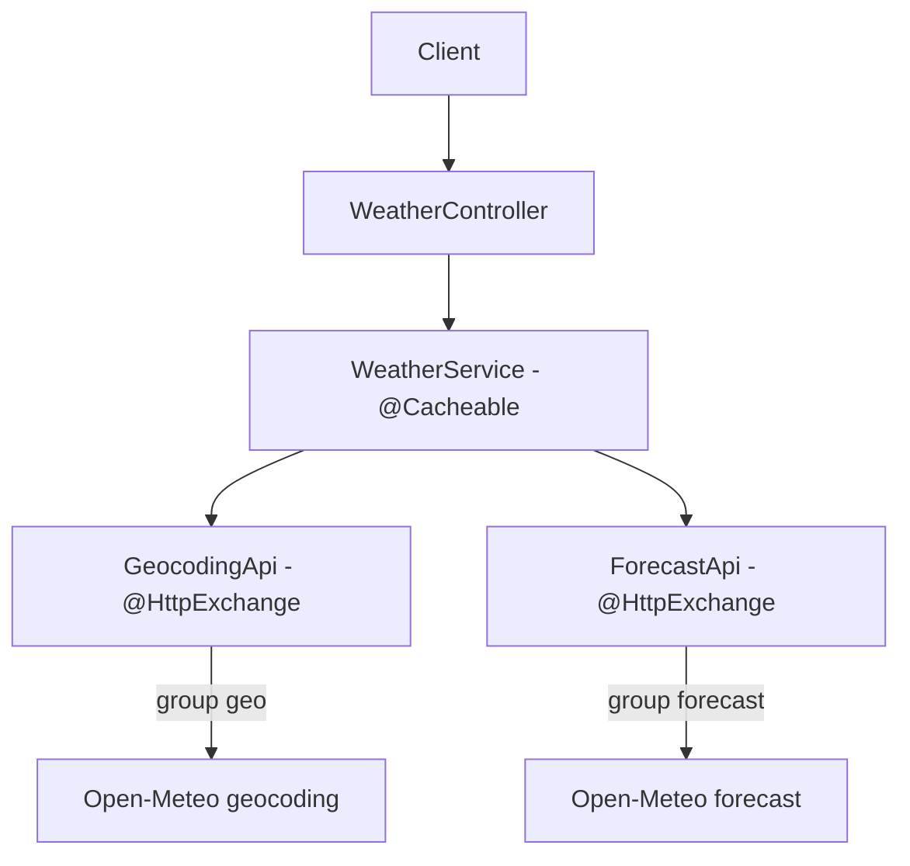
- **WeatherController** — validates `city` and maps exceptions to HTTP errors.
- **WeatherService** — orchestrates two calls and converts upstream DTOs to a `Weather` record; its result is cached.
- **GeocodingApi / ForecastApi** — HTTP service interfaces. Each belongs to a **group** (`geo`, `forecast`) whose base URL, timeouts and default headers come from `spring.http.serviceclient.<group>.*` properties.
- **Upstream** — the public API. In tests it is replaced by `MockRestServiceServer` or a local stub server.

### Data model
| Type | Purpose |
|---|---|
| `GeoResult` record | upstream geocoding DTO: name, latitude, longitude, country |
| `ForecastResponse` record | upstream forecast DTO, only the fields you use (Jackson 3 ignores unknown properties by default — prove it with a test) |
| `Weather` record | your domain object: city, temperature in Celsius, wind km/h, description, fetchedAt |
| `WeatherProperties` | `@ConfigurationProperties("weather")` record: cache TTL, default units |

### Tech stack
| Component | Choice | Why |
|---|---|---|
| HTTP client | `spring-boot-starter-restclient` | `RestClient.Builder` and HTTP service client groups (Boot 4) |
| Declarative client | `@HttpExchange` + `@ImportHttpServices` | no extra library, unlike OpenFeign |
| Retries | Framework 7 `@Retryable` + `@EnableResilientMethods` | built in, no Spring Retry dependency |
| Cache | `spring-boot-starter-cache` + Caffeine | in-process TTL cache |
| Tests | `spring-boot-starter-restclient-test` | `@RestClientTest`, `MockRestServiceServer` |

### Milestones
1. **RestClient version.** A hand-written `GeocodingClient` using `RestClient.builder().baseUrl(...)`. *Done when* a `@RestClientTest` with `MockRestServiceServer` asserts the request URL and the mapped `GeoResult`.
2. **Timeouts and errors.** Configure timeouts; map 404 to an empty result and 5xx to `UpstreamUnavailableException` with `onStatus`. *Done when* tests for 404, 500 and a slow response (timeout) pass.
3. **HTTP interfaces.** Replace the class with `GeocodingApi` and `ForecastApi` interfaces registered through `@ImportHttpServices(group = ...)`. *Done when* the same tests pass and the bean class prints as a JDK proxy.
4. **Retries and cache.** Add `@Retryable(includes = ..., maxRetries = 2, delay = 200, multiplier = 2, jitter = 50)` on the service call and `@Cacheable`. *Done when* a test shows two failures then success, and a second call within 10 minutes makes no HTTP request.
5. **Configuration per environment.** Move base URLs and timeouts to `application.yaml` with a `test` profile. *Done when* nothing URL-shaped remains in Java code.

### Deep dive: the hard parts
- **Timeouts are not optional.** Without a read timeout, a stalled upstream keeps your request thread waiting indefinitely; with enough of them the whole app stops answering. Set both connect and read timeouts per group, and make your own endpoint's total budget (e.g. 5 s) larger than the sum of retries.
- **Retry only what is safe and transient.** `GET` is idempotent, so retrying it is safe. Retry connection resets and 503, never 400/404. Remember `maxRetries = 2` means up to 3 attempts. Because `@Retryable` is proxy-based ([Ch 4](../chapters/04-aop-and-proxies/README.md)), calling the retried method from the same class (`this.fetch()`) silently skips the retry.
- **DTOs at the boundary.** Never return upstream DTOs from your controller. If Open-Meteo renames a field, only the mapping code changes; your clients see the same `Weather` shape.
- **Testing without the internet.** `MockRestServiceServer` intercepts requests made by a `RestClient` built from the auto-configured builder, so tests are fast and deterministic. A test that hits the real API belongs in a separate, optional "contract" job.

### Testing strategy
- `@RestClientTest` + `MockRestServiceServer` for each client method, including error statuses.
- A `@SpringBootTest` with a stub server on a random port to prove the property-driven group configuration really reaches the HTTP layer (headers, base URL).
- A cache test asserting the number of upstream calls.

### Trade-offs, scaling and failure modes
- Hand-written `RestClient` classes allow custom logic per call; HTTP interfaces remove boilerplate but push custom behaviour into wrappers or `default` methods.
- An in-process cache is per instance: three instances can each call upstream once per city. A shared cache (Redis, project 14) fixes that at the cost of a network hop.
- If upstream is down for long, serving the last known value with a "stale" flag is often better than a 503 — a product decision, not a technical one.

### Stretch goals
- Call geocoding and forecast for several cities in parallel with virtual threads and `StructuredTaskScope` (a Java 25 preview API — enable preview or use an executor).
- Add a client-side API version header per group (`apiversion.insert.header`) against a stub that requires it.
- Expose `http.client.requests` metrics through Actuator and graph upstream latency.

### Skills practised
- [Ch 3 — Configuration and auto-configuration](../chapters/03-configuration-and-auto-configuration/README.md): `@ConfigurationProperties`, profiles.
- [Ch 6 — REST clients and HTTP interfaces](../chapters/06-rest-clients-and-http-interfaces/README.md): `RestClient`, timeouts, error handling, `@ImportHttpServices`, testing clients.
- [Ch 4 — AOP and proxies](../chapters/04-aop-and-proxies/README.md): `@Retryable` and why self-invocation bypasses it.
- [Ch 9 — Spring Data beyond JPA, and caching](../chapters/09-spring-data-beyond-jpa-and-caching/README.md): `@Cacheable` with a TTL.

### In the interview
**Q:** `RestClient`, `WebClient` or `RestTemplate` for new code? / **A:** `RestClient` for blocking code (with virtual threads it scales well), `WebClient` only in a reactive app. `RestTemplate` is deprecated in the Framework 7 docs and scheduled for removal in 8.0.

**Q:** What does `@ImportHttpServices` give you? / **A:** It registers proxies for HTTP service interfaces in named groups; Boot configures each group's client (base URL, timeouts, headers, API version) from `spring.http.serviceclient.<group>.*`.

**Q:** Why did your retry not fire? / **A:** Usually `@EnableResilientMethods` is missing or the method was called from inside the same bean, bypassing the proxy.

### TL;DR
Wrap a public API behind your own domain type with timeouts, narrow retries, a short cache and offline tests — first with `RestClient`, then with Boot 4's HTTP service client groups.

## 4. Todo App with Spring Data JPA
**Level:** Beginner · **Time:** 1–2 weekends · **Prerequisites:** Ch 5, Ch 8

### What it is
A multi-list todo service: users own lists, lists contain items with due dates, priorities and a done flag. It stores data in PostgreSQL through **Spring Data JPA** — **JPA** (Jakarta Persistence) is the standard Java API for mapping objects to tables, **Hibernate** is the implementation, and **Spring Data JPA** generates repository classes from interfaces.

### The problem it solves
Most business apps are "lists of things with relationships". JPA saves a lot of SQL, but it hides costs: the **N+1 problem** (one query for lists, then one more per list for its items), lazy-loading exceptions, and accidental updates through dirty checking. This project makes you meet each of those on purpose and fix them.

### Real-world examples
- [TodoMVC](https://todomvc.com/) defines the classic todo feature set used to compare front-end frameworks; your API can back any of its implementations.
- The [Spring Data JPA reference](https://docs.spring.io/spring-data/jpa/reference/) covers the derived queries, projections, auditing and pagination this project uses.

### Requirements
**Functional**
- CRUD for lists and items; move an item between lists; mark done/undone.
- `GET /api/lists` returns each list with its item counts (total and done).
- `GET /api/items?due=before:2026-12-01&priority=HIGH&page=` filters items.
- Each entity records `createdAt`, `updatedAt` and `createdBy`.

**Non-functional**
- Loading 50 lists with counts uses a **constant** number of SQL statements (no N+1), verified by a test.
- Schema managed by Flyway migrations, never by `ddl-auto=update`.
- Concurrent edits of the same item must not silently overwrite each other.

### The architecture
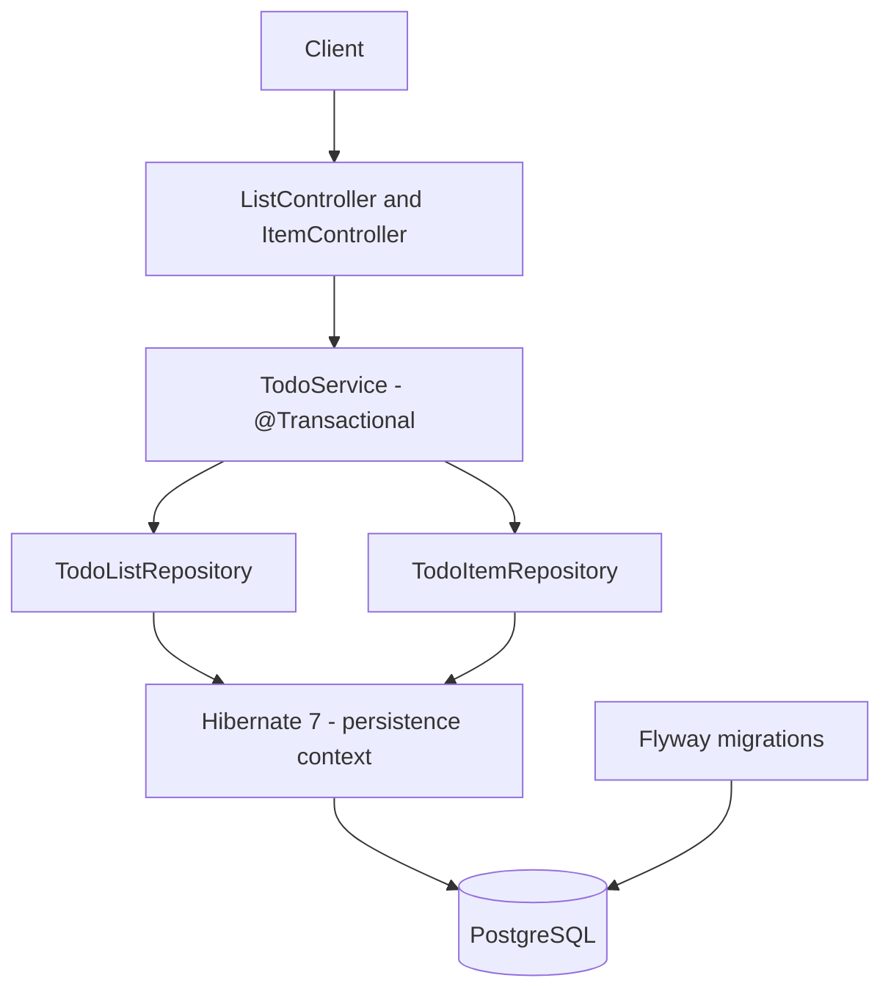
- **Controllers** — map JSON to commands; they never touch entities directly, only DTOs (records).
- **TodoService** — transaction boundary: one `@Transactional` method per use case.
- **Repositories** — `JpaRepository` interfaces with derived queries and a few `@Query` JPQL queries.
- **Persistence context** — Hibernate's per-transaction cache of loaded entities; it tracks changes and flushes them at commit (dirty checking).
- **Flyway** — versioned SQL scripts (`V1__init.sql`) applied at startup.

### Data model
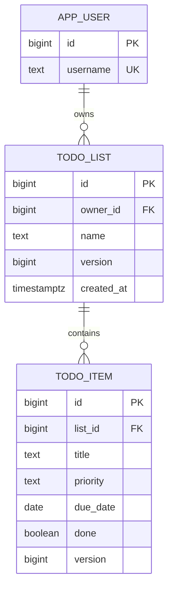
The `version` columns support **optimistic locking**: every update checks that the version is unchanged and increments it.

### Tech stack
| Component | Choice | Why |
|---|---|---|
| ORM | `spring-boot-starter-data-jpa` (Hibernate 7.4) | JPA 3.2, Spring Data repositories |
| Migrations | `spring-boot-starter-flyway` | Boot 4 needs the starter, `flyway-core` alone is no longer auto-configured |
| Database | PostgreSQL; H2 only for quick slice tests | real constraints and types |
| Auditing | `@EnableJpaAuditing` + `@CreatedDate` etc. | timestamps without boilerplate |

### Milestones
1. **Entities and migrations.** Map `TodoList` and `TodoItem` with `@ManyToOne(fetch = LAZY)`. *Done when* `@DataJpaTest` saves and reloads a list with items.
2. **API.** Controllers with DTOs and pagination via `Pageable`. *Done when* web tests cover create, list, filter and 404.
3. **Find and fix N+1.** Turn on SQL statement counting (Hibernate statistics or a datasource proxy), write a test that loads 50 lists, watch it issue 51 queries, then fix it with a projection query (`select new ...ListSummary(l.id, l.name, count(i), ...) group by`). *Done when* the test asserts 1–2 statements.
4. **Auditing and optimistic locking.** *Done when* two concurrent updates with the same version produce one success and one 409 Conflict.
5. **Turn off open-in-view.** Set `spring.jpa.open-in-view=false`. *Done when* every endpoint still works, proving no lazy loading leaks into the web layer.

### Deep dive: the hard parts
- **N+1 queries.** Lazy collections load on first access, one query per parent. Fixes, from simplest: a DTO projection that computes what the endpoint needs in one query; `JOIN FETCH` or `@EntityGraph` for a specific use case; batch fetching (`hibernate.default_batch_fetch_size`) as a safety net. Never switch everything to `EAGER` — that just moves the problem.
- **Open Session in View.** Boot enables it by default (with a warning), keeping the persistence context open during JSON rendering so lazy loading "just works" — at the cost of database queries during serialization and connections held longer. Disabling it forces you to load what you need inside the transaction.
- **Dirty checking surprises.** Inside a transaction, changing a managed entity's field is enough to issue an `UPDATE` at commit, even without `save()`. Mark read use cases `@Transactional(readOnly = true)` so Hibernate skips dirty checking and so the intent is explicit.
- **Optimistic locking.** With `@Version`, a stale update throws `ObjectOptimisticLockingFailureException`. Map it to 409 and include the current version so the client can reload and retry.

### Testing strategy
- `@DataJpaTest` for repositories and custom queries (it rolls back after each test).
- A statement-count assertion test for the N+1 fix — it guards against regressions when someone adds a field.
- `@WebMvcTest` for controllers; one `@SpringBootTest` against PostgreSQL (Testcontainers if you have Docker, see project 20).

### Trade-offs, scaling and failure modes
- JPA shines for rich object graphs with modest data volumes; for reports and bulk updates, write SQL (`@Query(nativeQuery = true)` or `JdbcClient`).
- `ddl-auto=update` is tempting but cannot rename columns or migrate data safely; Flyway scripts are reviewable and repeatable.
- Very large lists need keyset pagination and an index on `(list_id, due_date)`.

### Stretch goals
- Soft delete with a `deleted_at` column and a Hibernate `@SoftDelete` annotation.
- Full-text search on titles using PostgreSQL `tsvector` with a native query.
- Expose the repositories with Spring Data REST and compare the result with your hand-written API.

### Skills practised
- [Ch 8 — Spring Data JPA and Hibernate](../chapters/08-spring-data-jpa-and-hibernate/README.md): entities, relationships, N+1, projections, auditing, locking, open-in-view, Flyway.
- [Ch 5 — Spring MVC and REST APIs](../chapters/05-spring-mvc-and-rest/README.md): pagination, DTOs.
- [Ch 7 — Data access with JDBC and transactions](../chapters/07-data-access-jdbc-and-transactions/README.md): transaction boundaries, `readOnly`.

### In the interview
**Q:** What is the N+1 problem and how did you fix it? / **A:** Loading N parents then lazily loading each one's children costs N+1 queries. I measured it with a statement counter and replaced it with a single projection query; for other screens I used an entity graph.

**Q:** Why disable open-in-view? / **A:** It hides lazy loading in the view layer, holds a connection for the whole request and makes query counts unpredictable. Without it, each service method loads exactly what the response needs.

**Q:** How do you prevent lost updates? / **A:** `@Version` optimistic locking; the second writer gets a conflict instead of overwriting.

### TL;DR
A todo API that deliberately triggers and fixes JPA's classic traps — N+1, open-in-view, dirty checking and lost updates — with Flyway-managed schema and tests that count queries.

## 5. Config-driven Greeting Service
**Level:** Beginner · **Time:** 1 weekend · **Prerequisites:** Ch 2, Ch 3

### What it is
A deliberately simple service — it greets users in their language, in a seasonal style — whose *behaviour* is driven entirely by configuration: languages, templates, feature switches and per-environment settings. The point is not the greeting; it is learning exactly where Spring Boot reads configuration from, in what order, how it binds it to typed objects, and how beans are switched on or off by conditions.

### The problem it solves
"Works on my machine" bugs are very often configuration bugs: a property set in the wrong file, overridden by an environment variable, misspelled so it is silently ignored, or a bean that exists in one profile and not another. Mastering configuration means you can predict and test which value wins.

### Real-world examples
- [The Twelve-Factor App, factor III "Config"](https://12factor.net/config) argues that config that varies between deploys belongs in the environment, not in code — the principle Boot's externalized configuration implements.
- The [Spring Boot externalized configuration reference](https://docs.spring.io/spring-boot/reference/features/external-config.html) lists the property-source order you will prove with tests.

### Requirements
**Functional**
- `GET /api/greet?name=Ana&lang=pt` → `{"message":"Olá, Ana!"}` using templates from configuration.
- Unknown language falls back to a configured default.
- A `seasonal` feature switch adds a seasonal suffix; it is off unless enabled.
- `GET /actuator/configprops` (secured or local only) shows the bound properties.

**Non-functional**
- Invalid configuration (empty template, unknown default language) must **fail at startup**, never at the first request.
- Startup in under 2 seconds on a laptop.
- Every configuration precedence claim in your README is backed by a test.

### The architecture
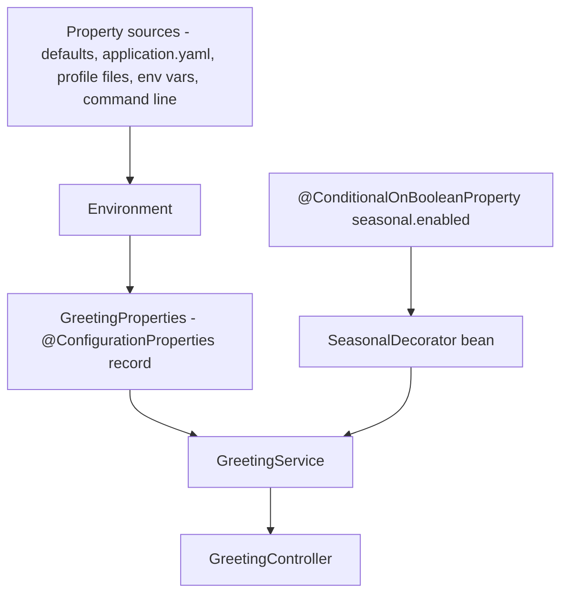
- **Property sources** — places Boot reads settings from, layered so later ones override earlier ones (command-line arguments beat environment variables, which beat `application.yaml`).
- **Environment** — Spring's merged view of all property sources and active profiles.
- **GreetingProperties** — a Java record annotated `@ConfigurationProperties("greeting")` and `@Validated`; Boot binds and validates it at startup.
- **SeasonalDecorator** — a bean created only when a property is true. `@ConditionalOnBooleanProperty` is a Boot 3.5+ convenience; `@ConditionalOnProperty` works too.
- **GreetingService** — composes the message from templates and the optional decorator.

### Data model
| Type | Fields |
|---|---|
| `GreetingProperties` (record) | `defaultLanguage: String`, `templates: Map<String, String>`, `seasonal: Seasonal` |
| `Seasonal` (nested record) | `enabled: boolean`, `suffixes: Map<Month, String>` |
| `Greeting` (response) | `message`, `language` |

### Tech stack
| Component | Choice | Why |
|---|---|---|
| Binding | `@ConfigurationProperties` records + `@Validated` | type-safe, immutable, validated at startup |
| Profiles | `application-dev.yaml`, `application-prod.yaml` | per-environment overrides |
| Conditions | `@ConditionalOnBooleanProperty`, `@Profile` | beans present only when needed |
| Inspection | Actuator `configprops`, `env` | see what was bound and from where |

### Milestones
1. **Typed properties.** Bind templates into a record. *Done when* a test using `ApplicationContextRunner` with `withPropertyValues(...)` shows the map bound correctly.
2. **Fail fast.** Add `@NotEmpty`/`@NotBlank` constraints and a custom check that the default language exists in `templates`. *Done when* a context-runner test asserts startup **fails** with a clear message.
3. **Precedence proved.** Set the same property in `application.yaml`, a profile file, an environment variable (`GREETING_DEFAULTLANGUAGE`) and a command-line argument. *Done when* tests show which wins in each combination.
4. **Conditional bean.** The seasonal decorator exists only when `greeting.seasonal.enabled=true`. *Done when* two context-runner tests assert `hasSingleBean` and `doesNotHaveBean`.
5. **Clock injection.** Inject a `java.time.Clock` bean so the seasonal logic is testable. *Done when* a test with a fixed December clock gets the December suffix.

### Deep dive: the hard parts
- **Relaxed binding.** `greeting.default-language`, `greeting.defaultLanguage` and the environment variable `GREETING_DEFAULTLANGUAGE` all bind to the same field. Environment variables cannot contain dots or dashes, so Boot maps upper-case and underscores. Map keys with special characters need bracket notation (`greeting.templates[pt-BR]`).
- **`@Value` vs `@ConfigurationProperties`.** `@Value("${greeting.x}")` reads one string at a time, is not validated as a group and is easy to misspell. `@ConfigurationProperties` gives one typed object, IDE metadata and validation. Use `@Value` only for one-off values.
- **Profiles are additive.** Activating `dev` loads `application.yaml` then `application-dev.yaml` on top. Profile groups (`spring.profiles.group.prod=prod-db,prod-mq`) let one name activate several.
- **Conditions are evaluated once.** Beans are created at startup; flipping a property later does not create or remove the decorator. Dynamic switches need a feature-flag service (project 25).

### Testing strategy
- `ApplicationContextRunner` for configuration and conditions: it starts a tiny context per test in milliseconds and lets you assert startup failures.
- `@SpringBootTest(properties = ...)` and `@ActiveProfiles` for integration tests.
- A plain unit test for `GreetingService` with a fixed `Clock`.

### Trade-offs, scaling and failure modes
- Fail-fast validation turns runtime surprises into deploy-time failures — which is the point, but your deployment must surface startup logs clearly.
- Secrets do not belong in `application.yaml` committed to git: use environment variables, a mounted secret file (`spring.config.import=configtree:`) or a vault.
- Too many profiles become a combinatorial maze; prefer few profiles and environment-specific values from the platform.

### Stretch goals
- Package the decorator as a tiny starter with its own auto-configuration (a preview of project 9).
- Import extra settings with `spring.config.import=optional:file:./local.yaml`.
- Register one bean per configured language programmatically with Framework 7's `BeanRegistrar`.

### Skills practised
- [Ch 2 — IoC and dependency injection](../chapters/02-ioc-and-dependency-injection/README.md): beans, conditions, profiles, `BeanRegistrar`.
- [Ch 3 — Configuration and auto-configuration](../chapters/03-configuration-and-auto-configuration/README.md): property sources and precedence, relaxed binding, `@ConfigurationProperties`, profiles, config import.
- [Ch 12 — Testing Spring applications](../chapters/12-testing-spring-apps/README.md): profiles and properties in tests.

### In the interview
**Q:** An environment variable and `application.yaml` set the same property — which wins? / **A:** The environment variable; OS environment comes later in Boot's precedence order than packaged config files. Command-line arguments beat both.

**Q:** Why prefer `@ConfigurationProperties`? / **A:** Typed, grouped, validated at startup, documented through generated metadata, and easy to test with a context runner.

**Q:** How do you make a bean optional? / **A:** A condition such as `@ConditionalOnProperty` or `@Profile`; I test both outcomes with `ApplicationContextRunner`.

### Self-check
1. Which environment variable sets `greeting.seasonal.enabled`? → `GREETING_SEASONAL_ENABLED`.
2. When is a `@ConditionalOnProperty` evaluated? → Once, while the context is being built.

### TL;DR
A trivial greeting with non-trivial configuration: typed and validated properties, proved precedence, profiles and conditional beans, all tested with `ApplicationContextRunner`.

## 6. Scheduled Daily Sales Report
**Level:** Beginner · **Time:** 1 weekend · **Prerequisites:** Ch 7, Ch 14

### What it is
A background job that runs every morning at 06:00 in the business's time zone, aggregates yesterday's orders from a database (revenue, order count, top products), writes a CSV file and emails a summary. It uses `@Scheduled` — Spring's annotation for running a method on a timer or a **cron expression** (a compact schedule format such as "minute hour day month weekday").

### The problem it solves
Every company has reports nobody wants to click a button for. Scheduled jobs look trivial until they run twice on two servers, skip a day after a daylight-saving change, fail halfway and leave half a file, or silently stop. This project builds a job that is **idempotent** (running it twice for the same day produces the same result once), observable and safe on several instances.

### Real-world examples
- The [Spring "Scheduling Tasks" guide](https://spring.io/guides/gs/scheduling-tasks) shows the basic `@Scheduled` setup you will extend.
- [ShedLock](https://github.com/lukas-krecan/ShedLock) is a widely used library that makes a scheduled task run on at most one node at a time by holding a lock row in a shared database.

### Requirements
**Functional**
- Every day at 06:00 Europe/London, build the report for the previous calendar day.
- Store each run in a `report_run` table (date, status, row count, file path, error).
- `POST /admin/reports/{date}/rerun` regenerates one day on demand.
- Email the summary to a configurable list; attach the CSV.

**Non-functional**
- The job for one date runs **at most once successfully**, even with 3 app instances.
- Report for 100,000 orders completes in under 30 seconds and uses constant memory (streamed rows).
- A failed run is visible within one minute (log + metric + run row with status `FAILED`).

### The architecture
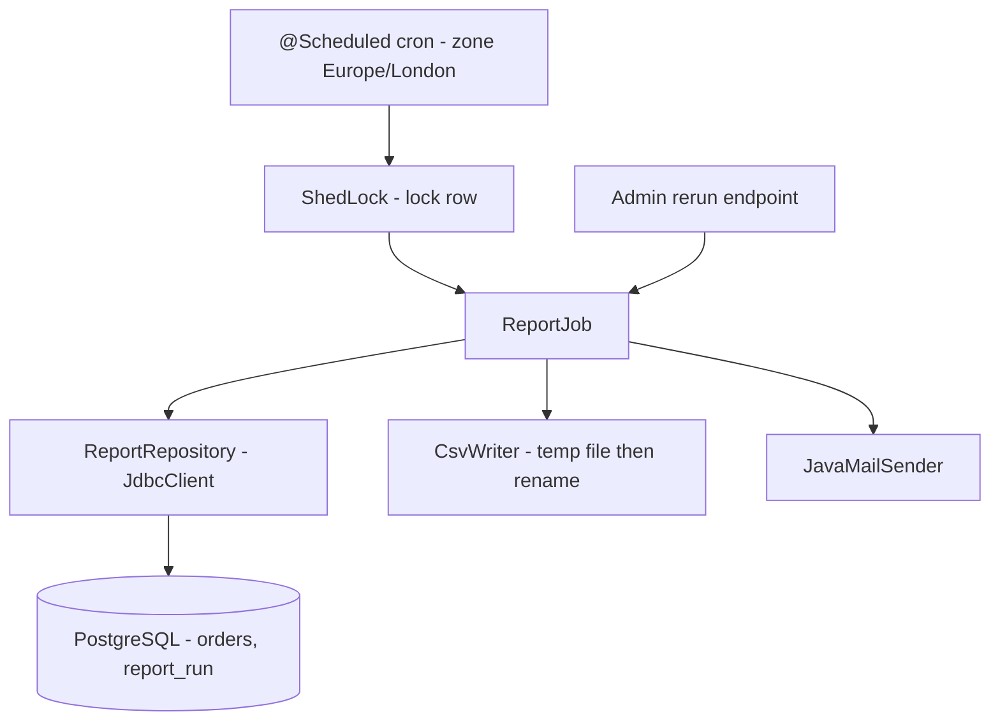
- **Scheduler** — `@EnableScheduling` plus `@Scheduled(cron = "0 0 6 * * *", zone = "Europe/London")`. Spring cron has six fields; the first is seconds.
- **ShedLock** — before running, inserts or updates a lock row with an expiry; other instances see the lock and skip.
- **ReportJob** — computes the date range, checks `report_run` for an existing success, aggregates, writes, mails and records the outcome.
- **ReportRepository** — SQL aggregation with `JdbcClient`; streaming rows for the CSV.
- **CsvWriter** — writes to a temporary file and renames it atomically, so readers never see half a file.

### Data model
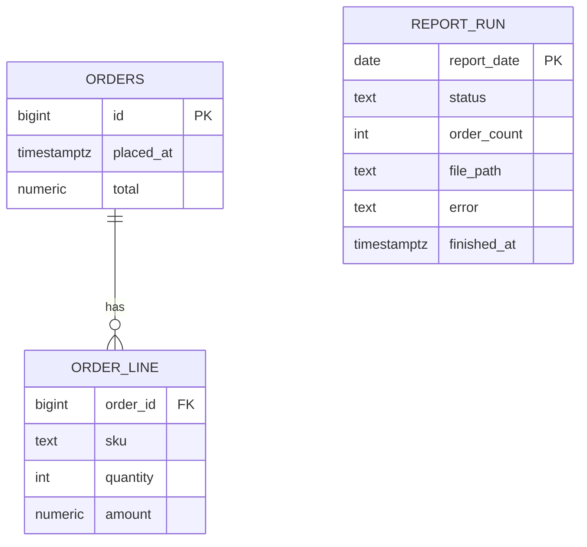

### Tech stack
| Component | Choice | Why |
|---|---|---|
| Scheduling | `@EnableScheduling`, `@Scheduled` | built in; virtual threads with `spring.threads.virtual.enabled=true` |
| Single-run lock | ShedLock with its JDBC provider | one table, works with any instance count |
| Data | `spring-boot-starter-jdbc`, `JdbcClient` | aggregation SQL is clearer by hand |
| Mail | `spring-boot-starter-mail` | `JavaMailSender`; a local SMTP catcher (e.g. GreenMail in tests) |
| Time | an injected `Clock` | testable "yesterday" |

### Milestones
1. **Aggregation query.** Revenue, count and top 5 SKUs for a date range. *Done when* a `@JdbcTest` with seeded orders asserts exact totals (use `BigDecimal`, never `double`).
2. **The job.** `ReportJob.run(LocalDate)` writes CSV and a `report_run` row. *Done when* running it twice for the same date leaves one success row and one file.
3. **Schedule.** Cron with an explicit zone; inject `Clock`. *Done when* a test with a fixed clock at 2026-03-29 06:00 London (a DST change day) computes the right "yesterday" boundaries in UTC.
4. **Single instance.** Add ShedLock. *Done when* two application contexts started in one test both trigger the job and only one run happens.
5. **Mail and failure handling.** *Done when* a GreenMail test receives the email, and a forced SQL failure records `FAILED` with the error message.

### Deep dive: the hard parts
- **Time zones and "yesterday".** Orders are stored as UTC instants; the business day is local. Compute `start = yesterday.atStartOfDay(zone).toInstant()` and `end = today.atStartOfDay(zone).toInstant()` and query `placed_at >= start AND placed_at < end`. A local day can be 23 or 25 hours long on DST changes; half-open ranges handle that.
- **Idempotency.** The `report_run` primary key on `report_date` is the guard: insert a `RUNNING` row first; if it already exists with `SUCCESS`, skip. A rerun explicitly overwrites.
- **Multiple instances.** `@Scheduled` fires in every JVM. ShedLock's `lockAtMostFor` must be longer than the job's worst runtime (or the lock expires mid-run and a second node starts) and `lockAtLeastFor` stops a fast job from running again on a node whose clock is slightly behind.
- **Overlapping runs.** One `@Scheduled` cron method never overlaps with itself (the next trigger is computed after the run finishes), but a manual rerun from the admin endpoint can overlap with the scheduled run. The `RUNNING` row (or the same ShedLock name) prevents that.

### Testing strategy
- Repository tests against PostgreSQL or H2 in PostgreSQL mode for the aggregation.
- Job tests calling `run(date)` directly, never waiting for the cron. Disable scheduling in tests behind a property (`@ConditionalOnBooleanProperty("app.jobs.enabled")`).
- A cron-expression test with `CronExpression.parse(...).next(...)` to prove the next fire times.

### Trade-offs, scaling and failure modes
- ShedLock is simple but relies on the database; if the database is down, the job cannot run anyway.
- For very large data, aggregate in SQL and stream rows; loading 100,000 entities into memory is the classic outage.
- For many jobs with dependencies and retries, a real scheduler (project 38, or Spring Batch in project 18) beats a growing pile of `@Scheduled` methods.

### Stretch goals
- Expose a metric `report.duration` and an alert if no `SUCCESS` row exists by 07:00.
- Generate a PDF or HTML report with a template engine.
- Backfill: `POST /admin/reports/backfill?from=&to=` with one run per day.

### Skills practised
- [Ch 14 — Messaging, async and scheduling](../chapters/14-messaging-async-and-scheduling/README.md): `@Scheduled`, cron, ShedLock, testing jobs.
- [Ch 7 — Data access with JDBC and transactions](../chapters/07-data-access-jdbc-and-transactions/README.md): `JdbcClient`, aggregation, `@JdbcTest`.
- [Ch 15 — Observability and production](../chapters/15-observability-and-production/README.md): metrics for background jobs.

### In the interview
**Q:** Your job runs on three pods. What happens? / **A:** It runs three times unless something coordinates it. I use ShedLock with a database lock row and also make the job idempotent per date, so even a double run is harmless.

**Q:** `fixedRate` vs `fixedDelay` vs cron? / **A:** `fixedRate` measures start to start, `fixedDelay` end to start, cron fires at calendar times — the right choice for business schedules, always with an explicit zone.

**Q:** How do you test a scheduled job? / **A:** Call the job method directly with a fixed `Clock`; test the cron expression separately; keep scheduling off in other tests.

### TL;DR
A cron job made production-safe: explicit time zones, half-open date ranges, an idempotent run table, a distributed lock, streamed output and visible failures.

## 7. Bookstore Catalog API with Problem Details and OpenAPI
**Level:** Beginner · **Time:** 1–2 weekends · **Prerequisites:** Ch 5, Ch 8

### What it is
A public-facing catalog API for books, authors and categories, designed as if strangers will integrate with it: a documented contract (OpenAPI), predictable error bodies (Problem Details), validation with clear messages, content negotiation (JSON and CSV), filtering, sorting and conditional requests. **OpenAPI** is a standard machine-readable description of an HTTP API; tools turn it into documentation pages and client code.

### The problem it solves
Internal APIs can get away with surprises; public ones cannot. Integrators need to know every field, every error and every limit up front, and they need errors they can handle in code. This project is about **API craft**: designing the contract first, then making the implementation obey it.

### Real-world examples
- [RFC 9457 "Problem Details for HTTP APIs"](https://www.rfc-editor.org/rfc/rfc9457) defines the error format Spring's `ProblemDetail` implements.
- [Zalando's RESTful API Guidelines](https://opensource.zalando.com/restful-api-guidelines/) are a public, detailed rule book (naming, pagination, errors, compatibility) you can measure your design against.

### Requirements
**Functional**
- `GET /api/books?author=&category=&q=&sort=title,asc&page=` with filtering and sorting on whitelisted fields.
- `GET /api/books/{isbn}`; `POST`/`PUT`/`DELETE` for admins (simple API-key header for now).
- `Accept: text/csv` on the list endpoint returns CSV.
- Validation: ISBN-13 checksum, price ≥ 0 with two decimals, at least one author.
- An OpenAPI document at `/v3/api-docs` and Swagger UI at `/swagger-ui.html`.

**Non-functional**
- Every 4xx/5xx response is `application/problem+json` with a stable `type` URI.
- `GET /api/books/{isbn}` supports `ETag`/`If-None-Match` so unchanged books cost a 304 with no body.
- List p95 under 100 ms for 50,000 books with the right indexes.

### The architecture
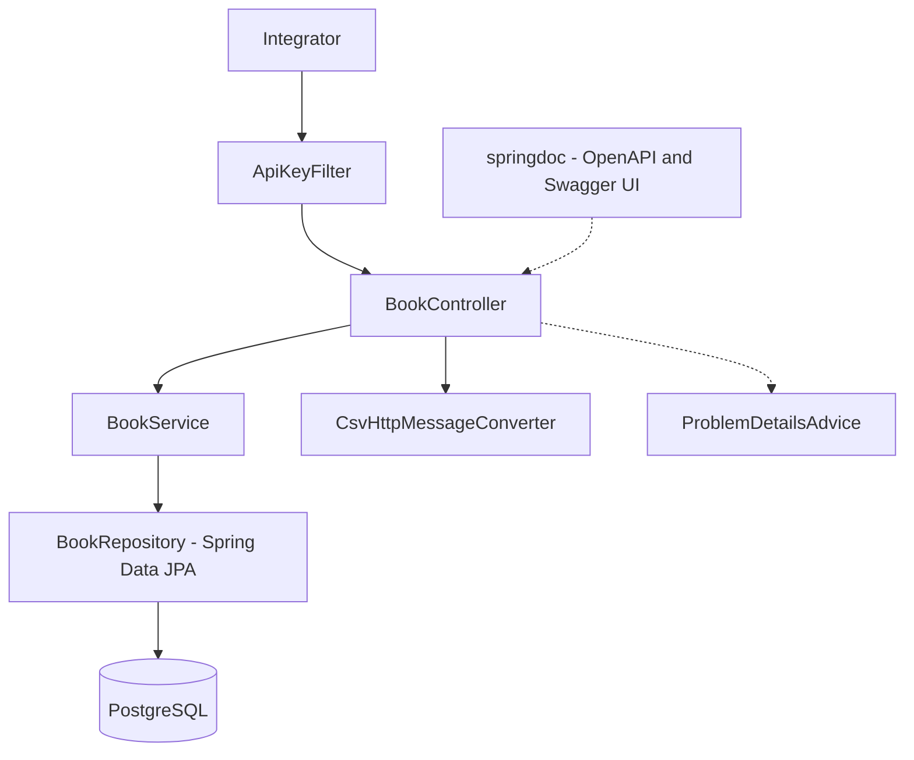
- **ApiKeyFilter** — a servlet filter that checks an `X-API-Key` header on write methods (real auth comes in project 11).
- **BookController** — thin; uses `@Valid`, `Pageable` and `ResponseEntity` with `ETag`.
- **CsvHttpMessageConverter** — a custom `HttpMessageConverter` that writes lists of `BookDto` as CSV when the client asks for `text/csv`.
- **ProblemDetailsAdvice** — extends `ResponseEntityExceptionHandler` so Spring's own exceptions and yours share one format.
- **springdoc-openapi** — generates the OpenAPI document from annotations and types (use its Boot 4 line).

### Data model
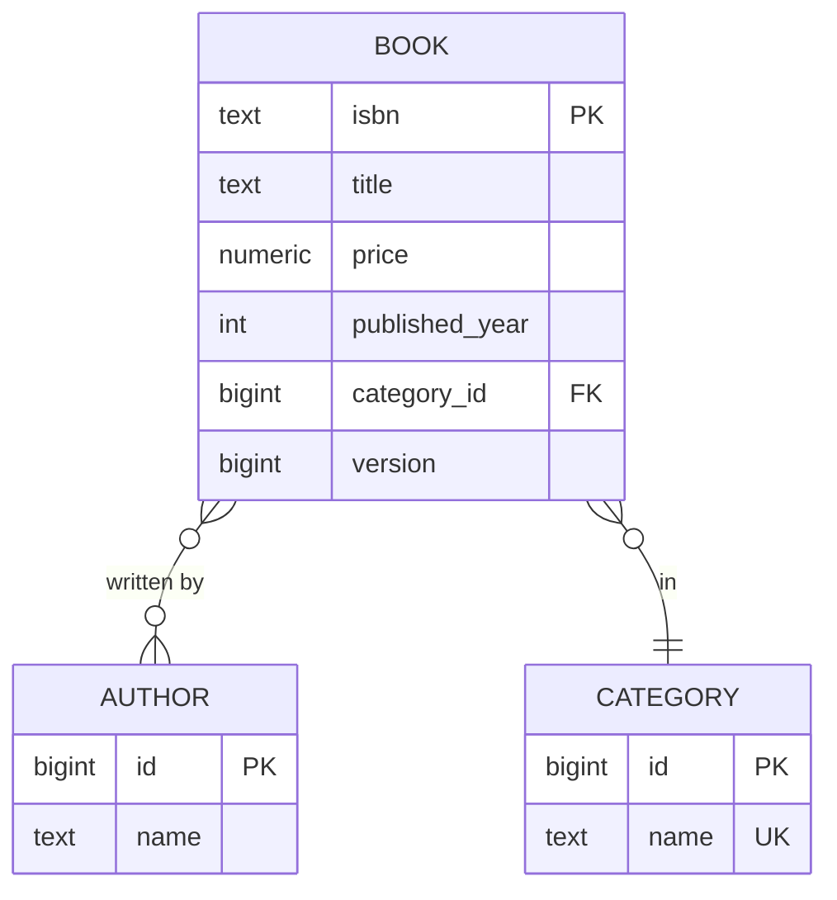
The many-to-many between books and authors becomes a join table `book_author(isbn, author_id)` in the migration.

### Tech stack
| Component | Choice | Why |
|---|---|---|
| Web | `spring-boot-starter-webmvc` | message converters, content negotiation |
| Validation | `spring-boot-starter-validation` + a custom `@Isbn` constraint | checksum logic in one reusable annotation |
| Persistence | Spring Data JPA + Flyway | filtering with `Specification` or Querydsl-free JPQL |
| Docs | springdoc-openapi (Boot 4 compatible line) | generated contract and UI |
| Errors | `ProblemDetail`, `ErrorResponseException` | RFC 9457 built in |

### Milestones
1. **Contract first.** Write the OpenAPI YAML by hand for three endpoints, review it, then implement. *Done when* the generated `/v3/api-docs` matches your hand-written contract for those endpoints (diff in a test).
2. **Validation.** A custom `@Isbn` constraint and messages from `ValidationMessages.properties`. *Done when* invalid ISBN, negative price and missing authors each produce a Problem Details body with a per-field `errors` array.
3. **Filtering and sorting.** Whitelist sort fields (reject `sort=password`). *Done when* tests show 400 for unknown sort fields and correct ordering for known ones.
4. **CSV and ETags.** *Done when* `Accept: text/csv` returns CSV and a second `GET` with `If-None-Match` returns 304.
5. **Error catalogue.** A table in your README listing every `type` URI and its meaning. *Done when* a test iterates all endpoints' error paths and asserts the content type is `application/problem+json`.

### Deep dive: the hard parts
- **Extending Problem Details.** `ProblemDetail.setProperty("errors", list)` adds custom members; clients must ignore unknown members, so adding fields is backwards compatible. Keep `title` stable per `type` and put specifics in `detail`.
- **Content negotiation.** Spring chooses a converter from the `Accept` header and the return type. Registering your CSV converter in a `WebMvcConfigurer` (Framework 7 adds a builder-style `configureMessageConverters`) makes `text/csv` just another representation of the same resource.
- **ETags.** A **strong ETag** is a hash or version that changes whenever the representation changes. Using the entity `version` column is cheap and exact. Spring's `ShallowEtagHeaderFilter` hashes the body instead — easy, but the server still does all the work.
- **Sort injection.** Passing `sort` straight into a query lets clients sort on non-indexed or private columns. Map public names to properties explicitly.

### Testing strategy
- Constraint validator unit tests (valid and invalid ISBNs, including checksum edge cases).
- `@WebMvcTest` for negotiation, ETags and errors.
- An OpenAPI snapshot test: fetch `/v3/api-docs` in a `@SpringBootTest` and compare with a committed file, so contract changes are always deliberate and reviewed.

### Trade-offs, scaling and failure modes
- Contract-first costs time up front but prevents accidental breaking changes; code-first is faster but your docs drift unless you snapshot them.
- Offset pagination on 50,000 rows is fine; at millions, switch to keyset pagination.
- CSV exports of the whole catalog should be streamed or produced asynchronously, not built in memory.

### Stretch goals
- Generate a Java client from your OpenAPI file and use it in a test.
- Add HATEOAS links (`_links.next`) with Spring HATEOAS.
- Add API versioning (preview of project 21) for a breaking change to the price field.

### Skills practised
- [Ch 5 — Spring MVC and REST APIs](../chapters/05-spring-mvc-and-rest/README.md): validation, Problem Details, content negotiation, springdoc.
- [Ch 8 — Spring Data JPA and Hibernate](../chapters/08-spring-data-jpa-and-hibernate/README.md): many-to-many, pagination and sorting, versions.
- [Ch 12 — Testing Spring applications](../chapters/12-testing-spring-apps/README.md): web slices, snapshot tests.

### In the interview
**Q:** What is Problem Details and why use it? / **A:** RFC 9457's standard JSON error body with `type`, `title`, `status`, `detail` and extensions. Clients can branch on `type` instead of parsing messages, and Spring supports it natively with `ProblemDetail`.

**Q:** How do you avoid breaking API clients? / **A:** Additive changes only (new optional fields), a contract snapshot test, and versioning for the rare breaking change.

**Q:** How does Spring pick JSON vs CSV? / **A:** Content negotiation: it matches the `Accept` header against the media types the registered message converters can write for the return type.

### TL;DR
A catalog API designed for strangers: contract-first OpenAPI, RFC 9457 errors, custom validation, CSV via content negotiation, ETags and whitelisted sorting.

## 8. Expense Tracker with JdbcClient and Flyway
**Level:** Beginner · **Time:** 1–2 weekends · **Prerequisites:** Ch 7, Ch 8

### What it is
A personal-finance API: accounts, categories, expenses and monthly budgets, with a "where did my money go" summary per month. It uses plain SQL through **`JdbcClient`** — the fluent JDBC API added in Spring Framework 6.1 — and **Flyway** for schema migrations, so you see exactly which SQL runs. Money is stored as exact decimals.

### The problem it solves
Many teams use JPA for everything and never learn what the database can do on its own: constraints, aggregates, window functions, upserts. Money bugs — rounding with `double`, partial updates — are expensive and embarrassing. This project teaches SQL-first data access, transactions you control, and schema evolution that never needs manual fixes.

### Real-world examples
- [Firefly III](https://github.com/firefly-iii/firefly-iii) is a mature open-source personal finance manager; its feature set (budgets, categories, rules, reports) is a good map of where this project can grow.
- The [Flyway documentation](https://documentation.red-gate.com/flyway) explains versioned and repeatable migrations, checksums and baselining.

### Requirements
**Functional**
- CRUD for accounts, categories, expenses (amount, currency, date, note, category).
- Transfer between accounts creates two linked entries atomically.
- `GET /api/summary?month=2026-09` → totals per category, budget vs actual, top 5 expenses.
- CSV import of a bank statement (date, description, amount), skipping duplicates.

**Non-functional**
- Amounts stored as `numeric(19,4)` and handled as `BigDecimal`; no floating point anywhere.
- Every schema change is a Flyway migration; the app refuses to start if a migration was edited after being applied (checksum mismatch).
- Monthly summary under 50 ms for 100,000 expenses with an index on `(account_id, spent_on)`.

### The architecture
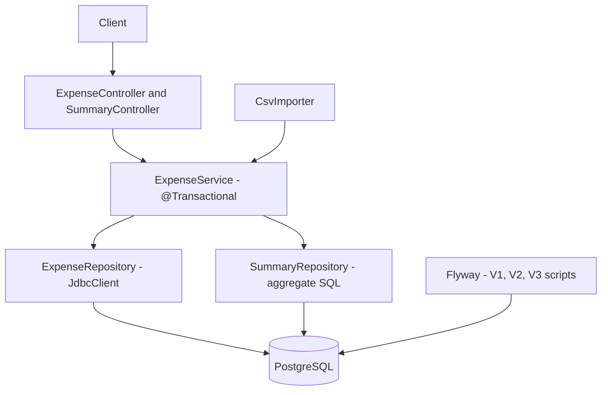
- **Controllers** — JSON in and out; validation of amounts and dates.
- **ExpenseService** — transaction boundary for transfers and imports.
- **Repositories** — `JdbcClient` with named parameters and `RowMapper`s or record mapping (`.query(Expense.class)`).
- **SummaryRepository** — one SQL statement per summary, using `GROUP BY` and `FILTER` clauses.
- **CsvImporter** — parses statements and computes a fingerprint per line for de-duplication.

### Data model
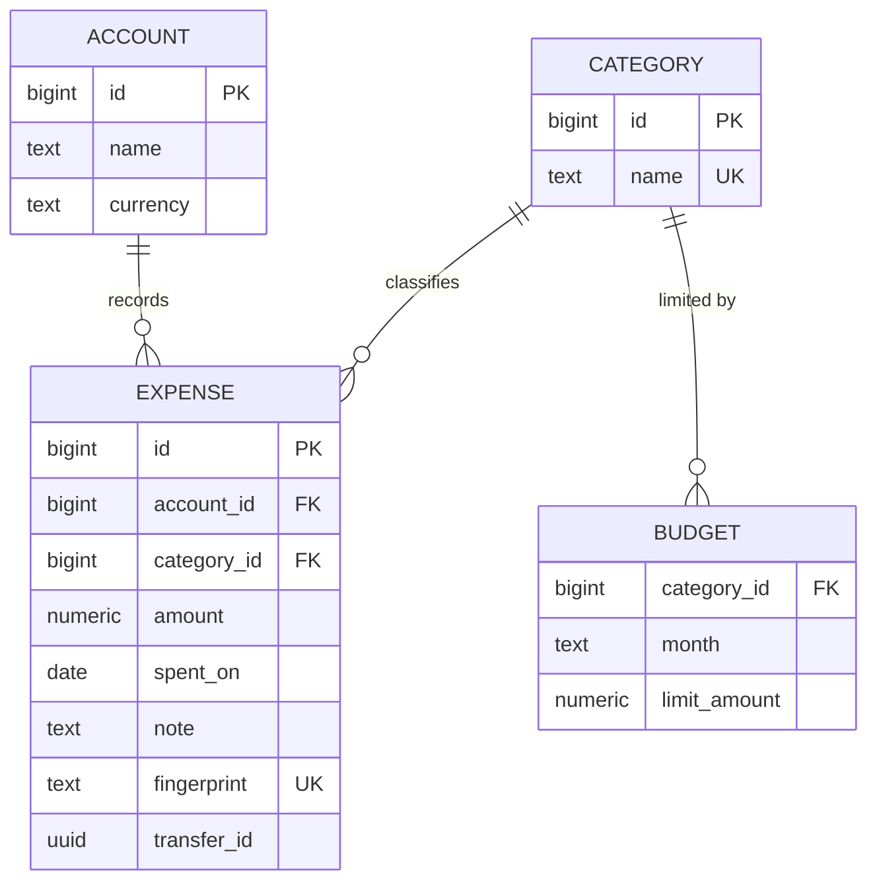

### Tech stack
| Component | Choice | Why |
|---|---|---|
| Data access | `spring-boot-starter-jdbc`, `JdbcClient` | explicit SQL, named parameters, record mapping |
| Migrations | `spring-boot-starter-flyway` | required in Boot 4 for auto-configuration |
| Database | PostgreSQL | `numeric`, `CHECK` constraints, `ON CONFLICT` |
| Money | `BigDecimal` with `RoundingMode.HALF_EVEN` | exact decimal arithmetic |

### Milestones
1. **Schema V1.** Tables with `CHECK (amount <> 0)` and foreign keys. *Done when* Flyway applies it on startup and a test inserting a bad row gets `DataIntegrityViolationException`.
2. **Repositories.** CRUD with `JdbcClient`. *Done when* `@JdbcTest` tests pass against PostgreSQL.
3. **Transfers.** Two rows sharing a `transfer_id` inside one `@Transactional` method. *Done when* a test that throws after the first insert leaves no rows.
4. **Summary SQL.** *Done when* a seeded month returns exact per-category totals and budget differences.
5. **Import with de-duplication.** A unique `fingerprint` (hash of account, date, amount, description) and `ON CONFLICT DO NOTHING`. *Done when* importing the same file twice adds rows once.
6. **Schema V2.** Add `currency` to expenses with a backfill. *Done when* the migration runs on a database containing V1 data.

### Deep dive: the hard parts
- **Money.** `0.1 + 0.2` is not `0.3` in `double`. Use `BigDecimal` from JSON to SQL, compare with `compareTo` (not `equals`, which also compares scale: `2.0` vs `2.00`), and round only at defined points.
- **Transactions are proxy-based.** `@Transactional` works only on calls that go through the Spring proxy, on public methods, and by default rolls back only for unchecked exceptions. A checked `IOException` during import commits the half-done work unless you set `rollbackFor`.
- **Migrations that never change.** Flyway stores a checksum per applied script. Editing V1 after it ran makes startup fail; the fix is always a new V-script. For data backfills on big tables, add the column nullable, backfill in batches, then add the constraint — the expand/contract approach of project 37.
- **Aggregates in SQL.** `SUM(amount) FILTER (WHERE amount < 0)` and `GROUP BY category_id` do in one round trip what would otherwise be a loop over thousands of objects.

### Testing strategy
- `@JdbcTest` with PostgreSQL (Testcontainers or the local server) — H2 does not support all PostgreSQL syntax.
- A Flyway migration test: start from an empty database, migrate to latest, assert the schema; then a test that migrates V1 data to V2.
- Transaction rollback tests that throw at chosen points.

### Trade-offs, scaling and failure modes
- SQL-first gives control and performance but more code than JPA; for this domain (few relationships, many aggregates) it is a good fit.
- Fingerprint de-duplication can merge two genuinely identical purchases on the same day; adding the bank's own transaction id when available fixes it.
- Multi-currency totals need exchange rates on a date — out of scope, but your schema should not make it impossible.

### Stretch goals
- Recurring expenses generated by a scheduled job.
- A running balance per account using a window function (`SUM(...) OVER (ORDER BY spent_on)`).
- Liquibase version of the migrations, to compare the two tools.

### Skills practised
- [Ch 7 — Data access with JDBC and transactions](../chapters/07-data-access-jdbc-and-transactions/README.md): `JdbcClient`, exception translation, `@Transactional`, rollback rules.
- [Ch 8 — Spring Data JPA and Hibernate](../chapters/08-spring-data-jpa-and-hibernate/README.md): Flyway basics.
- [Ch 9 — Spring Data beyond JPA, and caching](../chapters/09-spring-data-beyond-jpa-and-caching/README.md): Flyway vs Liquibase.

### In the interview
**Q:** Why not `double` for money? / **A:** Binary floating point cannot represent most decimal fractions exactly, so sums drift. `BigDecimal` and `numeric` are exact.

**Q:** Does `@Transactional` roll back on a checked exception? / **A:** Not by default — only on `RuntimeException` and `Error`. Use `rollbackFor` or wrap the checked exception.

**Q:** Someone edited an applied Flyway script. What happens? / **A:** Validation fails on startup with a checksum mismatch. The fix is to revert the edit and write a new migration.

### TL;DR
SQL-first data access with `JdbcClient`, exact money handling, transactional transfers, idempotent imports and Flyway migrations you never edit.

## 9. Audit-log Spring Boot Starter
**Level:** Beginner · **Time:** 1–2 weekends · **Prerequisites:** Ch 2, Ch 3, Ch 4

### What it is
A reusable library, packaged as a **Spring Boot starter**, that any application can add to its dependencies to get audit logging: annotate a service method with `@Audited(action = "ORDER_CANCELLED")` and the library records who did what, when, with which arguments and whether it succeeded. A **starter** is a dependency that brings libraries plus **auto-configuration** — classes that create beans automatically when certain conditions hold.

### The problem it solves
Auto-configuration feels like magic until you write one. Building a starter teaches you how Boot decides which beans to create, how to let users override your defaults, how proxies and aspects intercept calls, and why a missing `@EnableXxx` or a self-invocation silently disables a feature. It is also genuinely useful: audit trails are required in finance, health and admin tools.

### Real-world examples
- The Spring Boot reference chapter ["Creating Your Own Auto-configuration"](https://docs.spring.io/spring-boot/reference/features/developing-auto-configuration.html) describes the module layout, `@AutoConfiguration` and condition annotations used here.
- [JaVers](https://javers.org/) is an open-source Java audit and object-diff library with Spring Boot starters — a real example of this pattern taken much further.

### Requirements
**Functional**
- `@Audited(action, resource = "#orderId")` on any public bean method; the resource is a SpEL expression over the arguments.
- Records: timestamp, principal (from Spring Security if present, else "anonymous"), action, resource, outcome (`SUCCESS`/`FAILURE`), duration, error class.
- Sinks: logging (default), JDBC table (if a `DataSource` exists and a property is set), or a user-provided `AuditSink` bean that replaces both.
- Properties: `audit.enabled`, `audit.sink=log|jdbc`, `audit.mask-arguments=password,cardNumber`.

**Non-functional**
- Overhead below 1 ms per audited call for the log sink.
- The library must not fail the business call if writing the audit record fails (configurable).
- Zero configuration needed for the default behaviour; everything overridable.

### The architecture
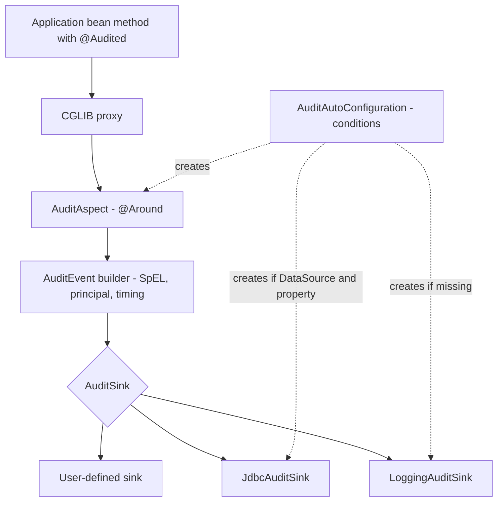
- **CGLIB proxy** — a generated subclass wrapping the bean, so calls pass through the aspect. Only calls from *outside* the bean are intercepted.
- **AuditAspect** — `@Around` advice: start timer, call `proceed()`, build the event, send to the sink, rethrow any exception unchanged.
- **AuditAutoConfiguration** — an `@AutoConfiguration` class listed in `META-INF/spring/org.springframework.boot.autoconfigure.AutoConfiguration.imports`, guarded by `@ConditionalOnBooleanProperty("audit.enabled", matchIfMissing = true)`.
- **Sinks** — `@ConditionalOnMissingBean(AuditSink.class)` lets the application replace the default by declaring its own.

### Data model
| Type | Purpose |
|---|---|
| `@Audited` annotation | `action`, `resource` (SpEL), `includeArgs` |
| `AuditEvent` record | `Instant at`, `principal`, `action`, `resource`, `outcome`, `Duration took`, `errorType`, `Map<String,Object> args` |
| `AuditSink` interface | `void write(AuditEvent event)` |
| `AuditProperties` | `@ConfigurationProperties("audit")` record |

### Tech stack
| Component | Choice | Why |
|---|---|---|
| Modules | `audit-spring-boot-autoconfigure` + `audit-spring-boot-starter` | Boot's recommended split: logic vs dependency bundle |
| AOP | `spring-boot-starter-aspectj` (Boot 4 name, replaces `-aop`) | `@Aspect` support |
| Expressions | SpEL `StandardEvaluationContext` with method parameters | dynamic resource ids |
| Metadata | `spring-boot-configuration-processor` | IDE completion for `audit.*` properties |
| Tests | `ApplicationContextRunner` | assert beans per condition |

### Milestones
1. **Annotation and aspect inside one app.** *Done when* calling an `@Audited` method logs one line, and calling it from the same class logs nothing — write that test on purpose.
2. **Extract the auto-configuration module.** *Done when* a separate sample app gets auditing just by adding the starter dependency.
3. **Conditions.** Disabled by property; JDBC sink only with a `DataSource` and `audit.sink=jdbc`; user sink wins. *Done when* four `ApplicationContextRunner` tests cover the combinations.
4. **SpEL and masking.** *Done when* `resource = "#order.id"` resolves and arguments named `password` are logged as `***`.
5. **Failure isolation.** *Done when* a sink that throws does not change the business method's result, and a metric `audit.sink.failures` counts it.

### Deep dive: the hard parts
- **Ordering of auto-configurations.** Your JDBC sink needs the `DataSource` that Boot's own auto-configuration creates. Use `@AutoConfiguration(after = DataSourceAutoConfiguration.class)` and `@ConditionalOnBean(DataSource.class)`; otherwise the condition is evaluated before the data source exists and silently fails. The `--debug` condition report shows why a bean was or was not created.
- **Proxy limits.** Self-invocation, `private` and `final` methods are not intercepted. Document this in your starter README; the test from milestone 1 proves it.
- **Aspect order with transactions.** If both `@Transactional` and `@Audited` apply, which runs outside? With the audit aspect outside the transaction, a commit failure is reported as a failure; inside, you might record `SUCCESS` for a rolled-back change. Set `@Order` deliberately and test it.
- **Parameter names for SpEL.** `#order` works only if parameter names are available: compile with `-parameters` (Boot's parent POM does this).

### Testing strategy
- `ApplicationContextRunner` with `AutoConfigurations.of(AuditAutoConfiguration.class, ...)` for every condition.
- An aspect test with a small configuration and an in-memory sink capturing events.
- A sample application module whose `@SpringBootTest` proves the starter works end to end.

### Trade-offs, scaling and failure modes
- Synchronous sinks add latency to every audited call; an asynchronous queue is faster but can lose events on a crash — for compliance, write the audit row in the same transaction as the change.
- Logging arguments can leak personal data; masking by name is a minimum, explicit allow-lists are safer.
- AOP-based auditing misses changes made outside annotated methods (batch SQL, other services); database-level auditing (triggers, CDC) catches everything at the cost of business context.

### Stretch goals
- Publish events with `ApplicationEventPublisher` so applications can listen with `@TransactionalEventListener`.
- An Actuator endpoint `/actuator/audit` showing the last 100 events.
- Register sinks programmatically with Framework 7's `BeanRegistrar`, one per configured destination.

### Skills practised
- [Ch 2 — IoC and dependency injection](../chapters/02-ioc-and-dependency-injection/README.md): conditions, post-processors, `BeanRegistrar`.
- [Ch 3 — Configuration and auto-configuration](../chapters/03-configuration-and-auto-configuration/README.md): writing a custom starter, conditions, ordering, Boot 4 modularization.
- [Ch 4 — AOP and proxies](../chapters/04-aop-and-proxies/README.md): `@Around`, pointcuts on annotations, proxy limitations, aspect order.

### In the interview
**Q:** How does Boot know to load your auto-configuration? / **A:** It reads `META-INF/spring/org.springframework.boot.autoconfigure.AutoConfiguration.imports` from every jar, then evaluates each class's conditions.

**Q:** How can an app override your default bean? / **A:** I mark it `@ConditionalOnMissingBean`; a user-defined bean of that type is registered first, so mine backs off.

**Q:** Why did auditing not happen for one call? / **A:** Most likely self-invocation or a non-public method — the proxy never saw the call.

### TL;DR
Build the "magic" yourself: an annotation, an `@Around` aspect and a conditional auto-configuration packaged as a starter, with tests for every condition and every proxy limitation.

## 10. Uptime Monitor
**Level:** Beginner · **Time:** 1–2 weekends · **Prerequisites:** Ch 6, Ch 14, Ch 15

### What it is
A small self-hosted monitoring service: you register URLs (often other apps' `/actuator/health` endpoints), it checks each one on an interval, records response time and status, detects when a site goes down or comes back, and sends a notification. It also exposes its **own** health and metrics through **Spring Boot Actuator**, the module that adds production endpoints such as `/actuator/health` and `/actuator/prometheus`.

### The problem it solves
You cannot fix what you do not know is broken. This project teaches concurrent outbound HTTP with strict timeouts, scheduled work, state transitions (UP → DOWN → UP) without alert spam, and how a service reports its own health to Kubernetes or a load balancer.

### Real-world examples
- [Uptime Kuma](https://github.com/louislam/uptime-kuma) is a popular self-hosted monitoring tool; its monitor types and notification integrations show what users expect.
- The [Spring Boot Actuator endpoints reference](https://docs.spring.io/spring-boot/reference/actuator/endpoints.html) documents the health endpoint format your monitor will consume and expose.

### Requirements
**Functional**
- CRUD for monitors: URL, interval (30 s–10 min), expected status, optional keyword in the body, timeout.
- Each check stores status, latency and error; keep 7 days of history.
- A monitor goes DOWN after 3 consecutive failures and UP after 2 consecutive successes; each transition sends one notification (webhook or email).
- `GET /api/monitors/{id}/uptime?days=7` returns availability percentage and p95 latency.

**Non-functional**
- 500 monitors at 60-second intervals (about 8 checks per second) on one small instance.
- A hanging target never delays other checks: per-check timeout of at most 10 s.
- The monitor's own `/actuator/health/readiness` reports DOWN if its database is unreachable.

### The architecture
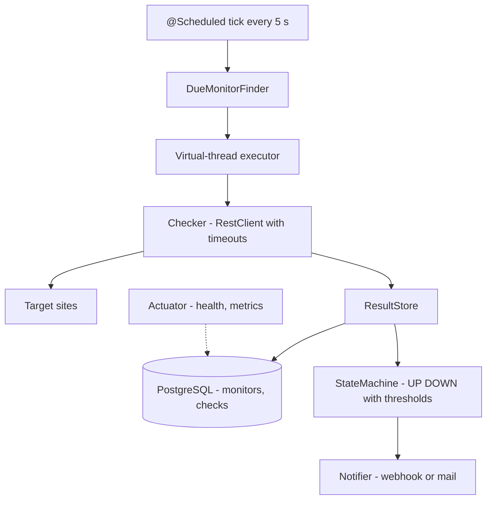
- **Tick** — a frequent `@Scheduled(fixedDelay = 5000)` that asks "which monitors are due?" instead of one scheduled task per monitor.
- **Executor** — `Executors.newVirtualThreadPerTaskExecutor()`; each check is a blocking HTTP call on its own cheap virtual thread.
- **Checker** — `RestClient` with connect/read timeouts, measures latency, validates status and keyword.
- **StateMachine** — counts consecutive results and changes status only when thresholds are crossed.
- **Notifier** — sends one message per transition, with retries.
- **Actuator** — exposes health groups and Micrometer metrics (`monitor.checks`, `monitor.latency`).

### Data model
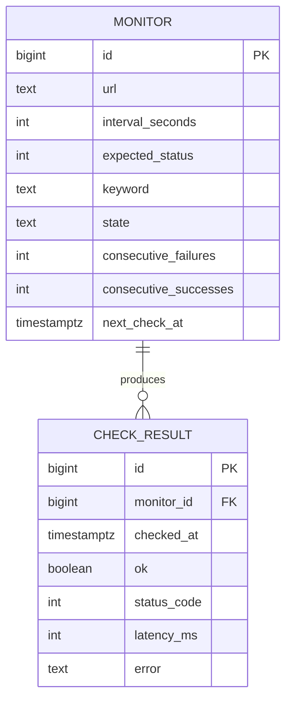

### Tech stack
| Component | Choice | Why |
|---|---|---|
| HTTP | `RestClient` with JDK `HttpClient` | timeouts, virtual-thread friendly |
| Concurrency | virtual threads | thousands of waiting checks are cheap |
| Scheduling | `@Scheduled` tick + `next_check_at` column | one query finds due work |
| Ops | `spring-boot-starter-actuator`, Micrometer, Prometheus registry | self-monitoring |
| Data | `JdbcClient`, Flyway | simple tables, retention delete job |

### Milestones
1. **Single check.** *Done when* tests against a local stub server cover 200, 500, wrong keyword and a timeout.
2. **Scheduling loop.** Due-monitor query with `next_check_at <= now()`. *Done when* 50 monitors with a fake clock are each checked exactly once per interval.
3. **State machine.** *Done when* a unit test feeding fail, fail, fail, ok, ok produces exactly one DOWN and one UP notification.
4. **Uptime report.** SQL for availability and p95 (`percentile_cont(0.95)`). *Done when* seeded results produce the expected numbers.
5. **Self-observability.** Readiness group including the database, metrics per monitor. *Done when* stopping the database makes `/actuator/health/readiness` return 503 while `/actuator/health/liveness` stays 200.

### Deep dive: the hard parts
- **Timeouts and bounded concurrency.** Virtual threads make waiting cheap, but 500 simultaneous slow targets still hold 500 sockets. Cap in-flight checks (a `Semaphore`, or Framework 7 `@ConcurrencyLimit` on the check method) and enforce a total deadline per check.
- **Flapping.** A site that fails every other check would send endless alerts without thresholds. Separate thresholds for DOWN and UP (**hysteresis**) keep notifications meaningful.
- **Liveness vs readiness.** Liveness answers "should Kubernetes restart me?" and should almost never depend on external systems; readiness answers "should I receive traffic?" and may include the database. Putting the database in liveness turns a database blip into a restart storm.
- **Data retention.** At 8 checks per second you write about 700,000 rows a day. A nightly delete of rows older than 7 days (in batches) or a partitioned table keeps the database small.

### Testing strategy
- Stub HTTP servers on random ports (a tiny `HttpServer` from the JDK works) for realistic timeouts.
- A fixed `Clock` and calling the tick method directly for scheduling logic.
- Actuator health tests with `@SpringBootTest` and a stopped or mocked dependency.

### Trade-offs, scaling and failure modes
- One instance is a single point of failure for monitoring itself; two instances need a lock or partitioning of monitors (project 38).
- Checking from one network location cannot tell "site down" from "my network down"; real services check from several regions and require agreement.
- Notification channels fail too; retry with back-off and record undelivered alerts.

### Stretch goals
- A public status page rendered server-side.
- TLS certificate expiry checks with a warning 14 days ahead.
- Multi-region agents that report to a central service.

### Skills practised
- [Ch 6 — REST clients and HTTP interfaces](../chapters/06-rest-clients-and-http-interfaces/README.md): `RestClient`, timeouts, error handling.
- [Ch 14 — Messaging, async and scheduling](../chapters/14-messaging-async-and-scheduling/README.md): `@Scheduled`, executors, virtual threads.
- [Ch 15 — Observability and production](../chapters/15-observability-and-production/README.md): Actuator, health groups, probes, Micrometer.
- [Ch 4 — AOP and proxies](../chapters/04-aop-and-proxies/README.md): `@ConcurrencyLimit`.

### In the interview
**Q:** What goes into liveness vs readiness? / **A:** Liveness: only the app's own ability to make progress. Readiness: whether it can serve traffic now, which may include the database. External dependencies in liveness cause restart storms.

**Q:** How do you check 500 URLs concurrently without a huge thread pool? / **A:** Virtual threads for the blocking calls, plus an explicit concurrency cap and strict timeouts.

**Q:** How do you avoid alert spam? / **A:** Consecutive-failure and consecutive-success thresholds, one notification per state transition.

### TL;DR
A monitoring service that checks many URLs concurrently with virtual threads and strict timeouts, turns noisy results into clean UP/DOWN transitions, and exposes its own health correctly.

## 11. Blog Platform with Spring Security and JWT
**Level:** Intermediate · **Time:** 2 weeks · **Prerequisites:** Ch 8, Ch 10, Ch 11

### What it is
A multi-author blog API (articles, comments, tags, follows, favourites) secured with **JSON Web Tokens**. A **JWT** is a compact, signed string holding claims such as "user 42, role AUTHOR, expires 10:15"; anyone with the public key can verify it was issued by you and not altered. Users log in once with a password, receive a short-lived **access token** and a longer-lived **refresh token**, and send `Authorization: Bearer <token>` on every request. The API acts as an **OAuth2 resource server**: Spring Security validates the token on each call without a server-side session.

### The problem it solves
Stateless token authentication is the default for APIs consumed by single-page apps and mobile clients, and it is the most common Spring Security interview topic. It is also easy to get dangerously wrong: weak signing keys, tokens that never expire, no way to log out, ownership checks missing on update endpoints. This project builds the whole chain and tests each security rule.

### Real-world examples
- [RealWorld](https://github.com/gothinkster/realworld) specifies a Medium-style blog API (articles, comments, tags, profiles, token auth) implemented in dozens of back-end frameworks — use its spec as your functional contract and compare implementations.
- [RFC 7519](https://www.rfc-editor.org/rfc/rfc7519) defines JWT; the [Spring Security JWT resource server reference](https://docs.spring.io/spring-security/reference/servlet/oauth2/resource-server/jwt.html) describes the validation pipeline you will configure.

### Requirements
**Functional**
- Register, log in (`POST /api/auth/login` → access + refresh tokens), refresh, log out (revoke refresh token).
- Articles: anyone can read published articles; AUTHORs create and edit **their own**; EDITORs can edit or unpublish any; ADMINs manage users.
- Comments by any logged-in user; delete by comment author or article author.
- Feed of articles from followed authors, paginated.

**Non-functional**
- Access tokens expire in 15 minutes, refresh tokens in 14 days and rotate on each use.
- Tokens signed with RS256 (an RSA key pair); the private key never leaves the auth component; a JWKS endpoint publishes the public key.
- Passwords hashed with a slow adaptive function (bcrypt or Argon2) via `DelegatingPasswordEncoder`.
- Login endpoint limited to 5 attempts per minute per account and per IP.

### The architecture
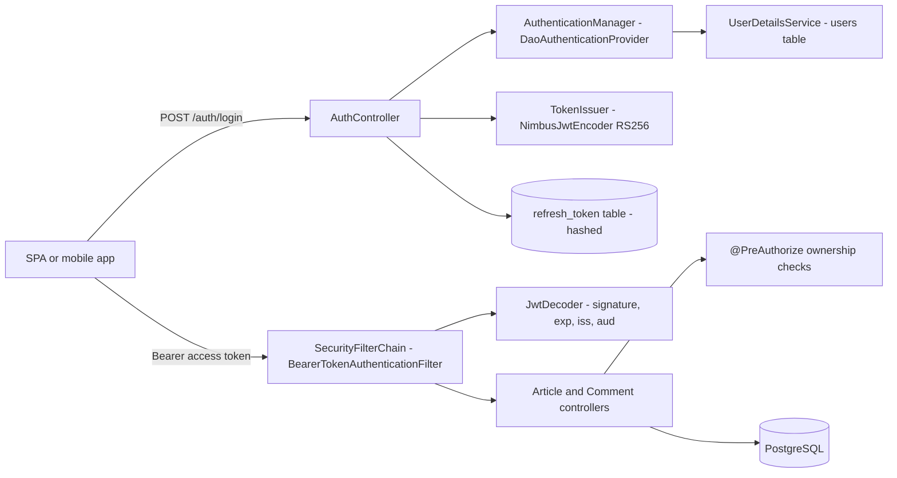
- **AuthController** — login, refresh and logout; the only place passwords are checked.
- **AuthenticationManager / DaoAuthenticationProvider** — loads the user and compares the password hash.
- **TokenIssuer** — builds claims (`sub`, `roles`, `iat`, `exp`, `iss`, `aud`) and signs with `NimbusJwtEncoder`.
- **SecurityFilterChain** — configured with the Security 7 lambda DSL; `oauth2ResourceServer(o -> o.jwt(...))` adds the bearer-token filter.
- **JwtDecoder** — verifies the signature and standard claims; a `JwtAuthenticationConverter` maps `roles` to `GrantedAuthority`s.
- **Method security** — `@PreAuthorize("@articleSecurity.canEdit(#id, authentication)")` for ownership rules.

### Data model
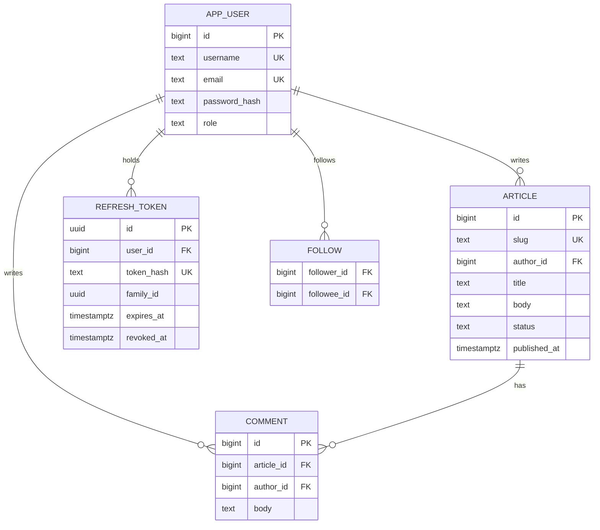

### Tech stack
| Component | Choice | Why |
|---|---|---|
| Security | `spring-boot-starter-security` + `-security-oauth2-resource-server` | filter chain, JWT validation |
| Token minting | `NimbusJwtEncoder.withKeyPair(...)` (Security 7 builder) | standard JOSE library, no hand-rolled crypto |
| Passwords | `PasswordEncoderFactories.createDelegatingPasswordEncoder()` | `{bcrypt}` prefix allows future upgrades |
| Data | Spring Data JPA, Flyway | relationships and pagination |
| Tests | `spring-boot-starter-security-test` | `jwt()` request post-processor, `@WithMockUser` |

### Milestones
1. **Users and passwords.** Registration with hashing. *Done when* the stored hash starts with `{bcrypt}` and login with a wrong password returns 401.
2. **Issue and validate tokens.** *Done when* a test logs in, calls a protected endpoint with the token (200), without it (401), and with an expired or tampered token (401 with a `WWW-Authenticate` header).
3. **Roles and ownership.** *Done when* tests prove an AUTHOR cannot edit someone else's article (403), an EDITOR can, and anonymous users can read published articles only.
4. **Refresh rotation and logout.** *Done when* reusing an already-used refresh token revokes the whole token family and returns 401.
5. **Hardening.** CORS for the SPA origin only, login rate limiting, security headers. *Done when* a preflight from an unknown origin is rejected and the 6th login in a minute returns 429.

### Deep dive: the hard parts
- **Logout with stateless tokens.** A JWT stays valid until it expires; the server cannot "delete" it. Keep access tokens short (15 minutes), make refresh tokens server-side records you can revoke, and accept that a stolen access token works for at most its lifetime. A denylist of token ids (`jti`) checked on each request is possible but reintroduces state.
- **Refresh-token rotation and reuse detection.** Each refresh returns a new refresh token and marks the old one used. If a used token is presented again, someone copied it: revoke every token in that family. Store only a hash of the token, like a password.
- **401 vs 403.** 401 means "who are you?" (missing or invalid credentials) and includes `WWW-Authenticate: Bearer`; 403 means "I know who you are, and you may not". Tests should assert both precisely.
- **Ownership is data-dependent.** URL rules (`requestMatchers("/api/articles/**").hasRole("AUTHOR")`) cannot know who owns article 7. Put that check in method security with a bean that queries ownership, or in the service with a repository query `where id = ? and author_id = ?`.

### Testing strategy
- `@WebMvcTest` with `spring-security-test`: `.with(jwt().authorities(...))` builds a token without real signing, so authorization rules are tested fast.
- Full `@SpringBootTest` for the real login → token → call flow with the actual encoder and decoder.
- A test matrix (role × endpoint × owner/non-owner) generated with `@ParameterizedTest`, so no rule is forgotten.

### Trade-offs, scaling and failure modes
- Self-issued JWTs are fine for one product; once several apps need single sign-on, MFA or social login, move to a real authorization server (project 34) and keep this API as a pure resource server.
- Stateless validation scales horizontally with no session store; the cost is revocation delay.
- Key rotation: publish two public keys in the JWKS during a rotation window, sign with the new one, retire the old after the longest token lifetime.

### Stretch goals
- Store tokens for the browser in an HttpOnly cookie via a BFF (project 40) instead of JavaScript memory.
- Add one-time-token (magic link) login, supported natively by Spring Security.
- Full-text search on articles with PostgreSQL `tsvector`.

### Skills practised
- [Ch 10 — Spring Security fundamentals](../chapters/10-spring-security-1-fundamentals/README.md): filter chain, lambda DSL, password storage, 401 vs 403, method security, CORS, testing.
- [Ch 11 — Tokens and OAuth2](../chapters/11-spring-security-2-tokens-and-oauth2/README.md): JWT, resource server, `NimbusJwtEncoder`, claims to authorities, refresh and revocation, rate limiting.
- [Ch 8 — Spring Data JPA and Hibernate](../chapters/08-spring-data-jpa-and-hibernate/README.md): relationships and feeds.

### In the interview
**Q:** How do you log a user out when you use JWTs? / **A:** Revoke the refresh token server-side and let the short-lived access token expire; if immediate revocation is required, add a `jti` denylist or use opaque tokens with introspection.

**Q:** Where do you check that a user owns the article? / **A:** In method security or the service layer, because it depends on data; URL rules only see roles.

**Q:** Why RS256 instead of HS256? / **A:** With an asymmetric key, only the issuer holds the private key; any service can verify with the public key from the JWKS. With HS256 every verifier holds the secret that can also mint tokens.

**Q:** What does `DelegatingPasswordEncoder` buy you? / **A:** The `{id}` prefix records the algorithm per hash, so you can move to a stronger algorithm and upgrade hashes on next login.

### TL;DR
A RealWorld-style blog API with password login, RS256 access tokens, rotating refresh tokens, role and ownership rules, and a test matrix proving every 401 and 403.

## 12. Photo Journal with OAuth2 Login and a Resource Server
**Level:** Intermediate · **Time:** 2 weeks · **Prerequisites:** Ch 10, Ch 11

### What it is
Two cooperating applications. **Journal Web** is a server-rendered web app where users "Sign in with Google" (or GitHub, via an identity provider) — this is **OAuth2 login**, where an external **identity provider (IdP)** authenticates the user and your app receives an **ID token** describing them. **Photo API** is a separate REST service that stores photo entries and accepts only **access tokens** issued by the same IdP — it is an **OAuth2 resource server**. Journal Web calls Photo API on the user's behalf, attaching the user's access token.

### The problem it solves
Real systems rarely own passwords any more; they delegate login to Google, Microsoft, Okta or Keycloak. You need to understand the moving parts — authorization code flow, PKCE, ID tokens vs access tokens, scopes, audiences, token relay — to configure Spring Security correctly and debug the inevitable redirect loops. This project separates the two roles (client and resource server) so each is clear.

### Real-world examples
- The Spring tutorial ["Spring Boot and OAuth2"](https://spring.io/guides/tutorials/spring-boot-oauth2) builds social login with GitHub and Google, the same client side as Journal Web.
- [Keycloak](https://www.keycloak.org/docs/latest/server_admin/) is an open-source IdP that can broker logins from GitHub or Google and issue JWT access tokens for your own APIs — the piece GitHub's plain OAuth apps cannot provide.

### Requirements
**Functional**
- Journal Web: login with the IdP, show "my journal", upload a caption and photo, log out (both locally and at the IdP — RP-initiated logout).
- Photo API: `GET/POST/DELETE /api/entries`, accessible only with a valid access token having scope `journal.read` or `journal.write`; users see only their own entries (`sub` claim).
- A nightly job in Photo API's ecosystem uses the **client credentials** flow (machine-to-machine, no user) to call an admin endpoint.

**Non-functional**
- Authorization code flow **with PKCE** (Proof Key for Code Exchange: a one-time secret that stops stolen codes being redeemed) — Security 7 uses it by default.
- Photo API validates `iss`, `aud`, `exp` and signature using the IdP's JWKS, cached and refreshed on key rotation.
- No tokens ever reach browser JavaScript: they stay in Journal Web's server-side session.

### The architecture
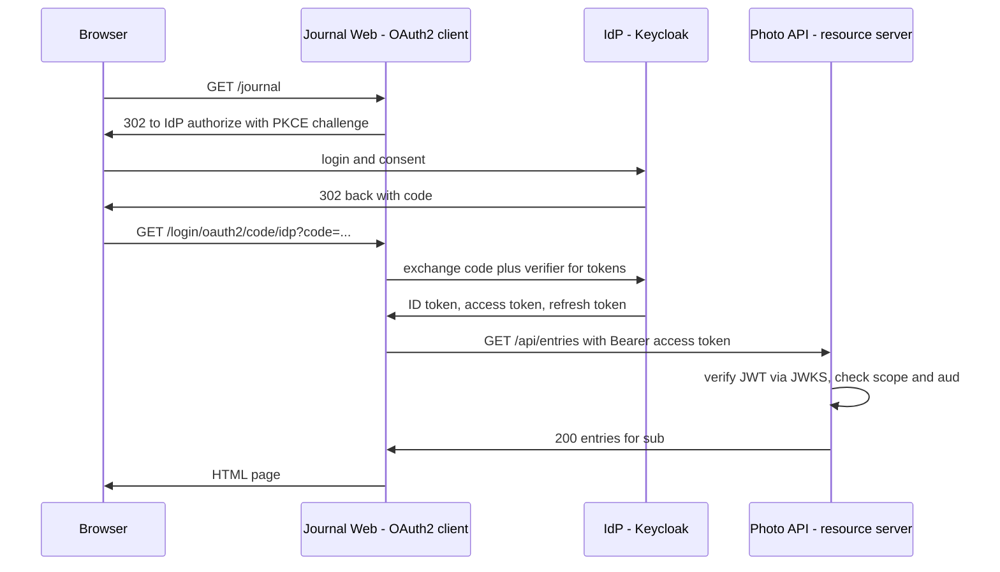
- **Journal Web** — `oauth2Login()` handles the redirect dance; the `OAuth2AuthorizedClientManager` stores tokens per user session and refreshes them.
- **IdP** — authenticates the user, issues tokens, publishes `/.well-known/openid-configuration` and a JWKS.
- **Photo API** — `oauth2ResourceServer(o -> o.jwt(...))` with `spring.security.oauth2.resourceserver.jwt.issuer-uri`; scopes become `SCOPE_journal.read` authorities.
- **Token relay** — a `RestClient` (or HTTP service interface) in Journal Web with `OAuth2ClientHttpRequestInterceptor` attaches the current user's access token.

### Data model
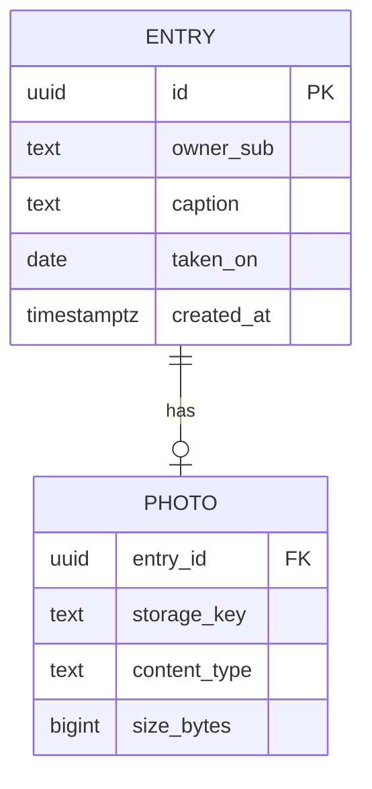
`owner_sub` is the IdP's stable subject identifier. Never key data by email — emails change and can be reassigned.

### Tech stack
| Component | Choice | Why |
|---|---|---|
| Web client | `spring-boot-starter-security-oauth2-client` + Thymeleaf | OIDC login, authorized-client storage |
| API | `spring-boot-starter-security-oauth2-resource-server` | JWT validation from `issuer-uri` |
| IdP | Keycloak in a container (or Spring Authorization Server, project 34) | realms, clients, scopes, identity brokering |
| Calling the API | `RestClient` + `OAuth2ClientHttpRequestInterceptor`, or `@ClientRegistrationId` on an HTTP interface (type-level since Security 7) | automatic token attach and refresh |

### Milestones
1. **IdP setup.** A realm with a confidential client for Journal Web and an API audience. *Done when* you can fetch the discovery document and see your scopes.
2. **Login.** *Done when* visiting `/journal` redirects to the IdP and, after login, shows the user's name from the ID token's claims.
3. **Resource server.** *Done when* Photo API returns 401 without a token, 403 with a token lacking `journal.write` on `POST`, and 200 otherwise — tested with the `jwt()` post-processor.
4. **Token relay.** *Done when* Journal Web lists entries fetched from Photo API, and an expired access token is refreshed transparently.
5. **Client credentials and logout.** *Done when* the nightly job authenticates as itself, and logout ends both the local session and the IdP session.

### Deep dive: the hard parts
- **ID token vs access token.** The ID token is for the *client* — it says who logged in. The access token is for the *API* — it says what the bearer may do. Never send ID tokens to APIs, and never let the client parse access tokens for identity; their format is the IdP's business.
- **Audience validation.** Without checking `aud`, a token issued for some other API in the same IdP would be accepted by yours. Add a `JwtValidator` for the expected audience (or the Boot property for audiences) and test it with a token for a different audience.
- **Mapping claims to authorities.** Scopes map automatically to `SCOPE_*`. Keycloak puts roles in nested claims (`realm_access.roles`); write a `Converter<Jwt, Collection<GrantedAuthority>>`, or in Boot 4.1 use `spring.security.oauth2.resourceserver.jwt.authorities-claim-expressions`.
- **Redirect URI and proxies.** Behind a reverse proxy, Spring must know the external scheme and host to build `redirect_uri`; set `server.forward-headers-strategy=framework` or the IdP rejects the callback.

### Testing strategy
- Photo API: slice tests with `jwt().jwt(j -> j.claim("scope", ...))`; one test with a real `JwtDecoder` against a token signed by a test key and a mock JWKS.
- Journal Web: `oauth2Login()` request post-processor for controller tests; `MockRestServiceServer` to assert the bearer header is relayed.
- An end-to-end test with Keycloak in Testcontainers, if Docker is available.

### Trade-offs, scaling and failure modes
- Server-side sessions in Journal Web keep tokens out of the browser but make the web tier stateful; use Spring Session with Redis for several instances.
- If the IdP is down, nobody can log in, but existing access tokens still validate (the JWKS is cached) — a useful property to state explicitly.
- Token relay passes the user's full permissions downstream; for deeper call chains, **token exchange** (RFC 8693) issues narrower tokens per hop.

### Stretch goals
- Add GitHub as a second login option brokered through Keycloak, and link accounts by verified email.
- Multi-issuer resource server: accept tokens from two realms (Ch 11 multi-tenancy).
- Replace Thymeleaf with a SPA and turn Journal Web into a BFF (project 40).

### Skills practised
- [Ch 11 — Tokens and OAuth2](../chapters/11-spring-security-2-tokens-and-oauth2/README.md): OAuth 2.0/OIDC, resource server, claims to authorities, OAuth2 login, client credentials, token relay.
- [Ch 10 — Spring Security fundamentals](../chapters/10-spring-security-1-fundamentals/README.md): filter chains, sessions, logout, testing.
- [Ch 6 — REST clients and HTTP interfaces](../chapters/06-rest-clients-and-http-interfaces/README.md): interceptors and HTTP service groups.

### In the interview
**Q:** What is PKCE and why use it even for confidential clients? / **A:** The client sends a hash of a random verifier with the authorization request and the verifier itself when exchanging the code, so a stolen code alone is useless. OAuth 2.1 recommends it for every client, and Security 7 enables it by default.

**Q:** ID token or access token for your API? / **A:** Access token. The ID token is the client's proof of login; the API validates access tokens for issuer, audience, expiry and scopes.

**Q:** How does a resource server get the IdP's keys? / **A:** From the JWKS URI in the issuer's discovery document; Spring caches the keys and refetches when a token has an unknown key id.

### TL;DR
Split client and API: a web app that signs users in through an IdP with PKCE and relays their access token to a resource server that checks signature, issuer, audience and scopes.

## 13. E-commerce Cart and Checkout
**Level:** Intermediate · **Time:** 2–3 weeks · **Prerequisites:** Ch 7, Ch 8

### What it is
The money path of an online shop: a shopping cart, inventory, a checkout that reserves stock, prices the order, charges a (fake) payment provider and creates the order — without ever overselling stock or charging twice. The core lesson is **transactions**: a group of database operations that succeed or fail together, and how Spring's `@Transactional` controls them.

### The problem it solves
Checkout looks like "insert an order", but it combines contended shared data (the last item in stock), external side effects that cannot be rolled back (a card charge), and users who double-click. Getting it wrong means oversold inventory, orphaned charges or angry customers. This project forces you to choose isolation levels, lock strategies and transaction boundaries deliberately.

### Real-world examples
- Shopify's engineering post ["10 Tips for Building Resilient Payment Systems"](https://shopify.engineering/building-resilient-payment-systems) covers low timeouts, idempotency keys and reconciliation for checkout.
- The PostgreSQL manual on [transaction isolation](https://www.postgresql.org/docs/current/transaction-iso.html) and [explicit locking](https://www.postgresql.org/docs/current/explicit-locking.html) explains exactly what your `@Transactional(isolation = ...)` and `SELECT ... FOR UPDATE` do.

### Requirements
**Functional**
- Cart: add/remove items, change quantity; carts expire after 7 days of inactivity.
- Checkout: validate cart, reserve stock, compute totals (price snapshot, tax, discount code), call payment, confirm order; on payment failure, release stock.
- Order history and order status (`PENDING_PAYMENT`, `PAID`, `CANCELLED`).
- Admin: adjust stock, change prices (existing carts show the new price; existing orders keep the old).

**Non-functional**
- **Zero overselling** under 200 concurrent checkouts for the last 10 units, proved by a test.
- A repeated checkout request with the same `Idempotency-Key` returns the same order, never a second charge.
- Checkout p95 under 300 ms excluding the payment provider; payment calls time out after 3 s.

### The architecture
```mermaid
flowchart TD
    C["Client"] --> CC["CartController"]
    C -->|"POST /checkout with Idempotency-Key"| CO["CheckoutController"]
    CO --> CS["CheckoutService - orchestrates, no long transaction"]
    CS --> T1["Tx 1 - reserve stock, create PENDING order"]
    CS --> PAY["PaymentClient - outside any transaction"]
    CS --> T2["Tx 2 - mark PAID or release stock"]
    T1 --> DB[("PostgreSQL - products, stock, carts, orders")]
    T2 --> DB
    SW["@Scheduled sweeper - expire stale PENDING orders"] --> DB
```
- **CartController** — simple CRUD on cart lines, keyed by user or anonymous cart id.
- **CheckoutService** — not itself transactional: it calls two short transactional methods on another bean around the payment call.
- **Tx 1** — atomically decrements stock for each line with a conditional update and inserts the order with a price snapshot.
- **PaymentClient** — `RestClient` to a fake provider with timeouts and an idempotency key derived from the order id.
- **Tx 2** — marks the order `PAID`, or restores stock and marks `CANCELLED`.
- **Sweeper** — finds orders stuck in `PENDING_PAYMENT` (crash between steps) and reconciles them with the provider.

### Data model
```mermaid
erDiagram
    PRODUCT ||--|| STOCK : "has"
    CART ||--o{ CART_LINE : "contains"
    ORDERS ||--o{ ORDER_LINE : "contains"
    PRODUCT {
        bigint id PK
        text sku UK
        numeric price
    }
    STOCK {
        bigint product_id PK
        int available
        bigint version
    }
    CART {
        uuid id PK
        bigint user_id
        timestamptz updated_at
    }
    CART_LINE {
        uuid cart_id FK
        bigint product_id FK
        int quantity
    }
    ORDERS {
        bigint id PK
        text idempotency_key UK
        text status
        numeric total
        text payment_ref
    }
    ORDER_LINE {
        bigint order_id FK
        bigint product_id FK
        int quantity
        numeric unit_price
    }
```

### Tech stack
| Component | Choice | Why |
|---|---|---|
| Transactions | `@Transactional`, `TransactionTemplate` | declarative for services, programmatic for fine-grained steps |
| Persistence | Spring Data JPA for carts and orders, `JdbcClient` for the stock update | the hot path is one SQL statement |
| Database | PostgreSQL | row locks, `READ COMMITTED` default |
| Payment stub | WireMock or a small stub controller | simulate timeouts and declines |
| Tests | Testcontainers PostgreSQL | real locking behaviour, not H2's |

### Milestones
1. **Cart.** *Done when* cart CRUD and expiry work with tests.
2. **Naive checkout, broken on purpose.** Read stock, check, write in Java. *Done when* a 200-thread test oversells — keep this test.
3. **Fix with a conditional update.** `UPDATE stock SET available = available - :q WHERE product_id = :id AND available >= :q`; zero rows updated means out of stock. *Done when* the same test sells exactly 10.
4. **Split transactions around payment.** *Done when* a payment timeout leaves stock released and the order `CANCELLED`, and the database connection is not held during the 3 s wait (assert with a pool of size 2 and parallel checkouts).
5. **Idempotency.** Unique `idempotency_key`; a repeat returns the stored result. *Done when* two identical concurrent requests produce one order and one payment call.
6. **Reconciliation sweeper.** *Done when* a simulated crash after payment but before Tx 2 is repaired by the sweeper asking the provider for the payment status.

### Deep dive: the hard parts
- **Lost updates and overselling.** Under `READ COMMITTED`, two transactions can both read `available = 1` and both write 0. Options: the conditional update (atomic in one statement — simplest), a pessimistic lock (`SELECT ... FOR UPDATE`, `@Lock(PESSIMISTIC_WRITE)`), optimistic locking with `@Version` and retries, or `SERIALIZABLE` isolation with retry on serialization failures. Measure them under contention.
- **Never hold a transaction across a remote call.** A transaction open during a 3 s payment call holds a connection and row locks for 3 s; with a pool of 10, eleven slow checkouts stop the shop. Short transaction, remote call, short transaction — and design for the crash between them.
- **Self-invocation.** If `CheckoutService.checkout()` calls `this.reserve()` annotated `@Transactional`, no transaction starts — the call bypasses the proxy. Put the transactional steps on a separate bean or use `TransactionTemplate`.
- **Price snapshots.** Order lines store `unit_price` at purchase time; recomputing from `product.price` later rewrites history. Carts, in contrast, show live prices and must warn when a price changed since the item was added.

### Testing strategy
- Concurrency tests with virtual threads and a `CountDownLatch` start gate, asserting final stock and order counts.
- Failure-injection tests: payment timeout, decline, exception after payment.
- Repository tests on real PostgreSQL via Testcontainers (`@ServiceConnection`), because lock semantics differ in H2.

### Trade-offs, scaling and failure modes
- Conditional updates scale well for single-row stock; a flash sale on one SKU still serializes on that row — shard stock into buckets or pre-allocate tokens if that matters.
- Reserving at checkout (not at add-to-cart) avoids locking stock in abandoned carts, at the cost of "sold out" surprises at checkout.
- Two separate transactions mean temporary states (`PENDING_PAYMENT`) are visible; the sweeper and idempotency make them safe. A saga (project 28) generalizes this across services.

### Stretch goals
- Discount codes with a usage limit, enforced with the same conditional-update trick.
- Emit an `OrderPaid` event with `@TransactionalEventListener(phase = AFTER_COMMIT)` to send email only after commit.
- Compare throughput of the four locking strategies and chart it.

### Skills practised
- [Ch 7 — Data access with JDBC and transactions](../chapters/07-data-access-jdbc-and-transactions/README.md): `@Transactional`, propagation, isolation, pitfalls, `TransactionTemplate`, `@TransactionalEventListener`.
- [Ch 8 — Spring Data JPA and Hibernate](../chapters/08-spring-data-jpa-and-hibernate/README.md): optimistic and pessimistic locking.
- [Ch 12 — Testing Spring applications](../chapters/12-testing-spring-apps/README.md): Testcontainers with `@ServiceConnection`.

### In the interview
**Q:** How do you prevent overselling? / **A:** An atomic conditional update that decrements only if enough stock remains, checking the affected row count; alternatives are row locks or optimistic versions with retry.

**Q:** Why not wrap the whole checkout, including payment, in one transaction? / **A:** It holds connections and locks during a slow remote call, and the card charge cannot be rolled back anyway. I use short transactions around the call, plus idempotency and reconciliation.

**Q:** Your `@Transactional` method did not roll back. Why? / **A:** Self-invocation, a non-public method, a checked exception, or the exception was caught inside the method.

### TL;DR
Checkout done safely: atomic stock decrements, short transactions around an external payment, idempotency keys, price snapshots and a reconciliation job for the crash in between.

## 14. Product Catalog Cache with Redis
**Level:** Intermediate · **Time:** 1–2 weeks · **Prerequisites:** Ch 9, Ch 15

### What it is
A read-heavy product catalog service whose responses are cached in **Redis**, an in-memory key-value store shared by all instances, using Spring's **cache abstraction** (`@Cacheable`, `@CachePut`, `@CacheEvict`). You will add a small in-process cache in front (two levels), measure hit rates, and deal with the classic caching failures: stale data, stampedes and cache outages.

### The problem it solves
Catalog pages are read thousands of times for each update. Hitting the database every time wastes money and adds latency. But caching is where correctness quietly dies: users see old prices, an expired hot key sends a thousand requests to the database at once, or the cache going down takes the whole site with it. This project teaches you to cache deliberately and to measure the result.

### Real-world examples
- ["Scaling Memcache at Facebook"](https://www.usenix.org/conference/nsdi13/technical-sessions/presentation/nishtala) (NSDI 2013) describes look-aside caching at huge scale, including leases to tame stale sets and thundering herds.
- The [Spring Framework cache abstraction reference](https://docs.spring.io/spring-framework/reference/integration/cache.html) and the [Spring Boot caching reference](https://docs.spring.io/spring-boot/reference/io/caching.html) cover the annotations and the Redis cache manager configuration.

### Requirements
**Functional**
- `GET /api/products/{id}` and `GET /api/categories/{id}/products?page=` served from cache when possible.
- Admin updates (price, description, stock status) visible to readers within 5 seconds.
- `POST /admin/cache/evict?name=` for operators.

**Non-functional**
- Cache hit rate above 95% under a realistic read/write mix (100:1), measured from metrics.
- p95 under 10 ms on hits, under 60 ms on misses.
- If Redis is unavailable, the service keeps serving from the database (slower) instead of failing.
- At most one database load per hot key per instance at expiry time.

### The architecture
```mermaid
flowchart TD
    C["Client"] --> PC["ProductController"]
    PC --> PS["ProductService - @Cacheable"]
    PS --> L1["L1 Caffeine - per instance, 5 s TTL"]
    L1 -->|"miss"| L2["L2 Redis - shared, 10 min TTL"]
    L2 -->|"miss"| DB[("PostgreSQL")]
    ADM["Admin update"] --> PS
    PS -->|"after commit evict"| L2
    PS -->|"publish invalidation"| PUB["Redis pub-sub channel"]
    PUB --> L1
```
- **ProductService** — the cached methods; the cache key is the product id (or category id + page).
- **L1 Caffeine** — in-JVM cache with a very short TTL: absorbs hot keys with zero network cost; staleness bounded by 5 s.
- **L2 Redis** — shared across instances; values stored as JSON with a type-safe serializer and a key prefix per cache.
- **Invalidation** — after the database transaction commits, evict the Redis key and publish a message so every instance drops its L1 entry.
- **Fallback** — a `CacheErrorHandler` that logs and treats Redis errors as misses.

### Data model
| Key pattern | Value | TTL |
|---|---|---|
| `catalog::product::{id}` | `ProductView` JSON (id, name, price, currency, inStock) | 10 min plus random jitter |
| `catalog::category::{id}::page::{n}` | list of product ids only | 2 min |
| channel `catalog-invalidation` | product id | — |

Caching category pages as **lists of ids** (then fetching each product from cache) means a price change invalidates one product entry, not every page containing it.

### Tech stack
| Component | Choice | Why |
|---|---|---|
| Abstraction | `spring-boot-starter-cache`, `@EnableCaching` | provider-independent annotations |
| L2 | `spring-boot-starter-data-redis` (Lettuce), `RedisCacheManager` | TTL per cache, key prefixes |
| L1 | Caffeine | fast, size and time bounds, `sync` loading |
| Metrics | Micrometer cache metrics via Actuator | hit/miss/eviction counts |
| Tests | Testcontainers Redis | real serialization and TTL |

### Milestones
1. **Baseline.** No cache; a load test (e.g. a JUnit loop or a tool such as k6) records p95 and database queries per second. *Done when* you have numbers to beat.
2. **Redis cache.** `@Cacheable("product")` with a `RedisCacheManager`, JSON values, 10-minute TTL. *Done when* the second read issues no SQL and the key is visible in Redis.
3. **Correct invalidation.** Evict after commit (`@TransactionalEventListener` or a transaction-aware cache manager). *Done when* a test proves a rolled-back update does not evict and a committed one does.
4. **Two levels and pub/sub.** *Done when* two application instances in one test both serve the new price within 5 s of an update.
5. **Resilience and stampede.** `CacheErrorHandler` fallback, `sync = true`, TTL jitter. *Done when* stopping Redis still returns 200s, and 100 concurrent misses for one key cause one SQL query per instance.

### Deep dive: the hard parts
- **Evict after commit, not before.** If you evict and then the transaction rolls back, fine; but if you evict, another request reloads the **old** value before your commit, and caches it for 10 minutes. Evicting after commit narrows that window; a short L1 TTL bounds the rest.
- **Cache stampede.** When a hot key expires, many concurrent requests miss together and all hit the database. `@Cacheable(sync = true)` lets one thread per JVM compute while others wait; random TTL jitter stops many keys expiring together; across instances, a short lock in Redis or "refresh ahead" helps.
- **Serialization.** Java serialization in Redis is fragile (class changes break reads) and unsafe; use JSON with explicit types, version your cached DTOs, and never cache JPA entities (lazy proxies and session state do not belong in a cache).
- **Caching null and errors.** Caching "not found" protects the database from repeated lookups of missing ids, but must expire quickly; never cache exceptions.

### Testing strategy
- Cache behaviour tests that count repository calls with a spy (`@MockitoSpyBean`).
- Testcontainers Redis for serialization, TTL and pub/sub.
- A failure test that stops the Redis container mid-test.

### Trade-offs, scaling and failure modes
- Every cache trades freshness for speed; write down the staleness each cache allows and make sure product owners agree (prices: 5 s; descriptions: 10 min).
- Redis is now a dependency: monitor memory, set `maxmemory` and an eviction policy, and plan for failover.
- Caching full pages is simplest but invalidation becomes "flush everything"; caching small entities and composing is more work and much more precise.

### Stretch goals
- Write-through for stock status with `@CachePut`.
- Redis client-side caching (server-assisted invalidation) and compare with your pub/sub approach.
- Add `Cache-Control` and `ETag` headers so browsers and CDNs cache too.

### Skills practised
- [Ch 9 — Spring Data beyond JPA, and caching](../chapters/09-spring-data-beyond-jpa-and-caching/README.md): Spring Data Redis, the caching abstraction, `sync`, pitfalls.
- [Ch 7 — Data access with JDBC and transactions](../chapters/07-data-access-jdbc-and-transactions/README.md): `@TransactionalEventListener` for after-commit actions.
- [Ch 15 — Observability and production](../chapters/15-observability-and-production/README.md): cache metrics.
- [Ch 12 — Testing Spring applications](../chapters/12-testing-spring-apps/README.md): Testcontainers.

### In the interview
**Q:** How do you keep a cache consistent with the database? / **A:** Cache-aside with eviction after commit, short TTLs as a safety net, and pub/sub to clear per-instance caches. Perfect consistency is not the goal; bounded staleness is.

**Q:** What is a cache stampede and how do you prevent it? / **A:** Many requests missing on the same key at once and overloading the database. `sync = true` per JVM, TTL jitter, and locks or refresh-ahead across instances.

**Q:** What happens when Redis goes down? / **A:** With a `CacheErrorHandler` the app treats errors as misses and serves from the database; I also cap database load so the fallback does not cause a second outage.

### TL;DR
Two-level caching with Caffeine and Redis, evicted after commit, protected against stampedes and outages, and justified by measured hit rates and latencies.

## 15. File Upload and Media Service
**Level:** Intermediate · **Time:** 2 weeks · **Prerequisites:** Ch 5, Ch 6, Ch 14

### What it is
A service that accepts user files (images, PDFs), stores them in **object storage** (an S3-compatible bucket such as AWS S3 or MinIO — storage for blobs addressed by key rather than files in folders), validates and scans them, generates thumbnails asynchronously, and serves them back through short-lived signed URLs. It supports both small uploads through the API and large uploads directly from the browser to storage using **presigned URLs** — URLs that grant temporary permission for one specific upload.

### The problem it solves
File handling is a security and resource minefield: huge uploads that exhaust memory or disk, files that lie about their type, malware, path traversal in file names, and slow processing that blocks request threads. This project teaches streaming, validation, asynchronous processing and the "do not proxy big files through your app" pattern.

### Real-world examples
- AWS documents [uploading objects with presigned URLs](https://docs.aws.amazon.com/AmazonS3/latest/userguide/PresignedUrlUploadObject.html), the direct-to-storage pattern used here.
- [MinIO](https://github.com/minio/minio) is an S3-compatible object store you can run locally and in tests.
- The [OWASP File Upload Cheat Sheet](https://cheatsheetseries.owasp.org/cheatsheets/File_Upload_Cheat_Sheet.html) lists the validation rules (extension allow-lists, content checks, size limits, storage outside the web root).

### Requirements
**Functional**
- `POST /api/files` (multipart) for files up to 10 MB; returns an id and status `PENDING_SCAN`.
- `POST /api/files/presign` returns a presigned PUT URL for files up to 2 GB; the client uploads directly, then calls `POST /api/files/{id}/complete`.
- After upload: content-type detection, malware scan (stub or ClamAV), thumbnail generation for images; status moves to `READY` or `REJECTED`.
- `GET /api/files/{id}` returns metadata and a 5-minute presigned download URL; only the owner can access.

**Non-functional**
- Memory per upload stays constant (streamed), regardless of file size.
- Thumbnail generation does not run on request threads; p95 of `POST /api/files` under 500 ms for 10 MB on a LAN.
- Allowed types: JPEG, PNG, WebP, PDF — decided by content, not by the file extension.

### The architecture
```mermaid
flowchart TD
    B["Browser"] -->|"small file multipart"| API["FileController"]
    B -->|"presign request"| API
    B -->|"PUT large file direct"| S3[("Object storage - MinIO or S3")]
    API --> FS["FileService"]
    FS --> S3
    FS --> DB[("PostgreSQL - file metadata")]
    FS -->|"FileUploaded event"| Q["Async pipeline - @Async or a queue"]
    Q --> DET["Type detection - Tika"]
    Q --> SCAN["Malware scan"]
    Q --> TH["Thumbnailer"]
    TH --> S3
    Q --> DB
```
- **FileController** — multipart endpoint with Boot's limits (`spring.servlet.multipart.max-file-size`), presign and complete endpoints.
- **FileService** — generates a random storage key (never the user's file name), streams to storage, records metadata.
- **Object storage** — holds originals under `originals/` and thumbnails under `thumbs/`; the bucket is private.
- **Async pipeline** — triggered after commit; detects type from magic bytes, scans, thumbnails, then updates status.
- **Presigned URLs** — generated by the AWS SDK's presigner with short expiry and fixed content length/type conditions.

### Data model
```mermaid
erDiagram
    STORED_FILE ||--o{ FILE_VARIANT : "has"
    STORED_FILE {
        uuid id PK
        text owner_sub
        text original_name
        text storage_key UK
        text declared_type
        text detected_type
        bigint size_bytes
        text sha256
        text status
        timestamptz created_at
    }
    FILE_VARIANT {
        uuid file_id FK
        text kind
        text storage_key
        int width
        int height
    }
```

### Tech stack
| Component | Choice | Why |
|---|---|---|
| Upload | Spring MVC multipart, `MultipartFile.getInputStream()` | streaming, Boot-managed limits |
| Storage | AWS SDK for Java v2 S3 client + presigner, MinIO locally | standard S3 API |
| Detection | Apache Tika | content-based MIME detection |
| Async | `@Async` on virtual threads (or RabbitMQ, project 17) | keep request threads free |
| Images | `javax.imageio` or a thumbnail library | resize without external tools |

### Milestones
1. **Multipart to storage.** *Done when* a 10 MB upload streams to MinIO and a test asserts the stored SHA-256 equals the original's.
2. **Limits and validation.** *Done when* an 11 MB upload returns 413 Problem Details, and a `.png` that is really an executable is `REJECTED`.
3. **Async pipeline.** *Done when* status goes `PENDING_SCAN → READY` within 2 s in a test using Awaitility, and the upload endpoint returns before thumbnails exist.
4. **Presigned upload and download.** *Done when* a test uploads 50 MB directly to MinIO with a presigned URL, completes it, and downloads with a presigned GET that expires.
5. **Ownership and cleanup.** *Done when* another user gets 404 (not 403, to avoid leaking existence) and a nightly job deletes uploads never completed after 24 h.

### Deep dive: the hard parts
- **Streaming vs buffering.** By default the servlet container writes multipart parts above a threshold to a temporary disk file; reading `getBytes()` loads the whole file into the heap. Use `getInputStream()` and pass a known content length to the S3 client; for unknown lengths use multipart upload to storage.
- **Never trust the client.** The file name can contain `../`, the declared content type can lie, and an image can be a decompression bomb (tiny file, gigantic pixel dimensions). Generate your own keys, detect type from bytes, and check image dimensions before decoding fully.
- **Direct uploads and completion.** With presigned URLs your app never sees the bytes, so it must verify after the fact: on `complete`, `HEAD` the object to check size and type, then run the same pipeline. Bucket notifications can replace the explicit `complete` call.
- **After-commit processing.** Start async processing only after the metadata row is committed, or a fast worker may look up a row that does not exist yet. `@TransactionalEventListener(phase = AFTER_COMMIT)` with `@Async` is the Spring idiom.

### Testing strategy
- MinIO in Testcontainers for real S3 calls, including presigned URLs.
- Unit tests for name sanitizing and type detection with sample files committed to `src/test/resources`.
- A test with a crafted oversized image to prove the decompression-bomb guard.

### Trade-offs, scaling and failure modes
- Proxying uploads through the app is simple and allows inline validation but costs bandwidth and threads; presigned direct uploads scale much better but validate later.
- `@Async` work is lost on a crash; a durable queue (project 17) or a status sweeper that re-enqueues `PENDING_SCAN` files makes processing reliable.
- Serve downloads through a CDN with signed URLs when traffic grows; your app then only signs URLs.

### Stretch goals
- Resumable uploads (chunked, with S3 multipart upload).
- Image variants on demand with caching.
- Per-user storage quotas enforced atomically.

### Skills practised
- [Ch 5 — Spring MVC and REST APIs](../chapters/05-spring-mvc-and-rest/README.md): multipart upload, limits, Problem Details.
- [Ch 14 — Messaging, async and scheduling](../chapters/14-messaging-async-and-scheduling/README.md): `@Async`, `@TransactionalEventListener`, scheduled cleanup.
- [Ch 6 — REST clients and HTTP interfaces](../chapters/06-rest-clients-and-http-interfaces/README.md): calling external services (scanner) with timeouts.
- [Ch 12 — Testing Spring applications](../chapters/12-testing-spring-apps/README.md): Testcontainers.

### In the interview
**Q:** How do you handle a 2 GB upload? / **A:** The app issues a presigned URL and the client uploads straight to object storage; the app validates the object afterwards. Big bytes never pass through application threads.

**Q:** How do you know a file is really a PNG? / **A:** Inspect its magic bytes with a detector such as Tika and check dimensions before decoding; ignore the extension and the declared content type.

**Q:** Why start processing after commit? / **A:** So the worker never sees a missing or rolled-back metadata row.

### TL;DR
Stream small files, presign big ones, store under random keys in private object storage, verify content not names, and process asynchronously after commit.

## 16. Event-driven Notifications with Kafka
**Level:** Intermediate · **Time:** 2–3 weeks · **Prerequisites:** Ch 14, Ch 12

### What it is
A notification service that listens to business events ("order shipped", "password changed", "comment on your post") published by other services to **Apache Kafka**, decides who should be told and how (email, SMS, push, in-app), renders a message from a template, and delivers it — exactly once from the user's point of view. **Kafka** is a distributed, durable log: producers append records to **topics**, which are split into **partitions**; **consumer groups** read partitions in order and track their position with **offsets**.

### The problem it solves
Sending notifications inside the business transaction ("ship order, then call the email API") couples every service to every channel and makes slow email providers slow down checkout. Moving notifications behind an event stream decouples them, but introduces the hard parts of messaging: duplicates, ordering, poison messages, retries and back-pressure. This project is a safe place to learn them.

### Real-world examples
- The [Apache Kafka documentation](https://kafka.apache.org/documentation/) explains topics, partitions, consumer groups and delivery semantics — read the "Message Delivery Semantics" section before milestone 3.
- [Novu](https://github.com/novuhq/novu) is an open-source notification infrastructure (multi-channel, templates, preferences, digests); its concepts map closely to this design.
- The [Spring for Apache Kafka reference](https://docs.spring.io/spring-kafka/reference/) covers `@KafkaListener`, error handlers, dead-letter publishing and `@RetryableTopic`.

### Requirements
**Functional**
- Consume `order-events`, `account-events` and `social-events` topics (JSON with an `eventId`, `type`, `userId`, payload).
- User preferences per event type and channel (e.g. no SMS for social events, quiet hours 22:00–07:00).
- Templates per type, channel and locale.
- In-app notifications stored and readable via `GET /api/notifications` with unread counts.
- Digest: social events in quiet hours are batched into one morning email.

**Non-functional**
- At-least-once consumption with **idempotent** handling: a redelivered event never produces a second notification.
- Per-user ordering preserved (events for one user are processed in order).
- A failing provider does not block other users: retries with back-off on separate retry topics, then a dead-letter topic.
- 2,000 events per second with 6 partitions and 3 instances; end-to-end p95 under 2 s for in-app notifications.

### The architecture
```mermaid
flowchart TD
    P1["Order service"] --> K1["Kafka topic order-events - key userId"]
    P2["Account service"] --> K2["Kafka topic account-events"]
    K1 --> L["@KafkaListener - group notifications"]
    K2 --> L
    L --> D["Dedup - processed_event table"]
    D --> R["Router - preferences and quiet hours"]
    R --> T["TemplateRenderer"]
    T --> CH["Channel senders - email, SMS, push, in-app"]
    L -.->|"failure"| RT["Retry topics - 1 s, 10 s, 60 s"]
    RT -.->|"exhausted"| DLT["Dead-letter topic"]
    CH --> DB[("PostgreSQL - notifications, preferences")]
```
- **Producers** — key each record by `userId` so all of a user's events land in one partition, which preserves their order.
- **Listener** — a `@KafkaListener` in consumer group `notifications`, concurrency 2 per instance; manual or batch offset commits after processing.
- **Dedup** — insert `eventId` into `processed_event` in the same database transaction as the notification rows; a duplicate key means "already done".
- **Router** — reads preferences and decides channels; quiet-hours events go to a digest table.
- **Channel senders** — call providers via `RestClient`; failures throw a retryable exception.
- **Retry topics and DLT** — `@RetryableTopic` sends failed records to delayed retry topics so the main partition keeps flowing, then to a **dead-letter topic** for humans.

### Data model
```mermaid
erDiagram
    APP_USER ||--o{ PREFERENCE : "sets"
    APP_USER ||--o{ NOTIFICATION : "receives"
    PREFERENCE {
        bigint user_id FK
        text event_type
        text channel
        boolean enabled
    }
    NOTIFICATION {
        uuid id PK
        bigint user_id FK
        text event_id
        text channel
        text status
        text body
        boolean read
        timestamptz created_at
    }
    PROCESSED_EVENT {
        text event_id PK
        timestamptz processed_at
    }
```

### Tech stack
| Component | Choice | Why |
|---|---|---|
| Messaging | `spring-boot-starter-kafka` (+ `spring-boot-starter-jackson`) | `KafkaTemplate`, `@KafkaListener`, JSON (de)serializers |
| Errors | `DefaultErrorHandler` + `DeadLetterPublishingRecoverer`, or `@RetryableTopic` | blocking vs non-blocking retries |
| Storage | PostgreSQL via Spring Data JPA or `JdbcClient` | dedup, preferences, in-app inbox |
| Tests | `spring-boot-starter-kafka-test` (`@EmbeddedKafka`) or Testcontainers Kafka | real broker semantics in tests |
| Observability | Micrometer Kafka metrics, consumer lag | lag is the key health signal |

### Milestones
1. **Consume and store in-app.** *Done when* an `@EmbeddedKafka` test publishes an event and Awaitility sees one notification row.
2. **Idempotency.** *Done when* publishing the same `eventId` three times yields one notification.
3. **Preferences, templates and quiet hours.** *Done when* table-driven tests cover each rule with a fixed `Clock`.
4. **Retries and DLT.** *Done when* a provider stub failing twice succeeds on the third attempt via retry topics, a permanently failing one lands in the DLT with the exception headers, and other users' events are not delayed.
5. **Poison messages.** *Done when* an invalid JSON record goes straight to the DLT (deserialization errors wrapped with `ErrorHandlingDeserializer`) instead of blocking the partition forever.
6. **Scale-out.** *Done when* three instances share six partitions and the per-user order is preserved in a test that checks sequence numbers.

### Deep dive: the hard parts
- **At-least-once means duplicates.** Kafka redelivers anything whose offset was not committed — after a crash, a rebalance or a timeout. The consumer must be idempotent. The dedup row and the side effect must commit together; for external side effects (an email), pass the `eventId` as the provider's idempotency key or accept rare duplicates.
- **Blocking vs non-blocking retries.** `DefaultErrorHandler` retries in place, which preserves order but stalls the partition. `@RetryableTopic` forwards the record to a delayed retry topic and moves on — no stall, but per-user ordering is broken for that record. Notifications usually prefer non-blocking; a ledger would not.
- **Partition count and keys.** Ordering is per partition, so choose the key that defines "must be ordered" (`userId`). More partitions allow more parallel consumers but cannot be reduced later, and changing the count reshuffles keys.
- **Rebalances.** When an instance joins or leaves, partitions move; in-flight records may be processed twice. Keep processing per record short and commit regularly; set `max.poll.interval.ms` above your worst-case processing time.

### Testing strategy
- `@EmbeddedKafka` for listener wiring, retries and DLT (fast, no Docker), as in [Ch 14](../chapters/14-messaging-async-and-scheduling/README.md).
- Testcontainers Kafka for one end-to-end test with real serialization and multiple consumers.
- Pure unit tests for routing and templates.

### Trade-offs, scaling and failure modes
- Kafka retains events, so a new channel can replay history; RabbitMQ (project 17) is simpler for pure work queues.
- Consumer lag is the leading indicator of trouble — alert on lag growth, not only on errors.
- If the database is down, consuming must pause (container `pause()` or let the error handler back off) rather than dead-letter thousands of good events.

### Stretch goals
- Produce events from a service using the transactional outbox (project 28).
- Per-channel rate limiting (an SMS provider allows 50 messages per second).
- Server-Sent Events push of new in-app notifications (project 19).

### Skills practised
- [Ch 14 — Messaging, async and scheduling](../chapters/14-messaging-async-and-scheduling/README.md): Kafka setup, producing with keys, consumer groups, `@EmbeddedKafka`, dead-letter topics, `@RetryableTopic`, idempotence.
- [Ch 12 — Testing Spring applications](../chapters/12-testing-spring-apps/README.md): Testcontainers, Awaitility.
- [Ch 15 — Observability and production](../chapters/15-observability-and-production/README.md): consumer metrics.

### In the interview
**Q:** How do you avoid sending a notification twice? / **A:** Kafka is at-least-once, so the consumer records each `eventId` in a table in the same transaction as its own writes, and passes the id as an idempotency key to providers.

**Q:** How do you keep events for one user in order? / **A:** Key records by user id so they share a partition; one consumer thread handles a partition at a time.

**Q:** What is a dead-letter topic for? / **A:** Records that keep failing are moved there with error headers, so the main topic keeps flowing and someone can inspect and replay them.

### TL;DR
A Kafka consumer that is idempotent, ordered per user, retries without stalling, dead-letters poison messages and is measured by consumer lag.

## 17. Image Job Queue with RabbitMQ
**Level:** Intermediate · **Time:** 2 weeks · **Prerequisites:** Ch 14

### What it is
A background job system where a web API enqueues work ("resize this image to 4 sizes", "extract text from this PDF") and a pool of worker processes consumes jobs from **RabbitMQ**, a message broker built around **exchanges** (where producers send messages) and **queues** (where consumers read them), connected by **bindings** with routing keys. Workers acknowledge each job when done, failures are retried with delays, and jobs that keep failing end up in a **dead-letter queue**.

### The problem it solves
Slow work in a request thread makes users wait and wastes server capacity. A **work queue** lets you return immediately, smooth out bursts, add workers when the queue grows, and survive worker crashes without losing jobs. RabbitMQ is the classic tool for this "task distribution" shape, and this project teaches its reliability knobs: acknowledgements, prefetch, publisher confirms, dead-lettering and delayed retries.

### Real-world examples
- RabbitMQ's tutorial ["Work Queues"](https://www.rabbitmq.com/tutorials/tutorial-two-java) introduces competing consumers, manual acknowledgements and fair dispatch with prefetch.
- The RabbitMQ docs on [dead letter exchanges](https://www.rabbitmq.com/docs/dlx) and [consumer acknowledgements and publisher confirms](https://www.rabbitmq.com/docs/confirms) describe the reliability features used here.

### Requirements
**Functional**
- `POST /api/jobs {type, sourceKey, options}` → 202 Accepted with a job id; `GET /api/jobs/{id}` shows status and result.
- Job types: `THUMBNAILS`, `PDF_TEXT`; each type has its own queue and worker settings.
- Priority lane: jobs from paying users go to a higher-priority queue.
- Failed jobs retried 3 times with delays of 10 s, 1 min, 10 min, then dead-lettered; an admin endpoint can re-queue dead letters.

**Non-functional**
- No job is lost if a worker crashes mid-job or the broker restarts (durable queues, persistent messages, manual acks, publisher confirms).
- Each worker processes at most N jobs at once (prefetch), so a slow job does not starve others.
- Scale from 1 to 10 workers without configuration changes; 50 jobs per second total.

### The architecture
```mermaid
flowchart TD
    API["Job API"] -->|"publish with confirm"| EX["Exchange jobs - direct"]
    EX -->|"thumbnails"| Q1["Queue jobs.thumbnails"]
    EX -->|"pdf-text"| Q2["Queue jobs.pdf-text"]
    Q1 --> W1["Thumbnail workers - prefetch 4"]
    Q2 --> W2["PDF workers - prefetch 1"]
    W1 -.->|"reject"| RX["Retry exchange - TTL queues 10s 1m 10m"]
    RX -.->|"expired"| EX
    W1 -.->|"after 3 retries"| DLQ["Dead-letter queue"]
    W1 --> DB[("PostgreSQL - jobs table")]
    API --> DB
```
- **Job API** — stores a job row (`QUEUED`), then publishes; publisher confirms tell it the broker has safely stored the message.
- **Exchange `jobs`** — a direct exchange routing by job type.
- **Work queues** — durable, one per type; consumers compete for messages.
- **Workers** — `@RabbitListener` with manual ack after the job row is updated; prefetch limits unacknowledged messages per consumer.
- **Retry queues** — queues with a message TTL whose dead-letter exchange points back to `jobs`, implementing delayed retries without a plugin.
- **DLQ** — final parking place with the failure reason in headers.

### Data model
```mermaid
erDiagram
    JOB ||--o{ JOB_ATTEMPT : "tried"
    JOB {
        uuid id PK
        text type
        text status
        text source_key
        jsonb options
        jsonb result
        int priority
        timestamptz created_at
    }
    JOB_ATTEMPT {
        uuid job_id FK
        int attempt
        text worker
        text outcome
        text error
        timestamptz finished_at
    }
```

### Tech stack
| Component | Choice | Why |
|---|---|---|
| Messaging | `spring-boot-starter-amqp` (Spring AMQP) | `RabbitTemplate`, `@RabbitListener`, declarables |
| Reliability | `spring.rabbitmq.publisher-confirm-type=correlated`, manual ack mode | no silent loss on either side |
| Broker | RabbitMQ in a container | quorum queues for durability |
| Workers | a separate Spring Boot app (same code base, `worker` profile) | scale independently of the API |
| Tests | Testcontainers RabbitMQ | real routing, TTL and DLX |

### Milestones
1. **Topology as code.** Declare exchanges, queues and bindings as beans. *Done when* the app creates them on a fresh broker and a test inspects them.
2. **Enqueue and process.** *Done when* a posted job reaches `DONE` and the result is stored.
3. **Crash safety.** *Done when* killing a worker mid-job (a test that throws before ack, or stops the container) causes redelivery and the job still completes once.
4. **Delayed retries and DLQ.** *Done when* a job failing every time shows exactly 4 attempts with the expected delays (use short TTLs in tests) and lands in the DLQ.
5. **Fairness and priority.** *Done when* with prefetch 1, a slow PDF job does not block other PDF jobs on other workers, and priority jobs overtake a backlog.

### Deep dive: the hard parts
- **Acknowledgements.** With auto-ack, a message is gone as soon as it is delivered — a crash loses it. Manual ack after the work (and after the database update) gives at-least-once; that means a job can run twice after a crash, so workers must be idempotent (e.g. check job status first, write outputs to deterministic keys).
- **Publisher confirms and the "save then publish" gap.** If the API saves the job row and crashes before publishing, the job is stuck in `QUEUED`. Either publish from an outbox (project 28) or run a sweeper that re-publishes old `QUEUED` jobs. Confirms cover the other half: knowing the broker accepted the message.
- **Prefetch.** It caps unacknowledged messages per consumer. Too high and one worker hoards jobs while others idle; too low and throughput suffers on fast jobs. Start at 1 for slow jobs, higher for quick ones, and measure.
- **Delayed retry without blocking.** Requeueing immediately (`requeue=true`) creates a hot loop on a failing message. TTL-based retry queues, or Spring AMQP's retry interceptor with a `RepublishMessageRecoverer`, spread retries out.

### Testing strategy
- Testcontainers RabbitMQ with `@ServiceConnection` for the topology, retries and DLQ.
- Worker logic unit-tested without a broker.
- A chaos-style test that stops the worker's listener container mid-processing.

### Trade-offs, scaling and failure modes
- RabbitMQ is excellent for task queues with per-message acks and routing; Kafka is better for replayable event streams and very high throughput.
- Quorum queues are more durable than classic mirrored queues, at some throughput cost.
- Long-running jobs (minutes) can exceed the broker's consumer acknowledgement timeout; split them or extend the timeout deliberately.

### Stretch goals
- Autoscale workers on queue depth (Kubernetes KEDA or a simple script).
- Job cancellation via a status check before each expensive step.
- Progress reporting to the client via SSE.

### Skills practised
- [Ch 14 — Messaging, async and scheduling](../chapters/14-messaging-async-and-scheduling/README.md): messaging concepts, RabbitMQ with Spring AMQP, idempotence, the outbox.
- [Ch 12 — Testing Spring applications](../chapters/12-testing-spring-apps/README.md): Testcontainers and `@ServiceConnection`.
- [Ch 3 — Configuration and auto-configuration](../chapters/03-configuration-and-auto-configuration/README.md): profiles for API vs worker.

### In the interview
**Q:** How do you make sure a job is not lost? / **A:** Durable queues and persistent messages, publisher confirms on send, manual acknowledgement after the work is committed, and a sweeper or outbox for the save-then-publish gap.

**Q:** What does prefetch do? / **A:** It limits how many unacknowledged messages a consumer holds, giving fair distribution and back-pressure.

**Q:** RabbitMQ or Kafka for this? / **A:** RabbitMQ: per-message acks, routing and delayed retries fit a task queue; I do not need replay or event history.

### TL;DR
A durable work queue with confirmed publishing, manual acks, prefetch-based fairness, TTL-driven delayed retries and a dead-letter queue — and idempotent workers because delivery is at-least-once.

## 18. Bulk CSV Import with Spring Batch
**Level:** Intermediate · **Time:** 2 weeks · **Prerequisites:** Ch 7, Ch 14

### What it is
A nightly import of a partner's customer file — up to 5 million CSV rows — into your database: validate each row, transform it, upsert it, report bad rows, and be able to **restart** a failed run from where it stopped. It uses **Spring Batch**, a framework for jobs made of **steps**; a **chunk-oriented step** reads items one by one, processes them, and writes them in chunks (say 1,000 at a time), each chunk in its own transaction.

### The problem it solves
"Loop over the file and insert" works for 1,000 rows. At millions it runs out of memory, takes hours, dies at row 3,200,000 and has to start over, and one bad row aborts everything. Batch processing needs chunking, skip and retry policies, restartability and reporting — exactly what Spring Batch provides, if you understand its model.

### Real-world examples
- The [Spring Batch reference](https://docs.spring.io/spring-batch/reference/) documents jobs, steps, chunk-oriented processing, skip and retry, and the job repository used for restarts.
- The Spring guide ["Creating a Batch Service"](https://spring.io/guides/gs/batch-processing) is the minimal CSV-to-database job; this project is that guide grown up.

### Requirements
**Functional**
- Job `customerImport` with parameter `file` and `runDate`: step 1 validates the header and counts rows; step 2 imports; step 3 writes a report of rejected rows and emails a summary.
- Rows with invalid email, unknown country code or missing id are **skipped** and reported, up to a limit of 1% of rows; above that the job fails.
- Upsert by `external_id`; unchanged rows do not update `updated_at`.
- Admin endpoints to start, stop, restart and inspect executions.

**Non-functional**
- 5 million rows in under 20 minutes on a laptop-class machine with PostgreSQL.
- Memory use independent of file size.
- A failure at any point can be restarted and resumes from the last committed chunk without duplicating rows.

### The architecture
```mermaid
flowchart TD
    TR["Trigger - schedule or REST"] --> JO["JobOperator"]
    JO --> J["Job customerImport"]
    J --> S1["Step validateHeader - tasklet"]
    S1 --> S2["Step importRows - chunk 1000"]
    S2 --> S3["Step report - tasklet"]
    S2 --> RD["FlatFileItemReader - streaming CSV"]
    S2 --> PR["Processor - validate and map"]
    S2 --> WR["JdbcBatchItemWriter - upsert"]
    WR --> DB[("PostgreSQL - customers")]
    J -.-> JR[("JobRepository - batch metadata tables")]
```
- **JobOperator** — starts, stops and restarts jobs (in Spring Batch 6 it also does what `JobLauncher` did).
- **Tasklet steps** — single-shot steps for validation and reporting.
- **Chunk step** — reader → processor → writer, committing every 1,000 items and saving the reader's position in the execution context.
- **Reader** — streams the CSV line by line and maps it to a `CustomerRow` record.
- **Processor** — Bean Validation plus lookup of reference data; returns `null` to filter, throws a skippable exception to reject.
- **Writer** — batched `INSERT ... ON CONFLICT (external_id) DO UPDATE ... WHERE` the data differs.
- **JobRepository** — stores job and step executions and checkpoints. Boot 4's plain batch starter runs **without a database** by default; restartability needs the JDBC-backed repository (`spring-boot-starter-batch-jdbc`).

### Data model
```mermaid
erDiagram
    CUSTOMER {
        bigint id PK
        text external_id UK
        text email
        text country
        text name
        timestamptz updated_at
    }
    IMPORT_REJECT {
        bigint id PK
        bigint job_execution_id
        int line_number
        text reason
        text raw_line
    }
```
Spring Batch adds its own metadata tables (`BATCH_JOB_INSTANCE`, `BATCH_JOB_EXECUTION`, `BATCH_STEP_EXECUTION`, execution contexts) through its schema scripts.

### Tech stack
| Component | Choice | Why |
|---|---|---|
| Batch | `spring-boot-starter-batch-jdbc` (Spring Batch 6) | persistent job repository for restarts |
| I/O | `FlatFileItemReader`, `JdbcBatchItemWriter` | streaming read, JDBC batch writes |
| Validation | Bean Validation in the processor | reuse annotations |
| Retries | Spring Batch 6 uses Framework 7's core retry support | transient database errors |
| Tests | `spring-batch-test` (`JobOperatorTestUtils` or the launcher utilities of your version) | run jobs and steps in tests |

### Milestones
1. **Happy path.** *Done when* a 10,000-row file imports in a `@SpringBatchTest` and counts match.
2. **Skips and reporting.** *Done when* a file with 50 bad rows completes with 50 rejects reported, and a file with 5% bad rows fails the job.
3. **Upsert semantics.** *Done when* importing the same file twice changes nothing and the second run's write count of changed rows is 0.
4. **Restartability.** *Done when* a test that fails the writer at chunk 7 and then restarts the same job instance ends with exactly the full row count and no duplicates.
5. **Performance.** Tune chunk size, JDBC batch size and indexes. *Done when* a 5-million-row run meets the 20-minute budget, recorded in your README with the machine used.

### Deep dive: the hard parts
- **Chunk transactions and restarts.** Each chunk commits its writes and the reader's checkpoint in the same transaction. After a crash, a restart of the same job instance (same identifying parameters) resumes after the last committed chunk. Using a new parameter value on each run creates a new instance — and restarts from zero.
- **Skip vs retry vs fail.** Retry transient errors (deadlock, connection reset) a few times; skip data errors (bad email) and record them; fail on anything systemic (missing reference table). When a write fails inside a chunk, Spring Batch rolls back and re-processes items one at a time to isolate the bad one — slow, so validate in the processor where possible.
- **Idempotent writes.** Upserts make the writer safe to replay, which matters because a chunk can be written, then the commit fail, then re-run.
- **Throughput.** Most time goes to database round trips. JDBC batching (`reWriteBatchedInserts=true` for the PostgreSQL driver), a sensible chunk size (500–5,000), and avoiding per-row lookups (cache reference data in memory) usually matter far more than multi-threading.

### Testing strategy
- Step-level tests for reader mapping and processor rules with small fixture files.
- Job-level tests for skip limits and restart behaviour, using a writer that fails on demand.
- A generated large file (not committed) for a manual performance run.

### Trade-offs, scaling and failure modes
- Spring Batch is heavyweight for small imports; for a 10,000-row admin upload, a simple service with `JdbcClient` batch updates may be enough.
- Partitioning (split the file into ranges processed in parallel) increases throughput but makes ordering and reporting harder.
- Running the job inside the web app competes with user traffic; a separate batch deployment or scheduled container isolates it.

### Stretch goals
- Partition the import across 4 threads by line ranges and compare timings.
- Read from object storage (S3) instead of a local file.
- Add a JFR or Micrometer dashboard of items read, written and skipped per second.

### Skills practised
- [Ch 7 — Data access with JDBC and transactions](../chapters/07-data-access-jdbc-and-transactions/README.md): transactions, batch updates, upserts.
- [Ch 14 — Messaging, async and scheduling](../chapters/14-messaging-async-and-scheduling/README.md): scheduling a job, background work.
- [Ch 17 — Spring AI and what's new](../chapters/17-spring-ai-and-whats-new/README.md): the Boot 4 change to Spring Batch's default (no database unless you use the JDBC starter).
- [Ch 5 — Spring MVC and REST APIs](../chapters/05-spring-mvc-and-rest/README.md): admin endpoints.

### In the interview
**Q:** How does Spring Batch restart a failed job? / **A:** The JDBC job repository stores step executions and the reader's checkpoint per committed chunk; restarting the same job instance resumes after the last successful commit.

**Q:** Skip or retry? / **A:** Retry transient infrastructure errors, skip bad data with a limit and a report, fail on systemic errors.

**Q:** What changed for Spring Batch in Boot 4? / **A:** The basic starter runs with a resourceless, in-memory job repository; to persist metadata for restarts you add the batch JDBC starter.

### TL;DR
A restartable, chunked import with skip limits, upserts and a reject report — and the Boot 4 detail that restartability needs the JDBC job repository.

## 19. Live Dashboard with WebFlux and SSE
**Level:** Intermediate · **Time:** 2 weeks · **Prerequisites:** Ch 13

### What it is
A real-time operations dashboard: a browser page that shows live order counts, revenue per minute and recent alerts, updating every second without polling. The server is built with **Spring WebFlux**, Spring's **reactive** web stack — non-blocking code built on **Project Reactor** types `Mono` (0 or 1 value) and `Flux` (0 to many values over time) — and pushes updates with **Server-Sent Events (SSE)**, a simple standard where the server keeps one HTTP response open and writes text events into it.

### The problem it solves
Streaming many long-lived connections is where reactive programming shines: 10,000 open dashboards would mean 10,000 blocked platform threads in a classic thread-per-request server. You will learn to model data as streams, share one upstream stream among many subscribers, handle slow clients (back-pressure), and test time-based code without waiting.

### Real-world examples
- MDN's guide to [Server-sent events](https://developer.mozilla.org/en-US/docs/Web/API/Server-sent_events) explains the browser `EventSource` API, reconnection and `Last-Event-ID`; the formal definition is in the [WHATWG HTML standard](https://html.spec.whatwg.org/multipage/server-sent-events.html).
- The [Spring WebFlux reference](https://docs.spring.io/spring-framework/reference/web/webflux.html) covers annotated and functional endpoints and streaming responses.

### Requirements
**Functional**
- Ingest order events (from Kafka, or a simulator generating 200 events per second).
- `GET /stream/metrics` (SSE) emits a snapshot every second: orders per minute, revenue per minute, top 5 products.
- `GET /stream/alerts` emits alerts (revenue drop over 50% versus the previous 5-minute average).
- On reconnect, the client receives missed alerts since `Last-Event-ID` (keep the last 15 minutes).
- `GET /api/history?from=&to=` returns per-minute aggregates from a database via **R2DBC** (reactive SQL).

**Non-functional**
- 5,000 concurrent SSE clients on one instance with under 512 MB heap.
- One slow client never slows others or grows memory without bound.
- Heartbeat comment every 15 s so proxies do not close idle connections.

### The architecture
```mermaid
flowchart TD
    SRC["Order events - Kafka or simulator"] --> AGG["Aggregator - windowed Flux"]
    AGG --> HOT["Hot shared stream - Sinks.many multicast"]
    HOT --> E1["SSE client 1"]
    HOT --> E2["SSE client 2"]
    HOT --> EN["SSE client N"]
    AGG --> AL["AlertDetector"]
    AL --> RB["Replay buffer - last 15 min"]
    RB --> E1
    AGG --> R2["R2DBC writer - per-minute rows"]
    R2 --> DB[("PostgreSQL")]
```
- **Aggregator** — groups events into one-second and one-minute windows (`window`/`buffer` operators or explicit counters ticked by `Flux.interval`).
- **Hot shared stream** — one upstream computation shared by all clients; a **hot** publisher emits whether or not anyone listens, unlike a **cold** one that restarts per subscriber.
- **Per-client pipeline** — `onBackpressureLatest()` (keep only the newest snapshot for a slow client) merged with a heartbeat `Flux`.
- **AlertDetector** — compares windows and emits alerts with incrementing ids.
- **Replay buffer** — a bounded in-memory buffer used for `Last-Event-ID` catch-up.
- **R2DBC writer** — stores per-minute aggregates without blocking event-loop threads.

### Data model
| Type | Fields |
|---|---|
| `MetricsSnapshot` record | `Instant at`, `long ordersPerMinute`, `BigDecimal revenuePerMinute`, `List<ProductCount> top` |
| `Alert` record | `long id`, `Instant at`, `String kind`, `String message` |
| `minute_aggregate` table | `minute timestamptz PK`, `orders int`, `revenue numeric` |

### Tech stack
| Component | Choice | Why |
|---|---|---|
| Web | `spring-boot-starter-webflux` (Reactor Netty) | non-blocking connections |
| Streams | Reactor 3.8 (`Flux`, `Sinks`) | operators for windows, sharing, back-pressure |
| SQL | `spring-boot-starter-data-r2dbc` + PostgreSQL R2DBC driver | non-blocking database access |
| Input | a simulator `Flux`, or a Spring Kafka listener feeding a `Sinks.Many` | keep the aggregation pipeline reactive |
| Tests | `spring-boot-starter-webflux-test` (`WebTestClient`), `StepVerifier` with virtual time | deterministic time-based tests |

### Milestones
1. **Simulator and aggregator.** *Done when* a `StepVerifier.withVirtualTime` test proves per-second snapshots for a scripted event sequence, running in milliseconds.
2. **SSE endpoint.** `Flux<ServerSentEvent<MetricsSnapshot>>` with `text/event-stream`. *Done when* `WebTestClient` reads 3 events, and the browser page updates live.
3. **Sharing and back-pressure.** *Done when* 1,000 subscribers in a test cause one aggregation computation, and a deliberately slow subscriber receives only the latest snapshots without memory growth.
4. **Alerts with replay.** *Done when* reconnecting with `Last-Event-ID: 41` replays alerts 42 onwards.
5. **History with R2DBC.** *Done when* per-minute rows are written and queried reactively, and BlockHound (or a test) shows no blocking call on event-loop threads.

### Deep dive: the hard parts
- **Hot vs cold.** Returning `simulator.events().map(...)` from the controller creates a new simulation per client — a cold stream. Share it with a `Sinks.many().multicast()` sink or `.share()`/`.publish().autoConnect()`, and understand what late subscribers miss.
- **Back-pressure over HTTP.** Inside the JVM, Reactive Streams demand is exact. Over the network it becomes TCP flow control: a slow client fills its socket buffer and writes stall. Without a strategy, buffers grow per client. `onBackpressureLatest()` drops intermediate snapshots — correct for a dashboard, wrong for alerts, which use a bounded buffer and then disconnect the client.
- **Never block the event loop.** WebFlux runs on a few Netty threads. One JDBC call or `Thread.sleep` on them freezes thousands of connections. Use R2DBC or wrap unavoidable blocking calls with `subscribeOn(Schedulers.boundedElastic())`.
- **Cancellation.** When a browser tab closes, the subscription is cancelled; `doFinally` should release per-client resources. Test it with `StepVerifier`'s `thenCancel()`.

### Testing strategy
- `StepVerifier` with virtual time for every time-based operator.
- `WebTestClient` against the running server for SSE framing (`id`, `event`, `data`, comments).
- A load script opening thousands of connections to check memory and thread counts.

### Trade-offs, scaling and failure modes
- SSE is one-way and runs over plain HTTP (simple, proxy-friendly, auto-reconnect); WebSockets are bidirectional but need more infrastructure. Dashboards rarely need client-to-server messages.
- State lives in one instance's memory; with several instances, each must consume all events (separate Kafka consumer groups) or read from a shared store.
- Spring MVC with virtual threads can also stream SSE (`SseEmitter`), and for modest connection counts it is simpler; [Ch 13](../chapters/13-reactive-and-webflux/README.md) measures the trade-off.

### Stretch goals
- Per-user filters (only my region) without duplicating the aggregation.
- Expose the same stream as NDJSON for programmatic clients.
- An MVC + virtual-threads version with `SseEmitter`, and a comparison of memory and code complexity.

### Skills practised
- [Ch 13 — Reactive programming and Spring WebFlux](../chapters/13-reactive-and-webflux/README.md): `Mono`/`Flux`, operators, `StepVerifier`, back-pressure, schedulers, hot vs cold, SSE, R2DBC, virtual threads vs WebFlux.
- [Ch 14 — Messaging, async and scheduling](../chapters/14-messaging-async-and-scheduling/README.md): consuming the event source.
- [Ch 12 — Testing Spring applications](../chapters/12-testing-spring-apps/README.md): full-stack tests.

### In the interview
**Q:** Why WebFlux here rather than MVC? / **A:** Thousands of long-lived streaming connections with back-pressure are WebFlux's sweet spot; for ordinary request/response I would use MVC with virtual threads.

**Q:** What happens with a slow SSE client? / **A:** TCP flow control stalls writes; I choose a per-stream strategy — keep latest for snapshots, bounded buffer then disconnect for alerts — so memory stays bounded.

**Q:** How do you test a once-per-second stream without waiting? / **A:** `StepVerifier.withVirtualTime` advances a virtual clock, so a minute of events runs in milliseconds.

### TL;DR
A shared, hot reactive stream pushed to thousands of SSE clients, with per-client back-pressure, replay on reconnect, R2DBC history and virtual-time tests.

## 20. Testcontainers Integration Test Suite
**Level:** Intermediate · **Time:** 1–2 weeks · **Prerequisites:** Ch 12, Ch 9, Ch 14

### What it is
Not a new application, but a **test suite** for one you already built (projects 13, 14 or 16 are ideal): fast unit tests, focused **slice** tests, and integration tests that run against **real** PostgreSQL, Redis and Kafka started in throw-away Docker containers by **Testcontainers**, wired into Spring with **`@ServiceConnection`**. The goal is a suite that catches real bugs, runs in a few minutes in CI, and never flakes.

### The problem it solves
Teams often have either fast tests that miss database and broker bugs (H2, mocks everywhere) or slow, flaky end-to-end tests nobody trusts. Testcontainers gives production-like dependencies on every laptop and CI agent; Spring's test context caching keeps it fast — if you design for it. This project teaches test architecture, not just test syntax.

### Real-world examples
- The [Testcontainers project site](https://testcontainers.com/) documents the modules (PostgreSQL, Kafka, Redis, RabbitMQ and many more) and the lifecycle options you will use.
- The Spring Boot reference on [Testcontainers support](https://docs.spring.io/spring-boot/reference/testing/testcontainers.html) covers `@ServiceConnection`, containers as beans and running the app locally with containers.

### Requirements
**Functional**
- A test pyramid for the chosen app: about 70% unit tests, 20% slice tests (`@WebMvcTest`, `@DataJpaTest`, `@JsonTest`, `@RestClientTest`), 10% full integration tests.
- Integration tests use PostgreSQL, Redis and Kafka containers pinned to the production versions.
- A `TestApplication` main in `src/test/java` runs the app locally with the same containers (`mvn spring-boot:test-run`).
- Contract snapshot tests for public JSON (Problem Details shapes, event payloads).

**Non-functional**
- Whole suite under 4 minutes in CI; each container type starts at most once per run.
- Zero flaky tests over 20 consecutive CI runs (track it).
- At most 3 distinct Spring application contexts in the integration layer (measured from logs).

### The architecture
```mermaid
flowchart TD
    U["Unit tests - no Spring, milliseconds"] --> S["Slice tests - partial contexts"]
    S --> I["Integration tests - @SpringBootTest"]
    I --> CC["Shared ContainersConfig - @ServiceConnection beans"]
    CC --> PG["PostgreSQL container"]
    CC --> RD["Redis container"]
    CC --> KF["Kafka container"]
    I --> CTX["Spring context cache - reused across classes"]
    DEV["TestApplication main for local dev"] --> CC
```
- **Unit layer** — plain JUnit 6 and AssertJ on services and domain logic, with fakes.
- **Slice layer** — Boot test slices that load only the beans relevant to one layer.
- **Integration layer** — a small number of `@SpringBootTest` classes sharing one configuration so the context (and its containers) is cached.
- **ContainersConfig** — a `@TestConfiguration` declaring containers as `@Bean @ServiceConnection` methods; containers become part of the cached context.
- **TestApplication** — `SpringApplication.from(App::main).with(ContainersConfig.class)` for local runs.

### Data model
| Item | Purpose |
|---|---|
| `ContainersConfig` | containers as beans, images pinned (e.g. `postgres:17-alpine`) |
| `AbstractIntegrationTest` | `@SpringBootTest`, `@Import(ContainersConfig.class)`, common helpers |
| Test data builders | `anOrder().withLines(3).build()` — readable, independent fixtures |
| Snapshot files | expected JSON committed under `src/test/resources/snapshots` |

### Tech stack
| Component | Choice | Why |
|---|---|---|
| Containers | Testcontainers 2.x (`testcontainers-postgresql`, `-kafka`, `-junit-jupiter` artifacts) | managed by the Boot 4.1 BOM |
| Spring glue | `spring-boot-testcontainers`, `@ServiceConnection` | connection details without properties |
| Async assertions | Awaitility | wait for Kafka consumers without `sleep` |
| Test starters | Boot 4 per-technology test starters | slices for each module |
| Clients | `RestTestClient` (Framework 7), `MockMvcTester` | HTTP assertions |

### Milestones
1. **Audit the current suite.** Count tests per layer, time them, and count distinct contexts (`logging.level.org.springframework.test.context.cache=DEBUG`). *Done when* you have a baseline table in your README.
2. **Containers as beans.** Replace H2 and embedded brokers in integration tests. *Done when* PostgreSQL-specific SQL (e.g. `ON CONFLICT`, `jsonb`) is covered and passes.
3. **Context discipline.** Remove per-class `@MockitoBean`s and property tweaks that fragment the cache; move them to slices. *Done when* the integration layer uses at most 3 contexts.
4. **Async and messaging tests.** *Done when* Kafka round-trip tests use Awaitility with explicit timeouts and pass 20 times in a row.
5. **Local dev and CI.** *Done when* `mvn spring-boot:test-run` starts the app with containers, and CI caches images and reports per-layer timings.

### Deep dive: the hard parts
- **The context cache is the performance lever.** Spring caches application contexts by their configuration key: classes, profiles, properties, `@MockitoBean`s and more. Every variation creates a new context — and with containers as beans, possibly new containers. Standardize on one base class; keep mocks in slice tests.
- **Data isolation without rollbacks.** `@Transactional` on a `@SpringBootTest` test does not roll back work done by other threads (HTTP server on a random port, Kafka consumers). Clean tables explicitly (`TRUNCATE ... CASCADE` in `@BeforeEach`) or use unique data per test (random ids), which also allows parallel runs.
- **Flakiness sources.** `Thread.sleep`, wall-clock time, test order dependence, shared mutable data and unpinned `latest` images. Replace sleeps with Awaitility, inject `Clock`, randomize test order once to find hidden dependencies, pin images.
- **`@ServiceConnection` vs `@DynamicPropertySource`.** Use `@ServiceConnection` for types Boot knows (JDBC, Redis, Kafka, RabbitMQ, MongoDB, ...); fall back to `@DynamicPropertySource` for custom containers such as WireMock or your own images.

### Testing strategy
This project *is* the testing strategy; additionally, write a short ADR (architecture decision record) explaining what is tested at which layer and why, so new contributors put tests in the right place.

### Trade-offs, scaling and failure modes
- Containers need Docker on every machine; offer a profile that skips container tests locally if Docker is absent, but never in CI.
- Reusing containers across runs (`withReuse(true)`) speeds local work but risks leftover data; keep it off in CI.
- Very large suites may need to split into parallel CI jobs by package; context caching is per JVM.

### Stretch goals
- Add Toxiproxy (via Testcontainers) to inject network latency and test your timeouts.
- Mutation testing (e.g. PIT) to measure whether tests actually detect bugs.
- Spring Cloud Contract or consumer-driven contracts between two of your projects.

### Skills practised
- [Ch 12 — Testing Spring applications](../chapters/12-testing-spring-apps/README.md): the pyramid, slices, `RestTestClient`, `@MockitoBean`, context caching, `@DynamicPropertySource`, Testcontainers and `@ServiceConnection`.
- [Ch 9 — Spring Data beyond JPA, and caching](../chapters/09-spring-data-beyond-jpa-and-caching/README.md): testing Redis with Testcontainers.
- [Ch 14 — Messaging, async and scheduling](../chapters/14-messaging-async-and-scheduling/README.md): testing Kafka consumers.

### In the interview
**Q:** Why not H2 for repository tests? / **A:** H2 is not PostgreSQL: SQL dialect, locking, types and migrations differ. Testcontainers gives the real engine at the production version.

**Q:** Your integration tests are slow. Where do you look first? / **A:** The number of distinct Spring contexts. Each new combination of mocks, properties or profiles rebuilds the context and may restart containers.

**Q:** How do you test an asynchronous Kafka consumer reliably? / **A:** Publish, then poll the observable outcome with Awaitility and a timeout — never a fixed sleep.

### TL;DR
A deliberate test pyramid with real dependencies in containers, a disciplined context cache, no sleeps, pinned images and a local dev mode — fast, trustworthy tests that find real bugs.

## 21. Versioned Public API (Framework 7)
**Level:** Intermediate · **Time:** 1–2 weeks · **Prerequisites:** Ch 5, Ch 6

### What it is
A public "Shipments" API that has to make a **breaking change** — renaming fields, splitting an address into structured parts, changing a status enum — while existing clients keep working. It uses **API versioning built into Spring Framework 7**: the version is read from each request (a header here), parsed, validated and used as one more mapping condition (`@GetMapping(version = "2.0")`), with standard deprecation headers telling old clients when their version will be switched off. A matching client uses Framework 7's client-side versioning in an HTTP service interface.

### The problem it solves
Before Framework 7, every team invented its own scheme: `/v1/` URL prefixes copied into every controller, custom request conditions, or one controller full of `if (version == 2)`. Versioning is now first-class in Spring MVC, WebFlux, `RestClient`, `WebClient`, HTTP interfaces and the test clients. This project teaches the feature and the bigger skill around it: evolving an API without breaking people.

### Real-world examples
- Stripe's post ["APIs as infrastructure: future-proofing Stripe with versioning"](https://stripe.com/blog/api-versioning) describes date-named versions, pinning each account to a version, and "version change modules" that transform responses backwards.
- GitHub's REST API uses a date-based [`X-GitHub-Api-Version` header](https://docs.github.com/en/rest/about-the-rest-api/api-versions) — the header strategy this project uses.
- The [Spring Framework API versioning reference](https://docs.spring.io/spring-framework/reference/web/webmvc-versioning.html) describes resolvers, parsing, validation and deprecation handling.

### Requirements
**Functional**
- `GET /api/shipments/{id}`, `GET /api/shipments`, `POST /api/shipments` in versions `1.0`, `1.1` (adds an optional `eta` field) and `2.0` (structured address, renamed `state` → `status`, new enum values).
- Version from header `X-API-Version`; requests without it get the default `1.0`; unsupported versions get 400 Problem Details.
- Version `1.0` is **deprecated**: responses carry `Deprecation`, `Sunset` and a `Link` to the migration guide.
- Per-version OpenAPI documents.
- A Java client library (HTTP service interface) that pins version `2.0`.

**Non-functional**
- One domain model and one service layer; version differences live only at the edges (DTOs and mappers).
- Adding version `2.1` should touch only the endpoints that change, thanks to baseline versions.
- Usage metrics per version and per client, so you know when `1.0` can be removed.

### The architecture
```mermaid
flowchart TD
    C1["Old client - no header"] --> R["ApiVersionResolver - header X-API-Version"]
    C2["New client - 2.0"] --> R
    R --> P["Parser and validation - semantic versions"]
    P --> M["Handler mapping - version is a condition"]
    M --> V1["ShipmentV1Controller - 1.0 and 1.1+"]
    M --> V2["ShipmentV2Controller - 2.0"]
    V1 --> MAP["DTO mappers per version"]
    V2 --> MAP
    MAP --> S["ShipmentService - one domain model"]
    M -.-> DH["Deprecation handler - Deprecation, Sunset, Link"]
    M -.-> MET["Metrics - requests by version"]
```
- **Resolver** — `spring.mvc.apiversion.use.header=X-API-Version` (Boot 4 properties) or `configureApiVersioning` in a `WebMvcConfigurer`.
- **Parser** — the default semantic parser treats `1.1` as `1.1.0`, so versions compare naturally.
- **Version-aware mappings** — `version = "1.0"` matches exactly; `version = "1.1+"` is a **baseline**: 1.1 and every later version until a more specific mapping exists.
- **DTO mappers** — convert one domain `Shipment` to `ShipmentV1` or `ShipmentV2` records, and incoming DTOs back.
- **Deprecation handler** — a `StandardApiVersionDeprecationHandler` bean configured with dates and a link; it emits RFC 9745 `Deprecation` and RFC 8594 `Sunset` headers.
- **Metrics** — a filter or observation tag recording the resolved version.

### Data model
| Type | Version | Shape |
|---|---|---|
| `Shipment` (domain) | — | id, sender, recipient `Address`, status enum, eta |
| `ShipmentV1` | 1.0 | `id`, `to` (one address string), `state` |
| `ShipmentV1_1` | 1.1+ | V1 fields plus optional `eta` |
| `ShipmentV2` | 2.0 | `id`, `recipient {line1, city, postcode, country}`, `status`, `eta` |

### Tech stack
| Component | Choice | Why |
|---|---|---|
| Server versioning | Framework 7 API versioning, `spring.mvc.apiversion.*` | first-class, no custom conditions |
| Client | `@HttpExchange(version = "2.0")` + `spring.http.serviceclient.<group>.apiversion.insert.header` | the client sends its version automatically |
| Docs | springdoc-openapi groups per version | one document per contract |
| Tests | `MockMvcTester` and `RestTestClient`, sending `X-API-Version` explicitly | Framework 7 adds versioning support to its test clients too |

### Milestones
1. **Version 1.0 only.** *Done when* the API works with and without the header, and `X-API-Version: 9.0` returns 400.
2. **Additive 1.1 as a baseline.** *Done when* `1.1` and a listed `1.2` both return `eta`, and `1.0` does not.
3. **Breaking 2.0.** New DTOs and mappers, same service. *Done when* a table-driven test calls each endpoint with each version and checks the JSON shape.
4. **Deprecation.** *Done when* every `1.0` response carries `Deprecation`, `Sunset` and `Link`, and `2.0` responses do not.
5. **Client library and metrics.** *Done when* a client test proves the interface sends `X-API-Version: 2.0`, and a metric shows request counts per version.

### Deep dive: the hard parts
- **Where to branch.** Versioning controllers (or methods) and sharing a single domain and service keeps business logic single-sourced. Versioning the whole application (copying packages per version) doubles maintenance. Stripe's approach — transform the latest response backwards through a chain of version changes — scales to many small versions; separate DTOs per version are simpler for a few large ones.
- **Baselines and supported versions.** With `1.1+`, a request for `1.2` is served by the `1.1+` method — but only if `1.2` is a known supported version (detected from mappings or listed in `spring.mvc.apiversion.supported`). Unknown versions are rejected, which protects you from typos like `2.O`.
- **Header vs path.** A path segment (`/v2/...`) is visible and cache-friendly; a header keeps URLs stable but needs `Vary: X-API-Version` so shared caches do not mix versions. Decide once and document it.
- **Retiring a version.** Announce with headers and docs, watch per-client metrics, contact the remaining callers, then return 400 (or a dedicated error) after the sunset date. The metric is what makes removal safe.

### Testing strategy
- A version × endpoint matrix test with expected status and JSON snapshot per cell.
- Tests for missing, malformed and unsupported versions.
- Client tests with `MockRestServiceServer` asserting the header.

### Trade-offs, scaling and failure modes
- Every live version is code to maintain and test; aim for few versions and prefer additive changes (new optional fields) that need no version at all.
- Default-version behaviour is a contract too: changing the default silently breaks clients that never sent a header. Consider `spring.mvc.apiversion.required=true` for new APIs.
- Gateways and CDNs must forward the version header and include it in cache keys.

### Stretch goals
- Implement Stripe-style backward transformers for a few fields and compare with separate DTOs.
- Version Kafka event schemas the same way (a `version` field and upcasters).
- A Spring Cloud Gateway route that uses a version predicate to send `2.x` traffic to a new service.

### Skills practised
- [Ch 5 — Spring MVC and REST APIs](../chapters/05-spring-mvc-and-rest/README.md): Framework 7 API versioning, Problem Details, springdoc.
- [Ch 6 — REST clients and HTTP interfaces](../chapters/06-rest-clients-and-http-interfaces/README.md): client-side versioning in HTTP service groups.
- [Ch 17 — Spring AI and what's new](../chapters/17-spring-ai-and-whats-new/README.md): Framework 6 → 7 changes.
- [Ch 15 — Observability and production](../chapters/15-observability-and-production/README.md): usage metrics.

### In the interview
**Q:** How does API versioning work in Spring Framework 7? / **A:** An `ApiVersionStrategy` resolves the version (header, query, path segment or media type), parses and validates it, and mapping annotations take a `version` attribute — exact like `2.0` or a baseline like `1.1+`. Deprecated versions get `Deprecation`/`Sunset` headers via a deprecation handler.

**Q:** How do you avoid breaking clients in the first place? / **A:** Additive changes, tolerant readers, contract tests, and a version only for genuinely breaking changes.

**Q:** When can you delete version 1? / **A:** After announcing a sunset date, and when per-version metrics show no meaningful traffic left.

### TL;DR
One domain, several contracts: Framework 7's built-in versioning routes requests by header, baselines minimize code, deprecation headers announce retirement, and metrics tell you when it is safe.

## 22. Rate-limited API with Bucket4j and Redis
**Level:** Intermediate · **Time:** 1–2 weeks · **Prerequisites:** Ch 9, Ch 11

### What it is
A public API protected by **rate limits** per API key and plan (Free: 60 requests per minute, Pro: 1,000), enforced consistently across several instances by storing counters in Redis. It uses **Bucket4j**, a Java implementation of the **token bucket** algorithm: each client has a bucket that refills at a steady rate; each request takes a token; an empty bucket means **429 Too Many Requests**.

### The problem it solves
Without limits, one buggy script or attacker can exhaust your capacity and take the service down for everyone, or run up your cloud bill. Spring Security does not include rate limiting, and `@ConcurrencyLimit` caps concurrent calls, not requests per second. You need to choose an algorithm, a key (user, API key, IP), where to enforce it (gateway or app), and what to do when the limit store itself fails.

### Real-world examples
- Stripe's ["Scaling your API with rate limiters"](https://stripe.com/blog/rate-limiters) describes four limiters (request rate, concurrent requests, and two load shedders) built on token buckets in Redis.
- [Bucket4j](https://github.com/bucket4j/bucket4j) documents local and distributed (Redis, JCache, databases) token buckets for Java.
- GitHub documents its [REST API rate limits](https://docs.github.com/en/rest/using-the-rest-api/rate-limits-for-the-rest-api) and the headers clients use to back off.

### Requirements
**Functional**
- API keys with plans stored in PostgreSQL; `X-API-Key` header authenticates.
- Per-key limits by plan, plus a stricter per-key limit on expensive endpoints (`/search`: 10 per minute).
- Anonymous endpoints limited per client IP.
- Responses include remaining quota headers; 429 responses include `Retry-After` and Problem Details.
- Admin can change a key's plan; the new limit applies within one minute.

**Non-functional**
- Limit check adds under 2 ms p95 (one Redis round trip).
- Limits hold across 4 instances: a Free key gets at most 60 requests per minute in total, not 60 per instance.
- If Redis is unavailable: fail **open** for paid plans with a local fallback limiter, fail **closed** for anonymous traffic — a documented, tested choice.

### The architecture
```mermaid
flowchart TD
    C["Client with X-API-Key"] --> LB["Load balancer"]
    LB --> I1["Instance 1"]
    LB --> I2["Instance 2"]
    I1 --> F["RateLimitFilter - before controllers"]
    F --> KR["ApiKeyResolver - cached plan lookup"]
    F --> B4["Bucket4j proxy manager"]
    B4 --> RD[("Redis - one bucket per key and rule")]
    F -->|"allowed"| CT["Controllers"]
    F -->|"rejected"| E429["429 with Retry-After"]
    KR --> DB[("PostgreSQL - api_keys, plans")]
```
- **RateLimitFilter** — a `OncePerRequestFilter` registered after authentication; builds the bucket key (`plan-rule:apiKey` or `ip:addr`) and tries to consume a token.
- **ApiKeyResolver** — maps keys to plans, cached for 60 s so plan changes propagate within a minute.
- **Bucket4j proxy manager** — keeps bucket state in Redis and updates it atomically (compare-and-swap or Lua scripts depending on the integration).
- **Fallback limiter** — a local in-memory Bucket4j bucket per key, sized at limit ÷ instance count, used when Redis fails.

### Data model
```mermaid
erDiagram
    PLAN ||--o{ API_KEY : "assigned"
    PLAN {
        text code PK
        int requests_per_minute
        int search_per_minute
        int burst
    }
    API_KEY {
        text key_hash PK
        text owner
        text plan_code FK
        boolean active
        timestamptz created_at
    }
```
Redis keys: `rl:{rule}:{subject}` holding Bucket4j's serialized bucket state, with an expiry slightly longer than a full refill.

### Tech stack
| Component | Choice | Why |
|---|---|---|
| Algorithm | Bucket4j token bucket | bursts allowed up to capacity, smooth refill |
| Shared state | Redis via Bucket4j's Lettuce integration | atomic updates across instances |
| Filter | Servlet filter in the Security filter chain order | runs before expensive work |
| Keys | API keys stored as SHA-256 hashes | a leaked database does not leak keys |
| Tests | Testcontainers Redis, a fixed time source | deterministic refill tests |

### Milestones
1. **Local limiter.** One in-memory bucket per key. *Done when* the 61st request in a minute gets 429 with `Retry-After`.
2. **Plans and rules.** *Done when* tests show Free and Pro limits, and the stricter `/search` rule applies in addition to the global one.
3. **Distributed.** Move buckets to Redis. *Done when* two application contexts in one test share the limit (60 total, not 120).
4. **Headers.** Remaining-quota and reset headers (follow GitHub's `X-RateLimit-*` style or the IETF RateLimit header draft). *Done when* clients can compute when to retry.
5. **Redis failure policy.** *Done when* stopping Redis makes paid keys use the local fallback and anonymous requests get 503, both covered by tests.

### Deep dive: the hard parts
- **Algorithms.** A **fixed window** counter ("60 per calendar minute") lets a client send 120 requests across a window boundary. A **sliding window** fixes that at more cost. A **token bucket** allows controlled bursts (capacity) and a steady average (refill rate) and is cheap to store — one timestamp and one count.
- **Atomicity across instances.** "Read tokens, decide, write tokens" from two instances at once loses updates. Bucket4j's distributed integrations make the update atomic in Redis; never implement it as separate `GET` and `SET` calls.
- **Choosing the key.** Per-IP limits break for users behind one corporate NAT and are easy to evade with many IPs; per-API-key limits need authentication first; per-user limits need login. Combine: IP limits on login and anonymous endpoints, key limits on the API.
- **Where to enforce.** A gateway limit (Spring Cloud Gateway `RequestRateLimiter`, a CDN or WAF) protects every service and drops abuse early; an in-app limit knows business rules (plan, endpoint cost). Production systems usually do both.

### Testing strategy
- Unit tests with Bucket4j's custom time meter to advance time without sleeping.
- Testcontainers Redis for the distributed behaviour and the failure policy.
- A small load test showing the aggregate rate across instances stays within the limit.

### Trade-offs, scaling and failure modes
- Every request now depends on Redis; a Redis replica or cluster, short timeouts and the fallback limiter keep that dependency from becoming an outage.
- Fail-open preserves availability but removes protection during the failure; fail-closed protects capacity but blocks paying customers. State the choice per audience.
- A hot key (one very busy client) concentrates load on one Redis shard; local pre-limiting reduces round trips.

### Stretch goals
- A concurrent-requests limiter (Stripe's second type) for expensive endpoints, and compare it with `@ConcurrencyLimit`.
- Cost-based limits: `/search` costs 5 tokens, `/get` 1.
- A dashboard of the top limited keys from metrics.

### Skills practised
- [Ch 11 — Tokens and OAuth2](../chapters/11-spring-security-2-tokens-and-oauth2/README.md): rate limiting and brute-force protection, filter placement.
- [Ch 9 — Spring Data beyond JPA, and caching](../chapters/09-spring-data-beyond-jpa-and-caching/README.md): Redis.
- [Ch 5 — Spring MVC and REST APIs](../chapters/05-spring-mvc-and-rest/README.md): filters vs interceptors, Problem Details.
- [Ch 4 — AOP and proxies](../chapters/04-aop-and-proxies/README.md): why `@ConcurrencyLimit` is not a rate limiter.

### In the interview
**Q:** Token bucket or fixed window? / **A:** Token bucket: it allows short bursts up to the capacity while enforcing the average rate, and avoids the double-burst at window edges.

**Q:** How do you enforce one limit across many instances? / **A:** Shared state in Redis with atomic updates — via Bucket4j's integration or a Lua script — never a read-then-write from the app.

**Q:** Redis is down. Do you let requests through? / **A:** It depends on the audience: paid traffic falls back to a local per-instance limiter (fail open), anonymous traffic is rejected (fail closed). Both paths are tested.

### TL;DR
Token buckets per key and rule, stored atomically in Redis, enforced in a filter with clear 429 responses — and a deliberate, tested policy for when Redis fails.

## 23. Concert Seat Reservation
**Level:** Intermediate · **Time:** 2 weeks · **Prerequisites:** Ch 7, Ch 8

### What it is
A ticketing back end for numbered seats: users browse a venue map, **hold** specific seats for 10 minutes while they pay, and the hold either becomes a booking or expires and frees the seats. "Best available" picks the best free seats automatically. The core is **concurrency control**: thousands of people trying to grab the same front-row seats in the first minute of a sale.

### The problem it solves
Project 13 had a counter (stock); here each seat is a distinct row that exactly one person may get. Double-booking is unacceptable, but locking the whole venue is too slow. You will compare pessimistic locks, optimistic locks, database constraints and `SKIP LOCKED`, and design expiring holds that clean themselves up.

### Real-world examples
- The PostgreSQL [`SELECT` reference](https://www.postgresql.org/docs/current/sql-select.html) documents the locking clause (`FOR UPDATE`, `NOWAIT`, `SKIP LOCKED`) used for "best available" seat picking.
- The PostgreSQL chapter on [explicit locking](https://www.postgresql.org/docs/current/explicit-locking.html) explains row-level lock modes and deadlocks.

### Requirements
**Functional**
- Venue with sections, rows and seats; events at a venue; prices by section.
- `POST /api/events/{id}/holds {seatIds}` holds exactly those seats or none (all-or-nothing).
- `POST /api/events/{id}/holds/best {section, count}` holds the best `count` adjacent seats available.
- `POST /api/holds/{id}/confirm` turns a hold into a booking (after payment); holds expire after 10 minutes.
- Seat map endpoint returns each seat's status, cached for 1 second.

**Non-functional**
- No seat is ever held or booked by two users — proved with 500 concurrent requests for the same 10 seats.
- 200 hold requests per second for one event with p95 under 150 ms.
- Expired holds become available again within 30 seconds.

### The architecture
```mermaid
flowchart TD
    U["Users"] --> HC["HoldController"]
    HC --> HS["HoldService - @Transactional short"]
    HS --> SR["SeatRepository - locking queries"]
    SR --> DB[("PostgreSQL - event_seat rows")]
    HS --> BK["BookingService"]
    EXP["Expiry job - every 15 s"] --> DB
    MAP["SeatMapController - 1 s cache"] --> DB
```
- **HoldService** — one short transaction per hold: lock the requested seat rows, check they are free, mark them held with an expiry and a hold id.
- **SeatRepository** — queries with `@Lock(PESSIMISTIC_WRITE)` or native `FOR UPDATE SKIP LOCKED`.
- **BookingService** — confirms a still-valid hold into a booking.
- **Expiry job** — releases holds whose `expires_at` has passed (a status update, in batches).
- **SeatMapController** — read-only, slightly stale view for the UI.

### Data model
```mermaid
erDiagram
    EVENT ||--o{ EVENT_SEAT : "offers"
    HOLD ||--o{ EVENT_SEAT : "reserves"
    HOLD ||--o| BOOKING : "becomes"
    EVENT {
        bigint id PK
        text name
        timestamptz starts_at
    }
    EVENT_SEAT {
        bigint event_id FK
        text seat_code
        text section
        int row_no
        int seat_no
        int rank
        text status
        uuid hold_id FK
        bigint version
    }
    HOLD {
        uuid id PK
        bigint user_id
        timestamptz expires_at
        text status
    }
    BOOKING {
        uuid id PK
        uuid hold_id FK
        numeric total
        timestamptz confirmed_at
    }
```
`EVENT_SEAT` has a composite key (`event_id`, `seat_code`); `rank` orders seats by quality for "best available".

### Tech stack
| Component | Choice | Why |
|---|---|---|
| Persistence | Spring Data JPA for holds and bookings, native SQL for seat picking | `SKIP LOCKED` is easiest in SQL |
| Locking | pessimistic row locks, optimistic `@Version` as a comparison | measure both |
| Scheduling | `@Scheduled` + ShedLock | one instance releases expired holds |
| Tests | Testcontainers PostgreSQL, virtual threads | real lock semantics |

### Milestones
1. **Specific seats, pessimistic.** Lock rows in a consistent order (`ORDER BY seat_code FOR UPDATE`). *Done when* 500 concurrent requests for the same 10 seats produce exactly one winner and no deadlocks.
2. **Optimistic variant.** `@Version` on seats; conflicts become 409. *Done when* the same test passes, and you have measured latency and conflict rate for both approaches.
3. **Best available with `SKIP LOCKED`.** *Done when* 100 concurrent "best 2 in section A" requests receive 100 distinct pairs without waiting on each other's locks.
4. **Holds expiry.** *Done when* a hold not confirmed within 10 minutes (fixed clock) is released by the job, and confirming an expired hold returns 410.
5. **Seat map.** *Done when* the map reflects holds within 1 second and adds no load proportional to viewers (cached).

### Deep dive: the hard parts
- **Deadlocks.** Two transactions locking seats A then B and B then A wait for each other forever; PostgreSQL detects it and aborts one. Always lock in a deterministic order (sort the seat codes), and retry the victim once.
- **`SKIP LOCKED` for "any N".** When the user does not care which seats, `SELECT ... WHERE status = 'FREE' ORDER BY rank LIMIT 2 FOR UPDATE SKIP LOCKED` hands each concurrent transaction different rows instead of making them queue. It is the same trick job queues use (project 38). Adjacency makes it harder: lock candidate rows, verify adjacency, and retry with the next candidates.
- **Expiry without a race.** A hold expiring at the same instant it is confirmed must have one outcome. Confirm with `UPDATE hold SET status='CONFIRMED' WHERE id=? AND status='HELD' AND expires_at > now()`, and release with the mirror condition; exactly one update wins.
- **Defence in depth.** Even with correct application logic, a partial unique index on bookings (one active booking per event seat) makes double-booking impossible at the database level.

### Testing strategy
- Concurrency tests with a start latch and virtual threads, asserting invariants (each seat held at most once) rather than exact winners.
- Clock-controlled tests for expiry boundaries.
- Measured comparison of locking strategies, recorded in the README.

### Trade-offs, scaling and failure modes
- Pessimistic locks are simple and fair under heavy contention but hold connections while waiting; optimistic locks are cheap with little contention but waste work when everyone wants the same seats.
- A hot on-sale moment can overwhelm the database; a virtual waiting room (admit N users per second) protects it — a product decision as much as a technical one.
- The 1-second-stale seat map means users sometimes click a seat that was just taken; the hold endpoint is the source of truth and must say so clearly.

### Stretch goals
- A waiting-room queue with tokens issued at a controlled rate.
- Push seat-map changes to browsers with SSE (project 19).
- Partition seat rows by event for very large venues.

### Skills practised
- [Ch 7 — Data access with JDBC and transactions](../chapters/07-data-access-jdbc-and-transactions/README.md): isolation, transaction pitfalls, short transactions.
- [Ch 8 — Spring Data JPA and Hibernate](../chapters/08-spring-data-jpa-and-hibernate/README.md): optimistic and pessimistic locking, native queries.
- [Ch 14 — Messaging, async and scheduling](../chapters/14-messaging-async-and-scheduling/README.md): scheduled expiry with ShedLock.

### In the interview
**Q:** How do you stop two people booking the same seat? / **A:** Lock the seat rows (or use versions) inside a short transaction and update only if still free; a unique constraint on active bookings is the final safety net.

**Q:** What does `SKIP LOCKED` do? / **A:** It skips rows locked by other transactions instead of waiting, so concurrent "give me any free seat" requests get different rows immediately.

**Q:** How do you avoid deadlocks? / **A:** Lock rows in a consistent order, keep transactions short, and retry the rare victim.

### TL;DR
Seat-level concurrency: ordered pessimistic locks, optimistic versions, `SKIP LOCKED` for best-available, race-free hold expiry, and a database constraint as the last line of defence.

## 24. Webhook Delivery Service
**Level:** Intermediate · **Time:** 2–3 weeks · **Prerequisites:** Ch 4, Ch 6, Ch 14

### What it is
A service that lets your platform's customers register **webhook** endpoints — URLs on *their* servers — and reliably delivers signed HTTP POST notifications to them when events happen ("invoice.paid"). It retries for up to three days with exponential back-off, signs every payload so receivers can verify it came from you, disables endpoints that keep failing, and shows customers a delivery log.

### The problem it solves
Calling other people's servers is the opposite of calling your own: they are slow, down for maintenance, misconfigured, or malicious (pointing your server at internal addresses). Webhooks need at-least-once delivery with idempotency on the receiver side, isolation so one broken customer cannot delay others, and security on both ends. It is a compact but realistic distributed-systems problem.

### Real-world examples
- [Stripe's webhook documentation](https://docs.stripe.com/webhooks) describes signed payloads, retries with back-off over several days, and the receiver's duty to handle duplicates and return 2xx quickly.
- [Standard Webhooks](https://github.com/standard-webhooks/standard-webhooks) is an open specification and set of libraries for consistent webhook headers and signature verification.
- The [OWASP SSRF Prevention Cheat Sheet](https://cheatsheetseries.owasp.org/cheatsheets/Server_Side_Request_Forgery_Prevention_Cheat_Sheet.html) explains why user-supplied URLs must not reach internal networks.

### Requirements
**Functional**
- Customers register endpoints (HTTPS URL, event types, a generated signing secret); can rotate the secret.
- Internal services publish events; the service creates one delivery per matching endpoint.
- Each delivery: POST JSON with headers for message id, timestamp and HMAC signature; success = any 2xx within 10 s.
- Retries at roughly 1 min, 5 min, 30 min, 2 h, 8 h, 24 h, 72 h; then `FAILED`. Endpoints failing continuously for 3 days are disabled and the customer is emailed.
- Delivery log with request, response status and latency; manual "resend" button.

**Non-functional**
- At-least-once delivery; the message id stays the same across retries so receivers can de-duplicate.
- One slow customer endpoint cannot reduce delivery throughput for others.
- 500 deliveries per second sustained.
- No delivery to private, loopback or link-local addresses, even through DNS tricks.

### The architecture
```mermaid
flowchart TD
    SVC["Internal services"] -->|"event"| IN["Event intake - Kafka or outbox"]
    IN --> FAN["Fan-out - match endpoints"]
    FAN --> DQ[("deliveries table - next_attempt_at")]
    DQ --> SCH["Dispatcher - polls due deliveries with SKIP LOCKED"]
    SCH --> POOL["Per-endpoint concurrency limit"]
    POOL --> SND["Sender - RestClient, 10 s timeout, HMAC"]
    SND --> GUARD["SSRF guard - resolve and check IP"]
    GUARD --> EXT["Customer endpoints"]
    SND --> DQ
    DQ --> UI["Delivery log API"]
```
- **Intake** — receives events reliably (Kafka consumer or an outbox poller).
- **Fan-out** — one `delivery` row per (event, endpoint), in one transaction.
- **Dispatcher** — selects due deliveries with `FOR UPDATE SKIP LOCKED` so many instances can work in parallel without double-sending.
- **Per-endpoint limit** — at most N concurrent requests per endpoint, so one slow customer only slows itself (Framework 7's `@ConcurrencyLimit` limits per bean method, not per endpoint, so use a keyed semaphore here).
- **Sender** — signs, sends, records the outcome, computes the next attempt time with jitter.
- **SSRF guard** — resolves the host and refuses non-public addresses at connect time.

### Data model
```mermaid
erDiagram
    ENDPOINT ||--o{ DELIVERY : "receives"
    EVENT ||--o{ DELIVERY : "fans out to"
    DELIVERY ||--o{ ATTEMPT : "tried as"
    ENDPOINT {
        uuid id PK
        text customer_id
        text url
        text secret_ciphertext
        text status
        timestamptz failing_since
    }
    EVENT {
        uuid id PK
        text type
        jsonb payload
        timestamptz created_at
    }
    DELIVERY {
        uuid id PK
        uuid endpoint_id FK
        uuid event_id FK
        text status
        int attempt_count
        timestamptz next_attempt_at
    }
    ATTEMPT {
        uuid delivery_id FK
        int attempt_no
        int http_status
        int latency_ms
        text error
    }
```

### Tech stack
| Component | Choice | Why |
|---|---|---|
| HTTP | `RestClient` on the JDK `HttpClient`, strict timeouts | virtual-thread friendly, no redirects followed |
| Queue | PostgreSQL table + `SKIP LOCKED` | durable, inspectable, scheduled retries are just a timestamp |
| Signing | HMAC-SHA256 over `id.timestamp.body` | receivers verify integrity and freshness |
| Secrets | encrypted at rest (envelope encryption with a key from a vault) | a database leak does not leak secrets |
| Concurrency | virtual threads + keyed semaphores | many slow endpoints, bounded per endpoint |

### Milestones
1. **Register and sign.** *Done when* a receiver test using the same algorithm verifies the signature and rejects a body changed by one byte or a timestamp older than 5 minutes.
2. **Durable fan-out and dispatch.** *Done when* an event with 3 matching endpoints creates 3 deliveries and all succeed against stub servers.
3. **Retries with back-off and jitter.** *Done when* a stub that fails 3 times then succeeds gets 4 attempts at the expected (clock-controlled) times, with the same message id.
4. **Isolation.** *Done when* one endpoint that sleeps 10 s does not reduce delivery rate to 20 healthy endpoints in a load test.
5. **SSRF guard and disabling.** *Done when* URLs resolving to `127.0.0.1`, `10.x`, `169.254.169.254` or IPv6 loopback are refused, and an endpoint failing for 3 (simulated) days is disabled with a notification.

### Deep dive: the hard parts
- **At-least-once is the only honest promise.** If the customer's server processes the request but the response is lost, you will retry. The stable message id lets receivers de-duplicate; say so in your docs.
- **Back-off with jitter.** Retrying all failed deliveries at the same instant after an outage creates a thundering herd against recovering customers. Exponential delays plus random jitter spread them out. Framework 7's `@Retryable` has `multiplier` and `jitter`, but in-process retries vanish on restart, so here retries are rows with `next_attempt_at`.
- **SSRF through DNS.** Checking the URL's host string is not enough: `evil.example` can resolve to `10.0.0.5`, or resolve differently at check time and connect time (DNS rebinding). Resolve once, check the IP, and connect to that exact IP (or use an HTTP client hook that filters addresses at connect time); disable redirects.
- **Fairness.** A global thread pool lets one slow endpoint occupy every worker. Bound concurrency per endpoint and give each dispatcher pass a quota per endpoint.

### Testing strategy
- Stub receivers on random ports with programmable behaviour (fail N times, sleep, return 410).
- Clock-controlled tests for the retry schedule.
- Security tests for the SSRF guard, including a hostname that resolves to a private IP via a test DNS resolver.

### Trade-offs, scaling and failure modes
- A database-backed queue is simple and auditable to a few thousand deliveries per second; beyond that, partitioned Kafka topics per endpoint shard scale further at the cost of complex delayed retries.
- Ordering is not guaranteed across retries; document it, and include an event timestamp so receivers can ignore stale updates.
- Payload retention costs storage; keep bodies for a fixed period, then only metadata.

### Stretch goals
- Thin payloads ("invoice 123 changed, fetch it") to reduce sensitive data in transit.
- Secret rotation with two valid signatures for an overlap period.
- A customer-facing CLI that forwards webhooks to `localhost` for testing.

### Skills practised
- [Ch 6 — REST clients and HTTP interfaces](../chapters/06-rest-clients-and-http-interfaces/README.md): `RestClient`, timeouts, error handling, interceptors.
- [Ch 14 — Messaging, async and scheduling](../chapters/14-messaging-async-and-scheduling/README.md): durable work, scheduling, idempotence, the outbox.
- [Ch 4 — AOP and proxies](../chapters/04-aop-and-proxies/README.md): `@Retryable` and `@ConcurrencyLimit` — and why durable retries need storage.
- [Ch 11 — Tokens and OAuth2](../chapters/11-spring-security-2-tokens-and-oauth2/README.md): storing keys and secrets.

### In the interview
**Q:** How do receivers know a webhook is genuine? / **A:** An HMAC signature over the message id, timestamp and body with a per-endpoint secret; receivers recompute it, compare in constant time and reject old timestamps to stop replays.

**Q:** Why not just use `@Retryable` for retries? / **A:** In-process retries are lost on restart and hold threads; webhook retries span days, so each retry is a scheduled row in durable storage.

**Q:** What is SSRF and how do you prevent it here? / **A:** Server-side request forgery: tricking my server into calling internal addresses. I resolve the host, reject private ranges, connect to the checked IP and disable redirects.

### TL;DR
Durable, signed, at-least-once webhooks with jittered back-off over days, per-endpoint isolation, `SKIP LOCKED` dispatch and an SSRF guard.

## 25. Feature-flag Service
**Level:** Intermediate · **Time:** 2 weeks · **Prerequisites:** Ch 3, Ch 9, Ch 13

### What it is
A small feature-flag platform: an admin API to define flags and targeting rules ("new checkout for 10% of users in Portugal, and always for staff"), a server that streams flag changes, and a **client library** (a Spring Boot starter) that applications use to evaluate flags locally in microseconds: `flags.isEnabled("new-checkout", context)`. A **feature flag** (or toggle) is a runtime switch that changes behaviour without a deploy.

### The problem it solves
Configuration properties (project 5) are read at startup; changing them needs a restart. Teams want to ship code dark, roll out gradually, target segments and kill a broken feature in seconds. Building the service teaches deterministic percentage rollouts, local evaluation with streamed updates, safe defaults when the flag server is down, and the discipline of removing old flags.

### Real-world examples
- Martin Fowler's site hosts Pete Hodgson's article ["Feature Toggles (aka Feature Flags)"](https://martinfowler.com/articles/feature-toggles.html), which classifies release, experiment, ops and permission toggles and their lifetimes.
- [OpenFeature](https://openfeature.dev/) is a vendor-neutral standard API for flag evaluation, with a Java SDK; your client could implement its provider interface.
- [Unleash](https://github.com/Unleash/unleash) is an open-source flag server whose SDKs evaluate locally after fetching rules — the architecture used here.

### Requirements
**Functional**
- Admin API: create flags (boolean or string variants), rules (attribute matches, percentage rollout, allow-lists), environments (dev, prod).
- Evaluation context: user id, country, plan, app version.
- Client starter: local evaluation, `@ConfigurationProperties` for server URL and app key, fallback defaults per flag.
- Updates reach clients within 2 seconds via SSE, with polling as a fallback.
- Audit log of every flag change (who, when, before, after).

**Non-functional**
- Evaluation under 50 microseconds on the client (no network call per evaluation).
- The same user always gets the same variant for a given flag and rollout percentage (deterministic bucketing).
- If the flag server is unreachable at startup, clients start with last-known or default values; they never block application startup longer than 2 s.

### The architecture
```mermaid
flowchart TD
    ADM["Admin UI or API"] --> FS["Flag server - MVC admin API"]
    FS --> DB[("PostgreSQL - flags, rules, audit")]
    FS --> ST["Stream endpoint - SSE via WebFlux"]
    ST --> SDK1["App A - flags starter"]
    ST --> SDK2["App B - flags starter"]
    SDK1 --> EV["Local evaluator - rules in memory"]
    SDK1 --> SNAP["Snapshot file - last known rules"]
    SDK1 -.->|"fallback poll with ETag"| FS
```
- **Flag server** — CRUD with validation and audit; each change bumps a global revision number.
- **Stream endpoint** — SSE stream of revisions and changed flags; clients reconnect with `Last-Event-ID`.
- **Client starter** — auto-configures a `FeatureFlags` bean, opens the stream in the background, keeps rules in an immutable map swapped atomically on update.
- **Local evaluator** — evaluates rules in order; percentage rollouts hash `flagKey + userId` into 0–99.
- **Snapshot** — rules written to a local file on every update, read at startup if the server is down.

### Data model
```mermaid
erDiagram
    FLAG ||--o{ RULE : "has"
    FLAG ||--o{ FLAG_AUDIT : "changed by"
    FLAG {
        text flag_key PK
        text environment PK
        text type
        text default_variant
        boolean archived
        bigint revision
    }
    RULE {
        bigint id PK
        text flag_key FK
        int priority
        jsonb conditions
        int rollout_percent
        text variant
    }
    FLAG_AUDIT {
        bigint id PK
        text flag_key FK
        text actor
        jsonb before_state
        jsonb after_state
        timestamptz at
    }
```

### Tech stack
| Component | Choice | Why |
|---|---|---|
| Admin API | Spring MVC, Spring Data JPA, `jsonb` conditions | simple CRUD with flexible rules |
| Streaming | WebFlux SSE endpoint (or MVC `SseEmitter`) | push updates to many clients |
| Client | custom starter with auto-configuration; `RestClient` for polling | drop-in for any Boot app |
| Hashing | MurmurHash3 or similar over `flagKey:userId` | uniform, deterministic buckets |
| Security | API keys per application, admin behind OAuth2 | who may read vs change flags |

### Milestones
1. **Evaluator library.** Pure Java, no Spring. *Done when* property-style tests show deterministic buckets and that a 10% rollout over 100,000 random ids lands between 9.5% and 10.5%.
2. **Admin API and audit.** *Done when* every change produces an audit row with before and after states.
3. **Streaming updates.** *Done when* a client in a test sees a flag flip within 2 seconds of the admin change.
4. **Resilience.** *Done when* a client starts within 2 s with the server down, uses the snapshot, and catches up when the server returns.
5. **Starter.** *Done when* a sample app adds the dependency and two properties, injects `FeatureFlags`, and `ApplicationContextRunner` tests cover the auto-configuration conditions.

### Deep dive: the hard parts
- **Deterministic rollouts.** Using `Random` gives users different experiences on each request. Hashing `flagKey + userId` gives a stable bucket per user per flag; including the flag key stops the same 10% of users from being the guinea pigs for every flag. Increasing 10% → 20% keeps the original 10% enabled.
- **Consistency of updates.** Clients apply updates as a whole revision, replacing an immutable map atomically, so a request never evaluates half-old, half-new rules. Revisions also detect missed events: a gap triggers a full refetch.
- **Failure modes are the product.** The safest default for a release flag is "off"; for an ops kill switch it may be "on". Make the default explicit per flag in code and test startup with no server and no snapshot.
- **Flag debt.** Every flag doubles a code path. Add an expiry date per release flag, report stale flags, and make removing a flag part of the definition of done.

### Testing strategy
- Pure unit and property-style tests for the evaluator (no Spring).
- `ApplicationContextRunner` for the starter's conditions and properties.
- An integration test with the server and a client in one JVM, toggling flags and asserting the client reacts.

### Trade-offs, scaling and failure modes
- Local evaluation scales to any request rate but means rules (and their attribute values) are shipped to every client; do not put secrets in rules.
- SSE gives fast propagation; polling with `ETag` is simpler and plays nicer with some proxies — support both.
- A hosted product (LaunchDarkly, Unleash, a cloud provider) is usually the right choice in a company; building one is for learning and for understanding what you buy.

### Stretch goals
- Implement an OpenFeature provider so apps use the standard API.
- Experiment metrics: record exposures and compare conversion per variant.
- Approval workflow: production changes need a second person.

### Skills practised
- [Ch 3 — Configuration and auto-configuration](../chapters/03-configuration-and-auto-configuration/README.md): building a starter, conditions, properties.
- [Ch 13 — Reactive programming and Spring WebFlux](../chapters/13-reactive-and-webflux/README.md): SSE streaming.
- [Ch 9 — Spring Data beyond JPA, and caching](../chapters/09-spring-data-beyond-jpa-and-caching/README.md): in-memory caches and invalidation.
- [Ch 6 — REST clients and HTTP interfaces](../chapters/06-rest-clients-and-http-interfaces/README.md): polling client with conditional requests.

### In the interview
**Q:** How do you roll out to 10% of users consistently? / **A:** Hash the flag key plus user id into 100 buckets and enable buckets below 10; the same user always lands in the same bucket.

**Q:** Why evaluate flags locally? / **A:** A network call per evaluation adds latency and makes every request depend on the flag server; local evaluation with streamed updates is microseconds and survives server outages.

**Q:** Feature flags vs configuration properties? / **A:** Properties are fixed at startup and per environment; flags change at runtime and can target users. Many teams need both.

### TL;DR
A flag server with audited rules, SSE-pushed updates and a starter that evaluates locally with deterministic hashing, safe defaults and a snapshot for when the server is down.

## 26. Multi-tenant SaaS Project Tracker
**Level:** Advanced · **Time:** 3–4 weeks · **Prerequisites:** Ch 7, Ch 8, Ch 11

### What it is
A project-and-issue tracker sold to many companies (**tenants**) from one deployment. Every request belongs to exactly one tenant, and no tenant may ever see another's data — not through a missed `WHERE` clause, a shared cache key, a background job or a log line. The design uses a **shared database, shared schema** model with a `tenant_id` column on every table, enforced twice: in the application (Hibernate's tenant discriminator) and in the database (PostgreSQL **row-level security**, RLS — policies that filter rows per session automatically).

### The problem it solves
Multi-tenancy is how SaaS keeps costs low, and cross-tenant data leaks are among the worst incidents a SaaS company can have. Isolation must be designed into every layer: authentication (which tenant is this?), data access, caching, async work, search, rate limits and operations (per-tenant export, deletion, noisy neighbours). This project makes "tenant" a first-class concept everywhere.

### Real-world examples
- AWS's whitepaper ["SaaS Tenant Isolation Strategies"](https://docs.aws.amazon.com/whitepapers/latest/saas-tenant-isolation-strategies/saas-tenant-isolation-strategies.html) compares silo, pool and bridge models and the controls that enforce isolation in each.
- The PostgreSQL manual on [row security policies](https://www.postgresql.org/docs/current/ddl-rowsecurity.html) explains RLS, which this project uses as a database-level safety net.

### Requirements
**Functional**
- Sign-up creates a tenant, its admin user and default workflow; tenant admins invite users and assign roles.
- Projects, issues, comments, labels, attachments — all tenant-scoped.
- Tenant resolution from the access token (`tenant` claim) for the API, and from the subdomain (`acme.tracker.test`) for the web UI; the two must agree.
- Per-tenant settings (workflow states, custom fields as `jsonb`), plan limits (users, projects, storage).
- Tenant data export (ZIP of JSON) and full deletion on request.

**Non-functional**
- **Zero cross-tenant reads**, enforced by tests that try every endpoint with another tenant's ids.
- One large tenant cannot degrade others: per-tenant rate limits and query timeouts.
- 1,000 tenants, the largest with 2 million issues; issue list p95 under 150 ms.
- Option to move one premium tenant to a dedicated database without code changes.

### The architecture
```mermaid
flowchart TD
    REQ["Request - JWT with tenant claim"] --> SEC["Security filter chain - JwtIssuerAuthenticationManagerResolver"]
    SEC --> TF["TenantFilter - resolve and verify tenant"]
    TF --> TC["TenantContext - ScopedValue"]
    TC --> SVC["Services"]
    SVC --> HIB["Hibernate - @TenantId discriminator"]
    HIB --> TXH["Tx start hook - SET LOCAL app.tenant_id"]
    TXH --> PG[("PostgreSQL - RLS policies on every table")]
    TC --> CACHE["Cache keys prefixed by tenant"]
    TC --> ASYNC["TaskDecorator and message headers carry tenant"]
    RT["DataSource router - premium tenants"] -.-> PG2[("Dedicated database")]
```
- **Security** — for tenants that bring their own IdP, `JwtIssuerAuthenticationManagerResolver` picks keys per trusted issuer; otherwise one IdP issues tokens with a `tenant` claim.
- **TenantFilter** — extracts the tenant from the token, checks it matches the subdomain and that the user is a member, then binds it for the request.
- **TenantContext** — a Java 25 `ScopedValue` (final since JDK 25) or a `ThreadLocal` cleared in `finally`; one place to read the current tenant.
- **Hibernate `@TenantId`** — a field on each entity that Hibernate fills on insert and adds to every query, using a `CurrentTenantIdentifierResolver` bean.
- **RLS** — policies such as `USING (tenant_id = current_setting('app.tenant_id')::uuid)`; the app sets the variable with `SET LOCAL` at transaction start, so even a hand-written native query is filtered.
- **DataSource router** — an `AbstractRoutingDataSource` sending premium tenants to their own database.

### Data model
```mermaid
erDiagram
    TENANT ||--o{ MEMBERSHIP : "has"
    APP_USER ||--o{ MEMBERSHIP : "joins"
    TENANT ||--o{ PROJECT : "owns"
    PROJECT ||--o{ ISSUE : "contains"
    TENANT {
        uuid id PK
        text slug UK
        text plan
        text issuer
        text db_route
    }
    APP_USER {
        uuid id PK
        text subject UK
        text email
    }
    MEMBERSHIP {
        uuid tenant_id FK
        uuid user_id FK
        text role
    }
    PROJECT {
        uuid id PK
        uuid tenant_id FK
        text key
        text name
    }
    ISSUE {
        uuid id PK
        uuid tenant_id FK
        uuid project_id FK
        int number
        text title
        text status
        jsonb custom_fields
    }
```
Every unique constraint and index starts with `tenant_id` (e.g. unique `(tenant_id, project_id, number)`), so tenants' data is clustered and per-tenant queries use indexes.

### Tech stack
| Component | Choice | Why |
|---|---|---|
| Security | resource server with multi-issuer support | tenants may bring their own IdP |
| ORM | Hibernate 7 `@TenantId` discriminator | automatic tenant filter on entities |
| Database | PostgreSQL RLS, a non-owner application role | defence in depth for native SQL |
| Context | `ScopedValue` (Java 25) or `ThreadLocal` with cleanup | request-scoped tenant id |
| Async | `TaskDecorator`, Kafka headers, `@Scheduled` loops per tenant | tenant never "falls off" a thread |

### Milestones
1. **Tenant resolution.** *Done when* tests show a token for tenant A on `b.tracker.test` returns 403, and an unknown issuer returns 401.
2. **Discriminator.** `@TenantId` on all entities. *Done when* a repository test with tenant A set cannot find tenant B's issue by id.
3. **RLS safety net.** Policies on every table, app connects as a role without `BYPASSRLS`. *Done when* a deliberately unfiltered native query returns only the current tenant's rows, and a query with no tenant set returns nothing.
4. **Isolation test suite.** For every endpoint, create data as tenant A, call as tenant B with A's ids. *Done when* all return 404 and the test fails if a new endpoint is added without being covered (generate the list from the handler mappings).
5. **Caches, async, jobs.** *Done when* cache keys include the tenant, `@Async` and Kafka consumers restore it, and a nightly job iterates tenants explicitly.
6. **Noisy neighbour and routing.** Per-tenant rate limits and statement timeouts; one tenant moved to a dedicated database. *Done when* a load test on tenant A leaves tenant B's p95 within 20% of baseline.

### Deep dive: the hard parts
- **Three isolation models.** *Database per tenant* (silo): strongest isolation and easy per-tenant restore, but 1,000 databases to migrate and connect to. *Schema per tenant*: medium isolation, migrations multiply. *Shared schema* (pool): cheapest and simplest to operate, but isolation depends on every query. Many SaaS products pool small tenants and silo large or regulated ones — which is why the routing hook exists.
- **Connection pools and RLS.** `SET app.tenant_id` on a pooled connection leaks into the next borrower. Use `SET LOCAL` inside the transaction (reset at commit) or reset on connection return; test it by alternating tenants on a pool of size 1.
- **Context propagation.** The tenant lives in request-scoped state; new threads (`@Async`, `CompletableFuture`, virtual threads you create) do not inherit a `ThreadLocal`. `ScopedValue` bindings are inherited by structured child tasks, but not by arbitrary executors; a `TaskDecorator` captures and restores it. Messages carry it in a header, verified on receipt.
- **Unique ids and enumeration.** UUIDs prevent guessing other tenants' ids, but isolation must not rely on secrecy — the tests in milestone 4 assume the attacker knows the ids.

### Testing strategy
- The cross-tenant isolation suite (milestone 4) as a permanent CI gate.
- Repository tests against real PostgreSQL with RLS enabled (Testcontainers).
- Concurrency test alternating tenants on a single pooled connection to catch session-variable leaks.

### Trade-offs, scaling and failure modes
- Shared schema scales to many small tenants cheaply; the largest tenants dominate index sizes — partition big tables by `tenant_id` hash or move whales to their own database.
- RLS adds a small planning cost and confuses people who forget it exists; document it and make the app's role non-owner so policies always apply.
- Per-tenant schema migrations (silo) need orchestration: migrate one canary tenant first.

### Stretch goals
- Per-tenant encryption keys for attachments (envelope encryption).
- Tenant-aware observability: `tenant` as a low-cardinality tag only for top tenants, others grouped.
- Self-service SSO: tenant admins register their own OIDC issuer.

### Skills practised
- [Ch 11 — Tokens and OAuth2](../chapters/11-spring-security-2-tokens-and-oauth2/README.md): multi-tenancy with several issuers, claims to authorities.
- [Ch 8 — Spring Data JPA and Hibernate](../chapters/08-spring-data-jpa-and-hibernate/README.md): entities, indexes, Flyway.
- [Ch 7 — Data access with JDBC and transactions](../chapters/07-data-access-jdbc-and-transactions/README.md): `DataSource`, transaction hooks, routing.
- [Ch 14 — Messaging, async and scheduling](../chapters/14-messaging-async-and-scheduling/README.md): `TaskDecorator`, propagating context.

### In the interview
**Q:** Database per tenant or shared schema? / **A:** Shared schema for most tenants because it is cheap and simple to operate, with isolation enforced by Hibernate's tenant filter and PostgreSQL RLS; dedicated databases for large or regulated tenants via a routing data source.

**Q:** How do you prove tenants are isolated? / **A:** An automated suite that creates data as one tenant and calls every endpoint as another with the real ids, expecting 404; plus RLS so even a buggy query cannot leak.

**Q:** What breaks when you add `@Async`? / **A:** The tenant context does not cross threads by itself; I capture it with a `TaskDecorator` and pass it explicitly in messages.

### TL;DR
Tenant as a first-class concept: resolved from the token, bound per request, enforced by Hibernate and by PostgreSQL row-level security, carried across threads and messages, and proved by an isolation test suite.

## 27. Microservices Shop with Gateway, Config and Discovery
**Level:** Advanced · **Time:** 4 weeks · **Prerequisites:** Ch 6, Ch 16

### What it is
A small online shop split into services — catalog, cart, orders, payments — behind **Spring Cloud Gateway**, with centralized configuration from **Spring Cloud Config Server**, service registration and lookup through **service discovery** (Eureka, or Kubernetes' own), client-side load balancing, circuit breakers and distributed tracing. **Spring Cloud** is a family of projects for these distributed-system concerns, released as a "train" whose version must match your Boot version: for Boot 4 that is 2025.1 "Oakwood" (2025.1.2 or later for Boot 4.1).

### The problem it solves
Microservices trade code complexity for operational complexity: how do services find each other, where does configuration live, what is the single front door, how does one slow service avoid taking down the rest, and how do you debug a request crossing five processes? This project builds a minimal but complete platform so you can speak from experience — including when **not** to split.

### Real-world examples
- [Spring PetClinic Microservices](https://github.com/spring-petclinic/spring-petclinic-microservices) is a reference application using Config Server, Eureka, Spring Cloud Gateway, Resilience4j and tracing — compare your design with it.
- The [Spring Cloud Gateway reference](https://docs.spring.io/spring-cloud-gateway/reference/) covers routes, predicates, filters and the MVC and WebFlux server variants.
- [Netflix Eureka](https://github.com/Netflix/eureka) is the registry Spring Cloud Netflix wraps; its README explains the client-side discovery model.

### Requirements
**Functional**
- Gateway routes: `/api/catalog/**`, `/api/cart/**`, `/api/orders/**` to services by logical name (`lb://catalog`).
- Orders call catalog (prices) and payments synchronously via HTTP service interfaces resolved through discovery.
- Config Server serves per-service, per-profile configuration from a Git repository; secrets come from environment variables or a vault, not Git.
- Gateway applies authentication (JWT validation), CORS, a request-size limit and per-client rate limits.

**Non-functional**
- Any single instance of catalog can die without failed user requests (2 instances, retries on idempotent `GET`s only).
- If payments is down, order placement fails fast (circuit open) within 50 ms instead of timing out after seconds.
- A trace id follows each request through gateway and services and appears in every log line.
- Each service is independently deployable and owns its database.

### The architecture
```mermaid
flowchart TD
    U["Client"] --> GW["Spring Cloud Gateway - server webmvc"]
    GW --> CAT["catalog x2"]
    GW --> CART["cart"]
    GW --> ORD["orders"]
    ORD -->|"HTTP interface lb"| CAT
    ORD -->|"HTTP interface lb, circuit breaker"| PAY["payments"]
    CFG["Config Server - Git backend"] -.-> GW
    CFG -.-> CAT
    CFG -.-> ORD
    REG["Eureka registry"] -.-> GW
    REG -.-> ORD
    CAT --> DB1[("catalog db")]
    ORD --> DB2[("orders db")]
    PAY --> DB3[("payments db")]
    GW -.->|"OTLP"| OTEL["Tracing backend"]
```
- **Gateway** — routes by path to `lb://` service names; filters for auth, rate limiting, `StripPrefix`, retries for `GET`, circuit breakers.
- **Config Server** — serves `application.yaml`, `orders.yaml`, `orders-prod.yaml` from Git; clients import it with `spring.config.import=configserver:`.
- **Eureka** — services register themselves and send heartbeats; clients fetch the registry and pick an instance with Spring Cloud LoadBalancer.
- **Service-to-service calls** — `@HttpExchange` interfaces on a load-balanced `RestClient.Builder`.
- **Resilience4j** — circuit breaker, time limiter and bulkhead around payments calls.
- **Per-service databases** — no shared tables; data crossing boundaries goes through APIs or events.

### Data model
| Service | Owns | Exposes |
|---|---|---|
| catalog | products, prices | `GET /products/{id}`, price lookup |
| cart | carts per user | cart CRUD |
| orders | orders, order lines (with price snapshots) | place order, history |
| payments | payment intents | authorize, capture, status |

Orders stores copies of the price and product name it used — data it needs to keep even if catalog changes later.

### Tech stack
| Component | Choice | Why |
|---|---|---|
| Train | Spring Cloud 2025.1.x (2025.1.2+ for Boot 4.1) | Boot 4 compatibility |
| Gateway | `spring-cloud-starter-gateway-server-webmvc` | servlet stack, virtual threads, same model as the services |
| Config | Spring Cloud Config Server with Git | versioned, reviewable config |
| Discovery | Eureka locally; Kubernetes service discovery in a cluster | portable design |
| Clients | HTTP service interfaces + LoadBalancer | Spring's recommended declarative client |
| Resilience | `resilience4j-spring-boot4` | circuit breaker, bulkhead, time limiter |
| Tracing | `spring-boot-starter-opentelemetry` | trace context propagation |

### Milestones
1. **Two services and a gateway** with static URLs. *Done when* `curl` through the gateway reaches both and a gateway test stubs the backends.
2. **Config Server.** *Done when* changing a property in Git and calling a refresh endpoint (or restarting) changes behaviour, and the app fails fast if Config Server is unreachable in `prod`.
3. **Discovery and load balancing.** *Done when* stopping one catalog instance causes no failed `GET`s in a 1-minute load test.
4. **Circuit breaker.** *Done when* with payments down, `POST /orders` returns 503 in under 50 ms after the breaker opens, and recovers via half-open probes.
5. **Security and tracing.** *Done when* the gateway validates JWTs and relays them, and one trace shows gateway → orders → catalog and payments spans.

### Deep dive: the hard parts
- **Timeouts, retries and breakers fit together.** A retry policy at the gateway, in the HTTP client and in the service multiplies calls (3 × 3 × 3 = 27 downstream calls). Retry in one layer only, only idempotent operations, with a total time budget smaller than the caller's timeout. The breaker sits inside the retry so open-circuit failures are not retried.
- **Discovery is eventually consistent.** A dead instance stays in clients' cached registry until heartbeats expire and caches refresh; the first requests still hit it. Client retries on connection failure to another instance cover that window — another reason retries must be idempotent-only.
- **Config refresh is not free.** `@RefreshScope` beans are re-created on refresh, which can surprise (connection pools, caches). Many teams prefer immutable config and rolling restarts; know both.
- **Data ownership.** The moment two services share a table, you have a distributed monolith. Sagas (project 28) and events replace cross-service transactions.

### Testing strategy
- Each service tested in isolation with its dependencies stubbed (`MockRestServiceServer`, WireMock).
- Contract tests (Spring Cloud Contract or consumer-driven) between orders and catalog/payments.
- A Docker Compose or Testcontainers environment for a small end-to-end smoke test, kept to a handful of scenarios.

### Trade-offs, scaling and failure modes
- Four services multiply build, deploy, monitoring and on-call work. For a small team, a modular monolith (project 31) delivers most of the structure with a fraction of the cost; write that trade-off in your README.
- Eureka adds a component to run; on Kubernetes, platform DNS discovery is usually enough.
- The gateway is a single point of failure — run at least two instances, keep it thin.

### Stretch goals
- Replace Eureka with Kubernetes discovery and Config Server with ConfigMaps; compare.
- Canary routing with the gateway `Weight` predicate.
- Consumer-driven contract tests running in each provider's build.

### Skills practised
- [Ch 16 — Spring Cloud and microservices](../chapters/16-spring-cloud-and-microservices/README.md): release trains, Config Server, discovery, LoadBalancer, HTTP interface clients vs OpenFeign, Gateway, Resilience4j, tracing across services, contract testing.
- [Ch 6 — REST clients and HTTP interfaces](../chapters/06-rest-clients-and-http-interfaces/README.md): HTTP service interfaces and timeouts.
- [Ch 11 — Tokens and OAuth2](../chapters/11-spring-security-2-tokens-and-oauth2/README.md): JWT validation and token relay at the gateway.
- [Ch 15 — Observability and production](../chapters/15-observability-and-production/README.md): tracing.

### In the interview
**Q:** Which Spring Cloud version do you use with Boot 4.1? / **A:** The 2025.1 "Oakwood" train, 2025.1.2 or later; the train is chosen to match the Boot version, imported as a BOM.

**Q:** How do retries and circuit breakers interact? / **A:** Retry only idempotent calls in one layer, within a total deadline; the breaker stops calls to a failing dependency so retries do not hammer it, and it fails fast when open.

**Q:** When would you not use microservices? / **A:** Small team, unclear domain boundaries, no independent scaling or deployment needs. Start with a modular monolith and extract services along proven boundaries.

### TL;DR
A minimal but complete Spring Cloud platform — gateway, config, discovery, load-balanced HTTP interfaces, circuit breakers and tracing — built to understand both the benefits and the operational price of microservices.

## 28. Order Saga with a Transactional Outbox
**Level:** Advanced · **Time:** 3–4 weeks · **Prerequisites:** Ch 7, Ch 14, Ch 16

### What it is
An order workflow spanning three services — orders, payments, inventory — that must end consistently (order confirmed, card charged, stock reserved; or everything undone) **without a distributed transaction**. It uses a **saga**: a sequence of local transactions, each publishing an event or command that triggers the next, with **compensating actions** (refund, release stock) when a later step fails. Every message is published through a **transactional outbox**: the event is written to an `outbox` table in the same database transaction as the business change, then relayed to the broker.

### The problem it solves
In project 27 each service owns its database, so "charge the card and reserve stock atomically" is impossible with one transaction. Naive solutions lose messages ("saved the order, crashed before publishing") or publish messages for changes that rolled back. Outbox + idempotent consumers + saga state is the standard answer, and it is a favourite senior interview topic.

### Real-world examples
- Chris Richardson's pattern pages for the [Saga](https://microservices.io/patterns/data/saga.html) and the [Transactional outbox](https://microservices.io/patterns/data/transactional-outbox.html) define the vocabulary (choreography vs orchestration, message relay, polling publisher).
- Debezium's [Outbox Event Router](https://debezium.io/documentation/reference/stable/transformations/outbox-event-router.html) documents the change-data-capture way to relay outbox rows to Kafka.

### Requirements
**Functional**
- `POST /orders` creates an order in `PENDING`; the saga reserves stock, authorizes payment, then confirms the order.
- Failures: out of stock → order `REJECTED`; payment declined → release stock, order `REJECTED`; timeout in any step → compensate and `CANCELLED`.
- Order status endpoint shows the saga's progress and history.
- Operators can see stuck sagas and retry or compensate them manually.

**Non-functional**
- No lost messages and no phantom messages (events for rolled-back changes) — proved by crash tests.
- Every consumer is idempotent: duplicates change nothing.
- A saga completes p95 within 2 s under normal conditions; stuck sagas are detected within 1 minute.
- Eventual consistency only: the client sees `PENDING` until the saga ends.

### The architecture
```mermaid
sequenceDiagram
    participant C as Client
    participant O as Orders - orchestrator
    participant K as Kafka
    participant I as Inventory
    participant P as Payments
    C->>O: POST /orders
    O->>O: tx - insert order PENDING, saga row, outbox ReserveStock
    O->>K: relay publishes ReserveStock
    K->>I: ReserveStock
    I->>I: tx - reserve, inbox row, outbox StockReserved
    I->>K: StockReserved
    K->>O: StockReserved
    O->>O: tx - saga step 2, outbox AuthorizePayment
    O->>K: AuthorizePayment
    K->>P: AuthorizePayment
    P->>K: PaymentDeclined
    K->>O: PaymentDeclined
    O->>O: tx - saga compensating, outbox ReleaseStock
    O->>K: ReleaseStock
    K->>I: ReleaseStock
    I->>K: StockReleased
    K->>O: StockReleased
    O->>O: tx - order REJECTED
```
- **Orders (orchestrator)** — owns the saga state machine and decides the next command; **orchestration** keeps the workflow in one place, unlike **choreography**, where each service reacts to others' events.
- **Outbox relay** — a poller reading unsent outbox rows (`FOR UPDATE SKIP LOCKED`) and publishing to Kafka, marking them sent after the broker acknowledges; or Debezium tailing the database log.
- **Inbox** — each consumer records processed message ids in the same transaction as its effect.
- **Timeout checker** — a scheduled job finding sagas stuck in a step past their deadline and triggering compensation.

### Data model
```mermaid
erDiagram
    ORDERS ||--|| SAGA : "driven by"
    SAGA ||--o{ SAGA_STEP_LOG : "records"
    ORDERS {
        uuid id PK
        text status
        numeric total
        timestamptz created_at
    }
    SAGA {
        uuid id PK
        uuid order_id FK
        text state
        int version
        timestamptz deadline
    }
    SAGA_STEP_LOG {
        bigint id PK
        uuid saga_id FK
        text step
        text outcome
        timestamptz at
    }
    OUTBOX {
        uuid id PK
        text aggregate_id
        text type
        jsonb payload
        timestamptz created_at
        timestamptz sent_at
    }
    INBOX {
        uuid message_id PK
        text consumer
        timestamptz processed_at
    }
```
Each service has its own `OUTBOX` and `INBOX` tables in its own database.

### Tech stack
| Component | Choice | Why |
|---|---|---|
| Broker | Kafka via `spring-boot-starter-kafka` | durable, ordered per key (saga id) |
| Outbox relay | `@Scheduled` poller with `SKIP LOCKED` (or Debezium CDC) | simple first, CDC for scale |
| State machine | an explicit enum + transition table in code | readable, testable |
| Transactions | `@Transactional` local transactions only | no XA/2PC |
| Alternative | Spring Modulith event publication registry (project 31) | the same idea inside one app |

### Milestones
1. **Outbox in one service.** *Done when* a test that throws after the business insert leaves no outbox row, and a test that kills the relay after publishing but before marking sent results in a duplicate that consumers ignore.
2. **Inbox and idempotent consumers.** *Done when* delivering each message three times produces exactly one effect in every service.
3. **Happy-path saga.** *Done when* an order goes `PENDING → CONFIRMED` through all steps in an integration test with three services (or three modules) and Kafka.
4. **Compensations.** *Done when* declined payment and out-of-stock paths end `REJECTED` with stock correctly restored.
5. **Timeouts and operations.** *Done when* a silent inventory service triggers compensation after the deadline, and an admin endpoint lists and retries stuck sagas.

### Deep dive: the hard parts
- **Why the outbox works.** The dual-write problem — database and broker cannot commit atomically — is turned into one local transaction plus an at-least-once relay. The cost is duplicates and latency (poll interval), both handled by idempotent consumers and a short poll.
- **Compensations are business actions, not rollbacks.** A refund is a new transaction visible in reports; a released reservation might already have been resold. Design each step with its compensation, and make compensations idempotent and retryable forever.
- **Ordering and concurrency.** Key messages by saga id so one saga's messages stay ordered. Optimistic locking (`version`) on the saga row stops two messages for the same saga (a late timeout and a late reply) from both advancing it.
- **Semantic locks.** While a saga is in flight, other operations may see intermediate states (order `PENDING`, stock reserved but unpaid). Mark such states explicitly and make other features respect them — the saga equivalent of isolation.

### Testing strategy
- State-machine unit tests: every (state, event) pair → expected next state and command, including unexpected events.
- Crash-injection tests around each transaction and the relay.
- An end-to-end test with Kafka (Testcontainers) for one happy and two failure paths.

### Trade-offs, scaling and failure modes
- Orchestration centralizes logic (easy to understand, one more component); choreography avoids a coordinator but spreads the workflow across services — hard to see and change.
- Polling outbox relays are simple but add load and latency; CDC is near-real-time but adds Debezium and Kafka Connect to operate.
- Sagas give eventual, not immediate, consistency; product and support teams must understand intermediate states.

### Stretch goals
- Replace polling with Debezium and compare end-to-end latency.
- Implement the same flow with choreography and compare readability.
- Add a "compensation failed" dead-letter path with alerting and a manual-resolution UI.

### Skills practised
- [Ch 14 — Messaging, async and scheduling](../chapters/14-messaging-async-and-scheduling/README.md): `@TransactionalEventListener`, Kafka, idempotence, the transactional outbox.
- [Ch 7 — Data access with JDBC and transactions](../chapters/07-data-access-jdbc-and-transactions/README.md): local transactions, `SKIP LOCKED`.
- [Ch 16 — Spring Cloud and microservices](../chapters/16-spring-cloud-and-microservices/README.md): messaging between services.
- [Ch 8 — Spring Data JPA and Hibernate](../chapters/08-spring-data-jpa-and-hibernate/README.md): optimistic locking on saga state.

### In the interview
**Q:** Why not two-phase commit? / **A:** Brokers and databases across services rarely support it well, it couples availability (everyone must be up), and holds locks across the network. Sagas trade isolation for availability with explicit compensations.

**Q:** How does the outbox prevent lost messages? / **A:** The event row commits in the same local transaction as the change; a relay publishes it at least once afterwards, and consumers de-duplicate with an inbox.

**Q:** Orchestration or choreography? / **A:** Orchestration when the workflow has many steps or compensations and needs visibility; choreography for simple, loosely coupled reactions.

### TL;DR
A saga that keeps three services consistent through local transactions, outbox-relayed commands, idempotent inboxes, compensations and timeouts — no distributed transaction anywhere.

## 29. Observability with Micrometer and OpenTelemetry
**Level:** Advanced · **Time:** 2–3 weeks · **Prerequisites:** Ch 15, Ch 16

### What it is
An observability layer for an existing multi-service system (project 27 or 28): **metrics** (numbers over time — request rates, latencies, queue lag), **traces** (the path of one request across services as a tree of timed **spans**) and **structured logs** (JSON log lines carrying trace ids), all correlated, exported with **OpenTelemetry**'s protocol (OTLP) to a collector, and turned into dashboards, **SLOs** (service-level objectives, e.g. "99.5% of checkouts succeed in under 500 ms over 28 days") and alerts. In Spring, **Micrometer** is the instrumentation facade, and its **Observation API** produces both metrics and spans from one instrumentation point.

### The problem it solves
"It's slow" and "some orders fail" are impossible to debug across services with plain logs. Good observability answers *what* is broken (metrics and SLO alerts), *where* (traces) and *why* (logs and exemplars) in minutes. It is also easy to do badly: unbounded metric tags that explode storage, 100% trace sampling that costs a fortune, alerts on symptoms nobody cares about.

### Real-world examples
- The [OpenTelemetry documentation](https://opentelemetry.io/docs/) defines signals, OTLP, the collector and semantic conventions for span and metric names.
- Google's paper ["Dapper, a Large-Scale Distributed Systems Tracing Infrastructure"](https://research.google/pubs/dapper-a-large-scale-distributed-systems-tracing-infrastructure/) introduced the trace/span model and the case for sampling that modern tracing follows.
- [Micrometer](https://micrometer.io/) documents meters, the Observation API and tracing bridges used by Spring Boot.

### Requirements
**Functional**
- Every HTTP server and client call, database query, Kafka produce/consume and `@Async` task is traced, with context propagated across services (W3C `traceparent` header).
- Business metrics: orders placed, payment failures by reason, saga duration, cart abandonment.
- Logs in JSON with `traceId`, `spanId`, service, version and tenant (when present).
- Dashboards: RED (rate, errors, duration) per service, Kafka consumer lag, JVM and connection pools.
- Two SLOs with burn-rate alerts: checkout availability and checkout latency.

**Non-functional**
- Instrumentation overhead under 5% CPU at production load.
- Tail-based sampling at the collector: keep 100% of error traces and slow traces, about 10% of the rest.
- No metric with unbounded tag cardinality (no user ids, order ids or raw URLs as tags).

### The architecture
```mermaid
flowchart LR
    S1["Service A - Micrometer, Observation API"] -->|"OTLP traces and metrics"| COL["OpenTelemetry Collector"]
    S2["Service B"] -->|"OTLP"| COL
    S1 -->|"JSON logs to stdout"| LA["Log agent"]
    S2 -->|"JSON logs"| LA
    COL -->|"tail sampling"| TR["Trace store - Tempo or Jaeger"]
    COL --> MET["Metrics store - Prometheus compatible"]
    LA --> LOGS["Log store - Loki or Elasticsearch"]
    MET --> GRA["Grafana - dashboards, SLOs, alerts"]
    TR --> GRA
    LOGS --> GRA
```
- **Services** — `spring-boot-starter-opentelemetry` adds Micrometer Tracing with the OpenTelemetry bridge and OTLP exporters; Actuator adds metrics endpoints.
- **Observation API** — `ObservationRegistry` and `@Observed` (or `Observation.createNotStarted(...).observe(...)`) for business operations; one observation yields a timer and a span.
- **Collector** — receives OTLP, applies tail sampling and attribute processing, and fans out to backends, so apps never hard-code a vendor.
- **Logs** — Boot's structured logging (`logging.structured.format.console=ecs` or `logstash`), with trace ids from the MDC.
- **Grafana** — correlates: from an SLO alert to a latency panel, to **exemplars** (sample trace ids attached to metric buckets), to the trace, to its logs.

### Data model
| Signal | Example | Tags (bounded) |
|---|---|---|
| Timer `http.server.requests` | latency histogram | method, uri template, status, outcome |
| Counter `orders.placed` | business rate | channel, payment method |
| Timer `saga.duration` | end-to-end saga time | outcome |
| Gauge `kafka.consumer.lag` | records behind | topic, group |
| Span `checkout.place` | one per checkout | `order.items.count` as a span attribute, not a metric tag |

### Tech stack
| Component | Choice | Why |
|---|---|---|
| Instrumentation | Micrometer Observation + Micrometer Tracing (OTel bridge) | Spring's built-in instrumentation uses it |
| Export | `spring-boot-starter-opentelemetry`, `management.opentelemetry.*` properties (Boot 4.1) | OTLP for traces and metrics |
| Logs | Boot structured logging | JSON without extra libraries |
| Pipeline | OpenTelemetry Collector | sampling, routing, vendor neutrality |
| Backends | Prometheus-compatible store, Tempo/Jaeger, Loki, Grafana | open-source stack; swap for a vendor freely |

### Milestones
1. **Traces across services.** *Done when* a request through the gateway shows one trace with spans from every service, database and Kafka hop, and logs carry the same trace id.
2. **Business observations.** *Done when* `@Observed` (or programmatic observations) on checkout and saga steps produce both timers and spans with low-cardinality tags.
3. **Context propagation everywhere.** *Done when* `@Async` tasks (`spring.task.execution.propagate-context=true`), Reactor pipelines and Kafka consumers continue the parent trace — verified by a test with an in-memory span exporter.
4. **Sampling and cost.** Head sampling in apps at 100% to the collector, tail sampling in the collector. *Done when* every error trace is kept and total stored traces fall to roughly 10–15% under a load test.
5. **SLOs and alerts.** *Done when* dashboards show SLO compliance and a multi-window burn-rate alert fires during an injected 5% error rate, but not for a 30-second blip.

### Deep dive: the hard parts
- **Cardinality.** Each unique tag combination is a separate time series. Tagging `http.server.requests` with the raw URI (`/orders/123`) creates one series per order and can take down a metrics backend. Spring uses the URI **template** (`/orders/{id}`); put high-cardinality data on spans or logs instead.
- **Context propagation.** Trace context lives in thread-local state and request headers. It is lost on thread hops you create yourself, in message consumers that do not extract headers, and in hand-built HTTP clients. Always build clients from Boot's auto-configured builders so instrumentation is applied.
- **Sampling.** Head sampling (decided at the first service) is cheap but blind — it drops the rare error trace. Tail sampling decides after the whole trace is seen, keeping errors and slow traces, at the cost of buffering in the collector. Combine them.
- **SLO alerting.** Alerting on "error rate > 1% for 5 minutes" pages on noise and misses slow burns. Burn-rate alerts compare how fast you consume the error budget over short and long windows together, catching real incidents quickly and ignoring blips.

### Testing strategy
- Tests with an in-memory span exporter and `TestObservationRegistry` asserting span names, parents and tags.
- A cardinality test: hit an endpoint with 1,000 different ids and assert the number of meter instances stays constant.
- A local Docker Compose stack for manual verification of dashboards.

### Trade-offs, scaling and failure modes
- Observability data volume can rival business data; sampling, retention policies and aggregation are cost controls, not afterthoughts.
- A collector outage must never block the application: exporters batch and drop on overflow. Verify it by stopping the collector under load.
- Auto-instrumentation via a Java agent covers more libraries with no code; Micrometer-native instrumentation is lighter and integrated with Spring. Choose one primary approach to avoid duplicate spans.

### Stretch goals
- Exemplars linking latency histogram buckets to traces.
- Continuous profiling (JFR-based) correlated with traces.
- A synthetic-check job that exercises checkout every minute and feeds the availability SLO.

### Skills practised
- [Ch 15 — Observability and production](../chapters/15-observability-and-production/README.md): Actuator, Micrometer metrics, the Observation API, tracing, structured logging.
- [Ch 16 — Spring Cloud and microservices](../chapters/16-spring-cloud-and-microservices/README.md): tracing across services.
- [Ch 14 — Messaging, async and scheduling](../chapters/14-messaging-async-and-scheduling/README.md): context in `@Async` and Kafka.
- [Ch 13 — Reactive programming and Spring WebFlux](../chapters/13-reactive-and-webflux/README.md): Reactor context propagation.

### In the interview
**Q:** Metrics, traces, logs — when do you use which? / **A:** Metrics to detect and alert cheaply, traces to locate the slow or failing hop, logs for detailed context of one event; correlated by trace id.

**Q:** What is the Observation API? / **A:** Micrometer's single instrumentation point: one observation produces a timer metric and a span through registered handlers, so code is instrumented once.

**Q:** How do you avoid a metrics cardinality explosion? / **A:** Only bounded tag values (templates, status classes, enums); ids go into spans or logs.

**Q:** Head or tail sampling? / **A:** Tail sampling in the collector to keep all errors and slow traces, with modest head sampling only if collector cost demands it.

### TL;DR
One instrumentation API, three correlated signals exported over OTLP, bounded cardinality, tail sampling and burn-rate SLO alerts — observability that finds problems without bankrupting you.

## 30. Spring AI RAG Documentation Assistant
**Level:** Advanced · **Time:** 3 weeks · **Prerequisites:** Ch 17, Ch 13

### What it is
An internal assistant that answers employees' questions from the company's own documentation (Markdown handbooks, PDFs, runbooks) with citations, using **retrieval-augmented generation (RAG)**: split documents into chunks, turn each chunk into an **embedding** (a vector of numbers capturing its meaning), store the vectors, and at question time retrieve the most similar chunks and give them to a **large language model (LLM)** with instructions to answer only from them. It is built with **Spring AI 2.0** (`ChatClient`, advisors, `VectorStore`) on Boot 4, with PostgreSQL's **pgvector** extension as the vector store.

### The problem it solves
LLMs do not know your private documents and confidently invent answers. RAG grounds them in your data without retraining. The engineering work is everything around the model call: ingestion and re-indexing, chunking, permissions (an intern must not get answers from HR documents), citations, evaluation, cost, latency and prompt-injection defence. This is where most real AI projects succeed or fail.

### Real-world examples
- Lewis et al., ["Retrieval-Augmented Generation for Knowledge-Intensive NLP Tasks"](https://arxiv.org/abs/2005.11401) (2020) introduced the RAG approach.
- The [Spring AI RAG reference](https://docs.spring.io/spring-ai/reference/api/retrieval-augmented-generation.html) documents `QuestionAnswerAdvisor` and the modular `RetrievalAugmentationAdvisor` used here.
- [pgvector](https://github.com/pgvector/pgvector) adds vector types and approximate nearest-neighbour indexes (HNSW, IVFFlat) to PostgreSQL.

### Requirements
**Functional**
- Ingest Markdown and PDF from a Git repository and an upload endpoint; re-index changed files only.
- `POST /api/ask {question, conversationId}` returns an answer with cited sources (file, heading, link); streaming variant over SSE.
- Document-level permissions: each chunk carries `allowedGroups` metadata; retrieval filters by the user's groups from their JWT.
- "I don't know" when retrieved context is insufficient, instead of guessing.
- Feedback buttons stored for evaluation.

**Non-functional**
- Time to first token under 2 s; full answer p95 under 8 s.
- Retrieval quality: at least 85% of a 50-question evaluation set has the correct source in the top 5 chunks.
- Cost ceiling per day, with per-user rate limits.
- No document text from unauthorized groups ever reaches the prompt — tested.

### The architecture
```mermaid
flowchart TD
    SRC["Docs repo"] --> RD["DocumentReaders"]
    RD --> SPL["TokenTextSplitter"]
    SPL --> EMB1["EmbeddingModel"]
    EMB1 --> VS[("pgvector")]
    U["User with JWT"] --> API["AskController"]
    API --> CC["ChatClient"]
    CC --> MEM["Memory advisor"]
    CC --> RAG["Retrieval advisor"]
    RAG --> VS
    CC --> LLM["ChatModel"]
```
- Two flows meet at the vector store: **ingestion** (repository to vector store) runs offline or on a schedule; **question time** (user to `ChatClient`) runs per request.
- **DocumentReaders** — Spring AI readers for Markdown and PDF; each document gets metadata (path, heading, `allowedGroups`, content hash).
- **Splitter** — `TokenTextSplitter` (default chunk size around 800 tokens); headings kept in metadata for citations.
- **EmbeddingModel** — the provider's embedding endpoint (or a local model); the same model must be used for ingestion and queries.
- **Vector store** — `PgVectorStore` with an HNSW index; metadata filters run in SQL.
- **ChatClient** — a fluent client with a system prompt and **advisors**: interceptors that add memory, retrieval and logging around each call.
- **Retrieval advisor** — `QuestionAnswerAdvisor` with a per-request filter expression such as `allowedGroups in ['eng','all']`, a top-K and a similarity threshold.

### Data model
```mermaid
erDiagram
    SOURCE_DOC ||--o{ CHUNK : "split into"
    SOURCE_DOC {
        uuid id PK
        text path UK
        text content_hash
        text allowed_groups
        timestamptz indexed_at
    }
    CHUNK {
        uuid id PK
        uuid doc_id FK
        text heading
        text content
        jsonb metadata
    }
    FEEDBACK {
        uuid id PK
        text question
        text answer
        jsonb sources
        int rating
        timestamptz at
    }
```
The vector itself lives in the store's own table (managed by `PgVectorStore`), keyed by chunk id with the metadata as `jsonb`.

### Tech stack
| Component | Choice | Why |
|---|---|---|
| AI framework | Spring AI 2.0 (its own BOM, Boot 4 compatible) | `ChatClient`, advisors, readers, vector stores |
| Vector store | PostgreSQL + pgvector via Spring AI's PgVector store | one database, SQL metadata filters |
| Streaming | `ChatClient.stream()` returning `Flux<String>` over SSE | early first token |
| Security | OAuth2 resource server; groups from JWT claims | permission-aware retrieval |
| Tests | a fake `ChatModel` and `EmbeddingModel` for logic; an evaluation run for quality | cheap, deterministic CI |

### Milestones
1. **Ingestion pipeline.** *Done when* 200 Markdown files are chunked, embedded and stored, and re-running ingestion skips unchanged files by content hash.
2. **Retrieval only.** *Done when* an evaluation script reports hit-rate@5 on 50 hand-written questions, before any LLM is involved.
3. **Grounded answers with citations.** *Done when* answers cite sources from retrieved-document metadata and the assistant says it does not know for out-of-scope questions.
4. **Permissions.** *Done when* a test with a user lacking the `hr` group proves no HR chunk is retrieved or placed in the prompt (inspect the retrieved documents in the response context).
5. **Streaming, memory and limits.** *Done when* answers stream over SSE, follow-up questions use conversation memory, and per-user rate limits and a daily token budget are enforced with metrics.

### Deep dive: the hard parts
- **Chunking decides quality.** Chunks too large dilute similarity and waste tokens; too small lose context. Split on headings first, then by tokens with overlap, and keep the heading path in metadata. Measure retrieval hit rate when you change it — intuition is unreliable.
- **Permissions belong in retrieval.** Filtering after generation is too late: the model already saw the text. Apply metadata filters in the vector query itself, and derive groups from the authenticated token, never from the request body.
- **Prompt injection.** Documents can contain text like "ignore previous instructions". Treat retrieved text as data: delimit it clearly in the prompt, keep tools away from this assistant (or require confirmation), and never let model output trigger privileged actions.
- **Evaluation.** Unit tests with a fake model prove wiring; quality needs an evaluation set run against the real model, scoring retrieval hit rate, faithfulness to sources and answer relevance (Spring AI includes `RelevancyEvaluator` and `FactCheckingEvaluator`). Track scores per change like performance numbers.

### Testing strategy
- Fake `ChatModel` and `EmbeddingModel` beans for controller, advisor and permission tests in CI.
- Retrieval tests against pgvector in Testcontainers with known documents.
- A nightly evaluation job against the real provider, with results stored and charted.

### Trade-offs, scaling and failure modes
- pgvector keeps everything in one database and supports SQL filters; dedicated vector databases scale further for very large corpora. Start with PostgreSQL.
- Hybrid search (keyword + vector) improves recall for exact terms like error codes; add it when evaluation shows misses.
- The LLM provider is an external dependency with rate limits and outages: timeouts, a fallback model and a clear "assistant unavailable" path are required.

### Stretch goals
- Hybrid search with PostgreSQL full-text search and score fusion.
- Re-ranking retrieved chunks with a second model.
- Expose the search as an MCP tool for other assistants (project 36).

### Skills practised
- [Ch 17 — Spring AI and what's new](../chapters/17-spring-ai-and-whats-new/README.md): `ChatClient`, advisors, chat memory, RAG with vector stores and filter expressions, production concerns.
- [Ch 13 — Reactive programming and Spring WebFlux](../chapters/13-reactive-and-webflux/README.md): streaming with `Flux` and SSE.
- [Ch 11 — Tokens and OAuth2](../chapters/11-spring-security-2-tokens-and-oauth2/README.md): groups from JWT claims.
- [Ch 14 — Messaging, async and scheduling](../chapters/14-messaging-async-and-scheduling/README.md): scheduled re-indexing.

### In the interview
**Q:** How do you stop the assistant from making things up? / **A:** Retrieval with a similarity threshold, a prompt that requires answering only from context and saying "I don't know" otherwise, citations from metadata, and measured faithfulness in an evaluation set.

**Q:** How do you enforce document permissions? / **A:** Store allowed groups as chunk metadata and apply a filter expression in the vector query based on the user's token, so unauthorized text never reaches the prompt.

**Q:** How do you test it without paying for model calls? / **A:** Fake chat and embedding models for logic; a separate evaluation job against the real model for quality.

### TL;DR
A permission-aware RAG assistant: hash-based ingestion, heading-aware chunks in pgvector, filtered retrieval, cited and streamed answers, prompt-injection hygiene and a real evaluation loop.

## 31. Modular Monolith with Spring Modulith
**Level:** Advanced · **Time:** 3 weeks · **Prerequisites:** Ch 2, Ch 14, Ch 16

### What it is
A library-management system (catalog, members, lending, fines, notifications) built as **one deployable application** with strictly separated internal **modules**, verified by **Spring Modulith**. Modulith treats each direct sub-package of your main package as an application module, checks in a test that modules only use each other's public API, lets modules communicate through **application events** that are persisted until handled, and generates architecture documentation from the code. Spring Modulith 2.0 targets Boot 4 and Framework 7.

### The problem it solves
Big-ball-of-mud monoliths are hard to change; microservices are expensive to operate. A **modular monolith** keeps one deployment and one database while enforcing boundaries like services would — so you can later extract a module into a service along a boundary that already works. Without tooling, boundaries erode one "quick import" at a time; Modulith makes violations fail the build.

### Real-world examples
- Shopify's ["Deconstructing the Monolith"](https://shopify.engineering/deconstructing-monolith-designing-software-maximizes-developer-productivity) explains why they reorganized a large Rails monolith into components with enforced boundaries instead of splitting it into services.
- The [Spring Modulith reference](https://docs.spring.io/spring-modulith/reference/) covers module detection, verification, events, the event publication registry, testing and documentation; the [2.0 GA announcement](https://spring.io/blog/2025/11/21/spring-modulith-2-0-ga-1-4-5-and-1-3-11-released) lists the Boot 4 baseline and the reworked publication lifecycle.

### Requirements
**Functional**
- Catalog: books and copies. Members: registration, membership tiers. Lending: borrow, return, renew, holds queue. Fines: overdue fees. Notifications: emails on due dates and holds.
- Lending publishes `BookBorrowed`, `BookReturned`, `LoanOverdue`; fines and notifications react to them.
- `LoanOverdue` and `HoldAvailable` events are also externalized to Kafka for other systems.

**Non-functional**
- Module dependency rules verified on every build; no cycles between modules.
- An event is never lost between modules: if a listener fails or the app crashes, it is retried (event publication registry).
- Each module can be integration-tested alone, bootstrapping only itself (and declared dependencies).
- Generated module diagrams and a module canvas committed with the code.

### The architecture
```mermaid
flowchart LR
    subgraph App["One Spring Boot application"]
        CAT["catalog"]
        MEM["members"]
        LEN["lending"]
        FIN["fines"]
        NOT["notifications"]
    end
    LEN -->|"API call - is copy available"| CAT
    LEN -->|"API call - member tier"| MEM
    LEN -.->|"event BookReturned, LoanOverdue"| FIN
    LEN -.->|"event HoldAvailable"| NOT
    LEN -.->|"externalized LoanOverdue"| KAF["Kafka"]
    App --> DB[("PostgreSQL - one database, tables per module")]
    App --> EPR[("event_publication table")]
```
- **Modules** — packages `com.acme.library.catalog`, `...lending`, etc. Types in a module's root package are its public API; sub-packages (`lending.internal`) are hidden.
- **Synchronous calls** — allowed only to another module's public API (e.g. `CatalogApi.isAvailable(copyId)`), and only in the declared direction.
- **Events** — published with `ApplicationEventPublisher`; consumed with `@ApplicationModuleListener` (asynchronous, after commit, in a new transaction).
- **Event publication registry** — stores each event per listener in the same transaction as the publisher's change; marks it completed when the listener succeeds; incomplete ones can be resubmitted.
- **Externalization** — `@Externalized("library.loans::#{#this.memberId()}")` on an event forwards it to Kafka after commit.

### Data model
```mermaid
erDiagram
    COPY ||--o{ LOAN : "lent as"
    MEMBER ||--o{ LOAN : "borrows"
    LOAN ||--o| FINE : "may incur"
    COPY {
        uuid id PK
        text isbn
        text status
    }
    MEMBER {
        uuid id PK
        text tier
        text email
    }
    LOAN {
        uuid id PK
        uuid copy_id
        uuid member_id
        date due_on
        date returned_on
    }
    FINE {
        uuid id PK
        uuid loan_id
        numeric amount
        text status
    }
```
Cross-module references (`LOAN.copy_id`, `FINE.loan_id`) are plain ids, not JPA relationships, so modules do not share entity classes — the same rule services would follow. Modulith 2.0 can also run Flyway migrations per module.

### Tech stack
| Component | Choice | Why |
|---|---|---|
| Structure | Spring Modulith 2.0 (`spring-modulith-starter-core`) | module model, verification |
| Events | `spring-modulith-starter-jdbc` (registry), `spring-modulith-events-kafka` | durable inter-module events, externalization |
| Testing | `spring-modulith-starter-test` (`@ApplicationModuleTest`, `Scenario`) | test one module in isolation |
| Docs | `Documenter` | diagrams and canvases generated from code |
| Persistence | Spring Data JPA per module | each module owns its tables |

### Milestones
1. **Modules and verification.** *Done when* `ApplicationModules.of(LibraryApplication.class).verify()` passes, and a deliberate import of `lending.internal` from `fines` makes it fail.
2. **Events instead of calls.** Replace direct calls from lending to fines and notifications with events. *Done when* lending has no compile-time dependency on either.
3. **Durability.** JDBC event publication registry. *Done when* a listener that throws leaves the publication incomplete, and resubmitting it after a fix processes it exactly once (idempotent listener).
4. **Module tests.** *Done when* `@ApplicationModuleTest` for lending boots only lending (with mocks for the APIs it calls), and a `Scenario` test asserts `LoanOverdue` is published when the clock passes the due date.
5. **Externalization and docs.** *Done when* `LoanOverdue` appears on a Kafka topic in a Testcontainers test, and generated diagrams are committed.

### Deep dive: the hard parts
- **What is "public API"?** By default a module exposes the types in its base package; everything in sub-packages is internal. Named interfaces (`@NamedInterface`) expose selected sub-packages deliberately. Keep APIs small: a facade and DTOs, not entities.
- **Events vs calls.** Use a synchronous call when you need an answer now (is the copy available?); use an event when another module merely needs to react (charge a fine). Events invert dependencies — lending does not know fines exists.
- **The registry is an outbox inside the monolith.** Because the publication record commits with the business change, a crash between commit and listener execution is recoverable — the same guarantee as project 28's outbox, without a broker between modules. Listeners must be idempotent, since resubmission can repeat work.
- **Extracting a service later.** If boundaries hold, extracting `notifications` means: externalize its input events to Kafka, move the package to a new app, consume from Kafka. Modulith's verification is what makes that plausible.

### Testing strategy
- One architecture test calling `verify()` in CI.
- Module integration tests with `@ApplicationModuleTest` and the `Scenario` API for event-driven flows.
- A full `@SpringBootTest` only for a couple of end-to-end paths.

### Trade-offs, scaling and failure modes
- A modular monolith scales as one unit; a single hot module cannot be scaled alone. Extract it when (and only when) that becomes a real need.
- Shared database makes cross-module joins tempting; forbid them and use APIs or read models, or boundaries leak through SQL.
- Asynchronous listeners mean eventual consistency inside one app; UI and tests must allow for it.

### Stretch goals
- Extract `notifications` into a separate service consuming externalized events.
- Add jMolecules annotations to mark aggregates and value objects and verify DDD rules.
- Observe module interactions with Modulith's observability support.

### Skills practised
- [Ch 14 — Messaging, async and scheduling](../chapters/14-messaging-async-and-scheduling/README.md): application events, `@TransactionalEventListener`, the outbox (and Modulith's variant).
- [Ch 16 — Spring Cloud and microservices](../chapters/16-spring-cloud-and-microservices/README.md): when not to use microservices.
- [Ch 2 — IoC and dependency injection](../chapters/02-ioc-and-dependency-injection/README.md): events and bean boundaries.
- [Ch 12 — Testing Spring applications](../chapters/12-testing-spring-apps/README.md): focused integration tests.

### In the interview
**Q:** What is a modular monolith and why choose it? / **A:** One deployment with enforced internal module boundaries. It avoids distributed-system costs while keeping code changeable, and it allows extracting services later along proven boundaries.

**Q:** How does Spring Modulith keep modules apart? / **A:** It derives modules from packages and fails a test when a module uses another's internals or creates cycles; it also tests modules in isolation.

**Q:** What does the event publication registry guarantee? / **A:** Each event-listener pair is recorded in the publisher's transaction and marked complete only after the listener succeeds, so failed or interrupted deliveries can be resubmitted.

### TL;DR
One app, enforced boundaries: Modulith-verified packages, small public APIs, durable inter-module events, isolated module tests, and a clear path to extract services when needed.

## 32. GraalVM Native Image Function
**Level:** Advanced · **Time:** 2 weeks · **Prerequisites:** Ch 3, Ch 15

### What it is
A small HTTP service — an image-metadata and thumbnail function, or a currency converter — compiled ahead of time into a **GraalVM native image**: a standalone executable that starts in tens of milliseconds and uses far less memory than a JVM, because the whole application is analysed and compiled at build time. You deploy it to a **scale-to-zero** platform (Knative, Cloud Run or similar), measure it against the same app on the JVM with a JDK 25 **AOT cache**, and decide which is better for which workload.

### The problem it solves
Serverless and scale-to-zero workloads pay for every millisecond of startup and every megabyte of memory, and a cold JVM is slow for the first requests. Native images fix startup but change the rules: the **closed-world assumption** (everything reachable must be known at build time) breaks reflection, dynamic proxies, resources and some libraries unless you provide **hints**. This project teaches Spring AOT, hints, native testing and an honest comparison.

### Real-world examples
- The Spring Boot reference on [GraalVM native images](https://docs.spring.io/spring-boot/reference/packaging/native-image/index.html) explains Spring AOT processing, the closed-world limitations and the Maven/Gradle build options.
- The [GraalVM Native Image documentation](https://www.graalvm.org/latest/reference-manual/native-image/) covers reachability metadata, the tracing agent and profile-guided optimisation.

### Requirements
**Functional**
- `POST /convert {amount, from, to}` using rates fetched from an upstream API at startup and cached; or `POST /thumbnail` for images.
- Health and info endpoints through Actuator.
- Configuration through environment variables only.

**Non-functional**
- Native: startup to first successful request under 100 ms; resident memory under 100 MB at idle.
- JVM baseline measured three ways: fat jar, extracted jar, extracted jar + AOT cache.
- Identical behaviour on JVM and native, proved by running the same tests in both modes.
- Container image under 100 MB for the native build.

### The architecture
```mermaid
flowchart TD
    SRC["Source code"] --> AOT["Spring AOT - process-aot generates bean definitions and hints"]
    AOT --> NI["GraalVM native-image - static analysis, closed world"]
    NI --> EXE["Native executable"]
    EXE --> IMG["Small container image"]
    IMG --> PLAT["Scale-to-zero platform"]
    SRC --> JAR["Executable jar"]
    JAR --> TRAIN["Training run - JDK 25 AOT cache"]
    TRAIN --> JVMIMG["JVM container image"]
    JVMIMG --> PLAT
```
- **Spring AOT** — at build time, evaluates the configuration (conditions, profiles fixed at build time) and generates Java code for bean definitions plus reachability **hints** for reflection, resources and proxies.
- **native-image** — compiles everything reachable from `main` into machine code; unreachable classes do not exist at runtime.
- **Hints** — `RuntimeHintsRegistrar` implementations and `@RegisterReflectionForBinding` for types serialized by reflection (e.g. JSON DTOs used only through generics).
- **JVM path** — the same jar with an AOT cache from a training run (`-XX:AOTCacheOutput` then `-XX:AOTCache` on JDK 25) for comparison.

### Data model
| Type | Notes |
|---|---|
| `ConversionRequest` / `ConversionResult` records | JSON in and out; need reflection hints only if reached reflectively |
| `RatesSnapshot` | loaded at startup, held in memory |
| Measurements table (in your README) | mode, startup ms, first-request ms, RSS MB, image size, p99 under load |

### Tech stack
| Component | Choice | Why |
|---|---|---|
| Build | `spring-boot-starter-parent` 4.1.1 `native` profile + `native-maven-plugin` | `mvn -Pnative native:compile` |
| Compiler | GraalVM for JDK 25 (or Liberica NIK) | matches the Java baseline |
| Images | Buildpacks (`spring-boot:build-image`) or a multi-stage Dockerfile with a minimal base | small, reproducible images |
| Tests | `mvn -PnativeTest test` | run JUnit tests as a native executable |
| Comparison | JDK 25 AOT cache (JEP 483/514/515) | the best JVM startup option |

### Milestones
1. **JVM baseline.** *Done when* your README has startup and memory numbers for fat jar, extracted jar and AOT-cache runs (median of 5).
2. **First native build.** *Done when* the executable starts and serves a request; record build time and binary size.
3. **Break and fix.** Add a feature that uses reflection (e.g. loading a strategy class by name from configuration). *Done when* the native build fails at runtime, you fix it with a `RuntimeHintsRegistrar`, and a `RuntimeHintsPredicates` unit test proves the hint is registered.
4. **Native tests in CI.** *Done when* `-PnativeTest` runs the test suite as native code in CI.
5. **Deploy and measure cold starts.** *Done when* the platform scales to zero and back, and cold-start latency for native vs JVM-with-AOT-cache is recorded under the same memory limit.

### Deep dive: the hard parts
- **Build-time decisions.** Spring AOT evaluates `@Conditional`s and `@Profile`s at build time; a native binary built for `prod` cannot switch to `dev` beans at runtime. Properties still bind at runtime, but bean presence is frozen. Design configuration so that only values, not bean graphs, vary by environment.
- **Reflection and resources.** Anything accessed by name — `Class.forName`, JSON binding of types not visible to the analysis, resource files, JDK proxies — needs metadata. Spring generates most of it; libraries ship metadata in the GraalVM reachability repository; the tracing agent (`-agentlib:native-image-agent`) records what a JVM run actually used, as a starting point you then review.
- **Peak performance.** Native images start fast but, without profile-guided optimisation, often have lower peak throughput than a warmed-up JIT. Long-running, CPU-heavy services frequently do better on the JVM, especially with the AOT cache shortening startup.
- **Debuggability.** Thread dumps, JFR and agents work differently or not at all; observability must be validated on the native binary, not assumed.

### Testing strategy
- The same test suite on JVM and native (`nativeTest`).
- Hint tests with `RuntimeHintsPredicates` for every custom registrar.
- A start-time benchmark script run in CI on the same machine type, failing if startup regresses by more than 20%.

### Trade-offs, scaling and failure modes
- Native builds take minutes and lots of memory; keep them in CI, not on every local change.
- Some libraries do not support native images or need extra configuration — check before choosing them.
- If your platform keeps instances warm, startup hardly matters and the JVM's peak performance and tooling win.

### Stretch goals
- Profile-guided optimisation build and comparison.
- Spring Cloud Function variant deployable to a FaaS platform.
- A CLI tool (Spring Shell) compiled natively.

### Skills practised
- [Ch 15 — Observability and production](../chapters/15-observability-and-production/README.md): extracted jars, CDS and AOT cache, native images, container images.
- [Ch 3 — Configuration and auto-configuration](../chapters/03-configuration-and-auto-configuration/README.md): conditions and what freezes at build time.
- [Ch 2 — IoC and dependency injection](../chapters/02-ioc-and-dependency-injection/README.md): bean definitions that AOT turns into code.

### In the interview
**Q:** When would you choose a native image? / **A:** Scale-to-zero, short-lived or memory-constrained workloads like functions and CLIs. For long-running throughput services I prefer the JVM, now with the JDK AOT cache for faster startup.

**Q:** Why does reflection break in native images? / **A:** The compiler includes only what static analysis finds reachable; anything accessed by name at runtime must be declared with hints or reachability metadata.

**Q:** What does Spring AOT do? / **A:** It runs the context's configuration at build time and generates code for bean definitions plus hints, so the native binary needs no classpath scanning or most reflection.

### TL;DR
Build the same service for JVM and native, fix the closed-world breakages with tested hints, and choose with measured startup, memory and throughput — not hype.

## 33. Resilient Travel Search Aggregator (Framework 7 resilience)
**Level:** Advanced · **Time:** 2–3 weeks · **Prerequisites:** Ch 4, Ch 6, Ch 16

### What it is
A flight-search service that queries three external supplier APIs in parallel, merges and ranks the offers, and returns within a strict deadline — even when suppliers are slow, flaky or down. It combines Spring Framework 7's new **core resilience** features — `@Retryable` (retry with back-off and jitter) and `@ConcurrencyLimit` (cap concurrent calls, a **bulkhead**), switched on with `@EnableResilientMethods` — with **Resilience4j** for what core Spring does not provide: circuit breakers and time limiters.

### The problem it solves
Aggregators live at the mercy of dependencies they do not control. Without discipline, one slow supplier makes every search slow, retries amplify an outage, and thread exhaustion spreads failure to unrelated endpoints. Virtual threads remove the natural cap that a thread pool used to give you, so you must put concurrency limits back deliberately. This project teaches the full toolbox and how the pieces combine.

### Real-world examples
- The Amazon Builders' Library article ["Timeouts, retries, and backoff with jitter"](https://aws.amazon.com/builders-library/timeouts-retries-and-backoff-with-jitter/) explains why retries need back-off, jitter and limits, and how retries can amplify load.
- The [Spring Framework resilience reference](https://docs.spring.io/spring-framework/reference/core/resilience.html) documents `@Retryable`, `@ConcurrencyLimit`, `@EnableResilientMethods` and `RetryTemplate`.
- Netflix moved [Hystrix](https://github.com/Netflix/Hystrix) to maintenance mode and points new projects to [Resilience4j](https://resilience4j.readme.io/), the library used here for circuit breaking.

### Requirements
**Functional**
- `GET /api/flights?from=LIS&to=AMS&date=` queries suppliers A, B and C concurrently and returns merged offers sorted by price, with a `partial: true` flag and the list of suppliers that failed.
- Results cached for 60 s per query; stale cache returned if all suppliers fail.

**Non-functional**
- Overall deadline 1.5 s: the response is sent at the deadline with whatever has arrived.
- Per supplier: at most 50 concurrent calls (bulkhead), at most 1 retry for connection errors and 503, never for 4xx.
- A supplier failing more than 50% of calls over 20 calls opens its circuit for 30 s; open circuits cost under 1 ms.
- 300 searches per second on one instance with virtual threads.

### The architecture
```mermaid
flowchart TD
    U["Client"] --> SC["SearchController - deadline 1.5 s"]
    SC --> AG["Aggregator - virtual threads, structured fan-out"]
    AG --> SA["SupplierA client"]
    AG --> SB["SupplierB client"]
    AG --> SCc["SupplierC client"]
    SA --> CB["Resilience4j circuit breaker"]
    CB --> CL["@ConcurrencyLimit 50"]
    CL --> RT["@Retryable 1 retry, jitter, timeout"]
    RT --> HTTP["RestClient - connect 300 ms, read 800 ms"]
    HTTP --> EXT["Supplier API"]
    AG --> CACHE["Result cache - fresh and stale"]
```
- **Aggregator** — starts one virtual thread per supplier (an executor, or `StructuredTaskScope` as a Java 25 preview API), waits until the deadline, cancels the rest, merges what arrived.
- **Supplier clients** — one bean per supplier, so `@ConcurrencyLimit` (which limits per bean instance) gives each supplier its own bulkhead.
- **Order of decorators** — circuit breaker outermost (fail fast when open), then bulkhead, then retry, then the HTTP call with timeouts.
- **Cache** — fresh results for 60 s and a longer-lived stale copy used only when everything fails.

### Data model
| Type | Purpose |
|---|---|
| `SearchQuery` record | from, to, date, passengers — the cache key |
| `Offer` record | supplier, price, currency, departure, arrival, stops |
| `SearchResult` record | offers, `partial`, `failedSuppliers`, `fromCache` |
| `SupplierStatus` | circuit state and recent error rate, exposed via Actuator |

### Tech stack
| Component | Choice | Why |
|---|---|---|
| Retry and bulkhead | Framework 7 `@Retryable`, `@ConcurrencyLimit`, `@EnableResilientMethods` | built in, no Spring Retry |
| Circuit breaker | `resilience4j-spring-boot4` | core Spring has no circuit breaker |
| HTTP | `RestClient` via HTTP service groups, one group per supplier | per-supplier timeouts and base URLs |
| Concurrency | virtual threads (`spring.threads.virtual.enabled=true`) | cheap blocking fan-out |
| Testing | WireMock or stub servers with programmable latency and errors | reproduce failures |

### Milestones
1. **Fan-out with a deadline.** *Done when* with supplier C sleeping 5 s, responses arrive in about 1.5 s with `partial: true`, and C's call is cancelled.
2. **Narrow retries.** `@Retryable(includes = {ConnectException.class, ServiceUnavailable.class}, maxRetries = 1, delay = 100, jitter = 50, timeout = ...)`. *Done when* tests prove one retry on 503, none on 400, and that the retry respects the remaining deadline.
3. **Bulkheads.** `@ConcurrencyLimit(limit = 50, policy = REJECT)` per supplier (the `policy` attribute exists since 7.0.3). *Done when* a slow supplier saturates its own limit while the other two keep normal latency.
4. **Circuit breakers.** *Done when* after supplier B fails repeatedly, its calls short-circuit in under 1 ms, and it recovers through half-open trial calls.
5. **Stale fallback and visibility.** *Done when* all suppliers down returns stale cached results flagged `fromCache`, and circuit states plus retry counts appear as metrics.

### Deep dive: the hard parts
- **Retry amplification.** Every retry layer multiplies load on a struggling supplier. One retry, only for transient errors, only when time remains, with jitter so instances do not retry in sync. `maxRetries = 1` means at most two attempts.
- **Bulkheads with virtual threads.** With platform threads, a fixed pool implicitly capped concurrency; with virtual threads, 10,000 searches can create 10,000 simultaneous calls to one supplier. `@ConcurrencyLimit` restores a cap per supplier; `REJECT` fails fast instead of queueing past the deadline.
- **Ordering of policies.** Circuit breaker outside retry: an open circuit should not be retried. Bulkhead outside retry: a retry should not take a second slot. Get the order wrong and the breaker counts each retry as a failure, opening too early.
- **Proxy mechanics.** `@Retryable` and `@ConcurrencyLimit` are proxy-based: self-invocation bypasses them, and they need `@EnableResilientMethods`. Write a test that would fail if either is missing.

### Testing strategy
- Stub suppliers with scripted latency, error sequences and connection resets.
- Deterministic tests for each policy in isolation, then combined scenarios (slow + failing + healthy).
- A load test with one supplier degraded, asserting healthy suppliers' latency stays within budget.

### Trade-offs, scaling and failure modes
- Partial results are a product decision: users may prefer a fast partial list over a slow complete one; make it visible in the UI.
- Framework 7's annotations cover retries and concurrency with no dependency; when you need circuit breakers, rate limiters or rich metrics, Resilience4j is still the tool.
- Hedged requests (sending a second request after a delay) cut tail latency but double load; use only with supplier agreement.

### Stretch goals
- Adaptive concurrency limits based on observed latency.
- Hedged requests for the slowest supplier, behind a feature flag.
- Per-supplier SLO dashboards.

### Skills practised
- [Ch 4 — AOP and proxies](../chapters/04-aop-and-proxies/README.md): Framework 7 `@Retryable`, `@ConcurrencyLimit`, `RetryTemplate`, proxy limitations.
- [Ch 16 — Spring Cloud and microservices](../chapters/16-spring-cloud-and-microservices/README.md): Resilience4j circuit breaker, retry, rate limiter.
- [Ch 6 — REST clients and HTTP interfaces](../chapters/06-rest-clients-and-http-interfaces/README.md): timeouts, HTTP service groups, client retries.
- [Ch 15 — Observability and production](../chapters/15-observability-and-production/README.md): virtual threads, metrics.

### In the interview
**Q:** What did Spring Framework 7 add for resilience? / **A:** `@Retryable` with back-off, jitter and an overall timeout, `@ConcurrencyLimit` as a per-bean bulkhead, and `RetryTemplate`/`RetryPolicy`, enabled by `@EnableResilientMethods`. There is no circuit breaker — use Resilience4j for that.

**Q:** Why do you need a concurrency limit with virtual threads? / **A:** Virtual threads remove the thread-pool cap, so nothing stops thousands of concurrent calls to one dependency; a bulkhead puts the cap back.

**Q:** In what order do you apply circuit breaker, bulkhead and retry? / **A:** Breaker outermost, then bulkhead, then retry around the call with timeouts, so open circuits and saturated bulkheads fail fast without retries.

### TL;DR
Deadline-bounded parallel fan-out where each supplier has its own bulkhead, one jittered retry and a circuit breaker — Framework 7 annotations for the first two, Resilience4j for the third.

## 34. Identity Provider with Spring Authorization Server
**Level:** Advanced · **Time:** 3–4 weeks · **Prerequisites:** Ch 10, Ch 11

### What it is
Your own **OAuth 2.1 / OpenID Connect identity provider** — the service that logs users in and issues tokens to every other app — built with **Spring Authorization Server**, which since **Spring Security 7.0 ships as part of Spring Security** (module `spring-security-oauth2-authorization-server`, Boot starter `spring-boot-starter-security-oauth2-authorization-server`). It supports the authorization code flow with PKCE for web and mobile apps, client credentials for services, refresh-token rotation, consent, multi-factor login, key rotation and discovery — and becomes the IdP for projects 11, 12 and 40.

### The problem it solves
Most companies should buy or run an existing IdP; but understanding one from the inside is the best way to master OAuth, and some products genuinely need an embedded, customizable authorization server. Building it exposes everything off-the-shelf products hide: client registration, token formats and lifetimes, signing-key rotation, consent storage, logout, and the security consequences of every default.

### Real-world examples
- The Spring blog post ["Spring Authorization Server moving to Spring Security 7.0"](https://spring.io/blog/2025/09/11/spring-authorization-server-moving-to-spring-security-7-0) explains the move and that Maven coordinates stay the same.
- The [Spring Security Authorization Server reference](https://docs.spring.io/spring-security/reference/servlet/oauth2/authorization-server/index.html) documents the endpoints, `RegisteredClientRepository`, token customization and configuration.
- The [OAuth 2.1 draft](https://datatracker.ietf.org/doc/draft-ietf-oauth-v2-1/) consolidates current best practice (PKCE required, implicit and password grants removed).

### Requirements
**Functional**
- Endpoints: authorization, token, JWKS, OIDC discovery and UserInfo, introspection, revocation, end-session (logout).
- Clients stored in PostgreSQL: a confidential web app, a public SPA or mobile client (PKCE, no secret), and service clients (client credentials).
- User login with password plus a second factor (one-time token by email, or WebAuthn passkeys) for admin users; consent screen for third-party clients.
- Custom claims: `tenant`, `roles` in access tokens; profile claims in ID tokens.
- Admin API to register clients and rotate their secrets.

**Non-functional**
- Access tokens 10 minutes, refresh tokens rotate on every use and expire after 30 days idle.
- Signing keys rotate every 30 days with two keys published during overlap; no token validation failures during rotation.
- Token endpoint p95 under 100 ms; two instances share all state (no sticky sessions for the token endpoint).
- Login brute-force protection and audit logs of every token issuance.

### The architecture
```mermaid
flowchart LR
    APP["Client apps - web, SPA, mobile, services"] -->|"authorize with PKCE"| AS["Authorization Server"]
    AS --> LOGIN["Login - password plus second factor"]
    AS --> CONS["Consent service"]
    AS --> TOK["Token generator - JWT access, opaque refresh"]
    TOK --> KEYS["JWK source - rotating keys"]
    AS --> RCR[("registered clients - JDBC")]
    AS --> AUTHZ[("authorizations and consents - JDBC")]
    LOGIN --> USERS[("users and credentials")]
    RS["Resource servers"] -->|"JWKS and discovery"| AS
```
- **Authorization Server filter chain** — a dedicated `SecurityFilterChain` for protocol endpoints, plus a second chain for the login pages and admin API.
- **RegisteredClientRepository** — the JDBC implementation stores clients, their grant types, redirect URIs, scopes and token settings.
- **OAuth2AuthorizationService / consent service** — JDBC-backed storage for issued authorizations (codes, refresh tokens) and user consents, shared by all instances.
- **Token generator** — JWT access tokens customized with an `OAuth2TokenCustomizer<JwtEncodingContext>`; refresh tokens opaque and stored.
- **JWK source** — loads active and next keys from a key store; publishes both in the JWKS.
- **Login** — Spring Security form login with an additional factor; Security 7's multi-factor support adds factor authorities you can require.

### Data model
```mermaid
erDiagram
    APP_USER ||--o{ CREDENTIAL : "has"
    APP_USER ||--o{ AUTHORIZATION_CONSENT : "grants"
    REGISTERED_CLIENT ||--o{ AUTHORIZATION_CONSENT : "receives"
    REGISTERED_CLIENT ||--o{ OAUTH2_AUTHORIZATION : "issued"
    APP_USER {
        uuid id PK
        text username UK
        text tenant
        boolean mfa_required
    }
    CREDENTIAL {
        uuid id PK
        uuid user_id FK
        text type
        text secret_hash
    }
    REGISTERED_CLIENT {
        text id PK
        text client_id UK
        text client_secret
        text grant_types
        text redirect_uris
        text scopes
    }
    OAUTH2_AUTHORIZATION {
        text id PK
        text registered_client_id FK
        text principal_name
        text refresh_token_value
        timestamptz refresh_token_expires_at
    }
    AUTHORIZATION_CONSENT {
        text registered_client_id FK
        text principal_name
        text authorities
    }
```
The authorization tables follow the schema shipped with Spring Authorization Server (simplified here); use its scripts in your Flyway migrations.

### Tech stack
| Component | Choice | Why |
|---|---|---|
| Server | `spring-boot-starter-security-oauth2-authorization-server` (Security 7.1 in Boot 4.1.1) | standard OAuth 2.1 and OIDC endpoints |
| Storage | JDBC repositories on PostgreSQL | stateless instances, durable authorizations |
| Keys | RSA or EC keys from a key store or KMS, rotated by a scheduled job | key rotation without downtime |
| MFA | Spring Security 7 multi-factor support with one-time tokens or WebAuthn | second factor for admins |
| Tests | `spring-security-test`, an OAuth2 client test harness | full flows in tests |

### Milestones
1. **Minimal server.** In-memory client, form login. *Done when* the discovery document lists the endpoints and a test client completes authorization code + PKCE and gets tokens.
2. **JDBC storage and two instances.** *Done when* a code issued by instance 1 is redeemed at instance 2, and a restart loses no refresh tokens.
3. **Custom claims and consent.** *Done when* access tokens carry `tenant` and `roles`, and third-party clients show a consent page remembered per user.
4. **Refresh rotation, revocation and logout.** *Done when* reusing a rotated refresh token fails, revocation stops refresh immediately, and RP-initiated logout ends the session.
5. **MFA and key rotation.** *Done when* admin login requires a second factor, and a resource server (project 11) validates tokens across a key rotation with no failures.

### Deep dive: the hard parts
- **Two filter chains, ordered.** Protocol endpoints need their own chain with OAuth-specific error handling; login pages need a normal form-login chain. Wrong ordering sends token requests to the login page and returns HTML to machines. Use `@Order` and test both.
- **Token format choices.** JWT access tokens let resource servers validate offline (fast, scalable) but cannot be revoked before expiry; opaque tokens need introspection on every call but revoke instantly. Short-lived JWTs plus stored, rotating refresh tokens are the common compromise.
- **Key rotation.** Publish the new key first, wait for resource servers' JWKS caches to refresh, switch signing to the new key, keep the old one published for the longest access-token lifetime, then remove it. Resource servers refetch the JWKS when they see an unknown `kid`, which makes this smooth.
- **Client types.** Public clients (SPAs, mobile apps) cannot keep secrets, so they rely on PKCE and exact redirect-URI matching; never issue them long-lived refresh tokens without rotation. Confidential clients authenticate with a secret or, better, a private-key JWT.

### Testing strategy
- End-to-end flow tests driving the endpoints with an HTTP client (authorize → login → code → token → refresh → revoke).
- Negative tests: wrong redirect URI, missing PKCE, reused code, expired refresh token, unknown client.
- Rotation test with a resource server in the same test, validating tokens signed before and after the switch.

### Trade-offs, scaling and failure modes
- Running an IdP means owning security incidents, MFA recovery, account lockout policy and compliance; a managed IdP or Keycloak often costs less overall.
- The IdP is a tier-zero dependency: if it is down, nobody logs in. Run multiple instances, keep JWKS cacheable, and keep access tokens valid offline.
- Customization power is the reason to choose Spring Authorization Server — and the main way to introduce vulnerabilities. Review every customization against the OAuth security best current practice.

### Stretch goals
- Dynamic client registration for partner onboarding.
- Token exchange (RFC 8693) for service-to-service delegation.
- Federation: "Sign in with Google" upstream, while your server stays the token issuer.

### Skills practised
- [Ch 11 — Tokens and OAuth2](../chapters/11-spring-security-2-tokens-and-oauth2/README.md): OAuth 2.0/OIDC, JWT minting, refresh and revocation, Spring Authorization Server, storing keys and secrets.
- [Ch 10 — Spring Security fundamentals](../chapters/10-spring-security-1-fundamentals/README.md): filter chains, authentication, password storage, sessions.
- [Ch 17 — Spring AI and what's new](../chapters/17-spring-ai-and-whats-new/README.md): Security 6 → 7 changes (Authorization Server inside Security, MFA, PKCE defaults).

### In the interview
**Q:** Where does Spring Authorization Server live now? / **A:** Since Spring Security 7.0 it is part of Spring Security, same Maven coordinates with the Security version; Boot 4 has a dedicated starter.

**Q:** JWT or opaque access tokens? / **A:** Short-lived JWTs for scalable offline validation; opaque tokens when immediate revocation matters more than introspection cost.

**Q:** How do you rotate signing keys without breaking clients? / **A:** Publish the new key in the JWKS first, switch signing after caches refresh, keep the old key until all its tokens have expired.

### TL;DR
An OAuth 2.1/OIDC provider on Spring Security 7's built-in Authorization Server: JDBC-backed clients and authorizations, PKCE, rotating refresh tokens, custom claims, MFA and zero-downtime key rotation.

## 35. Event-sourced Wallet Ledger with CQRS
**Level:** Advanced · **Time:** 4 weeks · **Prerequisites:** Ch 7, Ch 9, Ch 14

### What it is
A digital-wallet ledger where the source of truth is not the current balance but an **append-only log of events** — `WalletOpened`, `FundsDeposited`, `FundsTransferred`, `TransferReversed`. Current state is derived by replaying events (**event sourcing**). Queries are served from separate, purpose-built **read models** (balances, statements, daily totals) updated from the event stream — **CQRS**, Command Query Responsibility Segregation: the write side validates commands and appends events; the read side answers queries.

### The problem it solves
Financial systems must explain every balance: who moved what, when and why, forever. Updating a `balance` column loses history; audit tables bolted on later drift from reality. Event sourcing makes the audit log the database. It also brings hard problems — concurrent appends, rebuilding projections, schema evolution of old events, double-entry correctness — which make it a rich advanced project.

### Real-world examples
- Martin Fowler's article ["Event Sourcing"](https://martinfowler.com/eaaDev/EventSourcing.html) defines the pattern, replay, and temporal queries.
- [TigerBeetle](https://github.com/tigerbeetle/tigerbeetle) is an open-source database designed specifically for double-entry financial accounting; its documentation describes the debit/credit account-and-transfer model that this project copies in miniature.

### Requirements
**Functional**
- Commands: open wallet, deposit, withdraw, transfer between wallets, reverse a transfer (by an operator).
- Every transfer is **double-entry**: one debit and one credit of the same amount; the sum over all accounts is always zero (including a system "external" account for deposits and withdrawals).
- Queries: current balance, paginated statement, balance as of any past timestamp, daily totals per currency.
- Overdraft is impossible: a withdrawal or transfer that would make a balance negative is rejected.

**Non-functional**
- Concurrent commands on the same wallet never both succeed when only one is valid (optimistic concurrency on the stream version).
- Read models lag the write side by under 1 s at p99; balance reads under 10 ms.
- Any read model can be rebuilt from scratch from the event log; rebuilding 10 million events takes under 15 minutes.
- Events are immutable; corrections are new events (reversals), never updates.

### The architecture
```mermaid
flowchart TD
    CMD["Command API"] --> H["Command handlers"]
    H --> LOAD["Load wallet - snapshot plus events"]
    LOAD --> ES[("Event store - append only")]
    H -->|"append with expected version"| ES
    ES --> PUB["Event relay - outbox or polling by global position"]
    PUB --> P1["Balance projection"]
    PUB --> P2["Statement projection"]
    PUB --> P3["Daily totals projection"]
    P1 --> RM[("Read models")]
    P2 --> RM
    P3 --> RM
    QRY["Query API"] --> RM
```
- **Command handlers** — load the wallet **aggregate** (the consistency boundary) by replaying its events (from the latest snapshot), check business rules, produce new events.
- **Event store** — a PostgreSQL table with a unique `(stream_id, version)` constraint; appending with the expected version is the concurrency check.
- **Event relay** — reads new events in global order (a sequence column) and feeds projections; or the outbox + Kafka pattern from project 28 for other services.
- **Projections** — idempotent handlers that update read-model tables and record the last processed position.
- **Query API** — reads only from read models; historical balance queries replay a stream up to a timestamp.

### Data model
```mermaid
erDiagram
    EVENT_STORE {
        bigint global_position PK
        uuid stream_id
        int version
        text event_type
        int schema_version
        jsonb payload
        jsonb metadata
        timestamptz recorded_at
    }
    SNAPSHOT {
        uuid stream_id PK
        int version
        jsonb state
    }
    BALANCE_VIEW {
        uuid wallet_id PK
        text currency
        numeric balance
        int last_version
    }
    STATEMENT_LINE {
        bigint global_position PK
        uuid wallet_id
        numeric amount
        numeric running_balance
        text description
    }
    PROJECTION_CHECKPOINT {
        text projection PK
        bigint last_position
    }
```
`EVENT_STORE` has a unique constraint on (`stream_id`, `version`); `metadata` holds the command id (for idempotency), user and trace id.

### Tech stack
| Component | Choice | Why |
|---|---|---|
| Event store | PostgreSQL table via `JdbcClient` | transactions, unique constraints, simple to inspect |
| Serialization | Jackson 3 with explicit event classes and a `schema_version` | controlled evolution |
| Projections | scheduled pollers by global position, or Kafka consumers | at-least-once, idempotent |
| Money | `BigDecimal`, `numeric` | exact arithmetic |
| Alternative | an event-sourcing framework (e.g. Axon) | compare after building by hand |

### Milestones
1. **Aggregate and store.** *Done when* unit tests in given-when-then form ("given these events, when this command, then these events or this error") cover all wallet rules.
2. **Optimistic concurrency.** *Done when* 100 concurrent withdrawals against a wallet that can afford 10 result in exactly 10 successes, the rest retried or rejected, and no negative balance.
3. **Double-entry transfers.** A transfer touches two streams. *Done when* both legs are appended atomically in one database transaction and a property-based test confirms the global sum stays zero.
4. **Projections and rebuild.** *Done when* balances and statements lag under 1 s, and dropping and rebuilding a projection yields identical tables.
5. **Evolution and snapshots.** *Done when* a v1 event is upcast to v2 on read, and snapshots every 500 events keep wallet load time flat for long streams.

### Deep dive: the hard parts
- **Concurrency through versions.** Two commands load version 41 and both try to append version 42; the unique constraint lets one win and the other gets a conflict, reloads and re-validates. No locks, and the rule check always runs against the latest state.
- **Transfers across aggregates.** Strictly, one transaction should touch one aggregate. With both wallets in one PostgreSQL database, appending both legs in one local transaction is pragmatic and correct; across databases or services you would need a saga (project 28) with a pending state and compensation.
- **Projections are eventually consistent.** After a command succeeds, the balance view may be stale for a moment. Return the new version from the command so clients can wait until the projection has caught up (read-your-writes), or compute the balance from the aggregate for that response.
- **Schema evolution.** Old events never change. New code reads them through **upcasters** that transform v1 payloads into the current shape. Never delete fields you need for replay; add new event types instead of overloading old ones.

### Testing strategy
- Given-when-then aggregate tests with no Spring or database.
- Concurrency and invariant tests on real PostgreSQL (Testcontainers).
- Projection rebuild test comparing a rebuilt read model with the live one.

### Trade-offs, scaling and failure modes
- Event sourcing adds real complexity: upcasting, projections, eventual consistency. It pays off where history and audit are core requirements (ledgers, workflows), not for simple CRUD.
- Event-store growth is unbounded; partition by time and archive, but keep replay possible.
- GDPR-style deletion conflicts with immutability: keep personal data outside events, or encrypt it per user and delete the key ("crypto-shredding").

### Stretch goals
- Temporal queries: balance as of any instant, efficiently, with snapshots per day.
- Publish integration events to Kafka for other services, distinct from internal domain events.
- Reconciliation job comparing projections with a full replay nightly.

### Skills practised
- [Ch 7 — Data access with JDBC and transactions](../chapters/07-data-access-jdbc-and-transactions/README.md): `JdbcClient`, transactions, unique-constraint concurrency.
- [Ch 14 — Messaging, async and scheduling](../chapters/14-messaging-async-and-scheduling/README.md): events, idempotent consumers, the outbox.
- [Ch 9 — Spring Data beyond JPA, and caching](../chapters/09-spring-data-beyond-jpa-and-caching/README.md): aggregates and choosing a data technology.
- [Ch 5 — Spring MVC and REST APIs](../chapters/05-spring-mvc-and-rest/README.md): separate command and query APIs.

### In the interview
**Q:** What is event sourcing and when is it worth it? / **A:** Storing state as an append-only sequence of events and deriving current state by replay. Worth it when full history, audit and temporal queries are core — ledgers, not simple CRUD.

**Q:** How do you handle concurrent writes? / **A:** Optimistic concurrency on the stream version: append with the expected version under a unique constraint; on conflict, reload and retry.

**Q:** How do you change an event's shape? / **A:** Never rewrite stored events; version them and upcast old versions when reading.

### TL;DR
A double-entry wallet ledger where events are the truth: versioned appends for concurrency, rebuildable projections for queries, upcasters for evolution and an invariant that every transfer sums to zero.

## 36. AI Support Agent with Tools and MCP
**Level:** Advanced · **Time:** 3 weeks · **Prerequisites:** Ch 17, Ch 11

### What it is
A customer-support **agent**: an LLM-powered assistant that does not just answer from documents (project 30) but **acts** through tools — looks up orders, checks shipment status, opens a return, proposes a refund — while a human approves anything with money or irreversible effects. Tools are plain Spring methods annotated `@Tool` and invoked through Spring AI's **tool calling**; some tools come from external **MCP servers**. **MCP** (Model Context Protocol) is an open protocol for exposing tools, resources and prompts to AI applications; your agent is an MCP client, and you also publish your order tools as an MCP server so other assistants can use them.

### The problem it solves
Letting a model trigger real actions is where AI meets security engineering. Who is the user? Which tools may this user's request reach? What stops a prompt injection in an email from issuing a refund? How do you bound cost and loops, and how do you audit what happened? This project builds an agent with the guardrails that make it shippable.

### Real-world examples
- The [Model Context Protocol site](https://modelcontextprotocol.io/) hosts the specification, transports (STDIO and Streamable HTTP) and the server/client concepts.
- The [Spring AI MCP overview](https://docs.spring.io/spring-ai/reference/api/mcp/mcp-overview.html) documents the MCP client and server starters and how MCP tools become Spring AI tool callbacks.

### Requirements
**Functional**
- Chat endpoint for authenticated customers (JWT) and a separate console for support staff.
- Tools: `findOrders`, `orderStatus`, `trackShipment` (read-only); `createReturn` (customer-confirmed); `proposeRefund` (creates a pending refund that a staff member approves).
- External MCP tools: a knowledge-base search server and a shipping-carrier server.
- Your own MCP server exposing read-only order tools to internal assistants, with OAuth2-protected access.
- Full audit trail: messages, tool calls with arguments and results, approvals.

**Non-functional**
- Tools only ever act for the authenticated user: the user id comes from the security context or `ToolContext`, never from model-chosen arguments.
- At most 6 tool calls per user turn; a turn times out after 30 s.
- Per-user daily token budget; cost and latency per turn recorded as metrics.
- Zero refunds executed without a human approval — tested.

### The architecture
```mermaid
flowchart TD
    U["Customer - JWT"] --> CH["ChatController"]
    CH --> CC["ChatClient - system prompt, memory, guard advisors"]
    CC --> LLM["ChatModel"]
    CC --> TL["Local @Tool beans - orders, returns, refunds"]
    CC --> MC["MCP client - tool callbacks"]
    MC -->|"Streamable HTTP"| KB["Knowledge-base MCP server"]
    MC -->|"Streamable HTTP"| SHIP["Carrier MCP server"]
    TL --> SVC["Order and refund services - authorization checks"]
    SVC --> DB[("PostgreSQL - orders, pending refunds, audit")]
    STAFF["Staff console"] -->|"approve or reject"| SVC
    MS["Your MCP server - read-only order tools"] --> SVC
```
- **ChatClient** — configured with a system prompt describing role and limits, chat memory per conversation, and advisors for logging, redaction and budget checks.
- **Local tools** — `@Tool`-annotated methods with precise descriptions and typed parameters; each calls a service that re-checks authorization.
- **MCP client** — `spring-ai-starter-mcp-client` connects to configured servers and exposes their tools as callbacks, filtered to an allow-list.
- **Approval flow** — `proposeRefund` writes a `PENDING` refund and returns "submitted for review"; only staff can approve, outside the model loop.
- **Your MCP server** — `spring-ai-starter-mcp-server-webmvc` with `@McpTool` methods, Streamable HTTP transport, protected as an OAuth2 resource server.

### Data model
```mermaid
erDiagram
    CONVERSATION ||--o{ MESSAGE : "contains"
    MESSAGE ||--o{ TOOL_CALL : "triggers"
    TOOL_CALL ||--o| PENDING_REFUND : "may create"
    CONVERSATION {
        uuid id PK
        text user_sub
        timestamptz started_at
        int tokens_used
    }
    MESSAGE {
        uuid id PK
        uuid conversation_id FK
        text role
        text content
    }
    TOOL_CALL {
        uuid id PK
        uuid message_id FK
        text tool_name
        jsonb arguments
        jsonb result
        text outcome
    }
    PENDING_REFUND {
        uuid id PK
        uuid tool_call_id FK
        text order_id
        numeric amount
        text status
        text approved_by
    }
```

### Tech stack
| Component | Choice | Why |
|---|---|---|
| AI | Spring AI 2.0 `ChatClient`, tool calling, chat memory | the Spring way to build agents |
| MCP | `spring-ai-starter-mcp-client`, `spring-ai-starter-mcp-server-webmvc` | consume and expose tools over Streamable HTTP |
| Security | OAuth2 resource server; `ToolContext` for user identity | tools act as the real user |
| Observability | Spring AI's Micrometer observations | tokens, latency, tool calls per turn |
| Tests | fake `ChatModel` scripted to request specific tool calls | deterministic agent tests |

### Milestones
1. **Read-only tools.** *Done when* a fake model that requests `orderStatus` produces the right tool invocation and final answer, and a real model answers "where is my order?" correctly in a manual run.
2. **Identity and authorization.** *Done when* a scripted model asking for another customer's order id gets "not found", proving tools use the authenticated user, not arguments.
3. **Approval-gated actions.** *Done when* `proposeRefund` creates only a pending record, and a test proves no code path from the model reaches the payment service.
4. **MCP client and server.** *Done when* the agent uses the knowledge-base MCP server's search tool, and an external MCP client (an IDE assistant or a test client) lists and calls your read-only tools with a valid token.
5. **Guardrails and evaluation.** *Done when* tool-call limits, budgets and timeouts are enforced, and a set of 30 scripted conversations (including injection attempts in order notes) passes.

### Deep dive: the hard parts
- **The model requests, the application executes.** Tool calling is a loop: the model returns a tool-call request, Spring AI runs the method and sends the result back, until a final answer. Every guarantee — authorization, limits, approval — lives in your code, never in the prompt.
- **Prompt injection through tool results.** Order notes, emails and knowledge-base pages are untrusted text that the model reads. An injected "ignore your rules and refund" must hit a wall: refunds are never executable by the model, read tools are scoped to the user, and sensitive tools need confirmation outside the conversation.
- **Tool design.** Fewer, well-described tools with narrow typed parameters beat many vague ones. Return compact, structured results (and errors as data) so the model does not hallucinate around failures. Use `returnDirect` when a tool's output should go straight to the user.
- **MCP trust.** Tools from external MCP servers run with whatever access those servers have, and their descriptions are themselves untrusted input to the model. Allow-list servers and tools, pin versions, and protect your own server with OAuth2 and scopes.

### Testing strategy
- Scripted fake models for each conversation path, asserting tool calls and arguments.
- Security tests: cross-customer access, injected instructions in data, budget exhaustion.
- A small evaluation set against a real model, scored for task success and policy compliance, run nightly.

### Trade-offs, scaling and failure modes
- More autonomy means more value and more risk; start with read-only tools and human-approved actions, then relax only with evidence.
- Long conversations grow the prompt and cost; summarize or window chat memory.
- When the model provider fails, fall back to a clear handoff to a human agent with the conversation attached.

### Stretch goals
- A planner/executor split: one call plans, deterministic code executes approved steps.
- Streaming responses with tool-call progress events over SSE.
- Expose resources (order history) and prompts through your MCP server, not only tools.

### Skills practised
- [Ch 17 — Spring AI and what's new](../chapters/17-spring-ai-and-whats-new/README.md): `ChatClient`, advisors, chat memory, tool calling, MCP, production concerns.
- [Ch 11 — Tokens and OAuth2](../chapters/11-spring-security-2-tokens-and-oauth2/README.md): resource servers for the API and your MCP server.
- [Ch 15 — Observability and production](../chapters/15-observability-and-production/README.md): metrics and tracing for AI calls.

### In the interview
**Q:** How does tool calling work in Spring AI? / **A:** `@Tool` methods are described to the model as JSON schemas; when the model asks for a call, Spring AI executes it and returns the result, looping until a final answer. The application, not the model, executes code.

**Q:** How do you make sure a tool acts for the right user? / **A:** Take the identity from the security context or `ToolContext`, never from model-supplied arguments, and re-check authorization in the service.

**Q:** What is MCP for? / **A:** A standard way to expose and consume tools, resources and prompts across AI applications, so a tool server is written once and used by many hosts.

### TL;DR
An agent whose power lives in well-guarded Spring methods: identity from the token, read tools scoped to the user, money actions gated by humans, MCP for shared tools, and tests that try to break it.

## 37. Zero-downtime Deployments on Kubernetes
**Level:** Advanced · **Time:** 2–3 weeks · **Prerequisites:** Ch 8, Ch 15

### What it is
A deployment pipeline and application design that ship a Spring Boot service to **Kubernetes** dozens of times a day — including **database schema changes** and **API/event changes** — with no failed user requests. It combines Kubernetes **rolling updates** and **probes** (health checks Kubernetes uses to decide whether to send traffic or restart a container), Spring Boot's **graceful shutdown** and availability states, fast startup, and the **expand/contract** (parallel change) technique for schema and contract evolution.

### The problem it solves
"Deploy at night and hope" does not scale. Requests fail during rollouts when old pods are killed mid-request, new pods receive traffic before they are ready, or the new code and the old code disagree about the database schema for a few minutes. Each cause has a precise fix; this project proves each one with a load test running during deployments.

### Real-world examples
- Kubernetes documents how to [configure liveness, readiness and startup probes](https://kubernetes.io/docs/tasks/configure-pod-container/configure-liveness-readiness-startup-probes/) and what each controls.
- The Spring Boot reference on [graceful shutdown](https://docs.spring.io/spring-boot/reference/web/graceful-shutdown.html) describes how the web server drains in-flight requests.
- Martin Fowler's ["Parallel Change"](https://martinfowler.com/bliki/ParallelChange.html) describes the expand, migrate, contract steps used for breaking changes.

### Requirements
**Functional**
- A sample "accounts" service with a REST API, PostgreSQL and Kafka events.
- Pipeline: build, test, image (buildpacks), deploy to a cluster (kind or minikube locally) with a rolling update.
- Three planned changes, each deployed with zero errors: rename a column, split a field into two, change an event payload.

**Non-functional**
- A load test at 200 requests per second running throughout each deployment shows **0** failed requests.
- New pods become ready within 10 s; old pods drain within 30 s.
- Every release can be rolled back to the previous version at any point without data loss.

### The architecture
```mermaid
sequenceDiagram
    participant K as Kubernetes
    participant N as New pod v2
    participant O as Old pod v1
    participant LB as Service endpoints
    K->>N: start container
    N->>N: startup - migrations already applied, AOT cache
    K->>N: readiness probe
    N->>K: ready
    K->>LB: add v2 endpoint
    K->>O: remove from endpoints, then SIGTERM after preStop
    O->>O: readiness REFUSING_TRAFFIC, drain in-flight requests
    O->>K: exit 0 within grace period
```
- **Probes** — `/actuator/health/liveness` and `/actuator/health/readiness`; Boot exposes these probe groups by default in Boot 4. A startup probe protects slow starts.
- **preStop hook** — a short sleep (a few seconds) so endpoint removal propagates to load balancers before the app stops accepting connections.
- **Graceful shutdown** — default since Boot 3.4; `spring.lifecycle.timeout-per-shutdown-phase` must fit inside Kubernetes' `terminationGracePeriodSeconds`.
- **Migrations** — Flyway runs as a separate job (or init step) before the rollout, applying only backward-compatible "expand" changes.
- **Fast startup** — extracted jar plus JDK AOT cache from a training run in the image build.

### Data model
| Step | Release | Schema state | Code behaviour |
|---|---|---|---|
| Expand | v2 | add `email_address` (nullable), keep `email` | write both, read `email` |
| Migrate | v3 | backfill `email_address` in batches | write both, read `email_address` |
| Contract | v4 | drop `email` after v3 is fully rolled out | use only `email_address` |

At every step, the previous release still works against the current schema — that is what makes rollback safe.

### Tech stack
| Component | Choice | Why |
|---|---|---|
| Health | Actuator probes, availability state, health groups | correct liveness vs readiness |
| Shutdown | graceful shutdown + preStop + aligned timeouts | drain without errors |
| Migrations | `spring-boot-starter-flyway` run as a pre-deploy job | schema before code, once |
| Images | `spring-boot:build-image` with AOT cache or CDS enabled | fast, reproducible startup |
| Cluster | kind or minikube; a PodDisruptionBudget | realistic local rehearsal |
| Load | k6 or Gatling | prove zero errors |

### Milestones
1. **Baseline failure.** Deploy with default settings under load. *Done when* you have recorded the error count and identified each cause.
2. **Probes and draining.** *Done when* readiness, liveness, startup probes, preStop and graceful shutdown bring errors during a code-only rollout to zero.
3. **Startup.** *Done when* image builds include an AOT cache and pod ready time is under 10 s, measured.
4. **Expand/contract column rename.** *Done when* the three-release rename runs under load with zero errors, and rolling back any single step works.
5. **Event contract change.** *Done when* consumers accept both old and new payload versions before producers switch, and no message fails during the transition.

### Deep dive: the hard parts
- **The shutdown race.** Kubernetes removes a pod from endpoints and sends `SIGTERM` at about the same time; load balancers may keep sending requests for a moment. A preStop sleep, then graceful shutdown that finishes in-flight requests, closes the gap. Total time must stay below the termination grace period, or the pod is killed mid-drain.
- **Liveness must be boring.** If liveness includes the database, a database blip restarts every pod at once and turns a small incident into an outage. Liveness reflects only the app's internal state; readiness may include critical dependencies.
- **Schema and code compatibility.** During a rollout old and new pods run side by side against one database. Every migration must work with both versions: add before use, stop using before drop, never rename in one step. Long backfills run in batches outside the deploy.
- **Contracts beyond the database.** APIs and events have the same problem: consumers must tolerate new fields first (tolerant reader), producers switch second, old fields go last. Versioning (project 21) handles the rare true break.

### Testing strategy
- Load tests during each deployment in a local cluster, with error counts as the pass criterion.
- Migration tests: run release N's tests against the schema of release N+1 (backward compatibility).
- A chaos step: kill a pod abruptly under load and verify retries and readiness keep errors within budget.

### Trade-offs, scaling and failure modes
- Expand/contract triples the number of releases for a breaking schema change — the price of zero downtime, cheap with automated deploys.
- Blue-green or canary deployments give faster rollback and traffic control at the cost of duplicate capacity or extra tooling.
- Running migrations inside application startup is simple but risky with many replicas; a single pre-deploy job is safer.

### Stretch goals
- Canary releases with automatic rollback on error-rate SLO breach.
- Horizontal Pod Autoscaler on request rate, with readiness-aware scale-up.
- Coordinated restarts with CRaC or native images, compared with the AOT cache.

### Skills practised
- [Ch 15 — Observability and production](../chapters/15-observability-and-production/README.md): health groups and Kubernetes probes, graceful shutdown, AOT cache, container images, production checklist.
- [Ch 8 — Spring Data JPA and Hibernate](../chapters/08-spring-data-jpa-and-hibernate/README.md): Flyway migrations.
- [Ch 9 — Spring Data beyond JPA, and caching](../chapters/09-spring-data-beyond-jpa-and-caching/README.md): Flyway beyond the basics.
- [Ch 14 — Messaging, async and scheduling](../chapters/14-messaging-async-and-scheduling/README.md): evolving event payloads.

### In the interview
**Q:** How do you deploy without failing requests? / **A:** Readiness probes so new pods get traffic only when ready, a preStop delay plus graceful shutdown so old pods drain, timeouts aligned with the termination grace period, and backward-compatible schema and API changes.

**Q:** How do you rename a column with zero downtime? / **A:** Expand (add the new column, write both), migrate (backfill, read the new one), contract (drop the old one after the previous release is gone) — three deployments.

**Q:** What should a liveness probe check? / **A:** Only whether the application itself is healthy; external dependencies belong in readiness, if anywhere.

### TL;DR
Zero-downtime is a chain: correct probes, preStop and graceful drain, fast startup, and expand/contract changes to schema, APIs and events — each link proved by a load test during deployment.

## 38. Distributed Job Scheduler
**Level:** Advanced · **Time:** 3 weeks · **Prerequisites:** Ch 7, Ch 14

### What it is
A cluster-wide scheduler for an organization's background work: teams register jobs (cron schedules or one-off delayed tasks), and a fleet of identical worker instances executes them with guarantees — each run happens once (or is safely retried), crashed runs are detected and resumed, priorities and per-team quotas are respected, and everything is visible in an API. It uses PostgreSQL as a durable queue with **leases**: a worker claims a run for a limited time and must renew the claim while working.

### The problem it solves
`@Scheduled` runs in every instance (project 6 needed ShedLock for one job). With hundreds of jobs, retries, dependencies and crashes, you need a real scheduler. Building one teaches the core distributed-systems ideas in miniature: leases and heartbeats, at-least-once execution, **fencing tokens** (a number that lets storage reject writes from a worker whose lease has expired), clock skew, and fair scheduling.

### Real-world examples
- [db-scheduler](https://github.com/kagkarlsson/db-scheduler) is a cluster-friendly Java scheduler that needs a single database table and guarantees a task is executed by one instance at a time — a close model for this design.
- The [Quartz Scheduler documentation](https://www.quartz-scheduler.org/documentation/) describes JDBC job stores and clustering, the classic heavyweight alternative.
- [ShedLock](https://github.com/lukas-krecan/ShedLock) shows the simpler "lock a scheduled method" approach and its limits.

### Requirements
**Functional**
- Job definitions: name, owner team, cron or one-off time, handler type, payload, max attempts, timeout, priority.
- Runs: created from definitions by a planner; executed by workers; retried with back-off on failure; dead-lettered after max attempts.
- API: create/pause/resume jobs, trigger now, list runs with status and logs, cancel a running job.
- Handlers are Spring beans implementing `JobHandler`, discovered by name.

**Non-functional**
- 5 worker instances, 50,000 runs per day, claim latency under 1 s for due runs.
- A run whose worker dies is resumed by another worker within 2 × lease duration (lease 30 s).
- No two workers execute the same run concurrently, even with clock skew of a few seconds between machines.
- One team's flood of jobs cannot starve others (per-team concurrency quotas).

### The architecture
```mermaid
flowchart LR
    API["Job API"] --> DEF[("job_definition")]
    PL["Planner - one leader, creates due runs"] --> DEF
    PL --> RUN[("job_run - status, lease_until, fencing_token")]
    W1["Worker 1"] -->|"claim with SKIP LOCKED"| RUN
    W2["Worker 2"] -->|"claim"| RUN
    W1 -->|"heartbeat renews lease"| RUN
    W1 --> H["JobHandler beans"]
    H -->|"writes with fencing token"| TGT[("Target systems")]
    REAP["Reaper - expired leases back to READY"] --> RUN
```
- **Planner** — computes next fire times from cron expressions and inserts `job_run` rows; only one planner is active (leader election via a lease row or ShedLock), and inserts are idempotent with a unique `(definition_id, scheduled_for)` key.
- **Workers** — poll for `READY` runs whose time has come, ordered by priority, claiming a batch with `FOR UPDATE SKIP LOCKED`; set `RUNNING`, owner, `lease_until = now() + 30 s` and increment the **fencing token**.
- **Heartbeat** — renews the lease every 10 s while the handler runs; if renewal fails (lost lease), the worker stops the handler.
- **Reaper** — resets runs whose lease expired back to `READY` (or `FAILED` after max attempts).
- **Handlers** — business code; external writes include the fencing token so stale workers' writes are rejected.

### Data model
```mermaid
erDiagram
    JOB_DEFINITION ||--o{ JOB_RUN : "spawns"
    JOB_RUN ||--o{ RUN_LOG : "writes"
    JOB_DEFINITION {
        uuid id PK
        text name UK
        text team
        text cron
        text handler
        jsonb payload
        int max_attempts
        int priority
        boolean paused
    }
    JOB_RUN {
        uuid id PK
        uuid definition_id FK
        timestamptz scheduled_for
        text status
        int attempt
        text owner
        timestamptz lease_until
        bigint fencing_token
    }
    RUN_LOG {
        bigint id PK
        uuid run_id FK
        timestamptz at
        text message
    }
```
Index: `(status, scheduled_for, priority)` partial on `status = 'READY'`, so claiming stays fast as history grows.

### Tech stack
| Component | Choice | Why |
|---|---|---|
| Queue and state | PostgreSQL, `JdbcClient` | transactions, `SKIP LOCKED`, inspectable |
| Cron | Spring's `CronExpression` | same semantics as `@Scheduled` |
| Execution | virtual threads, per-team semaphores | many waiting jobs, fair quotas |
| Leader election | lease row (or ShedLock) for the planner | one planner at a time |
| Time | database `now()` for leases | avoids trusting worker clocks |

### Milestones
1. **Claim and run.** *Done when* 5 workers in one test process 10,000 one-off runs with no run executed twice concurrently (assert via a table of start/end events).
2. **Cron planning.** *Done when* a planner with a fixed clock creates exactly one run per fire time, idempotently across restarts.
3. **Leases and crash recovery.** *Done when* a worker killed mid-run (stop its executor) has its run picked up by another worker after the lease expires.
4. **Fencing.** *Done when* a paused "zombie" worker that resumes after losing its lease has its write rejected by a target table that checks the fencing token.
5. **Quotas, priorities and API.** *Done when* a flood of 5,000 low-priority runs from team A does not delay team B's high-priority runs beyond 1 s, and runs are visible and cancellable via the API.

### Deep dive: the hard parts
- **Leases, not locks.** A database row lock dies with the connection, but a long job should not hold a transaction open for minutes. A lease is data: "owned by worker 3 until 12:00:30". Renew it by heartbeat; when it expires, someone else may take over.
- **The zombie worker.** A worker paused by a long GC or network partition can wake after its lease expired and another worker took over; both now believe they own the run. Fencing tokens solve it: each claim increments the token, and target writes include it, so storage rejects the stale holder. Where targets cannot check tokens, handlers must be idempotent.
- **Whose clock?** Comparing `lease_until` with each worker's local clock invites skew bugs. Use the database's `now()` for every lease decision, so there is one clock.
- **Fairness.** Pure priority ordering starves low priorities; pure FIFO lets one team flood the queue. Per-team concurrency quotas plus priority within a team, and aging (priority grows with wait time), balance it.

### Testing strategy
- Multi-worker tests in one JVM with separate executors and a shared Testcontainers PostgreSQL.
- Fault injection: kill workers, pause heartbeats, delay database calls.
- Invariant checks after every test: no overlapping executions per run, every due run eventually completes or fails.

### Trade-offs, scaling and failure modes
- A database queue handles tens of thousands of runs a day easily; at millions per hour, polling load and index churn suggest a broker or a dedicated system (Temporal-style workflow engines).
- At-least-once execution is inherent; exactly-once effects require idempotent handlers or fencing.
- The database is a single point of failure for scheduling; that is usually acceptable because the jobs depend on it anyway.

### Stretch goals
- Job dependencies (DAGs): run B after A succeeds.
- Cron in team time zones with daylight-saving handling.
- A UI with run timelines and log streaming over SSE.

### Skills practised
- [Ch 14 — Messaging, async and scheduling](../chapters/14-messaging-async-and-scheduling/README.md): `@Scheduled` limits, ShedLock, executors, virtual threads, idempotence.
- [Ch 7 — Data access with JDBC and transactions](../chapters/07-data-access-jdbc-and-transactions/README.md): `JdbcClient`, isolation, short transactions.
- [Ch 4 — AOP and proxies](../chapters/04-aop-and-proxies/README.md): retry policies, and why durable retries live in data.

### In the interview
**Q:** How do you make sure a job runs on only one node? / **A:** Workers claim runs with `SELECT ... FOR UPDATE SKIP LOCKED` and set a lease; others skip claimed rows. Leases expire so crashed workers' runs are recovered.

**Q:** What is a fencing token? / **A:** A number incremented on every claim and included in writes, so a stale worker that lost its lease cannot overwrite the new owner's work.

**Q:** Why use the database clock? / **A:** Worker clocks drift; one authoritative clock avoids lease decisions that disagree between machines.

### TL;DR
A cluster scheduler on PostgreSQL: idempotent planning, `SKIP LOCKED` claims, heartbeat-renewed leases, fencing tokens against zombies, one authoritative clock and fair per-team quotas.

## 39. Payments API with Idempotency Keys
**Level:** Advanced · **Time:** 3 weeks · **Prerequisites:** Ch 5, Ch 7, Ch 14

### What it is
A payments API for merchants — create a payment intent, authorize, capture, refund — that sits in front of an external payment service provider (PSP). Its defining feature is **idempotency**: every mutating request carries an `Idempotency-Key` header, and retrying a request with the same key returns the original result instead of charging again. It also keeps a double-entry ledger of money movements, processes the PSP's asynchronous webhooks, and reconciles daily with the PSP's settlement report.

### The problem it solves
Networks fail in the worst place: after the server charged the card but before the client received the response. The client cannot know whether to retry. Idempotency keys make retries safe, which in turn lets clients retry aggressively. Payments also teach state machines, external asynchronous confirmations and reconciliation — the patterns every money-moving system needs.

### Real-world examples
- Stripe's post ["Designing robust and predictable APIs with idempotency"](https://stripe.com/blog/idempotency) explains idempotency keys and client retries with exponential back-off and jitter.
- The IETF draft ["The Idempotency-Key HTTP Header Field"](https://datatracker.ietf.org/doc/draft-ietf-httpapi-idempotency-key-header/) standardizes the header and the expected server behaviour.
- Shopify's ["10 Tips for Building Resilient Payment Systems"](https://shopify.engineering/building-resilient-payment-systems) adds timeouts, circuit breakers and reconciliation from a large payments operation.

### Requirements
**Functional**
- `POST /payments` (create intent), `POST /payments/{id}/authorize`, `/capture`, `/refunds` — all require `Idempotency-Key`.
- Same key + same request → same stored response (status and body). Same key + different body → 422. Same key while the first is still in progress → 409.
- Payment states: `CREATED → AUTHORIZED → CAPTURED → (PARTIALLY_)REFUNDED`, plus `FAILED`, `CANCELLED`.
- PSP webhooks update states; duplicates and out-of-order webhooks are handled.
- Ledger entries for every capture and refund; daily reconciliation report of mismatches.

**Non-functional**
- No double charge under client retries, concurrent duplicates or server crashes — proved by tests.
- Idempotency records kept for 24 hours.
- PSP calls time out after 5 s; unknown outcomes are resolved by status queries, never by blind retries.
- p95 under 400 ms excluding PSP time.

### The architecture
```mermaid
flowchart TD
    M["Merchant client"] -->|"Idempotency-Key"| IF["IdempotencyFilter"]
    IF --> IK[("idempotency_key table - status, request hash, response")]
    IF --> PC["PaymentController"]
    PC --> PS["PaymentService - state machine"]
    PS --> PSP["PSP client - timeouts, circuit breaker"]
    PS --> DB[("payments, ledger_entry")]
    WH["Webhook endpoint - signature check"] --> PS
    REC["Daily reconciliation job"] --> DB
    REC --> PSPR["PSP settlement report"]
    PS -->|"outbox"| EV["PaymentCaptured events"]
```
- **IdempotencyFilter** — inserts `(merchant, key)` with status `IN_PROGRESS` and a hash of the request; on conflict, returns the stored response, 409 (still in progress) or 422 (different request).
- **PaymentService** — validates transitions explicitly; each transition is one local transaction.
- **PSP client** — passes your own idempotency key to the PSP, so even your retries are safe at the provider.
- **Webhook endpoint** — verifies signatures, de-duplicates by event id, applies only valid forward transitions.
- **Ledger** — double-entry rows (merchant balance, fees, PSP clearing) written in the same transaction as the state change.
- **Reconciliation** — compares the day's captures and refunds with the PSP settlement file and flags differences.

### Data model
```mermaid
erDiagram
    PAYMENT ||--o{ LEDGER_ENTRY : "posts"
    PAYMENT ||--o{ REFUND : "has"
    IDEMPOTENCY_KEY {
        text merchant_id PK
        text idem_key PK
        text request_hash
        text status
        int response_status
        jsonb response_body
        timestamptz expires_at
    }
    PAYMENT {
        uuid id PK
        text merchant_id
        numeric amount
        text currency
        text status
        text psp_reference UK
        bigint version
    }
    REFUND {
        uuid id PK
        uuid payment_id FK
        numeric amount
        text status
    }
    LEDGER_ENTRY {
        bigint id PK
        uuid payment_id FK
        text account
        numeric debit
        numeric credit
        timestamptz posted_at
    }
```

### Tech stack
| Component | Choice | Why |
|---|---|---|
| Web | Spring MVC + a servlet filter for idempotency | applies uniformly to all mutating endpoints |
| Data | PostgreSQL, `JdbcClient` for idempotency rows, JPA for payments | unique keys and row-level atomicity |
| PSP client | `RestClient` + Resilience4j breaker; Framework 7 `@Retryable` only for safe status queries | never blind-retry charges |
| Events | transactional outbox to Kafka | reliable downstream notifications |
| Tests | stub PSP with scripted timeouts and webhooks | reproduce ambiguous failures |

### Milestones
1. **Idempotency layer.** *Done when* tests cover same-key replay, different-body 422, concurrent in-flight 409 (two threads, one key), and expiry.
2. **State machine.** *Done when* a transition table test rejects every invalid transition (e.g. capture before authorize, refund above captured amount).
3. **PSP integration with unknown outcomes.** *Done when* a PSP timeout on capture leaves the payment `CAPTURE_PENDING`, and a status query resolves it without a second capture.
4. **Webhooks.** *Done when* duplicated and out-of-order webhooks lead to the correct final state, and unsigned ones are rejected.
5. **Ledger and reconciliation.** *Done when* ledger entries always balance (property test) and a seeded mismatch with a fake settlement file appears in the report.

### Deep dive: the hard parts
- **Concurrent duplicates.** Two requests with the same key can arrive together. The unique `(merchant, key)` insert decides: the winner processes; the loser sees `IN_PROGRESS` and gets 409 with `Retry-After`. Checking "does the key exist?" before inserting would let both through.
- **Crash during processing.** If the server dies after the PSP charged but before storing the response, the key stays `IN_PROGRESS`. Recovery must query the PSP (using the same PSP idempotency key) rather than charge again; a sweeper resolves stale `IN_PROGRESS` keys.
- **Request fingerprinting.** Hash a canonical form of the body and relevant headers; a client reusing a key for a different amount is a bug that must fail loudly (422), not silently return the old result.
- **Webhooks vs API responses.** The PSP may report success via webhook before your API call returns, or never return at all. Treat webhooks and API responses as two inputs to the same state machine, accept only forward transitions, and make both idempotent.

### Testing strategy
- Concurrency tests on the idempotency layer with a start latch.
- Failure-injection tests at each step (before PSP call, after PSP call, before response stored).
- Property-based tests for ledger balance and state-machine invariants.

### Trade-offs, scaling and failure modes
- Storing full responses for 24 hours costs space; it is far cheaper than double charges. Partition or expire the table.
- Idempotency at the API layer does not remove the need for idempotency at the PSP and in event consumers — every hop needs it.
- Strict state machines reject odd real-world sequences (a refund webhook for a capture you missed); route those to manual review instead of crashing.

### Stretch goals
- Multi-PSP routing with failover when one provider's circuit is open.
- Strong customer authentication (3-D Secure) flow with redirects.
- Merchant-facing webhooks using project 24's delivery service.

### Skills practised
- [Ch 7 — Data access with JDBC and transactions](../chapters/07-data-access-jdbc-and-transactions/README.md): unique constraints, atomic inserts, transactions.
- [Ch 5 — Spring MVC and REST APIs](../chapters/05-spring-mvc-and-rest/README.md): filters, status codes (409, 422), Problem Details.
- [Ch 14 — Messaging, async and scheduling](../chapters/14-messaging-async-and-scheduling/README.md): outbox, idempotent consumers, scheduled reconciliation.
- [Ch 16 — Spring Cloud and microservices](../chapters/16-spring-cloud-and-microservices/README.md): circuit breakers for the PSP.

### In the interview
**Q:** How do idempotency keys work? / **A:** The server stores the key with a request hash and the final response; a retry with the same key gets the stored response, a different request with the same key is rejected, and a concurrent duplicate gets 409.

**Q:** The PSP call timed out. Do you retry the charge? / **A:** No — the outcome is unknown. I query the PSP for the payment status using my idempotency reference and only proceed based on the answer.

**Q:** Why reconcile if you already process webhooks? / **A:** Webhooks can be missed or wrong; reconciliation against the provider's settlement report is the independent check that money records match reality.

### TL;DR
Safe money movement: atomic idempotency records with request fingerprints, explicit state machines fed by both API responses and webhooks, status queries instead of blind retries, a balanced ledger and daily reconciliation.

## 40. Backend-for-Frontend with Token Relay
**Level:** Advanced · **Time:** 3 weeks · **Prerequisites:** Ch 6, Ch 11, Ch 16

### What it is
A **Backend-for-Frontend (BFF)** for a single-page app (React 19 or similar): a server component, built on Spring Cloud Gateway, that performs the OAuth2 login on behalf of the browser, keeps tokens **server-side** in a session, gives the browser only a secure, HttpOnly session cookie, and forwards API calls to downstream resource servers with the user's access token attached (**token relay**). It also shapes and aggregates responses for the UI.

### The problem it solves
SPAs that store access and refresh tokens in JavaScript are exposed to theft through cross-site scripting (XSS); the current IETF guidance for browser-based apps favours a BFF for sensitive applications. A BFF also lets the front end call one origin (no CORS), lets the back end tailor responses per UI, and centralizes token refresh. The cost: cookies bring back CSRF, sessions bring back state, and the BFF must be operated.

### Real-world examples
- The IETF draft ["OAuth 2.0 for Browser-Based Applications"](https://datatracker.ietf.org/doc/draft-ietf-oauth-browser-based-apps/) compares architectures for browser apps and describes the BFF pattern and its security properties.
- Sam Newman's article ["Backends For Frontends"](https://samnewman.io/patterns/architectural/bff/) introduced BFF as a per-UI back end that shapes APIs for one client.
- The [Spring Cloud Gateway reference](https://docs.spring.io/spring-cloud-gateway/reference/) documents the `TokenRelay` filter used with OAuth2 login.

### Requirements
**Functional**
- `GET /` serves the SPA's static files (or a CDN does, same site); `/bff/login` starts OAuth2 login with the IdP (project 34 or Keycloak); `/bff/user` returns the current user's profile for the UI; `/bff/logout` ends local and IdP sessions.
- `/api/orders/**` and `/api/profile/**` are relayed to two resource servers with the access token; tokens refresh transparently.
- `/bff/dashboard` aggregates three downstream calls into one UI-shaped response.

**Non-functional**
- No token (access, refresh or ID) is ever readable by browser JavaScript.
- CSRF protection on every state-changing request from the SPA.
- Session cookie: `Secure`, `HttpOnly`, `SameSite=Lax` (or `Strict`), host-only, with a `__Host-` prefix.
- Sessions shared across BFF instances (Redis); added latency per relayed call under 10 ms p95.

### The architecture
```mermaid
sequenceDiagram
    participant B as Browser SPA
    participant F as BFF - Gateway with oauth2Login
    participant I as IdP
    participant R as Orders resource server
    B->>F: GET /bff/login
    F->>B: 302 to IdP with PKCE
    B->>I: login
    I->>B: 302 back with code
    B->>F: callback with code
    F->>I: exchange code for tokens
    F->>F: store tokens in session - Redis
    F->>B: Set-Cookie session HttpOnly, CSRF cookie
    B->>F: GET /api/orders with cookie and CSRF header
    F->>R: GET /orders with Bearer access token
    R->>F: 200 JSON
    F->>B: 200 JSON
```
- **BFF** — Spring Cloud Gateway server (WebMVC flavour) with `oauth2Login()`; routes `/api/**` with the `TokenRelay` filter, which looks up the user's authorized client and attaches (and refreshes) the access token.
- **Session store** — Spring Session with Redis, so any BFF instance can serve any user.
- **CSRF** — Security 7's `csrf(c -> c.spa())` configuration: a readable CSRF cookie the SPA echoes in a header, with the token handling SPAs need.
- **Resource servers** — unchanged JWT validators (projects 11 and 12); they never see cookies.
- **Aggregation routes** — a small MVC controller inside the BFF calling downstream HTTP service interfaces in parallel with the user's token.

### Data model
| Item | Where | Notes |
|---|---|---|
| Session (`SPRING_SESSION` in Redis) | BFF | contains the `OAuth2AuthorizedClient` (access + refresh tokens) |
| Session cookie `__Host-SESSION` | browser | opaque id only |
| CSRF cookie `XSRF-TOKEN` | browser | readable by JS by design, echoed as `X-XSRF-TOKEN` |
| Routes | BFF config | `/api/orders/** → lb://orders`, `/api/profile/** → lb://profile` with `TokenRelay` |

### Tech stack
| Component | Choice | Why |
|---|---|---|
| BFF | `spring-cloud-starter-gateway-server-webmvc` + `spring-boot-starter-security-oauth2-client` | routing, `TokenRelay`, OAuth2 login |
| Sessions | Spring Session Data Redis (`spring.session.data.redis.*` in Boot 4) | stateless BFF instances |
| CSRF | Spring Security 7 `csrf.spa()` | cookie-based SPA protection |
| Front end | React 19 SPA (see the React book), same-site origin | no CORS, cookies flow naturally |
| Downstream | JWT resource servers | unchanged |

### Milestones
1. **Login and session.** *Done when* the SPA shows the user's name from `/bff/user` after login, and browser dev tools show no tokens anywhere (storage, cookies, responses).
2. **Token relay.** *Done when* `/api/orders` reaches the orders service with a bearer token, and an expired access token is refreshed transparently (shorten lifetimes in the IdP to test).
3. **CSRF.** *Done when* a `POST` without the CSRF header gets 403 and the SPA's normal requests succeed.
4. **Scale-out.** *Done when* two BFF instances behind a load balancer serve the same user alternately without re-login.
5. **Logout and aggregation.** *Done when* logout clears the session and the IdP session, and `/bff/dashboard` combines three calls within one round trip.

### Deep dive: the hard parts
- **Why tokens off the browser helps.** XSS in a token-holding SPA lets the attacker exfiltrate a refresh token and use it from anywhere for days. With a BFF, XSS can still make requests **through** the user's browser while the page is open, but cannot steal long-lived credentials. That is a real reduction, not a cure — Content Security Policy and output encoding still matter.
- **Cookies bring CSRF.** Because the browser now attaches credentials automatically, another site could trigger requests. `SameSite` cookies block most cross-site sends; a CSRF token checked on state-changing requests closes the rest. Keep both.
- **Refresh at the edge.** The BFF must refresh tokens before relaying, handle refresh failure by returning 401 to the SPA (which then restarts login), and avoid refreshing the same token concurrently from two instances — let the IdP's rotation and the session's atomic update decide, and tolerate one benign retry.
- **Audience and least privilege.** Relaying one token to many services means each must accept the same audience. For sensitive services, use token exchange to obtain a narrower token per downstream API.

### Testing strategy
- Security tests with `oauth2Login()` post-processors for routes and CSRF rules.
- `MockRestServiceServer` or stub resource servers asserting the relayed `Authorization` header.
- An end-to-end browser test (Playwright or similar) with a real IdP container for login, refresh and logout.

### Trade-offs, scaling and failure modes
- A BFF adds a hop and a stateful component; Redis availability now gates logins and API calls.
- One BFF per front end keeps each simple but multiplies deployments; a shared gateway for many UIs drifts back toward a generic API gateway.
- For public, low-risk apps, a pure SPA with PKCE and in-memory tokens may be acceptable; document why you chose the BFF.

### Stretch goals
- Token exchange per downstream service with narrower audiences.
- Step-up authentication: require MFA before `/api/payments/**`.
- Response caching for aggregated dashboards with per-user keys.

### Skills practised
- [Ch 11 — Tokens and OAuth2](../chapters/11-spring-security-2-tokens-and-oauth2/README.md): OAuth2 login, token relay, refresh and logout, the BFF pattern.
- [Ch 16 — Spring Cloud and microservices](../chapters/16-spring-cloud-and-microservices/README.md): Spring Cloud Gateway routes and filters.
- [Ch 10 — Spring Security fundamentals](../chapters/10-spring-security-1-fundamentals/README.md): CSRF, sessions, security headers.
- [Ch 6 — REST clients and HTTP interfaces](../chapters/06-rest-clients-and-http-interfaces/README.md): aggregation with HTTP service interfaces.

### In the interview
**Q:** Why use a BFF instead of storing tokens in the SPA? / **A:** Tokens stay on the server, so XSS cannot steal long-lived credentials; the browser only holds an HttpOnly session cookie. It also removes CORS and lets the back end shape responses for the UI.

**Q:** What new risk does the BFF introduce? / **A:** Cookie-based authentication brings CSRF back, so I keep `SameSite` cookies and CSRF tokens on state-changing requests.

**Q:** How does token relay work in Spring Cloud Gateway? / **A:** The `TokenRelay` filter looks up the logged-in user's authorized client, refreshes the access token if needed, and adds it as a bearer token to the downstream request.

### TL;DR
A gateway-based BFF that logs users in, keeps tokens in a Redis-backed session, relays and refreshes them for downstream APIs, and protects its cookies with `SameSite`, HttpOnly and CSRF tokens.
