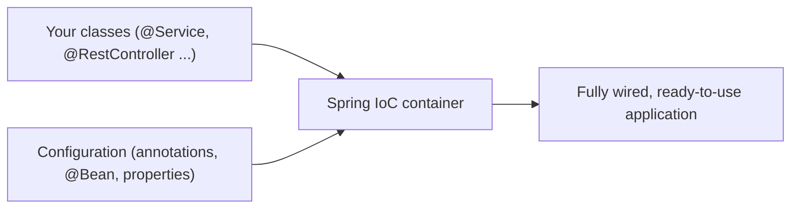
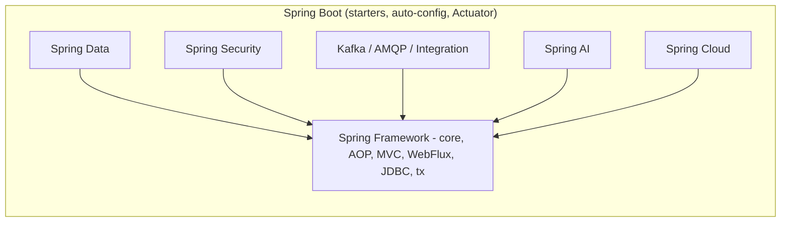
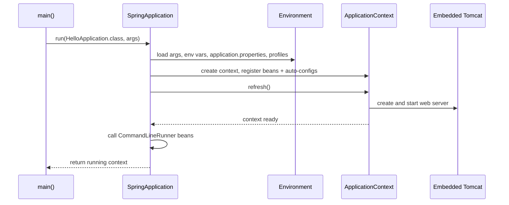
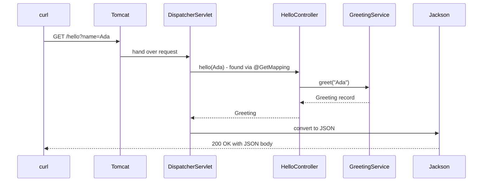

# Chapter 1 — The Spring Ecosystem and Your First App

Spring is the most widely used framework for building server-side Java applications: web APIs, back-office systems, batch jobs, message consumers. This chapter explains what Spring and Spring Boot actually are, where they came from, which versions are current, and then walks you through building, running, packaging and testing a first REST API with **Spring Boot 4.1.1** on **Java 25**.

You only need basic Java for this book. When a Java feature matters (records, annotations, lambdas, Maven), this book links to the [Java Handbook](../../../java/chapters/01-java-and-the-jvm/README.md) instead of teaching it again.

**What you'll learn**

1. What a framework is, and what problem Spring solves (§1.1).
2. What Spring Boot adds on top of Spring (§1.2).
3. The main projects of the Spring ecosystem and where each is covered in this book (§1.3).
4. History and versions: Framework 7, Boot 4, Java 17 baseline, Jakarta EE 11 (§1.4).
5. Creating a project with start.spring.io (§1.5) and reading its layout and `pom.xml` (§1.6).
6. Starters — what they are and what Boot 4 changed about them (§1.7).
7. The main class, `@SpringBootApplication`, and what `SpringApplication.run` does (§1.8).
8. Running the app: IDE, `mvn spring-boot:run`, the executable jar, reading the startup log (§1.9).
9. DevTools for fast restarts (§1.10).
10. Your first REST endpoint (§1.11) and your first two tests (§1.12).

All runnable code is in [`code/hello-boot/`](code/hello-boot/): a Maven project whose tests were run with `mvn -q -B -ntp verify` on JDK 25. Outputs below are real (long log lines trimmed with `...`).

---

## 1.1 What Spring is

### What it is
A **library** is code you call (for example, a JSON parser). A **framework** is code that calls *you*: it owns the program's structure and plugs your classes into it at the right moments. This reversal is called **Inversion of Control (IoC)** — "don't call us, we'll call you".

**Spring Framework** is an open-source Java framework whose core is an **IoC container**: an object that creates your application's objects, connects them to each other, configures them, and manages their whole life. Objects managed by the container are called **beans**. Around that core, Spring offers modules for web applications (Spring MVC, WebFlux), data access (JDBC, transactions), messaging, testing, scheduling and more.

Analogy: building a restaurant yourself means hiring every cook, buying every oven, and telling each cook where the ovens are. With Spring you write a list — "I need a cook who needs an oven" — and a manager (the container) hires them, hands each cook an oven, opens the doors in the morning and closes up at night.

### The problem it solves
Without a container, every class builds its own dependencies with `new`:

```java
// Hard-wired: OrderService decides WHICH repository and WHICH mailer it uses.
class OrderService {
    private final OrderRepository repo = new JdbcOrderRepository(new HikariDataSource(...));
    private final Mailer mailer = new SmtpMailer("smtp.example.com", 25);
}
```

This causes three problems:

| Problem | Why it hurts |
|---|---|
| **Tight coupling** | Swapping `JdbcOrderRepository` for another implementation means editing `OrderService`. |
| **Hard to test** | A unit test of `OrderService` now needs a real database and a real mail server. |
| **Scattered configuration** | Host names, pool sizes and credentials are buried in constructors all over the code. |

Spring's answer is **Dependency Injection (DI)**: a class *declares* what it needs (usually as constructor parameters) and the container *supplies* it. The class depends on an interface; the container picks the implementation. Chapter 2 covers DI in depth; the design principle behind it is the Dependency Inversion Principle — see [LLD §4.10](../../../lld/chapters/04-solid-principles/README.md) and the Hollywood Principle in [LLD Chapter 5](../../../lld/chapters/05-design-principles/README.md).

Beyond DI, Spring gives you ready-made, battle-tested answers for the plumbing every server application needs: HTTP request handling, JSON conversion, database transactions, security, scheduling, caching, and consistent exception types.

### How it works (bird's-eye view)
1. You write ordinary Java classes (often called POJOs — "Plain Old Java Objects") and mark the ones Spring should manage, for example with `@Service`.
2. At startup the container reads that **configuration metadata** (annotations, `@Bean` methods, or, in old projects, XML).
3. It creates each bean, injecting the other beans it needs.
4. It may wrap beans in **proxies** to add behaviour such as transactions or security (Chapter 4).
5. Your application runs; the container calls your code when HTTP requests, messages or timers arrive.
6. At shutdown the container calls clean-up callbacks and destroys the beans.



### Real-world examples
Spring (usually via Spring Boot) runs large parts of the back ends of banks, retailers, airlines, streaming services and public-sector systems. Netflix, for example, has publicly described moving its Java services to Spring Boot. It is also the most common Java stack in job descriptions and back-end interviews.

### TL;DR
Spring is a framework built around an IoC container that creates and wires your objects (beans) through dependency injection, plus modules for web, data, security and more.

---

## 1.2 What Spring Boot adds

### What it is
**Spring Boot** is a project built *on top of* Spring Framework that makes Spring applications quick to create and ready for production. It does not replace Spring — every Boot application *is* a Spring application. Boot adds:

| Feature | What it means | Where in this book |
|---|---|---|
| **Starters** | One dependency per capability (`spring-boot-starter-webmvc`) that brings a tested set of libraries. | §1.7 |
| **Dependency management** | Boot picks compatible versions of ~hundreds of libraries, so your `pom.xml` has no `<version>` tags. | §1.6 |
| **Auto-configuration** | Boot looks at your classpath and settings and creates sensible beans for you (a web server, a JSON mapper, a `DataSource`...). Your own beans always win. | Chapter 3 |
| **Embedded server** | Tomcat (or Jetty) runs *inside* your app. No separate server to install; you run `java -jar app.jar`. | §1.9 |
| **Externalized configuration** | Settings come from `application.properties`/`.yaml`, environment variables, command-line arguments... with a clear precedence order. | Chapter 3 |
| **Production features** | Health checks, metrics, tracing, structured logging, graceful shutdown (Actuator). | Chapter 15 |
| **Testing support** | Slices like `@WebMvcTest`, `@SpringBootTest`, test starters. | Chapter 12 |

Analogy: Spring Framework is a professional kitchen full of equipment. Spring Boot is the same kitchen delivered pre-assembled, with the ovens already connected and a sensible default menu — you can still move any piece of equipment.

### Why it matters
Before Boot (2014), a Spring web app needed a WAR file, an external Tomcat, XML or Java configuration for the `DispatcherServlet`, a view resolver, a JSON converter, a data source, and a careful choice of library versions that worked together. Boot reduced that to a generated project and a `main` method, while keeping every default overridable.

### Spring vs Spring Boot

| Question | Spring Framework | Spring Boot |
|---|---|---|
| What is it? | The core framework: IoC container, MVC, transactions... | An opinionated layer that configures Spring for you |
| Can you use one without the other? | Yes — plain Spring works without Boot | No — Boot always uses Spring Framework |
| Configuration | You declare the infrastructure beans yourself | Auto-configured; you override only what you need |
| Server | Deploy a WAR to an external server (traditional) | Embedded server inside an executable jar |
| Versions | You choose each library version | Managed by Boot's BOM |
| Typical use today | Libraries, special setups | Almost every new application |

### Common mistakes
- Thinking "Spring Boot" is a different framework with different annotations. `@Service`, `@Autowired`, `@Transactional`, `@RestController` are all Spring *Framework* annotations; Boot mostly adds `@SpringBootApplication`, `@ConfigurationProperties` and test annotations.
- Believing auto-configuration is magic you cannot inspect. It is ordinary `@Configuration` classes guarded by conditions, and Boot can print a report of every decision (Chapter 3).

### In the interview
**Q: What is the difference between Spring and Spring Boot?**
*30-second answer:* Spring Framework provides the IoC container and modules like MVC and transactions. Spring Boot sits on top: it adds starters for dependency sets, a managed version BOM, auto-configuration that creates beans based on the classpath and properties, an embedded server so the app runs as a plain jar, externalized configuration and production features like Actuator. Boot removes boilerplate; it does not replace Spring.

- *Follow-up: Can you override what Boot configures?* Yes. Auto-configured beans are usually guarded by `@ConditionalOnMissingBean`, so defining your own bean of that type makes Boot back off; many settings are also just properties.
- *Follow-up: Does Boot make the app slower?* Startup does some extra condition evaluation, but the runtime code path is the same Spring code. Boot also offers AOT processing and native images for faster startup (Chapter 15).

### TL;DR
Spring Boot = Spring Framework + starters + managed versions + auto-configuration + embedded server + externalized config + production features.

---

## 1.3 The Spring ecosystem

"Spring" is also an umbrella name for a family of projects maintained by the Spring team (part of Broadcom since its acquisition of VMware). They share a release rhythm and are all version-managed by Spring Boot, so you rarely pick their versions yourself.

| Project | What it gives you | Chapter |
|---|---|---|
| **Spring Framework** | IoC container, AOP, MVC, WebFlux, JDBC, transactions, testing | 2, 4, 5, 7, 13 |
| **Spring Boot** | Starters, auto-configuration, embedded servers, Actuator | 1, 3, 12, 15 |
| **Spring Data** | Repository interfaces for JPA, JDBC, MongoDB, Redis, R2DBC... | 8, 9 |
| **Spring Security** | Authentication, authorization, OAuth2, JWT | 10, 11 |
| **Spring Cloud** | Config server, service discovery, gateway, load balancing | 16 |
| **Spring for Apache Kafka / Spring AMQP** | Messaging with Kafka and RabbitMQ | 14 |
| **Spring Batch** | Large, restartable batch jobs | — (mentioned in 14) |
| **Spring Integration** | Enterprise integration patterns (channels, adapters) | — |
| **Spring Session** | Store HTTP sessions in Redis or a database | 10 |
| **Spring for GraphQL** | GraphQL servers on Spring | — |
| **Spring Modulith** | Structure a monolith into verified modules | 16 |
| **Spring AI** | LLM chat clients, embeddings, RAG, tool calling | 17 |



**Real-world stack example.** A typical online-shop order service is: Spring Boot + Spring MVC (REST API) + Spring Data JPA (PostgreSQL) + Spring Security (JWT) + Spring for Apache Kafka (publish "order placed" events) + Actuator/Micrometer (metrics). This book builds each of those layers.

---

## 1.4 History and versions

### A short timeline

| Year | Release | What changed (in one line) |
|---|---|---|
| 2002 | Rod Johnson's book *Expert One-on-One J2EE Design and Development* | Showed a lighter alternative to EJB; its sample code became Spring |
| 2004 | Spring Framework 1.0 | IoC container, AOP, transaction abstraction, XML configuration |
| 2007 | Spring 2.5 | Annotation-driven config: `@Autowired`, `@Component`, `@Controller` |
| 2009 | Spring 3.0 | Java 5 baseline, `@Configuration`/`@Bean` Java config, SpEL, REST support in MVC |
| 2013 | Spring 4.0 | Java 8 support, `@Conditional` (the foundation of auto-configuration) |
| 2014 | Spring Boot 1.0 | Starters, auto-configuration, embedded servers |
| 2017–18 | Spring 5.0 / Boot 2.0 | Java 8 baseline, reactive stack (WebFlux) |
| 2022 | Spring 6.0 / Boot 3.0 | **Java 17 baseline**, `javax.*` → `jakarta.*`, AOT and GraalVM native images |
| Nov 2025 | **Spring Framework 7.0** (13 Nov) / **Spring Boot 4.0** (20 Nov) | Jakarta EE 11, JSpecify null-safety, modular Boot jars, Jackson 3, API versioning, HTTP service clients, JUnit 6 |
| Jun 2026 | Spring Boot 4.1.0 (10 Jun) | gRPC support, Jackson config updates, observability updates |
| Aug 2026 | Spring Boot 4.1.1 (20 Aug) | Bug fixes and dependency upgrades — **the version used in this book** |

### The current generation — what Boot 4.1.1 gives you

The versions below come from Boot 4.1.1's dependency BOM (`spring-boot-dependencies-4.1.1.pom`), so they are exactly what your project gets:

| Component | Version in Boot 4.1.1 | Notes |
|---|---|---|
| Java | **17 minimum**, 25 recommended | Framework 7 keeps the Java 17 baseline; this book uses Java 25 (LTS) — see [Java Ch. 17](../../../java/chapters/17-modern-java-17-to-25/README.md) |
| Spring Framework | 7.0.9 | |
| Jakarta EE | 11 (Servlet 6.1, JPA 3.2, Bean Validation 3.1) | |
| Tomcat / Jetty | 11.0.24 / 12.1.12 | Undertow is no longer supported (it lacks Servlet 6.1) |
| Jackson | 3.1.5 (`tools.jackson` packages) | Jackson 2 still available via a separate module, deprecated |
| Hibernate ORM / Validator | 7.4.5 / 9.1.3 | |
| Spring Security | 7.1.1 | |
| Spring Data | 2026.0.1 release train | |
| JUnit Jupiter | 6.0.3 | JUnit 4 support is deprecated in Framework 7 |
| Mockito / AssertJ | 5.23.0 / 3.27.7 | |
| Kotlin | 2.3.21 (2.2 minimum) | |
| GraalVM (native images) | 25+ | |

### `javax` → `jakarta`
Java EE was handed to the Eclipse Foundation in 2017 and renamed **Jakarta EE**; for trademark reasons its packages were renamed from `javax.*` to `jakarta.*` (Jakarta EE 9, 2020). Since Spring 6 / Boot 3, Spring uses only the `jakarta` names: `jakarta.servlet.http.HttpServletRequest`, `jakarta.persistence.Entity`, `jakarta.annotation.PostConstruct`, `jakarta.validation.constraints.NotNull`. Framework 7 also removed the last support for `javax.annotation` and `javax.inject`. If a tutorial imports `javax.persistence`, it is for Boot 2 or older.

### How versions relate
- **Boot pins everything.** You choose one number — the Boot version — and the BOM chooses compatible versions of Spring Framework, Spring Data, Security, Tomcat, Jackson, Hibernate, JUnit, etc.
- **Release cadence.** Boot ships a new minor version (4.0, 4.1, ...) roughly every six months, and patch releases (4.1.1, 4.1.2) regularly in between.
- **Support.** Each Boot minor line gets roughly 13 months of free open-source support, then commercial support. Stay on a supported minor; check the "Support" section at spring.io/projects/spring-boot before planning an upgrade.
- **Version names.** `-M1`, `-M2` are milestones, `-RC1` release candidates, a plain `4.1.1` is GA (generally available). `-SNAPSHOT` versions are nightly builds — never use them in production.

### Common mistakes
- Adding `<version>` to a Spring dependency in a Boot project. It overrides the tested version and can break compatibility. Let the parent manage it.
- Mixing `javax.*` and `jakarta.*` imports after copying old code.
- Following a Boot 2/3 tutorial for Boot 4 without checking renamed starters (§1.7) and Jackson 3 package names.

### Self-check
1. Which Java version is the minimum for Spring Framework 7? → Java 17 (25 is recommended).
2. Why does Spring 6+ use `jakarta.persistence` instead of `javax.persistence`? → Java EE moved to Eclipse as Jakarta EE and the packages were renamed.
3. In a Boot project, who decides the Tomcat version? → Boot's dependency BOM (`spring-boot-dependencies`).

### TL;DR
This book uses Spring Boot 4.1.1 → Spring Framework 7.0.9, Jakarta EE 11, Tomcat 11, Jackson 3, JUnit 6, on Java 25. Pick the Boot version; Boot picks the rest.

---

## 1.5 Creating a project with start.spring.io

### What it is
**Spring Initializr** (at **start.spring.io**) is a web service that generates a ready-to-build Spring Boot project as a zip. IntelliJ IDEA, VS Code (Spring Boot Extension Pack) and Eclipse (Spring Tools) all call the same service from their "New project" wizards.

### How it works
1. Open start.spring.io.
2. **Project**: *Gradle - Groovy* (the site's default), *Gradle - Kotlin*, or *Maven*. This book uses Maven.
3. **Language**: Java (Kotlin and Groovy are also offered).
4. **Spring Boot**: pick the latest GA version without a suffix — **4.1.1** at the time of writing. Avoid `SNAPSHOT` and `M`/`RC` versions.
5. **Project metadata**: *Group* (`com.example`, usually your reversed domain), *Artifact* (`hello-boot`, also the jar name), *Package name* (`com.example.hello` — your main class goes here), *Packaging* (`Jar` — use `War` only for deploying to an external server), *Java* (17, 21, 25 or 27; this book uses 25).
6. **Dependencies**: search and add. For the first app: *Spring Web* (id `web`) and *Spring Boot DevTools* (id `devtools`).
7. Click **Generate**, unzip, and open the folder in your IDE.

You can do the same from a terminal (the service has a small HTTP API):

```bash
curl https://start.spring.io/starter.zip \
  -d type=maven-project -d bootVersion=4.1.1 -d javaVersion=25 \
  -d groupId=com.example -d artifactId=hello-boot -d packageName=com.example.hello \
  -d dependencies=web,devtools -o hello-boot.zip
```

For Boot 4.1.1, choosing *Spring Web* produces `spring-boot-starter-webmvc` and a matching test starter `spring-boot-starter-webmvc-test` — exactly the `pom.xml` shown in §1.6 (checked against the service's generated `pom.xml`).

### Common mistakes
- Choosing a Java version newer than the JDK installed on your machine (the build fails with `release version 25 not supported`). Check with `java -version`, see [Java §1.4](../../../java/chapters/01-java-and-the-jvm/README.md).
- Adding every dependency "just in case". Each starter can switch on auto-configuration — e.g. adding *Spring Data JPA* without a database makes startup fail with "Failed to configure a DataSource". Add what you use.
- Putting classes in a package *outside* the main class's package (see §1.8).

---

## 1.6 Project layout and the build file

### The layout

```
hello-boot/
├── pom.xml                          ← build file (Maven)
├── mvnw, mvnw.cmd, .mvn/            ← Maven Wrapper: builds without installing Maven (generated by Initializr)
└── src/
    ├── main/
    │   ├── java/com/example/hello/
    │   │   ├── HelloApplication.java   ← the main class (§1.8)
    │   │   ├── HelloController.java    ← REST endpoint (§1.11)
    │   │   ├── GreetingService.java
    │   │   └── Greeting.java
    │   └── resources/
    │       ├── application.properties  ← configuration (Chapter 3)
    │       ├── static/                 ← optional: files served as-is (HTML, CSS, JS)
    │       └── templates/              ← optional: server-side templates (Thymeleaf)
    └── test/java/com/example/hello/
        ├── HelloControllerTest.java
        └── HelloApplicationTests.java
```

This is the standard Maven layout (`src/main/java`, `src/main/resources`, `src/test/java`) — explained in [Java §18.1–18.2](../../../java/chapters/18-testing-build-and-tooling/README.md). Everything under `src/main/resources` ends up on the **classpath** (the list of places the JVM loads classes and files from), which is why Boot can find `application.properties` there.

### The `pom.xml`

```xml
<!-- code/hello-boot/pom.xml -->
<parent>                                              <!-- 1 -->
  <groupId>org.springframework.boot</groupId>
  <artifactId>spring-boot-starter-parent</artifactId>
  <version>4.1.1</version>
  <relativePath/>
</parent>

<groupId>com.example</groupId>
<artifactId>hello-boot</artifactId>
<version>0.0.1-SNAPSHOT</version>

<properties>
  <java.version>25</java.version>                     <!-- 2 -->
</properties>

<dependencies>
  <dependency>                                        <!-- 3 -->
    <groupId>org.springframework.boot</groupId>
    <artifactId>spring-boot-starter-webmvc</artifactId>
  </dependency>
  <dependency>                                        <!-- 4 -->
    <groupId>org.springframework.boot</groupId>
    <artifactId>spring-boot-devtools</artifactId>
    <scope>runtime</scope>
    <optional>true</optional>
  </dependency>
  <dependency>                                        <!-- 5 -->
    <groupId>org.springframework.boot</groupId>
    <artifactId>spring-boot-starter-webmvc-test</artifactId>
    <scope>test</scope>
  </dependency>
</dependencies>

<build>
  <plugins>
    <plugin>                                          <!-- 6 -->
      <groupId>org.springframework.boot</groupId>
      <artifactId>spring-boot-maven-plugin</artifactId>
    </plugin>
  </plugins>
</build>
```

1. **`spring-boot-starter-parent`** — a parent POM that (a) imports the dependency BOM (**Bill of Materials**: a POM that lists tested versions for hundreds of libraries), (b) sets UTF-8 encoding, (c) compiles with `-parameters` (so Spring can read constructor parameter names), and (d) pre-configures plugins (surefire for tests, resources filtering, the Boot plugin).
2. **`java.version`** — the parent turns this into `maven.compiler.release`, so `javac --release 25` is used.
3. **The web starter** — no `<version>`: the parent manages it.
4. **DevTools** — `runtime` scope + `optional` keeps it out of other projects that depend on yours; the Boot plugin also leaves it out of the packaged jar by default.
5. **The test starter** — only on the test classpath.
6. **`spring-boot-maven-plugin`** — adds goals such as `spring-boot:run`, and during `package` it **repackages** the normal jar into an executable "fat jar" (§1.9).

**If you cannot use the parent** (your company has its own parent POM), import the BOM instead:

```xml
<dependencyManagement>
  <dependencies>
    <dependency>
      <groupId>org.springframework.boot</groupId>
      <artifactId>spring-boot-dependencies</artifactId>
      <version>4.1.1</version>
      <type>pom</type>
      <scope>import</scope>
    </dependency>
  </dependencies>
</dependencyManagement>
```
You then configure the compiler (`-parameters`) and the Boot plugin's `repackage` goal yourself.

**Gradle equivalent** (what Initializr generates):

```groovy
plugins {
    id 'java'
    id 'org.springframework.boot' version '4.1.1'
    id 'io.spring.dependency-management' version '1.1.7'
}
java { toolchain { languageVersion = JavaLanguageVersion.of(25) } }
dependencies {
    implementation 'org.springframework.boot:spring-boot-starter-webmvc'
    developmentOnly 'org.springframework.boot:spring-boot-devtools'
    testImplementation 'org.springframework.boot:spring-boot-starter-webmvc-test'
    testRuntimeOnly 'org.junit.platform:junit-platform-launcher'
}
tasks.named('test') { useJUnitPlatform() }
```
Commands: `./gradlew bootRun`, `./gradlew bootJar`, `./gradlew test`.

### Self-check
1. Why do the dependencies have no `<version>`? → The parent imports Boot's BOM, which manages them.
2. What does `spring-boot-maven-plugin` do during `mvn package`? → Repackages the jar into an executable fat jar with all dependencies and a launcher.
3. Which Maven folder should `application.properties` go in? → `src/main/resources`.

---

## 1.7 Starters

### What it is
A **starter** is a dependency that contains (almost) no code; it exists only to pull in a curated, version-aligned set of libraries for one capability. Adding `spring-boot-starter-webmvc` gives you Spring MVC, an embedded Tomcat, Jackson for JSON, logging, and the Boot auto-configuration that wires them together.

### How it works
This is the real runtime dependency tree of `hello-boot` (`mvn dependency:tree -Dscope=runtime`):

```
com.example:hello-boot:jar:0.0.1-SNAPSHOT
+- org.springframework.boot:spring-boot-starter-webmvc:jar:4.1.1:compile
|  +- org.springframework.boot:spring-boot-starter:jar:4.1.1:compile
|  |  +- org.springframework.boot:spring-boot-starter-logging:jar:4.1.1:compile
|  |  |  +- ch.qos.logback:logback-classic:jar:1.5.38:compile
|  |  |  +- org.apache.logging.log4j:log4j-to-slf4j:jar:2.25.5:compile
|  |  |  \- org.slf4j:jul-to-slf4j:jar:2.0.18:compile
|  |  +- jakarta.annotation:jakarta.annotation-api:jar:3.0.0:compile
|  |  \- org.yaml:snakeyaml:jar:2.6:compile
|  +- org.springframework.boot:spring-boot-starter-jackson:jar:4.1.1:compile
|  |  \- org.springframework.boot:spring-boot-jackson:jar:4.1.1:compile
|  |     \- tools.jackson.core:jackson-databind:jar:3.1.5:compile
|  +- org.springframework.boot:spring-boot-starter-tomcat:jar:4.1.1:compile
|  |  +- org.springframework.boot:spring-boot-starter-tomcat-runtime:jar:4.1.1:compile
|  |  |  +- org.apache.tomcat.embed:tomcat-embed-core:jar:11.0.24:compile
|  |  |  ...
|  |  \- org.springframework.boot:spring-boot-tomcat:jar:4.1.1:compile
|  +- org.springframework.boot:spring-boot-http-converter:jar:4.1.1:compile
|  |  \- org.springframework:spring-web:jar:7.0.9:compile
|  \- org.springframework.boot:spring-boot-webmvc:jar:4.1.1:compile
|     +- org.springframework.boot:spring-boot-servlet:jar:4.1.1:compile
|     \- org.springframework:spring-webmvc:jar:7.0.9:compile
\- org.springframework.boot:spring-boot-devtools:jar:4.1.1:runtime (optional)
   +- org.springframework.boot:spring-boot:jar:4.1.1:compile
   |  +- org.springframework:spring-core:jar:7.0.9:compile
   |  |  +- commons-logging:commons-logging:jar:1.3.6:compile
   |  |  \- org.jspecify:jspecify:jar:1.0.1:compile
   |  \- org.springframework:spring-context:jar:7.0.9:compile
   \- org.springframework.boot:spring-boot-autoconfigure:jar:4.1.1:compile
```

Notice the Boot 4 pattern: each technology has a **Boot module** holding its auto-configuration (`spring-boot-webmvc`, `spring-boot-tomcat`, `spring-boot-jackson`) and a **starter** that combines that module with the library itself.

### Boot 4 modular starters
Boot 3 shipped all auto-configuration in one big `spring-boot-autoconfigure` jar. **Boot 4 split it into focused modules**, one per technology, and renamed some starters to match. In Boot 4.1.1 the core `spring-boot-autoconfigure` jar lists only 12 auto-configurations; web MVC's live in `spring-boot-webmvc`, Tomcat's in `spring-boot-tomcat`, and so on (Chapter 3 shows this).

| Capability | Boot 4 starter | Boot 3 name (if different) |
|---|---|---|
| Servlet web / REST (Spring MVC + Tomcat) | `spring-boot-starter-webmvc` | `spring-boot-starter-web` |
| Reactive web (WebFlux + Netty) | `spring-boot-starter-webflux` | |
| Blocking HTTP client (`RestClient`) | `spring-boot-starter-restclient` | part of `-web` |
| Reactive HTTP client (`WebClient`) | `spring-boot-starter-webclient` | part of `-webflux` |
| JSON (Jackson 3) | `spring-boot-starter-jackson` | `spring-boot-starter-json` (still available in 4.x) |
| Bean Validation | `spring-boot-starter-validation` | |
| JDBC / JPA | `spring-boot-starter-jdbc` / `spring-boot-starter-data-jpa` | |
| Security | `spring-boot-starter-security` | |
| OAuth2 resource server | `spring-boot-starter-security-oauth2-resource-server` | `spring-boot-starter-oauth2-resource-server` |
| AspectJ-based AOP | `spring-boot-starter-aspectj` | `spring-boot-starter-aop` |
| Kafka | `spring-boot-starter-kafka` | (previously just `spring-kafka`) |
| Actuator | `spring-boot-starter-actuator` | |
| Core only (no web) | `spring-boot-starter` | |
| Testing, generic | `spring-boot-starter-test` | |
| Testing, per technology | `spring-boot-starter-webmvc-test`, `-data-jpa-test`, `-security-test`, ... | — (new in Boot 4) |

Rules of thumb for Boot 4:
- **Every technology starter has a `-test` companion** that brings the test slice for it (`@WebMvcTest` lives in `spring-boot-webmvc-test`). Each test starter already includes `spring-boot-starter-test`.
- Some old names still exist in 4.1 as **deprecated** aliases (`spring-boot-starter-web`, `spring-boot-starter-oauth2-resource-server`) so upgrades don't break immediately; others are gone (`spring-boot-starter-aop` → use `spring-boot-starter-aspectj`). Prefer the new names.
- For a quick upgrade from Boot 3, `spring-boot-starter-classic` and `spring-boot-starter-test-classic` bring the old "everything on the classpath" behaviour while you fix imports.
- Third-party starters are named `<name>-spring-boot-starter` (e.g. `mybatis-spring-boot-starter`); only official ones start with `spring-boot-starter-` (Chapter 3 builds one).

### Common mistakes
- Adding both `spring-boot-starter-webmvc` and `spring-boot-starter-webflux` and being surprised the app is a *servlet* app. When both are present, Boot chooses Spring MVC.
- Using `spring-boot-starter-test` alone and then finding `@WebMvcTest` missing in Boot 4 — add `spring-boot-starter-webmvc-test`.
- Excluding a transitive library by hand to "slim down" and breaking auto-configuration. Use the starter meant for the job (e.g. exclude `spring-boot-starter-tomcat` and add `spring-boot-starter-jetty` to switch servers).

### Self-check
1. What code does a starter contain? → Essentially none; it's a curated dependency list.
2. What is the Boot 4 name of the old `spring-boot-starter-web`? → `spring-boot-starter-webmvc`.
3. Where does `@WebMvcTest` come from in Boot 4? → `spring-boot-webmvc-test`, via `spring-boot-starter-webmvc-test`.

### TL;DR
Starters = one dependency per capability. Boot 4 split auto-configuration into per-technology modules, renamed a few starters (`web` → `webmvc`, `aop` → `aspectj`) and added a `-test` starter for each technology.

---

## 1.8 The main class and `@SpringBootApplication`

```java
// code/hello-boot/src/main/java/com/example/hello/HelloApplication.java
package com.example.hello;

import org.springframework.boot.SpringApplication;
import org.springframework.boot.autoconfigure.SpringBootApplication;

@SpringBootApplication            // = @SpringBootConfiguration + @EnableAutoConfiguration + @ComponentScan
public class HelloApplication {

    public static void main(String[] args) {
        SpringApplication.run(HelloApplication.class, args);   // creates and starts the ApplicationContext
    }
}
```

### What `@SpringBootApplication` means
It is a shortcut for three annotations:

| Annotation | What it does |
|---|---|
| `@SpringBootConfiguration` | Marks this class as a configuration source (a specialised `@Configuration`). Tests use it to find your app's configuration. |
| `@EnableAutoConfiguration` | Turns on auto-configuration: Boot loads candidate configuration classes and applies those whose conditions match (Chapter 3). |
| `@ComponentScan` | Scans **this class's package and all sub-packages** for `@Component`, `@Service`, `@Repository`, `@Controller`, `@RestController`, `@Configuration` classes and registers them as beans. |

### What `SpringApplication.run` does
1. Decides the application type from the classpath: **servlet** (Spring MVC present), **reactive** (only WebFlux present) or **none**.
2. Prepares the `Environment`: reads command-line arguments, environment variables, `application.properties`/`.yaml`, and activates profiles (Chapter 3).
3. Prints the banner.
4. Creates the right `ApplicationContext` (the IoC container; for a servlet app a web-server-aware one).
5. Registers bean definitions: your scanned classes plus auto-configurations whose conditions pass.
6. **Refreshes** the context: creates all singleton beans, and for a web app starts the embedded Tomcat.
7. Runs any `CommandLineRunner`/`ApplicationRunner` beans (code you want to run once at startup).
8. Returns the running context; the JVM keeps running while Tomcat's threads are alive.



### Where to put the main class
Put it in the **root package** of your code (`com.example.hello`) and every other class in that package or below (`com.example.hello.orders`, `com.example.hello.web`...). Component scanning starts from the main class's package, so a class in `com.example.other` is silently **not** a bean.

### Common mistakes
- Main class in a sub-package (`com.example.hello.app`) while controllers live in `com.example.hello.web` → endpoints return 404 because the controllers were never scanned.
- Placing the main class in the *default* (unnamed) package — Boot warns and scanning every jar on the classpath breaks startup.
- Writing logic in `main` after `run(...)` expecting it to run "before the server starts". Use a `CommandLineRunner` or an event listener (Chapter 2).

### In the interview
**Q: What does `@SpringBootApplication` do?**
It combines `@SpringBootConfiguration` (this class is configuration), `@EnableAutoConfiguration` (apply Boot's conditional auto-configurations) and `@ComponentScan` (register annotated classes from this package downwards).
- *Follow-up: How would you scan a package outside the main package?* Move the code under the root package (best), or use `@SpringBootApplication(scanBasePackages = "...")` / `@Import` for specific classes.
- *Follow-up: How do you exclude one auto-configuration?* `@SpringBootApplication(exclude = SomeAutoConfiguration.class)` or the property `spring.autoconfigure.exclude`.

### TL;DR
`@SpringBootApplication` = configuration + auto-configuration + component scan from this package down. `SpringApplication.run` builds the environment, creates the container, registers and creates beans, and starts the embedded server.

---

## 1.9 Running the application

### Three ways to run

| Way | Command | When |
|---|---|---|
| IDE | Run `HelloApplication.main` | Daily development, debugging with breakpoints |
| Maven plugin | `./mvnw spring-boot:run` (or `mvn spring-boot:run`) | Terminal development; picks up `src/main/resources` directly |
| Executable jar | `./mvnw package` then `java -jar target/hello-boot-0.0.1-SNAPSHOT.jar` | Production, containers, CI |

Pass settings on the command line in either form:

```bash
mvn spring-boot:run -Dspring-boot.run.arguments="--server.port=9090"
java -jar target/hello-boot-0.0.1-SNAPSHOT.jar --server.port=9090 --spring.profiles.active=dev
```

### The startup log, line by line
Running the packaged jar with JDK 25 (`java -jar target/hello-boot-0.0.1-SNAPSHOT.jar --server.port=18081`):

```
  .   ____          _            __ _ _
 /\\ / ___'_ __ _ _(_)_ __  __ _ \ \ \ \
( ( )\___ | '_ | '_| | '_ \/ _` | \ \ \ \
 \\/  ___)| |_)| | | | | || (_| |  ) ) ) )
  '  |____| .__|_| |_|_| |_\__, | / / / /
 =========|_|==============|___/=/_/_/_/

 :: Spring Boot ::                (v4.1.1)

INFO 91361 --- [hello-boot] [main] c.e.hello.HelloApplication : Starting HelloApplication v0.0.1-SNAPSHOT using Java 25.0.2 with PID 91361 ...
INFO 91361 --- [hello-boot] [main] c.e.hello.HelloApplication : No active profile set, falling back to 1 default profile: "default"
INFO 91361 --- [hello-boot] [main] o.s.boot.tomcat.TomcatWebServer : Tomcat initialized with port 18081 (http)
INFO 91361 --- [hello-boot] [main] o.apache.catalina.core.StandardEngine : Starting Servlet engine: [Apache Tomcat/11.0.24]
INFO 91361 --- [hello-boot] [main] b.w.c.s.WebApplicationContextInitializer : Root WebApplicationContext: initialization completed in 376 ms
INFO 91361 --- [hello-boot] [main] o.s.boot.tomcat.TomcatWebServer : Tomcat started on port 18081 (http) with context path '/'
INFO 91361 --- [hello-boot] [main] c.e.hello.HelloApplication : Started HelloApplication in 0.728 seconds (process running for 0.929)
```

(Timestamps removed and logger names shortened for width.)

| Log part | Meaning |
|---|---|
| `91361` | Process ID |
| `[hello-boot]` | `spring.application.name` from `application.properties` |
| `[main]` | Thread name |
| `No active profile set...` | No profile chosen, so only `application.properties` applies (profiles: Chapter 3) |
| `Tomcat initialized/started on port ...` | The embedded server is listening |
| `Started HelloApplication in 0.728 seconds` | The context is fully refreshed and ready |

When the first request arrives you also see `Initializing Spring DispatcherServlet 'dispatcherServlet'` — the front controller of Spring MVC is created lazily on the first request (Chapter 5). Pressing Ctrl+C (or `kill <pid>`) shows:

```
INFO ... [ionShutdownHook] o.s.boot.tomcat.GracefulShutdown : Commencing graceful shutdown. Waiting for active requests to complete
INFO ... [tomcat-shutdown] o.s.boot.tomcat.GracefulShutdown : Graceful shutdown complete
```

**Graceful shutdown** is on by default: the server stops accepting new requests and lets in-flight ones finish (up to `spring.lifecycle.timeout-per-shutdown-phase`, default 30 s) before the context closes (Chapter 15).

### Inside the executable jar
`mvn package` produced a 19.9 MB jar. Its layout (from `unzip -l`) and manifest:

```
META-INF/MANIFEST.MF
org/springframework/boot/loader/...        ← Boot's launcher classes
BOOT-INF/classes/com/example/hello/*.class ← your code
BOOT-INF/classes/application.properties
BOOT-INF/lib/*.jar                         ← 34 dependency jars, stored unchanged
BOOT-INF/classpath.idx, BOOT-INF/layers.idx
```
```
Main-Class: org.springframework.boot.loader.launch.JarLauncher
Start-Class: com.example.hello.HelloApplication
Spring-Boot-Version: 4.1.1
Spring-Boot-Classes: BOOT-INF/classes/
Spring-Boot-Lib: BOOT-INF/lib/
```

A plain JVM cannot load classes from jars *nested* inside a jar. So `java -jar` starts Boot's **`JarLauncher`** (the `Main-Class`), which sets up a class loader able to read `BOOT-INF/lib/*.jar`, then calls your **`Start-Class`**. `layers.idx` groups files into layers (dependencies change rarely, your classes often) so Docker images can cache them — see Chapter 15. General jar packaging is covered in [Java §18.12](../../../java/chapters/18-testing-build-and-tooling/README.md).

### Common mistakes
- `Web server failed to start. Port 8080 was already in use.` Another process (often a previous run) holds the port. Stop it or set `server.port`. `server.port=0` picks a random free port.
- Running `java -jar` on the *original* jar (`*.jar.original`) — it has no launcher and fails with "no main manifest attribute".
- Expecting DevTools to work with `java -jar`: packaged apps disable it (§1.10).

### Self-check
1. Which class is the manifest's `Main-Class` in a Boot fat jar? → `org.springframework.boot.loader.launch.JarLauncher`; your class is `Start-Class`.
2. How do you change the port without editing files? → `--server.port=9090` on the command line (or env var `SERVER_PORT`).
3. What does graceful shutdown do? → Stops accepting requests, waits for active ones to finish, then closes the context.

---

## 1.10 DevTools

### What it is
**Spring Boot DevTools** (`spring-boot-devtools`) is a development-only module that makes the edit–run loop faster:

| Feature | What it does |
|---|---|
| **Automatic restart** | When compiled classes change on the classpath, the application restarts in about a second. |
| **Development property defaults** | Turns off caches that get in the way while developing (template caching, static-resource caching), enables the H2 console, etc. |
| **Global settings** | Personal settings in `~/.config/spring-boot/spring-boot-devtools.properties` apply to all your apps. |
| **Remote DevTools** | Opt-in restart of a remote app over HTTP; a security risk — only on trusted networks. |
| **LiveReload** | Browser auto-refresh; **disabled by default since Boot 4.0 and deprecated in 4.1** (no replacement). |

### How restart works
1. DevTools uses **two class loaders**: a *base* loader for the jars that don't change (Spring, Tomcat, Jackson...) and a *restart* loader for your own classes.
2. It watches your compiled output folders (e.g. `target/classes`).
3. When something changes there — because your IDE compiled on save (or IntelliJ's *Build Project*), or you ran `mvn compile` — DevTools throws away only the restart class loader and starts the context again.
4. Because the heavy base loader stays warm, a restart is much faster than a cold start.

Changes under `static/`, `public/`, `templates/` and `META-INF/resources` do **not** trigger a restart (they don't need one). Tune with `spring.devtools.restart.exclude` / `additional-exclude`, or disable with `spring.devtools.restart.enabled=false`.

### When it is off
DevTools considers an app "in production" — and disables itself — when it is launched with `java -jar` from a packaged jar or from a special class loader. It is also turned off in tests: the test log of this chapter's project shows `Restart disabled due to context in which it is running`.

### Common mistakes
- Expecting restarts after *editing* a `.java` file without compiling — DevTools watches compiled classes. Enable "build project automatically" in your IDE.
- Shipping DevTools to production by removing `<optional>true</optional>` or configuring the plugin to include it.
- Confusing restart with hot-swapping: restart re-creates the whole context, so in-memory state (sessions, caches) is lost. For true class reloading, tools like JRebel exist.

### TL;DR
DevTools restarts the app quickly when compiled classes change (two class loaders), applies developer-friendly defaults, and switches itself off for packaged jars and tests.

---

## 1.11 Your first REST endpoint

### What we build
`GET /hello?name=Ada` → `{"message":"Hello, Ada!","length":11}`. Three small classes show the typical layering: a **controller** (HTTP), a **service** (logic) and a **record** (the JSON shape).

```java
// Greeting.java — the response body
public record Greeting(String message, int length) {}
```
A **record** is a compact immutable data class (Java 16 — see [Java §6.8](../../../java/chapters/06-oop-inheritance-interfaces-and-more/README.md)). Jackson 3 serializes its components as JSON fields.

```java
// GreetingService.java
@Service                                   // a bean: Spring creates one instance and manages it
public class GreetingService {
    public Greeting greet(String name) {
        String message = "Hello, " + name + "!";
        return new Greeting(message, message.length());
    }
}
```

```java
// HelloController.java
@RestController                            // a bean whose method results are written to the HTTP response body
public class HelloController {

    private final GreetingService service;

    HelloController(GreetingService service) { // constructor injection: Spring passes the GreetingService bean
        this.service = service;
    }

    @GetMapping("/hello")                  // handles GET /hello and GET /hello?name=Ada
    Greeting hello(@RequestParam(defaultValue = "World") String name) {
        return service.greet(name);
    }
}
```

What each piece does:

| Piece | Role |
|---|---|
| `@RestController` | `@Controller` + `@ResponseBody`: the return value becomes the response body (converted to JSON), not a view name. |
| Constructor parameter | Spring sees `HelloController` needs a `GreetingService` and passes the singleton bean. No `@Autowired` needed with a single constructor (Chapter 2). |
| `@GetMapping("/hello")` | Maps HTTP GET requests for path `/hello` to this method. |
| `@RequestParam(defaultValue = "World")` | Reads the query parameter `name`; if absent, uses `"World"`. |
| Return type `Greeting` | Jackson (auto-configured by Boot) writes it as JSON with `Content-Type: application/json`. |

### Calling it
With the jar running on port 18081:

```bash
$ curl -s 'localhost:18081/hello?name=Ada'
{"message":"Hello, Ada!","length":11}
$ curl -s localhost:18081/hello
{"message":"Hello, World!","length":13}
$ curl -s -i localhost:18081/hello | head -3
HTTP/1.1 200
Content-Type: application/json
Content-Length: 39
$ curl -s localhost:18081/nope
{"timestamp":"2026-09-28T23:24:50.396Z","status":404,"error":"Not Found","path":"/nope"}
```

The last response comes from Boot's default error handling (`/error` endpoint). Chapter 5 replaces it with RFC 9457 `ProblemDetail` responses.

### What happened during a request


### Common mistakes
- Using `@Controller` instead of `@RestController` for a JSON API → Spring treats `"Hello"` as a *view name* and fails with a template error.
- Putting business logic in the controller. Keep controllers thin (parse input, call a service, return output) so logic is testable without HTTP.
- Returning mutable entities straight from the database — prefer small response records (Chapter 8 shows why).

---

## 1.12 Testing the first app

Spring Boot tests are ordinary JUnit tests with extra annotations that start (part of) the Spring container. Two styles cover most needs; Chapter 12 goes much deeper. JUnit basics are in [Java §18.4](../../../java/chapters/18-testing-build-and-tooling/README.md).

### Test 1 — a web *slice* with `MockMvcTester`

```java
// HelloControllerTest.java
@WebMvcTest(HelloController.class)        // only the web layer; no real server
@Import(GreetingService.class)             // the service is not part of the web slice, so add it
class HelloControllerTest {

    @Autowired
    MockMvcTester mvc;                     // AssertJ-flavoured MockMvc (Framework 6.2+)

    @Test
    void greetsWorldByDefault() {
        var result = mvc.get().uri("/hello").exchange();
        System.out.println("GET /hello          -> " + result.getResponse().getStatus() + " " + contentOf(result));
        assertThat(result).hasStatusOk()
                .bodyJson().extractingPath("$.message").isEqualTo("Hello, World!");
    }

    @Test
    void greetsByName() {
        var result = mvc.get().uri("/hello?name=Ada").exchange();
        System.out.println("GET /hello?name=Ada -> " + result.getResponse().getStatus() + " " + contentOf(result));
        assertThat(result).hasStatusOk()
                .bodyJson().extractingPath("$.length").isEqualTo(11);
    }
    // contentOf(...) reads the response body as a String
}
```

- **`@WebMvcTest`** starts a *slice*: only MVC infrastructure, controllers, JSON and filters — no services, repositories or web server. That is why `GreetingService` is added with `@Import` (the more common alternative is mocking it with `@MockitoBean`, Chapter 12).
- **`MockMvcTester`** sends requests straight to the `DispatcherServlet` in memory and offers AssertJ assertions such as `hasStatusOk()` and `bodyJson().extractingPath(...)` (a JSONPath expression; `$` is the document root).

### Test 2 — the whole app on a real port with `RestTestClient`

```java
// HelloApplicationTests.java
@SpringBootTest(webEnvironment = SpringBootTest.WebEnvironment.RANDOM_PORT)
@AutoConfigureRestTestClient
class HelloApplicationTests {

    @LocalServerPort int port;
    @Autowired RestTestClient client;      // Framework 7 test client, pre-bound to the random port

    @Test
    void realHttpCall() {
        String body = client.get().uri("/hello?name=Spring")
                .exchange()
                .expectStatus().isOk()
                .expectHeader().contentType("application/json")
                .expectBody(String.class).returnResult().getResponseBody();
        System.out.println("Tomcat on random port " + (port > 0 ? "OK" : "?") + ", body = " + body);
        assertThat(body).isEqualTo("{\"message\":\"Hello, Spring!\",\"length\":14}");
    }
}
```

- **`@SpringBootTest`** starts the full application context, like `main` does. With `RANDOM_PORT` it also starts Tomcat on a free port, so the test makes real HTTP calls.
- **`RestTestClient`** (new in Spring Framework 7) is a fluent test client for blocking apps; `@AutoConfigureRestTestClient` (from the `spring-boot-resttestclient` module, included by the webmvc test starter) binds it to the running server.
- Test class names must end in `Test`, `Tests` or `TestCase` for Maven Surefire to run them by default — a class named `*IT` is only run by the Failsafe plugin, which this project does not configure.

### Output
`mvn -q -B -ntp verify` (Spring banners and log lines removed):

```
Tomcat on random port OK, body = {"message":"Hello, Spring!","length":14}
GET /hello?name=Ada -> 200 {"message":"Hello, Ada!","length":11}
GET /hello          -> 200 {"message":"Hello, World!","length":13}
```
(JUnit does not guarantee the order of test methods, so the two `GET` lines can swap.) The build ends with exit code 0: all three tests passed.

### Trade-offs

| | `@WebMvcTest` + `MockMvcTester` | `@SpringBootTest(RANDOM_PORT)` + `RestTestClient` |
|---|---|---|
| Starts | Web layer only, no server | Whole app + real Tomcat |
| Speed | Fast | Slower |
| Catches | Mapping, JSON, validation, controller logic | Everything incl. filters, server config, real HTTP |
| Use for | Most controller tests | A few end-to-end "smoke" tests |

### Self-check
1. Why did `HelloControllerTest` need `@Import(GreetingService.class)`? → `@WebMvcTest` does not scan `@Service` classes.
2. Which annotation starts the full context on a random port? → `@SpringBootTest(webEnvironment = RANDOM_PORT)`.
3. Why might a test named `HelloApplicationIT` never run with `mvn verify`? → Surefire only picks `*Test`/`*Tests`/`*TestCase` by default; `*IT` needs Failsafe.

---

## 1.13 In the interview

**Q: Walk me through what happens when you run a Spring Boot jar.**
`java -jar` starts `JarLauncher` from the manifest; it builds a class loader for `BOOT-INF/lib` jars and calls the `Start-Class` main method. `SpringApplication.run` detects a servlet app, prepares the `Environment` (args, env vars, config files, profiles), creates the `ApplicationContext`, registers scanned beans and matching auto-configurations, refreshes the context — creating singletons and starting embedded Tomcat — then runs `CommandLineRunner`s.
- *Follow-up: Why an embedded server?* One self-contained artifact per service: same jar in dev, CI and production, easy to containerise, no server-version drift.
- *Follow-up: Can you still build a WAR?* Yes: packaging `war`, extend `SpringBootServletInitializer`, mark the server starter `provided`.

**Q: What is a starter?**
A dependency with no code that brings a curated, version-aligned set of libraries for one capability, plus the Boot module holding that capability's auto-configuration. In Boot 4 they are modular: `spring-boot-starter-webmvc`, plus a `-test` companion per technology.

**Q: What changed in Spring Boot 4 / Framework 7?**
Java 17 baseline (25 recommended), Jakarta EE 11 (Servlet 6.1, Tomcat 11), modularized Boot jars and renamed starters, Jackson 3 (`tools.jackson`), JUnit 6, JSpecify null-safety annotations, API versioning in MVC/WebFlux, HTTP service client auto-configuration, `RestTestClient`, core retry/concurrency-limit annotations, Undertow removed. Details in Chapter 17.

**Q: `@WebMvcTest` vs `@SpringBootTest`?**
Slice vs whole app. `@WebMvcTest` loads only MVC components and is fast; `@SpringBootTest` loads everything and, with a web environment, can start a real server.

---

## Chapter TL;DR

- **Spring Framework** = IoC container that creates and wires your objects (beans) + modules for web, data, transactions, messaging.
- **Spring Boot** = Spring + starters + managed versions (BOM) + auto-configuration + embedded server + externalized config + Actuator.
- **Current generation**: Framework 7 (Nov 2025) and Boot 4 (Nov 2025); this book uses **Boot 4.1.1 → Framework 7.0.9**, Jakarta EE 11, Tomcat 11, Jackson 3, JUnit 6, on **Java 25** (Java 17 minimum).
- Generate projects at **start.spring.io**; the `pom.xml` inherits `spring-boot-starter-parent`, has version-less starters and the `spring-boot-maven-plugin`.
- **Boot 4 starters are modular**: `spring-boot-starter-webmvc` (was `-web`), a `-test` starter per technology.
- `@SpringBootApplication` = `@SpringBootConfiguration` + `@EnableAutoConfiguration` + `@ComponentScan` (from the main class's package down).
- Run with the IDE, `mvn spring-boot:run`, or `java -jar` on the fat jar (`JarLauncher` → your `Start-Class`). Graceful shutdown is on by default.
- **DevTools** restarts fast on recompilation and disables itself for packaged jars and tests.
- A REST endpoint is a `@RestController` method with `@GetMapping`; return a record and Jackson writes JSON.
- Test controllers with `@WebMvcTest` + `MockMvcTester`; smoke-test the whole app with `@SpringBootTest(RANDOM_PORT)` + `RestTestClient`.

Next: [Chapter 2 — IoC and Dependency Injection](../02-ioc-and-dependency-injection/README.md) opens up the container you just used.
