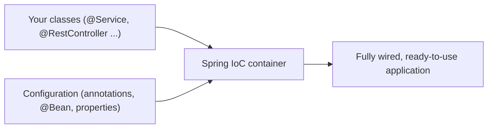
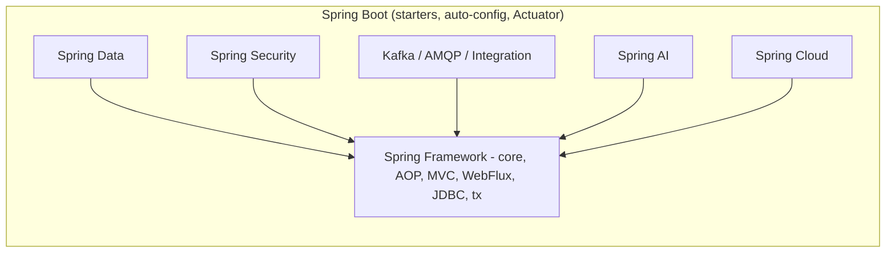
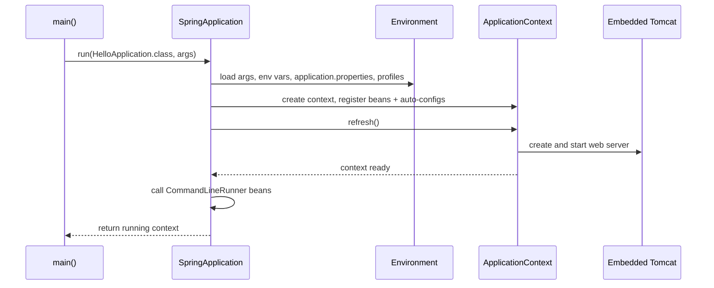
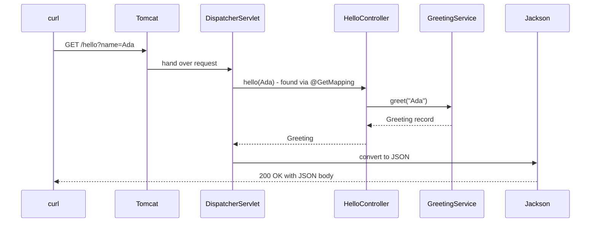

# Chapter 1 — The Spring Ecosystem and Your First App

Spring is the most widely used framework for server-side Java applications (programs that run on a server and answer other programs): web APIs, back-office systems, batch jobs (programs that process a large pile of data in one run, often at night) and message consumers (programs that react to messages arriving on a queue).

> **Key term — API / REST API:** An **API** (Application Programming Interface) is the set of operations one program offers to others. A **web API** offers them over HTTP. A **REST API** is a web API in a common style: each thing (an order, a user) has a URL, and you act on it with standard HTTP methods such as `GET` (read) and `POST` (create), usually exchanging JSON. HTTP basics: [System Design Fundamentals](../../../system-design-patterns/modules/00-system-design-fundamentals/README.md).

This chapter explains what Spring and Spring Boot are, their history and current versions, then builds, runs, packages and tests a first REST API with **Spring Boot 4.1.1** on **Java 25**. You only need basic Java; Java features (records, annotations, lambdas, Maven) are linked to the [Java Handbook](../../../java/chapters/01-java-and-the-jvm/README.md) rather than re-taught.

All runnable code is in [`code/hello-boot/`](code/hello-boot/): a Maven project whose tests were run with `mvn -q -B -ntp verify` on JDK 25. Outputs below are real (long log lines trimmed with `...`).

---

## 1.1 What Spring is

### What it is
A **library** is code you call (e.g. a JSON parser). A **framework** is code that calls *you*: it owns the program's structure and plugs your classes in at the right moments. This reversal is **Inversion of Control (IoC)** — "don't call us, we'll call you".

**Spring Framework** is an open-source Java framework whose core is an **IoC container**: an object that creates your application's objects, connects them, configures them and manages their whole life. Objects managed by the container are **beans**. Around that core Spring offers modules for web (Spring MVC — the classic web framework, one thread per request; WebFlux — a non-blocking alternative), data access (**JDBC** — Java Database Connectivity, Java's standard low-level SQL API; and **transactions** — groups of database changes that succeed or fail as one unit), messaging, testing, scheduling and more.

### The problem it solves
Without a container, every class builds its own dependencies with `new`:

```java
// Hard-wired: OrderService decides WHICH repository and WHICH mailer it uses.
class OrderService {
    private final OrderRepository repo = new JdbcOrderRepository(new HikariDataSource(...));
    private final Mailer mailer = new SmtpMailer("smtp.example.com", 25);
}
```

| Problem | Why it hurts |
|---|---|
| **Tight coupling** | Swapping `JdbcOrderRepository` for another implementation means editing `OrderService`. |
| **Hard to test** | A unit test of `OrderService` now needs a real database and a real mail server. |
| **Scattered configuration** | Host names, pool sizes and credentials are buried in constructors all over the code. |

Spring's answer is **Dependency Injection (DI)**: a class *declares* what it needs (usually as constructor parameters) and the container *supplies* it. The class depends on an interface; the container picks the implementation. Chapter 2 covers DI in depth; the design principle behind it is the Dependency Inversion Principle — see [LLD §4.10](../../../lld/chapters/04-solid-principles/README.md) and the Hollywood Principle in [LLD Chapter 5](../../../lld/chapters/05-design-principles/README.md).

Beyond DI, Spring gives battle-tested answers for the plumbing every server needs: HTTP handling, JSON conversion (**JSON** is a plain-text data format like `{"name":"Ada"}`), transactions, security, scheduling, caching and consistent exception types.

### How it works (bird's-eye view)
You write ordinary Java classes (POJOs — "Plain Old Java Objects") and mark those Spring should manage, e.g. with `@Service` (an **annotation**: a `@`-label frameworks read at runtime). At startup the container reads this **configuration metadata** (annotations, `@Bean` methods, or XML in old projects), creates each bean injecting what it needs, and may wrap beans in **proxies** (stand-ins that intercept calls) to add transactions or security (Chapter 4). It then calls your code when requests, messages or timers arrive, and at shutdown runs clean-up callbacks.



### Real-world examples
Banks, retailers, airlines, streaming and public-sector back ends; Netflix has publicly described moving its Java services to Spring Boot. It is the most common Java stack in back-end interviews.

---

## 1.2 What Spring Boot adds

### What it is
**Spring Boot** is built *on top of* Spring Framework to make Spring applications quick to create and production-ready. It does not replace Spring — every Boot application *is* a Spring application.

| Feature | What it means | Where in this book |
|---|---|---|
| **Starters** | One dependency per capability (`spring-boot-starter-webmvc`) bringing a tested set of libraries. | §1.7 |
| **Dependency management** | Boot picks compatible versions of hundreds of libraries, so your `pom.xml` has no `<version>` tags. | §1.6 |
| **Auto-configuration** | Boot inspects your classpath (the jars your app includes) and settings and creates sensible beans (web server, JSON mapper, a `DataSource` — an object that hands out database connections). Your own beans always win. | Chapter 3 |
| **Embedded server** | Tomcat (or Jetty) runs *inside* your app; you run `java -jar app.jar`. | §1.9 |
| **Externalized configuration** | Settings from `application.properties`/`.yaml`, environment variables (e.g. `SERVER_PORT=9090`), command-line arguments, with a clear precedence order. | Chapter 3 |
| **Production features** | Health checks, metrics, tracing (following one request across services), structured logging, graceful shutdown (Actuator). | Chapter 15 |
| **Testing support** | Slices (tests that start only one layer) like `@WebMvcTest`, `@SpringBootTest`, test starters. | Chapter 12 |

### Why it matters
Before Boot (2014), a Spring web app needed a WAR file (Web Application Archive — a zip you copy into a separately installed server), an external Tomcat, configuration for the `DispatcherServlet` (Spring MVC's central request dispatcher, Chapter 5), a view resolver, a JSON converter, a data source, and a careful choice of mutually compatible library versions. Boot reduced that to a generated project and a `main` method, keeping every default overridable.

### Spring vs Spring Boot

| Question | Spring Framework | Spring Boot |
|---|---|---|
| What is it? | The core: IoC container, MVC, transactions... | An opinionated layer (sensible defaults) that configures Spring for you |
| Use one without the other? | Yes — plain Spring works without Boot | No — Boot always uses Spring Framework |
| Config / server / versions | You declare infrastructure beans, deploy a WAR, pick each library version | Auto-configured, embedded server, versions from Boot's BOM |
| Typical use today | Libraries, special setups | Almost every new application |

### Common mistakes
- Thinking Boot is a different framework with different annotations. `@Service`, `@Autowired`, `@Transactional`, `@RestController` are Spring *Framework* annotations; Boot mostly adds `@SpringBootApplication`, `@ConfigurationProperties` and test annotations.
- Believing auto-configuration is uninspectable magic. It is ordinary `@Configuration` classes guarded by conditions, and Boot can print a report of every decision (Chapter 3).

### In the interview
**Q: What is the difference between Spring and Spring Boot?**
*30-second answer:* Spring Framework provides the IoC container and modules like MVC and transactions. Boot sits on top: starters for dependency sets, a managed version BOM, auto-configuration that creates beans based on classpath and properties, an embedded server so the app runs as a plain jar, externalized configuration and production features like Actuator. Boot removes boilerplate; it does not replace Spring.

- *Follow-up: Can you override what Boot configures?* Yes. Auto-configured beans are usually guarded by `@ConditionalOnMissingBean`, so defining your own bean of that type makes Boot back off; many settings are just properties.
- *Follow-up: Does Boot make the app slower?* Startup does extra condition evaluation, but the runtime path is the same Spring code. Boot also offers AOT (ahead-of-time: work done at build time instead of startup) processing and native images (the app compiled to a stand-alone executable needing no JVM) for faster startup (Chapter 15).

---

## 1.3 The Spring ecosystem

"Spring" is also an umbrella name for a family of projects maintained by the Spring team (part of Broadcom since its acquisition of VMware). All are version-managed by Spring Boot, so you rarely pick their versions yourself.

| Project | What it gives you | Chapter |
|---|---|---|
| **Spring Framework** | IoC container, AOP (Aspect-Oriented Programming — cross-cutting behaviour such as logging around methods), MVC, WebFlux, JDBC, transactions, testing | 2, 4, 5, 7, 13 |
| **Spring Boot** | Starters, auto-configuration, embedded servers, Actuator | 1, 3, 12, 15 |
| **Spring Data** | Repository interfaces (you declare data-access methods; Spring writes the code) for JPA, JDBC, MongoDB, Redis, R2DBC... | 8, 9 |
| **Spring Security** | Authentication (who are you?), authorization (what may you do?), OAuth2 (delegated login/access), JWT (a signed token carrying user claims) | 10, 11 |
| **Spring Cloud** | Config server, service discovery, gateway (single entry point in front of many services), load balancing | 16 |
| **Spring for Apache Kafka / Spring AMQP** | Messaging with Kafka and RabbitMQ (message brokers) | 14 |
| **Spring Batch** | Large, restartable batch jobs | — (mentioned in 14) |
| **Spring Integration** | Enterprise integration patterns (channels, adapters) | — |
| **Spring Session** | Store HTTP sessions (per-user server-side state) in Redis or a database | 10 |
| **Spring for GraphQL** | GraphQL (query language where the client picks the fields) servers | — |
| **Spring Modulith** | Structure a monolith (one app deployed as a single unit) into verified modules | 16 |
| **Spring AI** | LLM chat clients, embeddings (text as number vectors), RAG (retrieval-augmented generation), tool calling | 17 |



**Real-world stack.** A typical online-shop order service: Spring Boot + Spring MVC (REST API) + Spring Data JPA (PostgreSQL) + Spring Security (JWT) + Spring for Apache Kafka ("order placed" events) + Actuator/Micrometer (Spring's metrics library). This book builds each layer.

---

## 1.4 History and versions

### A short timeline

| Year | Release | What changed |
|---|---|---|
| 2002 | Rod Johnson's book *Expert One-on-One J2EE Design and Development* | A lighter alternative to EJB (Enterprise JavaBeans, J2EE's heavyweight component model); its sample code became Spring |
| 2004 | Spring Framework 1.0 | IoC container, AOP, transaction abstraction, XML configuration |
| 2007 | Spring 2.5 | Annotation-driven config: `@Autowired`, `@Component`, `@Controller` |
| 2009 | Spring 3.0 | Java 5 baseline, `@Configuration`/`@Bean`, SpEL (Spring Expression Language, `#{...}`), REST support in MVC |
| 2013 | Spring 4.0 | Java 8 support, `@Conditional` (foundation of auto-configuration) |
| 2014 | Spring Boot 1.0 | Starters, auto-configuration, embedded servers |
| 2017–18 | Spring 5.0 / Boot 2.0 | Java 8 baseline, reactive stack (WebFlux) |
| 2022 | Spring 6.0 / Boot 3.0 | **Java 17 baseline**, `javax.*` → `jakarta.*`, AOT and GraalVM native images |
| Nov 2025 | **Spring Framework 7.0** (13 Nov) / **Spring Boot 4.0** (20 Nov) | Jakarta EE 11, JSpecify null-safety (annotations marking what may be `null`), modular Boot jars, Jackson 3, API versioning, HTTP service clients, JUnit 6 |
| Jun 2026 | Spring Boot 4.1.0 (10 Jun) | gRPC (fast binary remote-call protocol) support, Jackson config updates, observability updates |
| Aug 2026 | Spring Boot 4.1.1 (20 Aug) | Bug fixes and dependency upgrades — **the version used in this book** |

### The current generation — what Boot 4.1.1 gives you

From Boot 4.1.1's dependency BOM (`spring-boot-dependencies-4.1.1.pom`):

| Component | Version in Boot 4.1.1 | Notes |
|---|---|---|
| Java | **17 minimum**, 25 recommended | This book uses Java 25 (LTS) — see [Java Ch. 17](../../../java/chapters/17-modern-java-17-to-25/README.md) |
| Spring Framework | 7.0.9 | |
| Jakarta EE | 11 (Servlet 6.1; JPA 3.2 — object/database mapping; Bean Validation 3.1 — rules like `@NotNull`) | |
| Tomcat / Jetty | 11.0.24 / 12.1.12 | Undertow no longer supported (lacks Servlet 6.1) |
| Jackson | 3.1.5 (`tools.jackson` packages) | Jackson 2 still available via a separate, deprecated module |
| Hibernate ORM / Validator | 7.4.5 / 9.1.3 | ORM = object-relational mapper |
| Spring Security | 7.1.1 | |
| Spring Data | 2026.0.1 release train (modules released together) | |
| JUnit Jupiter | 6.0.3 | JUnit 4 support deprecated in Framework 7 |
| Mockito / AssertJ | 5.23.0 / 3.27.7 | Test fakes / readable assertions |
| Kotlin | 2.3.21 (2.2 minimum) | |
| GraalVM (native images) | 25+ | |

### `javax` → `jakarta`
Java EE was handed to the Eclipse Foundation in 2017 and renamed **Jakarta EE**; for trademark reasons its packages moved from `javax.*` to `jakarta.*` (Jakarta EE 9, 2020). Since Spring 6 / Boot 3 Spring uses only `jakarta` names (`jakarta.servlet.http.HttpServletRequest`, `jakarta.persistence.Entity`, `jakarta.annotation.PostConstruct`, `jakarta.validation.constraints.NotNull`). Framework 7 removed the last support for `javax.annotation` and `javax.inject`. A tutorial importing `javax.persistence` is for Boot 2 or older.

### How versions relate
- **Boot pins everything.** You choose the Boot version; its BOM chooses compatible Spring Framework, Data, Security, Tomcat, Jackson, Hibernate, JUnit, etc.
- **Cadence.** A new minor (4.0, 4.1 — features, no breaking changes) roughly every six months; patch releases (4.1.1, 4.1.2 — bug fixes only) in between.
- **Support.** Each minor line gets roughly 13 months of free open-source support, then commercial support. Check spring.io/projects/spring-boot "Support" before planning an upgrade.
- **Version names.** `-M1`, `-M2` milestones, `-RC1` release candidates, plain `4.1.1` is GA (generally available). `-SNAPSHOT` = nightly builds — never in production.

### Common mistakes
- Adding `<version>` to a Spring dependency in a Boot project — overrides the tested version. Let the parent manage it.
- Mixing `javax.*` and `jakarta.*` imports after copying old code.
- Following a Boot 2/3 tutorial for Boot 4 without checking renamed starters (§1.7) and Jackson 3 package names.

---

## 1.5 Creating a project with start.spring.io

### What it is
**Spring Initializr** (**start.spring.io**) is a web service that generates a ready-to-build Boot project as a zip. IntelliJ IDEA, VS Code (Spring Boot Extension Pack) and Eclipse (Spring Tools) call the same service from their "New project" wizards.

### How it works
Choose: **Project** — *Gradle - Groovy* (default), *Gradle - Kotlin* or *Maven* (build tools; this book uses Maven); **Language** — Java (Kotlin, Groovy offered); **Spring Boot** — latest GA without suffix (**4.1.1**; avoid `SNAPSHOT`/`M`/`RC`); **Metadata** — *Group* `com.example` (reversed domain), *Artifact* `hello-boot` (also the jar name), *Package* `com.example.hello` (main class goes here), *Packaging* `Jar` (`War` only for an external server), *Java* 17/21/25/27 (this book: 25); **Dependencies** — *Spring Web* (id `web`) and *Spring Boot DevTools* (id `devtools`). Then Generate, unzip, open. From a terminal:

```bash
curl https://start.spring.io/starter.zip \
  -d type=maven-project -d bootVersion=4.1.1 -d javaVersion=25 \
  -d groupId=com.example -d artifactId=hello-boot -d packageName=com.example.hello \
  -d dependencies=web,devtools -o hello-boot.zip
```

For Boot 4.1.1, *Spring Web* produces `spring-boot-starter-webmvc` and the test starter `spring-boot-starter-webmvc-test` — exactly the `pom.xml` in §1.6 (checked against the generated file).

### Common mistakes
- Choosing a Java version newer than your installed JDK (`release version 25 not supported`). Check `java -version`, see [Java §1.4](../../../java/chapters/01-java-and-the-jvm/README.md).
- Adding every dependency "just in case". Each starter can switch on auto-configuration — e.g. *Spring Data JPA* without a database fails with "Failed to configure a DataSource".
- Putting classes in a package *outside* the main class's package (§1.8).

---

## 1.6 Project layout and the build file

### The layout

```
hello-boot/
├── pom.xml                          ← build file (Maven)
├── mvnw, mvnw.cmd, .mvn/            ← Maven Wrapper: builds without installing Maven
└── src/
    ├── main/
    │   ├── java/com/example/hello/
    │   │   ├── HelloApplication.java   ← the main class (§1.8)
    │   │   ├── HelloController.java    ← REST endpoint (§1.11)
    │   │   ├── GreetingService.java
    │   │   └── Greeting.java
    │   └── resources/
    │       ├── application.properties  ← configuration (Chapter 3)
    │       ├── static/                 ← optional: files served as-is (HTML, CSS, JS)
    │       └── templates/              ← optional: server-side templates (Thymeleaf)
    └── test/java/com/example/hello/
        ├── HelloControllerTest.java
        └── HelloApplicationTests.java
```

Standard Maven layout — `src/main/java`, `src/main/resources`, `src/test/java` ([Java §18.1–18.2](../../../java/chapters/18-testing-build-and-tooling/README.md)). Everything under `src/main/resources` ends up on the **classpath** (where the JVM loads classes and files from), which is how Boot finds `application.properties`.

### The `pom.xml`

```xml
<!-- code/hello-boot/pom.xml -->
<parent>                                              <!-- 1 -->
  <groupId>org.springframework.boot</groupId>
  <artifactId>spring-boot-starter-parent</artifactId>
  <version>4.1.1</version>
  <relativePath/>
</parent>

<groupId>com.example</groupId>
<artifactId>hello-boot</artifactId>
<version>0.0.1-SNAPSHOT</version>

<properties>
  <java.version>25</java.version>                     <!-- 2 -->
</properties>

<dependencies>
  <dependency>                                        <!-- 3 -->
    <groupId>org.springframework.boot</groupId>
    <artifactId>spring-boot-starter-webmvc</artifactId>
  </dependency>
  <dependency>                                        <!-- 4 -->
    <groupId>org.springframework.boot</groupId>
    <artifactId>spring-boot-devtools</artifactId>
    <scope>runtime</scope>
    <optional>true</optional>
  </dependency>
  <dependency>                                        <!-- 5 -->
    <groupId>org.springframework.boot</groupId>
    <artifactId>spring-boot-starter-webmvc-test</artifactId>
    <scope>test</scope>
  </dependency>
</dependencies>

<build>
  <plugins>
    <plugin>                                          <!-- 6 -->
      <groupId>org.springframework.boot</groupId>
      <artifactId>spring-boot-maven-plugin</artifactId>
    </plugin>
  </plugins>
</build>
```

1. **`spring-boot-starter-parent`** — a parent POM (Project Object Model, Maven's `pom.xml`; children inherit its settings) that (a) imports the dependency BOM (**Bill of Materials**: tested versions for hundreds of libraries), (b) sets UTF-8, (c) compiles with `-parameters` (so Spring can read constructor parameter names), (d) pre-configures plugins (surefire for tests, resources filtering, the Boot plugin).
2. **`java.version`** — becomes `maven.compiler.release`, so `javac --release 25`.
3. **Web starter** — no `<version>`: the parent manages it.
4. **DevTools** — `runtime` + `optional` keeps it out of projects depending on yours; the Boot plugin also leaves it out of the packaged jar by default.
5. **Test starter** — test classpath only.
6. **`spring-boot-maven-plugin`** — adds goals such as `spring-boot:run`, and during `package` **repackages** the jar into an executable "fat jar" containing all dependency jars (§1.9).

**If you cannot use the parent** (company parent POM), import the BOM and configure `-parameters` and the plugin's `repackage` goal yourself:

```xml
<dependencyManagement>
  <dependencies>
    <dependency>
      <groupId>org.springframework.boot</groupId>
      <artifactId>spring-boot-dependencies</artifactId>
      <version>4.1.1</version>
      <type>pom</type>
      <scope>import</scope>
    </dependency>
  </dependencies>
</dependencyManagement>
```

**Gradle equivalent** (what Initializr generates):

```groovy
plugins {
    id 'java'
    id 'org.springframework.boot' version '4.1.1'
    id 'io.spring.dependency-management' version '1.1.7'
}
java { toolchain { languageVersion = JavaLanguageVersion.of(25) } }
dependencies {
    implementation 'org.springframework.boot:spring-boot-starter-webmvc'
    developmentOnly 'org.springframework.boot:spring-boot-devtools'
    testImplementation 'org.springframework.boot:spring-boot-starter-webmvc-test'
    testRuntimeOnly 'org.junit.platform:junit-platform-launcher'
}
tasks.named('test') { useJUnitPlatform() }
```
Commands: `./gradlew bootRun`, `./gradlew bootJar`, `./gradlew test`.

---

## 1.7 Starters

### What it is
A **starter** is a dependency with (almost) no code; it pulls in a curated, version-aligned set of libraries for one capability. `spring-boot-starter-webmvc` gives you Spring MVC, embedded Tomcat, Jackson, logging, and the Boot auto-configuration that wires them.

### How it works
Real runtime dependency tree of `hello-boot` (`mvn dependency:tree -Dscope=runtime`):

```
com.example:hello-boot:jar:0.0.1-SNAPSHOT
+- org.springframework.boot:spring-boot-starter-webmvc:jar:4.1.1:compile
|  +- org.springframework.boot:spring-boot-starter:jar:4.1.1:compile
|  |  +- org.springframework.boot:spring-boot-starter-logging:jar:4.1.1:compile   (Logback 1.5.38, SLF4J bridges)
|  |  ...
|  +- org.springframework.boot:spring-boot-starter-jackson:jar:4.1.1:compile
|  |  \- org.springframework.boot:spring-boot-jackson:jar:4.1.1:compile
|  |     \- tools.jackson.core:jackson-databind:jar:3.1.5:compile
|  +- org.springframework.boot:spring-boot-starter-tomcat:jar:4.1.1:compile
|  |  +- org.springframework.boot:spring-boot-starter-tomcat-runtime:jar:4.1.1:compile
|  |  |  +- org.apache.tomcat.embed:tomcat-embed-core:jar:11.0.24:compile
|  |  |  ...
|  |  \- org.springframework.boot:spring-boot-tomcat:jar:4.1.1:compile
|  +- org.springframework.boot:spring-boot-http-converter:jar:4.1.1:compile
|  |  \- org.springframework:spring-web:jar:7.0.9:compile
|  \- org.springframework.boot:spring-boot-webmvc:jar:4.1.1:compile
|     +- org.springframework.boot:spring-boot-servlet:jar:4.1.1:compile
|     \- org.springframework:spring-webmvc:jar:7.0.9:compile
\- org.springframework.boot:spring-boot-devtools:jar:4.1.1:runtime (optional)
   +- org.springframework.boot:spring-boot:jar:4.1.1:compile   (spring-core / spring-context 7.0.9, jspecify 1.0.1)
   \- org.springframework.boot:spring-boot-autoconfigure:jar:4.1.1:compile
```

The Boot 4 pattern: each technology has a **Boot module** holding its auto-configuration (`spring-boot-webmvc`, `spring-boot-tomcat`, `spring-boot-jackson`) and a **starter** combining that module with the library.

### Boot 4 modular starters
Boot 3 shipped all auto-configuration in one `spring-boot-autoconfigure` jar. **Boot 4 split it into per-technology modules** and renamed some starters. In 4.1.1 the core `spring-boot-autoconfigure` jar lists only 12 auto-configurations; MVC's live in `spring-boot-webmvc`, Tomcat's in `spring-boot-tomcat`, etc. (Chapter 3).

| Capability | Boot 4 starter | Boot 3 name (if different) |
|---|---|---|
| Servlet web / REST (Spring MVC + Tomcat) | `spring-boot-starter-webmvc` | `spring-boot-starter-web` |
| Reactive web (WebFlux + Netty) | `spring-boot-starter-webflux` | |
| Blocking HTTP client (`RestClient`) | `spring-boot-starter-restclient` | part of `-web` |
| Reactive HTTP client (`WebClient`) | `spring-boot-starter-webclient` | part of `-webflux` |
| JSON (Jackson 3) | `spring-boot-starter-jackson` | `spring-boot-starter-json` (still available in 4.x) |
| Bean Validation | `spring-boot-starter-validation` | |
| JDBC / JPA | `spring-boot-starter-jdbc` / `spring-boot-starter-data-jpa` | |
| Security | `spring-boot-starter-security` | |
| OAuth2 resource server | `spring-boot-starter-security-oauth2-resource-server` | `spring-boot-starter-oauth2-resource-server` |
| AspectJ-based AOP | `spring-boot-starter-aspectj` | `spring-boot-starter-aop` |
| Kafka | `spring-boot-starter-kafka` | (previously just `spring-kafka`) |
| Actuator | `spring-boot-starter-actuator` | |
| Core only (no web) | `spring-boot-starter` | |
| Testing, generic | `spring-boot-starter-test` | |
| Testing, per technology | `spring-boot-starter-webmvc-test`, `-data-jpa-test`, `-security-test`, ... | — (new in Boot 4) |

Rules of thumb for Boot 4:
- **Every technology starter has a `-test` companion** bringing its test slice (`@WebMvcTest` lives in `spring-boot-webmvc-test`). Each test starter includes `spring-boot-starter-test`.
- Some old names remain in 4.1 as **deprecated** aliases (`spring-boot-starter-web`, `spring-boot-starter-oauth2-resource-server`); others are gone (`spring-boot-starter-aop` → `spring-boot-starter-aspectj`). Prefer the new names.
- For a quick Boot 3 upgrade, `spring-boot-starter-classic` and `spring-boot-starter-test-classic` restore the old "everything on the classpath" behaviour while you fix imports.
- Third-party starters are named `<name>-spring-boot-starter` (e.g. `mybatis-spring-boot-starter`); only official ones start with `spring-boot-starter-` (Chapter 3 builds one).

### Common mistakes
- Adding both `-webmvc` and `-webflux` starters and being surprised it's a *servlet* app: with both present Boot chooses Spring MVC.
- Using `spring-boot-starter-test` alone and finding `@WebMvcTest` missing in Boot 4 — add `spring-boot-starter-webmvc-test`.
- Excluding a transitive library (one you get indirectly) by hand to "slim down" and breaking auto-configuration. Use the intended starter (e.g. exclude `spring-boot-starter-tomcat`, add `spring-boot-starter-jetty`).

---

## 1.8 The main class and `@SpringBootApplication`

```java
// code/hello-boot/src/main/java/com/example/hello/HelloApplication.java
package com.example.hello;

import org.springframework.boot.SpringApplication;
import org.springframework.boot.autoconfigure.SpringBootApplication;

@SpringBootApplication            // = @SpringBootConfiguration + @EnableAutoConfiguration + @ComponentScan
public class HelloApplication {

    public static void main(String[] args) {
        SpringApplication.run(HelloApplication.class, args);   // creates and starts the ApplicationContext
    }
}
```

### What `@SpringBootApplication` means

| Annotation | What it does |
|---|---|
| `@SpringBootConfiguration` | Marks this class as a configuration source (a specialised `@Configuration`). Tests use it to find your app's configuration. |
| `@EnableAutoConfiguration` | Loads candidate auto-configuration classes and applies those whose conditions match (Chapter 3). |
| `@ComponentScan` | Scans **this class's package and all sub-packages** for `@Component`, `@Service`, `@Repository`, `@Controller`, `@RestController`, `@Configuration` classes and registers them as beans. |

### What `SpringApplication.run` does
1. Decides the application type from the classpath: **servlet** (Spring MVC present), **reactive** (only WebFlux) or **none**.
2. Prepares the `Environment`: command-line args, environment variables, `application.properties`/`.yaml`, active profiles (Chapter 3).
3. Prints the banner.
4. Creates the right `ApplicationContext` (the IoC container; web-server-aware for a servlet app).
5. Registers bean definitions: scanned classes plus auto-configurations whose conditions pass.
6. **Refreshes** the context: creates all singleton beans (one shared instance — the default) and, for a web app, starts embedded Tomcat.
7. Runs `CommandLineRunner`/`ApplicationRunner` beans (run-once-at-startup code).
8. Returns the running context; the JVM keeps running while Tomcat's threads are alive.



### Where to put the main class
In the **root package** (`com.example.hello`), with every other class in that package or below (`com.example.hello.orders`, `...web`). Scanning starts from the main class's package, so a class in `com.example.other` is silently **not** a bean.

### Common mistakes
- Main class in a sub-package (`com.example.hello.app`) while controllers live in `com.example.hello.web` → endpoints return 404 because the controllers were never scanned.
- Main class in the *default* (unnamed) package — Boot warns, and scanning every jar on the classpath breaks startup.
- Writing logic in `main` after `run(...)` expecting it to run "before the server starts". Use a `CommandLineRunner` or an event listener (Chapter 2).

### In the interview
**Q: What does `@SpringBootApplication` do?**
It combines `@SpringBootConfiguration` (this class is configuration), `@EnableAutoConfiguration` (apply Boot's conditional auto-configurations) and `@ComponentScan` (register annotated classes from this package downwards).
- *Follow-up: Scan a package outside the main package?* Move the code under the root package (best), or `@SpringBootApplication(scanBasePackages = "...")` / `@Import` for specific classes.
- *Follow-up: Exclude one auto-configuration?* `@SpringBootApplication(exclude = SomeAutoConfiguration.class)` or the property `spring.autoconfigure.exclude`.

---

## 1.9 Running the application

### Three ways to run

| Way | Command | When |
|---|---|---|
| IDE | Run `HelloApplication.main` | Daily development, breakpoints |
| Maven plugin | `./mvnw spring-boot:run` (or `mvn spring-boot:run`) | Terminal development; reads `src/main/resources` directly |
| Executable jar | `./mvnw package` then `java -jar target/hello-boot-0.0.1-SNAPSHOT.jar` | Production, containers, CI |

Settings on the command line:

```bash
mvn spring-boot:run -Dspring-boot.run.arguments="--server.port=9090"
java -jar target/hello-boot-0.0.1-SNAPSHOT.jar --server.port=9090 --spring.profiles.active=dev
```

### The startup log
Running the packaged jar on JDK 25 (`java -jar target/hello-boot-0.0.1-SNAPSHOT.jar --server.port=18081`):

```
 :: Spring Boot ::                (v4.1.1)      ← after the ASCII-art banner

INFO 91361 --- [hello-boot] [main] c.e.hello.HelloApplication : Starting HelloApplication v0.0.1-SNAPSHOT using Java 25.0.2 with PID 91361 ...
INFO 91361 --- [hello-boot] [main] c.e.hello.HelloApplication : No active profile set, falling back to 1 default profile: "default"
INFO 91361 --- [hello-boot] [main] o.s.boot.tomcat.TomcatWebServer : Tomcat initialized with port 18081 (http)
INFO 91361 --- [hello-boot] [main] o.apache.catalina.core.StandardEngine : Starting Servlet engine: [Apache Tomcat/11.0.24]
INFO 91361 --- [hello-boot] [main] b.w.c.s.WebApplicationContextInitializer : Root WebApplicationContext: initialization completed in 376 ms
INFO 91361 --- [hello-boot] [main] o.s.boot.tomcat.TomcatWebServer : Tomcat started on port 18081 (http) with context path '/'
INFO 91361 --- [hello-boot] [main] c.e.hello.HelloApplication : Started HelloApplication in 0.728 seconds (process running for 0.929)
```

(Timestamps removed, logger names shortened.)

| Log part | Meaning |
|---|---|
| `91361` | Process ID |
| `[hello-boot]` | `spring.application.name` from `application.properties` |
| `[main]` | Thread name |
| `No active profile set...` | Only `application.properties` applies (profiles: Chapter 3) |
| `Tomcat initialized/started on port ...` | The embedded server is listening |
| `Started HelloApplication in 0.728 seconds` | The context is fully refreshed and ready |

On the first request you also see `Initializing Spring DispatcherServlet 'dispatcherServlet'` — Spring MVC's front controller (one object that receives and routes every request) is created lazily (Chapter 5). Ctrl+C (or `kill <pid>`) shows:

```
INFO ... [ionShutdownHook] o.s.boot.tomcat.GracefulShutdown : Commencing graceful shutdown. Waiting for active requests to complete
INFO ... [tomcat-shutdown] o.s.boot.tomcat.GracefulShutdown : Graceful shutdown complete
```

**Graceful shutdown** is on by default: the server stops accepting new requests and lets in-flight ones finish (up to `spring.lifecycle.timeout-per-shutdown-phase`, default 30 s) before the context closes (Chapter 15).

### Inside the executable jar
`mvn package` produced a 19.9 MB jar. Layout (`unzip -l`) and manifest (`MANIFEST.MF`, tells Java which class to start):

```
META-INF/MANIFEST.MF
org/springframework/boot/loader/...        ← Boot's launcher classes
BOOT-INF/classes/com/example/hello/*.class ← your code
BOOT-INF/classes/application.properties
BOOT-INF/lib/*.jar                         ← 34 dependency jars, stored unchanged
BOOT-INF/classpath.idx, BOOT-INF/layers.idx
```
```
Main-Class: org.springframework.boot.loader.launch.JarLauncher
Start-Class: com.example.hello.HelloApplication
Spring-Boot-Version: 4.1.1
Spring-Boot-Classes: BOOT-INF/classes/
Spring-Boot-Lib: BOOT-INF/lib/
```

A plain JVM cannot load classes from jars *nested* inside a jar. So `java -jar` starts Boot's **`JarLauncher`** (`Main-Class`), which sets up a class loader able to read `BOOT-INF/lib/*.jar`, then calls your **`Start-Class`**. `layers.idx` groups files into layers (dependencies change rarely, your classes often) so Docker images can cache them (Chapter 15). General jar packaging: [Java §18.12](../../../java/chapters/18-testing-build-and-tooling/README.md).

### Common mistakes
- `Web server failed to start. Port 8080 was already in use.` — another process (often a previous run) holds the port. Stop it or set `server.port`; `server.port=0` picks a random free port. Without editing files: `--server.port=9090` or env var `SERVER_PORT`.
- Running `java -jar` on the *original* jar (`*.jar.original`) — no launcher, fails with "no main manifest attribute".
- Expecting DevTools to work with `java -jar`: packaged apps disable it (§1.10).

---

## 1.10 DevTools

### What it is
**Spring Boot DevTools** (`spring-boot-devtools`) is a development-only module for a faster edit–run loop:

| Feature | What it does |
|---|---|
| **Automatic restart** | When compiled classes on the classpath change, the app restarts in about a second. |
| **Development property defaults** | Turns off template and static-resource caching, enables the H2 console (web UI for the in-memory H2 database), etc. |
| **Global settings** | `~/.config/spring-boot/spring-boot-devtools.properties` applies to all your apps. |
| **Remote DevTools** | Opt-in restart of a remote app over HTTP; a security risk — trusted networks only. |
| **LiveReload** | Browser auto-refresh; **disabled by default since Boot 4.0, deprecated in 4.1** (no replacement). |

### How restart works
1. **Two class loaders**: a *base* loader for jars that don't change (Spring, Tomcat, Jackson...) and a *restart* loader for your classes.
2. It watches compiled output folders (e.g. `target/classes`).
3. When something changes there — IDE compile-on-save, IntelliJ *Build Project*, or `mvn compile` — it discards only the restart loader and starts the context again.
4. The warm base loader makes this much faster than a cold start.

Changes under `static/`, `public/`, `templates/` and `META-INF/resources` do **not** trigger a restart. Tune with `spring.devtools.restart.exclude` / `additional-exclude`, or disable with `spring.devtools.restart.enabled=false`.

### When it is off
DevTools treats an app launched with `java -jar` (or from a special class loader) as production and disables itself. It is also off in tests: this chapter's test log shows `Restart disabled due to context in which it is running`.

### Common mistakes
- Expecting a restart after *editing* a `.java` file without compiling — DevTools watches compiled classes. Enable "build project automatically".
- Shipping DevTools to production by removing `<optional>true</optional>` or configuring the plugin to include it.
- Confusing restart with hot-swapping (replacing code inside the running JVM): restart re-creates the whole context, so in-memory state (sessions, caches) is lost. Tools like JRebel do true class reloading.

---

## 1.11 Your first REST endpoint

### What we build
`GET /hello?name=Ada` → `{"message":"Hello, Ada!","length":11}`, with the typical layering: a **controller** (HTTP), a **service** (logic) and a **record** (the JSON shape).

```java
// Greeting.java — the response body
public record Greeting(String message, int length) {}
```
A **record** is a compact immutable data class (Java 16 — [Java §6.8](../../../java/chapters/06-oop-inheritance-interfaces-and-more/README.md)). Jackson 3 serializes its components as JSON fields.

```java
// GreetingService.java
@Service                                   // a bean: Spring creates one instance and manages it
public class GreetingService {
    public Greeting greet(String name) {
        String message = "Hello, " + name + "!";
        return new Greeting(message, message.length());
    }
}
```

```java
// HelloController.java
@RestController                            // a bean whose method results are written to the HTTP response body
public class HelloController {

    private final GreetingService service;

    HelloController(GreetingService service) { // constructor injection: Spring passes the GreetingService bean
        this.service = service;
    }

    @GetMapping("/hello")                  // handles GET /hello and GET /hello?name=Ada
    Greeting hello(@RequestParam(defaultValue = "World") String name) {
        return service.greet(name);
    }
}
```

| Piece | Role |
|---|---|
| `@RestController` | `@Controller` + `@ResponseBody`: the return value becomes the response body (JSON), not a view name. |
| Constructor parameter | Spring passes the singleton `GreetingService`. No `@Autowired` needed with a single constructor (Chapter 2). |
| `@GetMapping("/hello")` | Maps HTTP GET `/hello` to this method. |
| `@RequestParam(defaultValue = "World")` | Reads query parameter `name`; if absent, `"World"`. |
| Return type `Greeting` | Jackson (auto-configured) writes JSON with `Content-Type: application/json`. |

### Calling it

```bash
$ curl -s 'localhost:18081/hello?name=Ada'
{"message":"Hello, Ada!","length":11}
$ curl -s localhost:18081/hello
{"message":"Hello, World!","length":13}
$ curl -s -i localhost:18081/hello | head -3
HTTP/1.1 200
Content-Type: application/json
Content-Length: 39
$ curl -s localhost:18081/nope
{"timestamp":"2026-09-28T23:24:50.396Z","status":404,"error":"Not Found","path":"/nope"}
```

The last response is Boot's default error handling (`/error` endpoint). Chapter 5 replaces it with RFC 9457 `ProblemDetail` responses (a standard JSON shape for errors).

### What happened during a request


### Common mistakes
- `@Controller` instead of `@RestController` for a JSON API → `"Hello"` is treated as a *view name* and fails with a template error.
- Business logic in the controller. Keep controllers thin (parse input, call a service, return output).
- Returning mutable database entities directly — prefer small response records (Chapter 8).

---

## 1.12 Testing the first app

Spring Boot tests are ordinary JUnit tests with annotations that start (part of) the container. Two styles cover most needs; Chapter 12 goes deeper. JUnit basics: [Java §18.4](../../../java/chapters/18-testing-build-and-tooling/README.md).

### Test 1 — a web *slice* with `MockMvcTester`

```java
// HelloControllerTest.java
@WebMvcTest(HelloController.class)        // only the web layer; no real server
@Import(GreetingService.class)             // the service is not part of the web slice, so add it
class HelloControllerTest {

    @Autowired
    MockMvcTester mvc;                     // AssertJ-flavoured MockMvc (Framework 6.2+)

    @Test
    void greetsWorldByDefault() {
        var result = mvc.get().uri("/hello").exchange();
        System.out.println("GET /hello          -> " + result.getResponse().getStatus() + " " + contentOf(result));
        assertThat(result).hasStatusOk()
                .bodyJson().extractingPath("$.message").isEqualTo("Hello, World!");
    }

    @Test
    void greetsByName() {
        var result = mvc.get().uri("/hello?name=Ada").exchange();
        System.out.println("GET /hello?name=Ada -> " + result.getResponse().getStatus() + " " + contentOf(result));
        assertThat(result).hasStatusOk()
                .bodyJson().extractingPath("$.length").isEqualTo(11);
    }
    // contentOf(...) reads the response body as a String
}
```

- **`@WebMvcTest`** starts a *slice*: MVC infrastructure, controllers, JSON and filters only — no services, repositories or server. Hence `@Import(GreetingService.class)` (the common alternative is mocking it with `@MockitoBean`, Chapter 12).
- **`MockMvcTester`** sends requests straight to the `DispatcherServlet` in memory, with AssertJ assertions like `hasStatusOk()` and `bodyJson().extractingPath(...)` (JSONPath; `$` is the root).

### Test 2 — the whole app on a real port with `RestTestClient`

```java
// HelloApplicationTests.java
@SpringBootTest(webEnvironment = SpringBootTest.WebEnvironment.RANDOM_PORT)
@AutoConfigureRestTestClient
class HelloApplicationTests {

    @LocalServerPort int port;
    @Autowired RestTestClient client;      // Framework 7 test client, pre-bound to the random port

    @Test
    void realHttpCall() {
        String body = client.get().uri("/hello?name=Spring")
                .exchange()
                .expectStatus().isOk()
                .expectHeader().contentType("application/json")
                .expectBody(String.class).returnResult().getResponseBody();
        System.out.println("Tomcat on random port " + (port > 0 ? "OK" : "?") + ", body = " + body);
        assertThat(body).isEqualTo("{\"message\":\"Hello, Spring!\",\"length\":14}");
    }
}
```

- **`@SpringBootTest`** starts the full context like `main`; with `RANDOM_PORT` it also starts Tomcat on a free port, so the test makes real HTTP calls.
- **`RestTestClient`** (new in Framework 7) is a fluent test client for blocking apps; `@AutoConfigureRestTestClient` (module `spring-boot-resttestclient`, included by the webmvc test starter) binds it to the running server.
- Surefire (the unit-test plugin) runs only classes ending in `Test`, `Tests` or `TestCase` by default — a class like `HelloApplicationIT` never runs with `mvn verify` here; `*IT` classes need the Failsafe plugin, which this project does not configure.

### Output
`mvn -q -B -ntp verify` (banners and log lines removed):

```
Tomcat on random port OK, body = {"message":"Hello, Spring!","length":14}
GET /hello?name=Ada -> 200 {"message":"Hello, Ada!","length":11}
GET /hello          -> 200 {"message":"Hello, World!","length":13}
```
(JUnit does not guarantee method order, so the two `GET` lines can swap.) Exit code 0: all three tests passed.

### Trade-offs

| | `@WebMvcTest` + `MockMvcTester` | `@SpringBootTest(RANDOM_PORT)` + `RestTestClient` |
|---|---|---|
| Starts | Web layer only, no server | Whole app + real Tomcat |
| Speed | Fast | Slower |
| Catches | Mapping, JSON, validation, controller logic | Everything incl. filters, server config, real HTTP |
| Use for | Most controller tests | A few end-to-end "smoke" tests |

---

## 1.13 In the interview

**Q: Walk me through what happens when you run a Spring Boot jar.**
`java -jar` starts `JarLauncher` from the manifest; it builds a class loader for `BOOT-INF/lib` jars and calls the `Start-Class` main method. `SpringApplication.run` detects a servlet app, prepares the `Environment` (args, env vars, config files, profiles), creates the `ApplicationContext`, registers scanned beans and matching auto-configurations, refreshes the context — creating singletons and starting embedded Tomcat — then runs `CommandLineRunner`s.
- *Follow-up: Why an embedded server?* One self-contained artifact per service: same jar in dev, CI and production, easy to containerise, no server-version drift.
- *Follow-up: Can you still build a WAR?* Yes: packaging `war`, extend `SpringBootServletInitializer`, mark the server starter `provided`.

**Q: What is a starter?** A code-less dependency bringing a curated, version-aligned library set plus the Boot module holding its auto-configuration; in Boot 4, one per technology with a `-test` companion (§1.7).

**Q: What changed in Spring Boot 4 / Framework 7?**
Java 17 baseline (25 recommended), Jakarta EE 11 (Servlet 6.1, Tomcat 11), modularized Boot jars and renamed starters, Jackson 3 (`tools.jackson`), JUnit 6, JSpecify null-safety, API versioning in MVC/WebFlux, HTTP service client auto-configuration, `RestTestClient`, core retry/concurrency-limit annotations, Undertow removed. Details in Chapter 17.

**Q: `@WebMvcTest` vs `@SpringBootTest`?** Fast MVC-only slice vs the whole app (optionally on a real server) — see the §1.12 trade-offs table.

---

## Chapter TL;DR

- **Spring Framework** = IoC container that creates and wires your objects (beans) + modules for web, data, transactions, messaging.
- **Spring Boot** = Spring + starters + managed versions (BOM) + auto-configuration + embedded server + externalized config + Actuator.
- **Current generation**: Framework 7 and Boot 4 (Nov 2025); this book uses **Boot 4.1.1 → Framework 7.0.9**, Jakarta EE 11, Tomcat 11, Jackson 3, JUnit 6, on **Java 25** (Java 17 minimum).
- Generate projects at **start.spring.io**; the `pom.xml` inherits `spring-boot-starter-parent`, has version-less starters and the `spring-boot-maven-plugin`.
- **Boot 4 starters are modular**: `spring-boot-starter-webmvc` (was `-web`), a `-test` starter per technology.
- `@SpringBootApplication` = `@SpringBootConfiguration` + `@EnableAutoConfiguration` + `@ComponentScan` (from the main class's package down).
- Run with the IDE, `mvn spring-boot:run`, or `java -jar` on the fat jar (`JarLauncher` → your `Start-Class`). Graceful shutdown is on by default.
- **DevTools** restarts fast on recompilation and disables itself for packaged jars and tests.
- A REST endpoint is a `@RestController` method with `@GetMapping`; return a record and Jackson writes JSON.
- Test controllers with `@WebMvcTest` + `MockMvcTester`; smoke-test the whole app with `@SpringBootTest(RANDOM_PORT)` + `RestTestClient`.

Next: [Chapter 2 — IoC and Dependency Injection](../02-ioc-and-dependency-injection/README.md) opens up the container you just used.
