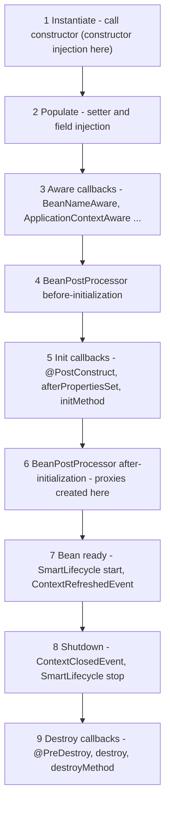

# Chapter 2 — IoC and Dependency Injection

Everything in Spring — web controllers, transactions, security, Spring Data repositories — sits on one foundation: the **IoC container** that creates your objects and connects them. Understand the container and the rest of Spring stops feeling like magic. This chapter covers bean definition, dependency resolution and injection, scopes, the full lifecycle, post-processors, circular dependencies, lazy beans, conditions and profiles, events, and two Framework 7 additions — JSpecify null-safety and `BeanRegistrar`.

Runnable code: [`code/ioc-container/`](code/ioc-container/) (plain Spring containers inside JUnit tests, so each demo gets its own isolated context) and [`code/web-scopes/`](code/web-scopes/) (request and session scopes). Both built with `mvn -q -B -ntp verify` on Spring Boot 4.1.1 / Framework 7.0.9 / JDK 25. Each demo writes to a small `Trace` log that the tests print, so the outputs show the *order* in which Spring did things.

---

## 2.1 Inversion of Control and Dependency Injection

### What it is
- **Dependency**: an object another object needs to do its job. A `PriceCalculator` needs a `TaxPolicy`.
- **Inversion of Control (IoC)**: an outside party (the framework), not your code, creates and controls collaborators and calls your code.
- **Dependency Injection (DI)**: the form of IoC where an object receives its dependencies from outside — constructor, setter or field — instead of creating them with `new` or looking them up.
- **IoC container**: the Spring object that performs DI for a whole application. Objects it manages are **beans**.

### The problem it solves
```java
// code/ioc-container/src/main/java/com/example/ioc/basics/PriceCalculator.java
public class PriceCalculator {
    private final TaxPolicy taxPolicy;

    public PriceCalculator(TaxPolicy taxPolicy) {       // the dependency is handed in, not created here
        this.taxPolicy = taxPolicy;
        Trace.add("PriceCalculator created with " + taxPolicy.getClass().getSimpleName());
    }

    public long totalCents(long netCents) { return netCents + taxPolicy.taxCents(netCents); }
}
```

`PriceCalculator` depends on the *interface* `TaxPolicy`, not on `FlatTaxPolicy`. That already gives testability (pass a fake `TaxPolicy` in a unit test) and flexibility (swap implementations without editing the class). DI is first a *design style*; the container automates the wiring:

```java
// Without Spring — you wire by hand (fine for 3 classes, painful for 300):
PriceCalculator calc = new PriceCalculator(new FlatTaxPolicy());

// With Spring — describe the wiring once:
@Configuration
public class ShopConfig {
    @Bean TaxPolicy taxPolicy() { return new FlatTaxPolicy(); }

    @Bean PriceCalculator priceCalculator(TaxPolicy taxPolicy) {   // parameter = dependency
        return new PriceCalculator(taxPolicy);
    }
}
// ...and ask the container for the finished object:
try (var ctx = new AnnotationConfigApplicationContext(ShopConfig.class)) {
    PriceCalculator calc = ctx.getBean(PriceCalculator.class);
}
```

### Why the container is worth it
| Hand wiring | Spring container |
|---|---|
| You decide creation order | Spring derives the order from the dependency graph |
| One object per `new`; sharing needs care | Singletons shared automatically; other scopes available |
| No central place for cross-cutting behaviour (logging, security touching many classes) | Can wrap beans in proxies (stand-ins that intercept calls): transactions, security, caching (Chapter 4) |
| Configuration values passed by hand | Values injected from properties/environment (Chapter 3) |
| Start-up/shut-down hooks by hand | Lifecycle callbacks and graceful shutdown |

### When not to use it
**Beans are the long-lived "service" objects** — services, repositories, controllers, clients, configuration. Data objects (a `Greeting`, an `Order` entity, a DTO — Data Transfer Object, a plain data carrier between layers) are created with `new`, many times per request; making them beans adds nothing.

The design ideas behind DI — Dependency Inversion and "program to an interface" — are in [LLD §4.10](../../../lld/chapters/04-solid-principles/README.md) and [LLD Chapter 5](../../../lld/chapters/05-design-principles/README.md).

---

## 2.2 The container: `BeanFactory` vs `ApplicationContext`

### What it is
- **`BeanFactory`** — the basic container: holds **bean definitions** (recipes: class, scope, dependencies, init method...) and creates beans from them on request.
- **`ApplicationContext`** — extends `BeanFactory` with everything a real application needs. It is what you always use; Spring Boot creates one for you.

| Feature | `BeanFactory` | `ApplicationContext` |
|---|---|---|
| Create and inject beans | Yes | Yes |
| Singletons created | **Lazily**, on first `getBean` | **Eagerly**, at startup (`refresh()`) — errors show up immediately |
| Registers `BeanPostProcessor`s automatically | No (manual) | Yes — so `@Autowired`, `@PostConstruct`, `@Transactional` work |
| Application events (`publishEvent`, `@EventListener`) | No | Yes |
| `Environment`, profiles, property sources | No | Yes |
| i18n (internationalization) messages (`MessageSource`) | No | Yes |
| Resource loading (`classpath:`, `file:`) | No | Yes |
| Typical implementations | `DefaultListableBeanFactory` | `AnnotationConfigApplicationContext`; in Boot: servlet/reactive web-server contexts |

### Eager vs lazy — proved
```java
// ContainerBasicsTest.java (excerpt)
try (var ctx = new AnnotationConfigApplicationContext(ShopConfig.class)) {
    Trace.add("-- context refreshed, now calling getBean");
    PriceCalculator calc = ctx.getBean(PriceCalculator.class);
    Trace.add("total for 1000 = " + calc.totalCents(1000));
    assertThat(ctx.getBean(PriceCalculator.class)).isSameAs(calc);   // singleton
}

var bf = new DefaultListableBeanFactory();
bf.registerBeanDefinition("taxPolicy", new RootBeanDefinition(FlatTaxPolicy.class));
var calcDef = new RootBeanDefinition(PriceCalculator.class);
calcDef.setAutowireMode(RootBeanDefinition.AUTOWIRE_CONSTRUCTOR);
bf.registerBeanDefinition("priceCalculator", calcDef);
Trace.add("-- definitions registered, nothing created yet");
bf.getBean(PriceCalculator.class);
```

Output:
```
--- ApplicationContext (eager) ---
 1. FlatTaxPolicy created
 2. PriceCalculator created with FlatTaxPolicy
 3. -- context refreshed, now calling getBean
 4. total for 1000 = 1200
--- Bare BeanFactory (lazy) ---
 1. -- definitions registered, nothing created yet
 2. FlatTaxPolicy created
 3. PriceCalculator created with FlatTaxPolicy
```

The context created both beans *before* anyone asked, created `FlatTaxPolicy` first because `PriceCalculator` needs it, and `getBean` twice returned the same instance (the default **singleton** scope).

### How startup works (`refresh()`)
1. **Load bean definitions** — `@Configuration` classes, component scanning, `@Import`, registrars.
2. **Run `BeanFactoryPostProcessor`s** — may read or change *definitions* (e.g. resolve `${...}` placeholders) before any bean exists (§2.8).
3. **Register `BeanPostProcessor`s** — objects that get a chance to modify every bean.
4. **Instantiate all non-lazy singletons** — construct, inject, init callbacks, post-processors (§2.7).
5. **Finish** — start `SmartLifecycle` beans, publish `ContextRefreshedEvent`.

In Spring Boot, `SpringApplication.run` does all this ([§1.8](../01-spring-ecosystem-and-first-app/README.md#18-the-main-class-and-springbootapplication)).

### Common mistakes
- Calling `ctx.getBean(...)` throughout your code ("service locator" style). Use injection; `getBean` belongs in tests, `main` methods and framework code.
- Creating a second `ApplicationContext` inside a bean — a duplicate set of beans that are not the ones the rest of the app uses.

### In the interview
**Q: BeanFactory vs ApplicationContext?** `BeanFactory` is the minimal container: definitions + lazy creation. `ApplicationContext` adds eager singleton creation, automatic post-processor registration (needed for annotations), events, `Environment`/profiles, i18n and resource loading. Applications use `ApplicationContext`.
- *Follow-up: Why is eager creation good?* Configuration errors (missing bean, bad property) fail at startup instead of on the first request in production.

---

## 2.3 Defining beans

Four ways; most apps use the first two.

### 1. Component scanning with stereotype annotations
Stereotype annotations say what *role* a class plays. Spring finds annotated classes while scanning packages (`@ComponentScan`, included in `@SpringBootApplication`).

| Annotation | Meaning | Extra behaviour |
|---|---|---|
| `@Component` | Generic bean | — |
| `@Service` | Business logic | None (documents intent) |
| `@Repository` | Data access | Persistence exceptions translated to Spring's `DataAccessException` (when a translation post-processor is present — Boot/Spring Data set it up) |
| `@Controller` | Spring MVC controller (returns views) | Detected as a request handler |
| `@RestController` | `@Controller` + `@ResponseBody` | Return values written as the body |
| `@Configuration` | Holds `@Bean` methods | Proxied in full mode (below) |

All are meta-annotated with `@Component` (their declaration carries `@Component`), which is why scanning finds them.

```java
@Repository public class InvoiceRepository {}

@Service public class InvoiceService {
    private final InvoiceRepository repository;
    public InvoiceService(InvoiceRepository repository) { this.repository = repository; }
}

@Component("renderer") public class PdfRenderer {}   // explicit bean name

public class NotABean {}                              // no annotation -> ignored
```

```
scanned beans: invoiceRepository, invoiceService, renderer
```

**Bean names.** Default: simple class name with lower-case first letter (`InvoiceService` → `invoiceService`); `@Component("renderer")` overrides it. A *nested* class includes the outer class: `Ambiguous.DiskStorage` → `ambiguous.DiskStorage` (see §2.5's output).

### 2. `@Bean` methods
A method that builds the object; Spring calls it once (for a singleton) and registers the result. Use `@Bean` for **classes you can't annotate** (third-party: `ObjectMapper` — Jackson's JSON converter, `DataSource`, a cloud SDK client) and when construction needs logic.

```java
@Configuration
public class ShopConfig {
    @Bean TaxPolicy taxPolicy() { return new FlatTaxPolicy(); }                  // bean name = method name
    @Bean PriceCalculator priceCalculator(TaxPolicy taxPolicy) { return new PriceCalculator(taxPolicy); }
}
```
`@Bean` attributes: `name`/`value` (names and aliases), `initMethod`, `destroyMethod`, `autowireCandidate`, `defaultCandidate` (6.2). Combine with `@Scope`, `@Lazy`, `@Primary`, `@Profile`, `@Conditional...` on the same method.

### Full vs lite `@Configuration` — proved
A `@Bean` method can call *another* `@Bean` method. What that returns depends on the mode:

```java
@Configuration                      // "full" mode: proxyBeanMethods = true (the default)
public class FullConfig {
    @Bean AuditLog auditLog() { return new AuditLog(); }
    @Bean OrderService orderService() { return new OrderService(auditLog()); }       // inter-bean call
    @Bean PaymentService paymentService() { return new PaymentService(auditLog()); } // inter-bean call
}

@Configuration(proxyBeanMethods = false)   // "lite" mode: no CGLIB subclass
public class LiteConfig { /* identical methods */ }

@Configuration(proxyBeanMethods = false)   // lite mode done right: ask for dependencies as parameters
public class LiteSafeConfig {
    @Bean AuditLog auditLog() { return new AuditLog(); }
    @Bean OrderService orderService(AuditLog log) { return new OrderService(log); }
    @Bean PaymentService paymentService(AuditLog log) { return new PaymentService(log); }
}
```

Output (`AuditLog` numbers each instance it creates):
```
full: config class = FullConfig$$SpringCGLIB$$0
full: order.log=#1 payment.log=#1, AuditLogs created=1
lite: config class = LiteConfig
lite: order.log=#2 payment.log=#3, AuditLogs created=3
lite+params: order.log=#1 payment.log=#1, AuditLogs created=1
```

How it works:
1. In **full mode** Spring generates a **CGLIB subclass** of your configuration class at startup (`FullConfig$$SpringCGLIB$$0`). CGLIB is a bytecode library that creates subclasses at runtime.
2. The subclass overrides each `@Bean` method: "if the bean exists in the container, return it; otherwise call the real method once" — so `auditLog()` called twice still yields one singleton.
3. In **lite mode** (`proxyBeanMethods = false`, or `@Bean` methods in a plain `@Component`) there is no subclass: `auditLog()` is a plain Java call creating a new, *unmanaged* object each time — 3 `AuditLog`s, two unknown to Spring (no lifecycle callbacks, no proxies).
4. **Parameters** avoid the problem in both modes: Spring injects the container's bean.

| | Full (`@Configuration`) | Lite (`proxyBeanMethods = false` or `@Component`) |
|---|---|---|
| Inter-bean method calls | Return the managed singleton | Create new unmanaged objects |
| Startup cost | Generates a CGLIB subclass | None — slightly faster, friendlier to AOT/native images |
| Class may be `final` / methods `private`? | No (must be subclassable) | Yes |
| Recommended style | Works either way if you use parameters | Spring Boot's own auto-configurations all use lite mode |

**Rule of thumb:** declare dependencies as `@Bean` method parameters and never call `@Bean` methods directly — then the mode doesn't matter.

### 3. `@Import`
`@Import(SomeConfig.class)` pulls in another configuration class (or a plain class as a bean, or an `ImportSelector`/`ImportBeanDefinitionRegistrar`/`BeanRegistrar`) without scanning. Auto-configuration and `@Enable...` annotations are built on it (Chapter 3).

### 4. Programmatic registration — `BeanRegistrar` (Framework 7)
For beans whose number or type depends on runtime logic. See §2.14.

Older projects also define beans in **XML** (`<bean id="..." class="...">`); it still works, but new code uses annotations.

### Common mistakes
- `@Service` on an interface — scanning registers only concrete classes. Annotate the implementation.
- Calling a `@Bean` method from a lite configuration and getting a second instance (above).
- Two beans with the same name (e.g. two `@Bean` methods named `dataSource`). Boot disables bean-definition overriding by default, so startup fails with `BeanDefinitionOverrideException` — rename one.

### In the interview
**Q: `@Component` vs `@Bean`?** `@Component` goes on *your* class and is found by scanning; `@Bean` goes on a factory *method* for third-party classes or when creation needs code. The resulting beans behave the same.
- *Follow-up: What does `proxyBeanMethods = false` change?* No CGLIB subclass; inter-bean calls become plain Java calls creating new objects. Safe with parameters, cheaper at startup.
- *Follow-up: `@Service` vs `@Component`?* No technical difference; `@Service` documents intent. `@Repository` adds exception translation.

---

## 2.4 Injection types

### What it is
```java
// Constructor injection (preferred)
@Service
public class AlertService {
    private final Notifier notifier;
    public AlertService(Notifier notifier) { this.notifier = notifier; }   // no @Autowired needed
}

// Setter (method) injection and field injection
@Component
public class OtherStyles {
    @Autowired @Qualifier("push")
    Notifier fieldInjected;                   // field injection: needs reflection, can't be final

    Notifier setterInjected;

    @Autowired
    void setNotifier(@Qualifier("email") Notifier n) {   // setter/method injection
        this.setterInjected = n;
    }
}
```

**`@Autowired`** means "inject here". Since Spring 4.3 a class with **exactly one constructor** doesn't need it; with several constructors, mark the one to use. The standard `jakarta.inject.Inject` works the same if `jakarta.inject-api` is on the classpath (Framework 7 dropped `javax.inject`).

### Trade-offs

| | Constructor | Setter | Field |
|---|---|---|---|
| Fields can be `final` (immutable) | Yes | No | No |
| Object complete after `new` | Yes | No — may be half-initialised | No |
| Unit test without Spring | Just call the constructor | Call setters | Needs reflection or Spring |
| Required dependency obvious | Yes (in the signature) | No | No |
| Circular dependency possible | No (fails fast, §2.9) | Yes | Yes |
| Too many dependencies visible | Yes — a 9-parameter constructor is a visible design smell | Hidden | Hidden |
| Good for | **Almost everything** | Optional dependencies, re-configuration | Test classes (`@Autowired MockMvcTester mvc`) |

### Common mistakes
- Field injection in production code — hides dependencies and makes plain unit tests awkward.
- `@Autowired` on a single constructor "just in case" — harmless noise.
- Using a dependency *inside the constructor* of a field-injected class → `NullPointerException`, because fields are injected after construction.

### In the interview
**Q: Why is constructor injection recommended?** Dependencies are `final`, the object is complete when constructed, required dependencies are explicit, unit tests just call `new`, and circular dependencies fail fast. The Spring team recommends it.
- *Follow-up: When setter injection?* Truly optional dependencies or values that can change after startup.

---

## 2.5 How Spring picks a bean

### What it is
To inject a `Notifier`, Spring looks for **candidate beans assignable to that type** (the type itself, implementations, subclasses):

1. **Exactly one candidate** → inject it.
2. **Several candidates** → narrow down in order:
   1. `@Qualifier("name")` on the injection point selects that bean name (or qualifier).
   2. Otherwise a **`@Primary`** bean wins.
   3. Otherwise, if all but one are **`@Fallback`** (Framework 6.2), the remaining one wins.
   4. Otherwise a bean whose **name equals the parameter name** wins (needs the `-parameters` compiler flag, which Boot's parent sets).
   5. Otherwise → `NoUniqueBeanDefinitionException`.
   (`@jakarta.annotation.Priority` on candidate classes is also consulted — highest wins — but is rare in application code.)
3. **No candidate** → `NoSuchBeanDefinitionException` — unless the point is optional (`Optional<T>`, `ObjectProvider<T>`, `@Nullable`, `@Autowired(required = false)`).
4. **Collection/array/Map of the type** → *all* candidates: `List<Notifier>` ordered by `@Order`/`Ordered` (lowest first, unordered last), `Map<String, Notifier>` keyed by bean name.

### Example
```java
public final class Notifiers {
    @Component("sms") @Primary @Order(1)
    public static class SmsNotifier implements Notifier { public String send(String m) { return "SMS: " + m; } }

    @Component("email") @Order(2)
    public static class EmailNotifier implements Notifier { public String send(String m) { return "EMAIL: " + m; } }

    @Component("push") @Order(3)
    public static class PushNotifier implements Notifier { public String send(String m) { return "PUSH: " + m; } }
}

@Service
public class AlertService {
    public AlertService(Notifier defaultNotifier,                     // by type -> the @Primary one
                        @Qualifier("email") Notifier emailNotifier,   // by name
                        List<Notifier> all,                           // all, sorted by @Order
                        Map<String, Notifier> byName,                 // bean name -> bean
                        Optional<AuditTrail> audit,                   // absent -> Optional.empty()
                        ObjectProvider<AuditTrail> auditProvider) {   // lazy, optional lookup
        ...
    }
}
```

Output:
```
by type (@Primary): SMS: hi
@Qualifier(email):  EMAIL: hi
List (by @Order):   [SMS: hi, EMAIL: hi, PUSH: hi]
Map keys:           [email, push, sms]
optional AuditTrail present? false
```

The qualifier beats `@Primary` because it is more specific. The failure case — two `Storage` beans, no tie-breaker:
```java
@Component public static class DiskStorage implements Storage {}
@Component public static class CloudStorage implements Storage {}
@Component public static class Backup { public Backup(Storage storage) {} }
```
```
startup failed: No qualifying bean of type 'com.example.ioc.ambiguous.Ambiguous$Storage' available:
expected single matching bean but found 2: ambiguous.CloudStorage,ambiguous.DiskStorage
```
The exception is `UnsatisfiedDependencyException` wrapping `NoUniqueBeanDefinitionException` — the context never starts.

### The tie-breakers compared

| Tool | Where it goes | Meaning | Use when |
|---|---|---|---|
| `@Primary` | On a bean | "Default choice for this type" | One implementation is the normal one |
| `@Fallback` (6.2+) | On a bean | "Use me only if nothing else qualifies" | A default that others should override |
| `@Qualifier("x")` | Injection point (optionally the bean) | "I want exactly this one" | A consumer needs a specific implementation |
| Custom qualifier annotation | e.g. `@Qualifier @interface Fast {}` | Type-safe qualifier | Avoid string names spread across code |
| `List<T>` / `Map<String,T>` | Injection point | "Give me all of them" | Strategy/plugin patterns, broadcast |
| `ObjectProvider<T>` | Injection point | Lazy/optional/multiple lookup: `getIfAvailable()`, `getIfUnique()`, `orderedStream()` | Optional beans, prototypes (§2.6) |

`List<Notifier>` + `Map` is the Spring way to implement the **Strategy pattern**: each strategy is a bean, the consumer receives all and picks by key — [LLD §11.3](../../../lld/chapters/11-patterns-behavioral-2/README.md).

### Common mistakes
- Adding a second implementation later (e.g. a test stub) and breaking every injection point that relied on "only one". Decide on `@Primary` or qualifiers early.
- Qualifier string typos — they fail at startup, but a custom qualifier annotation avoids them entirely.
- Expecting `@Order` to choose the single injected bean. It only orders collections.

### In the interview
**Q: Two beans implement the same interface. How does Spring decide?** By type; with several candidates, `@Qualifier`, then `@Primary`, then `@Fallback`, then a bean named like the parameter; otherwise `NoUniqueBeanDefinitionException` at startup. Or inject `List<T>`/`Map<String,T>` to get all.
- *Follow-up: Optional dependency?* `Optional<T>`, `ObjectProvider<T>.getIfAvailable()`, a `@Nullable` parameter (§2.13), or `@Autowired(required = false)` on a setter.

---

## 2.6 Bean scopes

### What it is
A **scope** decides *how many instances* of a bean exist and *how long* each lives.

| Scope | Instances | Lives until | Available in |
|---|---|---|---|
| `singleton` (default) | One per container | Context closes | All apps |
| `prototype` | New one **per injection/lookup** | Garbage collected — Spring forgets it after handing it out | All apps |
| `request` | One per HTTP request | Request ends | Web apps |
| `session` | One per HTTP session (one user's requests, tied by a cookie) | Session expires | Web apps |
| `application` | One per `ServletContext` (the web app as a whole) | App stops | Web apps |
| `websocket` | One per WebSocket session | Socket closes | WebSocket apps |

Declare with `@Scope("prototype")` (or `ConfigurableBeanFactory.SCOPE_PROTOTYPE`), `@RequestScope`, `@SessionScope`, `@ApplicationScope`.

> **Spring singleton ≠ GoF Singleton.** The "Gang of Four" Singleton pattern enforces one instance *per class loader* via a private constructor. A Spring singleton is one instance *per container and bean definition* — you could define two beans of the same class. See [LLD §8.8](../../../lld/chapters/08-patterns-creational/README.md).

### Singleton vs prototype — and the classic trap
```java
@Component @Scope(ConfigurableBeanFactory.SCOPE_PROTOTYPE)
public class ShoppingCart { public final int id = SEQ.incrementAndGet(); @PreDestroy void close() {...} }

@Component
public class PriceList { public final int id = SEQ.incrementAndGet(); @PreDestroy void close() {...} }

@Service                                            // singleton that depends on a prototype
public class CheckoutService {
    private final ShoppingCart injectedOnce;                // injected ONE time, at creation
    private final ObjectProvider<ShoppingCart> carts;        // asks the container each time
    public int cartIdFromField() { return injectedOnce.id; }
    public int cartIdFromProvider() { return carts.getObject().id; }
}
```

Output:
```
singleton: PriceList #1, #1
prototype: ShoppingCart #2, #3
prototype injected into singleton: #1, #1 (stuck!)
via ObjectProvider:                #4, #5 (fresh)
--- destroy callbacks on close ---
 1. PriceList#1 @PreDestroy
```

1. `getBean(PriceList.class)` always returns #1; `getBean(ShoppingCart.class)` returns a new one each time.
2. **A prototype injected into a singleton is created once** — when the singleton is built — and reused forever.
3. Fix: *look up* a new instance when needed — `ObjectProvider<T>.getObject()` (shown), `@Lookup` method injection, or a scoped proxy.
4. **Spring does not call destroy callbacks on prototypes** — only `PriceList`'s `@PreDestroy` ran. The code that asked for a resource-holding prototype must clean up.

### Request and session scopes — proved
A singleton controller can hold "the current request's object" only through a **scoped proxy**: a stand-in that, on every call, finds the real instance for the *current* request or session.

```java
@Component @RequestScope          // one instance per HTTP request; a scoped proxy is injected into singletons
public class RequestInfo { private final int id = SEQ.incrementAndGet(); public int id() { return id; } }

@Component @SessionScope          // one instance per HTTP session
public class Cart { private final List<String> items = new ArrayList<>(); ... }

@RestController                   // a singleton...
public class CartController {
    private final Cart cart;               // ...holding proxies that find the right
    private final RequestInfo request;     //    session/request instance on every call

    @PostMapping("/cart/{item}")
    String add(@PathVariable String item) {
        cart.add(item);
        return "request#" + request.id() + " cart=" + cart.items() + " proxy=" + cart.getClass().getSimpleName().contains("CGLIB");
    }
}
```

Two posts with Alice's session and one with Bob's (`MockHttpSession`):
```
alice: request#1 cart=[book] proxy=true
alice: request#2 cart=[book, pen] proxy=true
bob:   request#3 cart=[mug] proxy=true
```
Every request got a new `RequestInfo`; Alice's requests shared one `Cart`, Bob got his own — through the same singleton controller. `@RequestScope`/`@SessionScope` create CGLIB proxies by default (`proxyMode = TARGET_CLASS`); with plain `@Scope("request")` you must set `proxyMode` yourself.

### Thread safety
A singleton is shared by **all request threads at once**. Keep singletons **stateless** (only `final` references to other beans and configuration); per-request data goes in parameters/locals or request-scoped beans. Concurrency basics: [Java Chapter 14](../../../java/chapters/14-concurrency-1/README.md).

### Common mistakes
- A mutable field (`private int counter`, a `HashMap` cache) in a singleton → **race conditions** under load (the result depends on thread timing: two threads read `counter = 5`, both write `6`, one increment is lost; it shows only under concurrency, so tests often miss it).
- Expecting a new prototype per method call when it was injected once.
- Injecting a request-scoped bean into a singleton without a proxy → `Scope 'request' is not active for the current thread` at startup.
- Session scope in a horizontally scaled app (several copies behind a load balancer) without session replication (Spring Session, Chapter 10; [System Design Fundamentals](../../../system-design-patterns/modules/00-system-design-fundamentals/README.md)).

### In the interview
**Q: What are Spring's bean scopes?** singleton (default, one per container), prototype (new per lookup, not destroyed by Spring), and web scopes request, session, application, websocket.
- *Follow-up: Prototype inside singleton?* Injected once, so effectively a singleton for that consumer. Use `ObjectProvider`, `@Lookup`, or a scoped proxy.
- *Follow-up: Are singletons thread-safe?* Spring doesn't make them so; they're shared, so design them stateless.

---

## 2.7 The bean lifecycle

### What it is
From creation to destruction Spring calls a fixed sequence of hooks. You rarely need more than `@PostConstruct`/`@PreDestroy`, but the order explains many "why is my field null?" questions. This bean implements *every* hook:

```java
public class CacheWarmer implements BeanNameAware, InitializingBean, DisposableBean {
    public CacheWarmer()                          { Trace.add("constructor"); }
    @Autowired void setDependency(Dependency d)   { Trace.add("setter injection"); }
    @Override public void setBeanName(String n)   { Trace.add("BeanNameAware.setBeanName(" + n + ")"); }
    @PostConstruct void postConstruct()           { Trace.add("@PostConstruct"); }
    @Override public void afterPropertiesSet()    { Trace.add("InitializingBean.afterPropertiesSet"); }
    void customInit()                             { Trace.add("@Bean(initMethod) customInit"); }

    @PreDestroy void preDestroy()                 { Trace.add("@PreDestroy"); }
    @Override public void destroy()               { Trace.add("DisposableBean.destroy"); }
    void customDestroy()                          { Trace.add("@Bean(destroyMethod) customDestroy"); }
}

@Configuration
public class LifecycleConfig {
    @Bean static TracingPostProcessor tracingPostProcessor() { return new TracingPostProcessor(); } // static!
    @Bean Dependency dependency() { return new Dependency(); }
    @Bean(initMethod = "customInit", destroyMethod = "customDestroy")
    CacheWarmer cacheWarmer() { return new CacheWarmer(); }
    @Bean Poller poller() { return new Poller(); }                 // a SmartLifecycle bean

    @EventListener void onRefresh(ContextRefreshedEvent e) { Trace.add("ContextRefreshedEvent"); }
    @EventListener void onClose(ContextClosedEvent e)      { Trace.add("ContextClosedEvent"); }
}
```

Output (context created, then closed):
```
--- bean lifecycle ---
 1. constructor
 2. setter injection
 3. BeanNameAware.setBeanName(cacheWarmer)
 4. BeanPostProcessor.before(cacheWarmer)
 5. @PostConstruct
 6. InitializingBean.afterPropertiesSet
 7. @Bean(initMethod) customInit
 8. BeanPostProcessor.after(cacheWarmer)
 9. SmartLifecycle.start (Poller)
10. ContextRefreshedEvent
11. ----- application running -----
12. ContextClosedEvent
13. SmartLifecycle.stop (Poller)
14. @PreDestroy
15. DisposableBean.destroy
16. @Bean(destroyMethod) customDestroy
```

### How it works


Notes on the steps:
- **3 `Aware`** — the bean can receive its name, the `BeanFactory`, `ApplicationContext`, `Environment`. Prefer normal injection; `Aware` ties code to Spring.
- **4** — `BeanPostProcessor.postProcessBeforeInitialization` runs for every BPP. `@PostConstruct` itself is implemented by a BPP (`CommonAnnotationBeanPostProcessor`), which is why our custom "before" ran just before it.
- **5** — init order: `@PostConstruct` → `InitializingBean.afterPropertiesSet()` → `@Bean(initMethod)`.
- **6** — `postProcessAfterInitialization`: the bean may be *replaced* here, typically by a proxy (transactions, AOP, §2.8).
- **7** — after **all** singletons are ready: `SmartLifecycle.start()` (by phase), then `ContextRefreshedEvent` (in Boot then `ApplicationStartedEvent` and `ApplicationReadyEvent`).
- **8** — on `close()` or the JVM shutdown hook (which Boot registers): `ContextClosedEvent`, `SmartLifecycle.stop()` in reverse phase order.
- **9** — `@PreDestroy` → `DisposableBean.destroy()` → `@Bean(destroyMethod)`; beans are destroyed in reverse dependency order.

### Which hook to use

| Hook | Use for | Notes |
|---|---|---|
| `@PostConstruct` / `@PreDestroy` (`jakarta.annotation`) | Validate state, warm a cache, open/close a resource | **Default choice** — standard, no Spring interface |
| `InitializingBean` / `DisposableBean` | Framework or library code | Couples your class to Spring |
| `@Bean(initMethod, destroyMethod)` | Third-party classes you can't annotate | `destroyMethod` is inferred: a public `close()`/`shutdown()` is called automatically |
| `SmartLifecycle` | Things that *run* while the app is up: message listeners, pollers, schedulers | `start`/`stop`, `getPhase()` orders them (lower starts first, stops last), `isAutoStartup()` |
| `ApplicationReadyEvent` listener (Boot) | "Do X once the app is fully started" | Runs after runners; the server already accepts traffic |
| `CommandLineRunner` / `ApplicationRunner` (Boot) | One-off startup tasks with access to args | Run before `ApplicationReadyEvent` |

### Common mistakes
- Heavy work (remote calls, long cache loads) in constructors or `@PostConstruct` — slows startup and a failure kills the app. Consider lazy loading or `ApplicationReadyEvent`.
- Calling `@Transactional` methods from `@PostConstruct` expecting a transaction: the proxy is applied in step 6, *after* `@PostConstruct` (step 5), and you are calling `this` anyway (self-invocation, Chapter 4).
- Expecting `@PreDestroy` on prototypes (§2.6).
- `kill -9` (a forced kill) runs no shutdown hook, so no destroy callbacks.

### In the interview
**Q: Describe the Spring bean lifecycle.** Instantiate → inject → `Aware` → BPP before-init → `@PostConstruct` → `afterPropertiesSet` → custom init → BPP after-init (proxies) → ready → `SmartLifecycle.start` → `ContextRefreshedEvent`; on shutdown `@PreDestroy` → `destroy()` → custom destroy.
- *Follow-up: Where does a `@Transactional` proxy come from?* A `BeanPostProcessor`'s after-initialization step wraps the bean.
- *Follow-up: `@PostConstruct` vs constructor?* In the constructor, setter/field injection and post-processing haven't happened yet; `@PostConstruct` runs after all injection.

---

## 2.8 Post-processors: the container's extension points

### What it is

| | `BeanFactoryPostProcessor` (BFPP) | `BeanPostProcessor` (BPP) |
|---|---|---|
| Works on | Bean **definitions** (recipes) | Bean **instances** |
| Runs | Once, after definitions load, **before any normal bean is created** | For every bean, before and after its init callbacks |
| Can | Change scopes, class names, property values; register more definitions | Modify the bean, or **return a different object** (proxy/wrapper) |
| Spring's own examples | `PropertySourcesPlaceholderConfigurer` (resolves `${...}`), `ConfigurationClassPostProcessor` (processes `@Configuration`, `@ComponentScan`, `@Import`) | `AutowiredAnnotationBeanPostProcessor` (`@Autowired`, `@Value`), `CommonAnnotationBeanPostProcessor` (`@PostConstruct`, `@PreDestroy`), the AOP auto-proxy creator (`@Transactional`, `@Cacheable`, `@Async`) |

Most of Spring's annotation "magic" is ordinary post-processors.

### Example — a BPP that swaps beans for logging proxies
```java
@Target(ElementType.TYPE) @Retention(RetentionPolicy.RUNTIME)
public @interface LogCalls {}

@Component @LogCalls
public class FriendlyGreeter implements Greeter { public String greet(String name) { return "Hi " + name; } }

@Component
public class LogCallsPostProcessor implements BeanPostProcessor {
    @Override
    public Object postProcessAfterInitialization(Object bean, String beanName) {
        if (!bean.getClass().isAnnotationPresent(LogCalls.class)) return bean;
        return Proxy.newProxyInstance(                          // JDK dynamic proxy over the bean's interfaces
                bean.getClass().getClassLoader(), bean.getClass().getInterfaces(),
                (proxy, method, args) -> {
                    Trace.add("-> " + beanName + "." + method.getName() + "(" + args[0] + ")");
                    Object result = method.invoke(bean, args);  // call the real object
                    Trace.add("<- " + result);
                    return result;
                });
    }
}

@Component
public class CountingFactoryPostProcessor implements BeanFactoryPostProcessor {
    @Override
    public void postProcessBeanFactory(ConfigurableListableBeanFactory bf) {
        Trace.add("BeanFactoryPostProcessor: friendlyGreeter defined=" + bf.containsBeanDefinition("friendlyGreeter")
                + ", created=" + bf.containsSingleton("friendlyGreeter"));
    }
}
```

Output (test gets the `Greeter` bean and calls `greet("Ada")`):
```
--- post-processors ---
 1. BeanFactoryPostProcessor: friendlyGreeter defined=true, created=false
 2. bean class = jdk.proxy2.$Proxy45
 3. -> friendlyGreeter.greet(Ada)
 4. <- Hi Ada
```

1. The BFPP ran when the `friendlyGreeter` **definition** existed but no **instance** did.
2. The BPP returned a proxy, so the container stored and injected the *proxy* (`jdk.proxy2.$Proxy45`). Every caller goes through the logging code — exactly how Spring AOP adds transactions and caching (Chapter 4). Proxy pattern: [LLD §9.7](../../../lld/chapters/09-patterns-structural/README.md).
3. A **JDK dynamic proxy** (Java's built-in runtime object implementing given interfaces, routing every call to one handler) implements only the *interfaces*, so `ctx.getBean(FriendlyGreeter.class)` would now fail — one reason to inject interfaces, and one reason Spring often uses class-based CGLIB proxies.

### Rules
- Declare BFPP and BPP `@Bean` methods **`static`** (as in `LifecycleConfig`). They are created very early; a non-static method forces the whole configuration class to be created early too, so its own `@Autowired`/`@Value` may not be processed. Spring logs a message when this happens.
- A BPP should not depend on ordinary beans: anything it injects is created before all BPPs are registered and is "not eligible for getting processed by all BeanPostProcessors" (e.g. no transactional proxy) — Spring logs exactly that phrase.
- Order several post-processors with `Ordered`/`PriorityOrdered` or `@Order`.

---

## 2.9 Circular dependencies

### What it is
A **circular dependency** is a cycle in the dependency graph: `OrderService` needs `CustomerService`, which needs `OrderService` (or a longer loop A → B → C → A).

### What happens — proved
```java
// Constructor cycle
@Component class OrderService    { OrderService(CustomerService customers) {} }
@Component class CustomerService { CustomerService(OrderService orders) {} }

// Field cycle
@Component class OrderService    { @Autowired CustomerService customers; }
@Component class CustomerService { @Autowired OrderService orders; }

// Cycle broken with @Lazy
@Component class OrderService    { OrderService(@Lazy CustomerService customers) {...} }
@Component class CustomerService { CustomerService(OrderService orders) {...} }
```

Output:
```
constructor cycle -> BeanCurrentlyInCreationException: Error creating bean with name 'ctorCycle.CustomerService': Requested bean is currently in creat...
field cycle, plain Spring -> OK, orders.customers.orders == orders? true
field cycle, Spring Boot -> BeanCurrentlyInCreationException
@Lazy cycle -> OK, injected class = LazyCycle$CustomerService$$SpringCGLIB$$0, call = customers
```

### How it works
1. **Constructor cycles cannot be satisfied.** `new OrderService(customers)` needs a finished `CustomerService`, whose constructor needs a finished `OrderService`... Spring detects the loop and throws `BeanCurrentlyInCreationException`.
2. **Field/setter cycles work in plain Spring**: Spring constructs `OrderService` (empty), registers an *early reference* in an internal cache, creates `CustomerService` injecting that reference, then finishes `OrderService`. (The internal "singleton caches" are often called the three-level cache in interviews.)
3. **Spring Boot forbids this by default** (`spring.main.allow-circular-references=false`, since Boot 2.6): a cycle usually means entangled classes, and an early reference is the raw object, not the transactional proxy. Boot's startup report prints the cycle as an ASCII diagram.
4. **`@Lazy` on an injection point** injects a proxy; the real `CustomerService` is looked up on first call, breaking the creation-time cycle — note the `$$SpringCGLIB$$` class name.

### How to fix a cycle (best first)
1. **Redesign.** Usually one class does two jobs. Extract shared logic into a third bean, or move a method to where its data lives.
2. **Use events** (§2.12): `OrderService` publishes `OrderPlaced`; `CustomerService` listens. No compile-time dependency.
3. **Inject lazily**: `@Lazy` on the parameter, or `ObjectProvider<CustomerService>` with `getObject()` when needed.
4. **Last resort**: `spring.main.allow-circular-references=true` — hides the design problem.

### In the interview
**Q: How does Spring handle circular dependencies?** Constructor cycles fail with `BeanCurrentlyInCreationException`. Field/setter cycles can be resolved via early singleton references, but Boot disallows them by default since 2.6. Fix by redesigning (extract a third class), decoupling with events, or `@Lazy`/`ObjectProvider`.
- *Follow-up: Why is constructor injection "good" here?* Cycles fail fast at startup instead of silently producing half-initialised or unproxied objects.

---

## 2.10 Lazy initialization

### What it is
By default the `ApplicationContext` creates every singleton at startup. A **lazy** bean is created on first use.

```java
@Component @Lazy                             // not created at startup; created on first use
public class ReportGenerator { public ReportGenerator() { Trace.add("ReportGenerator created (lazy)"); } }

@Component                                   // eager by default
public class RateCache { public RateCache() { Trace.add("RateCache created (eager)"); } }
```

```
--- @Lazy ---
 1. RateCache created (eager)
 2. -- context started
 3. ReportGenerator created (lazy)
--- spring.main.lazy-initialization=true ---
 1. -- context started
 2. RateCache created (eager)
```

The second run used Boot with `spring.main.lazy-initialization=true`, which makes **every** bean lazy — even `RateCache`. `@Lazy(false)` opts a bean back out.

### Trade-offs

| Eager (default) | Lazy |
|---|---|
| Slower startup | Faster startup |
| Misconfiguration fails **at startup** | Misconfiguration fails **on first request** — maybe in production |
| First request is fast | First request pays the creation cost |
| Memory used up front | Memory only for used beans |

**When to use it:** individual rarely used, expensive beans; global lazy init only in development, tests or CLI tools where startup dominates. Keep production eager so broken configuration can't get past startup. (For fast production startup, Chapter 15 covers AOT and CDS — Class Data Sharing, a JVM cache of pre-loaded classes.)

---

## 2.11 `@Conditional` and profiles

### What it is
- **`@Conditional(SomeCondition.class)`** — register a bean *only if* a `Condition` returns true. A `Condition` sees the environment (properties, profiles), the registry (definitions so far) and the classpath. This is the building block of Boot's auto-configuration (`@ConditionalOnClass`, `@ConditionalOnMissingBean`, `@ConditionalOnProperty` — Chapter 3).
- **`@Profile("dev")`** — a ready-made condition: register only when that **profile** (a named set of beans/settings for one environment: `dev`, `test`, `prod`) is active. Expressions allowed: `"!dev"`, `"prod & eu"`, `"dev | test"`.

```java
public class OnFeatureFlag implements Condition {
    @Override
    public boolean matches(ConditionContext context, AnnotatedTypeMetadata metadata) {
        return context.getEnvironment().getProperty("features.fraud-check", Boolean.class, false);
    }
}

@Configuration
public class PaymentBeans {
    @Bean @Profile("dev")                    // only when profile "dev" is active
    PaymentGateway fakeGateway() { return () -> "fake gateway (dev)"; }

    @Bean @Profile("!dev")                   // any time "dev" is NOT active
    PaymentGateway httpGateway() { return () -> "HTTP gateway (real)"; }

    @Bean @Conditional(OnFeatureFlag.class)  // custom condition
    FraudChecker fraudChecker() { return new FraudChecker(); }
}
```

Two contexts — one with profile `dev` and `features.fraud-check=true`, one with neither:
```
profile dev : fake gateway (dev), fraudChecker beans = 1
no profile  : HTTP gateway (real), fraudChecker beans = 0
```

### How to activate profiles
`spring.profiles.active=dev` in a property file, `--spring.profiles.active=dev`, env var `SPRING_PROFILES_ACTIVE=dev`, `@ActiveProfiles("test")` in tests, or `context.getEnvironment().setActiveProfiles("dev")` in plain Spring. With none active, the `default` profile is active. Profile-specific *property files* (`application-dev.yaml`) and profile groups: Chapter 3.

### Common mistakes
- Profiles for things that are just values (URLs, timeouts). Keep one bean and vary the *property*; reserve profiles for genuinely different beans (a fake payment gateway in dev).
- `@Profile("prod")` on a bean tests need → "no bean". Provide a `"!prod"` alternative.
- A custom `Condition` in a Boot app when `@ConditionalOnProperty` already does it.

---

## 2.12 Application events

### What it is
The container includes an in-process **publish/subscribe** mechanism: any bean publishes an event object through `ApplicationEventPublisher`; any `@EventListener` method whose parameter type matches receives it. Publishers don't know who listens — the **Observer pattern** ([LLD §11.1](../../../lld/chapters/11-patterns-behavioral-2/README.md)). Since Spring 4.2 an event can be any object (no need to extend `ApplicationEvent`); records are ideal.

```java
public record OrderPlaced(String orderId, long cents) {}
public record StockReserved(String orderId) {}

@Service
public class OrderService {
    private final ApplicationEventPublisher events;
    public OrderService(ApplicationEventPublisher events) { this.events = events; }

    public void place(String id, long cents) {
        Trace.add("OrderService: saving " + id + " on " + Thread.currentThread().getName());
        events.publishEvent(new OrderPlaced(id, cents));   // listeners run NOW, same thread
        Trace.add("OrderService: publishEvent returned");
    }
}

@Component
public class OrderListeners {
    @EventListener @Order(1)
    void sendEmail(OrderPlaced e) { Trace.add("  email listener for " + e.orderId() + " on " + Thread.currentThread().getName()); }

    @EventListener @Order(2)
    StockReserved reserveStock(OrderPlaced e) {           // a non-void return value is published as a new event
        Trace.add("  stock listener for " + e.orderId());
        return new StockReserved(e.orderId());
    }

    @EventListener(condition = "#event.cents > 10000")    // SpEL filter: only big orders
    void alertBigOrder(OrderPlaced event) { Trace.add("  BIG order alert for " + event.orderId()); }

    @EventListener
    void onStock(StockReserved e) { Trace.add("  shipping listener sees StockReserved(" + e.orderId() + ")"); }
}
```

Output for `place("A-1", 2_500)` then `place("B-2", 50_000)`:
```
--- events ---
 1. OrderService: saving A-1 on main
 2.   email listener for A-1 on main
 3.   stock listener for A-1
 4.   shipping listener sees StockReserved(A-1)
 5. OrderService: publishEvent returned
 6. OrderService: saving B-2 on main
 7.   email listener for B-2 on main
 8.   stock listener for B-2
 9.   shipping listener sees StockReserved(B-2)
10.   BIG order alert for B-2
11. OrderService: publishEvent returned
```

### How it works
1. `publishEvent` finds all listeners whose parameter type matches (generics respected).
2. It calls them **synchronously, on the publisher's thread** (`main` above), in `@Order` sequence; unordered listeners run after ordered ones.
3. A non-`void`/non-`null` return value is published as a new event — `StockReserved` was handled *before* the remaining `OrderPlaced` listener ran.
4. `condition` is a SpEL expression over `#event` (or the parameter name); `false` skips the listener.
5. `publishEvent` returns only after all listeners finish. **An exception in a listener propagates to the publisher.**

### Variations and built-in events

| Need | Use | Chapter |
|---|---|---|
| Listener on another thread | `@Async` + `@EventListener` (needs `@EnableAsync`) | 14 |
| Run only after the publisher's DB transaction commits | `@TransactionalEventListener(phase = AFTER_COMMIT)` | 7 |
| React to container stages | `ContextRefreshedEvent`, `ContextClosedEvent` (Framework); `ApplicationStartingEvent`, `ApplicationEnvironmentPreparedEvent`, `ApplicationPreparedEvent`, `ApplicationStartedEvent`, `ApplicationReadyEvent`, `ApplicationFailedEvent`, `WebServerInitializedEvent` (Boot) | 2.7, 15 |
| Events between services | A message broker (e.g. Kafka) — application events are in-memory, single JVM | 14 |

### Trade-offs
| Direct method call | Application event |
|---|---|
| Explicit, easy to follow in the IDE | Decoupled — publisher doesn't know listeners |
| Compile-time dependency | No dependency; breaks cycles (§2.9) |
| Obvious error handling | Synchronous by default: slow/failing listeners slow/fail the publisher |
| — | Not durable: lost if the JVM crashes |

### Common mistakes
- Assuming events are asynchronous. Not without `@Async`.
- Using in-memory events for "must not be lost" integration; use the transactional outbox (save the event in the same DB transaction as the data, publish from there) + a broker (Chapter 14, [microservices notes](../../../microservices-patterns/chapters/11-event-driven/README.md)).
- Sending emails in a plain listener inside a transaction that later rolls back — use `@TransactionalEventListener`.

---

## 2.13 Null-safety with JSpecify (Framework 7)

### What it is
`NullPointerException` is Java's most common runtime error, and Java can't express "this may be null". **JSpecify** (`org.jspecify.annotations`) is a standard annotation set agreed by several vendors (Google, JetBrains, Uber, Spring, ...):

| Annotation | Meaning |
|---|---|
| `@NullMarked` (package, class or module) | "In here, every type is non-null unless marked otherwise" |
| `@Nullable` | This field/parameter/return value may be `null` |
| `@NonNull` | Explicitly non-null (rarely needed inside `@NullMarked`) |
| `@NullUnmarked` | Opt a part back out |

**Spring Framework 7 and Boot 4** annotate their whole codebase with JSpecify, replacing `org.springframework.lang.Nullable`/`NonNull` (deprecated since 7.0). IDEs and build-time checkers such as **NullAway** (an Error Prone plugin — Google's extra compiler checks) warn when you might dereference `null`; Kotlin sees Spring APIs with correct nullable/non-null types. `jspecify` comes transitively with `spring-core`.

### Example
```java
// package-info.java
@NullMarked
package com.example.ioc.nullsafety;
import org.jspecify.annotations.NullMarked;

// ReportService.java
@Service
public class ReportService {
    private final @Nullable Translator translator;   // may be absent

    // Spring treats a parameter annotated with any @Nullable as optional: it injects null if no bean.
    public ReportService(@Nullable Translator translator) { this.translator = translator; }

    public String title(String raw) {
        return translator == null ? raw : translator.translate(raw);   // the null check the annotation asks for
    }

    public @Nullable String findTitle(int id) { return id == 1 ? "Q3 sales" : null; }  // callers see null is possible
}
```

With no `Translator` bean in the context:
```
no Translator bean -> title = Q3 sales, findTitle(2) = null
```

### How it works
1. `@NullMarked` makes every unannotated type in the package non-null by *contract*; `@Nullable` marks exceptions. Tools enforce it — at runtime the annotations do nothing.
2. **Spring's container reads them for injection**: an injection point annotated with any annotation named `Nullable` is optional, so a missing bean gives `null` instead of a startup failure (like `Optional<T>`).
3. Add NullAway to your build to turn the contract into compile errors (optional; Spring itself does this).

### Common mistakes
- Thinking `@Nullable` adds runtime checks — it only documents and enables tooling.
- Mixing old `org.springframework.lang.Nullable` with JSpecify in new code.
- Misplacing `@Nullable`: JSpecify annotations are *type-use* annotations (attached to a type wherever it is written), so arrays and nested types are written `String @Nullable []` or `Outer.@Nullable Inner`.

---

## 2.14 Programmatic registration with `BeanRegistrar` (Framework 7)

### What it is
`@Bean` methods register a *fixed* set of beans. When the set depends on runtime data — "one client bean per configured channel" — Framework 7's **`BeanRegistrar`** registers beans with ordinary code (loops, `if`s), in a form that also works with AOT/native images.

```java
public class ChannelRegistrar implements BeanRegistrar {
    public record Channel(String name) {}
    public record Router(java.util.List<Channel> channels) {}

    @Override
    public void register(BeanRegistry registry, Environment env) {
        String[] names = env.getProperty("channels", String[].class, new String[] {"email"});
        for (String n : names) {                                     // one bean per configured channel
            registry.registerBean(n + "Channel", Channel.class, spec -> spec.supplier(ctx -> new Channel(n)));
        }
        registry.registerBean("router", Router.class, spec -> spec
                .lazyInit()
                .supplier(ctx -> new Router(ctx.beanProvider(Channel.class).orderedStream().toList())));
    }
}

@Configuration
@Import(ChannelRegistrar.class)   // a BeanRegistrar is activated with @Import
public class RegistrarConfig {}
```

With `channels=email,sms,push`:
```
registered: emailChannel, smsChannel, pushChannel, router
router -> Router[channels=[Channel[name=email], Channel[name=sms], Channel[name=push]]]
```

The `spec` offers the same options as annotations: `primary()`, `fallback()`, `lazyInit()`, `prototype()`, `scope(...)`, `order(...)`, `description(...)`, `supplier(...)` (whose context fetches other beans with `bean(...)`/`beanProvider(...)`). Use it for libraries and dynamic setups; in application code `@Component` and `@Bean` remain simpler.

---

## 2.15 In the interview — quick round

| Question | Short answer |
|---|---|
| What is IoC? DI? | IoC: the framework controls object creation and calls your code. DI: objects receive dependencies instead of building them; Spring's container does it. |
| BeanFactory vs ApplicationContext? | Minimal lazy container vs full container: eager singletons, post-processors, events, environment, i18n. (§2.2) |
| `@Component` vs `@Bean`? | Class annotation found by scanning vs factory method for third-party classes/complex creation. (§2.3) |
| Full vs lite configuration? | Full = CGLIB subclass makes inter-bean calls return singletons; lite = plain calls. Pass dependencies as parameters. (§2.3) |
| Why constructor injection? | Immutable, complete objects, explicit, testable, fails fast on cycles. (§2.4) |
| Two beans of one type? | `@Qualifier`, `@Primary`, `@Fallback`, parameter name, or inject `List`/`Map`. (§2.5) |
| Default scope? Thread-safe? | Singleton; shared across threads, so keep it stateless. (§2.6) |
| Prototype in singleton? | Injected once; use `ObjectProvider`/`@Lookup`/scoped proxy. (§2.6) |
| Lifecycle order? | Construct → inject → aware → BPP before → `@PostConstruct` → `afterPropertiesSet` → init-method → BPP after → ... → `@PreDestroy` → `destroy` → destroy-method. (§2.7) |
| BPP vs BFPP? | Instances vs definitions. `@Autowired`/`@Transactional` are BPPs; `${}` resolution is a BFPP. (§2.8) |
| Circular dependency? | Constructor cycles fail; Boot rejects field cycles by default; refactor, events, or `@Lazy`. (§2.9) |
| `@Profile` vs `@Conditional`? | `@Profile` is a specific condition on active profiles; `@Conditional` takes any `Condition`. (§2.11) |
| Are events async? | No — synchronous on the publisher's thread unless `@Async`. (§2.12) |
| What's new in the Framework 7 container? | JSpecify null-safety, `BeanRegistrar`, `javax.inject`/`javax.annotation` support removed. (§2.13–2.14) |

---

## Chapter TL;DR

(The §2.15 table is the question-by-question recap.)

- **DI**: classes declare dependencies as constructor parameters (`final` fields); the **`ApplicationContext`** creates beans eagerly, in dependency order, at startup.
- **Define beans** by scanning stereotypes, `@Bean` methods (third-party classes; full `@Configuration` = CGLIB subclass, lite = plain calls — pass dependencies as parameters), `@Import`, or Framework 7's `BeanRegistrar`.
- **Picking a bean**: type → `@Qualifier` → `@Primary` → `@Fallback` → parameter name; `List`/`Map` for all; `Optional`/`ObjectProvider`/`@Nullable` for optional.
- **Scopes**: singleton (shared, keep stateless), prototype (new per lookup, no destroy callbacks), request/session via scoped proxies.
- **Lifecycle & post-processors**: BPP-after-init is where proxies appear; declare post-processors `static`. Constructor cycles fail, Boot rejects field cycles.
- **Lazy init**, **`@Conditional`/`@Profile`**, synchronous **events**, and Framework 7's **JSpecify** null-safety round out the container.

Next: [Chapter 3 — Configuration and Auto-configuration](../03-configuration-and-auto-configuration/README.md) shows where property values come from and how Boot uses conditions to configure beans for you.
