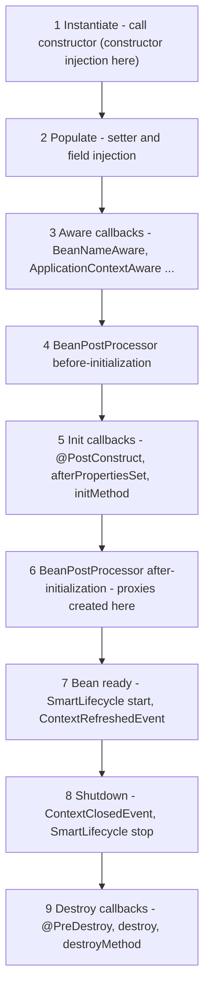

# Chapter 2 — IoC and Dependency Injection

Everything in Spring — web controllers (classes that handle HTTP requests), transactions (groups of database changes that succeed or fail together), security, Spring Data repositories (data-access objects Spring generates for you) — sits on one foundation: the **IoC container** that creates your objects and connects them. If you understand the container, the rest of Spring stops feeling like magic. This chapter opens it up: how beans are defined, how dependencies are found and injected, scopes, the full bean lifecycle, post-processors, circular dependencies, lazy beans, conditions and profiles, events, and two Framework 7 additions — JSpecify null-safety and programmatic bean registration.

**What you'll learn**

1. Inversion of Control and Dependency Injection, with and without Spring (§2.1).
2. `BeanFactory` vs `ApplicationContext` (§2.2).
3. Four ways to define beans: component scanning, `@Bean` methods (full vs lite `@Configuration`), `@Import`, `BeanRegistrar` (§2.3).
4. Constructor, setter and field injection — and why constructor wins (§2.4).
5. How Spring picks a bean: by type, `@Primary`, `@Fallback`, `@Qualifier`, collections, optional dependencies (§2.5).
6. Scopes: singleton, prototype, request, session (§2.6).
7. The lifecycle: `@PostConstruct`, `InitializingBean`, init/destroy methods, `SmartLifecycle` (§2.7).
8. `BeanPostProcessor` and `BeanFactoryPostProcessor` — the container's extension points (§2.8).
9. Circular dependencies — why they fail and how to fix them (§2.9).
10. Lazy initialization (§2.10), `@Conditional` and profiles (§2.11), application events (§2.12).
11. JSpecify null-safety (§2.13) and `BeanRegistrar` (§2.14), both new in Framework 7.

Runnable code: [`code/ioc-container/`](code/ioc-container/) (plain Spring containers inside JUnit tests — JUnit is Java's standard testing framework — so each demo gets its own isolated context) and [`code/web-scopes/`](code/web-scopes/) (request and session scopes). Both built with `mvn -q -B -ntp verify` on Spring Boot 4.1.1 / Framework 7.0.9 / JDK 25. Each demo writes to a small `Trace` log and the tests print it, so the outputs below show the *order* in which Spring did things.

---

## 2.1 Inversion of Control and Dependency Injection

### What it is
- **Dependency**: an object another object needs to do its job. A `PriceCalculator` needs a `TaxPolicy`.
- **Inversion of Control (IoC)**: instead of your code creating and controlling its collaborators, an outside party (the framework) does it and calls your code.
- **Dependency Injection (DI)**: the specific form of IoC where an object receives its dependencies from outside — through its constructor, a setter or a field — instead of creating them with `new` or looking them up.
- **IoC container**: the Spring object that performs DI for a whole application. Objects it manages are **beans**.

Analogy: a film crew. An actor (your class) doesn't hire their co-stars; the casting director (container) reads the script (configuration), casts everyone, and puts them on set together.

### The problem it solves
```java
// code/ioc-container/src/main/java/com/example/ioc/basics/PriceCalculator.java
public class PriceCalculator {
    private final TaxPolicy taxPolicy;

    public PriceCalculator(TaxPolicy taxPolicy) {       // the dependency is handed in, not created here
        this.taxPolicy = taxPolicy;
        Trace.add("PriceCalculator created with " + taxPolicy.getClass().getSimpleName());
    }

    public long totalCents(long netCents) { return netCents + taxPolicy.taxCents(netCents); }
}
```

`PriceCalculator` depends on the *interface* `TaxPolicy`, not on `FlatTaxPolicy`. That already gives you testability (pass a fake `TaxPolicy` in a **unit test** — a small automated test of one class in isolation) and flexibility (swap implementations without editing the class). DI is first a *design style*; the container just automates the wiring. Someone still has to call the constructors:

```java
// Without Spring — you wire by hand (fine for 3 classes, painful for 300):
PriceCalculator calc = new PriceCalculator(new FlatTaxPolicy());
```

```java
// With Spring — you describe the wiring once:
@Configuration
public class ShopConfig {
    @Bean TaxPolicy taxPolicy() { return new FlatTaxPolicy(); }

    @Bean PriceCalculator priceCalculator(TaxPolicy taxPolicy) {   // parameter = dependency
        return new PriceCalculator(taxPolicy);
    }
}
// ...and ask the container for the finished object:
try (var ctx = new AnnotationConfigApplicationContext(ShopConfig.class)) {
    PriceCalculator calc = ctx.getBean(PriceCalculator.class);
}
```

### Why the container is worth it
| Hand wiring | Spring container |
|---|---|
| You decide creation order | Spring works out the order from the dependency graph (the map of which object needs which) |
| One object per `new`; sharing needs care | Singletons shared automatically; other scopes available |
| No central place to add cross-cutting behaviour (concerns like logging or security that touch many classes) | Can wrap beans in proxies (stand-in objects that intercept calls before passing them on): transactions, security, caching (Chapter 4) |
| Configuration values passed by hand | Values injected from properties/environment (Chapter 3) |
| Start-up/shut-down hooks by hand | Lifecycle callbacks and graceful shutdown |

### When not to use it
Not every object should be a bean. **Beans are the long-lived "service" objects** — services, repositories, controllers, clients, configuration. Data objects (a `Greeting`, an `Order` entity — a class mapped to a database table — or a DTO, Data Transfer Object: a plain class that just carries data between layers) are created with `new` in your code, many times per request. Making them beans adds nothing.

The design ideas behind DI — the Dependency Inversion Principle and "program to an interface" — are covered in [LLD §4.10](../../../lld/chapters/04-solid-principles/README.md) and [LLD Chapter 5](../../../lld/chapters/05-design-principles/README.md).

### TL;DR
DI = objects receive dependencies instead of creating them. Spring's IoC container automates DI for the whole app and manages each bean's life.

---

## 2.2 The container: `BeanFactory` vs `ApplicationContext`

### What it is
Spring has two container interfaces:

- **`BeanFactory`** — the basic container: holds **bean definitions** (recipes: class, scope, dependencies, init method...) and creates beans from them on request.
- **`ApplicationContext`** — extends `BeanFactory` and adds everything a real application needs. It is what you always use; Spring Boot creates one for you.

| Feature | `BeanFactory` | `ApplicationContext` |
|---|---|---|
| Create and inject beans | Yes | Yes |
| Singletons created | **Lazily**, on first `getBean` | **Eagerly**, at startup (`refresh()`) — errors show up immediately |
| Registers `BeanPostProcessor`s automatically | No (manual) | Yes — so `@Autowired`, `@PostConstruct`, `@Transactional` work |
| Application events (`publishEvent`, `@EventListener`) | No | Yes |
| `Environment`, profiles, property sources | No | Yes |
| i18n (internationalization: showing text in the user's language) messages (`MessageSource`) | No | Yes |
| Resource loading (`classpath:`, `file:`) | No | Yes |
| Typical implementations | `DefaultListableBeanFactory` | `AnnotationConfigApplicationContext`; in Boot: servlet/reactive web-server contexts |

### Eager vs lazy — proved
```java
// ContainerBasicsTest.java (excerpt)
try (var ctx = new AnnotationConfigApplicationContext(ShopConfig.class)) {
    Trace.add("-- context refreshed, now calling getBean");
    PriceCalculator calc = ctx.getBean(PriceCalculator.class);
    Trace.add("total for 1000 = " + calc.totalCents(1000));
    assertThat(ctx.getBean(PriceCalculator.class)).isSameAs(calc);   // singleton
}

var bf = new DefaultListableBeanFactory();
bf.registerBeanDefinition("taxPolicy", new RootBeanDefinition(FlatTaxPolicy.class));
var calcDef = new RootBeanDefinition(PriceCalculator.class);
calcDef.setAutowireMode(RootBeanDefinition.AUTOWIRE_CONSTRUCTOR);
bf.registerBeanDefinition("priceCalculator", calcDef);
Trace.add("-- definitions registered, nothing created yet");
bf.getBean(PriceCalculator.class);
```

Output:
```
--- ApplicationContext (eager) ---
 1. FlatTaxPolicy created
 2. PriceCalculator created with FlatTaxPolicy
 3. -- context refreshed, now calling getBean
 4. total for 1000 = 1200
--- Bare BeanFactory (lazy) ---
 1. -- definitions registered, nothing created yet
 2. FlatTaxPolicy created
 3. PriceCalculator created with FlatTaxPolicy
```

Notice three things: the context created both beans *before* anyone asked; Spring created `FlatTaxPolicy` first because `PriceCalculator` needs it; and `getBean` twice returned the same instance (the default **singleton** scope).

### How startup works (`refresh()`)
1. **Load bean definitions** — from `@Configuration` classes, component scanning, `@Import`, registrars.
2. **Run `BeanFactoryPostProcessor`s** — they may read or change *definitions* (e.g. resolve `${...}` placeholders — markers replaced by a property value) before any bean exists (§2.8).
3. **Register `BeanPostProcessor`s** — objects that will get a chance to modify every bean.
4. **Instantiate all non-lazy singletons** — for each: construct, inject, run init callbacks, apply post-processors (§2.7).
5. **Finish** — start `SmartLifecycle` beans, publish `ContextRefreshedEvent`.

In Spring Boot, `SpringApplication.run` does all this (Chapter 1 §1.8).

### Common mistakes
- Calling `ctx.getBean(...)` all over your code ("service locator" style). Use injection; `getBean` belongs in tests, `main` methods and framework code.
- Creating a second `ApplicationContext` inside a bean. You get a duplicate set of beans that are not the ones the rest of the app uses.

### In the interview
**Q: BeanFactory vs ApplicationContext?** `BeanFactory` is the minimal container: definitions + lazy creation. `ApplicationContext` extends it with eager singleton creation, automatic post-processor registration (needed for annotations), events, the `Environment`/profiles, i18n and resource loading. Applications use `ApplicationContext`.
- *Follow-up: Why is eager creation good?* Configuration errors (missing bean, bad property) fail at startup instead of on the first request in production.

### TL;DR
Use `ApplicationContext`. It creates singletons eagerly in dependency order, and it's what makes annotations, events and profiles work.

---

## 2.3 Defining beans

There are four ways to tell the container about beans. Most apps use the first two.

### 1. Component scanning with stereotype annotations
Stereotype annotations are labels that say what *role* a class plays (service, repository, controller). Annotate the class; Spring finds it while scanning packages (`@ComponentScan`, included in `@SpringBootApplication`).

| Annotation | Meaning | Extra behaviour |
|---|---|---|
| `@Component` | Generic bean | — |
| `@Service` | Business logic | None (documents intent) |
| `@Repository` | Data access | Persistence exceptions (errors thrown by database libraries) translated to Spring's `DataAccessException` (when a translation post-processor is present — Boot/Spring Data set it up) |
| `@Controller` | Spring MVC controller (returns views) | Detected as a request handler |
| `@RestController` | `@Controller` + `@ResponseBody` | Return values written as the body |
| `@Configuration` | Holds `@Bean` methods | Proxied in full mode (below) |

All of them are meta-annotated with `@Component` (their own declaration carries `@Component`, so they count as one); that's why scanning finds them.

```java
@Repository public class InvoiceRepository {}

@Service public class InvoiceService {
    private final InvoiceRepository repository;
    public InvoiceService(InvoiceRepository repository) { this.repository = repository; }
}

@Component("renderer") public class PdfRenderer {}   // explicit bean name

public class NotABean {}                              // no annotation -> ignored
```

```
scanned beans: invoiceRepository, invoiceService, renderer
```

**Bean names.** The default is the simple class name with a lower-case first letter (`InvoiceService` → `invoiceService`); `@Component("renderer")` overrides it. For a *nested* class Spring uses the outer class too: `Ambiguous.DiskStorage` becomes `ambiguous.DiskStorage` (you'll see this in §2.5's output).

### 2. `@Bean` methods
Write a method that builds the object; Spring calls it once (for a singleton) and registers the result. Use `@Bean` for **classes you can't annotate** (third-party libraries: `ObjectMapper` — Jackson's JSON converter, `DataSource` — a source of database connections, a cloud SDK — Software Development Kit, a vendor's client library — client) and when construction needs logic.

```java
@Configuration
public class ShopConfig {
    @Bean TaxPolicy taxPolicy() { return new FlatTaxPolicy(); }                  // bean name = method name
    @Bean PriceCalculator priceCalculator(TaxPolicy taxPolicy) { return new PriceCalculator(taxPolicy); }
}
```
`@Bean` attributes: `name`/`value` (names and aliases), `initMethod`, `destroyMethod`, `autowireCandidate`, `defaultCandidate` (6.2). Combine with `@Scope`, `@Lazy`, `@Primary`, `@Profile`, `@Conditional...` on the same method.

### Full vs lite `@Configuration` — proved
A `@Bean` method in a `@Configuration` class can call *another* `@Bean` method. What that call returns depends on the mode:

```java
@Configuration                      // "full" mode: proxyBeanMethods = true (the default)
public class FullConfig {
    @Bean AuditLog auditLog() { return new AuditLog(); }
    @Bean OrderService orderService() { return new OrderService(auditLog()); }       // inter-bean call
    @Bean PaymentService paymentService() { return new PaymentService(auditLog()); } // inter-bean call
}

@Configuration(proxyBeanMethods = false)   // "lite" mode: no CGLIB subclass
public class LiteConfig { /* identical methods */ }

@Configuration(proxyBeanMethods = false)   // lite mode done right: ask for dependencies as parameters
public class LiteSafeConfig {
    @Bean AuditLog auditLog() { return new AuditLog(); }
    @Bean OrderService orderService(AuditLog log) { return new OrderService(log); }
    @Bean PaymentService paymentService(AuditLog log) { return new PaymentService(log); }
}
```

Output (`AuditLog` numbers each instance it creates):
```
full: config class = FullConfig$$SpringCGLIB$$0
full: order.log=#1 payment.log=#1, AuditLogs created=1
lite: config class = LiteConfig
lite: order.log=#2 payment.log=#3, AuditLogs created=3
lite+params: order.log=#1 payment.log=#1, AuditLogs created=1
```

How it works:
1. In **full mode**, Spring generates a **CGLIB subclass** of your configuration class at startup (`FullConfig$$SpringCGLIB$$0`). CGLIB is a bytecode library that creates subclasses at runtime (**bytecode** is the compiled form of Java that the JVM — Java Virtual Machine — executes).
2. The subclass overrides each `@Bean` method: "if the bean already exists in the container, return it; otherwise call the real method once". So `auditLog()` called from two methods still yields the one singleton.
3. In **lite mode** (`proxyBeanMethods = false`, or `@Bean` methods in a plain `@Component`), there is no subclass: `auditLog()` is an ordinary Java call and creates a new, *unmanaged* object each time — 3 `AuditLog`s, two of which Spring knows nothing about (no lifecycle callbacks, no proxies).
4. **Parameters** avoid the problem in both modes: Spring injects the container's bean.

| | Full (`@Configuration`) | Lite (`proxyBeanMethods = false` or `@Component`) |
|---|---|---|
| Inter-bean method calls | Return the managed singleton | Create new unmanaged objects |
| Startup cost | Generates a CGLIB subclass | None — slightly faster, friendlier to AOT (ahead-of-time build processing)/native images (apps compiled to a stand-alone executable) |
| Class may be `final` / methods `private`? | No (must be subclassable) | Yes |
| Recommended style | Works either way if you use parameters | Spring Boot's own auto-configurations all use lite mode |

**Rule of thumb:** declare dependencies as `@Bean` method parameters and never call `@Bean` methods directly — then the mode doesn't matter.

### 3. `@Import`
`@Import(SomeConfig.class)` pulls in another configuration class (or a plain class as a bean, or an `ImportSelector`/`ImportBeanDefinitionRegistrar`/`BeanRegistrar`) without component scanning. Auto-configuration and `@Enable...` annotations are built on it (Chapter 3).

### 4. Programmatic registration — `BeanRegistrar` (Framework 7)
For beans whose number or type depends on runtime logic (loops, ifs over properties). See §2.14.

Older projects also define beans in **XML** (`<bean id="..." class="...">`). It still works but new code uses annotations.

### Common mistakes
- Annotating an interface with `@Service` — scanning registers only concrete classes. Annotate the implementation.
- Calling a `@Bean` method from a lite configuration and getting a second instance (shown above).
- Two beans with the same name (e.g. two `@Bean` methods named `dataSource` in different configs). Spring Boot disables bean-definition overriding by default, so startup fails with `BeanDefinitionOverrideException` — rename one.

### In the interview
**Q: `@Component` vs `@Bean`?** `@Component` goes on *your* class and is found by scanning; `@Bean` goes on a factory *method* in a configuration class and is used for third-party classes or when creation needs code. Both produce beans that behave the same.
- *Follow-up: What does `proxyBeanMethods = false` change?* No CGLIB subclass; calls between `@Bean` methods become plain Java calls and create new objects. Safe when dependencies are passed as parameters, and cheaper at startup.
- *Follow-up: Difference between `@Service` and `@Component`?* None technically; `@Service` documents intent. `@Repository` adds exception translation.

### TL;DR
Scan your own classes (`@Service`, `@Repository`...), use `@Bean` for others, pass dependencies as `@Bean` method parameters, and know that full `@Configuration` is a CGLIB subclass.

---

## 2.4 Injection types

### What it is
Spring can inject a dependency in three places:

```java
// Constructor injection (preferred)
@Service
public class AlertService {
    private final Notifier notifier;
    public AlertService(Notifier notifier) { this.notifier = notifier; }   // no @Autowired needed
}

// Setter (method) injection and field injection
@Component
public class OtherStyles {
    @Autowired @Qualifier("push")
    Notifier fieldInjected;                   // field injection: needs reflection, can't be final

    Notifier setterInjected;

    @Autowired
    void setNotifier(@Qualifier("email") Notifier n) {   // setter/method injection
        this.setterInjected = n;
    }
}
```

**`@Autowired`** tells Spring "inject here". Since Spring 4.3, a class with **exactly one constructor** doesn't need it — Spring uses that constructor automatically. With several constructors, mark the one to use with `@Autowired`. The standard `jakarta.inject.Inject` annotation works the same way if `jakarta.inject-api` is on the classpath (Framework 7 dropped the old `javax.inject`).

### Trade-offs

| | Constructor | Setter | Field |
|---|---|---|---|
| Fields can be `final` (immutable) | Yes | No | No |
| Object is complete after `new` | Yes | No — may be half-initialised | No |
| Unit test without Spring | Just call the constructor | Call setters | Needs reflection (code inspecting/changing objects at runtime) or Spring |
| Required dependency obvious | Yes (it's in the signature) | No | No |
| Circular dependency possible | No (fails fast, §2.9) | Yes | Yes |
| Too many dependencies visible | Yes — a 9-parameter constructor is a design smell (a hint that the design is off) you can see | Hidden | Hidden |
| Good for | **Almost everything** | Optional dependencies, re-configuration | Test classes (`@Autowired MockMvcTester mvc`) |

### Common mistakes
- Field injection in production code — convenient but hides dependencies and makes plain unit tests awkward.
- Adding `@Autowired` to a single constructor "just in case" — harmless but noise.
- Using a dependency *inside the constructor* of a class that uses field injection → `NullPointerException` (the error thrown when you use a reference that is `null`), because fields are injected after construction.

### In the interview
**Q: Why is constructor injection recommended?** Dependencies become `final`, the object is fully built when constructed, required dependencies are explicit, unit tests just call `new`, and circular dependencies fail fast instead of hiding. The Spring team recommends it.
- *Follow-up: When would you use setter injection?* For truly optional dependencies or values that can change after startup.

### TL;DR
Use constructor injection with `final` fields; skip `@Autowired` on a single constructor; keep field injection for tests.

---

## 2.5 How Spring picks a bean

### What it is
To inject a parameter of type `Notifier`, Spring looks for **candidate beans assignable to that type** (beans whose class is that type, implements it, or extends it). The rules when there are zero, one, or many candidates:

1. **Exactly one candidate** → inject it.
2. **Several candidates** → narrow down in this order:
   1. A `@Qualifier("name")` on the injection point selects the bean with that name (or that qualifier).
   2. Otherwise, a bean marked **`@Primary`** wins.
   3. Otherwise, if all but one are marked **`@Fallback`** (Framework 6.2), the remaining one wins.
   4. Otherwise, a bean whose **name equals the parameter name** wins (needs the `-parameters` compiler flag — an option that keeps parameter names in the compiled class — which Boot's parent sets).
   5. Otherwise → `NoUniqueBeanDefinitionException`.
   (`@jakarta.annotation.Priority` on the candidate classes is also consulted — highest priority wins — but it is rarely used in application code.)
3. **No candidate** → `NoSuchBeanDefinitionException` — unless the injection point is optional (`Optional<T>`, `ObjectProvider<T>`, `@Nullable`, `@Autowired(required = false)`).
4. **Collection/array/Map of the type** → inject *all* candidates: `List<Notifier>` ordered by `@Order`/`Ordered`, `Map<String, Notifier>` keyed by bean name.

### Example
```java
public final class Notifiers {
    @Component("sms") @Primary @Order(1)
    public static class SmsNotifier implements Notifier { public String send(String m) { return "SMS: " + m; } }

    @Component("email") @Order(2)
    public static class EmailNotifier implements Notifier { public String send(String m) { return "EMAIL: " + m; } }

    @Component("push") @Order(3)
    public static class PushNotifier implements Notifier { public String send(String m) { return "PUSH: " + m; } }
}

@Service
public class AlertService {
    public AlertService(Notifier defaultNotifier,                     // by type -> the @Primary one
                        @Qualifier("email") Notifier emailNotifier,   // by name
                        List<Notifier> all,                           // all, sorted by @Order
                        Map<String, Notifier> byName,                 // bean name -> bean
                        Optional<AuditTrail> audit,                   // absent -> Optional.empty()
                        ObjectProvider<AuditTrail> auditProvider) {   // lazy, optional lookup
        ...
    }
}
```

Output:
```
by type (@Primary): SMS: hi
@Qualifier(email):  EMAIL: hi
List (by @Order):   [SMS: hi, EMAIL: hi, PUSH: hi]
Map keys:           [email, push, sms]
optional AuditTrail present? false
```

And the failure case — two `Storage` beans, no tie-breaker:
```java
@Component public static class DiskStorage implements Storage {}
@Component public static class CloudStorage implements Storage {}
@Component public static class Backup { public Backup(Storage storage) {} }
```
```
startup failed: No qualifying bean of type 'com.example.ioc.ambiguous.Ambiguous$Storage' available:
expected single matching bean but found 2: ambiguous.CloudStorage,ambiguous.DiskStorage
```
The exception is `UnsatisfiedDependencyException` wrapping `NoUniqueBeanDefinitionException` — the context never starts.

### The tie-breakers compared

| Tool | Where it goes | Meaning | Use when |
|---|---|---|---|
| `@Primary` | On a bean | "Default choice for this type" | One implementation is the normal one |
| `@Fallback` (6.2+) | On a bean | "Use me only if nothing else qualifies" | A default that others should override |
| `@Qualifier("x")` | On the injection point (and optionally the bean) | "I want exactly this one" | A specific consumer needs a specific implementation |
| Custom qualifier annotation | e.g. `@Qualifier @interface Fast {}` | Type-safe qualifier | Avoid string names spread across code |
| `List<T>` / `Map<String,T>` | Injection point | "Give me all of them" | Strategy/plugin patterns, broadcast |
| `ObjectProvider<T>` | Injection point | Lazy/optional/multiple lookup: `getIfAvailable()`, `getIfUnique()`, `orderedStream()` | Optional beans, prototypes (§2.6) |

`List<Notifier>` + `Map` is how you implement the **Strategy pattern** with Spring: each strategy is a bean, the consumer receives them all and picks by key — see [LLD §11.3](../../../lld/chapters/11-patterns-behavioral-2/README.md).

### Common mistakes
- Adding a second implementation of an interface later (e.g. a test stub) and breaking every injection point that relied on "only one". Decide on `@Primary` or qualifiers early.
- Qualifier string typos — they fail at startup (good), but a custom qualifier annotation avoids them entirely.
- Expecting `@Order` to change which single bean is injected. It only orders collections; use `@Primary`/`@Qualifier` for single injection.

### In the interview
**Q: Two beans implement the same interface. How does Spring decide?** By type first; with several candidates, `@Qualifier` on the injection point, then `@Primary`, then `@Fallback`, then a bean named like the parameter; otherwise startup fails with `NoUniqueBeanDefinitionException`. Or inject `List<T>`/`Map<String,T>` to get all.
- *Follow-up: How do you inject an optional dependency?* `Optional<T>`, `ObjectProvider<T>.getIfAvailable()`, a `@Nullable` parameter (§2.13), or `@Autowired(required = false)` on a setter.

### Self-check
1. `@Primary` on `SmsNotifier`, `@Qualifier("email")` on a parameter — which is injected there? → `email`; the qualifier is more specific.
2. What order does `List<Notifier>` have? → `@Order`/`Ordered` values, lowest first; unordered beans come last.
3. What happens with zero candidates for a required dependency? → `NoSuchBeanDefinitionException` at startup.

### TL;DR
Type first, then `@Qualifier` > `@Primary` > `@Fallback` > parameter name. Collections get everything. Optional via `Optional`/`ObjectProvider`/`@Nullable`.

---

## 2.6 Bean scopes

### What it is
A **scope** decides *how many instances* of a bean exist and *how long* each lives.

| Scope | Instances | Lives until | Available in |
|---|---|---|---|
| `singleton` (default) | One per container | Context closes | All apps |
| `prototype` | New one **per injection/lookup** | Garbage collected (freed automatically by the JVM once nothing references it) — Spring forgets it after handing it out | All apps |
| `request` | One per HTTP request | Request ends | Web apps |
| `session` | One per HTTP session (one user's series of requests, tied together by a cookie) | Session expires | Web apps |
| `application` | One per `ServletContext` (the web app as a whole, inside the server) | App stops | Web apps |
| `websocket` | One per WebSocket (a long-lived two-way connection between browser and server) session | Socket closes | WebSocket apps |

Declare with `@Scope("prototype")` (or `ConfigurableBeanFactory.SCOPE_PROTOTYPE`), `@RequestScope`, `@SessionScope`, `@ApplicationScope`.

> **Spring singleton ≠ GoF Singleton.** (GoF = "Gang of Four", the authors of the classic *Design Patterns* book.) The GoF Singleton pattern enforces one instance *per class loader* via a private constructor. A Spring singleton is one instance *per container and bean definition* — you could define two beans of the same class. See [LLD §8.8](../../../lld/chapters/08-patterns-creational/README.md).

### Singleton vs prototype — and the classic trap
```java
@Component @Scope(ConfigurableBeanFactory.SCOPE_PROTOTYPE)
public class ShoppingCart { public final int id = SEQ.incrementAndGet(); @PreDestroy void close() {...} }

@Component
public class PriceList { public final int id = SEQ.incrementAndGet(); @PreDestroy void close() {...} }

@Service                                            // singleton that depends on a prototype
public class CheckoutService {
    private final ShoppingCart injectedOnce;                // injected ONE time, at creation
    private final ObjectProvider<ShoppingCart> carts;        // asks the container each time
    public int cartIdFromField() { return injectedOnce.id; }
    public int cartIdFromProvider() { return carts.getObject().id; }
}
```

Output:
```
singleton: PriceList #1, #1
prototype: ShoppingCart #2, #3
prototype injected into singleton: #1, #1 (stuck!)
via ObjectProvider:                #4, #5 (fresh)
--- destroy callbacks on close ---
 1. PriceList#1 @PreDestroy
```

What this proves:
1. `getBean(PriceList.class)` always returns instance #1; `getBean(ShoppingCart.class)` returns a new one each time.
2. **A prototype injected into a singleton is created once** — when the singleton is built — and then reused forever. The singleton is created only once, so injection happens only once.
3. The fix is to *look up* a new instance when needed: `ObjectProvider<T>.getObject()` (shown), `@Lookup` method injection, or a scoped proxy.
4. **Spring does not call destroy callbacks on prototypes.** Only `PriceList`'s `@PreDestroy` ran. If a prototype holds resources (files, connections), the code that asked for it must clean up.

### Request and session scopes — proved
A singleton controller can't hold "the current request's object" in a field... unless that field is a **scoped proxy**: a stand-in object that, on every method call, finds the real instance for the *current* request or session.

```java
@Component @RequestScope          // one instance per HTTP request; a scoped proxy is injected into singletons
public class RequestInfo { private final int id = SEQ.incrementAndGet(); public int id() { return id; } }

@Component @SessionScope          // one instance per HTTP session
public class Cart { private final List<String> items = new ArrayList<>(); ... }

@RestController                   // a singleton...
public class CartController {
    private final Cart cart;               // ...holding proxies that find the right
    private final RequestInfo request;     //    session/request instance on every call

    @PostMapping("/cart/{item}")
    String add(@PathVariable String item) {
        cart.add(item);
        return "request#" + request.id() + " cart=" + cart.items() + " proxy=" + cart.getClass().getSimpleName().contains("CGLIB");
    }
}
```

The test posts twice with Alice's session and once with Bob's (`MockHttpSession` objects):
```
alice: request#1 cart=[book] proxy=true
alice: request#2 cart=[book, pen] proxy=true
bob:   request#3 cart=[mug] proxy=true
```
Every request got a new `RequestInfo`; Alice's two requests shared one `Cart`, Bob got his own — through the same singleton controller. `@RequestScope` and `@SessionScope` create class-based (CGLIB) proxies by default (`proxyMode = TARGET_CLASS`); with plain `@Scope("request")` you must set `proxyMode` yourself.

### Thread safety
A singleton bean is shared by **all request threads at once**. Keep singletons **stateless** (holding no data that changes between calls — only `final` references to other beans and configuration). Per-request data belongs in method parameters/local variables, or in request-scoped beans. Concurrency basics: [Java Chapter 14](../../../java/chapters/14-concurrency-1/README.md).

### Common mistakes
- A mutable field (`private int counter`, a `HashMap` cache) in a singleton service → race conditions under load.

  > **Key term — race condition:** a bug where the result depends on the exact timing of several threads touching the same data. Two threads both read `counter = 5`, both add 1, both write `6` — one increment is lost. It appears only under concurrent load, so it often slips through tests.
- Expecting a new prototype on each method call when it was injected once (shown above).
- Injecting a request-scoped bean into a singleton without a proxy → `Scope 'request' is not active for the current thread` at startup.
- Using session scope for data in a horizontally scaled app (one that runs several copies behind a load balancer) without session replication (copying session data so every copy can see it — Spring Session, Chapter 10; see [System Design Fundamentals](../../../system-design-patterns/modules/00-system-design-fundamentals/README.md)).

### In the interview
**Q: What are Spring's bean scopes?** singleton (default, one per container), prototype (new per lookup, not destroyed by Spring), and web scopes request, session, application, websocket.
- *Follow-up: Prototype inside singleton?* Injected once, so effectively a singleton for that consumer. Use `ObjectProvider`, `@Lookup`, or a scoped proxy.
- *Follow-up: Are singletons thread-safe?* Spring doesn't make them thread-safe; they're shared, so design them stateless.

### TL;DR
Singleton by default, shared by all threads — keep it stateless. Prototype = new per lookup, no destroy callback. Web scopes use proxies so singletons can reach the current request/session object.

---

## 2.7 The bean lifecycle

### What it is
From creation to destruction Spring calls a fixed sequence of hooks. You rarely need more than `@PostConstruct` and `@PreDestroy`, but knowing the order explains many "why is my field null?" questions.

This bean implements *every* hook and records when it runs:

```java
public class CacheWarmer implements BeanNameAware, InitializingBean, DisposableBean {
    public CacheWarmer()                          { Trace.add("constructor"); }
    @Autowired void setDependency(Dependency d)   { Trace.add("setter injection"); }
    @Override public void setBeanName(String n)   { Trace.add("BeanNameAware.setBeanName(" + n + ")"); }
    @PostConstruct void postConstruct()           { Trace.add("@PostConstruct"); }
    @Override public void afterPropertiesSet()    { Trace.add("InitializingBean.afterPropertiesSet"); }
    void customInit()                             { Trace.add("@Bean(initMethod) customInit"); }

    @PreDestroy void preDestroy()                 { Trace.add("@PreDestroy"); }
    @Override public void destroy()               { Trace.add("DisposableBean.destroy"); }
    void customDestroy()                          { Trace.add("@Bean(destroyMethod) customDestroy"); }
}

@Configuration
public class LifecycleConfig {
    @Bean static TracingPostProcessor tracingPostProcessor() { return new TracingPostProcessor(); } // static!
    @Bean Dependency dependency() { return new Dependency(); }
    @Bean(initMethod = "customInit", destroyMethod = "customDestroy")
    CacheWarmer cacheWarmer() { return new CacheWarmer(); }
    @Bean Poller poller() { return new Poller(); }                 // a SmartLifecycle bean

    @EventListener void onRefresh(ContextRefreshedEvent e) { Trace.add("ContextRefreshedEvent"); }
    @EventListener void onClose(ContextClosedEvent e)      { Trace.add("ContextClosedEvent"); }
}
```

Output (context created, then closed):
```
--- bean lifecycle ---
 1. constructor
 2. setter injection
 3. BeanNameAware.setBeanName(cacheWarmer)
 4. BeanPostProcessor.before(cacheWarmer)
 5. @PostConstruct
 6. InitializingBean.afterPropertiesSet
 7. @Bean(initMethod) customInit
 8. BeanPostProcessor.after(cacheWarmer)
 9. SmartLifecycle.start (Poller)
10. ContextRefreshedEvent
11. ----- application running -----
12. ContextClosedEvent
13. SmartLifecycle.stop (Poller)
14. @PreDestroy
15. DisposableBean.destroy
16. @Bean(destroyMethod) customDestroy
```

### How it works


1. **Instantiate** — the constructor runs; constructor-injected dependencies are available here.
2. **Populate properties** — setter and field injection.
3. **`Aware` callbacks** — the bean can receive container objects: its name, the `BeanFactory`, the `ApplicationContext`, the `Environment`. (Prefer injecting these normally; `Aware` interfaces tie code to Spring.)
4. **`BeanPostProcessor.postProcessBeforeInitialization`** for every post-processor. `@PostConstruct` itself is implemented by one (`CommonAnnotationBeanPostProcessor`), which is why our custom "before" ran just before it.
5. **Initialization**, in this order: `@PostConstruct` → `InitializingBean.afterPropertiesSet()` → `@Bean(initMethod)`.
6. **`postProcessAfterInitialization`** — the bean may be *replaced* here, typically by a proxy (transactions, AOP, §2.8).
7. After **all** singletons are ready: `SmartLifecycle.start()` (by phase), then `ContextRefreshedEvent` (then, in Boot, `ApplicationStartedEvent` and `ApplicationReadyEvent`).
8. On `close()` (or JVM shutdown hook — code the JVM runs when the process is asked to stop — which Boot registers): `ContextClosedEvent`, `SmartLifecycle.stop()` in reverse phase order.
9. **Destruction**, in this order: `@PreDestroy` → `DisposableBean.destroy()` → `@Bean(destroyMethod)`. Beans are destroyed in reverse dependency order.

### Which hook to use

| Hook | Use for | Notes |
|---|---|---|
| `@PostConstruct` / `@PreDestroy` (`jakarta.annotation`) | Validate state, warm a cache, open/close a resource | **Default choice** — standard, no Spring interface |
| `InitializingBean` / `DisposableBean` | Framework or library code | Couples your class to Spring |
| `@Bean(initMethod, destroyMethod)` | Third-party classes you can't annotate | `destroyMethod` is inferred: a public `close()`/`shutdown()` is called automatically |
| `SmartLifecycle` | Things that must *run* while the app is up: message listeners, pollers, schedulers | `start`/`stop`, `getPhase()` orders them (lower starts first, stops last), `isAutoStartup()` |
| `ApplicationReadyEvent` listener (Boot) | "Do X once the app is fully started" | Runs after runners; the server already accepts traffic |
| `CommandLineRunner` / `ApplicationRunner` (Boot) | One-off startup tasks with access to args | Run before `ApplicationReadyEvent` |

### Common mistakes
- Doing heavy work (remote calls, long cache loads) in constructors or `@PostConstruct` — it slows startup and a failure kills the app. Consider lazy loading or `ApplicationReadyEvent`.
- Calling `@Transactional` methods from `@PostConstruct` and expecting a transaction: the proxy is applied in step 6, *after* `@PostConstruct` (step 5), and you are calling `this` anyway (self-invocation, Chapter 4).
- Expecting `@PreDestroy` on prototype beans (§2.6).
- Killing the JVM with `kill -9` (a forced kill the process cannot intercept): no shutdown hook runs, so no destroy callbacks.

### In the interview
**Q: Describe the Spring bean lifecycle.** Instantiate → inject → `Aware` callbacks → BPP before-init → `@PostConstruct` → `afterPropertiesSet` → custom init → BPP after-init (proxies) → ready; on shutdown `@PreDestroy` → `destroy()` → custom destroy.
- *Follow-up: Where does a `@Transactional` proxy come from?* A `BeanPostProcessor`'s after-initialization step wraps the bean.
- *Follow-up: `@PostConstruct` vs constructor?* In the constructor, setter/field-injected dependencies and post-processing haven't happened yet; `@PostConstruct` runs after all injection.

### TL;DR
Construct → inject → aware → BPP-before → `@PostConstruct` → `afterPropertiesSet` → initMethod → BPP-after (proxies) → lifecycle start → ... → `@PreDestroy` → `destroy` → destroyMethod.

---

## 2.8 Post-processors: the container's extension points

### What it is
Two interfaces let code customise the container itself:

| | `BeanFactoryPostProcessor` (BFPP) | `BeanPostProcessor` (BPP) |
|---|---|---|
| Works on | Bean **definitions** (recipes) | Bean **instances** |
| Runs | Once, after definitions are loaded, **before any normal bean is created** | For every bean, before and after its init callbacks |
| Can | Change scopes, class names, property values; register more definitions | Modify the bean, or **return a different object** (proxy/wrapper) |
| Spring's own examples | `PropertySourcesPlaceholderConfigurer` (resolves `${...}`), `ConfigurationClassPostProcessor` (processes `@Configuration`, `@ComponentScan`, `@Import`) | `AutowiredAnnotationBeanPostProcessor` (`@Autowired`, `@Value`), `CommonAnnotationBeanPostProcessor` (`@PostConstruct`, `@PreDestroy`), the AOP auto-proxy creator (`@Transactional`, `@Cacheable`, `@Async`) |

In other words, most of Spring's annotation "magic" is ordinary post-processors.

### Example — a BPP that swaps beans for logging proxies
```java
@Target(ElementType.TYPE) @Retention(RetentionPolicy.RUNTIME)
public @interface LogCalls {}

@Component @LogCalls
public class FriendlyGreeter implements Greeter { public String greet(String name) { return "Hi " + name; } }

@Component
public class LogCallsPostProcessor implements BeanPostProcessor {
    @Override
    public Object postProcessAfterInitialization(Object bean, String beanName) {
        if (!bean.getClass().isAnnotationPresent(LogCalls.class)) return bean;
        return Proxy.newProxyInstance(                          // JDK dynamic proxy over the bean's interfaces
                bean.getClass().getClassLoader(), bean.getClass().getInterfaces(),
                (proxy, method, args) -> {
                    Trace.add("-> " + beanName + "." + method.getName() + "(" + args[0] + ")");
                    Object result = method.invoke(bean, args);  // call the real object
                    Trace.add("<- " + result);
                    return result;
                });
    }
}

@Component
public class CountingFactoryPostProcessor implements BeanFactoryPostProcessor {
    @Override
    public void postProcessBeanFactory(ConfigurableListableBeanFactory bf) {
        Trace.add("BeanFactoryPostProcessor: friendlyGreeter defined=" + bf.containsBeanDefinition("friendlyGreeter")
                + ", created=" + bf.containsSingleton("friendlyGreeter"));
    }
}
```

Output (test gets the `Greeter` bean and calls `greet("Ada")`):
```
--- post-processors ---
 1. BeanFactoryPostProcessor: friendlyGreeter defined=true, created=false
 2. bean class = jdk.proxy2.$Proxy45
 3. -> friendlyGreeter.greet(Ada)
 4. <- Hi Ada
```

1. The BFPP ran when the `friendlyGreeter` **definition** existed but no **instance** had been created.
2. The BPP returned a proxy, so the container stored and injected the *proxy* (`jdk.proxy2.$Proxy45`), not `FriendlyGreeter`. Every caller now goes through the logging code — this is exactly how Spring AOP adds transactions and caching (Chapter 4). The Proxy pattern itself: [LLD §9.7](../../../lld/chapters/09-patterns-structural/README.md).
3. The proxy here is a **JDK dynamic proxy** (Java's built-in way to create, at runtime, an object that implements given interfaces and routes every call to one handler). Because it implements only the *interfaces*, `ctx.getBean(FriendlyGreeter.class)` would now fail — one reason to inject interfaces, and one reason Spring often uses class-based CGLIB proxies instead.

### Rules
- Declare BFPP and BPP `@Bean` methods **`static`** (as in `LifecycleConfig` above). They must be created very early; a non-static `@Bean` method forces Spring to create the whole configuration class early too, so that class's own `@Autowired`/`@Value` may not be processed. Spring logs an info/warning message when this happens.
- A BPP should not depend on ordinary beans: anything it injects is created before all BPPs are registered, and so is "not eligible for getting processed by all BeanPostProcessors" (e.g. won't get transactional proxies). Spring logs exactly that phrase.
- Order several post-processors with `Ordered`/`PriorityOrdered` or `@Order`.

### TL;DR
BFPP edits recipes before any bean exists; BPP sees (and can replace) every bean. `@Autowired`, `@Value`, `@PostConstruct` and all proxy-based features are implemented as post-processors.

---

## 2.9 Circular dependencies

### What it is
A **circular dependency** is a cycle in the dependency graph: `OrderService` needs `CustomerService`, which needs `OrderService` (or a longer loop A → B → C → A).

### What happens — proved
```java
// Constructor cycle
@Component class OrderService    { OrderService(CustomerService customers) {} }
@Component class CustomerService { CustomerService(OrderService orders) {} }

// Field cycle
@Component class OrderService    { @Autowired CustomerService customers; }
@Component class CustomerService { @Autowired OrderService orders; }

// Cycle broken with @Lazy
@Component class OrderService    { OrderService(@Lazy CustomerService customers) {...} }
@Component class CustomerService { CustomerService(OrderService orders) {...} }
```

Output:
```
constructor cycle -> BeanCurrentlyInCreationException: Error creating bean with name 'ctorCycle.CustomerService': Requested bean is currently in creat...
field cycle, plain Spring -> OK, orders.customers.orders == orders? true
field cycle, Spring Boot -> BeanCurrentlyInCreationException
@Lazy cycle -> OK, injected class = LazyCycle$CustomerService$$SpringCGLIB$$0, call = customers
```

### How it works
1. **Constructor cycles are impossible to satisfy.** To call `new OrderService(customers)` Spring needs a finished `CustomerService`, whose constructor needs a finished `OrderService`... Spring detects the loop and throws `BeanCurrentlyInCreationException`.
2. **Field/setter cycles can be satisfied in plain Spring**: Spring constructs `OrderService` (empty), registers an *early reference* to it in an internal cache, then creates `CustomerService` and injects that early reference, then finishes `OrderService`. (The internal "singleton caches" are sometimes called the three-level cache in interviews.)
3. **Spring Boot forbids that by default** (`spring.main.allow-circular-references=false`, since Boot 2.6). A cycle usually means the classes are too entangled, and early references can also skip proxies (an early reference is the raw object, not the transactional proxy). Boot's startup report prints the cycle as a small ASCII diagram.
4. **`@Lazy` on an injection point** injects a proxy instead of the real bean; the real `CustomerService` is looked up on the first method call. That breaks the creation-time cycle — note the `$$SpringCGLIB$$` class name.

### How to fix a cycle (best first)
1. **Redesign.** Usually one of the classes does two jobs. Extract the shared logic into a third bean both can depend on, or move a method to where its data lives.
2. **Use events** (§2.12): `OrderService` publishes `OrderPlaced`; `CustomerService` listens. No compile-time dependency either way.
3. **Inject lazily**: `@Lazy` on the parameter, or `ObjectProvider<CustomerService>` and call `getObject()` when needed.
4. **Last resort**: `spring.main.allow-circular-references=true` — hides the design problem; avoid.

### In the interview
**Q: How does Spring handle circular dependencies?** Constructor cycles fail with `BeanCurrentlyInCreationException`. Field/setter cycles can be resolved with early singleton references, but Spring Boot disallows them by default since 2.6. Fix by redesigning (extract a third class), decoupling with events, or `@Lazy`/`ObjectProvider`.
- *Follow-up: Why is constructor injection "good" here?* It makes cycles fail fast at startup instead of silently producing half-initialised or unproxied objects.

### TL;DR
Constructor cycles always fail; field cycles work in plain Spring but Boot rejects them. Refactor first; `@Lazy` or events if you must.

---

## 2.10 Lazy initialization

### What it is
By default the `ApplicationContext` creates every singleton at startup. A **lazy** bean is created on first use instead.

```java
@Component @Lazy                             // not created at startup; created on first use
public class ReportGenerator { public ReportGenerator() { Trace.add("ReportGenerator created (lazy)"); } }

@Component                                   // eager by default
public class RateCache { public RateCache() { Trace.add("RateCache created (eager)"); } }
```

```
--- @Lazy ---
 1. RateCache created (eager)
 2. -- context started
 3. ReportGenerator created (lazy)
--- spring.main.lazy-initialization=true ---
 1. -- context started
 2. RateCache created (eager)
```

The second run started the same classes with Spring Boot and the property `spring.main.lazy-initialization=true`, which makes **every** bean lazy — even `RateCache`, which has no `@Lazy`. `@Lazy(false)` on a bean opts it back out.

### Trade-offs

| Eager (default) | Lazy |
|---|---|
| Slower startup | Faster startup |
| Misconfiguration fails **at startup** | Misconfiguration fails **on first request** — maybe in production |
| First request is fast | First request pays the creation cost |
| Memory used up front | Memory only for used beans |

**When to use it:** individual rarely used, expensive beans; global lazy init only in development or for tests/CLI tools (command-line programs) where startup time dominates. Keep production eager so broken configuration can't get past startup. (For fast production startup, Chapter 15 covers AOT and CDS — Class Data Sharing, a JVM cache of pre-loaded classes.)

---

## 2.11 `@Conditional` and profiles

### What it is
- **`@Conditional(SomeCondition.class)`** — register a bean *only if* a `Condition` returns true. A `Condition` sees the environment (properties and profiles), the registry (the bean definitions registered so far) and the classpath (the jars and classes available to the app). This is the building block of Spring Boot's auto-configuration (`@ConditionalOnClass`, `@ConditionalOnMissingBean`, `@ConditionalOnProperty` — Chapter 3).
- **`@Profile("dev")`** — a ready-made condition: register only when that **profile** is active. A profile is a named set of beans/settings for one environment (`dev`, `test`, `prod`). Expressions are allowed: `"!dev"`, `"prod & eu"`, `"dev | test"`.

```java
public class OnFeatureFlag implements Condition {
    @Override
    public boolean matches(ConditionContext context, AnnotatedTypeMetadata metadata) {
        return context.getEnvironment().getProperty("features.fraud-check", Boolean.class, false);
    }
}

@Configuration
public class PaymentBeans {
    @Bean @Profile("dev")                    // only when profile "dev" is active
    PaymentGateway fakeGateway() { return () -> "fake gateway (dev)"; }

    @Bean @Profile("!dev")                   // any time "dev" is NOT active
    PaymentGateway httpGateway() { return () -> "HTTP gateway (real)"; }

    @Bean @Conditional(OnFeatureFlag.class)  // custom condition
    FraudChecker fraudChecker() { return new FraudChecker(); }
}
```

The test starts two contexts — one with profile `dev` and `features.fraud-check=true`, one with neither:
```
profile dev : fake gateway (dev), fraudChecker beans = 1
no profile  : HTTP gateway (real), fraudChecker beans = 0
```

### How to activate profiles
`spring.profiles.active=dev` in a property file, `--spring.profiles.active=dev` on the command line, env var `SPRING_PROFILES_ACTIVE=dev`, `@ActiveProfiles("test")` in tests, or `context.getEnvironment().setActiveProfiles("dev")` in plain Spring. With no active profile, the `default` profile is active. Profile-specific *property files* (`application-dev.yaml`) and profile groups are in Chapter 3.

### Common mistakes
- Using profiles for things that are just values (URLs, timeouts). Keep one bean and change the *property* per environment; reserve profiles for genuinely different beans (a fake payment gateway in dev).
- `@Profile("prod")` on a bean that tests need → tests fail with "no bean". Provide an alternative for the non-prod case (`"!prod"`).
- Writing a custom `Condition` in a Boot app when a `@ConditionalOnProperty` already does it.

### TL;DR
`@Conditional` = register the bean only if a condition matches; `@Profile` = the environment-name condition. Boot's auto-configuration is built from these.

---

## 2.12 Application events

### What it is
The container includes a small **publish/subscribe** mechanism (senders "publish" messages without knowing who receives them; receivers "subscribe" to the kinds they care about). Any bean can publish an event object through `ApplicationEventPublisher`; any bean method annotated `@EventListener` whose parameter type matches receives it. Publishers don't know who listens — this is the **Observer pattern** ([LLD §11.1](../../../lld/chapters/11-patterns-behavioral-2/README.md)) built into Spring. Since Spring 4.2 an event can be any object (it no longer has to extend `ApplicationEvent`); records are ideal.

```java
public record OrderPlaced(String orderId, long cents) {}
public record StockReserved(String orderId) {}

@Service
public class OrderService {
    private final ApplicationEventPublisher events;
    public OrderService(ApplicationEventPublisher events) { this.events = events; }

    public void place(String id, long cents) {
        Trace.add("OrderService: saving " + id + " on " + Thread.currentThread().getName());
        events.publishEvent(new OrderPlaced(id, cents));   // listeners run NOW, same thread
        Trace.add("OrderService: publishEvent returned");
    }
}

@Component
public class OrderListeners {
    @EventListener @Order(1)
    void sendEmail(OrderPlaced e) { Trace.add("  email listener for " + e.orderId() + " on " + Thread.currentThread().getName()); }

    @EventListener @Order(2)
    StockReserved reserveStock(OrderPlaced e) {           // a non-void return value is published as a new event
        Trace.add("  stock listener for " + e.orderId());
        return new StockReserved(e.orderId());
    }

    @EventListener(condition = "#event.cents > 10000")    // SpEL filter: only big orders
    void alertBigOrder(OrderPlaced event) { Trace.add("  BIG order alert for " + event.orderId()); }

    @EventListener
    void onStock(StockReserved e) { Trace.add("  shipping listener sees StockReserved(" + e.orderId() + ")"); }
}
```

Output for `place("A-1", 2_500)` then `place("B-2", 50_000)`:
```
--- events ---
 1. OrderService: saving A-1 on main
 2.   email listener for A-1 on main
 3.   stock listener for A-1
 4.   shipping listener sees StockReserved(A-1)
 5. OrderService: publishEvent returned
 6. OrderService: saving B-2 on main
 7.   email listener for B-2 on main
 8.   stock listener for B-2
 9.   shipping listener sees StockReserved(B-2)
10.   BIG order alert for B-2
11. OrderService: publishEvent returned
```

### How it works
1. `publishEvent` finds all listeners whose parameter type matches the event (generics — type parameters like `List<String>` — are respected).
2. It calls them **synchronously** (the caller waits until they finish)**, on the publisher's thread** (a thread is one independent path of execution in the program) (`main` above), in `@Order` sequence; unordered listeners run after ordered ones.
3. A listener's return value (if not `void`/`null`) is published as a new event — `StockReserved` was handled *before* the remaining `OrderPlaced` listener ran.
4. `condition` is a SpEL (Spring Expression Language — small expressions Spring evaluates at runtime) expression over `#event` (or the parameter name); `false` skips the listener.
5. Only after all listeners finish does `publishEvent` return. **An exception in a listener propagates to the publisher** (is thrown on up to the code that called `publishEvent`).

### Variations and built-in events

| Need | Use | Chapter |
|---|---|---|
| Run the listener on another thread | `@Async` + `@EventListener` (needs `@EnableAsync`) | 14 |
| Run only after the publisher's DB transaction commits (is permanently saved) | `@TransactionalEventListener(phase = AFTER_COMMIT)` | 7 |
| React to container stages | `ContextRefreshedEvent`, `ContextClosedEvent` (Framework); `ApplicationStartingEvent`, `ApplicationEnvironmentPreparedEvent`, `ApplicationPreparedEvent`, `ApplicationStartedEvent`, `ApplicationReadyEvent`, `ApplicationFailedEvent`, `WebServerInitializedEvent` (Boot) | 2.7, 15 |
| Events between services | A message broker (a server that stores and forwards messages between programs, e.g. Kafka), not application events — they are in-memory, single JVM | 14 |

### Trade-offs
| Direct method call | Application event |
|---|---|
| Explicit, easy to follow in the IDE | Decoupled — publisher doesn't know listeners |
| Compile-time dependency | No dependency; breaks cycles (§2.9) |
| Obvious error handling | Synchronous by default: slow/failing listeners slow/fail the publisher |
| — | Lost if the JVM crashes (not durable — not saved anywhere that survives a crash) |

### Common mistakes
- Assuming events are asynchronous. They aren't unless you add `@Async`.
- Using in-memory events as a reliable integration mechanism; for "must not be lost" use the transactional outbox (save the event in the same database transaction as the data, then publish it from there) + a broker (Chapter 14, [microservices notes](../../../microservices-patterns/chapters/11-event-driven/README.md)).
- Sending emails in a plain listener inside a transaction that later rolls back (is cancelled, undoing its changes) — use `@TransactionalEventListener`.

### TL;DR
`publishEvent` + `@EventListener` = in-process Observer. Synchronous, same thread, ordered with `@Order`, filterable with SpEL, return values become new events.

---

## 2.13 Null-safety with JSpecify (Framework 7)

### What it is
`NullPointerException` is Java's most common runtime error. Java has no built-in way to say "this may be null". **JSpecify** (`org.jspecify.annotations`) is a standard set of annotations agreed by several vendors (Google, JetBrains, Uber, Spring, ...):

| Annotation | Meaning |
|---|---|
| `@NullMarked` (on a package, class or module) | "In here, every type is non-null unless marked otherwise" |
| `@Nullable` | This field/parameter/return value may be `null` |
| `@NonNull` | Explicitly non-null (rarely needed inside `@NullMarked`) |
| `@NullUnmarked` | Opt a part back out |

**Spring Framework 7 and Boot 4** annotate their whole codebase with JSpecify, replacing Spring's own `org.springframework.lang.Nullable`/`NonNull` (deprecated since 7.0). IDEs (IntelliJ IDEA) and build-time checkers such as **NullAway** (an Error Prone plugin — Error Prone is Google's extra compiler checks) read the annotations and warn when you might dereference `null` (call a method or read a field through a `null` reference); Kotlin sees Spring APIs with correct nullable/non-null types. `jspecify` comes transitively (as a dependency of a dependency) with `spring-core`.

### Example
```java
// package-info.java
@NullMarked
package com.example.ioc.nullsafety;
import org.jspecify.annotations.NullMarked;

// ReportService.java
@Service
public class ReportService {
    private final @Nullable Translator translator;   // may be absent

    // Spring treats a parameter annotated with any @Nullable as optional: it injects null if no bean.
    public ReportService(@Nullable Translator translator) { this.translator = translator; }

    public String title(String raw) {
        return translator == null ? raw : translator.translate(raw);   // the null check the annotation asks for
    }

    public @Nullable String findTitle(int id) { return id == 1 ? "Q3 sales" : null; }  // callers see null is possible
}
```

There is no `Translator` bean in the context:
```
no Translator bean -> title = Q3 sales, findTitle(2) = null
```

### How it works
1. `@NullMarked` on the package makes every unannotated type in it non-null by *contract*.
2. `@Nullable` marks the exceptions. Tools, not the JVM, enforce the contract — at runtime these annotations do nothing by themselves.
3. **Spring's container reads them for injection**: an injection point annotated with an annotation named `Nullable` is treated as optional, so a missing bean gives `null` instead of a startup failure (like `Optional<T>`).
4. Add NullAway to your build to turn the contract into compile errors (optional; Spring itself does this).

### Common mistakes
- Thinking `@Nullable` adds runtime checks — it doesn't; it documents and enables tooling.
- Mixing old `org.springframework.lang.Nullable` with JSpecify in new code. Use `org.jspecify.annotations`.
- Putting `@Nullable` before a qualified type in the wrong place: JSpecify annotations are *type-use* annotations (they attach to a type, wherever a type is written, rather than to a declaration), so an array or nested type is written `String @Nullable []` or `Outer.@Nullable Inner`.

### TL;DR
Framework 7 / Boot 4 use JSpecify: `@NullMarked` package + `@Nullable` exceptions. Tools check it; Spring also treats `@Nullable` injection points as optional.

---

## 2.14 Programmatic registration with `BeanRegistrar` (Framework 7)

### What it is
`@Bean` methods register a *fixed* set of beans. When the set depends on runtime data — "one client bean per configured channel" — Framework 7's **`BeanRegistrar`** lets you register beans with ordinary code (loops, `if`s), in a form that also works with AOT/native images.

```java
public class ChannelRegistrar implements BeanRegistrar {
    public record Channel(String name) {}
    public record Router(java.util.List<Channel> channels) {}

    @Override
    public void register(BeanRegistry registry, Environment env) {
        String[] names = env.getProperty("channels", String[].class, new String[] {"email"});
        for (String n : names) {                                     // one bean per configured channel
            registry.registerBean(n + "Channel", Channel.class, spec -> spec.supplier(ctx -> new Channel(n)));
        }
        registry.registerBean("router", Router.class, spec -> spec
                .lazyInit()
                .supplier(ctx -> new Router(ctx.beanProvider(Channel.class).orderedStream().toList())));
    }
}

@Configuration
@Import(ChannelRegistrar.class)   // a BeanRegistrar is activated with @Import
public class RegistrarConfig {}
```

With `channels=email,sms,push`:
```
registered: emailChannel, smsChannel, pushChannel, router
router -> Router[channels=[Channel[name=email], Channel[name=sms], Channel[name=push]]]
```

The `spec` offers the same options as annotations: `primary()`, `fallback()`, `lazyInit()`, `prototype()`, `scope(...)`, `order(...)`, `description(...)`, `supplier(...)` (whose context can fetch other beans with `bean(...)`/`beanProvider(...)`). Use it for libraries and dynamic setups; for normal application code, `@Component` and `@Bean` remain simpler.

---

## 2.15 In the interview — quick round

| Question | Short answer |
|---|---|
| What is IoC? DI? | IoC: the framework controls object creation and calls your code. DI: objects receive dependencies instead of building them; Spring's container does it. |
| BeanFactory vs ApplicationContext? | Minimal lazy container vs full container: eager singletons, post-processors, events, environment, i18n. (§2.2) |
| `@Component` vs `@Bean`? | Class annotation found by scanning vs factory method for third-party classes/complex creation. (§2.3) |
| Full vs lite configuration? | Full = CGLIB subclass makes inter-bean calls return singletons; lite = plain calls. Pass dependencies as parameters. (§2.3) |
| Why constructor injection? | Immutable, complete objects, explicit, testable, fails fast on cycles. (§2.4) |
| Two beans of one type? | `@Qualifier`, `@Primary`, `@Fallback`, parameter name, or inject `List`/`Map`. (§2.5) |
| Default scope? Thread-safe? | Singleton; shared across threads, so keep it stateless. (§2.6) |
| Prototype in singleton? | Injected once; use `ObjectProvider`/`@Lookup`/scoped proxy. (§2.6) |
| Lifecycle order? | Construct → inject → aware → BPP before → `@PostConstruct` → `afterPropertiesSet` → init-method → BPP after → ... → `@PreDestroy` → `destroy` → destroy-method. (§2.7) |
| BPP vs BFPP? | Instances vs definitions. `@Autowired`/`@Transactional` are BPPs; `${}` resolution is a BFPP. (§2.8) |
| Circular dependency? | Constructor cycles fail; Boot rejects field cycles by default; refactor, events, or `@Lazy`. (§2.9) |
| `@Profile` vs `@Conditional`? | `@Profile` is a specific condition on active profiles; `@Conditional` takes any `Condition`. (§2.11) |
| Are events async? | No — synchronous on the publisher's thread unless `@Async`. (§2.12) |
| What's new in the Framework 7 container? | JSpecify null-safety, `BeanRegistrar`, `javax.inject`/`javax.annotation` support removed. (§2.13–2.14) |

---

## Chapter TL;DR

- **DI**: classes declare dependencies (constructor parameters); the **`ApplicationContext`** creates beans in dependency order, eagerly, at startup.
- **Define beans** by scanning (`@Component`, `@Service`, `@Repository`, `@Controller`), with `@Bean` methods (third-party classes), `@Import`, or Framework 7's `BeanRegistrar`.
- **Full `@Configuration`** is a CGLIB subclass (inter-bean calls return singletons); **lite** mode is plain Java. Pass dependencies as parameters and it doesn't matter.
- **Constructor injection** with `final` fields is the default choice.
- **Picking a bean**: type → `@Qualifier` → `@Primary` → `@Fallback` → parameter name; `List`/`Map` for all; `Optional`/`ObjectProvider`/`@Nullable` for optional.
- **Scopes**: singleton (shared, stateless!), prototype (new per lookup, no destroy callbacks), request/session (via scoped proxies).
- **Lifecycle**: construct → inject → aware → BPP-before → `@PostConstruct` → `afterPropertiesSet` → init-method → BPP-after (proxies) → `SmartLifecycle.start` → `ContextRefreshedEvent` ... `@PreDestroy` → `destroy` → destroy-method.
- **Post-processors** implement Spring's annotations; BPPs can replace beans with proxies. Declare them `static`.
- **Circular dependencies**: constructor cycles fail, Boot rejects field cycles — redesign, use events, or `@Lazy`.
- **Lazy init** trades startup errors for faster startup; **`@Conditional`/`@Profile`** choose beans per environment.
- **Events**: `publishEvent` + `@EventListener`, synchronous and ordered.
- **Framework 7**: JSpecify `@NullMarked`/`@Nullable` everywhere; `BeanRegistrar` for programmatic registration.

Next: [Chapter 3 — Configuration and Auto-configuration](../03-configuration-and-auto-configuration/README.md) shows where property values come from and how Boot uses conditions to configure beans for you.
