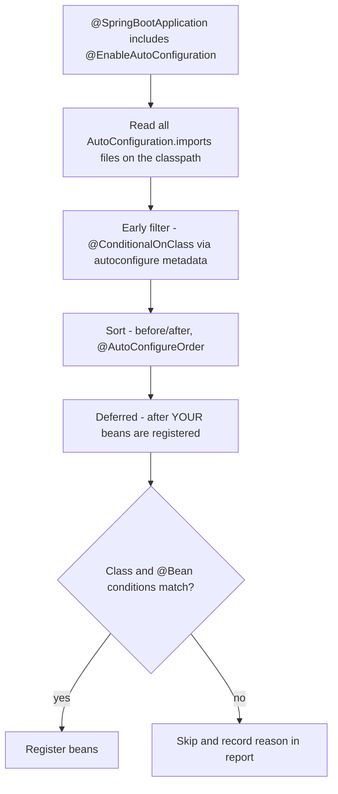

# Chapter 3 — Configuration and Auto-configuration

A real application runs in many places — your laptop, CI (the continuous-integration server that builds and tests every change), staging (a production-like test environment), production (the live system real users hit) — with different database URLs, passwords, timeouts and feature flags (on/off switches for features). Spring Boot's answer is **externalized configuration**: the same jar reads its settings from outside, from sources with a well-defined priority. Boot then uses those settings, together with what is on the classpath (the jars and classes available to the app at runtime), to **auto-configure** beans for you. This chapter covers both halves and ends by writing your own auto-configuration and starter.

**What you'll learn**

1. The `Environment` and property sources — how Spring sees configuration (§3.1).
2. `application.properties` vs `application.yaml`, file locations and multi-document files (§3.2).
3. The precedence order of all sources, proved (§3.3), and environment variables with relaxed binding (§3.4).
4. `@Value` (§3.5) vs type-safe `@ConfigurationProperties` with records, conversion and validation (§3.6).
5. Profiles, profile-specific files and profile groups (§3.7), and `spring.config.import` (§3.8).
6. Random values, placeholders and other sources (§3.9).
7. How auto-configuration works: `AutoConfiguration.imports`, `@ConditionalOn...` (§3.10).
8. Reading the conditions report (`--debug`, the conditions endpoint) (§3.11) and overriding/excluding auto-configuration (§3.12).
9. Writing a custom starter and testing it with `ApplicationContextRunner` (§3.13).
10. Boot 4's modularization and what it means for you (§3.14).

Runnable code: [`code/config-demo/`](code/config-demo/) (a non-web Boot app started in tests with different arguments, fake environment variables and profiles) and [`code/greeter/`](code/greeter/) (a three-module build: auto-configuration module, starter, and an app using it). Built with `mvn -q -B -ntp verify` on Spring Boot 4.1.1 / JDK 25; all outputs are real.

Background you may want first: the container, `@Conditional` and profiles in [Chapter 2](../02-ioc-and-dependency-injection/README.md) (§2.11). The architecture idea behind this chapter — keep config out of the artifact — is the *externalized configuration* pattern in the [microservices notes](../../../microservices-patterns/chapters/13-config-externalization/README.md).

---

## 3.1 Externalized configuration and the `Environment`

### What it is
**Externalized configuration** means settings live *outside* the compiled code, so one build artifact runs everywhere and only its configuration changes. (This is factor III, "Config", of the Twelve-Factor App methodology — a well-known list of twelve rules for building cloud-friendly services.)

In Spring, all configuration is reached through one object, the **`Environment`**:
- a **property source** (`PropertySource`) is one named set of key/value pairs — a file, the OS environment, the command line, a map in a test;
- the `Environment` holds an **ordered list** of property sources and the active **profiles**;
- `environment.getProperty("shop.name")` asks each source *in order* and returns the **first** value found.

Analogy: a stack of transparent sheets on an overhead projector. Each sheet (property source) writes some values; you read the projection from the top, so a value on a higher sheet hides the same key on lower sheets.

### Why it matters
- **No rebuilds per environment** — the same jar goes from test to production.
- **Secrets stay out of Git** (the version-control system that stores your source code) — passwords arrive through environment variables (named values the operating system passes to a process) or mounted files (files a platform places into the app's file system at startup).
- **Operations can change behaviour** (timeouts, pool sizes such as how many database connections to keep open, feature flags) without a code change.

### How it works in Boot
1. `SpringApplication.run` builds the `Environment` *before* creating any bean.
2. It adds sources: command-line arguments, `SPRING_APPLICATION_JSON`, Java system properties (key/value settings passed to the JVM with `-Dkey=value`), OS environment variables, `random.*`, then the **config data** files (`application.properties`/`.yaml` and profile-specific variants, imports).
3. Beans read values through `@Value`, `@ConfigurationProperties` or `Environment` injection.
4. Auto-configuration conditions (`@ConditionalOnProperty`) read the same `Environment`.

---

## 3.2 `application.properties` vs `application.yaml`

### Syntax
Both formats hold the same data; pick one per project. The book's demo uses YAML (a human-friendly configuration format that uses indentation to show nesting):

```yaml
# config-demo/src/main/resources/application.yaml (first part)
spring:
  application:
    name: config-demo
shop:
  name: Corner Shop
  checkout-timeout: 45s               # kebab-case in files; binds to checkoutTimeout
  max-upload: 10MB
  currencies: [USD, EUR]
  discounts:
    gold: 15
    silver: 5
  payment:
    retries: 2
```

The same in `.properties`:
```properties
spring.application.name=config-demo
shop.name=Corner Shop
shop.checkout-timeout=45s
shop.max-upload=10MB
shop.currencies=USD,EUR          # or shop.currencies[0]=USD / shop.currencies[1]=EUR
shop.discounts.gold=15
shop.discounts.silver=5
shop.payment.retries=2
```

| | `.properties` | `.yaml` / `.yml` |
|---|---|---|
| Structure | Flat `a.b.c=value` lines | Indentation-based tree |
| Lists | `x=a,b` or `x[0]=a` | `[a, b]` or `- a` lines |
| Multiple documents in one file | `#---` separator line | `---` separator line |
| Pitfalls | Long repeated prefixes | Indentation errors; unquoted values like `on`, `no`, `010` may be read as booleans (true/false)/octal (base-8 numbers) — quote them |
| Loadable by `@PropertySource` | Yes | **No** |
| Both in the same folder | `.properties` wins over `.yaml` | |

Use **kebab-case** keys in files (`checkout-timeout` — lower-case words joined by dashes), the recommended canonical (standard, official) form.

### Where Boot looks
Boot loads `application.properties`/`.yaml` from these locations; **later ones override earlier ones**:

1. The classpath root (`src/main/resources/application.yaml` ends up here)
2. The classpath `/config` package
3. The current directory
4. The `config/` subdirectory of the current directory
5. Immediate child directories of `config/` (e.g. `config/db/application.yaml`)

So an operator can drop a `config/application.yaml` next to the jar to override what's packaged inside it. Change the file name with `spring.config.name`, replace the search locations with `spring.config.location`, or add locations with `spring.config.additional-location` (these three must be set early: as command-line args, system properties or env vars).

### Multi-document files
A single file can contain several documents; a document can be **activated** conditionally:

```yaml
# ... first document above ...
---
# a second document inside the same file, used only when "prod" is active
spring:
  config:
    activate:
      on-profile: prod
shop:
  payment:
    gateway-url: https://pay.prod.example.test
    retries: 5
```
`spring.config.activate.on-profile` takes a profile expression (`prod | staging`); `spring.config.activate.on-cloud-platform` (e.g. `kubernetes` — Kubernetes is the most common platform for running containers across many machines) is the other activation property. Later documents override earlier ones.

---

## 3.3 Precedence: which value wins?

### The full order
From **lowest** to **highest** priority (a higher item overrides lower ones), per the Boot 4.1 reference:

| # | Source | Example |
|---|---|---|
| 1 | Default properties | `SpringApplication.setDefaultProperties(...)` |
| 2 | `@PropertySource` on `@Configuration` classes | `@PropertySource("classpath:legacy.properties")` |
| 3 | **Config data** files (table below) | `application.yaml`, `application-prod.yaml` |
| 4 | `RandomValuePropertySource` | `${random.uuid}` |
| 5 | **OS environment variables** | `SHOP_NAME=...` |
| 6 | **Java system properties** | `java -Dshop.name=... -jar app.jar` |
| 7 | JNDI (Java Naming and Directory Interface, a lookup service in classic app servers) attributes | (app servers) |
| 8–9 | `ServletContext` / `ServletConfig` init parameters | (WAR — web-archive — deployments to an external server) |
| 10 | `SPRING_APPLICATION_JSON` | `SPRING_APPLICATION_JSON='{"shop":{"name":"X"}}'` |
| 11 | **Command-line arguments** | `java -jar app.jar --shop.name=...` |
| 12 | `properties` attribute of tests | `@SpringBootTest(properties = "shop.name=T")` |
| 13 | `@DynamicPropertySource` | Testcontainers (a library that starts real databases in Docker for tests) URLs (Chapter 12) |
| 14 | `@TestPropertySource` | |
| 15 | DevTools global settings | `~/.config/spring-boot/` |

Within **config data** (row 3), again lowest → highest:

1. `application.*` packaged **inside** the jar
2. `application-{profile}.*` inside the jar
3. `application.*` **outside** the jar (current dir, `config/`)
4. `application-{profile}.*` outside the jar

Memory aid: *specific beats general* (profile file > plain file; outside > inside; command line > everything the app ships with), and tests override everything.

### Proved
The test starts the real application five times, each time adding one higher source (fake environment variables are injected through a custom `StandardEnvironment`; see `Apps.java`):

```java
// PrecedenceTest.java (simplified)
shopName(Map.of());                                                          // 1
shopName(Map.of(), "--spring.profiles.active=dev");                          // 2
shopName(Map.of("SHOP_NAME", "Env Shop"), "--spring.profiles.active=dev");   // 3
System.setProperty("shop.name", "SysProp Shop");
shopName(Map.of("SHOP_NAME", "Env Shop"));                                   // 4
shopName(Map.of("SHOP_NAME", "Env Shop"), "--shop.name=CLI Shop");           // 5 (system property still set)
```

```
1 application.yaml only          -> Corner Shop
2 + application-dev.yaml         -> Corner Shop (DEV)
3 + env SHOP_NAME                -> Env Shop
4 + -Dshop.name (system prop)    -> SysProp Shop
5 + --shop.name (command line)   -> CLI Shop
```

And this is the `Environment`'s actual search order when started with `--spring.profiles.active=dev` (first wins):

```
Environment property sources (first wins):
  configurationProperties
  commandLineArgs
  systemProperties
  systemEnvironment
  random
  Config resource 'class path resource [application-dev.yaml]' via location 'optional:classpath:/'
  Config resource 'class path resource [owner.properties]' via location 'classpath:owner.properties'
  Config resource 'class path resource [application.yaml]' via location 'optional:classpath:/' (document #0)
  applicationInfo
  defaultProperties
```

Notes on this list:
- `configurationProperties` at the top is not a real source; it's Boot's adapter that exposes all the others to the binder (Boot's component that copies property values into Java objects) with relaxed names.
- `owner.properties` sits *above* `application.yaml` because `application.yaml` imports it (§3.8): **an imported file overrides the file that imports it**.
- The profile file `application-dev.yaml` is above both.

### Common mistakes
- Setting a value in `application.yaml` and wondering why it's ignored — an environment variable (often from a Kubernetes manifest — the YAML file describing how to run the app — or a `.env` file) with the same relaxed name overrides it.
- Putting secrets in `application.yaml` in Git. Use env vars, mounted files (`configtree:`, §3.8), or a secret manager (a dedicated service that stores and hands out passwords and keys).
- Expecting a value set in `@PropertySource` to beat `application.yaml` — `@PropertySource` is near the bottom (row 2).

### In the interview
**Q: A property is set in `application.yaml`, an environment variable and a command-line argument. Which wins?** The command-line argument; then system properties, then environment variables, then profile-specific files, then `application.yaml`. Test properties beat all of them.
- *Follow-up: How do you see where a value came from?* The Actuator (Boot's production-monitoring module, Chapter 15) `env` endpoint (a URL the app exposes, here `/actuator/env/shop.name`) lists every source that defines it, highest first; failure messages from binding also show the *origin* (e.g. `"shop.name" from property source "commandLineArgs"`, §3.6).

### TL;DR
Command line > system properties > env vars > profile files > `application.*`; outside the jar > inside; imported file > importer. Tests override all.

---

## 3.4 Environment variables and relaxed binding

### What it is
Environment variable names can't contain dots or dashes on most systems, so Boot maps them by rule. **Relaxed binding** means Boot accepts several spellings of the same property when binding to `@ConfigurationProperties`:

| Form | Example | Use in |
|---|---|---|
| Kebab case (canonical, recommended) | `shop.checkout-timeout` | `.properties` / `.yaml` |
| Camel case (words joined, each new word capitalized) | `shop.checkoutTimeout` | Also accepted in files |
| Underscore | `shop.checkout_timeout` | Also accepted in files |
| Upper case with underscores | `SHOP_CHECKOUTTIMEOUT` | **Environment variables** |

**Environment-variable rule:** replace `.` with `_`, **remove** `-`, convert to upper case. List index: `SHOP_CURRENCIES_0=USD`. So `shop.payment.retries` → `SHOP_PAYMENT_RETRIES`, `spring.profiles.active` → `SPRING_PROFILES_ACTIVE`.

### Proved
```java
Apps.start(Map.of("SHOP_PAYMENT_RETRIES", "4", "SHOP_CHECKOUTTIMEOUT", "2m"))
```
```
SHOP_PAYMENT_RETRIES=4, SHOP_CHECKOUTTIMEOUT=2m -> retries=4, checkoutTimeout=PT2M
```

### Common mistakes
- Assuming `SHOP_CHECKOUT_TIMEOUT` (an underscore where the dash was) is wrong or ignored. It isn't: for backward compatibility (so older setups keep working) Boot's binder also accepts this **legacy** spelling and binds it to `shop.checkout-timeout` (proved in [ch19](../19-cheatsheet-and-glossary/README.md#1915-proofs-the-facts-on-these-sheets-run) — `SHOP_CHECKOUT_TIMEOUT=3m -> PT3M`). The real mistake is using two spellings for the same property: they are separate environment variables, so a search for `SHOP_CHECKOUTTIMEOUT` misses the value set by the other one. Stick to the documented form (drop the dash).
- Using camelCase keys in `@Value("${shop.checkoutTimeout}")`. `@Value` only gets relaxed matching if the placeholder uses the canonical kebab-case form: `@Value("${shop.checkout-timeout}")`.

---

## 3.5 `@Value`

### What it is
`@Value` injects one value into a field, constructor parameter or `@Bean` method parameter.

```java
// config-demo/src/main/java/com/example/config/ValueStyle.java
@Component
public class ValueStyle {
    ValueStyle(@Value("${shop.name}") String name,                             // required: startup fails if missing
               @Value("${shop.support-email:help@example.test}") String email, // default after the colon
               @Value("#{${shop.payment.retries:3} + 1}") int maxAttempts,     // SpEL: #{...}
               @Value("${shop.owner}") String owner) {                         // comes from an imported file
        ...
    }
}
```
```
@Value                   -> name=Corner Shop, supportEmail=help@example.test, maxAttempts=3, owner=Ada
```

| Syntax | Meaning |
|---|---|
| `${key}` | Property placeholder; startup fails with `Could not resolve placeholder` if missing |
| `${key:default}` | Default when missing (`${key:}` = empty string) |
| `#{expression}` | SpEL (Spring Expression Language) — arithmetic, method calls, other beans: `#{@clock.millis()}` |
| `#{${key} * 2}` | Placeholder resolved first, then SpEL evaluated |

Conversion to `int`, `boolean`, `Duration`, enums (Java types with a fixed set of named values), etc. is automatic; comma-separated strings convert to arrays/lists.

### When not to use it
For more than two or three related settings, use `@ConfigurationProperties`: `@Value` strings are scattered, untyped until runtime, not validated, and have no IDE (code editor such as IntelliJ IDEA) auto-completion.

---

## 3.6 `@ConfigurationProperties` — type-safe configuration

### What it is
`@ConfigurationProperties("shop")` binds **every property under a prefix** into one Java object. With a **record** (a compact Java class that just holds data; fields are fixed once created), the object is immutable (cannot change after creation) and bound through its constructor ("constructor binding").

```java
// config-demo/src/main/java/com/example/config/ShopProperties.java
@ConfigurationProperties("shop")
@Validated
public record ShopProperties(
        @NotBlank String name,
        @DefaultValue("30s") Duration checkoutTimeout,
        @DefaultValue("5MB") DataSize maxUpload,
        @DefaultValue("USD") List<String> currencies,
        Map<String, Integer> discounts,
        @Valid @DefaultValue Payment payment) {

    public record Payment(
            @NotBlank @DefaultValue("https://pay.example.test") String gatewayUrl,
            @Min(0) @Max(5) @DefaultValue("3") int retries) {
    }
}

@SpringBootApplication
@ConfigurationPropertiesScan          // registers every @ConfigurationProperties class in this package tree
public class ConfigDemoApplication { ... }
```

Bound from the YAML in §3.2:
```
@ConfigurationProperties -> ShopProperties[name=Corner Shop, checkoutTimeout=PT45S, maxUpload=10485760B, currencies=[USD, EUR], discounts={gold=15, silver=5}, payment=Payment[gatewayUrl=https://pay.example.test, retries=2]]
```

Any bean can now take `ShopProperties` as a constructor parameter and read `props.payment().retries()`.

### How it works
1. **Register** the class: `@ConfigurationPropertiesScan` on the application (scans like component scanning), or `@EnableConfigurationProperties(ShopProperties.class)` on a configuration class (typical in auto-configurations).
2. At startup Boot's **`Binder`** walks the constructor parameters (or setters, for JavaBean-style classes), builds each property name from the prefix + relaxed form of the parameter name, and looks it up in the `Environment`.
3. **Conversion**: strings become the parameter type — numbers, booleans, enums, `List`, `Map`, nested records, and these special types:

| Type | Accepted values | Notes |
|---|---|---|
| `java.time.Duration` | `45s`, `5m`, `2h`, `1d`, `500ms`, `PT45S` (ISO-8601, the international standard text format for dates and durations), plain `45` | Plain numbers default to milliseconds; change with `@DurationUnit(ChronoUnit.SECONDS)` |
| `org.springframework.util.unit.DataSize` | `10MB`, `512KB`, `1GB`, plain `1024` | Plain numbers are bytes; `@DataSizeUnit` changes it. `10MB` = 10 × 1024 × 1024 = `10485760B` |
| `java.time.Period` | `1y3d`, `P1Y3D` | |

4. **Defaults**: `@DefaultValue("...")` on a constructor parameter supplies a value when the property is absent. A bare `@DefaultValue` on a nested record (as on `payment`) means "create it even if no `shop.payment.*` property exists" — otherwise the nested object would be `null`. `gatewayUrl` came from its default because only `retries` was configured.
5. **Validation**: with `@Validated` on the class and a Bean Validation provider (a library implementing the standard `@NotBlank`/`@Min`-style rules) on the classpath (`spring-boot-starter-validation` → Hibernate Validator), constraints are checked at startup. Put `@Valid` on nested objects so their constraints are checked too.

### Validation failure — proved
```java
Apps.start("--shop.payment.retries=9", "--shop.name= ")
```
Boot's failure analyzer (a component that turns a startup exception into a readable explanation) prints this (real output) and the app does not start:
```
***************************
APPLICATION FAILED TO START
***************************

Description:

Binding to target com.example.config.ShopProperties failed:

    Property: shop.name
    Value: " "
    Origin: "shop.name" from property source "commandLineArgs"
    Reason: must not be blank

    Property: shop.payment.retries
    Value: "9"
    Reason: must be less than or equal to 5


Action:

Update your application's configuration
```
The root exception is `BindValidationException`. **Failing at startup is the point**: a bad production setting is caught during deployment, not at 3 a.m. when the first payment retries.

### IDE auto-completion — configuration metadata
Adding `spring-boot-configuration-processor` as an annotation processor (a plug-in that runs inside the Java compiler and can generate files) generates `META-INF/spring-configuration-metadata.json` at compile time. IDEs use it for auto-completion and documentation of `shop.*` keys. Its descriptions come from the record's Javadoc (documentation comments `/** ... */`) `@param` tags. Generated for this project (first entries):

```json
{"name": "shop.checkout-timeout", "type": "java.time.Duration", "description": "how long a checkout may take", "sourceType": "com.example.config.ShopProperties", "defaultValue": "30s"}
{"name": "shop.currencies", "type": "java.util.List<java.lang.String>", "description": "accepted currency codes", "sourceType": "com.example.config.ShopProperties", "defaultValue": "USD"}
```

```xml
<!-- pom.xml: since JDK 23, javac no longer runs processors found on the classpath by default -->
<dependency>
  <groupId>org.springframework.boot</groupId>
  <artifactId>spring-boot-configuration-processor</artifactId>
  <optional>true</optional>
</dependency>
...
<plugin>
  <artifactId>maven-compiler-plugin</artifactId>
  <configuration>
    <annotationProcessorPaths>
      <path>
        <groupId>org.springframework.boot</groupId>
        <artifactId>spring-boot-configuration-processor</artifactId>
      </path>
    </annotationProcessorPaths>
  </configuration>
</plugin>
```

### Other shapes
- **JavaBean style** (class with a no-arg constructor, getters and setters) is still supported and needed when you want mutable properties; records are simpler.
- A class with several constructors marks the binding one with `@ConstructorBinding`.
- **Third-party classes**: put `@ConfigurationProperties("pool")` on a `@Bean` method that returns the object; Boot binds `pool.*` onto its setters.

### `@Value` vs `@ConfigurationProperties`

| | `@ConfigurationProperties` | `@Value` |
|---|---|---|
| Granularity | A whole group under a prefix | One value |
| Type safety | Typed object, checked at startup | Converted per injection point |
| Relaxed binding | Yes | Limited (use kebab-case placeholders) |
| Validation | `@Validated` + Jakarta constraints | No |
| IDE metadata / auto-complete | Yes (processor) | No |
| SpEL | No | Yes |
| Default values | `@DefaultValue` / field initialisers | `${key:default}` |
| Best for | Any real settings of your app or library | A single value, or when you need SpEL |

### Common mistakes
- Forgetting to register the class (`@ConfigurationPropertiesScan` or `@EnableConfigurationProperties`) → "No qualifying bean of type ShopProperties". Adding `@Component` instead does **not** work for a record: constructor binding only happens for classes registered by scanning or `@EnableConfigurationProperties`; as a plain component Spring would try to inject beans of type `String`, `Duration`... and fail.
- Expecting `@DefaultValue`/field defaults to be visible via `@Value` or `Environment.getProperty` — they aren't; they exist only in the bound object.
- A typo in a key (`shop.chekout-timeout`) is silently ignored — metadata-based IDE warnings help, and so does validation of required fields.
- Leaving out `@Valid` on nested objects, so their constraints never run.

### In the interview
**Q: `@Value` vs `@ConfigurationProperties`?** `@ConfigurationProperties` binds a prefix into a typed, validated object with relaxed binding and IDE metadata — use it for groups of settings. `@Value` injects single values and supports SpEL.
- *Follow-up: How do you make configuration immutable?* Use a record (constructor binding) — no setters.
- *Follow-up: How do you fail fast on bad config?* `@Validated` + constraints; Boot refuses to start and prints each invalid property with its origin.

### TL;DR
Group settings into a `@ConfigurationProperties` **record**, register it with `@ConfigurationPropertiesScan`, use `Duration`/`DataSize` types, `@DefaultValue` for defaults, `@Validated` to fail fast, and the configuration processor for IDE help.

---

## 3.7 Profiles, profile-specific files and profile groups

### What it is
A **profile** is a named environment ("dev", "test", "prod"). Activating it (Chapter 2 §2.11) does two things:
1. registers beans marked `@Profile("...")`, and
2. loads **profile-specific configuration**: `application-{profile}.properties`/`.yaml` files and documents with `spring.config.activate.on-profile`.

```yaml
# application-dev.yaml — loaded only when "dev" is active; overrides application.yaml
shop:
  name: Corner Shop (DEV)
  checkout-timeout: 5m
```

### Profile groups
A **profile group** gives one name to several profiles, so operators activate a single word:

```yaml
spring:
  profiles:
    group:
      production: [prod, metrics]     # --spring.profiles.active=production turns on both
```

```java
Apps.start("--spring.profiles.active=production")
```
```
active profiles = [production, prod, metrics]
payment         = Payment[gatewayUrl=https://pay.prod.example.test, retries=5]
```
Activating `production` also activated `prod`, so the `on-profile: prod` document in `application.yaml` applied (gateway URL and 5 retries).

### Rules worth knowing

| Property | Meaning |
|---|---|
| `spring.profiles.active` | The profiles to activate (comma-separated). Last one listed wins on conflicts between their files. |
| `spring.profiles.default` | Profiles active when none are set (default: `default`) |
| `spring.profiles.include` | Profiles always added on top of the active ones |
| `spring.profiles.group.<name>` | Expand one profile into several |

- `spring.profiles.active`, `.default` and `.include` may only appear in **non-profile-specific** documents — you can't activate a profile from inside `application-dev.yaml` (Boot fails with `InvalidConfigDataPropertyException`). Define `spring.profiles.group` there too.
- Profile-specific files always override the non-specific file in the same location.
- In tests: `@ActiveProfiles("test")`.

### Common mistakes
- One profile per developer machine (`application-john.yaml`) committed to Git. Use an ignored `config/application.yaml` or env vars.
- Building different jars per environment — the whole point is one jar plus a profile.
- Deeply layered profiles (`dev,eu,feature-x,local`) that nobody can reason about. Keep a small, documented set.

### TL;DR
Profiles select beans *and* configuration. `application-{profile}.yaml` overrides `application.yaml`; groups activate several profiles with one name.

---

## 3.8 Importing configuration: `spring.config.import`

### What it is
`spring.config.import` pulls more configuration into the `Environment` from inside a config file (or from the command line):

```yaml
spring:
  config:
    import:
      - classpath:owner.properties               # must exist
      - optional:file:./local-overrides.yaml     # ignored if missing
```
```
shop.owner from owner.properties = Ada
```
The optional `./local-overrides.yaml` doesn't exist and the app starts anyway.

| Location form | Example | Use |
|---|---|---|
| `classpath:` | `classpath:owner.properties` | Split a large config into files |
| `file:` | `file:/etc/myapp/extra.yaml` | Files on the host/volume (storage attached to a container) |
| `optional:` prefix | `optional:file:./local.yaml` | Don't fail if missing (without it: `ConfigDataLocationNotFoundException`) |
| `configtree:` | `optional:configtree:/etc/secrets/` | **Kubernetes secrets/ConfigMaps (Kubernetes objects holding secret or plain settings) mounted as files**: each file name becomes a key, its content the value (`/etc/secrets/db/password` → `db.password`) |
| Extension hint | `file:/etc/app/conf[.yaml]` | Location without a recognisable extension |
| Other schemes (via libraries) | `configserver:http://...` (Spring Cloud Config), `vault://` (Spring Cloud Vault), `aws-secretsmanager:` / `aws-parameterstore:` (Spring Cloud AWS) | Central config / secret stores (Chapter 16) |

Rules: relative locations are resolved relative to the importing file; an imported file **overrides** the file that imports it (seen in §3.3's list); imports are processed once, even if listed twice.

---

## 3.9 Placeholders, random values and other sources

- **Placeholders inside property files**: `app.description=${spring.application.name} runs on port ${server.port:8080}`. Refer to other keys in canonical kebab-case.
- **Random values** (row 4 of the precedence table), handy for test secrets or instance ids (`uuid` = universally unique identifier, a random 128-bit id):
  ```properties
  my.secret=${random.value}
  my.id=${random.uuid}
  my.number=${random.int}
  my.port=${random.int[1024,65536]}
  my.small=${random.int(10)}
  ```
  Each placeholder is evaluated independently at startup; they are not secure random tokens (values generated by a cryptographically strong, unguessable generator) for production secrets.
- **`SPRING_APPLICATION_JSON`**: a JSON blob in one env var or system property, flattened into properties — convenient where only one variable can be set.
- **`@PropertySource("classpath:legacy.properties")`** on a `@Configuration` class: plain Spring's way to add a file. Low priority, `.properties` only (no YAML, no profiles). In Boot apps prefer `spring.config.import`.
- **Injecting `Environment`**: `env.getProperty("shop.name")`, `env.getProperty("shop.payment.retries", Integer.class, 3)`, `env.matchesProfiles("prod")`. Useful in conditions and registrars (Chapter 2 §2.14).

---

## 3.10 How auto-configuration works

### What it is
**Auto-configuration** is Boot's mechanism for registering beans you'd otherwise have to write yourself — a `DispatcherServlet`, an embedded Tomcat, a Jackson `JsonMapper`, a `DataSource` (hands out database connections), a transaction manager (the object that starts, commits and rolls back transactions) — *only when it makes sense*: the required library is on the classpath, you haven't defined your own bean, and the relevant property allows it.

Each auto-configuration is just a `@Configuration` class (marked `@AutoConfiguration`) whose class and `@Bean` methods carry **conditions**. There's no special magic beyond Chapter 2's `@Conditional` and `@Import`.

### How it works
1. `@SpringBootApplication` includes **`@EnableAutoConfiguration`**, which imports `AutoConfigurationImportSelector`.
2. The selector reads every file named **`META-INF/spring/org.springframework.boot.autoconfigure.AutoConfiguration.imports`** on the classpath. Each jar that provides auto-configuration ships one, listing class names one per line.
3. **Early filtering**: using pre-computed `META-INF/spring-autoconfigure-metadata.properties` (generated by `spring-boot-autoconfigure-processor`), Boot drops candidates whose `@ConditionalOnClass` can't match — without even loading those classes. This keeps startup fast.
4. Candidates are **sorted** by `@AutoConfiguration(before/after = ...)` and `@AutoConfigureOrder`.
5. It is a **deferred** import: auto-configurations are processed **after all your own configuration and scanned beans** are registered. That's what makes `@ConditionalOnMissingBean` reliable — Boot can see whether *you* already defined the bean.
6. Each remaining class's conditions are evaluated; matching classes and `@Bean` methods register beans. Every decision is recorded in the **condition evaluation report** (§3.11).



Here is what Boot 4.1.1's web MVC module ships (from `spring-boot-webmvc-4.1.1.jar`):
```
org.springframework.boot.webmvc.autoconfigure.DispatcherServletAutoConfiguration
org.springframework.boot.webmvc.autoconfigure.WebMvcAutoConfiguration
org.springframework.boot.webmvc.autoconfigure.WebMvcObservationAutoConfiguration
org.springframework.boot.webmvc.autoconfigure.actuate.endpoint.web.WebMvcHealthEndpointExtensionAutoConfiguration
org.springframework.boot.webmvc.autoconfigure.actuate.web.mappings.WebMvcMappingsAutoConfiguration
org.springframework.boot.webmvc.autoconfigure.error.ErrorMvcAutoConfiguration
```

### The condition annotations
All in `org.springframework.boot.autoconfigure.condition`:

| Annotation | Matches when | Typical use |
|---|---|---|
| `@ConditionalOnClass` / `@ConditionalOnMissingClass` | A class is / isn't on the classpath | "Configure Jackson only if Jackson is present" |
| `@ConditionalOnBean` / `@ConditionalOnMissingBean` | A bean of a type/name exists / doesn't exist | **Back off** if the user defined their own |
| `@ConditionalOnSingleCandidate` | Exactly one (or one primary) bean of a type | "Create a `JdbcTemplate` if there's one `DataSource`" |
| `@ConditionalOnProperty` | A property has a value (`havingValue`), or exists; `matchIfMissing` | Feature switches |
| `@ConditionalOnBooleanProperty` (Boot 3.5+) | A boolean property is `true` (by default); `matchIfMissing` | `spring.jmx.enabled` (JMX = Java Management Extensions, a built-in JVM monitoring interface) |
| `@ConditionalOnResource` | A resource exists | `classpath:META-INF/build-info.properties` |
| `@ConditionalOnWebApplication` / `@ConditionalOnNotWebApplication` | Servlet or reactive web app / not | Web-only beans |
| `@ConditionalOnWarDeployment` / `@ConditionalOnNotWarDeployment` | Deployed as WAR / not | |
| `@ConditionalOnThreading` | Platform (classic OS) or virtual (lightweight, JVM-managed) threads selected (`spring.threads.virtual.enabled`) | Executors — thread pools that run tasks (Chapter 14) |
| `@ConditionalOnCloudPlatform` | Running on Kubernetes, Cloud Foundry (another app-hosting platform), ... | Platform tweaks |
| `@ConditionalOnJava` | JVM version range | |
| `@ConditionalOnExpression` | A SpEL expression is true | Last resort — can trigger early bean creation |

### Common mistakes
- Using `@ConditionalOnBean`/`@ConditionalOnMissingBean` in *your own* (non-auto) configuration classes. They only see beans registered *so far*, so the result depends on processing order. They are reliable in auto-configurations because those run last.
- Putting `@ConditionalOnClass(SomeLib.class)` on a `@Bean` *method* whose return type is from that library. If the class is missing, loading the configuration class itself can fail. Put the condition on a nested `@Configuration` class instead (the Boot docs' recommended pattern).

### In the interview
**Q: How does Spring Boot auto-configuration work?** `@EnableAutoConfiguration` imports a deferred selector that loads class names from every `META-INF/spring/...AutoConfiguration.imports` file, filters by `@ConditionalOnClass` early using generated metadata, sorts them, and — after user configuration is registered — evaluates their conditions. Matching configurations register beans; most beans are `@ConditionalOnMissingBean`, so user beans take priority.
- *Follow-up: Where were auto-configurations listed before?* In `META-INF/spring.factories` under `EnableAutoConfiguration`; the `.imports` file arrived in Boot 2.7 and `spring.factories` stopped working for auto-configuration in Boot 3.0.
- *Follow-up: Why are auto-configurations deferred?* So `@ConditionalOnMissingBean` can see the user's beans and back off.

### TL;DR
Auto-configuration = ordinary `@Configuration` classes listed in `AutoConfiguration.imports`, applied last, guarded by `@ConditionalOn...` so they fill gaps and back off when you define your own beans.

---

## 3.11 Seeing what Boot decided

### The `--debug` report
Start any Boot app with `--debug` (or `debug=true` in `application.properties`) and Boot prints the **CONDITIONS EVALUATION REPORT**. Real excerpt from `java -jar config-demo.jar --debug`:

```
============================
CONDITIONS EVALUATION REPORT
============================

Positive matches:
-----------------

   AopAutoConfiguration matched:
      - @ConditionalOnBooleanProperty (spring.aop.auto=true) matched (OnPropertyCondition)

   TaskExecutionAutoConfiguration matched:
      - @ConditionalOnClass found required class 'org.springframework.scheduling.concurrent.ThreadPoolTaskExecutor' (OnClassCondition)

   ValidationAutoConfiguration matched:
      - @ConditionalOnClass found required class 'jakarta.validation.executable.ExecutableValidator' (OnClassCondition)
      - @ConditionalOnResource found location classpath:META-INF/services/jakarta.validation.spi.ValidationProvider (OnResourceCondition)

   ValidationAutoConfiguration#defaultValidator matched:
      - @ConditionalOnMissingBean (types: jakarta.validation.Validator; SearchStrategy: all) did not find any beans (OnBeanCondition)
   ...

Negative matches:
-----------------

   AopAutoConfiguration.AspectJAutoProxyingConfiguration:
      Did not match:
         - @ConditionalOnClass did not find required class 'org.aspectj.weaver.Advice' (OnClassCondition)

   JmxAutoConfiguration:
      Did not match:
         - @ConditionalOnBooleanProperty (spring.jmx.enabled=true) did not find property 'spring.jmx.enabled' (OnPropertyCondition)
      Matched:
         - @ConditionalOnClass found required class 'org.springframework.jmx.export.MBeanExporter' (OnClassCondition)

   TaskExecutorConfigurations.TaskExecutorConfiguration#applicationTaskExecutorVirtualThreads:
      Did not match:
         - @ConditionalOnThreading did not find VIRTUAL (OnThreadingCondition)
   ...

Exclusions:
-----------

    None

Unconditional classes:
----------------------

    org.springframework.boot.autoconfigure.context.ConfigurationPropertiesAutoConfiguration
    org.springframework.boot.autoconfigure.context.PropertyPlaceholderAutoConfiguration
    ...
```

How to read it:
- **Positive matches** — applied. `Class#method` entries are individual `@Bean` methods.
- **Negative matches** — skipped, with the failing condition (and any that matched). This is where you look when "Boot didn't create X": the missing class, bean or property is named.
- **Exclusions** — auto-configurations you excluded explicitly.
- **Unconditional classes** — auto-configurations with no class-level condition.

Note `ValidationAutoConfiguration` matched only because `spring-boot-starter-validation` put Hibernate Validator on the classpath — that's auto-configuration reacting to a dependency.

### The same report in code and over HTTP
The report is a bean-factory object you can query, which the demo does in a test:

```java
var report = ConditionEvaluationReport.get(ctx.getBeanFactory());
var outcomes = report.getConditionAndOutcomesBySource().get("...JmxAutoConfiguration");
```
```
TaskExecutionAutoConfiguration  MATCHED
   - @ConditionalOnClass found required class 'org.springframework.scheduling.concurrent.ThreadPoolTaskExecutor'
JmxAutoConfiguration  DID NOT MATCH
   - @ConditionalOnClass found required class 'org.springframework.jmx.export.MBeanExporter'
   - @ConditionalOnBooleanProperty (spring.jmx.enabled=true) did not find property 'spring.jmx.enabled'
AopAutoConfiguration  MATCHED
   - @ConditionalOnBooleanProperty (spring.aop.auto=true) matched
auto-configuration classes evaluated: 7
```

With **Actuator** (Chapter 15), `GET /actuator/conditions` returns the same report as JSON (expose it with `management.endpoints.web.exposure.include=conditions`; keep it off public networks). `/actuator/configprops` shows all bound `@ConfigurationProperties` beans and `/actuator/env` the property sources.

---

## 3.12 Overriding and excluding auto-configuration

In order of preference:

1. **Set a property.** Most auto-configurations are tuned by properties (`server.port`, `spring.jackson.*`, `spring.datasource.*`). The reference's "Common Application Properties" appendix lists them all; your IDE completes them from the metadata.
2. **Define your own bean.** Auto-configured beans are `@ConditionalOnMissingBean`, so your bean of the same type replaces Boot's (proved with the starter in §3.13).
3. **Use a customizer.** Many auto-configurations accept customizer beans to *adjust* rather than replace (e.g. `JsonMapperBuilderCustomizer` for Jackson 3, `WebServerFactoryCustomizer` for Tomcat).
4. **Exclude an auto-configuration entirely:**
   ```java
   @SpringBootApplication(exclude = JmxAutoConfiguration.class)
   ```
   ```properties
   spring.autoconfigure.exclude=org.springframework.boot.autoconfigure.jmx.JmxAutoConfiguration
   ```
5. **Remove the dependency.** If you don't use it, don't put the starter on the classpath.

### Common mistakes
- Excluding by class name copied from a Boot 3 tutorial — in Boot 4 most auto-configuration classes moved to per-module packages (e.g. `org.springframework.boot.webmvc.autoconfigure.WebMvcAutoConfiguration`, previously `org.springframework.boot.autoconfigure.web.servlet.WebMvcAutoConfiguration`). Check the report for the current name.
- Adding `@EnableWebMvc` to a Boot app "to configure MVC" — it tells Boot you want full manual control and switches off Boot's MVC auto-configuration (Chapter 5).

---

## 3.13 Writing your own auto-configuration and starter

### Why
Companies write starters so every service gets the same client library, tracing setup (recording a request's path through several services) or security defaults with one dependency — for example an internal `payments-client-spring-boot-starter`. Open-source examples: `mybatis-spring-boot-starter`, `springdoc-openapi-starter-webmvc-ui` (generates OpenAPI — a standard machine-readable API description — and a docs UI).

### The structure
The Boot 4.1 reference recommends two modules (merge them into one `acme-spring-boot-starter` if the auto-configuration is simple):

| Module | Name pattern | Contains |
|---|---|---|
| Auto-configure module | `acme-spring-boot` | `@AutoConfiguration` classes, `@ConfigurationProperties`, the `.imports` file |
| Starter | `acme-spring-boot-starter` | No code; depends on the auto-configure module, the library, and `spring-boot-starter` |
| (Optional) test starter | `acme-spring-boot-starter-test` | Test support |

**Never start your module names with `spring-boot`** — that namespace is reserved for official modules — and use your own property prefix (`acme.*`), not `spring.*`/`server.*`.

Our example wires a tiny `GreetingService` library:

```
greeter/
├── pom.xml                         ← aggregator: builds the modules together
└── modules/
    ├── autoconfig/                 ← auto-configure module (artifactId greeting-spring-boot)
    │   ├── src/main/java/com/example/greeting/core/GreetingService.java
    │   ├── src/main/java/com/example/greeting/autoconfigure/GreetingProperties.java
    │   ├── src/main/java/com/example/greeting/autoconfigure/GreetingAutoConfiguration.java
    │   └── src/main/resources/META-INF/spring/org.springframework.boot.autoconfigure.AutoConfiguration.imports
    ├── starter/pom.xml             ← dependencies only (artifactId greeting-spring-boot-starter)
    └── demo/                       ← an application that uses the starter
```
(In real life `GreetingService` would be a separate library jar; it's in the same module here to keep the demo small.)

### The code
```java
/** The "library" the starter wires up. It knows nothing about Spring. */
public class GreetingService {
    private final String template;
    public GreetingService(String template) { this.template = template; }
    public String greet(String name) { return template.formatted(name); }
}

/**
 * @param enabled  whether to auto-configure a GreetingService
 * @param template message template; %s is replaced by the name
 */
@ConfigurationProperties("greeting")
public record GreetingProperties(
        @DefaultValue("true") boolean enabled,
        @DefaultValue("Hello, %s!") String template) {
}

@AutoConfiguration                                              // a @Configuration(proxyBeanMethods = false) for Boot
@ConditionalOnClass(GreetingService.class)                      // 1. only if the library is on the classpath
@ConditionalOnBooleanProperty(name = "greeting.enabled", matchIfMissing = true) // 2. unless switched off
@EnableConfigurationProperties(GreetingProperties.class)        // 3. bind greeting.* into GreetingProperties
public class GreetingAutoConfiguration {

    @Bean
    @ConditionalOnMissingBean                                   // 4. back off if the user defined their own
    GreetingService greetingService(GreetingProperties props) {
        return new GreetingService(props.template());
    }
}
```

```
# src/main/resources/META-INF/spring/org.springframework.boot.autoconfigure.AutoConfiguration.imports
com.example.greeting.autoconfigure.GreetingAutoConfiguration
```

The auto-configure module's `pom.xml` depends on `spring-boot-autoconfigure` and declares two annotation processors: `spring-boot-configuration-processor` (property metadata) and `spring-boot-autoconfigure-processor`, which generated this file for Boot's early class filtering (§3.10 step 3):

```properties
# target/classes/META-INF/spring-autoconfigure-metadata.properties (generated)
com.example.greeting.autoconfigure.GreetingAutoConfiguration=
com.example.greeting.autoconfigure.GreetingAutoConfiguration.ConditionalOnClass=com.example.greeting.core.GreetingService
```

The starter's `pom.xml` is just:
```xml
<artifactId>greeting-spring-boot-starter</artifactId>
<dependencies>
  <dependency>
    <groupId>org.springframework.boot</groupId>
    <artifactId>spring-boot-starter</artifactId>
  </dependency>
  <dependency>
    <groupId>com.example.greeting</groupId>
    <artifactId>greeting-spring-boot</artifactId>
    <version>${project.version}</version>
  </dependency>
</dependencies>
```

### Testing auto-configuration with `ApplicationContextRunner`
`ApplicationContextRunner` builds a tiny, throw-away context per test with exactly the configuration, properties and classpath you specify — much faster and more precise than `@SpringBootTest`. Its AssertJ (a fluent test-assertion library) assertions (`hasSingleBean`, `doesNotHaveBean`, `hasBean`) read naturally.

```java
private final ApplicationContextRunner runner = new ApplicationContextRunner()
        .withConfiguration(AutoConfigurations.of(GreetingAutoConfiguration.class));

@Test void createsTheBeanByDefault() {
    runner.run(ctx -> assertThat(ctx).hasSingleBean(GreetingService.class));
}
@Test void propertiesCustomiseIt() {
    runner.withPropertyValues("greeting.template=Welcome back, %s.").run(ctx -> ...);
}
@Test void canBeSwitchedOff() {
    runner.withPropertyValues("greeting.enabled=false").run(ctx -> assertThat(ctx).doesNotHaveBean(GreetingService.class));
}
@Configuration(proxyBeanMethods = false)
static class UserConfig { @Bean GreetingService myGreeting() { return new GreetingService("Yo %s"); } }

@Test void backsOffWhenTheUserDefinesOne() {
    runner.withUserConfiguration(UserConfig.class).run(ctx ->
            assertThat(ctx).hasSingleBean(GreetingService.class).hasBean("myGreeting"));
}
@Test void skippedWhenLibraryIsMissing() {
    runner.withClassLoader(new FilteredClassLoader(GreetingService.class))   // pretend the jar is absent
          .run(ctx -> assertThat(ctx).doesNotHaveBean("greetingService"));
}
```

Output (each test prints what it saw):
```
default         -> Hello, Ada!
with property   -> Welcome back, Ada.
enabled=false   -> GreetingService beans: 0
user bean       -> Yo Ada (bean name: myGreeting)
class missing   -> has greetingService? false
```
All five behaviours are proved: default bean, property binding, the on/off switch, backing off to the user's bean, and skipping when the library is absent.

### Using the starter
The demo app has one dependency on `greeting-spring-boot-starter`, one property, and **no** `@Bean` or `@Import` for `GreetingService`:

```properties
# modules/demo/src/main/resources/application.properties
greeting.template=Good morning, %s!
```
```java
@SpringBootTest
class DemoApplicationTests {
    @Autowired GreetingService greetings;          // provided by the starter's auto-configuration
    ...
}
```
```
app says: Good morning, Ada!
GreetingAutoConfiguration matched? true
```

### Checklist for a good starter
1. Guard the class with `@ConditionalOnClass` of the library's key type; guard beans with `@ConditionalOnMissingBean`.
2. Put `@ConditionalOnClass` for *optional* integrations on nested `@Configuration(proxyBeanMethods = false)` classes.
3. Use `@ConfigurationProperties` with your own prefix and Javadoc on every property (it becomes IDE help).
4. Order relative to Boot's auto-configurations with `@AutoConfiguration(after = ...)` when you depend on their beans.
5. Test with `ApplicationContextRunner` (and `WebApplicationContextRunner` for web-specific parts).
6. Keep the starter free of code and of optional dependencies.

### In the interview
**Q: How would you create a custom Spring Boot starter?** Write an `@AutoConfiguration` class with `@ConditionalOnClass`/`@ConditionalOnMissingBean`/property conditions and a `@ConfigurationProperties` record, list it in `META-INF/spring/org.springframework.boot.autoconfigure.AutoConfiguration.imports`, package it as `acme-spring-boot`, and publish an `acme-spring-boot-starter` pom that depends on it and the library. Test with `ApplicationContextRunner`.
- *Follow-up: How does a user override your bean?* By defining a bean of the same type; `@ConditionalOnMissingBean` makes yours back off.

---

## 3.14 Boot 4 modularization

### What changed
Up to Boot 3.5, one jar — `spring-boot-autoconfigure` — held auto-configuration for *every* supported technology (156 auto-configuration classes in 3.5.6). **Boot 4 split it into one module per technology.** In 4.1.1, `spring-boot-autoconfigure` itself lists only 12 core auto-configurations (AOP, task execution/scheduling, JMX, SSL (encrypted connections), lifecycle, message source, property placeholders...). The rest moved to modules such as:

| Module jar | Auto-configurations (4.1.1) | Example |
|---|---|---|
| `spring-boot-webmvc` | 6 | `org.springframework.boot.webmvc.autoconfigure.WebMvcAutoConfiguration` |
| `spring-boot-tomcat` | 5 | `...tomcat.autoconfigure.servlet.TomcatServletWebServerAutoConfiguration` |
| `spring-boot-jackson` | 1 | `...jackson.autoconfigure.JacksonAutoConfiguration` |
| `spring-boot-jdbc` | 9 | DataSource, JdbcTemplate/JdbcClient, transactions |
| `spring-boot-actuator-autoconfigure` | 24 | Actuator endpoints |
| `spring-boot-micrometer-metrics` | 28 | Metrics |

### Why it matters to you
- **Smaller classpath, faster and more predictable startup**: only modules for technologies you use are present, so fewer candidates to filter and no accidental auto-configuration from a stray transitive library (one pulled in indirectly by another dependency).
- **Clearer ownership**: each module has its own packages, its own starter and its own `-test` starter (`@WebMvcTest` now lives in `spring-boot-webmvc-test`, `@DataJpaTest` in `spring-boot-data-jpa-test`).
- **Migration impact**: imports of auto-configuration classes (in `exclude = ...`, `@ImportAutoConfiguration`, `@AutoConfiguration(after = ...)`) and of test-slice annotations change package. The quick path is `spring-boot-starter-classic` / `spring-boot-starter-test-classic`, which restore the Boot 3-style "everything on the classpath" behaviour while you move to the modular starters. Full migration notes: Chapter 17.

### TL;DR
Boot 4 = one auto-configuration module + starter + test starter per technology. The mechanism (imports file + conditions) is unchanged; class packages moved.

---

## 3.15 In the interview — quick round

| Question | Short answer |
|---|---|
| Name the main configuration sources in priority order. | Command line > `SPRING_APPLICATION_JSON` > system properties > env vars > `random.*` > profile files (outside > inside jar) > `application.*` > `@PropertySource` > defaults. Tests on top. (§3.3) |
| How does an env var map to a property? | `.`→`_`, drop `-`, upper-case: `SHOP_CHECKOUTTIMEOUT` → `shop.checkout-timeout`. (§3.4) |
| `@Value` vs `@ConfigurationProperties`? | Single value + SpEL vs typed, validated, relaxed, documented group. (§3.6) |
| How do you validate configuration? | `@Validated` + Jakarta constraints (+ `@Valid` for nested); app fails to start with each bad property and origin. (§3.6) |
| Profile-specific config? | `application-{profile}.yaml`, `on-profile` documents; groups activate several profiles. (§3.7) |
| Kubernetes secrets as config? | `spring.config.import=optional:configtree:/etc/secrets/` (or env vars). (§3.8) |
| How does auto-configuration work? | `.imports` files → early class filter → sort → deferred → conditions → beans; `@ConditionalOnMissingBean` lets you override. (§3.10) |
| Why didn't Boot create bean X? | Run with `--debug` or `/actuator/conditions`; read the negative match. (§3.11) |
| How do you turn off one auto-configuration? | `exclude =` on `@SpringBootApplication` or `spring.autoconfigure.exclude`. (§3.12) |
| How do you write a starter? | `@AutoConfiguration` + conditions + properties in `acme-spring-boot`, listed in `.imports`; `acme-spring-boot-starter` pom; test with `ApplicationContextRunner`. (§3.13) |
| What did Boot 4 modularize? | Auto-configuration split into per-technology modules with their own starters and test starters. (§3.14) |

---

## Chapter TL;DR

- All configuration flows through the **`Environment`**: an ordered list of property sources; the first source with a key wins.
- **Precedence** (high → low): tests > command line > `SPRING_APPLICATION_JSON` > system properties > env vars > profile-specific files > `application.*` (outside jar > inside; imported file > importer) > `@PropertySource` > defaults.
- **Env vars** use relaxed binding: `SHOP_PAYMENT_RETRIES` → `shop.payment.retries`; drop dashes.
- Prefer **`@ConfigurationProperties` records** (with `@ConfigurationPropertiesScan`, `@DefaultValue`, `Duration`/`DataSize`, `@Validated`) over scattered `@Value`s. Add the configuration processor for IDE metadata.
- **Profiles** select beans and config files; **profile groups** activate several at once; `spring.config.activate.on-profile` makes multi-document files conditional.
- **`spring.config.import`** adds files, optional files, and `configtree:` directories (Kubernetes secrets).
- **Auto-configuration** = `@AutoConfiguration` classes listed in `META-INF/spring/org.springframework.boot.autoconfigure.AutoConfiguration.imports`, processed after your beans, guarded by `@ConditionalOnClass`/`OnMissingBean`/`OnProperty`/`OnBooleanProperty`...
- Debug it with `--debug` (conditions report) or `/actuator/conditions`; override with properties, your own bean, customizers, or `exclude`.
- A **custom starter** = auto-configure module + code-free starter pom; test with `ApplicationContextRunner`.
- **Boot 4** split auto-configuration into per-technology modules (`spring-boot-webmvc`, `spring-boot-jdbc`, ...), each with a starter and a `-test` starter.

Next: [Chapter 4 — AOP and Proxies](../04-aop-and-proxies/README.md) explains the proxies you met in Chapter 2 and how `@Transactional`, `@Cacheable` and `@Async` are built on them.
