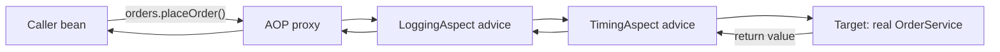
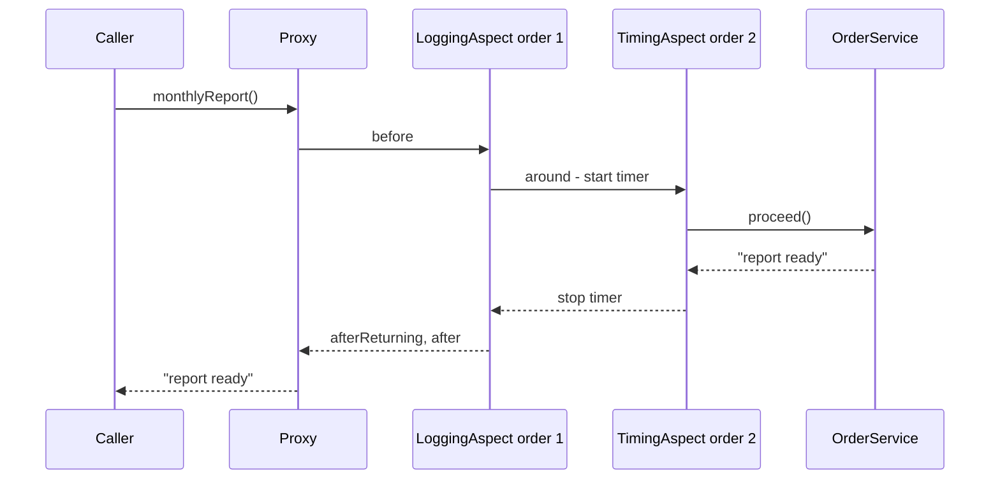
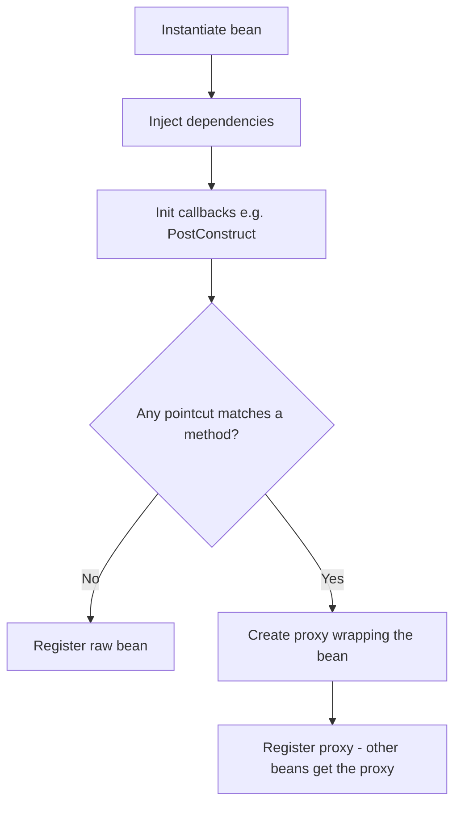
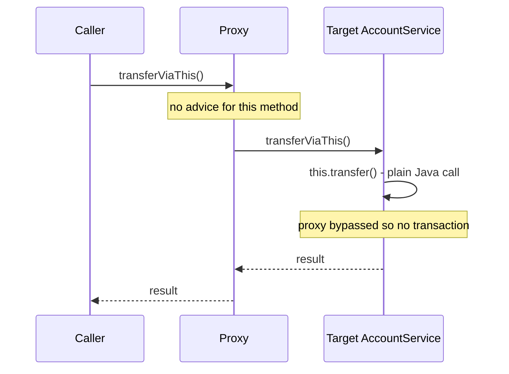

# Chapter 4 — AOP and Proxies

Many things an application must do are not part of any single business rule: logging, timing, transactions (groups of database changes that are saved together or not at all), caching (keeping recent results in memory so repeat requests are fast), security checks, retries (trying a failed call again). If you write that code by hand inside every service method, the business logic drowns in it and one forgotten line becomes a bug. **Aspect-Oriented Programming (AOP)** lets you write such a concern once and declare *where* it applies. Spring implements AOP with **proxies** — stand-in objects that wrap your beans — and the same proxy mechanism is what makes `@Transactional`, `@Cacheable`, `@Async`, `@PreAuthorize` and the new Framework 7 `@Retryable` work.

Understanding proxies is the single most useful piece of "Spring internals" knowledge: it explains the most common Spring bug of all (an annotation that silently does nothing) and it comes up in almost every Spring interview.

**What you'll learn**

1. The problem AOP solves and its vocabulary: aspect, advice, pointcut, join point, target, proxy, weaving.
2. Writing aspects with `@Aspect`: the five advice types, binding arguments, ordering several aspects.
3. The pointcut expression language (`execution`, `within`, `@annotation`, `bean`, ...).
4. How Spring creates proxies: JDK dynamic proxies (Java's built-in runtime proxies, which implement interfaces) vs CGLIB subclasses (classes generated at runtime that extend your class), Boot's default, Framework 7's `@Proxyable`.
5. Proxy limitations, **proved by tests**: self-invocation, `final` methods, `private` methods — and the fixes.
6. Which Spring features are proxy-based and what that means for you.
7. Framework 7 core resilience (keeping an app working when things it depends on fail): `@Retryable`, `@ConcurrencyLimit`, `RetryTemplate`.
8. Spring AOP vs full AspectJ weaving, and when not to use AOP at all.

All code lives in [`code/aop-proxies/`](code/aop-proxies/) — a Spring Boot 4.1.1 / Framework 7.0 project on Java 25. Every claim marked "proved" is checked by a JUnit (Java's standard test framework) test; the output shown is real `mvn -q verify` output (Spring's log lines trimmed as `...`).

> **Prerequisites.** Beans, the `ApplicationContext` and `BeanPostProcessor` are explained in [Chapter 2](../02-ioc-and-dependency-injection/README.md). The Proxy *design pattern* itself (without Spring) is covered in the LLD handbook: [Proxy Pattern](../../../lld/chapters/09-patterns-structural/README.md#97-proxy-pattern).

---

## 4.1 Cross-cutting concerns and the AOP vocabulary

### The problem it solves

Imagine an `OrderService` with ten methods, and three requirements: log each call, measure how long it takes, and run it in a database transaction. Without AOP every method looks like this:

```java
public String placeOrder(String item, int qty) {
    log.info("placeOrder {} {}", item, qty);          // logging
    long start = System.nanoTime();                    // timing
    TransactionStatus tx = txManager.getTransaction(def);  // transaction
    try {
        String id = /* ... the 3 lines that actually matter ... */;
        txManager.commit(tx);
        return id;
    } catch (RuntimeException e) {
        txManager.rollback(tx);
        throw e;
    } finally {
        metrics.record("placeOrder", System.nanoTime() - start);
    }
}
```

The real logic is three lines; the rest is copied into every method. Such code is called a **cross-cutting concern**: a requirement that *cuts across* many classes instead of living in one. Two symptoms give it away:

- **Scattering** — the same code is spread over many classes.
- **Tangling** — each method mixes several unrelated concerns.

### What it is

**AOP** is a way to modularise cross-cutting concerns. You write the concern once in an **aspect**, and describe with a **pointcut** which methods it applies to. The framework then applies it for you.

Analogy: airport security. Passengers (method calls) go to many different gates (business methods), but every one of them passes through the same security checkpoint first. Gates do not each run their own security; the checkpoint is defined once and placed in the path to all of them.

### The vocabulary

| Term | Meaning | In this chapter's code |
|---|---|---|
| **Join point** | A point during execution where extra behaviour *could* be added. In Spring AOP this is always **a method execution on a bean**. | the call `orders.placeOrder("book", 2)` |
| **Pointcut** | A predicate (a yes/no test) that selects join points. | `execution(public * ch04.aop.OrderService.*(..))` |
| **Advice** | The code to run at the selected join points, plus *when* (before, after, around...). | `LoggingAspect.before(...)` |
| **Aspect** | A class that bundles pointcuts and advice for one concern. | `LoggingAspect`, `TimingAspect` |
| **Target object** | The real object being advised. | the plain `OrderService` instance |
| **AOP proxy** | The object Spring creates that wraps the target and runs the advice. Other beans receive the proxy. | `OrderService$$SpringCGLIB$$0` |
| **Weaving** | Linking aspects with targets. Spring does it **at runtime by creating proxies**; AspectJ (the original, full AOP tool for Java) can do it at compile time (when `javac` builds the code) or class-load time (when the JVM first loads a class). | done by a `BeanPostProcessor` at startup |
| **Advisor** | Spring's internal pairing of one advice with one pointcut. You rarely write these by hand. | — |
| **Introduction** | Adding a new interface to an advised object. Rarely used. | — |



The caller *thinks* it holds an `OrderService`. It actually holds the proxy, which runs the advice chain and eventually calls the real object.

### Self-check

1. What are the two symptoms of a cross-cutting concern? → Scattering (same code in many places) and tangling (several concerns mixed in one method).
2. What is a join point in Spring AOP? → Only a method execution on a Spring bean (not field access, not constructors).
3. Pointcut vs advice? → The pointcut says *where*, the advice says *what* and *when*.

---

## 4.2 Writing aspects with `@Aspect`

### How to set it up

1. Add the starter. In **Boot 4** it is `spring-boot-starter-aspectj` (it was called `spring-boot-starter-aop` up to Boot 3.x and was renamed to make clear that it brings AspectJ's annotation support):

   ```xml
   <dependency>
     <groupId>org.springframework.boot</groupId>
     <artifactId>spring-boot-starter-aspectj</artifactId>
   </dependency>
   ```

2. Boot's `AopAutoConfiguration` sees AspectJ on the classpath (the set of jars the app runs with) and switches on `@EnableAspectJAutoProxy` for you (property `spring.aop.auto`, default `true`). In a plain Spring (non-Boot) app you add `@EnableAspectJAutoProxy` to a `@Configuration` class yourself.
3. Write a class annotated **both** `@Aspect` and `@Component` (or register it with `@Bean`). `@Aspect` alone is *not* a stereotype (one of the role annotations like `@Component`/`@Service` that scanning looks for) — component scanning ignores it, and an aspect that is not a bean never runs.

### The five kinds of advice

| Annotation | Runs | Can it change the outcome? | Typical use |
|---|---|---|---|
| `@Before` | before the method | only by throwing an exception (the method then never runs) | argument checks, audit "who called" |
| `@AfterReturning` | after a normal return | can read the return value (bind with `returning=`), cannot replace it | log results, publish an event |
| `@AfterThrowing` | after the method throws | can read the exception (`throwing=`); the exception still propagates (continues up to the caller) unless the advice throws a different one | translate/log errors |
| `@After` | always, like `finally` | no | release resources, clear context |
| `@Around` | wraps the call; *you* call `proceed()` | yes: skip the call, change arguments, change or replace the return value, catch exceptions, retry | timing, caching, transactions, retries |

Rule of thumb from the Spring docs: use the **least powerful** advice that does the job. A `@Before` cannot forget to call `proceed()`; an `@Around` can.

### Example: logging aspect

The business class knows nothing about logging ([`OrderService.java`](code/aop-proxies/src/main/java/ch04/aop/OrderService.java)):

```java
@Service
public class OrderService {
    public String placeOrder(String item, int quantity) {
        return "order-" + item + "-x" + quantity;
    }
    public void cancel(String orderId) {
        if (orderId.startsWith("unknown")) {
            throw new IllegalArgumentException("no such order: " + orderId);
        }
    }
    @Timed("monthly-report")
    public String monthlyReport() throws InterruptedException {
        Thread.sleep(20);                  // pretend to do slow work
        return "report ready";
    }
}
```

The aspect ([`LoggingAspect.java`](code/aop-proxies/src/main/java/ch04/aop/LoggingAspect.java)) writes into a small `CallLog` bean so a test can check the exact order:

```java
@Aspect                 // "this class contains advice + pointcuts"
@Component              // ...and it must also be a bean, or Spring never sees it
@Order(1)               // lower number = outer layer = runs first on the way in
public class LoggingAspect {
    private final CallLog log;
    public LoggingAspect(CallLog log) { this.log = log; }

    // A named, reusable pointcut: every public method of OrderService
    @Pointcut("execution(public * ch04.aop.OrderService.*(..))")
    void orderServiceMethods() {}

    @Before("orderServiceMethods()")
    public void before(JoinPoint jp) {
        log.add("before " + jp.getSignature().getName() + " args=" + Arrays.toString(jp.getArgs()));
    }

    @AfterReturning(pointcut = "orderServiceMethods()", returning = "result")
    public void afterReturning(JoinPoint jp, Object result) {
        log.add("afterReturning " + jp.getSignature().getName() + " -> " + result);
    }

    @AfterThrowing(pointcut = "orderServiceMethods()", throwing = "ex")
    public void afterThrowing(JoinPoint jp, Exception ex) {
        log.add("afterThrowing " + jp.getSignature().getName() + " -> " + ex.getMessage());
    }

    @After("orderServiceMethods()")   // like 'finally': runs on success AND on exception
    public void after(JoinPoint jp) {
        log.add("after " + jp.getSignature().getName());
    }
}
```

What each part does:

- `@Pointcut` on an empty method gives the expression a **name** (`orderServiceMethods()`) that the advice annotations reuse. The method body is never executed.
- `JoinPoint` gives access to the method signature (its name, parameter types and return type), the arguments (`getArgs()`), the target (`getTarget()`) and the proxy (`getThis()`).
- `returning = "result"` binds the return value to the parameter named `result`. If you declare the parameter as `String` instead of `Object`, the advice only matches methods returning a `String`.
- `throwing = "ex"` does the same for the exception; the parameter type also filters (here: only `Exception` and subclasses).

The test ([`AspectsTest.java`](code/aop-proxies/src/test/java/ch04/AspectsTest.java)) calls the service and prints the log:

```java
@Test
void adviceRunsAroundASuccessfulCall() {
    String result = orders.placeOrder("book", 2);
    System.out.println("result = " + result);
    log.lines().forEach(l -> System.out.println("  " + l));
    assertThat(log.lines()).containsExactly(
            "before placeOrder args=[book, 2]",
            "afterReturning placeOrder -> order-book-x2",
            "after placeOrder");
}

@Test
void adviceRunsWhenTheMethodThrows() {
    assertThatThrownBy(() -> orders.cancel("unknown-7"))
            .isInstanceOf(IllegalArgumentException.class);   // the aspect does not swallow it
    log.lines().forEach(l -> System.out.println("  " + l));
    assertThat(log.lines()).containsExactly(
            "before cancel args=[unknown-7]",
            "afterThrowing cancel -> no such order: unknown-7",
            "after cancel");
}
```

Output:

```output
result = order-book-x2
  before placeOrder args=[book, 2]
  afterReturning placeOrder -> order-book-x2
  after placeOrder
  before cancel args=[unknown-7]
  afterThrowing cancel -> no such order: unknown-7
  after cancel
```

Notice that `@After` ran **after** `@AfterReturning`/`@AfterThrowing`. Since Spring Framework 5.2.7, advice methods of the *same* aspect on the *same* join point have a fixed precedence — `@Around`, `@Before`, `@After`, `@AfterReturning`, `@AfterThrowing` from highest to lowest — and an `@After` method is effectively invoked after the returning/throwing advice of that aspect, just like a `finally` block.

### `@Around` advice and custom annotations

`@Around` receives a `ProceedingJoinPoint`. Calling `proceed()` continues to the next advice or the real method; not calling it skips the method entirely. A very common pattern is to trigger an aspect with your own annotation:

```java
@Retention(RetentionPolicy.RUNTIME)  // must be visible at runtime for the pointcut to see it
@Target(ElementType.METHOD)
public @interface Timed {
    String value() default "";       // optional label
}
```

```java
@Aspect
@Component
@Order(2)               // inner layer: runs after LoggingAspect's @Before
public class TimingAspect {
    private final CallLog log;
    public TimingAspect(CallLog log) { this.log = log; }

    // Matches any bean method annotated with @Timed and binds the annotation to 'timed'
    @Around("@annotation(timed)")
    public Object time(ProceedingJoinPoint pjp, Timed timed) throws Throwable {
        long start = System.nanoTime();
        log.add("timer start [" + timed.value() + "]");
        try {
            return pjp.proceed();          // call the next advice / the real method
        } finally {
            long ms = (System.nanoTime() - start) / 1_000_000;
            log.add("timer stop [" + timed.value() + "] took>=20ms? " + (ms >= 20));
        }
    }
}
```

- `@annotation(timed)` uses the *parameter name* `timed`; its type `Timed` tells AspectJ which annotation to look for, and the annotation instance is passed in, so the advice can read `timed.value()`.
- The advice **must return** what `proceed()` returned (or something else deliberately). An `@Around` method declared `void`, or one that forgets `return`, makes every advised method return `null` — a classic bug.
- Always declare `throws Throwable` and let exceptions pass through unless you intend to handle them.

### Ordering several aspects

When two aspects advise the same method, Spring orders them with `@Order` (or by implementing `Ordered`). Lower value = higher precedence = **outer** layer: it runs first on the way in and last on the way out. Without an explicit order the sequence is undefined.

```java
@Test
void twoAspectsNestByOrder() throws Exception {
    orders.monthlyReport();
    log.lines().forEach(l -> System.out.println("  " + l));
    assertThat(log.lines()).containsExactly(
            "before monthlyReport args=[]",        // @Order(1) LoggingAspect: outer
            "timer start [monthly-report]",        // @Order(2) TimingAspect: inner
            "timer stop [monthly-report] took>=20ms? true",
            "afterReturning monthlyReport -> report ready",
            "after monthlyReport");
}
```

Output:

```output
  before monthlyReport args=[]
  timer start [monthly-report]
  timer stop [monthly-report] took>=20ms? true
  afterReturning monthlyReport -> report ready
  after monthlyReport
```



This matters in real systems. Spring's own infrastructure advisors (transactions, caching, security) have orders too; for example, if you write a retry aspect, it must be *outside* the transaction aspect so each retry gets a fresh transaction.

### Common mistakes

- **Forgetting `@Component`** on the aspect → nothing happens, no error.
- **`@Around` without `return pjp.proceed()`** → methods return `null`, or the real method never runs.
- **Swallowing exceptions** in `@Around` → callers think a failed operation succeeded, and `@Transactional` further out does not roll back.
- **Pointcut too broad** (`execution(* *(..))`) → Spring tries to proxy every bean, including infrastructure beans; startup slows or fails with odd errors. Always restrict to your packages.
- **Relying on unordered aspects** → inconsistent behaviour between runs or environments.

### Self-check

1. Which advice type can prevent the target method from running without throwing? → Only `@Around` (by not calling `proceed()`).
2. Does `@AfterThrowing` stop the exception? → No. The exception continues to the caller unless the advice itself throws another one.
3. Aspect A has `@Order(1)` and B `@Order(2)`. Whose `@Before` runs first? → A's; A is the outer layer.
4. Why must `Timed` have `RetentionPolicy.RUNTIME`? → Spring inspects annotations with reflection (Java's API for examining classes and methods while the program runs) at runtime; `CLASS`/`SOURCE` retention makes them invisible, so the pointcut never matches.

---

## 4.3 Pointcut expressions

### What it is

A pointcut expression is a tiny query language (from AspectJ) that selects methods. Spring AOP supports a subset of AspectJ's **pointcut designators** (PCDs):

| Designator | Matches method executions ... | Example |
|---|---|---|
| `execution(...)` | whose signature matches a pattern (the main one) | `execution(* com.shop.service.*.*(..))` |
| `within(type-pattern)` | declared in matching types/packages | `within(com.shop..*)` |
| `this(Type)` | where the **proxy** is an instance of `Type` | `this(com.shop.Auditable)` |
| `target(Type)` | where the **target** is an instance of `Type` | `target(com.shop.Repository)` |
| `args(...)` | whose runtime arguments match (and can bind them) | `args(id, ..)` |
| `@annotation(A)` | on methods annotated with `A` | `@annotation(com.shop.Timed)` |
| `@within(A)` | in classes annotated with `A` | `@within(org.springframework.stereotype.Service)` |
| `@target(A)` | where the target's runtime class has `A` | `@target(com.shop.Audited)` |
| `@args(A)` | whose argument types carry annotation `A` | `@args(com.shop.Sensitive)` |
| `bean(name)` | on beans with a matching name — **Spring-only**, not AspectJ | `bean(*Service)` |

### The `execution` pattern, piece by piece

```text
execution( modifiers?  return-type  declaring-type?.method-name(params)  throws? )
execution( public      *            com.shop.service..*Service.find*(Long, ..) )
```

| Part | Meaning in the example |
|---|---|
| `public` | optional; only public methods (with CGLIB proxies, protected/package-private — no modifier, visible only inside the same package — methods can also be matched) |
| `*` | any return type |
| `com.shop.service..` | the package `com.shop.service` **or any sub-package** (`..` in a type pattern) |
| `*Service` | any type whose name ends in `Service` |
| `find*` | method names starting with `find` |
| `(Long, ..)` | first parameter `Long`, then zero or more of anything (`..` in a parameter list). `()` = no params, `(*)` = exactly one param of any type |

### Combining and reusing

Pointcuts combine with `&&`, `||`, `!` and can reference named pointcuts, even from other classes:

```java
public class CommonPointcuts {
    @Pointcut("within(com.shop..web..*)")     public void webLayer() {}
    @Pointcut("within(com.shop..service..*)") public void serviceLayer() {}
    @Pointcut("execution(* com.shop..*Repository.*(..))") public void dataAccess() {}
}

@Before("com.shop.aop.CommonPointcuts.serviceLayer() && args(id, ..)")
public void checkId(Long id) { /* id is bound from the first argument */ }
```

The chapter's `TracingAspect` shows a `within` pointcut that excludes the aspect's own package class:

```java
@Before("within(ch04.proxy..*) && !within(ch04.proxy.TracingAspect)")
public void trace(JoinPoint jp) { log.add("trace " + jp.getSignature().toShortString()); }
```

### Performance tip

AspectJ matching is done once per bean method at startup and then cached, so runtime cost is small — but **kinded** designators (`execution`) and **scoping** designators (`within`) are cheapest to evaluate. Contextual ones (`this`, `target`, `args`, `@annotation`) are more expensive on their own. A good pointcut includes a `within(...)` scope whenever possible.

### Common mistakes

- `com.shop.*` matches only types directly in `com.shop`; use `com.shop..*` for sub-packages.
- `execution(* save(*))` matches exactly one parameter, not "any parameters" — that is `(..)`.
- Putting a custom trigger annotation only on an **interface** method and expecting `@annotation(...)` to match: matching is done against the method actually executed on the bean class, so put custom trigger annotations on the implementation method to be safe. (Spring's own annotations such as `@Transactional` use their own, more forgiving lookup.)

### Self-check

1. `execution(* com.acme.*.*(..))` — does it match a method in `com.acme.billing.InvoiceService`? → No; `.*.` matches one package level. Use `com.acme..*.*(..)`.
2. Which PCD is Spring-specific? → `bean(...)`.
3. What does `args(id, ..)` do in addition to matching? → Binds the first argument to the advice parameter named `id`.

---

## 4.4 How Spring AOP works: proxies

### What it is

A **proxy** is an object that has the same type as your bean (so callers cannot tell the difference) but forwards each call through the advice chain to the real object. Spring creates proxies **at startup**, in a `BeanPostProcessor` (see [Chapter 2](../02-ioc-and-dependency-injection/README.md)). For `@Aspect` support that post-processor is `AnnotationAwareAspectJAutoProxyCreator`.

### How it works

1. The container creates the real bean (constructor, dependency injection, `@PostConstruct`).
2. In `postProcessAfterInitialization`, the auto-proxy creator asks: *does any advisor's pointcut match any method of this bean's class?*
3. If no: the raw bean is registered. If yes: it builds a proxy around the bean with the matching advisors, and **the proxy** is what gets registered in the context and injected everywhere.
4. At call time the proxy builds a chain of interceptors (advice objects, each of which can act before and after passing the call on) for that method and walks it; the last link calls the real method on the target.



### Two kinds of proxy

| | **JDK dynamic proxy** | **CGLIB proxy** |
|---|---|---|
| Built with | `java.lang.reflect.Proxy` (part of the JDK — Java Development Kit, the standard Java tools and libraries) | bytecode (compiled JVM instructions) generation of a **subclass** (Spring ships a repackaged CGLIB) |
| Requires | the bean implements at least one interface | the class is not `final` and has a usable constructor |
| The proxy *is a* | implementation of the interfaces only | subclass of the bean's class |
| Can be injected as the concrete class? | **No** — `BeanNotOfRequiredTypeException` | Yes |
| Methods it can intercept | interface methods (public) | non-final, non-private methods (public, protected, package-private within the same package) |
| Class name you'll see | `jdk.proxy2.$Proxy83` | `OrderService$$SpringCGLIB$$0` |

**Which one does Spring pick?**

- **Plain Spring Framework:** JDK proxy if the bean implements an interface, otherwise CGLIB (unless you set `proxyTargetClass = true`).
- **Spring Boot:** `spring.aop.proxy-target-class` defaults to **`true`**, so Boot uses **CGLIB for everything**, even beans with interfaces. Boot chose this so that injecting a bean by its concrete class never fails. Set the property to `false` to get the plain-Spring behaviour.
- **Framework 7:** `@Proxyable` on a bean class or `@Bean` method overrides the global default for that one bean: `@Proxyable(ProxyType.INTERFACES)`, `@Proxyable(ProxyType.TARGET_CLASS)`, or `@Proxyable(interfaces = ...)` to expose only some interfaces. Framework 7 also merges the proxy settings of the different `@Enable...` annotations into one global default instead of each deciding separately.

Proved in [`ProxyTypesTest.java`](code/aop-proxies/src/test/java/ch04/ProxyTypesTest.java):

```java
static String describe(Object bean) {
    String kind = AopUtils.isJdkDynamicProxy(bean) ? "JDK dynamic proxy"
                : AopUtils.isCglibProxy(bean) ? "CGLIB proxy" : "not a proxy";
    return kind + " -> " + bean.getClass().getName();
}

@Test
void whatKindOfProxyDidSpringCreate() {
    System.out.println("OrderService (no interface):       " + describe(orders));
    System.out.println("DefaultGreetingService (interface): " + describe(greeting));
    System.out.println("@Proxyable(INTERFACES) bean:        " + describe(interfaceOnly));
    assertThat(AopUtils.isCglibProxy(orders)).isTrue();
    assertThat(AopUtils.isCglibProxy(greeting)).isTrue();     // Boot default: proxy-target-class=true
    assertThat(AopUtils.isJdkDynamicProxy(interfaceOnly)).isTrue();
    assertThat(interfaceOnly).isNotInstanceOf(DefaultGreetingService.class);
}
```

where the third bean is:

```java
@Service
@Proxyable(ProxyType.INTERFACES)       // ask for a JDK dynamic proxy
public class InterfaceOnlyGreetingService implements GreetingService { ... }
```

Output:

```output
OrderService (no interface):       CGLIB proxy -> ch04.aop.OrderService$$SpringCGLIB$$0
DefaultGreetingService (interface): CGLIB proxy -> ch04.proxy.DefaultGreetingService$$SpringCGLIB$$0
@Proxyable(INTERFACES) bean:        JDK dynamic proxy -> jdk.proxy2.$Proxy83
```

### A proxy by hand: `java.lang.reflect.Proxy`

To demystify it, here is a JDK dynamic proxy without Spring. You give the JDK a list of interfaces and an `InvocationHandler`; every call on the proxy lands in `invoke(proxy, method, args)`:

```java
GreetingService target = new DefaultGreetingService();
InvocationHandler handler = (proxy, method, args) -> {
    System.out.println("  [handler] before " + method.getName());
    Object result = method.invoke(target, args);      // delegate to the real object
    System.out.println("  [handler] after  " + method.getName());
    return result;
};
GreetingService proxy = (GreetingService) Proxy.newProxyInstance(
        GreetingService.class.getClassLoader(), new Class<?>[] {GreetingService.class}, handler);
String out = proxy.greet("Ada");
System.out.println("result = " + out + ", proxy class = " + proxy.getClass().getSimpleName());
```

Output:

```output
  [handler] before greet
  [handler] after  greet
result = Hello, Ada, proxy class = $Proxy137
```

Spring's JDK proxies are exactly this, with an `InvocationHandler` that runs the advisor chain.

### Spring's `ProxyFactory`

Spring exposes its proxy machinery as `ProxyFactory`, handy in tests or libraries. The advice here is an AOP Alliance (a small, shared set of AOP interfaces several frameworks agreed on) `MethodInterceptor` — the low-level interface all Spring advice is converted into:

```java
MethodInterceptor upper = inv -> ((String) inv.proceed()).toUpperCase();

ProxyFactory jdk = new ProxyFactory(new DefaultGreetingService());
jdk.addInterface(GreetingService.class);   // interfaces known + proxyTargetClass=false -> JDK
jdk.addAdvice(upper);
GreetingService p1 = (GreetingService) jdk.getProxy();

ProxyFactory cglib = new ProxyFactory(new DefaultGreetingService());
cglib.setProxyTargetClass(true);           // force a subclass
cglib.addAdvice(upper);
DefaultGreetingService p2 = (DefaultGreetingService) cglib.getProxy();
```

Output:

```output
factory 1: JDK dynamic proxy -> jdk.proxy2.$Proxy83 says HELLO, BOB
factory 2: CGLIB proxy -> ch04.proxy.DefaultGreetingService$$SpringCGLIB$$1 says HELLO, BOB
```

(The JDK reuses one generated proxy class per interface set, which is why `$Proxy83` appears twice. The numbers in `$Proxy83`/`$Proxy137` depend on how many proxy classes the JVM generated before, so your run may show different ones.)

### Trade-offs

| Concern | JDK proxy | CGLIB proxy |
|---|---|---|
| Inject by concrete class | fails | works |
| `final` classes / methods | irrelevant (interface-based) | class cannot be proxied / method silently not advised |
| Startup cost | tiny | generates a class per bean (small, and cached) |
| Constructor | not involved | Spring uses Objenesis (a library that creates objects without calling a constructor), so the target's constructor is **not** run again for the proxy |
| Recommended | when you program to interfaces and want only interface methods exposed | Boot's default; works for classes without interfaces |

### Self-check

1. In a Boot app, `PaymentService implements Payments` is `@Transactional`. What proxy do you get? → CGLIB (Boot's `spring.aop.proxy-target-class=true`).
2. Why can injecting `PaymentServiceImpl` fail in plain Spring? → The bean is a JDK proxy implementing only `Payments`; it is not a `PaymentServiceImpl`.
3. Who creates Spring's proxies and when? → A `BeanPostProcessor` (an auto-proxy creator) after the bean is initialised, at startup.

---

## 4.5 Proxy limitations — proved

Because the advice lives in the proxy, **advice runs only when a call passes through the proxy**. Every limitation below follows from that one sentence.

### Self-invocation

#### What it is
Inside a bean, `this` refers to the **target object**, not the proxy. A call `this.someMethod()` — or just `someMethod()` — is an ordinary Java call that never touches the proxy, so no advice runs on it: no transaction, no caching, no async, no retry, no security check.



#### Proof 1 — `@Transactional`

```java
@Service
public class AccountService {
    private final ObjectProvider<AccountService> self;   // lazy handle to *our own proxy*

    public AccountService(ObjectProvider<AccountService> self) { this.self = self; }

    @Transactional
    public String transfer() {
        // true only if a transaction proxy started a transaction before we got here
        return "transaction active = " + TransactionSynchronizationManager.isActualTransactionActive();
    }
    public String transferViaThis()      { return this.transfer(); }              // skips the proxy
    public String transferViaSelfProxy() { return self.getObject().transfer(); }  // goes through it
}
```

`TransactionSynchronizationManager.isActualTransactionActive()` reports whether a real transaction is bound to the current thread (a thread is one independent path of execution; Spring tracks the transaction per thread). The project has H2 (a small in-memory database) + `spring-boot-starter-jdbc`, so Boot configured a `DataSourceTransactionManager`.

#### Proof 2 — `@Cacheable`

```java
@Cacheable("prices")                    // proxy checks the "prices" cache before calling us
public int price(String sku) {
    realCalls.incrementAndGet();         // counts how often the real method body runs
    return sku.length() * 100;
}
public int priceTwiceViaThis(String sku) {
    return this.price(sku) + this.price(sku);   // self-invocation: cache never consulted
}
```

#### Proof 3 — `@Async`

```java
@Async                                   // proxy hands the call to a TaskExecutor thread
public CompletableFuture<String> build() {
    return CompletableFuture.completedFuture(Thread.currentThread().getName());
}
public CompletableFuture<String> buildViaThis() {
    return this.build();                 // runs on the CALLER's thread
}
```

The test ([`SelfInvocationTest.java`](code/aop-proxies/src/test/java/ch04/SelfInvocationTest.java)) asserts all three. Output:

```output
caller -> proxy -> transfer():        transaction active = true
caller -> proxy -> this.transfer():   transaction active = false
caller -> proxy -> self.transfer():   transaction active = true
2 external calls -> real method ran 1 time(s)
2 internal calls -> real method ran 2 time(s)
caller thread:          main
@Async through proxy:   task-1
@Async via this.build(): main
```

`task-1` is a thread of Boot's auto-configured `applicationTaskExecutor` (a thread pool: a set of reusable worker threads that run submitted tasks). Via `this`, the "async" (meant to run in the background on another thread) method ran synchronously (the caller waited, on its own thread) on `main` — no error, no warning.

#### Fixes, best first

1. **Move the method to another bean.** If `transfer()` must be transactional on its own, it probably belongs in a separate service anyway. Clearest, no Spring tricks.
2. **Call through the proxy by self-injection** — inject your own bean lazily (`ObjectProvider<T>`, or a field `@Autowired @Lazy MyService self`). Shown above; it works but surprises readers, so comment it.
3. **`AopContext.currentProxy()`** — requires `@EnableAspectJAutoProxy(exposeProxy = true)` and couples code to Spring AOP; the Spring docs discourage it.
4. **Put the annotation on the outer method** (the entry point) instead of the inner one, if that is what you really meant.
5. **AspectJ weaving** (section 4.8) — advice is woven into the bytecode, so `this` calls are advised too. Rarely worth the build complexity.

### `final` methods on CGLIB proxies

A CGLIB proxy is a subclass; a subclass **cannot override a `final` method**. So a call to a `final` method runs the method body **on the proxy object itself**. Worse: Spring creates proxy instances without running your constructor, so the proxy's own fields are `null`.

```java
@Service
public class PricingService {
    private final List<String> currencies;
    public PricingService() { this.currencies = List.of("EUR", "USD"); }

    public String currencies()             { return "currencies=" + currencies; }
    public final String currenciesFinal()  { return "currencies=" + currencies; }
}
```

`TracingAspect` advises every method of this class, so the bean is proxied. The test:

```java
String normal = pricing.currencies();
String viaFinal = pricing.currenciesFinal();
System.out.println("normal method: " + normal);
System.out.println("final method:  " + viaFinal);
System.out.println("advice log:    " + log.lines());
assertThat(viaFinal).isEqualTo("currencies=null");            // proxy's own, never-initialised field
```

Output:

```output
normal method: currencies=[EUR, USD]
final method:  currencies=null
advice log:    [trace PricingService.currencies()]
```

The final method was not advised **and** read `null` instead of `[EUR, USD]`. In real code this shows up as a mysterious `NullPointerException` on an injected field that "definitely was injected". Kotlin classes are `final` by default, which is why Kotlin (a JVM language) Spring projects use the `kotlin-spring` (all-open) compiler plugin, which makes annotated classes non-final automatically.

A `final` **class** cannot be subclassed at all; if it needs advice and has no interface, startup fails with an error saying CGLIB cannot subclass it.

### Other things proxies cannot advise

| Case | Why | What happens |
|---|---|---|
| `private` methods | not visible to a subclass, not on an interface | advice silently ignored |
| `static` methods | not called on an instance | ignored |
| Calls inside the **constructor** or `@PostConstruct` | proxy does not exist yet / you are on the target | ignored (e.g. `@Transactional` in `@PostConstruct` has no transaction) |
| Objects created with `new` | not Spring beans, never proxied | ignored |
| Field access | Spring AOP only supports method execution join points | not possible (needs AspectJ) |
| Methods only on the class, with a JDK proxy | the proxy implements only interfaces | not reachable through the proxy at all |

For `@Transactional` specifically: since Framework 6.0, `protected` and package-private methods can be transactional with class-based (CGLIB) proxies; with interface-based proxies they must be `public`, and `private` never works.

### In the interview

**30-second answer:** "Spring AOP is proxy-based. At startup a BeanPostProcessor wraps any bean that matches a pointcut in a proxy — CGLIB by default in Boot, JDK dynamic proxy for interface-only proxying — and other beans get the proxy. Advice runs only when a call goes through the proxy. So `this.method()` calls, private or final methods, and calls from constructors skip `@Transactional`, `@Cacheable`, `@Async` and custom aspects. The fix is usually to move the method to another bean, or to call through an injected reference to the proxy."

- *"My `@Transactional` method doesn't roll back — why?"* → Top causes: self-invocation; method is private/final; exception is checked (a *checked* exception must be declared with `throws`, e.g. `IOException`; an *unchecked* one extends `RuntimeException`; rollback defaults to unchecked exceptions only — see [Chapter 7](../07-data-access-jdbc-and-transactions/README.md)); exception caught inside the method; bean created with `new`.
- *"How can you see if a bean is proxied?"* → `AopUtils.isAopProxy(bean)` / `isCglibProxy` / `isJdkDynamicProxy`, or print `bean.getClass()` and look for `$$SpringCGLIB$$` or `$Proxy`.
- *"JDK vs CGLIB?"* → JDK: interface-based, from the JDK, cannot be cast to the class. CGLIB: runtime subclass, can't handle final classes/methods. Boot defaults to CGLIB via `spring.aop.proxy-target-class=true`.

### Self-check

1. Why does `this.transfer()` skip the transaction? → `this` is the target, not the proxy; the transaction interceptor lives in the proxy.
2. What did the `final` method return in the proof and why? → `currencies=null` — it ran on the CGLIB proxy instance, whose fields were never initialised.
3. Name two fixes for self-invocation. → Extract the method into another bean; inject and call your own proxy (`ObjectProvider<Self>` or `@Lazy` self-reference).
4. Does `@Async` on a method called from `@PostConstruct` of the same bean run asynchronously? → No; that call is on the target, not through the proxy.

---

## 4.6 Spring features built on proxies

Many annotations in this book are "AOP you did not write yourself". They are processed by infrastructure advisors, not `@Aspect` classes, but they obey **all** the rules of section 4.5.

| Annotation | Switched on by | Interceptor / processor | Chapter |
|---|---|---|---|
| `@Transactional` | Boot auto-config (`@EnableTransactionManagement` in plain Spring) | `TransactionInterceptor` | [7](../07-data-access-jdbc-and-transactions/README.md) |
| `@Cacheable`, `@CachePut`, `@CacheEvict` | `@EnableCaching` | `CacheInterceptor` | [9](../09-spring-data-beyond-jpa-and-caching/README.md) |
| `@Async` | `@EnableAsync` | `AsyncExecutionInterceptor` | [14](../14-messaging-async-and-scheduling/README.md) |
| `@Retryable`, `@ConcurrencyLimit` (Framework 7) | `@EnableResilientMethods` | `RetryAnnotationBeanPostProcessor`, `ConcurrencyLimitBeanPostProcessor` | 4.7 below |
| `@PreAuthorize`, `@PostAuthorize`, `@Secured` | `@EnableMethodSecurity` | `AuthorizationManagerBeforeMethodInterceptor`, ... | [10](../10-spring-security-1-fundamentals/README.md) |
| `@Validated` on a class + constraint annotations on method parameters | Boot auto-config (`MethodValidationPostProcessor`) | `MethodValidationInterceptor` | [5](../05-spring-mvc-and-rest/README.md) |
| `@Observed` (Micrometer, Spring's metrics library) | an `ObservedAspect` bean | an `@Aspect` | [15](../15-observability-and-production/README.md) |
| Spring Data repository interfaces | `@EnableJpaRepositories` / Boot | JDK proxy generated for the interface | [8](../08-spring-data-jpa-and-hibernate/README.md) |
| `@Configuration` classes (full mode) | always | CGLIB subclass that intercepts `@Bean` method calls (not AOP advice, same technique) | [2](../02-ioc-and-dependency-injection/README.md) |

**Order matters when several apply.** For example, `@Retryable` + `@Transactional` on the same method: if the transaction interceptor is outside the retry interceptor, all attempts share one transaction that is already marked rollback-only (doomed to be undone, whatever happens next) after the first failure. Put retries on a caller one layer up, or set the orders explicitly (`@EnableTransactionManagement(order = ...)`, `@EnableResilientMethods(order = ...)`).

### Self-check

1. Which annotation turns on `@Cacheable`? → `@EnableCaching`.
2. Does `@PreAuthorize` protect a `private` method? → No — it is proxy-based like the others.

---

## 4.7 Framework 7 core resilience: `@Retryable` and `@ConcurrencyLimit`

### What it is

Spring Framework **7.0** (November 2025) added a small resilience toolkit to the core framework, in the packages `org.springframework.resilience.annotation` and `org.springframework.core.retry`:

- **`@Retryable`** — call a method again when it throws, with back-off delay.
- **`@ConcurrencyLimit`** — allow at most N threads inside a method at a time (a *bulkhead*: a limit that stops one overloaded part from sinking the whole app, named after a ship's watertight walls).
- **`RetryTemplate` / `RetryPolicy`** — the same retry logic, programmatically.

They replace most uses of the separate **Spring Retry** project; Boot 4 removed dependency management for Spring Retry. They are **not** a full resilience library: there is no circuit breaker (stops calling a failing service for a while so it can recover), rate limiter (caps calls per second) or time limiter (gives up after a deadline) — for those use Resilience4j (a popular Java resilience library) (see [Chapter 16](../16-spring-cloud-and-microservices/README.md) and the [circuit breaker notes](../../../microservices-patterns/chapters/06-circuit-breaker/README.md)).

### Why it matters

Remote calls fail *transiently* (briefly, then work again): a timeout, a 503 (HTTP "service unavailable") during a deploy (rolling out a new version), a dropped connection. Retrying once or twice with a short, growing delay turns many such failures into successes. And with **virtual threads** (very cheap threads managed by the JVM, so you can have millions) ([Java book 15.4](../../../java/chapters/15-concurrency-2-modern/README.md#154-virtual-threads)) you no longer have a thread-pool size that naturally caps how many callers hit a slow downstream service (a service *you* call) at once — `@ConcurrencyLimit` puts that cap back where you need it.

### How to switch it on

Add `@EnableResilientMethods` to a configuration class. As of Boot 4.1 there is no auto-configuration for it, so without the annotation `@Retryable` is silently ignored — like every other proxy feature.

```java
@SpringBootApplication
@EnableCaching          // turns on the @Cacheable proxy
@EnableAsync            // turns on the @Async proxy
@EnableResilientMethods // Framework 7: turns on @Retryable and @ConcurrencyLimit
public class AopApplication { ... }
```

(Alternatively register a `RetryAnnotationBeanPostProcessor` and/or `ConcurrencyLimitBeanPostProcessor` bean.)

### `@Retryable` attributes (Framework 7.0)

| Attribute | Default | Meaning |
|---|---|---|
| `includes` / `value` | empty = all exceptions | exception types to retry (also matches **nested causes**) |
| `excludes` | empty | exception types never to retry |
| `predicate` | none | a `MethodRetryPredicate` class for custom decisions, applied after includes/excludes |
| `maxRetries` | `3` | retries **after** the first call → total attempts = 1 + `maxRetries` |
| `delay` | `1000` ms | wait before the first retry |
| `multiplier` | `1.0` | each delay = previous × multiplier (exponential back-off — waits that double or grow each time — when > 1) |
| `maxDelay` | `Long.MAX_VALUE` | cap for the growing delay |
| `jitter` | `0` | random variation applied to each delay, so many clients don't retry in lock-step (all at the same instant) |
| `timeout` | `0` = none | total time budget for all attempts including delays (since 7.0.2) |
| `timeUnit` | `MILLISECONDS` | unit for the numeric delay attributes |
| `...String` variants | — | `maxRetriesString`, `delayString`, ... accept `${...}` placeholders and SpEL |

It works on methods returning `Mono`/`Flux` (Project Reactor's types for 0–1 and 0–N values that arrive later) too (the retry is applied to the reactive pipeline), and publishes a `MethodRetryEvent` for each failed attempt, which you can observe with an `@EventListener`.

### Example: a flaky client

```java
@Service
public class InventoryClient {
    // up to 3 retries (4 attempts in total), waiting 10 ms, then 20 ms, then 40 ms
    @Retryable(includes = TransientException.class, maxRetries = 3, delay = 10, multiplier = 2)
    public int stockFor(String sku) {
        attempts.add("attempt " + (attempts.size() + 1));
        if (failuresLeft-- > 0) {
            throw new TransientException("inventory timed out");
        }
        return 42;
    }

    // IllegalArgumentException is not in 'includes', so it is never retried
    @Retryable(includes = TransientException.class, maxRetries = 3, delay = 10)
    public int stockForBadSku(String sku) {
        attempts.add("attempt " + (attempts.size() + 1));
        throw new IllegalArgumentException("bad sku " + sku);
    }
}
```

The tests ([`ResilienceTest.java`](code/aop-proxies/src/test/java/ch04/ResilienceTest.java)) make it fail twice (recovers), ten times (gives up), and with a non-retryable exception:

```java
inventory.failNextCalls(2);
int stock = inventory.stockFor("SKU-1");            // succeeds on attempt 3

inventory.failNextCalls(10);
assertThatThrownBy(() -> inventory.stockFor("SKU-1"))
        .isInstanceOf(TransientException.class);    // the LAST original exception
assertThat(inventory.attempts()).hasSize(4);        // 1 call + 3 retries
```

Output:

```output
stock = 42 after [attempt 1, attempt 2, attempt 3]
gave up after [attempt 1, attempt 2, attempt 3, attempt 4]
IllegalArgumentException -> [attempt 1]
```

When all attempts fail, the caller receives the **last original exception** (here a `TransientException`), not a wrapper — so existing `catch` blocks keep working.

### `@ConcurrencyLimit`

```java
@ConcurrencyLimit(2)                        // default policy BLOCK: extra callers wait
public void print(String doc) throws InterruptedException {
    int now = inside.incrementAndGet();
    maxInside.accumulateAndGet(now, Math::max);
    Thread.sleep(50);                        // hold the "printer" for a while
    inside.decrementAndGet();
}

@ConcurrencyLimit(limit = 1, policy = ConcurrencyLimit.ThrottlePolicy.REJECT)  // 7.0.3+
public void printUrgent(String doc) throws InterruptedException {
    Thread.sleep(100);
}
```

- `value`/`limit`: the maximum concurrent invocations **per bean instance**. `1` makes the method behave like a lock (only one thread may be inside at a time) on the bean.
- `limitString`: placeholder/SpEL variant, e.g. `"${printer.max-concurrent}"`.
- `policy` (since 7.0.3): `BLOCK` (default) makes extra callers wait; `REJECT` throws `InvocationRejectedException` (a subclass of `RejectedExecutionException`) immediately.

The test starts 6 virtual threads calling `print` and a second caller of `printUrgent` while the first is still inside:

```output
6 callers, max inside print() at once = 2
second caller -> InvocationRejectedException
```

### Programmatic: `RetryTemplate`

Use it when the retry scope is a few lines inside a method, or when policies are chosen at runtime:

```java
RetryPolicy policy = RetryPolicy.builder()
        .maxRetries(4)
        .delay(Duration.ofMillis(5))
        .multiplier(2)
        .includes(TransientException.class)
        .build();
RetryTemplate retry = new RetryTemplate(policy);

String result = retry.execute(() -> {
    if (calls.incrementAndGet() < 3) throw new TransientException("busy");
    return "done on call " + calls.get();
});
```

Output:

```output
RetryTemplate -> done on call 3
```

`execute(...)` throws a checked `RetryException` on exhaustion that holds every failure (`getExceptions()`, `getLastException()`, `getRetryCount()`); `invoke(...)` instead rethrows the last original exception unchecked. A `RetryListener` can observe each attempt (for logging or metrics).

### Trade-offs: which retry tool?

| | Framework 7 `@Retryable` / `RetryTemplate` | Spring Retry (`org.springframework.retry`) | Resilience4j |
|---|---|---|---|
| Where | built into `spring-context` / `spring-core` | separate library, no longer managed by Boot 4 | separate library + Spring Boot integration |
| Retry + back-off + jitter | yes | yes | yes |
| Recovery method (`@Recover`) | no — catch the exception at the caller | yes | fallback methods |
| Circuit breaker, rate limiter, time limiter | no | basic circuit breaker only | yes, all |
| Bulkhead | `@ConcurrencyLimit` | no | semaphore (a counter of free permits) and thread-pool bulkheads |
| Metrics | via `RetryListener` / `MethodRetryEvent` | listeners | built-in Micrometer metrics |
| Choose when | you need simple retries / limits and want no extra dependency | legacy code | you need circuit breaking and rich resilience policies |

### When not to use it

- **Non-idempotent operations** (charging a card, sending an email) — a retry after a timeout may do the work twice.

  > **Key term — idempotent:** an operation is idempotent if doing it twice has the same effect as doing it once. "Set the price to 10" is idempotent; "add 10 to the balance" is not. An **idempotency key** is a unique id the caller sends with a request so the server can recognise a repeat and skip it. See [System Design Fundamentals](../../../system-design-patterns/modules/00-system-design-fundamentals/README.md). Retry only operations that are safe to repeat, or make them idempotent first (idempotency keys). See [Retry pattern notes](../../../microservices-patterns/chapters/08-retry/README.md).
- **Errors that won't go away** — validation errors, 4xx responses (HTTP status codes 400–499, meaning the *request* was wrong), `NullPointerException`. Always set `includes` narrowly.
- **Retry at every layer** — if the gateway (the entry-point server in front of your services), the client library and your service each retry 3 times, one user request can become 64 downstream calls ("retry storm"). Retry at one layer.
- **Inside a transaction** — see section 4.6.

### Common mistakes

- Forgetting `@EnableResilientMethods` → no retries, no error.
- Self-invocation → `this.stockFor()` is not retried (it is proxy-based).
- `maxRetries = 3` read as "3 attempts" → it is 4 attempts.
- No jitter on a fleet of instances (many running copies of the same app) → synchronised retry waves after an outage.

### Self-check

1. With `maxRetries = 2`, how many times can the method run? → 3 (1 + 2).
2. What does the caller get after the last failed attempt of `@Retryable`? → The last original exception.
3. How does `@ConcurrencyLimit` behave at the limit by default? → `BLOCK`: extra callers wait for a free slot. With `policy = REJECT` they get `InvocationRejectedException`.
4. Is there a circuit breaker in Framework 7 core? → No; use Resilience4j (or Spring Cloud Circuit Breaker).

### TL;DR
`@EnableResilientMethods` + `@Retryable(includes = ..., maxRetries, delay, multiplier, jitter)` for retries; `@ConcurrencyLimit(n)` to cap concurrent callers; `RetryTemplate` + `RetryPolicy.builder()` programmatically. All are proxy-based.

---

## 4.8 Spring AOP vs AspectJ

### What it is

**AspectJ** is the original, full AOP language for Java. Spring borrowed its annotations and pointcut syntax (that is why the imports are `org.aspectj.lang.annotation.*`), but by default Spring does **not** use the AspectJ weaver — it uses its own proxies and only uses AspectJ's library to *parse and match* pointcut expressions.

| | Spring AOP (default) | AspectJ weaving |
|---|---|---|
| How advice is applied | runtime proxy around a bean | bytecode modified at compile time (`ajc`), post-compile, or load time (LTW — load-time weaving — with a Java agent, a helper that can change classes as the JVM loads them) |
| Join points | method execution on Spring beans only | method call and execution, constructor, field get/set, static initialisers, ... on **any** object |
| Self-invocation, `final`, `private` | not advised | advised |
| Objects created with `new` | not advised | advised |
| Setup | add the starter | AspectJ compiler plugin or `-javaagent`, extra build complexity |
| Performance | a few extra method calls per advised invocation | practically zero overhead (code is inlined — copied straight into the method) |
| Good for | 95% of enterprise needs: transactions, logging, security | fine-grained or domain-object advice, very hot paths (code that runs extremely often) |

`@Transactional`, `@Cacheable` and `@Async` can be switched to AspectJ mode (`@EnableTransactionManagement(mode = AdviceMode.ASPECTJ)` plus the weaver), which removes the self-invocation limitation. Very few teams do this; extracting a bean is simpler.

### When not to use AOP at all

- **Business logic** — if a rule matters to the domain (e.g. "orders over 1000 need approval"), write it explicitly in the service. Hidden advice makes code hard to follow and test.
- **When a plain decorator (a wrapper object that adds behaviour), filter or interceptor fits** — HTTP concerns belong in servlet filters (code that runs on every web request before it reaches Spring MVC) / `HandlerInterceptor` ([Chapter 5](../05-spring-mvc-and-rest/README.md)); client concerns in `ClientHttpRequestInterceptor` ([Chapter 6](../06-rest-clients-and-http-interfaces/README.md)).
- **Very broad pointcuts** — "log every method in the app" produces noise and cost; use tracing/metrics tools ([Chapter 15](../15-observability-and-production/README.md)).

### Real-world examples

- **Spring itself**: transactions, caching, security, async and retries as shown above.
- **Micrometer `@Timed` / `@Observed`** — aspects that record metrics/traces around annotated methods.
- **Audit logging** in banking/insurance apps: an `@Audited` annotation + `@AfterReturning` advice writes who-did-what records.
- **Multi-tenant routing** (one app serving many customer organisations, "tenants", with separate data): an `@Around` aspect sets a tenant id in a `ThreadLocal` (a variable with a separate value per thread)/scoped value before repository calls and clears it after.
- **Feature flags / rate limits** on specific service methods via custom annotations.

---

## 4.9 Common mistakes (whole chapter)

| Symptom | Likely cause | Fix |
|---|---|---|
| Aspect never runs | aspect is not a bean; starter missing; pointcut doesn't match | add `@Component`; add `spring-boot-starter-aspectj`; test the pointcut |
| `@Transactional`/`@Cacheable`/`@Async`/`@Retryable` ignored | self-invocation; private/final method; bean made with `new`; missing `@Enable...` | extract to another bean; make method public and non-final; inject the bean; enable the feature |
| `NullPointerException` on an injected field inside a method | `final` method on a CGLIB proxy runs on the proxy | remove `final` |
| `BeanNotOfRequiredTypeException` | JDK proxy injected where the concrete class is expected | inject the interface, or use CGLIB (Boot default) |
| Advised method returns `null` | `@Around` advice doesn't return `proceed()`'s result | `return pjp.proceed();` |
| Slow startup / weird errors after adding an aspect | pointcut matches infrastructure beans | scope with `within(com.yourapp..*)` |
| Retry happens inside a failing transaction | transaction interceptor wraps the retry interceptor | retry at a higher layer or set advisor orders |

---

## 4.10 In the interview

**Q: What is AOP and how does Spring implement it?**
30-second answer: AOP modularises cross-cutting concerns such as logging, transactions and security. You write an aspect containing advice and a pointcut; Spring applies it at runtime by wrapping matching beans in proxies created by a `BeanPostProcessor`. Callers get the proxy, which runs the advice chain and then the real method.

- *Follow-up: name the advice types.* → `@Before`, `@AfterReturning`, `@AfterThrowing`, `@After`, `@Around`. Only `@Around` controls whether the method runs and what it returns.
- *Follow-up: how do you order two aspects?* → `@Order` / `Ordered`; lower value is the outer layer.
- *Follow-up: what's a join point in Spring AOP?* → Only method execution on a Spring bean.

**Q: JDK dynamic proxy vs CGLIB — which does Spring Boot use?**
CGLIB by default for all beans (`spring.aop.proxy-target-class=true`), which allows injecting by class. Plain Spring uses JDK proxies when interfaces exist. Framework 7 adds `@Proxyable` to override per bean.

- *Follow-up: limits of CGLIB?* → No `final` classes; `final`/`private` methods are not advised; `final` methods even run on the uninitialised proxy instance.

**Q: Why might `@Async`/`@Transactional` not work?** → Self-invocation (most common), not a Spring bean, private/final method, missing `@EnableAsync`/transaction manager, or for transactions: checked exception / exception swallowed.

**Q: What's new for resilience in Spring Framework 7?** → `@Retryable` (with delay, multiplier, jitter, maxDelay, includes/excludes, reactive support), `@ConcurrencyLimit` (bulkhead, BLOCK or REJECT), enabled with `@EnableResilientMethods`; plus `RetryTemplate`/`RetryPolicy` in `spring-core`. No circuit breaker — use Resilience4j for that.

- *Follow-up: what's the danger of retries?* → Duplicate side effects on non-idempotent operations and retry storms; retry only transient errors, add jitter, retry in one layer.

**Q: Spring AOP vs AspectJ?** → Spring AOP: proxies, method execution on beans only, easy. AspectJ: bytecode weaving, any join point, no self-invocation problem, more build complexity.

---

## 4.11 Chapter TL;DR

- **AOP** = write a cross-cutting concern once (an **aspect**: **advice** + **pointcut**) and apply it to many **join points** (in Spring: bean method executions).
- `@Aspect` **+ `@Component`**, `spring-boot-starter-aspectj` (Boot 4 name). Five advice types; `@Around` must `return pjp.proceed()`. Order aspects with `@Order` (lower = outer).
- Pointcuts: `execution(...)`, `within(...)`, `@annotation(...)`, `args(...)`, `bean(...)`; `..` means "any sub-package" or "any parameters".
- Spring AOP is **proxy-based**. Boot uses **CGLIB** subclasses by default; JDK proxies implement interfaces only; Framework 7's `@Proxyable` overrides per bean.
- **Advice runs only through the proxy**: self-invocation, `private`, `final`, `static`, constructor/`@PostConstruct` calls and `new` objects are not advised — proved for `@Transactional`, `@Cacheable`, `@Async` and a `final` method.
- `@Transactional`, `@Cacheable`, `@Async`, `@PreAuthorize`, `@Validated`, `@Retryable` are all proxy features with the same rules.
- Framework 7 **resilience**: `@EnableResilientMethods`, `@Retryable` (attempts = 1 + `maxRetries`, last exception rethrown), `@ConcurrencyLimit` (BLOCK/REJECT), `RetryTemplate`. No circuit breaker in core.
- Next: [Chapter 5 — Spring MVC and REST](../05-spring-mvc-and-rest/README.md).
