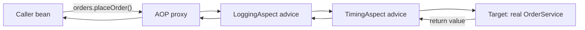
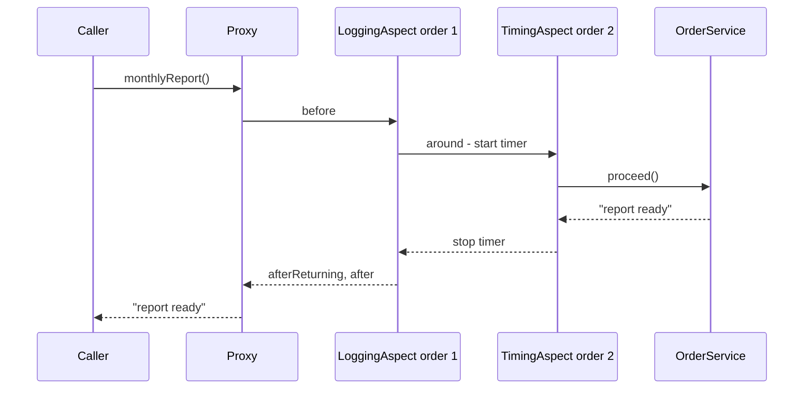
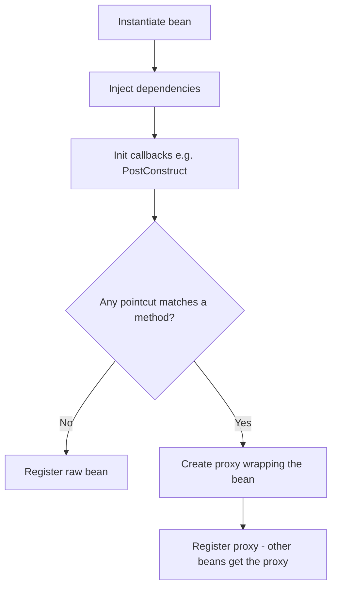
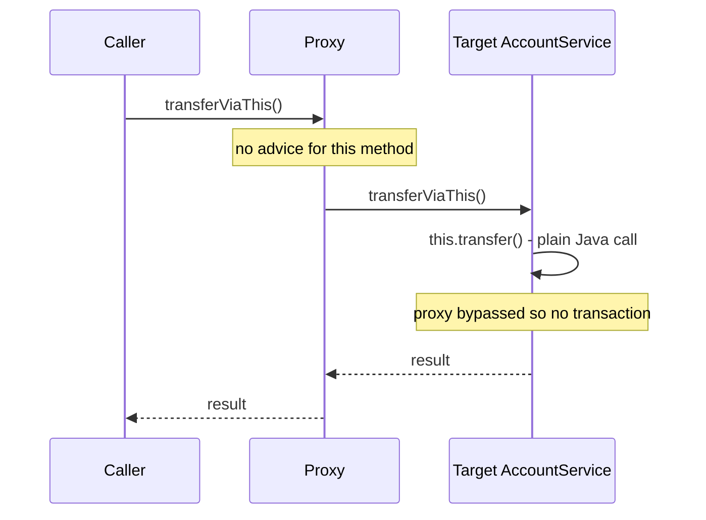

# Chapter 4 — AOP and Proxies

Many things an application must do are not part of any single business rule: logging, timing, transactions, caching, security checks, retries. Written by hand inside every service method, they drown the business logic, and one forgotten line becomes a bug. **Aspect-Oriented Programming (AOP)** lets you write such a concern once and declare *where* it applies. Spring implements AOP with **proxies** — stand-in objects that wrap your beans — and the same mechanism makes `@Transactional`, `@Cacheable`, `@Async`, `@PreAuthorize` and Framework 7's `@Retryable` work.

Understanding proxies is the most useful piece of "Spring internals" knowledge: it explains the most common Spring bug (an annotation that silently does nothing) and comes up in almost every Spring interview.

All code lives in [`code/aop-proxies/`](code/aop-proxies/) — Spring Boot 4.1.1 / Framework 7.0 on Java 25. Every claim marked "proved" is checked by a JUnit test; outputs are real `mvn -q verify` output (log lines trimmed as `...`).

> **Prerequisites.** Beans, the `ApplicationContext` and `BeanPostProcessor`: [Chapter 2](../02-ioc-and-dependency-injection/README.md). The Proxy *design pattern* without Spring: [LLD Proxy Pattern](../../../lld/chapters/09-patterns-structural/README.md#97-proxy-pattern).

---

## 4.1 Cross-cutting concerns and the AOP vocabulary

### The problem it solves

An `OrderService` with ten methods must log each call, time it and run it in a transaction. Without AOP every method looks like this:

```java
public String placeOrder(String item, int qty) {
    log.info("placeOrder {} {}", item, qty);          // logging
    long start = System.nanoTime();                    // timing
    TransactionStatus tx = txManager.getTransaction(def);  // transaction
    try {
        String id = /* ... the 3 lines that actually matter ... */;
        txManager.commit(tx);
        return id;
    } catch (RuntimeException e) {
        txManager.rollback(tx);
        throw e;
    } finally {
        metrics.record("placeOrder", System.nanoTime() - start);
    }
}
```

Such code is a **cross-cutting concern**: a requirement that *cuts across* many classes instead of living in one. Two symptoms:

- **Scattering** — the same code spread over many classes.
- **Tangling** — each method mixes several unrelated concerns.

### What it is

**AOP** modularises cross-cutting concerns: write the concern once in an **aspect**, describe with a **pointcut** which methods it applies to, and the framework applies it.

### The vocabulary

| Term | Meaning | In this chapter's code |
|---|---|---|
| **Join point** | A point during execution where behaviour *could* be added. In Spring AOP always **a method execution on a bean** (not field access, not constructors). | the call `orders.placeOrder("book", 2)` |
| **Pointcut** | A predicate selecting join points — *where*. | `execution(public * ch04.aop.OrderService.*(..))` |
| **Advice** | The code to run there, plus *when* (before, after, around...) — *what* and *when*. | `LoggingAspect.before(...)` |
| **Aspect** | A class bundling pointcuts and advice for one concern. | `LoggingAspect`, `TimingAspect` |
| **Target object** | The real object being advised. | the plain `OrderService` instance |
| **AOP proxy** | The object Spring creates that wraps the target and runs the advice. Other beans receive the proxy. | `OrderService$$SpringCGLIB$$0` |
| **Weaving** | Linking aspects with targets. Spring does it **at runtime by creating proxies**; AspectJ (the original, full AOP tool for Java) can do it at compile time or class-load time. | done by a `BeanPostProcessor` at startup |
| **Advisor** | Spring's internal pairing of one advice with one pointcut. Rarely written by hand. | — |
| **Introduction** | Adding a new interface to an advised object. Rarely used. | — |



The caller *thinks* it holds an `OrderService`; it holds the proxy, which runs the advice chain and eventually calls the real object.

---

## 4.2 Writing aspects with `@Aspect`

### How to set it up

1. Add the starter. In **Boot 4** it is `spring-boot-starter-aspectj` (called `spring-boot-starter-aop` up to Boot 3.x; renamed to make clear it brings AspectJ's annotation support):

   ```xml
   <dependency>
     <groupId>org.springframework.boot</groupId>
     <artifactId>spring-boot-starter-aspectj</artifactId>
   </dependency>
   ```

2. Boot's `AopAutoConfiguration` sees AspectJ on the classpath and switches on `@EnableAspectJAutoProxy` (property `spring.aop.auto`, default `true`). In plain Spring add `@EnableAspectJAutoProxy` to a `@Configuration` class yourself.
3. Annotate the class **both** `@Aspect` and `@Component` (or register it with `@Bean`). `@Aspect` alone is *not* a stereotype — scanning ignores it, and an aspect that is not a bean never runs.

### The five kinds of advice

| Annotation | Runs | Can it change the outcome? | Typical use |
|---|---|---|---|
| `@Before` | before the method | only by throwing (the method then never runs) | argument checks, audit "who called" |
| `@AfterReturning` | after a normal return | reads the return value (`returning=`), cannot replace it | log results, publish an event |
| `@AfterThrowing` | after the method throws | reads the exception (`throwing=`); it still propagates unless the advice throws a different one | translate/log errors |
| `@After` | always, like `finally` | no | release resources, clear context |
| `@Around` | wraps the call; *you* call `proceed()` | yes: skip the call, change arguments or return value, catch exceptions, retry | timing, caching, transactions, retries |

Spring docs' rule: use the **least powerful** advice that does the job. A `@Before` cannot forget to call `proceed()`; an `@Around` can.

### Example: logging aspect

The business class knows nothing about logging ([`OrderService.java`](code/aop-proxies/src/main/java/ch04/aop/OrderService.java)):

```java
@Service
public class OrderService {
    public String placeOrder(String item, int quantity) {
        return "order-" + item + "-x" + quantity;
    }
    public void cancel(String orderId) {
        if (orderId.startsWith("unknown")) {
            throw new IllegalArgumentException("no such order: " + orderId);
        }
    }
    @Timed("monthly-report")
    public String monthlyReport() throws InterruptedException {
        Thread.sleep(20);                  // pretend to do slow work
        return "report ready";
    }
}
```

The aspect ([`LoggingAspect.java`](code/aop-proxies/src/main/java/ch04/aop/LoggingAspect.java)) writes into a small `CallLog` bean so a test can check the exact order:

```java
@Aspect                 // "this class contains advice + pointcuts"
@Component              // ...and it must also be a bean, or Spring never sees it
@Order(1)               // lower number = outer layer = runs first on the way in
public class LoggingAspect {
    private final CallLog log;
    public LoggingAspect(CallLog log) { this.log = log; }

    // A named, reusable pointcut: every public method of OrderService
    @Pointcut("execution(public * ch04.aop.OrderService.*(..))")
    void orderServiceMethods() {}

    @Before("orderServiceMethods()")
    public void before(JoinPoint jp) {
        log.add("before " + jp.getSignature().getName() + " args=" + Arrays.toString(jp.getArgs()));
    }

    @AfterReturning(pointcut = "orderServiceMethods()", returning = "result")
    public void afterReturning(JoinPoint jp, Object result) {
        log.add("afterReturning " + jp.getSignature().getName() + " -> " + result);
    }

    @AfterThrowing(pointcut = "orderServiceMethods()", throwing = "ex")
    public void afterThrowing(JoinPoint jp, Exception ex) {
        log.add("afterThrowing " + jp.getSignature().getName() + " -> " + ex.getMessage());
    }

    @After("orderServiceMethods()")   // like 'finally': runs on success AND on exception
    public void after(JoinPoint jp) {
        log.add("after " + jp.getSignature().getName());
    }
}
```

- `@Pointcut` on an empty method gives the expression a reusable **name** (`orderServiceMethods()`); the body never runs.
- `JoinPoint` exposes the method signature, the arguments (`getArgs()`), the target (`getTarget()`) and the proxy (`getThis()`).
- `returning = "result"` binds the return value to the parameter named `result`; declaring it `String` instead of `Object` restricts matching to methods returning `String`.
- `throwing = "ex"` does the same for the exception; the parameter type also filters.

The test ([`AspectsTest.java`](code/aop-proxies/src/test/java/ch04/AspectsTest.java)):

```java
@Test
void adviceRunsAroundASuccessfulCall() {
    String result = orders.placeOrder("book", 2);
    System.out.println("result = " + result);
    log.lines().forEach(l -> System.out.println("  " + l));
    assertThat(log.lines()).containsExactly(
            "before placeOrder args=[book, 2]",
            "afterReturning placeOrder -> order-book-x2",
            "after placeOrder");
}

@Test
void adviceRunsWhenTheMethodThrows() {
    assertThatThrownBy(() -> orders.cancel("unknown-7"))
            .isInstanceOf(IllegalArgumentException.class);   // the aspect does not swallow it
    log.lines().forEach(l -> System.out.println("  " + l));
    assertThat(log.lines()).containsExactly(
            "before cancel args=[unknown-7]",
            "afterThrowing cancel -> no such order: unknown-7",
            "after cancel");
}
```

Output:

```output
result = order-book-x2
  before placeOrder args=[book, 2]
  afterReturning placeOrder -> order-book-x2
  after placeOrder
  before cancel args=[unknown-7]
  afterThrowing cancel -> no such order: unknown-7
  after cancel
```

`@After` ran **after** `@AfterReturning`/`@AfterThrowing`. Since Framework 5.2.7, advice of the *same* aspect on the *same* join point has a fixed precedence — `@Around`, `@Before`, `@After`, `@AfterReturning`, `@AfterThrowing` from highest to lowest — and `@After` is effectively invoked after that aspect's returning/throwing advice, like a `finally` block.

### `@Around` advice and custom annotations

`@Around` receives a `ProceedingJoinPoint`; `proceed()` continues to the next advice or the real method, and not calling it skips the method. A common pattern triggers an aspect with your own annotation:

```java
@Retention(RetentionPolicy.RUNTIME)  // must be visible at runtime for the pointcut to see it
@Target(ElementType.METHOD)
public @interface Timed {
    String value() default "";       // optional label
}
```

`RUNTIME` retention is required because Spring inspects annotations by reflection at runtime; with `CLASS`/`SOURCE` retention the pointcut never matches.

```java
@Aspect
@Component
@Order(2)               // inner layer: runs after LoggingAspect's @Before
public class TimingAspect {
    private final CallLog log;
    public TimingAspect(CallLog log) { this.log = log; }

    // Matches any bean method annotated with @Timed and binds the annotation to 'timed'
    @Around("@annotation(timed)")
    public Object time(ProceedingJoinPoint pjp, Timed timed) throws Throwable {
        long start = System.nanoTime();
        log.add("timer start [" + timed.value() + "]");
        try {
            return pjp.proceed();          // call the next advice / the real method
        } finally {
            long ms = (System.nanoTime() - start) / 1_000_000;
            log.add("timer stop [" + timed.value() + "] took>=20ms? " + (ms >= 20));
        }
    }
}
```

- `@annotation(timed)` uses the *parameter name*; its type `Timed` tells AspectJ which annotation to look for, and the instance is passed in (`timed.value()`).
- The advice **must return** what `proceed()` returned. An `@Around` method declared `void`, or one that forgets `return`, makes every advised method return `null` — a classic bug.
- Declare `throws Throwable` and let exceptions pass unless you intend to handle them.

### Ordering several aspects

Spring orders aspects on the same method with `@Order` (or `Ordered`). Lower value = higher precedence = **outer** layer: first in, last out. Without an explicit order the sequence is undefined.

```java
@Test
void twoAspectsNestByOrder() throws Exception {
    orders.monthlyReport();
    log.lines().forEach(l -> System.out.println("  " + l));
    assertThat(log.lines()).containsExactly(
            "before monthlyReport args=[]",        // @Order(1) LoggingAspect: outer
            "timer start [monthly-report]",        // @Order(2) TimingAspect: inner
            "timer stop [monthly-report] took>=20ms? true",
            "afterReturning monthlyReport -> report ready",
            "after monthlyReport");
}
```

Output:

```output
  before monthlyReport args=[]
  timer start [monthly-report]
  timer stop [monthly-report] took>=20ms? true
  afterReturning monthlyReport -> report ready
  after monthlyReport
```



Spring's infrastructure advisors (transactions, caching, security) have orders too; a retry aspect must be *outside* the transaction aspect so each retry gets a fresh transaction.

### Common mistakes

- **Forgetting `@Component`** on the aspect → nothing happens, no error.
- **`@Around` without `return pjp.proceed()`** → methods return `null`, or the real method never runs.
- **Swallowing exceptions** in `@Around` → callers think a failure succeeded, and an outer `@Transactional` doesn't roll back.
- **Pointcut too broad** (`execution(* *(..))`) → Spring tries to proxy every bean, including infrastructure; startup slows or fails oddly. Restrict to your packages.
- **Relying on unordered aspects** → inconsistent behaviour between runs or environments.

---

## 4.3 Pointcut expressions

### What it is

A pointcut expression is a tiny query language (from AspectJ) that selects methods. Spring AOP supports a subset of AspectJ's **pointcut designators** (PCDs):

| Designator | Matches method executions ... | Example |
|---|---|---|
| `execution(...)` | whose signature matches a pattern (the main one) | `execution(* com.shop.service.*.*(..))` |
| `within(type-pattern)` | declared in matching types/packages | `within(com.shop..*)` |
| `this(Type)` | where the **proxy** is an instance of `Type` | `this(com.shop.Auditable)` |
| `target(Type)` | where the **target** is an instance of `Type` | `target(com.shop.Repository)` |
| `args(...)` | whose runtime arguments match (and binds them) | `args(id, ..)` |
| `@annotation(A)` | on methods annotated with `A` | `@annotation(com.shop.Timed)` |
| `@within(A)` | in classes annotated with `A` | `@within(org.springframework.stereotype.Service)` |
| `@target(A)` | where the target's runtime class has `A` | `@target(com.shop.Audited)` |
| `@args(A)` | whose argument types carry annotation `A` | `@args(com.shop.Sensitive)` |
| `bean(name)` | on beans with a matching name — **Spring-only**, not AspectJ | `bean(*Service)` |

### The `execution` pattern, piece by piece

```text
execution( modifiers?  return-type  declaring-type?.method-name(params)  throws? )
execution( public      *            com.shop.service..*Service.find*(Long, ..) )
```

| Part | Meaning in the example |
|---|---|
| `public` | optional; only public methods (with CGLIB proxies, protected/package-private methods can also be matched) |
| `*` | any return type |
| `com.shop.service..` | the package `com.shop.service` **or any sub-package** (`..` in a type pattern) |
| `*Service` | any type whose name ends in `Service` |
| `find*` | method names starting with `find` |
| `(Long, ..)` | first parameter `Long`, then zero or more of anything (`..` in a parameter list). `()` = no params, `(*)` = exactly one param of any type |

### Combining and reusing

Pointcuts combine with `&&`, `||`, `!` and can reference named pointcuts from other classes:

```java
public class CommonPointcuts {
    @Pointcut("within(com.shop..web..*)")     public void webLayer() {}
    @Pointcut("within(com.shop..service..*)") public void serviceLayer() {}
    @Pointcut("execution(* com.shop..*Repository.*(..))") public void dataAccess() {}
}

@Before("com.shop.aop.CommonPointcuts.serviceLayer() && args(id, ..)")
public void checkId(Long id) { /* id is bound from the first argument */ }
```

The chapter's `TracingAspect` uses a `within` pointcut that excludes the aspect's own class:

```java
@Before("within(ch04.proxy..*) && !within(ch04.proxy.TracingAspect)")
public void trace(JoinPoint jp) { log.add("trace " + jp.getSignature().toShortString()); }
```

### Performance tip

Matching is done once per bean method at startup and cached, so runtime cost is small — but **kinded** (`execution`) and **scoping** (`within`) designators are cheapest; contextual ones (`this`, `target`, `args`, `@annotation`) are more expensive alone. Include a `within(...)` scope whenever possible.

### Common mistakes

- `com.shop.*` matches only types directly in `com.shop` (one package level — `execution(* com.acme.*.*(..))` misses `com.acme.billing.InvoiceService`); use `com.shop..*` for sub-packages.
- `execution(* save(*))` matches exactly one parameter, not "any parameters" — that is `(..)`.
- A custom trigger annotation only on an **interface** method: `@annotation(...)` matches the method actually executed on the bean class, so annotate the implementation. (Spring's own annotations such as `@Transactional` use a more forgiving lookup.)

---

## 4.4 How Spring AOP works: proxies

### What it is

A **proxy** has the same type as your bean (callers can't tell the difference) but forwards each call through the advice chain to the real object. Spring creates proxies **at startup** in a `BeanPostProcessor` ([§2.8](../02-ioc-and-dependency-injection/README.md#28-post-processors-the-containers-extension-points)); for `@Aspect` support that is `AnnotationAwareAspectJAutoProxyCreator`.

### How it works

1. The container creates the real bean (constructor, injection, `@PostConstruct`).
2. In `postProcessAfterInitialization` the auto-proxy creator asks: *does any advisor's pointcut match any method of this bean's class?*
3. No: the raw bean is registered. Yes: it builds a proxy with the matching advisors, and **the proxy** is registered and injected everywhere.
4. At call time the proxy walks a chain of interceptors (advice objects that act before and after passing the call on); the last link calls the real method.



### Two kinds of proxy

| | **JDK dynamic proxy** | **CGLIB proxy** |
|---|---|---|
| Built with | `java.lang.reflect.Proxy` (part of the JDK) | bytecode generation of a **subclass** (Spring ships a repackaged CGLIB) |
| Requires | the bean implements at least one interface | the class is not `final` and has a usable constructor |
| The proxy *is a* | implementation of the interfaces only | subclass of the bean's class |
| Can be injected as the concrete class? | **No** — `BeanNotOfRequiredTypeException` | Yes |
| Methods it can intercept | interface methods (public) | non-final, non-private methods (public, protected, package-private within the same package) |
| Class name you'll see | `jdk.proxy2.$Proxy83` | `OrderService$$SpringCGLIB$$0` |

**Which one does Spring pick?**

- **Plain Spring Framework:** JDK proxy if the bean implements an interface, otherwise CGLIB (unless `proxyTargetClass = true`).
- **Spring Boot:** `spring.aop.proxy-target-class` defaults to **`true`**, so Boot uses **CGLIB for everything**, even beans with interfaces — so injecting by concrete class never fails. Set it to `false` for plain-Spring behaviour.
- **Framework 7:** `@Proxyable` on a bean class or `@Bean` method overrides the global default for that bean: `@Proxyable(ProxyType.INTERFACES)`, `@Proxyable(ProxyType.TARGET_CLASS)`, or `@Proxyable(interfaces = ...)` to expose only some interfaces. Framework 7 also merges the proxy settings of the various `@Enable...` annotations into one global default.

Proved in [`ProxyTypesTest.java`](code/aop-proxies/src/test/java/ch04/ProxyTypesTest.java):

```java
static String describe(Object bean) {
    String kind = AopUtils.isJdkDynamicProxy(bean) ? "JDK dynamic proxy"
                : AopUtils.isCglibProxy(bean) ? "CGLIB proxy" : "not a proxy";
    return kind + " -> " + bean.getClass().getName();
}

@Test
void whatKindOfProxyDidSpringCreate() {
    System.out.println("OrderService (no interface):       " + describe(orders));
    System.out.println("DefaultGreetingService (interface): " + describe(greeting));
    System.out.println("@Proxyable(INTERFACES) bean:        " + describe(interfaceOnly));
    assertThat(AopUtils.isCglibProxy(orders)).isTrue();
    assertThat(AopUtils.isCglibProxy(greeting)).isTrue();     // Boot default: proxy-target-class=true
    assertThat(AopUtils.isJdkDynamicProxy(interfaceOnly)).isTrue();
    assertThat(interfaceOnly).isNotInstanceOf(DefaultGreetingService.class);
}
```

where the third bean is:

```java
@Service
@Proxyable(ProxyType.INTERFACES)       // ask for a JDK dynamic proxy
public class InterfaceOnlyGreetingService implements GreetingService { ... }
```

Output:

```output
OrderService (no interface):       CGLIB proxy -> ch04.aop.OrderService$$SpringCGLIB$$0
DefaultGreetingService (interface): CGLIB proxy -> ch04.proxy.DefaultGreetingService$$SpringCGLIB$$0
@Proxyable(INTERFACES) bean:        JDK dynamic proxy -> jdk.proxy2.$Proxy83
```

### A proxy by hand: `java.lang.reflect.Proxy`

A JDK dynamic proxy without Spring: give the JDK interfaces and an `InvocationHandler`; every call lands in `invoke(proxy, method, args)`:

```java
GreetingService target = new DefaultGreetingService();
InvocationHandler handler = (proxy, method, args) -> {
    System.out.println("  [handler] before " + method.getName());
    Object result = method.invoke(target, args);      // delegate to the real object
    System.out.println("  [handler] after  " + method.getName());
    return result;
};
GreetingService proxy = (GreetingService) Proxy.newProxyInstance(
        GreetingService.class.getClassLoader(), new Class<?>[] {GreetingService.class}, handler);
String out = proxy.greet("Ada");
System.out.println("result = " + out + ", proxy class = " + proxy.getClass().getSimpleName());
```

```output
  [handler] before greet
  [handler] after  greet
result = Hello, Ada, proxy class = $Proxy137
```

Spring's JDK proxies are exactly this, with an `InvocationHandler` that runs the advisor chain.

### Spring's `ProxyFactory`

Spring exposes its proxy machinery as `ProxyFactory` (handy in tests or libraries). The advice is an AOP Alliance (a shared set of AOP interfaces) `MethodInterceptor` — the low-level interface all Spring advice is converted into:

```java
MethodInterceptor upper = inv -> ((String) inv.proceed()).toUpperCase();

ProxyFactory jdk = new ProxyFactory(new DefaultGreetingService());
jdk.addInterface(GreetingService.class);   // interfaces known + proxyTargetClass=false -> JDK
jdk.addAdvice(upper);
GreetingService p1 = (GreetingService) jdk.getProxy();

ProxyFactory cglib = new ProxyFactory(new DefaultGreetingService());
cglib.setProxyTargetClass(true);           // force a subclass
cglib.addAdvice(upper);
DefaultGreetingService p2 = (DefaultGreetingService) cglib.getProxy();
```

```output
factory 1: JDK dynamic proxy -> jdk.proxy2.$Proxy83 says HELLO, BOB
factory 2: CGLIB proxy -> ch04.proxy.DefaultGreetingService$$SpringCGLIB$$1 says HELLO, BOB
```

(The JDK reuses one proxy class per interface set, hence `$Proxy83` twice. The numbers depend on how many proxy classes were generated before, so your run may differ.)

### Trade-offs

| Concern | JDK proxy | CGLIB proxy |
|---|---|---|
| Inject by concrete class | fails | works |
| `final` classes / methods | irrelevant (interface-based) | class cannot be proxied / method silently not advised |
| Startup cost | tiny | generates a class per bean (small, cached) |
| Constructor | not involved | Spring uses Objenesis (creates objects without calling a constructor), so the target's constructor is **not** run again for the proxy |
| Recommended | when you program to interfaces and want only interface methods exposed | Boot's default; works for classes without interfaces |

E.g. in a Boot app a `@Transactional` `PaymentService implements Payments` gets a CGLIB proxy; in plain Spring it gets a JDK proxy, and injecting `PaymentServiceImpl` fails because the proxy only implements `Payments`.

---

## 4.5 Proxy limitations — proved

Because the advice lives in the proxy, **advice runs only when a call passes through the proxy**. Every limitation below follows from that.

### Self-invocation

#### What it is
Inside a bean, `this` is the **target object**, not the proxy. `this.someMethod()` (or just `someMethod()`) is a plain Java call that never touches the proxy: no transaction, caching, async, retry or security check.



#### Proof 1 — `@Transactional`

```java
@Service
public class AccountService {
    private final ObjectProvider<AccountService> self;   // lazy handle to *our own proxy*

    public AccountService(ObjectProvider<AccountService> self) { this.self = self; }

    @Transactional
    public String transfer() {
        // true only if a transaction proxy started a transaction before we got here
        return "transaction active = " + TransactionSynchronizationManager.isActualTransactionActive();
    }
    public String transferViaThis()      { return this.transfer(); }              // skips the proxy
    public String transferViaSelfProxy() { return self.getObject().transfer(); }  // goes through it
}
```

`TransactionSynchronizationManager.isActualTransactionActive()` reports whether a real transaction is bound to the current thread (Spring tracks transactions per thread). The project has H2 (in-memory database) + `spring-boot-starter-jdbc`, so Boot configured a `DataSourceTransactionManager`.

#### Proof 2 — `@Cacheable`

```java
@Cacheable("prices")                    // proxy checks the "prices" cache before calling us
public int price(String sku) {
    realCalls.incrementAndGet();         // counts how often the real method body runs
    return sku.length() * 100;
}
public int priceTwiceViaThis(String sku) {
    return this.price(sku) + this.price(sku);   // self-invocation: cache never consulted
}
```

#### Proof 3 — `@Async`

```java
@Async                                   // proxy hands the call to a TaskExecutor thread
public CompletableFuture<String> build() {
    return CompletableFuture.completedFuture(Thread.currentThread().getName());
}
public CompletableFuture<String> buildViaThis() {
    return this.build();                 // runs on the CALLER's thread
}
```

The test ([`SelfInvocationTest.java`](code/aop-proxies/src/test/java/ch04/SelfInvocationTest.java)) asserts all three:

```output
caller -> proxy -> transfer():        transaction active = true
caller -> proxy -> this.transfer():   transaction active = false
caller -> proxy -> self.transfer():   transaction active = true
2 external calls -> real method ran 1 time(s)
2 internal calls -> real method ran 2 time(s)
caller thread:          main
@Async through proxy:   task-1
@Async via this.build(): main
```

`task-1` is a thread of Boot's auto-configured `applicationTaskExecutor` (a thread pool of reusable workers). Via `this`, the "async" method ran synchronously on `main` — no error, no warning.

#### Fixes, best first

1. **Move the method to another bean.** If `transfer()` must be transactional on its own, it probably belongs in a separate service anyway.
2. **Call through the proxy by self-injection** — `ObjectProvider<T>` or `@Autowired @Lazy MyService self` (shown above). Works but surprises readers; comment it.
3. **`AopContext.currentProxy()`** — needs `@EnableAspectJAutoProxy(exposeProxy = true)` and couples code to Spring AOP; the docs discourage it.
4. **Annotate the outer (entry-point) method** instead, if that's what you meant.
5. **AspectJ weaving** (§4.8) — advice woven into bytecode, so `this` calls are advised. Rarely worth the build complexity.

### `final` methods on CGLIB proxies

A CGLIB proxy is a subclass, which **cannot override a `final` method** — so a `final` method runs **on the proxy object itself**. Worse, Spring creates proxy instances without running your constructor, so the proxy's fields are `null`.

```java
@Service
public class PricingService {
    private final List<String> currencies;
    public PricingService() { this.currencies = List.of("EUR", "USD"); }

    public String currencies()             { return "currencies=" + currencies; }
    public final String currenciesFinal()  { return "currencies=" + currencies; }
}
```

`TracingAspect` advises every method of this class, so it is proxied:

```java
String normal = pricing.currencies();
String viaFinal = pricing.currenciesFinal();
System.out.println("normal method: " + normal);
System.out.println("final method:  " + viaFinal);
System.out.println("advice log:    " + log.lines());
assertThat(viaFinal).isEqualTo("currencies=null");            // proxy's own, never-initialised field
```

```output
normal method: currencies=[EUR, USD]
final method:  currencies=null
advice log:    [trace PricingService.currencies()]
```

The final method was not advised **and** read `null`. In real code: a mysterious `NullPointerException` on a field that "definitely was injected". Kotlin classes are `final` by default, which is why Kotlin Spring projects use the `kotlin-spring` (all-open) compiler plugin to make annotated classes non-final.

A `final` **class** cannot be subclassed at all; if it needs advice and has no interface, startup fails saying CGLIB cannot subclass it.

### Other things proxies cannot advise

| Case | Why | What happens |
|---|---|---|
| `private` methods | not visible to a subclass, not on an interface | advice silently ignored |
| `static` methods | not called on an instance | ignored |
| Calls inside the **constructor** or `@PostConstruct` | proxy does not exist yet / you are on the target | ignored (e.g. no transaction, no async for `@Transactional`/`@Async` called from `@PostConstruct`) |
| Objects created with `new` | not Spring beans, never proxied | ignored |
| Field access | Spring AOP supports only method execution join points | not possible (needs AspectJ) |
| Methods only on the class, with a JDK proxy | the proxy implements only interfaces | not reachable through the proxy |

For `@Transactional`: since Framework 6.0, `protected` and package-private methods can be transactional with CGLIB proxies; with interface-based proxies they must be `public`, and `private` never works.

### In the interview

**30-second answer:** "Spring AOP is proxy-based. At startup a BeanPostProcessor wraps any bean matching a pointcut in a proxy — CGLIB by default in Boot, JDK dynamic proxy for interface-only proxying — and other beans get the proxy. Advice runs only when a call goes through the proxy, so `this.method()` calls, private or final methods, and calls from constructors skip `@Transactional`, `@Cacheable`, `@Async` and custom aspects. The fix is usually to move the method to another bean, or call through an injected reference to the proxy."

- *"My `@Transactional` method doesn't roll back — why?"* → Self-invocation; private/final method; the exception is checked (declared with `throws`, e.g. `IOException` — rollback defaults to unchecked `RuntimeException`s only, see [Chapter 7](../07-data-access-jdbc-and-transactions/README.md)); exception caught inside the method; bean created with `new`.
- *"How can you see if a bean is proxied?"* → `AopUtils.isAopProxy(bean)` / `isCglibProxy` / `isJdkDynamicProxy`, or print `bean.getClass()` and look for `$$SpringCGLIB$$` or `$Proxy`.

---

## 4.6 Spring features built on proxies

Many annotations in this book are "AOP you did not write". They use infrastructure advisors, not `@Aspect` classes, but obey **all** the rules of §4.5 (e.g. `@PreAuthorize` does not protect a `private` method).

| Annotation | Switched on by | Interceptor / processor | Chapter |
|---|---|---|---|
| `@Transactional` | Boot auto-config (`@EnableTransactionManagement` in plain Spring) | `TransactionInterceptor` | [7](../07-data-access-jdbc-and-transactions/README.md) |
| `@Cacheable`, `@CachePut`, `@CacheEvict` | `@EnableCaching` | `CacheInterceptor` | [9](../09-spring-data-beyond-jpa-and-caching/README.md) |
| `@Async` | `@EnableAsync` | `AsyncExecutionInterceptor` | [14](../14-messaging-async-and-scheduling/README.md) |
| `@Retryable`, `@ConcurrencyLimit` (Framework 7) | `@EnableResilientMethods` | `RetryAnnotationBeanPostProcessor`, `ConcurrencyLimitBeanPostProcessor` | 4.7 below |
| `@PreAuthorize`, `@PostAuthorize`, `@Secured` | `@EnableMethodSecurity` | `AuthorizationManagerBeforeMethodInterceptor`, ... | [10](../10-spring-security-1-fundamentals/README.md) |
| `@Validated` on a class + constraint annotations on method parameters | Boot auto-config (`MethodValidationPostProcessor`) | `MethodValidationInterceptor` | [5](../05-spring-mvc-and-rest/README.md) |
| `@Observed` (Micrometer, Spring's metrics library) | an `ObservedAspect` bean | an `@Aspect` | [15](../15-observability-and-production/README.md) |
| Spring Data repository interfaces | `@EnableJpaRepositories` / Boot | JDK proxy generated for the interface | [8](../08-spring-data-jpa-and-hibernate/README.md) |
| `@Configuration` classes (full mode) | always | CGLIB subclass intercepting `@Bean` method calls (not AOP advice, same technique) | [2](../02-ioc-and-dependency-injection/README.md) |

**Order matters when several apply.** With `@Retryable` + `@Transactional` on one method, if the transaction interceptor is outside the retry interceptor, all attempts share one transaction already marked rollback-only (doomed to be undone) after the first failure. Put retries one layer up, or set orders explicitly (`@EnableTransactionManagement(order = ...)`, `@EnableResilientMethods(order = ...)`).

---

## 4.7 Framework 7 core resilience: `@Retryable` and `@ConcurrencyLimit`

### What it is

Spring Framework **7.0** (November 2025) added a small resilience toolkit (keeping an app working when its dependencies fail) to the core, in `org.springframework.resilience.annotation` and `org.springframework.core.retry`:

- **`@Retryable`** — call a method again when it throws, with back-off delay.
- **`@ConcurrencyLimit`** — at most N threads inside a method at a time (a *bulkhead*: a limit that stops one overloaded part from sinking the whole app, named after a ship's watertight walls).
- **`RetryTemplate` / `RetryPolicy`** — the same retry logic, programmatically.

They replace most uses of the separate **Spring Retry** project; Boot 4 removed dependency management for Spring Retry. They are **not** a full resilience library: no circuit breaker (stops calling a failing service for a while), rate limiter (caps calls per second) or time limiter (gives up after a deadline) — use Resilience4j or Spring Cloud Circuit Breaker ([Chapter 16](../16-spring-cloud-and-microservices/README.md), [circuit breaker notes](../../../microservices-patterns/chapters/06-circuit-breaker/README.md)).

### Why it matters

Remote calls fail *transiently*: a timeout, a 503 ("service unavailable") during a deploy, a dropped connection. Retrying once or twice with a short, growing delay turns many such failures into successes. And with **virtual threads** (very cheap JVM-managed threads — [Java book 15.4](../../../java/chapters/15-concurrency-2-modern/README.md#154-virtual-threads)) there is no thread-pool size naturally capping how many callers hit a slow downstream service — `@ConcurrencyLimit` puts that cap back.

### How to switch it on

Add `@EnableResilientMethods` to a configuration class. As of Boot 4.1 there is no auto-configuration for it, so without it `@Retryable` is silently ignored.

```java
@SpringBootApplication
@EnableCaching          // turns on the @Cacheable proxy
@EnableAsync            // turns on the @Async proxy
@EnableResilientMethods // Framework 7: turns on @Retryable and @ConcurrencyLimit
public class AopApplication { ... }
```

(Alternatively register `RetryAnnotationBeanPostProcessor` and/or `ConcurrencyLimitBeanPostProcessor` beans.)

### `@Retryable` attributes (Framework 7.0)

| Attribute | Default | Meaning |
|---|---|---|
| `includes` / `value` | empty = all exceptions | exception types to retry (also matches **nested causes**) |
| `excludes` | empty | exception types never to retry |
| `predicate` | none | a `MethodRetryPredicate` class for custom decisions, applied after includes/excludes |
| `maxRetries` | `3` | retries **after** the first call → total attempts = 1 + `maxRetries` |
| `delay` | `1000` ms | wait before the first retry |
| `multiplier` | `1.0` | each delay = previous × multiplier (exponential back-off when > 1) |
| `maxDelay` | `Long.MAX_VALUE` | cap for the growing delay |
| `jitter` | `0` | random variation per delay, so many clients don't retry in lock-step |
| `timeout` | `0` = none | total time budget for all attempts including delays (since 7.0.2) |
| `timeUnit` | `MILLISECONDS` | unit for the numeric delay attributes |
| `...String` variants | — | `maxRetriesString`, `delayString`, ... accept `${...}` placeholders and SpEL |

It also works on methods returning `Mono`/`Flux` (Project Reactor's types for 0–1 and 0–N future values; the retry is applied to the reactive pipeline), and publishes a `MethodRetryEvent` per failed attempt, observable with `@EventListener`.

### Example: a flaky client

```java
@Service
public class InventoryClient {
    // up to 3 retries (4 attempts in total), waiting 10 ms, then 20 ms, then 40 ms
    @Retryable(includes = TransientException.class, maxRetries = 3, delay = 10, multiplier = 2)
    public int stockFor(String sku) {
        attempts.add("attempt " + (attempts.size() + 1));
        if (failuresLeft-- > 0) {
            throw new TransientException("inventory timed out");
        }
        return 42;
    }

    // IllegalArgumentException is not in 'includes', so it is never retried
    @Retryable(includes = TransientException.class, maxRetries = 3, delay = 10)
    public int stockForBadSku(String sku) {
        attempts.add("attempt " + (attempts.size() + 1));
        throw new IllegalArgumentException("bad sku " + sku);
    }
}
```

The tests ([`ResilienceTest.java`](code/aop-proxies/src/test/java/ch04/ResilienceTest.java)) make it fail twice (recovers), ten times (gives up), and with a non-retryable exception:

```java
inventory.failNextCalls(2);
int stock = inventory.stockFor("SKU-1");            // succeeds on attempt 3

inventory.failNextCalls(10);
assertThatThrownBy(() -> inventory.stockFor("SKU-1"))
        .isInstanceOf(TransientException.class);    // the LAST original exception
assertThat(inventory.attempts()).hasSize(4);        // 1 call + 3 retries
```

```output
stock = 42 after [attempt 1, attempt 2, attempt 3]
gave up after [attempt 1, attempt 2, attempt 3, attempt 4]
IllegalArgumentException -> [attempt 1]
```

When all attempts fail, the caller gets the **last original exception**, not a wrapper — existing `catch` blocks keep working.

### `@ConcurrencyLimit`

```java
@ConcurrencyLimit(2)                        // default policy BLOCK: extra callers wait
public void print(String doc) throws InterruptedException {
    int now = inside.incrementAndGet();
    maxInside.accumulateAndGet(now, Math::max);
    Thread.sleep(50);                        // hold the "printer" for a while
    inside.decrementAndGet();
}

@ConcurrencyLimit(limit = 1, policy = ConcurrencyLimit.ThrottlePolicy.REJECT)  // 7.0.3+
public void printUrgent(String doc) throws InterruptedException {
    Thread.sleep(100);
}
```

- `value`/`limit`: maximum concurrent invocations **per bean instance**; `1` makes the method behave like a lock on the bean.
- `limitString`: placeholder/SpEL variant, e.g. `"${printer.max-concurrent}"`.
- `policy` (since 7.0.3): `BLOCK` (default) makes extra callers wait; `REJECT` throws `InvocationRejectedException` (a `RejectedExecutionException` subclass) immediately.

6 virtual threads call `print`; a second caller hits `printUrgent` while the first is inside:

```output
6 callers, max inside print() at once = 2
second caller -> InvocationRejectedException
```

### Programmatic: `RetryTemplate`

For a retry scope of a few lines, or policies chosen at runtime:

```java
RetryPolicy policy = RetryPolicy.builder()
        .maxRetries(4)
        .delay(Duration.ofMillis(5))
        .multiplier(2)
        .includes(TransientException.class)
        .build();
RetryTemplate retry = new RetryTemplate(policy);

String result = retry.execute(() -> {
    if (calls.incrementAndGet() < 3) throw new TransientException("busy");
    return "done on call " + calls.get();
});
```

```output
RetryTemplate -> done on call 3
```

`execute(...)` throws a checked `RetryException` on exhaustion holding every failure (`getExceptions()`, `getLastException()`, `getRetryCount()`); `invoke(...)` rethrows the last original exception unchecked. A `RetryListener` can observe each attempt (logging, metrics).

### Trade-offs: which retry tool?

| | Framework 7 `@Retryable` / `RetryTemplate` | Spring Retry (`org.springframework.retry`) | Resilience4j |
|---|---|---|---|
| Where | built into `spring-context` / `spring-core` | separate library, no longer managed by Boot 4 | separate library + Spring Boot integration |
| Retry + back-off + jitter | yes | yes | yes |
| Recovery method (`@Recover`) | no — catch the exception at the caller | yes | fallback methods |
| Circuit breaker, rate limiter, time limiter | no | basic circuit breaker only | yes, all |
| Bulkhead | `@ConcurrencyLimit` | no | semaphore and thread-pool bulkheads |
| Metrics | via `RetryListener` / `MethodRetryEvent` | listeners | built-in Micrometer metrics |
| Choose when | simple retries / limits, no extra dependency | legacy code | circuit breaking and rich resilience policies |

### When not to use it

- **Non-idempotent operations** (charging a card, sending an email) — a retry after a timeout may do the work twice.

  > **Key term — idempotent:** doing it twice has the same effect as doing it once. "Set the price to 10" is idempotent; "add 10 to the balance" is not. An **idempotency key** is a unique id the caller sends so the server can recognise and skip a repeat. See [System Design Fundamentals](../../../system-design-patterns/modules/00-system-design-fundamentals/README.md) and the [Retry pattern notes](../../../microservices-patterns/chapters/08-retry/README.md). Retry only operations safe to repeat, or make them idempotent first.
- **Errors that won't go away** — validation errors, 4xx responses (the *request* was wrong), `NullPointerException`. Set `includes` narrowly.
- **Retry at every layer** — gateway, client library and service each retrying 3 times turns one request into 64 downstream calls ("retry storm"). Retry at one layer.
- **Inside a transaction** — see §4.6.

### Common mistakes

- Forgetting `@EnableResilientMethods` → no retries, no error.
- Self-invocation → `this.stockFor()` is not retried.
- Reading `maxRetries = 3` as "3 attempts" → it is 4.
- No jitter across a fleet of instances → synchronised retry waves after an outage.

---

## 4.8 Spring AOP vs AspectJ

### What it is

**AspectJ** is the original, full AOP language for Java. Spring borrowed its annotations and pointcut syntax (hence `org.aspectj.lang.annotation.*` imports), but by default does **not** use the AspectJ weaver — it uses its own proxies and only AspectJ's library to *parse and match* pointcuts.

| | Spring AOP (default) | AspectJ weaving |
|---|---|---|
| How advice is applied | runtime proxy around a bean | bytecode modified at compile time (`ajc`), post-compile, or load time (LTW — load-time weaving — with a Java agent that changes classes as the JVM loads them) |
| Join points | method execution on Spring beans only | method call and execution, constructor, field get/set, static initialisers, ... on **any** object |
| Self-invocation, `final`, `private` | not advised | advised |
| Objects created with `new` | not advised | advised |
| Setup | add the starter | AspectJ compiler plugin or `-javaagent`, extra build complexity |
| Performance | a few extra method calls per advised invocation | practically zero overhead (code inlined into the method) |
| Good for | 95% of enterprise needs: transactions, logging, security | fine-grained or domain-object advice, very hot paths |

`@Transactional`, `@Cacheable` and `@Async` can switch to AspectJ mode (`@EnableTransactionManagement(mode = AdviceMode.ASPECTJ)` plus the weaver), removing the self-invocation limitation. Few teams do; extracting a bean is simpler.

### When not to use AOP at all

- **Business logic** — a domain rule ("orders over 1000 need approval") belongs explicitly in the service; hidden advice is hard to follow and test.
- **When a decorator (a wrapper object adding behaviour), filter or interceptor fits** — HTTP concerns belong in servlet filters / `HandlerInterceptor` ([Chapter 5](../05-spring-mvc-and-rest/README.md)); client concerns in `ClientHttpRequestInterceptor` ([Chapter 6](../06-rest-clients-and-http-interfaces/README.md)).
- **Very broad pointcuts** — "log every method" is noise and cost; use tracing/metrics tools ([Chapter 15](../15-observability-and-production/README.md)).

### Real-world examples

- **Spring itself**: transactions, caching, security, async, retries.
- **Micrometer `@Timed` / `@Observed`** — aspects recording metrics/traces.
- **Audit logging** in banking/insurance: an `@Audited` annotation + `@AfterReturning` advice writing who-did-what records.
- **Multi-tenant routing** (one app serving many customer organisations with separate data): an `@Around` aspect sets a tenant id in a `ThreadLocal`/scoped value before repository calls and clears it after.
- **Feature flags / rate limits** on specific methods via custom annotations.

---

## 4.9 Common mistakes (whole chapter)

| Symptom | Likely cause | Fix |
|---|---|---|
| Aspect never runs | aspect is not a bean; starter missing; pointcut doesn't match | add `@Component`; add `spring-boot-starter-aspectj`; test the pointcut |
| `@Transactional`/`@Cacheable`/`@Async`/`@Retryable` ignored | self-invocation; private/final method; bean made with `new`; missing `@Enable...` | extract to another bean; make method public and non-final; inject the bean; enable the feature |
| `NullPointerException` on an injected field inside a method | `final` method on a CGLIB proxy runs on the proxy | remove `final` |
| `BeanNotOfRequiredTypeException` | JDK proxy injected where the concrete class is expected | inject the interface, or use CGLIB (Boot default) |
| Advised method returns `null` | `@Around` advice doesn't return `proceed()`'s result | `return pjp.proceed();` |
| Slow startup / weird errors after adding an aspect | pointcut matches infrastructure beans | scope with `within(com.yourapp..*)` |
| Retry happens inside a failing transaction | transaction interceptor wraps the retry interceptor | retry at a higher layer or set advisor orders |

---

## 4.10 In the interview

**Q: What is AOP and how does Spring implement it?**
AOP modularises cross-cutting concerns such as logging, transactions and security. You write an aspect containing advice and a pointcut; Spring applies it at runtime by wrapping matching beans in proxies created by a `BeanPostProcessor`. Callers get the proxy, which runs the advice chain and then the real method.

- *Follow-up: advice types?* → `@Before`, `@AfterReturning`, `@AfterThrowing`, `@After`, `@Around`. Only `@Around` controls whether the method runs and what it returns; `@AfterThrowing` doesn't stop the exception.
- *Follow-up: order two aspects?* → `@Order` / `Ordered`; lower value is the outer layer.
- *Follow-up: join point in Spring AOP?* → Only method execution on a Spring bean.

**Q: JDK dynamic proxy vs CGLIB — which does Spring Boot use?**
CGLIB for all beans by default (`spring.aop.proxy-target-class=true`), which allows injecting by class. Plain Spring uses JDK proxies when interfaces exist. Framework 7 adds `@Proxyable` to override per bean.

- *Follow-up: limits of CGLIB?* → No `final` classes; `final`/`private` methods are not advised; `final` methods even run on the uninitialised proxy instance.

**Q: Why might `@Async`/`@Transactional` not work?** → Self-invocation (most common), not a Spring bean, private/final method, missing `@EnableAsync`/transaction manager, or for transactions: checked exception / exception swallowed. (Details and proofs in §4.5.)

**Q: What's new for resilience in Spring Framework 7?** → `@Retryable` (delay, multiplier, jitter, maxDelay, includes/excludes, reactive support; attempts = 1 + `maxRetries`, last exception rethrown), `@ConcurrencyLimit` (bulkhead, BLOCK or REJECT), enabled with `@EnableResilientMethods`; plus `RetryTemplate`/`RetryPolicy` in `spring-core`. No circuit breaker — use Resilience4j.

- *Follow-up: danger of retries?* → Duplicate side effects on non-idempotent operations and retry storms; retry only transient errors, add jitter, retry in one layer.

**Q: Spring AOP vs AspectJ?** → Spring AOP: proxies, method execution on beans only, easy. AspectJ: bytecode weaving, any join point, no self-invocation problem, more build complexity.

---

## 4.11 Chapter TL;DR

- **AOP** = write a cross-cutting concern once (an **aspect**: **advice** + **pointcut**) and apply it to many **join points** (in Spring: bean method executions).
- `@Aspect` **+ `@Component`**, `spring-boot-starter-aspectj` (Boot 4 name). Five advice types; `@Around` must `return pjp.proceed()`. Order aspects with `@Order` (lower = outer).
- Pointcuts: `execution(...)`, `within(...)`, `@annotation(...)`, `args(...)`, `bean(...)`; `..` means "any sub-package" or "any parameters".
- Spring AOP is **proxy-based**. Boot uses **CGLIB** subclasses by default; JDK proxies implement interfaces only; Framework 7's `@Proxyable` overrides per bean.
- **Advice runs only through the proxy**: self-invocation, `private`, `final`, `static`, constructor/`@PostConstruct` calls and `new` objects are not advised — proved for `@Transactional`, `@Cacheable`, `@Async` and a `final` method.
- `@Transactional`, `@Cacheable`, `@Async`, `@PreAuthorize`, `@Validated`, `@Retryable` are all proxy features with the same rules.
- Framework 7 **resilience**: `@EnableResilientMethods`, `@Retryable` (attempts = 1 + `maxRetries`, last exception rethrown), `@ConcurrencyLimit` (BLOCK/REJECT), `RetryTemplate`. No circuit breaker in core.
- Next: [Chapter 5 — Spring MVC and REST](../05-spring-mvc-and-rest/README.md).
