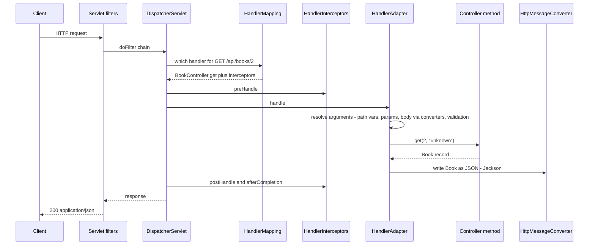

# Chapter 5 — Spring MVC and REST APIs

**Spring MVC** is Spring's web framework for the classic, thread-per-request Servlet stack (Tomcat, Jetty). Almost every Spring Boot service that exposes an HTTP/JSON API is built on it. This chapter builds a small but complete **book catalogue API** and uses it to explain how a request travels through Spring MVC, how to map URLs to methods, read input, validate it, return the right status codes and error bodies, negotiate formats, version the API (new in Framework 7), handle CORS and file uploads, page through results, document the API with OpenAPI, and plug in filters and interceptors.

**What you'll learn**

1. REST in one page: resources, HTTP methods, status codes, idempotency.
2. The `DispatcherServlet` request flow and the components involved.
3. Controllers and request mappings (`@RestController`, `@GetMapping`, path patterns).
4. Reading input: path variables, query parameters, headers, request bodies; and writing output with `ResponseEntity`.
5. JSON with **Jackson 3** (Boot 4's default) — what changed from Jackson 2.
6. Validation with Jakarta Bean Validation: `@Valid`, `@Validated`, groups, parameter validation.
7. Error handling with `@RestControllerAdvice` and **Problem Details (RFC 9457)**.
8. Content negotiation (`Accept`, `produces`, 406) and pagination.
9. **API versioning** — first-class in Framework 7 / Boot 4.
10. CORS, file upload, filters vs interceptors, OpenAPI with springdoc, HATEOAS in brief.

Code: [`code/mvc-rest/`](code/mvc-rest/) (the book API) and [`code/api-versioning/`](code/api-versioning/) — Spring Boot 4.1.1, Framework 7.0, Java 25. All behaviour is proved with `@WebMvcTest` + `MockMvcTester` tests; output shown is real. Testing in depth is [Chapter 12](../12-testing-spring-apps/README.md); the reactive alternative (WebFlux) is [Chapter 13](../13-reactive-and-webflux/README.md); calling other APIs is [Chapter 6](../06-rest-clients-and-http-interfaces/README.md).

The project's single web dependency is the Boot 4 starter:

```xml
<!-- Spring MVC + embedded Tomcat + Jackson 3 (was spring-boot-starter-web before Boot 4) -->
<dependency>
  <groupId>org.springframework.boot</groupId>
  <artifactId>spring-boot-starter-webmvc</artifactId>
</dependency>
```

---

## 5.1 REST in one page

### What it is

**REST** (Representational State Transfer) is an architectural style for HTTP APIs. In practice a "REST API" means:

- The API exposes **resources** (things) at **URLs**: `/api/books`, `/api/books/3`.
- Clients act on them with standard **HTTP methods**.
- Data travels as **representations** (usually JSON) whose format is agreed with headers (`Content-Type`, `Accept`).
- Each request carries everything needed to handle it (**stateless** server).
- Results are signalled with **HTTP status codes**.

### Methods

| Method | Meaning | Safe? (no change) | Idempotent? (repeat = same effect) | Typical response |
|---|---|---|---|---|
| `GET /books` | list/search | yes | yes | `200` + body |
| `GET /books/3` | read one | yes | yes | `200`, or `404` |
| `POST /books` | create (server picks the id) | no | **no** — two POSTs create two books | `201 Created` + `Location` header |
| `PUT /books/3` | replace the whole resource | no | yes | `200` + body, or `204` |
| `PATCH /books/3` | partial update | no | not necessarily | `200` / `204` |
| `DELETE /books/3` | delete | no | yes | `204 No Content`, then `404` |

Idempotency matters for retries: a client may safely retry a timed-out `PUT` or `DELETE`, but not a `POST` without an idempotency key (see [Chapter 6](../06-rest-clients-and-http-interfaces/README.md)).

### Status codes you will actually use

| Code | Name | When |
|---|---|---|
| 200 | OK | success with a body |
| 201 | Created | a POST created something; add `Location` |
| 204 | No Content | success, nothing to return (DELETE) |
| 400 | Bad Request | malformed JSON, invalid fields, bad parameter types |
| 401 | Unauthorized | not authenticated ([Chapter 10](../10-spring-security-1-fundamentals/README.md)) |
| 403 | Forbidden | authenticated but not allowed; also a rejected CORS request |
| 404 | Not Found | no such resource / URL |
| 405 | Method Not Allowed | URL exists, method doesn't (response has `Allow`) |
| 406 | Not Acceptable | cannot produce any format the client accepts |
| 409 | Conflict | state conflict, e.g. duplicate or version clash |
| 413 | Content Too Large | upload too big |
| 415 | Unsupported Media Type | request body format not supported |
| 422 | Unprocessable Content | some teams use it for semantic validation errors (Spring uses 400 by default) |
| 500 | Internal Server Error | unexpected bug |
| 503 | Service Unavailable | overloaded / dependency down |

---

## 5.2 How a request flows: the `DispatcherServlet`

### What it is

Spring MVC is built around one servlet, the **`DispatcherServlet`** — a **front controller**: every request enters through it, and it delegates each step to pluggable components. Analogy: a hotel reception desk. Guests (requests) do not wander to rooms; reception looks up who handles the request, passes it on, and hands back the answer in a form the guest understands.

Boot registers the `DispatcherServlet` at `/` automatically and starts an embedded **Tomcat 11** (Jakarta Servlet 6.1).

### How it works



1. **Servlet filters** run first (security, request ids, compression). They are outside Spring MVC.
2. The `DispatcherServlet` asks its **`HandlerMapping`s** which handler matches. For annotated controllers, `RequestMappingHandlerMapping` compares path, HTTP method, `consumes`/`produces`, params, headers and — in Framework 7 — the **API version**.
3. **`HandlerInterceptor.preHandle`** runs for the chosen handler.
4. A **`HandlerAdapter`** invokes the method. Before that, **`HandlerMethodArgumentResolver`s** build each argument: `@PathVariable` from the URL, `@RequestParam` from the query string, `@RequestBody` via an **`HttpMessageConverter`** (Jackson for JSON), plus validation.
5. The return value is handled by a **`HandlerMethodReturnValueHandler`**: for `@ResponseBody`/`@RestController` it picks an `HttpMessageConverter` based on the `Accept` header (content negotiation) and writes the body.
6. If anything throws, **`HandlerExceptionResolver`s** turn the exception into a response (`@ExceptionHandler` methods, `@ResponseStatus`, Spring's defaults).
7. `postHandle` / `afterCompletion` interceptor callbacks, then filters unwind.

For server-rendered HTML (Thymeleaf), step 5 instead returns a view name that a `ViewResolver` renders; this book focuses on JSON APIs.

### Self-check

1. What is a front controller? → One entry point that receives every request and delegates to handlers — the `DispatcherServlet`.
2. Which component turns a Java object into JSON? → An `HttpMessageConverter` (the Jackson one), chosen by content negotiation.
3. Do servlet filters know which controller method will run? → No — they run before the `DispatcherServlet` resolves the handler; interceptors do know.

---

## 5.3 Controllers and request mappings

### What it is

A **controller** is a bean whose methods handle requests. `@RestController` = `@Controller` + `@ResponseBody`: every method's return value is written straight into the response body (as JSON), not treated as a view name.

```java
@RestController                         // = @Controller + @ResponseBody on every method
@RequestMapping("/api/books")           // common path prefix for the class
public class BookController {

    private final BookRepository repo;

    public BookController(BookRepository repo) { this.repo = repo; }

    @GetMapping
    public PageResponse<Book> list(@RequestParam(defaultValue = "0") @Min(0) int page,
                                   @RequestParam(defaultValue = "2") @Min(1) @Max(50) int size,
                                   @RequestParam(required = false) String author) { ... }

    @GetMapping("/{id:\\d+}")      // regex: only digits, so "/export" never lands here
    public Book get(@PathVariable long id,
                    @RequestHeader(name = "X-Client", defaultValue = "unknown") String client) {
        return repo.findById(id).orElseThrow(() -> new BookNotFoundException(id));
    }

    @PostMapping
    public ResponseEntity<Book> create(
            @Validated({BookRequest.OnCreate.class, Default.class}) @RequestBody BookRequest request) { ... }

    @PutMapping("/{id:\\d+}")
    public Book update(@PathVariable long id, @Validated @RequestBody BookRequest request) { ... }

    @DeleteMapping("/{id:\\d+}")
    @ResponseStatus(HttpStatus.NO_CONTENT)
    public void delete(@PathVariable long id) { ... }
}
```

### Mapping annotations

| Annotation | Same as |
|---|---|
| `@GetMapping` | `@RequestMapping(method = GET)` |
| `@PostMapping`, `@PutMapping`, `@PatchMapping`, `@DeleteMapping` | the other methods |
| `@RequestMapping` on the class | prefix + shared settings for all methods |

Useful attributes (all mapping annotations):

| Attribute | Narrows the match to requests ... | Example |
|---|---|---|
| `path` / `value` | with this URL pattern | `"/{id}"` |
| `consumes` | whose `Content-Type` matches | `consumes = "application/json"` |
| `produces` | whose `Accept` allows this type | `produces = "text/csv"` |
| `params` | having / lacking a parameter | `params = "format=short"` |
| `headers` | having a header value | `headers = "X-Beta=true"` |
| `version` (Framework 7) | with a matching API version | `version = "1.1+"` |

### Path patterns

Spring MVC matches with `PathPattern` (the default since Framework 6 / Boot 3):

| Pattern | Matches |
|---|---|
| `/books/{id}` | one segment captured as `id` |
| `/books/{id:\d+}` | only if the segment matches the regex |
| `/files/**` | anything below `/files/` |
| `/files/{*path}` | the rest of the path, captured (must be at the end) |
| `/books/*.csv` | `*` = any characters within one segment |

Two version-specific facts:

- **Trailing slashes** no longer match by default (since Framework 6.0): `/api/books/` is *not* `/api/books`.
- When several patterns match, the **most specific** wins (fewer wildcards/variables, longer literal text).

### A real pitfall caught by the tests

The first version of this controller mapped `@GetMapping("/{id}")`. A request `GET /api/books/export` with `Accept: application/xml` could not be served by the two `/export` methods (they produce JSON and CSV only), so Spring fell back to the next matching pattern — `/{id}` with `id = "export"` — and answered **400 "Failed to convert 'id'"** instead of **406 Not Acceptable**. Constraining the variable with a regex, `/{id:\d+}`, removed the ambiguity. Use regex constraints (or distinct paths) when literal sub-paths share a level with variables.

### Self-check

1. `@RestController` vs `@Controller`? → `@RestController` adds `@ResponseBody` so return values become the response body; `@Controller` returns view names unless a method has `@ResponseBody`.
2. Does `GET /api/books/` hit a method mapped to `/api/books` in Boot 4? → No; trailing-slash matching is off by default since Framework 6.
3. How do you restrict `{id}` to digits? → `{id:\d+}` (in Java source `"{id:\\d+}"`).

---

## 5.4 Reading input and writing output

### Method arguments

| Annotation / type | Source | Notes |
|---|---|---|
| `@PathVariable long id` | URL segment `{id}` | type conversion is automatic; failure → 400 |
| `@RequestParam int page` | query string / form field | `required` defaults to `true`; `defaultValue` makes it optional; `Optional<T>` also works |
| `@RequestParam Map<String,String>` | all query params | |
| `@RequestHeader("X-Client") String c` | request header | `defaultValue`, `required` as above |
| `@CookieValue` | cookie | |
| `@RequestBody BookRequest r` | body, via `HttpMessageConverter` | JSON → record/class with Jackson |
| `@RequestPart MultipartFile f` | part of a `multipart/form-data` body | section 5.10 |
| `@ModelAttribute` / no annotation on a class | query params / form fields bound to an object's properties | handy for search filters |
| `HttpServletRequest`, `Principal`, `Locale`, `UriComponentsBuilder` | framework-provided | |

Names: with `@PathVariable long id` Spring uses the parameter name `id`. That needs the `-parameters` compiler flag, which `spring-boot-starter-parent` enables; outside Boot's parent, write `@PathVariable("id")`.

### Return values

| Return type | Result |
|---|---|
| any object / record / `List` | `200` + body serialised by a message converter |
| `void` + `@ResponseStatus(NO_CONTENT)` | `204`, no body |
| `ResponseEntity<T>` | full control: status, headers, body |
| `ProblemDetail` / `ErrorResponse` | RFC 9457 error body (section 5.7) |
| `String` in a `@RestController` | written as text (`text/plain` or what `produces` says) |
| `CompletableFuture<T>`, `Callable<T>`, `DeferredResult<T>`, `SseEmitter`, `StreamingResponseBody` | async/streaming responses (SSE is covered in [Chapter 13](../13-reactive-and-webflux/README.md)) |

### `ResponseEntity` for 201 + `Location`

```java
@PostMapping
public ResponseEntity<Book> create(
        @Validated({BookRequest.OnCreate.class, Default.class}) @RequestBody BookRequest request) {
    Book saved = repo.save(request);
    URI location = ServletUriComponentsBuilder.fromCurrentRequest()
            .path("/{id}").buildAndExpand(saved.id()).toUri();
    return ResponseEntity.created(location).body(saved);
}
```

`ServletUriComponentsBuilder.fromCurrentRequest()` starts from the URL the client used, so the `Location` is correct behind different hosts (if you run behind a proxy, set `server.forward-headers-strategy=framework` so `X-Forwarded-*` headers are honoured).

### The tests

The tests use **`MockMvcTester`** (Framework 6.2+), the AssertJ-style front end for MockMvc: it calls the `DispatcherServlet` in-process with mock request/response objects — no network, no Tomcat.

```java
@WebMvcTest                        // web slice: controllers, advice, filters, WebMvcConfigurers, Jackson
@Import(BookRepository.class)      // @Repository beans are not part of the slice, so add ours
class BookApiTest {
    @Autowired MockMvcTester mvc;

    @Test
    void createReturns201WithLocation() throws Exception {
        MvcTestResult r = mvc.post().uri("/api/books")
                .contentType(MediaType.APPLICATION_JSON)
                .content("""
                        {"title":"Release It! 2nd ed","author":"Michael T. Nygard",
                         "isbn":"9781680502398","year":2018}""")
                .exchange();
        show("POST /api/books", r);
        System.out.println("  Location = " + r.getResponse().getHeader("Location"));
        assertThat(r).hasStatus(201).hasHeader("Location", "http://localhost/api/books/6");
    }
    // list, get, update, delete tests ...
}
```

Output (all CRUD tests):

```output
GET /api/books?page=1&size=2 -> 200 {"content":[{"id":3,"title":"Refactoring","author":"Martin Fowler","isbn":"9780134757599","published_year":2018,"addedOn":"2026-01-15"},{"id":4,"title":"Domain-Driven Design","author":"Eric Evans","isbn":"9780321125217","published_year":2003,"addedOn":"2026-01-15"}],"page":1,"size":2,"totalElements":5,"totalPages":3}
GET /api/books/2 -> 200 {"id":2,"title":"Effective Java","author":"Joshua Bloch","isbn":"9780134685991","published_year":2018,"addedOn":"2026-01-15"}
  X-Request-Id = req-15
  X-Handler    = BookController#get
POST /api/books -> 201 {"id":6,"title":"Release It! 2nd ed","author":"Michael T. Nygard","isbn":"9781680502398","published_year":2018,"addedOn":"2026-01-15"}
  Location = http://localhost/api/books/6
PUT /api/books/1 -> 200 {"id":1,"title":"Clean Code (2nd ed)","author":"Robert C. Martin","isbn":"9780132350884","published_year":2025,"addedOn":"2026-01-15"}
DELETE /api/books/1 -> 204 
GET /api/books/1 after delete -> 404
```

(`X-Request-Id` and `X-Handler` come from the filter and interceptor in section 5.11. The number in `req-15` is a counter shared by all tests in the cached context, so it depends on test order and may differ in your run.)

### Pagination

`list` returns one **page** plus the numbers a client needs to build page links:

```java
public record PageResponse<T>(List<T> content, int page, int size, long totalElements, int totalPages) {}
```

- Use **zero-based** `page` and a bounded `size` (`@Max(50)`) so nobody can request a million rows.
- Return a **stable DTO** like this one rather than serialising Spring Data's `Page` implementation directly — its JSON shape is not a stable API (Spring Data now warns about it and offers `@EnableSpringDataWebSupport(pageSerializationMode = VIA_DTO)`). With Spring Data you would accept a `Pageable` argument (`?page=1&size=2&sort=title,asc`) — see [Chapter 8](../08-spring-data-jpa-and-hibernate/README.md).
- For very large or fast-changing data, **keyset (cursor) pagination** (`?after=lastSeenId`) is faster and more stable than `OFFSET` — see the SQL book, [Indexes and query performance](../../../sql/chapters/12-indexes-storage-and-query-performance/README.md).

### Self-check

1. How do you return 201 with a `Location` header? → `ResponseEntity.created(uri).body(saved)`.
2. What status does a missing required `@RequestParam` produce? → 400 (`MissingServletRequestParameterException`).
3. What does `MockMvcTester` avoid? → Starting a server; it drives the `DispatcherServlet` directly.

---

## 5.5 JSON with Jackson 3

### What it is

**Jackson** is the JSON library behind Spring MVC's JSON converter. **Spring Boot 4 uses Jackson 3** by default (Boot 4.1.1 manages Jackson 3.1.x). Jackson 3 is a new major version with new coordinates, so code and configuration written for Jackson 2 need small changes.

### What changed from Jackson 2

| Topic | Jackson 2 (Boot 3) | Jackson 3 (Boot 4) |
|---|---|---|
| Maven group / Java package | `com.fasterxml.jackson.*` | `tools.jackson.*` |
| Annotations (`@JsonProperty`, `@JsonIgnore`, ...) | `com.fasterxml.jackson.annotation` | **unchanged**: still `com.fasterxml.jackson.annotation` |
| Java baseline | Java 8 | Java 17 |
| Main mapper | `ObjectMapper` (mutable) | `JsonMapper` (a format-specific `ObjectMapper`), **immutable**, built with `JsonMapper.builder()` |
| Exceptions | checked `JsonProcessingException` | unchecked `JacksonException` (`DatabindException`, `StreamReadException`, ...) |
| `java.time`, `Optional`, parameter names | separate modules (`jsr310`, `jdk8`, ...) | built in |
| Dates | timestamps by default (Boot turned this off) | ISO strings by default (`WRITE_DATES_AS_TIMESTAMPS` disabled) |
| Unknown JSON properties | fail by default (Boot turned this off) | ignored by default |
| Property order | declaration order | alphabetical by default, but creator (constructor/record) properties first |
| Renamed types | `JsonSerializer`, `JsonDeserializer`, `SerializerProvider`, `Module` | `ValueSerializer`, `ValueDeserializer`, `SerializationContext`, `JacksonModule` |

Spring Boot 4 changes that follow from it:

| Boot 3 | Boot 4 |
|---|---|
| `Jackson2ObjectMapperBuilderCustomizer` | `JsonMapperBuilderCustomizer` |
| `@JsonComponent`, `@JsonMixin` | `@JacksonComponent`, `@JacksonMixin` |
| `spring.jackson.read.*` / `spring.jackson.write.*` | `spring.jackson.json.read.*` / `spring.jackson.json.write.*` |
| define an `ObjectMapper` bean to customise | define/customise a `JsonMapper` bean |
| — | deprecated `spring-boot-jackson2` module to keep Jackson 2 while migrating |
| `HttpMessageConverters` bean | deprecated; use `ServerHttpMessageConvertersCustomizer` / `ClientHttpMessageConvertersCustomizer` |

### Example

The API record uses an annotation from the unchanged annotations package:

```java
import com.fasterxml.jackson.annotation.JsonProperty;
import java.time.LocalDate;

public record Book(
        Long id,
        String title,
        String author,
        String isbn,
        @JsonProperty("published_year") int year,   // rename one JSON field
        LocalDate addedOn) {
}
```

The test injects Boot's `JsonMapper`:

```java
@SpringBootTest
class JacksonTest {
    @Autowired JsonMapper mapper;   // Jackson 3 (package tools.jackson), configured by Boot 4

    @Test
    void serializeAndDeserializeARecord() {
        Book b = new Book(7L, "Effective Java", "Joshua Bloch", "9780134685991", 2018, LocalDate.of(2026, 1, 15));
        String json = mapper.writeValueAsString(b);          // no checked exception in Jackson 3
        System.out.println("mapper class: " + mapper.getClass().getName());
        System.out.println("JSON: " + json);

        Book back = mapper.readValue("""
                {"id":8,"title":"T","author":"A","isbn":"1","published_year":2001,
                 "addedOn":"2026-02-01","somethingNew":true}""", Book.class);
        System.out.println("read back (unknown field ignored): " + back);
    }

    @Test
    void jacksonExceptionsAreUnchecked() {
        assertThatThrownBy(() -> mapper.readValue("{not json", Book.class))
                .isInstanceOf(JacksonException.class)
                .isInstanceOf(RuntimeException.class) ... ;
    }
}
```

Output:

```output
mapper class: tools.jackson.databind.json.JsonMapper
JSON: {"id":7,"title":"Effective Java","author":"Joshua Bloch","isbn":"9780134685991","published_year":2018,"addedOn":"2026-01-15"}
read back (unknown field ignored): Book[id=8, title=T, author=A, isbn=1, year=2001, addedOn=2026-02-01]
bad JSON -> StreamReadException (a RuntimeException: true)
```

Notice: `LocalDate` became `"2026-01-15"` with no extra module; the record kept its declaration order (record components are creator properties, which are sorted first); the unknown `somethingNew` was ignored. In the error responses later in this chapter, `ProblemDetail`'s fields *do* appear alphabetically (`detail, instance, status, title, type`) — that is Jackson 3's new default ordering for regular properties.

### Customising

```java
@Bean
JsonMapperBuilderCustomizer jsonCustomizer() {
    return builder -> builder.enable(SerializationFeature.INDENT_OUTPUT);   // tools.jackson.databind
}
```

or with properties, e.g. `spring.jackson.serialization.indent-output=true`, `spring.jackson.default-property-inclusion=non_null`. (`spring.jackson.json.read.*` / `json.write.*` hold the JSON-format-specific `JsonReadFeature`/`JsonWriteFeature` switches.)

### Common mistakes

- Mixing Jackson 2 and 3 imports (`com.fasterxml.jackson.databind.ObjectMapper` vs `tools.jackson.databind...`): Spring MVC uses the Jackson 3 mapper, so a Jackson 2 `ObjectMapper` bean you define is simply not used for HTTP. (Some libraries, e.g. springdoc's swagger-core, still bring Jackson 2 for their own use — that is fine.)
- Exposing JPA entities directly as JSON → lazy-loading errors, infinite recursion, leaking columns. Use DTOs/records ([Chapter 8](../08-spring-data-jpa-and-hibernate/README.md)).
- Relying on field order in clients — JSON objects are unordered by definition.

---

## 5.6 Validation

### What it is

**Jakarta Bean Validation** (Hibernate Validator is the implementation; add `spring-boot-starter-validation`) lets you declare rules as annotations on fields/record components and parameters. Spring MVC runs them before your method executes, so the controller only ever sees valid input.

```java
public record BookRequest(
        @NotBlank @Size(max = 100) String title,
        @NotBlank String author,
        // required only when creating (group OnCreate); an update may leave it out
        @NotBlank(groups = OnCreate.class)
        @Pattern(regexp = "\\d{13}", message = "must be 13 digits") String isbn,
        @Min(1450) @Max(2100) int year) {

    /** Validation group marker: rules that apply only on create. */
    public interface OnCreate {}
}
```

Common constraints: `@NotNull`, `@NotBlank` (not null and not only whitespace), `@NotEmpty`, `@Size`, `@Min`/`@Max`, `@Positive`, `@Email`, `@Pattern`, `@Past`/`@Future`, `@Valid` (cascade into a nested object or list elements). Custom constraints: an annotation + a `ConstraintValidator`.

### Three ways validation is triggered

| Where | How to trigger | Failure exception | Default status |
|---|---|---|---|
| `@RequestBody` / `@ModelAttribute` object | `@Valid` or `@Validated` on the parameter | `MethodArgumentNotValidException` | 400 |
| Constraints directly on `@RequestParam`, `@PathVariable`, `@RequestHeader` (e.g. `@Max(50) int size`) | automatic — **built-in method validation** since Framework 6.1, no `@Validated` needed | `HandlerMethodValidationException` | 400 |
| Any Spring bean method (services) | `@Validated` on the **class** + constraints on parameters | `ConstraintViolationException` (AOP proxy, see [Chapter 4](../04-aop-and-proxies/README.md)) | 500 unless you handle it |

Do **not** put `@Validated` on the controller class in Framework 6.1+: it switches that controller to the AOP-based validation of the third row, and you get `ConstraintViolationException` instead of the web-aware exceptions.

### Validation groups

A **group** is a marker interface that labels constraints so you can validate different subsets in different situations. Constraints without `groups` belong to `jakarta.validation.groups.Default`. `@Valid` cannot select groups; Spring's `@Validated({...})` can:

```java
@PostMapping                     // create: Default rules + OnCreate rules (isbn required)
public ResponseEntity<Book> create(
        @Validated({BookRequest.OnCreate.class, Default.class}) @RequestBody BookRequest request) { ... }

@PutMapping("/{id:\\d+}")        // update: only Default rules (isbn optional)
public Book update(@PathVariable long id, @Validated @RequestBody BookRequest request) { ... }
```

Test output (the same body without `isbn`):

```output
POST without isbn -> 400 errors={"isbn":"must not be blank"}
PUT  without isbn -> 200
```

Invalid body and invalid query parameter:

```output
POST invalid book -> 400 application/problem+json
   {"detail":"Request body has 3 invalid field(s)","instance":"/api/books","status":400,"title":"Bad Request","errors":{"isbn":"must be 13 digits","title":"must not be blank","year":"must be greater than or equal to 1450"}}
GET /api/books?size=500 -> 400 application/problem+json
   {"detail":"Validation failure","instance":"/api/books","status":400,"title":"Bad Request","errors":{"size":"must be less than or equal to 50"}}
```

The `errors` maps are added by the exception handler in the next section.

### Common mistakes

- Forgetting `@Valid`/`@Validated` on `@RequestBody` → annotations on the record are ignored.
- Forgetting `@Valid` on a nested field (`@Valid Address address`) → nested object not validated.
- Missing `spring-boot-starter-validation` → no validator on the classpath, constraints silently ignored.
- Using `@NotNull` on a primitive `int` → never null; use a wrapper `Integer` if "missing" must be detected.
- Validating only in the UI → every API must validate its own input.

### Self-check

1. How do you validate `size` ≤ 50 on a `@RequestParam` in Framework 7? → Put `@Max(50)` on the parameter; built-in method validation handles it (400 `HandlerMethodValidationException`).
2. Why `@Validated` rather than `@Valid` for groups? → `@Valid` (Jakarta) has no groups attribute; Spring's `@Validated` does.
3. What is the default group? → `jakarta.validation.groups.Default` — every constraint without `groups`.

---

## 5.7 Error handling and Problem Details (RFC 9457)

### The problem it solves

Without a plan, errors leak as stack traces, HTML error pages, or a different JSON shape per endpoint. Clients need **one predictable error format**. **RFC 9457 "Problem Details for HTTP APIs"** (July 2023, replacing RFC 7807) defines it: media type `application/problem+json` with members

| Member | Meaning |
|---|---|
| `type` | URI identifying the problem type (default `about:blank`) |
| `title` | short human summary of the type |
| `status` | HTTP status code |
| `detail` | explanation of this occurrence |
| `instance` | URI of this occurrence (Spring fills the request path) |
| *extensions* | any extra members, e.g. `bookId`, `errors` |

Spring's model: `ProblemDetail` (the body), `ErrorResponse` (an exception that carries a `ProblemDetail`; all Spring MVC exceptions implement it), `ErrorResponseException` (a base class for your own).

### How it works

1. Controller code throws.
2. `ExceptionHandlerExceptionResolver` looks for an `@ExceptionHandler` for that type — first in the controller, then in **`@ControllerAdvice`/`@RestControllerAdvice`** beans (global handlers).
3. Otherwise `ResponseStatusExceptionResolver` (for `@ResponseStatus` or `ResponseStatusException`) and `DefaultHandlerExceptionResolver` (Spring MVC's own exceptions) set a status.
4. Anything still unhandled goes to the servlet container's error page, which Boot maps to **`/error`** → `BasicErrorController`, producing Boot's JSON (`timestamp`, `status`, `error`, `path`).

The cleanest setup: one `@RestControllerAdvice` that **extends `ResponseEntityExceptionHandler`**. The base class already maps every Spring MVC exception (400, 404, 405, 406, 413, 415, 500 ...) to a `ProblemDetail`; you add handlers for your own exceptions and override the hooks you want to enrich.

```java
@RestControllerAdvice
public class ApiExceptionHandler extends ResponseEntityExceptionHandler {

    @ExceptionHandler(BookNotFoundException.class)
    public ProblemDetail bookNotFound(BookNotFoundException ex) {
        ProblemDetail pd = ProblemDetail.forStatusAndDetail(HttpStatus.NOT_FOUND, ex.getMessage());
        pd.setTitle("Book not found");
        pd.setType(URI.create("https://api.example.com/problems/book-not-found"));
        pd.setProperty("bookId", ex.bookId());          // extra member in the JSON
        return pd;
    }

    // Customise the built-in 400 for @Valid/@Validated @RequestBody failures: add field errors
    @Override
    protected ResponseEntity<Object> handleMethodArgumentNotValid(
            MethodArgumentNotValidException ex, HttpHeaders headers, HttpStatusCode status, WebRequest request) {
        ProblemDetail pd = ex.getBody();                 // already a ProblemDetail (status 400)
        Map<String, String> errors = new TreeMap<>();
        ex.getBindingResult().getFieldErrors()
                .forEach(fe -> errors.put(fe.getField(), fe.getDefaultMessage()));
        pd.setDetail("Request body has " + errors.size() + " invalid field(s)");
        pd.setProperty("errors", errors);
        return ResponseEntity.status(status).headers(headers).body(pd);
    }

    // Customise the built-in 400 for constraint violations on @RequestParam/@PathVariable/... (Framework 6.1+)
    @Override
    protected ResponseEntity<Object> handleHandlerMethodValidationException(
            HandlerMethodValidationException ex, HttpHeaders headers, HttpStatusCode status, WebRequest request) {
        ProblemDetail pd = ex.getBody();
        Map<String, String> errors = new TreeMap<>();
        ex.getParameterValidationResults().forEach(result -> result.getResolvableErrors().forEach(err ->
                errors.put(result.getMethodParameter().getParameterName(), err.getDefaultMessage())));
        pd.setProperty("errors", errors);
        return ResponseEntity.status(status).headers(headers).body(pd);
    }
}
```

Test output — our own exception and several framework errors, all in the same format:

```output
GET /api/books/99 -> 404 application/problem+json
   {"detail":"Book 99 does not exist","instance":"/api/books/99","status":404,"title":"Book not found","type":"https://api.example.com/problems/book-not-found","bookId":99}
GET /api/books?page=abc -> 400 application/problem+json
   {"detail":"Failed to convert 'page' with value: 'abc'","instance":"/api/books","status":400,"title":"Bad Request"}
PATCH /api/books/1 -> 405 application/problem+json
   {"detail":"Method 'PATCH' is not supported.","instance":"/api/books/1","status":405,"title":"Method Not Allowed"}
POST text/plain -> 415 application/problem+json
   {"detail":"Content-Type 'text/plain;charset=UTF-8' is not supported.","instance":"/api/books","status":415,"title":"Unsupported Media Type"}
POST broken JSON -> 400 application/problem+json
   {"detail":"Failed to read request","instance":"/api/books","status":400,"title":"Bad Request"}
```

The 405 response also carries an `Allow` header listing the supported methods, and the 415 an `Accept` header listing supported body types. Note the generic `detail` for broken JSON: Spring deliberately does not echo parser internals back to clients.

### Other options

| Option | Use when |
|---|---|
| `spring.mvc.problemdetails.enabled=true` | you have **no** advice of your own and just want Problem Details for Spring MVC's exceptions (Boot registers a `ResponseEntityExceptionHandler` for you; default `false`) |
| `@ResponseStatus(HttpStatus.NOT_FOUND)` on an exception class | quick and simple, but no custom body |
| `throw new ResponseStatusException(HttpStatus.CONFLICT, "...")` | one-off errors without a custom class |
| extend `ErrorResponseException` | your exception carries its own `ProblemDetail` (status, type, extra properties) |
| `@ExceptionHandler` inside one controller | an error specific to that controller |
| `@RestControllerAdvice(basePackages = ...)` / `assignableTypes` | different handlers for different API areas |

### Common mistakes

- **Catching exceptions in controllers** and returning `200` with an `"error"` field — breaks HTTP semantics, caching and client retries.
- **Leaking internals** (`ex.getMessage()` from a SQL exception, stack traces) in `detail`. Log them server-side; return a safe message.
- **A generic `@ExceptionHandler(Exception.class)` returning 400** — bugs are 500s. Keep a catch-all that returns 500 and logs.
- Two advices handling the same exception without `@Order` — which wins is undefined.

### In the interview

**30-second answer:** "I use a single `@RestControllerAdvice` that extends `ResponseEntityExceptionHandler`, so every Spring MVC exception already produces an RFC 9457 `ProblemDetail` with `application/problem+json`. I add `@ExceptionHandler` methods for domain exceptions — e.g. `NotFound` → 404 with a `type` URI and extra properties — and override `handleMethodArgumentNotValid` to include field errors. Unexpected exceptions become 500s with a safe message and are logged with a correlation id."

- *What's RFC 9457?* → Problem Details for HTTP APIs; it obsoletes RFC 7807; fields `type`, `title`, `status`, `detail`, `instance` plus extensions.
- *Order of lookup?* → `@ExceptionHandler` in the controller, then in `@ControllerAdvice` beans, then `@ResponseStatus`/`ResponseStatusException`, then Spring defaults, finally Boot's `/error`.

---

## 5.8 Content negotiation

### What it is

**Content negotiation** is how client and server agree on a representation. The client sends `Accept: text/csv` (what it wants back) and `Content-Type` (what it is sending). Spring matches `Accept` against each method's `produces` and the available `HttpMessageConverter`s; `Content-Type` against `consumes`.

```java
@GetMapping(value = "/export", produces = MediaType.APPLICATION_JSON_VALUE)
public List<Book> exportJson() { return repo.findAll(null); }

@GetMapping(value = "/export", produces = "text/csv")
public String exportCsv() {
    return repo.findAll(null).stream()
            .map(b -> b.id() + "," + b.title() + "," + b.year())
            .collect(Collectors.joining("\n", "id,title,year\n", "\n"));
}
```

Output:

```output
Accept: text/csv -> text/csv;charset=UTF-8
   id,title,year
   1,Clean Code,2008
   2,Effective Java,2018
Accept: application/json -> application/json starts [{"id":1,"title":"Clean Code","author":"...
Accept: application/xml -> 406
```

- No `Accept` header (or `*/*`) → the first producible type wins.
- XML would need a converter: add `tools.jackson.dataformat:jackson-dataformat-xml` (Jackson 3) and Boot registers it automatically.
- Query-parameter negotiation (`?format=csv`) can be turned on with `spring.mvc.contentnegotiation.favor-parameter=true` (parameter name `format`, changeable with `spring.mvc.contentnegotiation.parameter-name`). Negotiation by path extension (`/books.json`) was deprecated in Framework 5.3 and is not available with the modern `PathPattern` matching.

---

## 5.9 API versioning (Framework 7)

### What it is

Public APIs change. **API versioning** lets old clients keep the old contract while new clients use a new one. Before Framework 7 every team invented its own scheme (`/v1/...` prefixes, custom header conditions). **Spring Framework 7.0 made it first-class**: a version is resolved from each request, parsed, validated, and used as one more mapping condition, with support on the client side (`RestClient`, `WebClient`, HTTP interfaces — [Chapter 6](../06-rest-clients-and-http-interfaces/README.md)) and in tests.

### How it works

1. A **resolver** reads the version from the request: header, query parameter, path segment, or media-type parameter.
2. A **parser** turns it into a comparable version (default: semantic `major.minor.patch`, so `1.1` = `1.1.0`).
3. The version is **validated**: if missing and no default → 400 `MissingApiVersionException`; if not supported → 400 `InvalidApiVersionException`.
4. Mappings with a `version` attribute are matched: `"1.0"` = exactly that version; `"1.1+"` = a **baseline** — 1.1 and higher, until a more specific mapping for a higher version exists. Mappings without `version` match any version.
5. An optional **deprecation handler** adds standard `Deprecation` (RFC 9745), `Sunset` (RFC 8594) and `Link` headers to responses for deprecated versions.

### Configuration

In Boot 4 via properties (or `WebMvcConfigurer.configureApiVersioning(ApiVersionConfigurer)` in plain Spring):

```properties
# Framework 7 API versioning, configured through Boot 4 properties
spring.mvc.apiversion.use.header=X-API-Version
spring.mvc.apiversion.default=1.0
# versions used in @GetMapping(version=...) are detected automatically; list extra ones here
spring.mvc.apiversion.supported=1.2
```

| Property | Meaning |
|---|---|
| `spring.mvc.apiversion.use.header` / `.use.query-parameter` / `.use.path-segment` / `.use.media-type-parameter` | where the version comes from |
| `spring.mvc.apiversion.default` | version assumed when a request has none |
| `spring.mvc.apiversion.required` | reject requests without a version |
| `spring.mvc.apiversion.supported` | extra supported versions |
| `spring.mvc.apiversion.detect-supported` | detect supported versions from mappings |

Beans of type `ApiVersionResolver`, `ApiVersionParser` and `ApiVersionDeprecationHandler` are picked up by Boot's MVC auto-configuration for full control. Our deprecation handler:

```java
@Bean
ApiVersionDeprecationHandler deprecationHandler() {
    var handler = new StandardApiVersionDeprecationHandler();
    handler.configureVersion("1.0")
            .setDeprecationDate(ZonedDateTime.of(2026, 6, 1, 0, 0, 0, 0, ZoneOffset.UTC))
            .setSunsetDate(ZonedDateTime.of(2027, 1, 1, 0, 0, 0, 0, ZoneOffset.UTC))
            .setDeprecationLink(URI.create("https://api.example.com/docs/migrate-to-v2"));
    return handler;
}
```

The controller:

```java
@RestController
@RequestMapping("/api/greeting")
public class GreetingController {
    public record GreetingV1(String message) {}
    public record GreetingV1_1(String message, String language) {}
    public record GreetingV2(String text, String lang) {}

    @GetMapping(version = "1.0")            // exactly version 1.0
    public GreetingV1 v1()     { return new GreetingV1("Hello"); }

    @GetMapping(version = "1.1+")           // baseline: 1.1 and every later version...
    public GreetingV1_1 v1_1() { return new GreetingV1_1("Hello", "en"); }

    @GetMapping(version = "2.0")            // ...until a more specific mapping takes over
    public GreetingV2 v2()     { return new GreetingV2("Hello", "en"); }
}
```

Output of [`ApiVersioningTest`](code/api-versioning/src/test/java/ch05/versioning/ApiVersioningTest.java):

```output
X-API-Version: none -> 200 {"message":"Hello"}
X-API-Version: 1.0  -> 200 {"message":"Hello"}
X-API-Version: 1.1  -> 200 {"message":"Hello","language":"en"}
X-API-Version: 1.2  -> 200 {"message":"Hello","language":"en"}
X-API-Version: 2.0  -> 200 {"text":"Hello","lang":"en"}
X-API-Version: 3.0  -> 400
Deprecation: @1780272000
Sunset: Fri, 1 Jan 2027 00:00:00 GMT
Link: <https://api.example.com/docs/migrate-to-v2>; rel="deprecation"; type="text/html"
```

- No header → default `1.0`. `1.2` has no exact mapping, so the `1.1+` baseline serves it (1.2 is supported because we listed it). `3.0` is unsupported → 400.
- `Deprecation: @1780272000` is the RFC 9745 format: `@` + Unix seconds (2026-06-01T00:00Z).

### Trade-offs: where to put the version

| Strategy | Example | Pros | Cons |
|---|---|---|---|
| Path segment | `/api/v2/books` | visible, easy to test in a browser, cache-friendly | "the same resource" has several URLs |
| Header | `X-API-Version: 2.0` | clean URLs | invisible in logs/links unless you add it; needs `Vary` for caches |
| Query parameter | `?version=2.0` | easy to try | mixes with filters, easy to drop |
| Media type parameter | `Accept: application/json;version=2.0` | "pure" HTTP content negotiation | least discoverable, harder tooling |

Whatever you choose, prefer **additive, backwards-compatible changes** (new optional fields) and bump the version only for breaking changes.

---

## 5.10 CORS and file upload

### CORS

#### What it is
Browsers enforce the **same-origin policy**: JavaScript on `https://shop.example.com` may not read responses from `https://api.example.com` unless the API opts in with **CORS** (Cross-Origin Resource Sharing) headers. For "non-simple" requests (e.g. JSON `POST`, custom headers) the browser first sends a **preflight** `OPTIONS` request asking permission.

CORS protects **users' browsers**, not your server: `curl` and server-to-server calls ignore it. It is not authentication.

#### How to configure

Globally (preferred):

```java
@Override
public void addCorsMappings(CorsRegistry registry) {
    registry.addMapping("/api/**")
            .allowedOrigins("https://shop.example.com")   // the browser app's origin
            .allowedMethods("GET", "POST", "PUT", "DELETE")
            .maxAge(3600);                                // preflight may be cached 1 h
}
```

or per controller/method with `@CrossOrigin(origins = "...")`. With Spring Security, also enable `http.cors(...)` so the security filter chain lets preflights through ([Chapter 10](../10-spring-security-1-fundamentals/README.md)).

Test output (preflights from an allowed and an unknown origin):

```output
preflight from shop.example.com -> 200 Allow-Origin=https://shop.example.com Allow-Methods=GET,POST,PUT,DELETE Max-Age=3600
preflight from evil.example.net -> 403 Allow-Origin=null
```

#### Common mistakes
- `allowedOrigins("*")` together with `allowCredentials(true)` — not allowed by the CORS spec (Spring rejects it); use explicit origins or `allowedOriginPatterns`.
- Configuring CORS in MVC but not in Spring Security → preflight gets 401/403 from security first.

### File upload

Multipart (`multipart/form-data`) requests carry files plus form fields. Boot configures multipart support; limits:

```properties
spring.servlet.multipart.max-file-size=1MB       # default 1MB
spring.servlet.multipart.max-request-size=2MB    # default 10MB
```

```java
@PostMapping("/api/uploads")
public UploadResult upload(@RequestPart("file") MultipartFile file,
                           @RequestParam(defaultValue = "") String note) throws IOException {
    String text = new String(file.getBytes(), StandardCharsets.UTF_8);
    return new UploadResult(file.getOriginalFilename(), file.getSize(),
            file.getContentType(), (int) text.lines().count(), note);
}
```

Output:

```output
POST /api/uploads -> 200 {"fileName":"books.csv","bytes":36,"contentType":"text/csv","lines":3,"note":"weekly import"}
```

- Exceeding the limit in a running server raises `MaxUploadSizeExceededException`, which `ResponseEntityExceptionHandler` maps to **413**. (MockMvc does not parse real multipart streams, so the limit is not exercised by this test.)
- **Security:** never trust `getOriginalFilename()` as a path (path traversal: `../../etc/passwd`); generate your own storage names, check type and size, and stream large files (`file.getInputStream()` / `transferTo`) rather than loading them into memory. Large files usually go straight to object storage via pre-signed URLs instead of through your API.

---

## 5.11 Filters vs interceptors (vs AOP)

### What it is

Three places to put code that runs around requests:

| | Servlet `Filter` | Spring MVC `HandlerInterceptor` | AOP aspect ([Ch. 4](../04-aop-and-proxies/README.md)) |
|---|---|---|---|
| Runs | before/after the `DispatcherServlet`, for every request (also static files, errors) | inside the `DispatcherServlet`, only for requests mapped to a handler | around bean method calls |
| Knows the controller method? | no | yes (`HandlerMethod`) | yes (join point) |
| Can wrap/replace request & response objects | yes | no | no |
| Typical use | security (Spring Security is a filter chain), request ids/MDC, compression, CORS | per-endpoint auth checks, locale, audit, timing by handler | business-level cross-cutting concerns |
| Register | `@Component` implementing `Filter` (often `OncePerRequestFilter`) or `FilterRegistrationBean` | `WebMvcConfigurer.addInterceptors` | `@Aspect @Component` |

The chapter's filter adds a correlation id to every response:

```java
@Component
@Order(Ordered.HIGHEST_PRECEDENCE)
public class RequestIdFilter extends OncePerRequestFilter {
    private final AtomicLong counter = new AtomicLong();

    @Override
    protected void doFilterInternal(HttpServletRequest req, HttpServletResponse res, FilterChain chain)
            throws ServletException, IOException {
        String id = req.getHeader("X-Request-Id");
        if (id == null) id = "req-" + counter.incrementAndGet();
        res.setHeader("X-Request-Id", id);   // echo it so clients and logs can correlate
        chain.doFilter(req, res);            // continue to the next filter / the DispatcherServlet
    }
}
```

The interceptor records which controller method was chosen — something a filter cannot know:

```java
public class HandlerNameInterceptor implements HandlerInterceptor {
    @Override
    public boolean preHandle(HttpServletRequest req, HttpServletResponse res, Object handler) {
        if (handler instanceof HandlerMethod hm) {
            res.setHeader("X-Handler", hm.getBeanType().getSimpleName() + "#" + hm.getMethod().getName());
        }
        return true;                          // false would stop the request here
    }
}
```

registered with `registry.addInterceptor(new HandlerNameInterceptor()).addPathPatterns("/api/**")`. The earlier output showed both headers: `X-Request-Id = req-15`, `X-Handler = BookController#get`.

Interceptor callbacks: `preHandle` (before the method; return `false` to stop), `postHandle` (after the method, **before** the response is written for views — for `@ResponseBody` methods the body is already written, so headers added here are too late), `afterCompletion` (always, even on exceptions — use for cleanup/metrics).

`@WebMvcTest` includes `Filter` beans, `WebMvcConfigurer`s and interceptors, which is why the tests see both headers.

---

## 5.12 Documenting the API: OpenAPI with springdoc

### What it is

**OpenAPI** (formerly Swagger) is a machine-readable description of an HTTP API: paths, parameters, bodies, responses. Tools generate client SDKs, contract tests and interactive docs from it. **springdoc-openapi** generates the document from your Spring MVC controllers at runtime. Its **3.x** line targets **Spring Boot 4** (2.x is for Boot 3); this project uses 3.1.1.

```xml
<dependency>
  <groupId>org.springdoc</groupId>
  <artifactId>springdoc-openapi-starter-webmvc-api</artifactId>   <!-- -ui adds Swagger UI -->
  <version>3.1.1</version>
</dependency>
```

- `/v3/api-docs` serves the JSON document (`/v3/api-docs.yaml` for YAML).
- With `springdoc-openapi-starter-webmvc-ui`, Swagger UI appears at `/swagger-ui.html`.
- It reads your mappings, parameter annotations and Bean Validation constraints (`@Max(50)` becomes `maximum: 50`). Add detail with `io.swagger.v3.oas.annotations` (`@Operation`, `@ApiResponse`, `@Schema`).

The test fetches the document:

```java
@SpringBootTest                 // full context: springdoc is not part of the @WebMvcTest slice
@AutoConfigureMockMvc           // Boot 4: @SpringBootTest no longer adds MockMvc on its own
class OpenApiTest { ... mvc.get().uri("/v3/api-docs") ... }
```

Output:

```output
openapi: 3.1.0
  /api/books/{id} [get, put, delete]
  /api/uploads [post]
  /api/books [get, post]
  /api/books/export [get]
```

springdoc logs a warning that `/v3/api-docs` is enabled by default — in production either secure it or set `springdoc.api-docs.enabled=false` (and `springdoc.swagger-ui.enabled=false`).

**Code-first vs design-first:** springdoc is *code-first* (document generated from code). Many API-platform teams go *design-first*: write the OpenAPI file, review it, then generate server interfaces/clients with `openapi-generator`. Both are fine; the key is that the published spec is tested against the real service.

### HATEOAS in brief

**HATEOAS** (Hypermedia as the Engine of Application State) means responses include **links** to related actions (`"_links": {"self": ..., "next": ...}`), so clients navigate the API like a website instead of hard-coding URLs. **Spring HATEOAS** (`spring-boot-starter-hateoas`) provides `EntityModel`, `CollectionModel`, `PagedModel` and `linkTo(methodOn(...))` builders, rendering HAL JSON. It is valuable for long-lived public APIs; most internal JSON APIs skip it and rely on OpenAPI documentation instead.

---

## 5.13 Putting it together: design checklist and mistakes

| Area | Do |
|---|---|
| URLs | plural nouns (`/books`, `/books/{id}`), no verbs; nested only for true ownership (`/orders/{id}/items`) |
| Methods & codes | follow section 5.1; `201 + Location` on create, `204` on delete |
| DTOs | separate request/response records; never expose entities |
| Validation | Bean Validation on every input; groups for create vs update |
| Errors | one `@RestControllerAdvice`, RFC 9457 `ProblemDetail`, no internals |
| Lists | always paginate, cap `size`, stable JSON shape |
| Versioning | pick one strategy; Framework 7 `version` attribute; deprecate with headers |
| Security | authentication/authorization ([Ch. 10](../10-spring-security-1-fundamentals/README.md)), CORS explicit origins, upload limits |
| Docs | OpenAPI published and tested |
| Observability | request id filter, metrics per endpoint ([Ch. 15](../15-observability-and-production/README.md)) |
| Threads | Spring MVC is thread-per-request; with `spring.threads.virtual.enabled=true` Tomcat uses virtual threads, giving high concurrency without reactive code ([Ch. 13](../13-reactive-and-webflux/README.md)) |

**Functional endpoints.** Besides annotated controllers, Spring MVC offers `RouterFunction`/`HandlerFunction` ("WebMvc.fn"): routes are declared as code (`route().GET("/api/books/{id}", handler::get).build()`). Same `DispatcherServlet`, same converters; choose it if you prefer explicit routing over annotations. It also supports API versioning.

### Common mistakes (whole chapter)

| Symptom | Cause | Fix |
|---|---|---|
| 404 for `/api/books/` | trailing slash no longer matched | call without slash or map both |
| 400 "Failed to convert 'id'" for a literal path | `/{id}` pattern catches `/export` | regex `{id:\d+}` |
| Validation ignored | missing `@Valid`/`@Validated` or validation starter | add them |
| `ConstraintViolationException` → 500 from a controller | `@Validated` on the controller class | remove it; rely on built-in method validation |
| Errors in five different JSON shapes | ad-hoc try/catch in controllers | central advice + `ProblemDetail` |
| Browser "CORS error", curl works | missing CORS config (or blocked by security) | `addCorsMappings` + `http.cors()` |
| Header set in `postHandle` missing | `@ResponseBody` already wrote the response | set it in `preHandle` or a filter |
| `@SpringBootTest` test can't autowire `MockMvc` (Boot 4) | MockMvc no longer auto-added | `@AutoConfigureMockMvc` |

---

## 5.14 In the interview

**Q: Walk me through what happens when a request hits a Spring MVC app.**
Filters → `DispatcherServlet` → `HandlerMapping` finds the controller method (path, method, consumes/produces, version) → interceptors' `preHandle` → `HandlerAdapter` resolves arguments (message converters for bodies, conversion, validation) → method runs → return value written by a message converter chosen by `Accept` → exceptions go to `HandlerExceptionResolver`s (`@ExceptionHandler`/advice) → `afterCompletion` → filters.

- *Filter vs interceptor?* → Filter: servlet level, every request, can wrap request/response, doesn't know the handler. Interceptor: MVC level, knows the `HandlerMethod`, only mapped requests.
- *`@Controller` vs `@RestController`?* → The latter adds `@ResponseBody`.

**Q: How do you validate input and report errors?** → Bean Validation annotations on DTOs + `@Valid`/`@Validated` (groups via `@Validated`); constraints on parameters are validated automatically since 6.1; a global `@RestControllerAdvice` extending `ResponseEntityExceptionHandler` returns RFC 9457 `ProblemDetail`s with field errors.

**Q: PUT vs PATCH vs POST? Which are idempotent?** → POST creates (not idempotent); PUT replaces (idempotent); PATCH partially updates (not necessarily idempotent); GET/DELETE idempotent.

**Q: How would you version an API in Spring Boot 4?** → Framework 7 API versioning: configure a resolver (`spring.mvc.apiversion.use.header=X-API-Version` or path segment), set default/supported versions, use `@GetMapping(version = "1.1+")` baselines, add a deprecation handler that sends `Deprecation`/`Sunset`/`Link` headers; clients use `ApiVersionInserter`.

**Q: What changed with JSON in Boot 4?** → Jackson 3: `tools.jackson` packages (annotations unchanged), immutable `JsonMapper`, unchecked exceptions, java.time built in, ISO dates by default; Boot's customizer is `JsonMapperBuilderCustomizer`, `@JsonComponent` → `@JacksonComponent`, JSON read/write properties moved under `spring.jackson.json.*`.

**Q: What is CORS and does it secure my API?** → A browser mechanism that lets a page from one origin read responses from another if the server allows it via headers and preflight. It doesn't secure the API against non-browser clients — you still need authentication and authorization.

---

## 5.15 Chapter TL;DR

- `spring-boot-starter-webmvc` (Boot 4 name) gives Spring MVC on embedded Tomcat with Jackson 3.
- Request flow: **filters → `DispatcherServlet` → HandlerMapping → interceptors → argument resolution (converters + validation) → controller → message converter (by `Accept`) → exception resolvers**.
- `@RestController` + `@GetMapping/@PostMapping/...`; `@PathVariable`, `@RequestParam`, `@RequestHeader`, `@RequestBody`; `ResponseEntity.created(uri)` for 201; `@ResponseStatus(NO_CONTENT)` for 204. Constrain path variables (`{id:\d+}`) to avoid ambiguous matches.
- **Jackson 3**: `tools.jackson.*`, annotations unchanged, immutable `JsonMapper`, unchecked `JacksonException`, java.time built in.
- **Validation**: `@Valid`/`@Validated` on bodies (groups via `@Validated`), parameter constraints validated automatically (6.1+), don't put `@Validated` on controllers.
- **Errors**: one `@RestControllerAdvice extends ResponseEntityExceptionHandler`, returning **RFC 9457 `ProblemDetail`** (`application/problem+json`).
- **Content negotiation** via `Accept` + `produces`; 406 if impossible. Paginate with a bounded `size` and a stable DTO.
- **API versioning** (Framework 7): `spring.mvc.apiversion.*`, `version = "1.0"` / `"1.1+"`, 400 for unsupported versions, `Deprecation`/`Sunset` headers.
- **CORS** in `addCorsMappings` (+ Spring Security); **uploads** with `MultipartFile` and size limits; **filters** vs **interceptors**; **springdoc 3.x** for OpenAPI on Boot 4.
- Next: [Chapter 6 — REST clients and HTTP interfaces](../06-rest-clients-and-http-interfaces/README.md).
