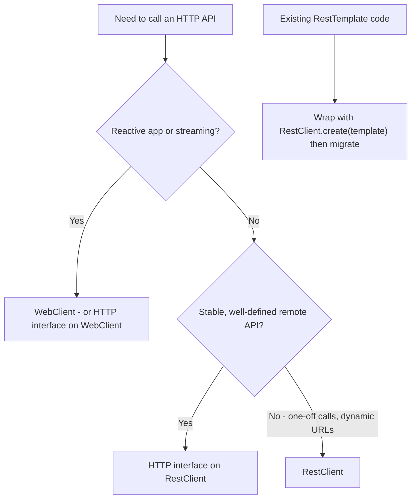
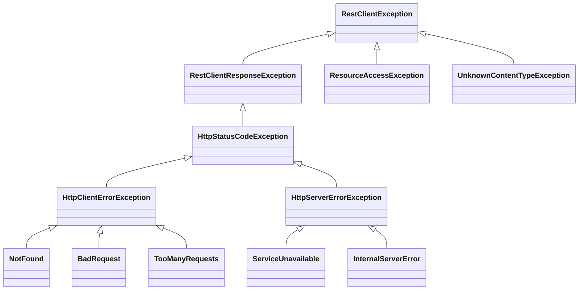

# Chapter 6 — REST Clients and HTTP Interfaces

[Chapter 5](../05-spring-mvc-and-rest/README.md) built an API. Real services also **call** APIs: a payment provider, another team's microservice, a search engine. Calling over the network brings problems you never have with a local method call — slowness, timeouts, partial failures, error bodies, versioning, retries. This chapter covers Spring's HTTP clients and how to use them safely:

**What you'll learn**

1. The four Spring HTTP clients — `RestClient`, `RestTemplate`, `WebClient`, HTTP interfaces — and which to choose (including `RestTemplate`'s deprecation timeline).
2. `RestClient` in depth: requests, bodies, `retrieve()` vs `exchange()`, `ResponseEntity`, generics.
3. Error handling: Spring's exception hierarchy, status handlers, reading Problem Details from error bodies, mapping to your own exceptions.
4. Timeouts and the underlying HTTP library (JDK, Apache, Jetty, Reactor Netty) — Boot 4's `spring.http.clients.*`.
5. Interceptors for cross-cutting concerns (headers, logging, tracing).
6. **HTTP service interfaces** (`@HttpExchange`) and **Boot 4's HTTP service client auto-configuration** (`@ImportHttpServices`, `spring.http.serviceclient.*`).
7. Client-side **API versioning** (Framework 7).
8. **Retries** with Framework 7 `@Retryable` — and when not to retry.
9. Testing clients: `@RestClientTest` + `MockRestServiceServer`, and tests against a real local server.

Code: [`code/rest-clients/`](code/rest-clients/) — Spring Boot 4.1.1, Framework 7.0, Java 25. To make the tests hit a *real* HTTP server without the internet, the project also contains a small "remote" catalog API ([`CatalogServerController`](code/rest-clients/src/main/java/ch06/catalog/CatalogServerController.java)) that the test starts on a free local port; imagine it belongs to another team. All output shown is real.

```xml
<!-- RestClient.Builder, RestTemplateBuilder, HTTP service client auto-configuration (Boot 4 starter) -->
<dependency>
  <groupId>org.springframework.boot</groupId>
  <artifactId>spring-boot-starter-restclient</artifactId>
</dependency>
```

(An app that already has `spring-boot-starter-webmvc` for its own endpoints still adds `spring-boot-starter-restclient` for the client side — Boot 4's starters are modular.)

---

## 6.1 Choosing a client

### What they are

| Client | Style | Since | Status (Framework 7) | Use for |
|---|---|---|---|---|
| **`RestClient`** | synchronous, **fluent** API | Framework 6.1 (2023) | the recommended blocking client | new code in Spring MVC / non-reactive apps |
| **`RestTemplate`** | synchronous, template methods (`getForObject`, `exchange`, ...) | Spring 3.0 (2009) | **deprecation announced**: intent to deprecate in 7.0, planned `@Deprecated` in 7.1 (Nov 2026), removal in 8.0 | existing code only; migrate to `RestClient` |
| **`WebClient`** | non-blocking, reactive (`Mono`/`Flux`) | Framework 5.0 | recommended reactive client | WebFlux apps, streaming, reactive pipelines ([Chapter 13](../13-reactive-and-webflux/README.md)) |
| **HTTP interface** (`@HttpExchange`) | **declarative**: an annotated Java interface, Spring generates the implementation | Framework 6.0; Boot auto-config in 4.0 | recommended for calling well-defined APIs | typed clients for other services; runs on `RestClient` or `WebClient` |

Why `RestClient` replaced `RestTemplate`: the same underlying machinery (request factories, message converters, interceptors) but a modern fluent API instead of dozens of overloaded methods, and one place for all new features (API versioning, `requiredBody`, status handlers). The Spring team's plan (spring.io blog, "The state of HTTP clients in Spring", September 2025) keeps `RestTemplate` working through the 7.x line — so no panic, but no new code on it.

Do you need `WebClient` in a Spring MVC app? Not any more. Before `RestClient`, people pulled in WebFlux just to use `WebClient` and called `.block()`. With `RestClient` — and **virtual threads** making blocking calls cheap ([Java book 15.4](../../../java/chapters/15-concurrency-2-modern/README.md#154-virtual-threads)) — the blocking client is the simpler choice for MVC apps.



### Self-check

1. Which client should new blocking code use? → `RestClient` (directly or behind an HTTP interface).
2. When is `RestTemplate` scheduled to be removed? → Framework 8.0; formally deprecated from 7.1.
3. Do you need WebFlux to use HTTP interfaces? → No; they run on `RestClient` too.

---

## 6.2 `RestClient` basics

### How it works

1. Get a **builder**. In Boot, inject `RestClient.Builder` — a **prototype** bean pre-configured with Boot's message converters (Jackson 3), the chosen HTTP library, timeouts from `spring.http.clients.*`, and (when Micrometer is present) observability. Each injection point gets a fresh builder, so configuring one does not affect others. (Outside Boot: `RestClient.builder()` or `RestClient.create("https://...")`.)
2. Set shared settings (`baseUrl`, `defaultHeader`, `defaultStatusHandler`, `requestInterceptor`, `requestFactory`) and `build()`. A `RestClient` is **immutable and thread-safe** — build it once (e.g. in a constructor) and reuse it.
3. Per call: choose the method (`get()`, `post()`, `put()`, `patch()`, `delete()`, `method(...)`), the `uri(...)`, headers, body.
4. Finish with **`retrieve()`** (then `body(...)`, `toEntity(...)`, `toBodilessEntity()`) or **`exchange(...)`**.

### Example: body, entity and generic lists

```java
RestClient rest = builder.baseUrl(baseUrl()).build();

BookDto book = rest.get().uri("/catalog/books/{id}", 1).retrieve().body(BookDto.class);

ResponseEntity<List<BookDto>> entity = rest.get()
        .uri(b -> b.path("/catalog/books").queryParam("author", "Martin Fowler").build())
        .retrieve()
        .toEntity(new ParameterizedTypeReference<List<BookDto>>() {});
```

Output:

```output
body(BookDto.class) -> BookDto[id=1, title=Release It!, author=Michael T. Nygard]
toEntity(List) -> 200 OK 2 books
```

What each part does:

- `uri("/catalog/books/{id}", 1)` — a **URI template**; variables are URL-encoded for you. Never build URLs by string concatenation with user input.
- `uri(b -> b.path(...).queryParam("author", "Martin Fowler").build())` — the `UriBuilder` form for query parameters (the space is encoded).
- `body(BookDto.class)` — deserialises the JSON body into your record. Your DTO only needs the fields you use; unknown fields are ignored (Jackson 3 default).
- `ParameterizedTypeReference<List<BookDto>>` — Java erases generics at runtime, so `List.class` would give you a list of maps; the anonymous subclass captures the full type.
- `toEntity(...)` returns `ResponseEntity<T>`: status + headers + body. `toBodilessEntity()` when you only care about the status.
- `requiredBody(...)` (Framework 7.0.4+) is like `body(...)` but throws if the body is empty instead of returning `null`.

### A hand-written client class

Wrap the calls in a small class so the rest of your code talks in domain terms ([`CatalogClient.java`](code/rest-clients/src/main/java/ch06/client/CatalogClient.java)):

```java
@Component
public class CatalogClient {

    private final RestClient rest;

    public CatalogClient(RestClient.Builder builder, @Value("${catalog.base-url}") String baseUrl) {
        this.rest = builder                                   // Boot's pre-configured, prototype builder
                .baseUrl(baseUrl)
                .defaultHeader("X-Client", "catalog-client")
                .defaultStatusHandler(status -> status.is5xxServerError(), (request, response) -> {
                    throw new CatalogUnavailableException(
                            "catalog answered " + response.getStatusCode().value() + " for " + request.getURI().getPath());
                })
                .build();
    }

    /** 404 becomes Optional.empty(); 5xx becomes CatalogUnavailableException (default status handler). */
    public Optional<BookDto> findBook(long id) {
        try {
            return Optional.ofNullable(rest.get()
                    .uri("/catalog/books/{id}", id)           // URI template: id is encoded for us
                    .retrieve()                               // status handlers apply to retrieve()
                    .body(BookDto.class));
        } catch (HttpClientErrorException.NotFound e) {
            return Optional.empty();
        }
    }

    /** exchange(): full control over the raw response - status handlers are NOT applied. */
    public String describe(long id) {
        return rest.get()
                .uri("/catalog/books/{id}", id)
                .exchange((request, response) -> {
                    if (response.getStatusCode().isError()) {
                        return "status " + response.getStatusCode().value();
                    }
                    BookDto b = response.bodyTo(BookDto.class);
                    return b.title() + " by " + b.author();
                });
    }

    public ResponseEntity<BookDto> create(String title, String author) {
        return rest.post()
                .uri("/catalog/books")
                .body(new BookDto(null, title, author))      // serialised to JSON by Jackson
                .retrieve()
                .toEntity(BookDto.class);                     // status + headers + body
    }
}
```

Output:

```output
findBook(2)   -> Optional[BookDto[id=2, title=Refactoring, author=Martin Fowler]]
findBook(999) -> Optional.empty
describe(1)   -> Release It! by Michael T. Nygard
describe(999) -> status 404
create        -> 201 CREATED Location=/catalog/books/102 body=BookDto[id=102, title=Designing Data-Intensive Applications, author=Martin Kleppmann]
```

### `retrieve()` vs `exchange()`

| | `retrieve()` | `exchange((req, res) -> ...)` |
|---|---|---|
| Error statuses | turned into exceptions (default or your status handlers) | **you** inspect the status; **status handlers are not applied** |
| Body handling | `body`, `toEntity`, `toBodilessEntity` | `res.bodyTo(...)`, `res.getHeaders()`, anything |
| Use when | almost always | different body types per status, streaming, very custom handling |

A lesson from writing this chapter: the first version of `findBook` used `exchange()` and treated 404 specially, assuming the 5xx `defaultStatusHandler` would still fire. It does not — `exchange()` bypasses status handlers — so a 503 silently became `Optional.empty()`. The `@RestClientTest` in section 6.8 caught it. If you use `exchange()`, handle **every** status yourself.

### Self-check

1. Why inject `RestClient.Builder` instead of calling `RestClient.builder()` in Boot? → Boot's builder carries the auto-configured converters, HTTP library, timeouts and observability.
2. Is a `RestClient` safe to share between threads? → Yes, it is immutable and thread-safe once built.
3. How do you deserialise a `List<BookDto>`? → `body(new ParameterizedTypeReference<List<BookDto>>() {})`.

### More request features (quick reference)

| Need | `RestClient` call |
|---|---|
| Header on one request | `.header("X-Tenant", "acme")`, `.headers(h -> h.setBearerAuth(token))` |
| Accept / content type | `.accept(MediaType.APPLICATION_JSON)`, `.contentType(MediaType.APPLICATION_JSON)` |
| Form post (`application/x-www-form-urlencoded`) | `.contentType(APPLICATION_FORM_URLENCODED).body(multiValueMap)` |
| Multipart upload | `.body(new MultipartBodyBuilder().part("file", resource).build())` with `contentType(MULTIPART_FORM_DATA)` |
| Download a large file | `.exchange((req, res) -> { res.getBody().transferTo(out); return null; })` — stream, don't buffer |
| Plain text | `.retrieve().body(String.class)` |
| Per-request attributes for interceptors/observations | `.attribute("name", value)` |

---

## 6.3 Error handling

### Spring's client exception hierarchy



| Exception | Meaning | Retry? |
|---|---|---|
| `HttpClientErrorException` (4xx) with nested types `.NotFound`, `.BadRequest`, `.Conflict`, `.TooManyRequests`, ... | the **request** was wrong or not allowed | no (except 429 after `Retry-After`, and 408) |
| `HttpServerErrorException` (5xx) with `.InternalServerError`, `.BadGateway`, `.ServiceUnavailable`, `.GatewayTimeout` | the server failed | often yes (transient), if the operation is idempotent |
| `ResourceAccessException` | I/O problem: connection refused, **timeout**, DNS | often yes |
| `UnknownContentTypeException` | no converter for the response type | no — a bug or contract change |

All are **unchecked** (`RestClientException extends RuntimeException`). `RestClientResponseException` gives you `getStatusCode()`, `getResponseHeaders()`, `getResponseBodyAsString()`, and **`getResponseBodyAs(Class)`** — which can decode an RFC 9457 error body directly:

```java
assertThatThrownBy(() -> rest.get().uri("/catalog/books/{id}", 999).retrieve().body(BookDto.class))
        .isInstanceOf(HttpClientErrorException.NotFound.class)
        .satisfies(e -> {
            var ex = (HttpClientErrorException) e;
            ProblemDetail pd = ex.getResponseBodyAs(ProblemDetail.class);   // read the error body
            System.out.println("404 -> " + ex.getClass().getSimpleName()
                    + ", problem title='" + pd.getTitle() + "', detail='" + pd.getDetail() + "'");
        });
```

Output:

```output
404 -> NotFound, problem title='Book not found', detail='No book 999'
```

### Mapping to your own exceptions

Callers of `CatalogClient` should not need to know it uses HTTP. Translate at the edge:

- **Per request:** `.retrieve().onStatus(HttpStatusCode::is4xxClientError, (req, res) -> { throw new ... })`.
- **For every request of a client:** `builder.defaultStatusHandler(predicate, handler)` — used above to turn any 5xx into `CatalogUnavailableException`:

```output
503 -> CatalogUnavailableException: catalog answered 503 for /catalog/flaky
```

- **Expected "not found":** return `Optional.empty()` (as `findBook` does) instead of throwing.

### Common mistakes

- Catching `Exception` around a client call and returning `null` — hides outages; log and translate instead.
- Logging full response bodies of errors — may contain personal data or secrets.
- Treating every 4xx as retryable — a 400 will fail the same way every time.
- Forgetting that **no timeout = wait forever**-ish (next section).

### Self-check

1. A call times out. Which exception? → `ResourceAccessException` (its cause is the library's timeout exception, e.g. `HttpTimeoutException` for the JDK client).
2. How do you read an RFC 9457 error body from a failed call? → `ex.getResponseBodyAs(ProblemDetail.class)` on the `RestClientResponseException`.
3. Where should HTTP exceptions be translated into domain exceptions? → At the client edge (status handlers or the client class), so business code never sees HTTP types.

---

## 6.4 Timeouts and the underlying HTTP library

### What it is

`RestClient` does not open sockets itself; it delegates to a **`ClientHttpRequestFactory`** wrapping a real HTTP library. Two timeouts matter:

- **Connect timeout** — how long to wait for the TCP (and TLS) connection to be established.
- **Read timeout** — how long to wait for response data once connected.

Why it matters: without timeouts, a slow downstream service makes your request threads pile up waiting, until your service also stops answering — a **cascading failure**. Every remote call needs a timeout shorter than your own callers' timeout. See also [Circuit breaker](../../../microservices-patterns/chapters/06-circuit-breaker/README.md) and [Bulkhead](../../../microservices-patterns/chapters/07-bulkhead/README.md).

### Which library does Boot pick?

Boot 4 detects, in this order, the first one on the classpath:

| Priority | Library | Factory | Add dependency |
|---|---|---|---|
| 1 | Apache HttpClient 5 | `HttpComponentsClientHttpRequestFactory` | `org.apache.httpcomponents.client5:httpclient5` |
| 2 | Jetty HttpClient | `JettyClientHttpRequestFactory` | `org.eclipse.jetty:jetty-client` |
| 3 | Reactor Netty | `ReactorClientHttpRequestFactory` | `io.projectreactor.netty:reactor-netty-http` |
| 4 | JDK `java.net.http.HttpClient` | `JdkClientHttpRequestFactory` | nothing (built in) |
| 5 | `HttpURLConnection` | `SimpleClientHttpRequestFactory` | nothing |

This project has none of the first three, so it uses the **JDK HttpClient**. Force a choice with `spring.http.clients.imperative.factory=jdk|http-components|jetty|reactor|simple`. (For `WebClient` the equivalent is `spring.http.clients.reactive.connector`.)

### Configuring timeouts

Globally, for every auto-configured client (Boot 4 property names — the Boot 3.x `spring.http.client.*` names are deprecated):

```properties
spring.http.clients.connect-timeout=1s
spring.http.clients.read-timeout=3s
spring.http.clients.redirects=dont-follow     # or follow / follow-when-possible
```

Per client, in code, with Boot's `ClientHttpRequestFactoryBuilder` and `HttpClientSettings`:

```java
var factory = ClientHttpRequestFactoryBuilder.jdk()
        .build(HttpClientSettings.defaults()
                .withConnectTimeout(Duration.ofSeconds(1))
                .withReadTimeout(Duration.ofMillis(300)));
RestClient rest = builder.baseUrl(baseUrl()).requestFactory(factory).build();
rest.get().uri("/catalog/slow").retrieve().body(String.class);   // server needs 1.5 s
```

Output:

```output
slow endpoint -> ResourceAccessException caused by HttpTimeoutException after ~300 ms
```

For HTTP service groups (section 6.6) the timeouts can be set per group: `spring.http.serviceclient.<group>.read-timeout=2s`.

**Choosing values:** measure the downstream's normal latency (p99) and set the read timeout a bit above it; keep the total (timeout × attempts + back-off) below what *your* caller will wait. Connection **pooling** (Apache/Jetty/Netty pool by default; the JDK client keeps connections alive) avoids paying TCP/TLS setup on every call.

### Self-check

1. Connect vs read timeout? → Connect: establishing the connection. Read: waiting for response data after connecting.
2. Which HTTP library does Boot use if you add nothing? → The JDK `java.net.http.HttpClient`.
3. Boot 4 property for a global read timeout? → `spring.http.clients.read-timeout` (the Boot 3 name `spring.http.client.read-timeout` is deprecated).

---

## 6.5 Interceptors

A **`ClientHttpRequestInterceptor`** wraps every request a client sends — the client-side twin of a servlet filter. Uses: auth headers (tokens), correlation ids, logging, metrics.

```java
RestClient rest = builder.baseUrl(baseUrl())
        .requestInterceptor((request, body, execution) -> {
            request.getHeaders().add("X-Trace-Id", "trace-42");          // add a header
            var response = execution.execute(request, body);            // do the call
            log.add(request.getMethod() + " " + request.getURI().getPath() + " -> " + response.getStatusCode().value());
            return response;
        })
        .build();
```

Output:

```output
interceptor: GET /catalog/books/1 -> 200
interceptor: GET /catalog/books/3 -> 200
```

- You rarely need interceptors for **tracing**: when Micrometer observability is set up (Actuator, [Chapter 15](../15-observability-and-production/README.md)), Boot instruments the auto-configured builder with an observation customizer that records `http.client.requests` metrics and propagates trace headers. This only works if you build from the injected builder — `RestClient.create()` skips it.
- For OAuth2 bearer tokens, Spring Security provides `OAuth2ClientHttpRequestInterceptor` ([Chapter 11](../11-spring-security-2-tokens-and-oauth2/README.md)).
- Don't read the response body in an interceptor unless you buffer it (`BufferingClientHttpRequestFactory`); a body can normally be read only once.
- To customise **all** builders Boot creates, declare a `RestClientCustomizer` bean.

---

## 6.6 HTTP service interfaces (`@HttpExchange`)

### What it is

An **HTTP service interface** is a Java interface whose methods are annotated with the HTTP method, path and parameters. Spring generates a **proxy** that implements it by turning each call into an HTTP request (the same proxy idea as [Chapter 4](../04-aop-and-proxies/README.md)). It is Spring's built-in answer to Feign-style declarative clients — no extra library. Analogy: a TV remote. You press "channel 5"; you do not care which infrared codes are sent.

```java
@HttpExchange("/catalog")
public interface CatalogApi {

    @GetExchange("/books/{id}")
    BookDto get(@PathVariable long id);

    @GetExchange("/books/{id}")
    ResponseEntity<BookDto> getEntity(@PathVariable long id);   // status + headers too

    @GetExchange("/books")
    List<BookDto> byAuthor(@RequestParam String author);

    @PostExchange("/books")
    ResponseEntity<BookDto> create(@RequestBody BookDto book);

    @GetExchange(url = "/greeting", version = "2.0")   // Framework 7: API version per method
    String greetingV2();
}
```

| Annotation | Purpose |
|---|---|
| `@HttpExchange` (type) | shared URL prefix, content type, accept, headers, version |
| `@GetExchange`, `@PostExchange`, `@PutExchange`, `@PatchExchange`, `@DeleteExchange` | method + path |
| `@PathVariable`, `@RequestParam`, `@RequestHeader`, `@RequestBody`, `@RequestPart`, `@CookieValue` | the same annotations as server controllers, now describing the request to send |
| `URI` parameter | override the full URL dynamically |

Return types: a body type (`BookDto`, `List<BookDto>`), `ResponseEntity<T>`, `ResponseEntity<Void>`, `HttpHeaders`, `void`; on `WebClient`, also `Mono<T>`/`Flux<T>`. Errors surface as the same `HttpClientErrorException`/`HttpServerErrorException` as `RestClient`.

### Boot 4 auto-configuration: `@ImportHttpServices`

Before Framework 7 / Boot 4 you created each proxy yourself. Now you declare **groups** of interfaces; each group gets its own `RestClient` configured from properties:

```java
@SpringBootApplication
@EnableResilientMethods                                       // for @Retryable (Framework 7)
@ImportHttpServices(group = "catalog", types = CatalogApi.class)   // creates a CatalogApi bean
public class ClientsApplication { ... }
```

```properties
# Boot 4: HTTP service client group "catalog" (the @HttpExchange interface)
spring.http.serviceclient.catalog.base-url=http://localhost:8080
spring.http.serviceclient.catalog.read-timeout=2s
spring.http.serviceclient.catalog.default-header.X-Client=handbook-ch06
# the group's RestClient sends the API version (from @GetExchange(version=...)) in this header
spring.http.serviceclient.catalog.apiversion.insert.header=X-API-Version
```

- `types = ...` lists interfaces; `basePackages`/`basePackageClasses` scans a package instead. Repeat the annotation for several groups (one per remote service).
- `clientType = WEB_CLIENT` makes a group use `WebClient`.
- For configuration beyond properties, declare a `RestClientHttpServiceGroupConfigurer` bean: `groups -> groups.filterByName("catalog").forEachClient((group, builder) -> builder.requestInterceptor(...))`.

Then inject and call it like any bean ([`HttpInterfaceTest.java`](code/rest-clients/src/test/java/ch06/HttpInterfaceTest.java)):

```java
@Autowired CatalogApi catalogApi;     // generated by @ImportHttpServices + Boot auto-config

BookDto one = catalogApi.get(1);
ResponseEntity<BookDto> e = catalogApi.getEntity(2);
ResponseEntity<BookDto> created = catalogApi.create(new BookDto(null, "Accelerate", "Nicole Forsgren"));
String v2 = catalogApi.greetingV2();
```

Output:

```output
bean class     -> $ProxyN
get(1)         -> BookDto[id=1, title=Release It!, author=Michael T. Nygard]
byAuthor(...)  -> [BookDto[id=2, title=Refactoring, author=Martin Fowler], BookDto[id=3, title=Patterns of Enterprise Application Architecture, author=Martin Fowler]]
getEntity(2)   -> 200 OK server saw X-Client=handbook-ch06
create(...)    -> 201 CREATED BookDto[id=101, title=Accelerate, author=Nicole Forsgren]
greetingV2()   -> v2: hello
get(999)       -> NotFound
```

The bean is a JDK dynamic proxy (`$Proxy...`). `X-Client=handbook-ch06` shows the per-group `default-header` property reached the server, and `greetingV2()` shows the method's `version = "2.0"` was sent in the `X-API-Version` header configured for the group.

### What Boot does for you, by hand

```java
RestClient restClient = RestClient.builder().baseUrl(baseUrl()).build();
HttpServiceProxyFactory factory = HttpServiceProxyFactory
        .builderFor(RestClientAdapter.create(restClient)).build();
CatalogApi manual = factory.createClient(CatalogApi.class);
```

```output
manual proxy get(3) -> Patterns of Enterprise Application Architecture
```

Useful in plain Spring, in tests, or in libraries.

### Trade-offs

| | HTTP interface | Hand-written `RestClient` class | OpenFeign (Spring Cloud) |
|---|---|---|---|
| Boilerplate | minimal | more | minimal |
| Custom per-call logic (fallbacks, `Optional` on 404) | needs a wrapper or default methods | natural | via fallbacks |
| Dependencies | none beyond Spring | none | Spring Cloud OpenFeign (in maintenance mode; Spring recommends HTTP interfaces) |
| Config per remote service | `spring.http.serviceclient.<group>.*` (Boot 4) | your own properties | `spring.cloud.openfeign.client.config.*` |
| Can share the interface with the server? | technically, but couples client and server release cycles | — | same caveat |

Common approach: an HTTP interface for the raw calls + a thin service class on top for domain translation (`Optional`, own exceptions, retries).

### Self-check

1. What does `@ImportHttpServices(group = "catalog", types = CatalogApi.class)` do? → Registers a `CatalogApi` proxy bean backed by a `RestClient` for group `catalog`, configured from `spring.http.serviceclient.catalog.*`.
2. Which class creates the proxy under the hood? → `HttpServiceProxyFactory` with a `RestClientAdapter` (or `WebClientAdapter`).
3. How would you add an interceptor to only one group? → A `RestClientHttpServiceGroupConfigurer` bean using `groups.filterByName("catalog").forEachClient(...)`.

---

## 6.7 Client-side API versioning and retries

### API versioning (Framework 7)

When the server versions its API ([Chapter 5, section 5.9](../05-spring-mvc-and-rest/README.md)), the client must send the version. Framework 7 adds this to every client: an **`ApiVersionInserter`** decides *how* (header, query param, path segment, media-type parameter), `defaultApiVersion` sets the usual version, and each request can override it with `.apiVersion(...)`:

```java
RestClient rest = builder.baseUrl(baseUrl())
        .apiVersionInserter(ApiVersionInserter.useHeader("X-API-Version"))  // how to send it
        .defaultApiVersion("1.0")                                           // unless overridden
        .build();
String v1 = rest.get().uri("/catalog/greeting").retrieve().body(String.class);
String v2 = rest.get().uri("/catalog/greeting").apiVersion("2.0").retrieve().body(String.class);
```

Output:

```output
default version -> v1: hello
apiVersion(2.0) -> v2: hello
```

HTTP interfaces put the version on the method (`@GetExchange(version = "2.0")`) and configure the inserter per group (`spring.http.serviceclient.<group>.apiversion.insert.header=...`), as shown in 6.6. Server-side version properties (`spring.mvc.apiversion.*`) are **not** applied to clients; configure them separately.

### Retries

#### What it is
A **retry** repeats a failed call hoping the failure was transient. Framework 7's `@Retryable` ([Chapter 4, section 4.7](../04-aop-and-proxies/README.md)) makes this one annotation:

```java
@Service
public class StockService {
    private final RestClient rest;

    public StockService(RestClient.Builder builder, @Value("${catalog.base-url}") String baseUrl) {
        this.rest = builder.baseUrl(baseUrl).build();
    }

    @Retryable(includes = org.springframework.web.client.HttpServerErrorException.class,
               maxRetries = 3, delay = 20, multiplier = 2, jitter = 5)
    public String checkStock() {
        return rest.get().uri("/catalog/flaky").retrieve().body(String.class);
    }
}
```

The `/catalog/flaky` endpoint answers 503 twice, then 200:

```output
checkStock() -> ok on call 3
```

#### Rules for safe retries

1. **Only transient failures:** 5xx (especially 502/503/504), timeouts/`ResourceAccessException`, 429 (respect `Retry-After`). Never 400/401/403/404/409/422.
2. **Only idempotent operations** — GET, PUT, DELETE — or POSTs protected by an **idempotency key** header that the server uses to de-duplicate (the way payment APIs such as Stripe do).
3. **Exponential back-off + jitter** so thousands of clients don't hammer a recovering service in sync.
4. **Bound the total time**: attempts × read timeout + delays must fit your own deadline (`@Retryable(timeout = ...)` since 7.0.2 caps the total).
5. **Retry in one layer only**, and combine with a **circuit breaker** (Resilience4j) so a dead dependency is not retried forever — see [Chapter 16](../16-spring-cloud-and-microservices/README.md) and [Retry pattern](../../../microservices-patterns/chapters/08-retry/README.md).
6. `@Retryable` is proxy-based: it must be on a Spring bean method called from **another** bean.

### Self-check

1. Should you retry a `POST /payments` after a read timeout? → Only if the request carries an idempotency key the server honours; otherwise you may charge twice.
2. With `maxRetries = 3`, how many HTTP calls at most? → 4.
3. Does the server's `spring.mvc.apiversion.use.header` configure your clients? → No; configure `apiVersionInserter` or the service-group `apiversion.*` properties.

---

## 6.8 Testing clients

### Option 1 — `@RestClientTest` + `MockRestServiceServer` (fast, no network)

`@RestClientTest` is a **test slice**: it starts only the listed components, Jackson and the `RestClient.Builder`/`RestTemplateBuilder` auto-configuration, and binds a **`MockRestServiceServer`** to the builder. Requests never leave the JVM; the mock checks each request against expectations and returns canned responses. Boot 4 dependency: `spring-boot-starter-restclient-test`.

```java
@RestClientTest(components = CatalogClient.class, properties = "catalog.base-url=http://catalog.test")
class CatalogClientMockServerTest {

    @Autowired CatalogClient client;
    @Autowired MockRestServiceServer server;   // intercepts requests; no network at all

    @Test
    void foundNotFoundAndUnavailable() {
        server.expect(requestTo("http://catalog.test/catalog/books/1"))
              .andExpect(method(HttpMethod.GET))
              .andExpect(header("X-Client", "catalog-client"))
              .andRespond(withSuccess("""
                      {"id":1,"title":"Release It!","author":"Michael T. Nygard","pages":376}""",
                      MediaType.APPLICATION_JSON));
        server.expect(requestTo("http://catalog.test/catalog/books/2"))
              .andRespond(withStatus(HttpStatus.NOT_FOUND));
        server.expect(requestTo("http://catalog.test/catalog/books/3"))
              .andRespond(withStatus(HttpStatus.SERVICE_UNAVAILABLE));

        System.out.println("mock 200 -> " + client.findBook(1));
        System.out.println("mock 404 -> " + client.findBook(2));
        assertThatThrownBy(() -> client.findBook(3))
                .isInstanceOf(CatalogUnavailableException.class)
                .satisfies(e -> System.out.println("mock 503 -> " + e.getMessage()));
        server.verify();                         // every expected request really happened
    }
}
```

Output:

```output
mock 200 -> Optional[BookDto[id=1, title=Release It!, author=Michael T. Nygard]]
mock 404 -> Optional.empty
mock 503 -> catalog answered 503 for /catalog/books/3
```

The unknown `pages` field was ignored. By default expectations must occur **in order**; `MockRestServiceServer.bindTo(builder).ignoreExpectOrder(true)` relaxes that. `withException(new SocketTimeoutException())` simulates I/O failures.

### Option 2 — a real HTTP server

Mocks can't catch problems in the real HTTP layer (timeouts, headers, encoding, the version header). This chapter's other tests start the app on a real port with a local "remote" controller:

```java
@SpringBootTest(webEnvironment = SpringBootTest.WebEnvironment.DEFINED_PORT)
abstract class LiveServerTest {

    static final int PORT = freePort();

    @DynamicPropertySource
    static void urls(DynamicPropertyRegistry registry) {
        String base = "http://localhost:" + PORT;
        registry.add("server.port", () -> PORT);
        registry.add("catalog.base-url", () -> base);
        registry.add("spring.http.serviceclient.catalog.base-url", () -> base);
    }
    ...
}
```

The port is picked **before** the context starts so the client base URLs can be set as properties (with `RANDOM_PORT` the port is only known after the clients were created). In real projects the "remote" side is usually a **WireMock** server (a standalone HTTP stub server, often via Testcontainers) or a Spring Cloud Contract stub — see [Chapter 12](../12-testing-spring-apps/README.md).

For testing **your own** endpoints over HTTP, Boot 4 offers **`RestTestClient`** (`@AutoConfigureRestTestClient`), the `RestClient`-based successor of `TestRestTemplate` (which now needs `@AutoConfigureTestRestTemplate` and the `spring-boot-resttestclient` module).

### Self-check

1. What does `server.verify()` check? → That every expected request was actually made.
2. Why also test against a real (stub) server? → Mocks skip the real HTTP layer: timeouts, encoding, headers, connection handling.
3. Which Boot 4 starter provides `@RestClientTest`? → `spring-boot-starter-restclient-test`.

---

## 6.9 `RestTemplate` and `WebClient` in brief

### `RestTemplate` (legacy)

```java
RestTemplate template = restTemplateBuilder.rootUri(baseUrl()).build();
BookDto viaTemplate = template.getForObject("/catalog/books/{id}", BookDto.class, 2);

RestClient wrapped = RestClient.create(template);     // migration step: reuse its config
BookDto viaWrapped = wrapped.get().uri("/catalog/books/{id}", 2).retrieve().body(BookDto.class);
```

```output
RestTemplate  -> BookDto[id=2, title=Refactoring, author=Martin Fowler]
RestClient.create(template) -> BookDto[id=2, title=Refactoring, author=Martin Fowler]
```

Boot auto-configures a `RestTemplateBuilder` (not a `RestTemplate`). Migration map:

| `RestTemplate` | `RestClient` |
|---|---|
| `getForObject(url, T.class, vars)` | `get().uri(url, vars).retrieve().body(T.class)` |
| `getForEntity(...)` | `get().uri(...).retrieve().toEntity(T.class)` |
| `postForEntity(url, body, T.class)` | `post().uri(url).body(body).retrieve().toEntity(T.class)` |
| `exchange(url, method, entity, T.class)` | `method(m).uri(url).headers(...).body(...).retrieve().toEntity(T.class)` |
| `setErrorHandler(...)` | `defaultStatusHandler(...)` |
| interceptors / request factory | reused as-is (`requestInterceptor`, `requestFactory`) |

Steps: (1) wrap existing templates with `RestClient.create(restTemplate)` or `RestClient.builder(restTemplate)` so configuration is reused; (2) rewrite call sites; (3) move shared config to a `RestClientCustomizer` / builder; (4) remove the templates.

### `WebClient` (reactive) — not run here

```java
WebClient web = webClientBuilder.baseUrl("https://catalog.example.com").build();
Mono<BookDto> book = web.get().uri("/catalog/books/{id}", 1)
        .retrieve()
        .bodyToMono(BookDto.class)
        .timeout(Duration.ofSeconds(2));
```

Same shape as `RestClient`, but returns `Mono`/`Flux` and never blocks a thread. Use it in WebFlux apps or for streaming; don't call `.block()` inside a reactive pipeline. Full coverage in [Chapter 13](../13-reactive-and-webflux/README.md).

---

## 6.10 Common mistakes, real-world examples, interview

### Common mistakes

| Mistake | Consequence | Fix |
|---|---|---|
| New `RestClient` per request | loses connection pooling, slower, more sockets | build once, reuse |
| `RestClient.create()` in a Boot app | no Boot converters/timeouts/observability | inject `RestClient.Builder` |
| No timeouts | thread pile-up, cascading failure | `spring.http.clients.*-timeout` or per-group/per-client settings |
| String-concatenated URLs | broken encoding, injection | URI templates / `UriBuilder` |
| Using `exchange()` and expecting status handlers | errors silently treated as success | handle statuses yourself or use `retrieve()` |
| Retrying POSTs / 4xx | duplicate orders, wasted calls | retry only idempotent + transient |
| Leaking `HttpClientErrorException` into business code | HTTP details spread everywhere | translate at the client edge |
| Mock-only tests | real HTTP issues missed | add a test against a real/stub server |

### Real-world examples

- **Payment integration**: a `PaymentsApi` HTTP interface for the provider, read timeout ~5 s, retries only for GETs and for POSTs carrying an `Idempotency-Key`, errors mapped to `PaymentDeclined` vs `PaymentProviderUnavailable`.
- **Microservice calls** inside a company: one `@ImportHttpServices` group per downstream service (`inventory`, `pricing`, `shipping`) each with its own base URL and timeouts from config, tracing headers propagated automatically.
- **Third-party APIs with versions** (e.g. APIs that version by header or date): a default API version on the client, bumped deliberately after testing.

### In the interview

**Q: Which HTTP client would you use in a new Spring Boot 4 MVC service, and why?**
30-second answer: "`RestClient` — or an `@HttpExchange` interface backed by it. It's the modern synchronous client: fluent, uses Boot's auto-configured converters, HTTP library, timeouts and observability. `RestTemplate` is being deprecated (formally in 7.1, removal in 8.0), and `WebClient` is for reactive stacks. With virtual threads, blocking calls are cheap enough that I don't need reactive just for concurrency."

- *How do HTTP interfaces get implemented?* → `HttpServiceProxyFactory` creates a JDK dynamic proxy; in Boot 4 `@ImportHttpServices` registers groups and `spring.http.serviceclient.<group>.*` configures each group's client.
- *How do you handle errors?* → `retrieve()` throws `HttpClientErrorException`/`HttpServerErrorException` (with nested per-status types) and `ResourceAccessException` for I/O/timeouts; I map them to domain exceptions with `onStatus`/`defaultStatusHandler` and read `ProblemDetail` bodies with `getResponseBodyAs`.
- *What timeouts do you set?* → Connect and read timeouts on every client (`spring.http.clients.connect-timeout/read-timeout` or per group), sized from downstream p99 and my own SLA.

**Q: How do you make remote calls resilient?** → Timeouts, retries with exponential back-off + jitter only for idempotent/transient failures (`@Retryable` in Framework 7), circuit breaker + bulkhead (Resilience4j / `@ConcurrencyLimit`), fallbacks where acceptable, and idempotency keys for writes.

**Q: How do you test a REST client?** → `@RestClientTest` + `MockRestServiceServer` for fast request/response contract checks; plus an integration test against a real stub server (WireMock) or the provider's contract stubs for the HTTP layer.

---

## 6.11 Chapter TL;DR

- **Clients:** `RestClient` (sync, recommended) · HTTP interfaces `@HttpExchange` (declarative, on `RestClient` or `WebClient`) · `WebClient` (reactive) · `RestTemplate` (legacy; deprecated from 7.1, removed in 8.0).
- **Boot 4:** add `spring-boot-starter-restclient`; inject the **prototype `RestClient.Builder`**; build once, reuse (thread-safe).
- **Calls:** `get().uri(template, vars).retrieve().body(T)` / `toEntity(T)` / `toBodilessEntity()`; `ParameterizedTypeReference` for generics; `exchange()` for raw control (**status handlers not applied**).
- **Errors:** 4xx → `HttpClientErrorException.*`, 5xx → `HttpServerErrorException.*`, I/O/timeouts → `ResourceAccessException`; `getResponseBodyAs(ProblemDetail.class)`; translate with `onStatus`/`defaultStatusHandler`.
- **Timeouts:** `spring.http.clients.connect-timeout`/`read-timeout` (Boot 4 names), per group `spring.http.serviceclient.<g>.read-timeout`, or `ClientHttpRequestFactoryBuilder` + `HttpClientSettings`. Library order: Apache → Jetty → Reactor Netty → JDK → simple.
- **HTTP interfaces in Boot 4:** `@ImportHttpServices(group = "...", types = ...)` + `spring.http.serviceclient.<group>.base-url/default-header/apiversion.*`; customise with `RestClientHttpServiceGroupConfigurer`.
- **Versioning (Framework 7):** `ApiVersionInserter.useHeader(...)` + `defaultApiVersion(...)`, per-request `.apiVersion(...)`, `@GetExchange(version = ...)`.
- **Retries:** `@Retryable` for transient + idempotent calls only, with back-off, jitter and a total budget; add a circuit breaker.
- **Tests:** `@RestClientTest` + `MockRestServiceServer`; real/stub server tests for the HTTP layer; `RestTestClient` for your own endpoints.
- Next: [Chapter 7 — Data access with JDBC and transactions](../07-data-access-jdbc-and-transactions/README.md).
