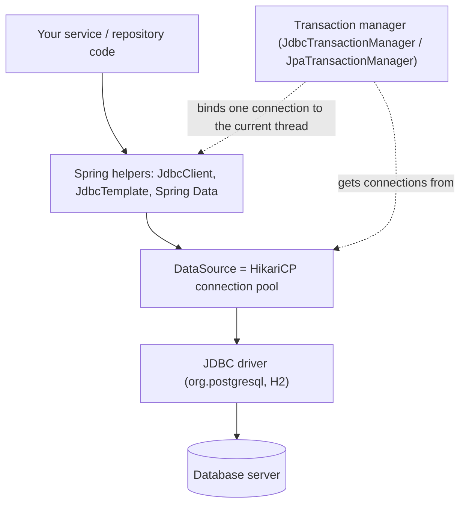
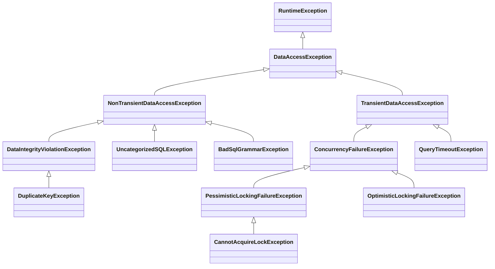
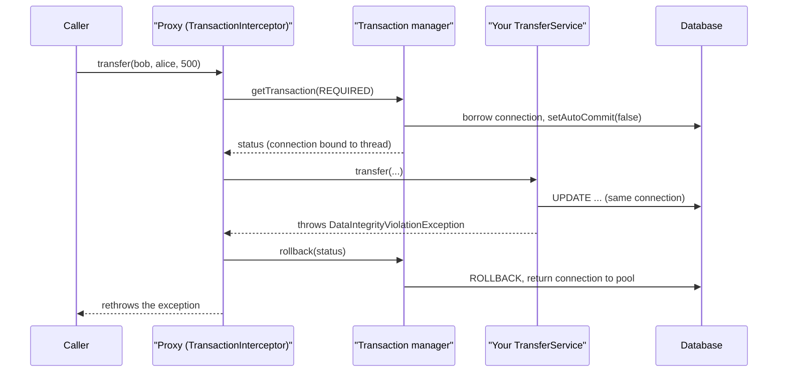
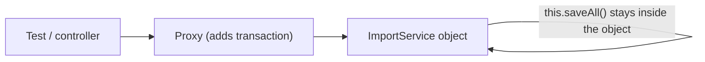

# Chapter 7 — Data Access with JDBC and Transactions

Almost every Spring application stores data in a relational database (tables of rows queried with SQL, e.g. PostgreSQL). This chapter covers the plumbing: how Boot creates a **connection pool**, running SQL with **`JdbcClient`** and **`JdbcTemplate`**, and translating database errors into one exception family. Most of it is about **transactions** (changes saved together or not at all): what `@Transactional` really does, the seven propagation types (what happens when one transactional method calls another), rollback rules, isolation (how much concurrent transactions see of each other), read-only and timeouts, and the pitfalls that make `@Transactional` silently do nothing.

This is not a SQL course. Transactions at the database level (ACID — Atomicity, Consistency, Isolation, Durability; isolation anomalies; MVCC — multi-version concurrency control, readers see a snapshot instead of waiting for writers; locks) are taught in the SQL book: [SQL ch13 — Transactions and concurrency](../../../sql/chapters/13-transactions-and-concurrency/README.md). Here we look at the Spring side: who opens the transaction, on which connection, and when it commits (makes its changes permanent).

**The code** (Spring Boot 4.1.1, Spring Framework 7.0, Java 25):

| Project | Database | What it proves |
|---|---|---|
| [`code/jdbc-basics`](code/jdbc-basics) | H2 in memory | HikariCP settings, `JdbcClient`/`JdbcTemplate`, batch, exception translation, `@JdbcTest` |
| [`code/tx-demos`](code/tx-demos) | the book's private PostgreSQL 14 (port 5544) | propagation, rollback rules, pitfalls, isolation, read-only, timeout, events, `TransactionTemplate` |

The transaction demos use real PostgreSQL; H2 (a small in-memory Java database) would hide how read-only transactions and serialization failures (the database refusing a transaction because a concurrent one changed the same data) act. The `tx-demos` test run creates a database called `spring_ch07_tx` before the tests and drops it afterwards (see [7.7](#77-how-a-spring-transaction-works)). Every result below was printed by a test and checked by an assertion. Run everything with `bash tools_run_spring.sh spring '07-*'` from the repository root. Start PostgreSQL first with `bash tools_pg.sh start`.

---

## 7.1 The data-access stack

### What it is

A `SELECT` passes through several layers, each with one job:



| Layer | Job | Spring Boot gives you |
|---|---|---|
| **JDBC** (Java Database Connectivity) | The standard Java API for SQL: `Connection`, `PreparedStatement`, `ResultSet` | the driver from your dependencies |
| **DataSource** | A factory for connections. In practice it is a **pool** that keeps connections open and lends them out | `HikariDataSource`, set up from `spring.datasource.*` |
| **Spring JDBC helpers** | Take away the boilerplate (repetitive setup code): open/close, loops over `ResultSet`, turning `SQLException` into something useful | `JdbcTemplate`, `NamedParameterJdbcTemplate`, `JdbcClient` beans |
| **Transaction manager** | Starts, commits and rolls back transactions. Keeps the current connection on the current thread (each request usually runs on its own thread) so every helper call in one transaction uses the same connection | `JdbcTransactionManager` (JDBC) or `JpaTransactionManager` (JPA, [ch08](../08-spring-data-jpa-and-hibernate/README.md)) |

Plain JDBC (without Spring) is covered in the SQL book: [SQL 14.11 — Using SQL from Java (JDBC)](../../../sql/chapters/14-advanced-sql-and-using-sql-from-code/README.md#1411-using-sql-from-java-jdbc). Compared with that code, Spring adds three things: a pool, much less boilerplate, and declarative transactions (you mark a method with an annotation instead of writing begin/commit code).

### Choosing an API

| Need | Use |
|---|---|
| Hand-written SQL, full control, reporting queries | `JdbcClient` (or `JdbcTemplate`) — this chapter |
| Simple aggregates (a root object plus the objects it owns, saved as one unit), no ORM (Object-Relational Mapper, which maps objects to tables and writes SQL for you), predictable SQL | Spring Data JDBC — [ch09](../09-spring-data-beyond-jpa-and-caching/README.md) |
| Rich domain model with relationships, change tracking (the library notices which objects you modified) | JPA / Hibernate + Spring Data JPA — [ch08](../08-spring-data-jpa-and-hibernate/README.md) |

You can mix them in one application. A `JdbcClient` query and a JPA repository call can even share one transaction when the `JpaTransactionManager` is in charge.

---

## 7.2 DataSource and HikariCP

### What it is

A **connection pool** keeps a set of open database connections and lends one to each piece of work, because opening a connection (TCP handshake, authentication, session setup) is expensive. **HikariCP** is the pool Spring Boot picks first whenever it is on the classpath. `spring-boot-starter-jdbc` and `spring-boot-starter-data-jpa` both bring it in.

### How Boot builds it

1. You add a starter plus a driver (`org.postgresql:postgresql`, `com.h2database:h2`).
2. Boot's `DataSourceAutoConfiguration` reads `spring.datasource.url`, `username` and `password`.
3. If you give **no URL** and an embedded database (runs inside your Java process: H2, HSQLDB, Derby) is on the classpath, Boot creates an in-memory database whose name is unique per application context (`spring.datasource.generate-unique-name=true` by default), so test contexts never see each other's tables.
4. Pool settings go under `spring.datasource.hikari.*`.

```properties
# jdbc-basics/src/main/resources/application.properties
spring.datasource.url=jdbc:h2:mem:shop;DB_CLOSE_DELAY=-1
spring.datasource.username=sa
spring.datasource.hikari.maximum-pool-size=5
spring.datasource.hikari.pool-name=shop-pool
spring.datasource.hikari.connection-timeout=2000
```

The test reads the settings back from the real bean:

```java
HikariDataSource hikari = (HikariDataSource) dataSource;
System.out.println("DataSource class = " + hikari.getClass().getSimpleName()
        + ", pool = " + hikari.getPoolName()
        + ", maxPoolSize = " + hikari.getMaximumPoolSize()
        + ", connectionTimeout = " + hikari.getConnectionTimeout() + " ms");
```

Output:

```
DataSource class = HikariDataSource, pool = shop-pool, maxPoolSize = 5, connectionTimeout = 2000 ms
```

### The settings that matter

| Property (`spring.datasource.hikari.`) | HikariCP default | Meaning |
|---|---|---|
| `maximum-pool-size` | 10 | Most connections the pool will ever open |
| `minimum-idle` | same as max | Idle (open but unused) connections kept ready. Leaving it unset gives a fixed-size pool, which HikariCP recommends — it never has to open connections during a traffic spike |
| `connection-timeout` | 30 000 ms | How long a thread waits for a free connection; then `SQLTransientConnectionException`, which Spring wraps as `CannotGetJdbcConnectionException` |
| `idle-timeout` | 600 000 ms | Idle connections above `minimum-idle` are closed after this |
| `max-lifetime` | 1 800 000 ms | Connections are retired after this. Keep it shorter than any database or firewall idle limit |
| `keepalive-time` | 120 000 ms | Pings idle connections so network gear does not drop them |
| `leak-detection-threshold` | 0 (off) | Logs a stack trace when a connection is held longer than this. Good for finding leaks (connections never returned) in staging |

Boot 4.1 added `spring.datasource.connection-fetch=lazy`. It wraps the pool in Spring's `LazyConnectionDataSourceProxy`, so a transaction takes a physical connection only when the first SQL statement runs. A `@Transactional` method that returns early without touching the database never borrows a connection.

### Pool sizing — the counter-intuitive part

A bigger pool is not faster. The database has a fixed number of CPU cores and disks. Hundreds of connections all running at once make it switch between them and fight over locks. HikariCP's own guidance starts from a small pool, roughly *cores × 2 + effective disks*, and then measures. Two rules follow from this:

- **Sum across instances.** 20 application pods (running copies) × pool 10 = 200 connections, and the default PostgreSQL `max_connections` is 100.
- **Hold connections briefly.** A transaction that calls a slow HTTP API keeps its connection the whole time (see [7.13](#713-transaction-pitfalls)).

More on pooling in general: [SQL 14.12 — Connection pooling](../../../sql/chapters/14-advanced-sql-and-using-sql-from-code/README.md#1412-connection-pooling).

### Common mistakes

- Setting `maximum-pool-size=100` "to be safe", then running out of database connections as soon as you scale out.
- Leaving `connection-timeout` at 30 s in a user-facing API. Requests hang for 30 s when the pool is exhausted, when failing fast would be better.
- Forgetting the pool when you add virtual threads (cheap JVM-managed threads) ([ch15](../15-observability-and-production/README.md)). Thousands of virtual threads still share, say, 10 connections, and the pool becomes the limit.

---

## 7.3 JdbcClient and JdbcTemplate

### What it is

Both run SQL you write yourself. They open and close the connection, bind parameters, loop over rows, map each row to an object, and translate errors.

- **`JdbcTemplate`** (since Spring 1.x): the classic API with many overloaded methods, `?` placeholders (filled with values safely), and a `RowMapper` (a function turning one result row into an object).
- **`NamedParameterJdbcTemplate`**: the same, with `:name` placeholders.
- **`JdbcClient`** (Spring Framework 6.1+): one fluent API that covers both styles. Boot auto-configures it from the `NamedParameterJdbcTemplate`. It is the recommended default for new code.

### Querying with JdbcClient

```java
@Repository
public class ProductRepository {

    private final JdbcClient jdbc;

    public ProductRepository(JdbcClient jdbc) { this.jdbc = jdbc; }

    public List<Product> findAll() {
        return jdbc.sql("SELECT id, sku, name, price, in_stock FROM product ORDER BY id")
                   .query(Product.class)          // columns -> record components by name
                   .list();
    }

    public Optional<Product> findBySku(String sku) {
        return jdbc.sql("SELECT id, sku, name, price, in_stock FROM product WHERE sku = :sku")
                   .param("sku", sku)             // named parameter
                   .query(Product.class)
                   .optional();                   // 0 rows -> empty, 2+ rows -> exception
    }

    public List<String> namesCheaperThan(BigDecimal max) {
        return jdbc.sql("SELECT name FROM product WHERE price < ? ORDER BY price")
                   .param(max)                     // positional parameter
                   .query(String.class)            // one column -> simple type
                   .list();
    }
    // ...
}
```

`Product` is a record: `record Product(Long id, String sku, String name, BigDecimal price, int inStock)`. `query(Product.class)` maps columns to constructor parameters by name. It understands `in_stock` → `inStock` because it ignores underscores and case. For a single column, `query(String.class)` (or `Long.class`, ...) returns plain values.

Output:

```
row: Product[id=1, sku=KB-01, name=Mechanical keyboard, price=89.00, inStock=12]
row: Product[id=2, sku=MS-01, name=Wireless mouse, price=25.50, inStock=40]
row: Product[id=3, sku=MN-27, name=27-inch monitor, price=249.99, inStock=3]
findBySku(MS-01) = Optional[Product[id=2, sku=MS-01, name=Wireless mouse, price=25.50, inStock=40]]
findBySku(NOPE)  = Optional.empty
cheaper than 100 = [Wireless mouse, Mechanical keyboard]
```

The terminal methods after `query(...)`:

| Method | Returns | When |
|---|---|---|
| `.list()` | `List<T>` | any number of rows |
| `.optional()` | `Optional<T>` | 0 or 1 row. More than one throws `IncorrectResultSizeDataAccessException` |
| `.single()` | `T` | exactly 1 row. Zero rows throws `EmptyResultDataAccessException` |
| `.set()` / `.stream()` | `Set<T>` / `Stream<T>` | a set, or streaming. Close the stream (try-with-resources) |
| `.query(rowMapper)` / `.query(rowCallbackHandler)` | custom | full control over mapping |

### Writing: generated keys and row counts

```java
public long insert(String sku, String name, BigDecimal price, int stock) {
    KeyHolder keys = new GeneratedKeyHolder();
    jdbc.sql("INSERT INTO product (sku, name, price, in_stock) VALUES (:sku, :name, :price, :stock)")
        .param("sku", sku).param("name", name).param("price", price).param("stock", stock)
        .update(keys, "id");                  // ask the driver to return the generated "id"
    return keys.getKeyAs(Long.class);
}

public int changeStock(String sku, int delta) {
    return jdbc.sql("UPDATE product SET in_stock = in_stock + :d WHERE sku = :sku")
               .param("d", delta).param("sku", sku)
               .update();                     // number of rows changed
}
```

Output:

```
generated id = 6, rows updated = 1, now = Product[id=6, sku=HD-01, name=Headset, price=59.90, inStock=5]
```

Why 6, with only three rows? Earlier tests inserted rows and were rolled back, but **identity and sequence values (auto-increment id counters) are never rolled back** — the database hands out numbers without waiting for the commit, so gaps are normal. Never use ids to count rows or assume gap-free ordering.

### The same with JdbcTemplate, plus a batch

```java
private static final RowMapper<Product> MAPPER = (rs, rowNum) -> new Product(
        rs.getLong("id"), rs.getString("sku"), rs.getString("name"),
        rs.getBigDecimal("price"), rs.getInt("in_stock"));

public List<Product> inStockAtLeast(int min) {
    return jdbc.query("SELECT * FROM product WHERE in_stock >= ? ORDER BY sku", MAPPER, min);
}

/** One JDBC batch: one round trip per batch instead of one per row. */
public int[] restock(List<String> skus, int amount) {
    return jdbc.batchUpdate("UPDATE product SET in_stock = in_stock + ? WHERE sku = ?",
            skus.stream().map(s -> new Object[] {amount, s}).toList());
}
```

Output:

```
batch update counts = [1, 1, 0]
in stock >= 13: [KB-01, MN-27, MS-01]
```

The batch returns one count per parameter set (`NOPE` matched no row → 0). It sends the statements in one network round trip — for 10 000 rows, a handful of round trips instead of 10 000.

### Trade-offs

| | `JdbcTemplate` | `NamedParameterJdbcTemplate` | `JdbcClient` |
|---|---|---|---|
| Placeholders | `?` | `:name` | both |
| Style | overloaded methods | overloaded methods | fluent chain |
| Record/bean mapping | `DataClassRowMapper` by hand | same | automatic with `query(Type.class)` |
| Batch updates | `batchUpdate` | `batchUpdate` | not in the fluent API. Use `JdbcTemplate` |
| Stored procedures | `SimpleJdbcCall` | — | — |

### Common mistakes

- **String concatenation in SQL** (`"... WHERE sku = '" + sku + "'"`) → SQL injection (attacker input runs as SQL). Always bind parameters. See [SQL 14.9 — SQL injection](../../../sql/chapters/14-advanced-sql-and-using-sql-from-code/README.md#149-sql-injection-and-parameterized-queries).
- Using `.single()` when "no row" is a normal case. Use `.optional()`.
- `SELECT *` into a record. A column added later breaks nothing, but a renamed one fails at runtime. List the columns.
- Loading a million rows with `.list()`. Stream them, or page with keyset pagination ([SQL 12.14](../../../sql/chapters/12-indexes-storage-and-query-performance/README.md#1214-offset-vs-keyset-pagination)).

### In the interview

**30-second answer:** "`JdbcTemplate` and `JdbcClient` run hand-written SQL and handle connections, parameter binding, row mapping and exception translation. `JdbcClient` is the fluent API from Spring 6.1 and supports named and positional parameters and automatic mapping to records. Both take their connection from the `DataSource` pool. If a transaction is active, they use the connection bound to the current thread, so they take part in `@Transactional` automatically."

- *How does `JdbcTemplate` know about the current transaction?* → It gets its connection through `DataSourceUtils.getConnection`, which first checks `TransactionSynchronizationManager` for a connection already bound to this thread.
- *Is `JdbcTemplate` thread-safe?* → Yes. After configuration it holds no per-call state, so one shared bean is fine.

---

## 7.4 Schema and data initialization

Spring Boot can run SQL scripts at startup:

| File | Runs | Purpose |
|---|---|---|
| `schema.sql` (and `schema-<platform>.sql`) | first | `CREATE TABLE ...` |
| `data.sql` (and `data-<platform>.sql`) | after `schema.sql` | seed rows |

| Property | Default | Meaning |
|---|---|---|
| `spring.sql.init.mode` | `embedded` | `embedded` = only for H2/HSQLDB/Derby, `always` = any database, `never` = off |
| `spring.sql.init.platform` | `all` | picks `schema-${platform}.sql` |
| `spring.sql.init.continue-on-error` | `false` | stop startup on a failing statement |
| `spring.jpa.defer-datasource-initialization` | `false` | with JPA: run the scripts *after* Hibernate has created the tables |

`jdbc-basics` uses H2, so the scripts would run anyway. The project sets `mode=always` to make that visible. `tx-demos` points at PostgreSQL, which is not embedded, so there `mode=always` is required. Its `schema.sql` begins with `DROP TABLE IF EXISTS` so it can run again on every startup.

```sql
-- tx-demos/src/main/resources/schema.sql
CREATE TABLE account (
    owner   TEXT PRIMARY KEY,
    balance BIGINT NOT NULL CHECK (balance >= 0)
);
CREATE TABLE audit_log (id BIGSERIAL PRIMARY KEY, message TEXT NOT NULL);
```

### When not to use it

In production the schema changes over time, and a script that only ever creates tables cannot handle that. Use a **migration tool** (Flyway or Liquibase: tools that keep track of which schema changes a database has already received) that applies numbered, versioned changes exactly once. See [8.16](../08-spring-data-jpa-and-hibernate/README.md#816-schema-migrations-with-flyway). `schema.sql` is fine for demos, tests and prototypes.

---

## 7.5 Exception translation: DataAccessException

### The problem it solves

JDBC reports every failure as a checked `SQLException` carrying a vendor error code and an SQLState (a standard five-character code). Telling "duplicate key" from "deadlock" (two transactions each waiting for the other's lock) would mean checking vendor codes like PostgreSQL's `23505` or MySQL's `1062`. Spring translates them into one **unchecked** hierarchy, the same for every database and data-access technology (JDBC, JPA, R2DBC — a non-blocking database API, ...).

```java
assertThatThrownBy(() -> repo.insert("KB-01", "Duplicate", BigDecimal.ONE, 1))
        .isInstanceOf(DuplicateKeyException.class)
        .isInstanceOf(DataAccessException.class);
assertThatThrownBy(() -> repo.insert("NEG-1", "Negative", new BigDecimal("-1"), 1))
        .isInstanceOf(DataIntegrityViolationException.class);
```

Output:

```
duplicate sku -> DuplicateKeyException
CHECK violated -> DataIntegrityViolationException
```

### The part of the hierarchy you will meet

The diagram is simplified: a few intermediate classes are left out. For example, `BadSqlGrammarException` really extends `InvalidDataAccessResourceUsageException`.



| Exception | Typical cause | Retry? |
|---|---|---|
| `DuplicateKeyException` | unique/primary key violated | no — fix the data |
| `DataIntegrityViolationException` | NOT NULL, CHECK, foreign key | no |
| `BadSqlGrammarException` | typo in SQL, missing table | no — bug |
| `CannotAcquireLockException`, `PessimisticLockingFailureException` | lock timeout, deadlock, PostgreSQL serialization failure | **yes**, the whole transaction |
| `OptimisticLockingFailureException` | `@Version` conflict (someone else saved the row since you read it) ([8.14](../08-spring-data-jpa-and-hibernate/README.md#814-locking-optimistic-and-pessimistic)) | yes, after reloading |
| `QueryTimeoutException` | statement cancelled by a timeout | maybe |
| `UncategorizedSQLException` | an error Spring has no specific class for | inspect `getCause()` |

The **transient** branch means "the same operation might succeed if you try again". That is exactly the test to use when deciding whether to retry ([ch04](../04-aop-and-proxies/README.md) covers `@Retryable`).

For JPA repositories the same translation is applied by a proxy around `@Repository` beans. In Boot 4 the switch is `spring.persistence.exceptiontranslation.enabled`. It was `spring.dao.exceptiontranslation.enabled` before Boot 4.

---

## 7.6 Testing JDBC code with @JdbcTest

`@JdbcTest` is a **test slice**: it starts only the JDBC parts of the application (`DataSource`, `JdbcTemplate`, `JdbcClient`, the transaction manager, SQL init) and none of your services or controllers. Two defaults matter:

1. It replaces your `DataSource` with a fresh embedded database. `@AutoConfigureTestDatabase(replace = Replace.NONE)` keeps yours, which is how the Hikari settings above could be checked.
2. **Every test method runs in a transaction that is rolled back afterwards**, so tests do not see each other's changes.

```java
@JdbcTest
@AutoConfigureTestDatabase(replace = AutoConfigureTestDatabase.Replace.NONE)
@Import({ProductRepository.class, ProductTemplateDao.class})   // our beans are not in the slice
class JdbcClientTest {
    @Test
    void eachTestRunsInsideARolledBackTransaction() {
        System.out.println("test method in a transaction? "
                + TransactionSynchronizationManager.isActualTransactionActive());
        repo.changeStock("KB-01", -12);          // undone after the test
    }
}
```

Output:

```
test method in a transaction? true
```

In Boot 4 the slice annotations moved with the modules: `org.springframework.boot.jdbc.test.autoconfigure.JdbcTest`, from `spring-boot-starter-jdbc-test`. The rolled-back test transaction is convenient, but it can **hide transaction bugs**. Code that only works because the test opened a transaction will pass in the test and fail in production. That is why every demo in `tx-demos` is a non-transactional `@SpringBootTest`. More in [ch12](../12-testing-spring-apps/README.md).

---

## 7.7 How a Spring transaction works

### What it is

A **database transaction** groups statements so they all commit or all roll back (see [SQL 13.1](../../../sql/chapters/13-transactions-and-concurrency/README.md#131-what-a-transaction-is)). On one JDBC connection that means `setAutoCommit(false)`, the statements, then `commit()` or `rollback()`. A **Spring transaction** does that work for you and adds three things:

1. **One connection per transaction, bound to the thread.** Every `JdbcClient`, `JdbcTemplate` or JPA call inside the transaction, in any class, finds that connection through `TransactionSynchronizationManager`, which works like a `ThreadLocal` (per-thread variable) map.
2. **Declarative boundaries.** `@Transactional` on a method means "wrap this method in a transaction".
3. **Rules** for what to do when a transactional method calls another one (propagation), when to roll back, which isolation level to use, and more.

### How @Transactional works, step by step

Spring does not change your class. It puts a **proxy** in front of the bean (AOP — see [ch04](../04-aop-and-proxies/README.md)). Other beans are injected with the proxy, not your object.



1. The caller calls the proxy.
2. The `TransactionInterceptor` reads the `@Transactional` attributes and asks the `PlatformTransactionManager` for a transaction.
3. The manager takes a connection from the pool, switches off auto-commit, applies isolation/read-only/timeout, and **binds the connection to the current thread**.
4. Your method runs. Every data-access call finds the bound connection.
5. If the method returns normally, the manager commits. If it throws, the rollback rules decide between commit and rollback ([7.10](#710-rollback-rules)).
6. The connection is unbound and returned to the pool.

### Which transaction manager?

| You use | Boot auto-configures | Notes |
|---|---|---|
| JDBC only (`spring-boot-starter-jdbc`) | `JdbcTransactionManager` | a `DataSourceTransactionManager` that also translates commit errors to `DataAccessException` |
| JPA (`spring-boot-starter-data-jpa`) | `JpaTransactionManager` | also manages the `EntityManager`. JDBC calls on the same `DataSource` join its transactions |
| Several resources (JMS — Java's messaging API — + DB) | none by default | a JTA (Java Transaction API) manager, or better, avoid distributed transactions (slow and fragile; see the outbox idea in [ch14](../14-messaging-async-and-scheduling/README.md)) |
| Reactive (R2DBC) | `R2dbcTransactionManager` | `ReactiveTransactionManager`, context-bound instead of thread-bound ([ch13](../13-reactive-and-webflux/README.md)) |

### Seeing it

The demos print a small "where am I" string: whether a Spring transaction is active, the transaction's name (the method that started it), and the PostgreSQL **backend pid**. Every PostgreSQL connection is served by its own server process, so the same pid means the same connection.

```java
public String where() {
    int pid = jdbc.sql("SELECT pg_backend_pid()").query(Integer.class).single();
    return "txActive=" + TransactionSynchronizationManager.isActualTransactionActive()
            + " name=" + TransactionSynchronizationManager.getCurrentTransactionName()
            + " pid=" + pid;
}
```

### Test plumbing for the PostgreSQL demos

`tx-demos` needs its own database. A JUnit **`LauncherSessionListener`** (plain JUnit, not Spring, registered in `META-INF/services`) runs before the first test and after the last one. It connects to the admin database and creates or drops `spring_ch07_tx`:

```java
public class DemoDatabase implements LauncherSessionListener {
    public void launcherSessionOpened(LauncherSession s) {
        run("DROP DATABASE IF EXISTS spring_ch07_tx WITH (FORCE)");
        run("CREATE DATABASE spring_ch07_tx");
    }
    public void launcherSessionClosed(LauncherSession s) {
        run("DROP DATABASE IF EXISTS spring_ch07_tx WITH (FORCE)"); // pool may still hold connections
    }
    // run(sql) = DriverManager.getConnection("jdbc:postgresql://127.0.0.1:5544/postgres", ...) + execute
}
```

The tests extend a base class that is **not** `@Transactional`. Commits and rollbacks really happen, and `@BeforeEach` resets the data to `alice = 100, bob = 50`.

---

## 7.8 @Transactional attributes

| Attribute | Default | What it does |
|---|---|---|
| `propagation` | `REQUIRED` | what to do if a transaction already exists ([7.9](#79-propagation)) |
| `isolation` | `DEFAULT` (= the database's default, READ COMMITTED on PostgreSQL) | [7.11](#711-isolation-levels) |
| `readOnly` | `false` | hint, and on some drivers a rule, that nothing is written ([7.12](#712-readonly-and-timeout)) |
| `timeout` / `timeoutString` | none | seconds before statements are cancelled |
| `rollbackFor` / `rollbackForClassName` | — | also roll back for these (checked) exceptions |
| `noRollbackFor` / `noRollbackForClassName` | — | commit even though this exception was thrown |
| `transactionManager` (alias `value`) | the primary one | choose among several managers |
| `label` | — | free-form labels that a custom manager can read |

**Where to put it.** On a class, it applies to every method the proxy can intercept. On a method, it overrides the class. The Spring team recommends annotating **concrete classes**, not interfaces. A common pattern is `@Transactional(readOnly = true)` on the class with `@Transactional` on the write methods. Spring Data's `SimpleJpaRepository` is built exactly that way.

---

## 7.9 Propagation

### What it is

**Propagation** answers: *this method is transactional, and a transaction may already be running. What now?*

| Propagation | Transaction already running | No transaction running | Typical use |
|---|---|---|---|
| `REQUIRED` (default) | **join** it | start one | almost everything |
| `REQUIRES_NEW` | **suspend** it, start an independent one (new connection) | start one | audit logs that must survive a rollback, id generators |
| `NESTED` | create a **savepoint** (a marker you can roll back to without undoing everything) inside it | start one | "try this part, undo just this part on failure" (JDBC only) |
| `MANDATORY` | join it | **throw** `IllegalTransactionStateException` | methods that must never run on their own |
| `SUPPORTS` | join it | run **without** | read helpers that do not care |
| `NOT_SUPPORTED` | suspend it, run without | run without | slow non-transactional work inside a transactional flow |
| `NEVER` | **throw** `IllegalTransactionStateException` | run without | guard: "must not be called inside a transaction" |

### Demo 1 — one outer transaction calling each type

`OuterService.callEachPropagation()` is `@Transactional`. It calls methods on a **different** bean (`AuditService`, so the calls go through the proxy), and each method has a different propagation:

```java
@Transactional
public List<String> callEachPropagation() {
    List<String> seen = new ArrayList<>();
    seen.add("outer        : " + db.where());
    seen.add("REQUIRED     : " + audit.required("required"));
    seen.add("REQUIRES_NEW : " + audit.requiresNew("requires-new"));
    seen.add("NESTED       : " + audit.nestedAndMaybeFail("nested", false));
    seen.add("MANDATORY    : " + audit.mandatory("mandatory"));
    seen.add("SUPPORTS     : " + audit.supports());
    seen.add("NOT_SUPPORTED: " + audit.notSupported());
    return seen;
}
```

The test raises the transaction manager's log level to DEBUG so you can read its decisions. Output (logger name and connection hashes shortened, a few "Initiating commit" and "Releasing connection" lines left out):

```
DEBUG JdbcTransactionManager - Creating new transaction with name [ch07.tx.OuterService.callEachPropagation]: PROPAGATION_REQUIRED,ISOLATION_DEFAULT
DEBUG JdbcTransactionManager - Acquired Connection [HikariProxyConnection@... wrapping PgConnection@2b6262bc] for JDBC transaction
DEBUG JdbcTransactionManager - Switching JDBC Connection [...PgConnection@2b6262bc] to manual commit
DEBUG JdbcTransactionManager - Participating in existing transaction
DEBUG JdbcTransactionManager - Suspending current transaction, creating new transaction with name [ch07.tx.AuditService.requiresNew]
DEBUG JdbcTransactionManager - Acquired Connection [...PgConnection@3e28dc96] for JDBC transaction
DEBUG JdbcTransactionManager - Committing JDBC transaction on Connection [...PgConnection@3e28dc96]
DEBUG JdbcTransactionManager - Resuming suspended transaction after completion of inner transaction
DEBUG JdbcTransactionManager - Creating nested transaction with name [ch07.tx.AuditService.nestedAndMaybeFail]
DEBUG JdbcTransactionManager - Releasing transaction savepoint
DEBUG JdbcTransactionManager - Participating in existing transaction
DEBUG JdbcTransactionManager - Participating in existing transaction
DEBUG JdbcTransactionManager - Suspending current transaction
DEBUG JdbcTransactionManager - Resuming suspended transaction after completion of inner transaction
DEBUG JdbcTransactionManager - Committing JDBC transaction on Connection [...PgConnection@2b6262bc]
outer        : txActive=true name=ch07.tx.OuterService.callEachPropagation pid=92825
REQUIRED     : txActive=true name=ch07.tx.OuterService.callEachPropagation pid=92825
REQUIRES_NEW : txActive=true name=ch07.tx.AuditService.requiresNew pid=92827
NESTED       : txActive=true name=ch07.tx.OuterService.callEachPropagation pid=92825
MANDATORY    : txActive=true name=ch07.tx.OuterService.callEachPropagation pid=92825
SUPPORTS     : txActive=true name=ch07.tx.OuterService.callEachPropagation pid=92825
NOT_SUPPORTED: txActive=false name=ch07.tx.AuditService.notSupported pid=92827
```

Reading it (the pids and connection hashes change from run to run; what matters is which lines share a pid):

- **REQUIRED, MANDATORY, SUPPORTS** joined: same name, same pid 92825 ("Participating in existing transaction").
- **REQUIRES_NEW** took a **second connection** (pid 92827) and committed on its own before the outer transaction continued.
- **NESTED** stayed on the same connection. The log shows a savepoint being created and then released.
- **NOT_SUPPORTED** suspended the outer transaction and ran with no transaction (`txActive=false`). It still needed a connection, so it borrowed one from the pool, here the one REQUIRES_NEW had just returned.

A subtle cost: while REQUIRES_NEW runs, **one thread holds two connections**. If every request does that, a pool of 10 can deadlock with only 5 concurrent requests, each holding one connection and waiting for a second.

### Demo 2 — without an outer transaction

```
SUPPORTS      : txActive=false name=ch07.tx.AuditService.supports pid=92825
MANDATORY     : No existing transaction found for transaction marked with propagation 'mandatory'
NEVER in tx   : Existing transaction found for transaction marked with propagation 'never'
```

SUPPORTS simply ran without a transaction. MANDATORY and NEVER threw `IllegalTransactionStateException`.

### Demo 3 — REQUIRES_NEW survives the outer rollback

```java
@Transactional
public void outerFailsAfterRequiresNew() {
    db.audit("outer work");
    audit.requiresNew("audit written in REQUIRES_NEW");
    throw new IllegalStateException("outer failed");
}
```

```
=== REQUIRES_NEW commits even though the outer transaction rolls back ===
audit_log = [audit written in REQUIRES_NEW]
```

"outer work" is gone and the audit row stayed. This is the standard way to record *"someone tried to do X and it failed"*.

### Demo 4 — NESTED rolls back to the savepoint only

```java
@Transactional
public void outerSurvivesNestedFailure() {
    db.audit("outer work");
    try {
        audit.nestedAndMaybeFail("nested work", true);
    } catch (IllegalStateException e) {
        db.audit("outer caught: " + e.getMessage());
    }
}
```

```
DEBUG JdbcTransactionManager - Creating nested transaction with name [ch07.tx.AuditService.nestedAndMaybeFail]
DEBUG JdbcTransactionManager - Rolling back transaction to savepoint
DEBUG JdbcTransactionManager - Committing JDBC transaction on Connection [...]
audit_log = [outer work, outer caught: inner NESTED failed]
```

"nested work" was undone with `ROLLBACK TO SAVEPOINT`, and the rest committed. NESTED is supported by the JDBC transaction managers. With JPA, `JpaTransactionManager` can create JDBC savepoints, but Hibernate's in-memory state (the persistence context) is not rolled back with them. Avoid NESTED with JPA.

### Demo 5 — catching an inner REQUIRED failure does not save you

This surprises almost everyone:

```java
@Transactional
public void outerCatchesRequiredFailure() {
    db.audit("outer work");
    try {
        audit.requiredAndFail("inner work");   // REQUIRED -> joins, then throws
    } catch (IllegalStateException e) {
        db.audit("outer caught: " + e.getMessage() + " and carries on");
    }
}
```

```
DEBUG JdbcTransactionManager - Participating in existing transaction
DEBUG JdbcTransactionManager - Participating transaction failed - marking existing transaction as rollback-only
DEBUG JdbcTransactionManager - Global transaction is marked as rollback-only but transactional code requested commit
DEBUG JdbcTransactionManager - Rolling back JDBC transaction on Connection [...]
UnexpectedRollbackException: Transaction rolled back because it has been marked as rollback-only
audit_log = []
```

The inner method **shared** the outer transaction. When the exception left the inner proxy, that proxy could not roll back only its own part, because there is only one physical transaction. So it marked the whole transaction **rollback-only**. The outer method caught the exception and returned normally. At commit time Spring found the mark, rolled everything back, and threw `UnexpectedRollbackException` so the failure is not silent.

Fixes: let the exception propagate. Or make the inner call `REQUIRES_NEW`/`NESTED` if its failure really should be isolated. Or check for the error condition before calling instead of catching the exception.

### Common mistakes

- REQUIRES_NEW everywhere "for safety" doubles connection use and breaks atomicity, because parts commit independently.
- Expecting propagation to apply to calls inside the same class. It does not ([7.13](#713-transaction-pitfalls)).
- Expecting a transaction to follow work into another thread (`@Async`, `CompletableFuture`, parallel streams). Transactions are bound to one thread, so the new thread has none.

### In the interview

**30-second answer:** "Propagation decides what a transactional method does when a transaction already exists. REQUIRED, the default, joins it or starts one. REQUIRES_NEW suspends the caller's transaction and runs an independent one on a new connection. NESTED uses a savepoint. MANDATORY and NEVER throw if a transaction is missing or present. SUPPORTS and NOT_SUPPORTED run with or without one."

- *Inner REQUIRED method throws, outer catches it. What happens?* → The shared transaction is marked rollback-only. The outer commit becomes a rollback and throws `UnexpectedRollbackException`.
- *REQUIRES_NEW vs NESTED?* → REQUIRES_NEW is a separate physical transaction that commits independently, even if the outer one rolls back later. NESTED is a savepoint in the same transaction, so if the outer transaction rolls back, the nested work is lost too.
- *Risk of REQUIRES_NEW?* → Two connections per thread, which can exhaust the pool. It can also deadlock if the inner transaction waits for a row lock the outer one holds.

---

## 7.10 Rollback rules

### What it is

When an exception leaves a `@Transactional` method, Spring chooses rollback or commit. The default copies EJB (Enterprise JavaBeans, the older Java EE component model):

- **`RuntimeException` and `Error` → rollback.**
- **Checked exceptions (`Exception` subclasses that are not runtime exceptions) → commit.**

The idea was that checked exceptions are "business outcomes" the caller is expected to handle. In practice this causes bugs. (Checked vs unchecked is explained in the Java book: [Java 8.2](../../../java/chapters/08-exceptions/README.md#82-the-throwable-hierarchy-checked-unchecked-and-errors).)

### The demo

```java
public class FraudCheckException extends Exception { ... }  // CHECKED

@Transactional
public void transferThenFailChecked(String from, String to, long amount) throws FraudCheckException {
    transferSteps(from, to, amount);
    throw new FraudCheckException("fraud check failed (checked)");
}

@Transactional(rollbackFor = FraudCheckException.class)
public void transferThenFailCheckedWithRollbackFor(...) throws FraudCheckException { /* same */ }

@Transactional(noRollbackFor = IllegalArgumentException.class)
public void transferWithNoRollbackFor(...) { transferSteps(...); throw new IllegalArgumentException(...); }
```

Output (start: `alice=100 bob=50`, transfer 30 from alice to bob):

```
CHECK violation      -> rolled back, alice=100 bob=50
RuntimeException     -> rolled back, alice=100 bob=50
checked exception    -> COMMITTED (!), alice=70 bob=80
checked + rollbackFor -> rolled back, alice=100 bob=50
unchecked + noRollbackFor -> committed, alice=70 bob=80
```

The third line is the trap. The method **threw**, the caller saw an exception, and the money moved anyway.

### Changing the default for the whole application (Framework 6.2+)

```java
@Configuration
@EnableTransactionManagement(proxyTargetClass = true, rollbackOn = RollbackOn.ALL_EXCEPTIONS)
public class RollbackOnAllExceptionsConfig { }
```

With this configuration active (a separate test context with the profile `rollback-all`), the *same* method rolls back:

```
rollbackOn=ALL_EXCEPTIONS, checked exception -> rolled back, alice=100 bob=50
```

The Spring reference docs recommend `ALL_EXCEPTIONS` unless you really rely on "commit on checked exception". `rollbackFor`/`noRollbackFor` on a method still override the global default. When you declare your own `@EnableTransactionManagement`, Boot's version backs off. Keep `proxyTargetClass = true` so beans still get class-based proxies, as with Boot's default.

### Rules summary

| Thrown | Default | `rollbackFor = X` | `noRollbackFor = X` | `rollbackOn = ALL_EXCEPTIONS` |
|---|---|---|---|---|
| `RuntimeException` / `Error` | rollback | rollback | commit if it is an X | rollback |
| checked exception | **commit** | rollback if it is an X | commit | rollback |
| exception caught inside the method | nothing to decide — commits | same | same | same |

Rules match **subclasses** too: `rollbackFor = Exception.class` covers every checked exception. The `...ClassName` variants match by name pattern, which is powerful but easy to over-match.

### Common mistakes

- Catching an exception, logging it, and not rethrowing. The method ends normally and **commits**. If you must swallow it, call `TransactionAspectSupport.currentTransactionStatus().setRollbackOnly()`, or better, use `TransactionTemplate`.
- Wrapping a runtime exception into a checked one on the way out, which silently switches the outcome to commit.
- Your own JDBC code throwing raw `SQLException` (checked) → commit; Spring's helpers throw unchecked `DataAccessException`s, which do roll back.
- Assuming `@Transactional(rollbackFor = ...)` on an interface method is honoured by every proxy type. Annotate the class.

### In the interview

**30-second answer:** "By default Spring rolls back on unchecked exceptions and errors and commits on checked exceptions. You change it per method with `rollbackFor`/`noRollbackFor`, or since Spring 6.2 globally with `@EnableTransactionManagement(rollbackOn = ALL_EXCEPTIONS)`. A caught exception never triggers a rollback, because the proxy never sees it."

- *My method threw an `IOException` but the data was saved. Why?* → `IOException` is checked, so the default rule commits. Add `rollbackFor` or switch the global default.

---

## 7.11 Isolation levels

### What it is

**Isolation** controls what one transaction can see of other transactions that run at the same time. The anomalies (dirty read, non-repeatable read, phantom, lost update, write skew) and how PostgreSQL implements each level with MVCC are taught in [SQL 13.4 — Isolation](../../../sql/chapters/13-transactions-and-concurrency/README.md#134-isolation--anomalies-and-isolation-levels) and [SQL 13.7 — Lost updates](../../../sql/chapters/13-transactions-and-concurrency/README.md#137-lost-updates-and-how-to-prevent-them). In Spring you only choose the level:

```java
@Transactional(isolation = Isolation.REPEATABLE_READ)
```

Spring calls `Connection.setTransactionIsolation(...)` when it starts the transaction and resets it afterwards. `Isolation.DEFAULT` leaves the database default in place: READ COMMITTED on PostgreSQL, Oracle and SQL Server, REPEATABLE READ on MySQL InnoDB. Isolation only applies when a **new** transaction starts. A method that joins an existing transaction inherits the outer transaction's level.

### Demo — two reads, and another user commits in between

"Another user" is simulated with a `REQUIRES_NEW` method on a second bean. It uses a second connection and commits immediately, which makes the demo run on one thread with a predictable result.

```java
@Transactional(isolation = Isolation.READ_COMMITTED)
public List<Long> readTwiceReadCommitted() {
    long first = db.balance("alice");
    other.deposit("alice", 50);          // REQUIRES_NEW: commits on another connection
    long second = db.balance("alice");
    return List.of(first, second);
}
// readTwiceRepeatableRead(): identical, with Isolation.REPEATABLE_READ
```

```
READ_COMMITTED  reads alice twice: [100, 150]  (non-repeatable read)
REPEATABLE_READ reads alice twice: [100, 100]  (same snapshot)
```

PostgreSQL's REPEATABLE READ takes one snapshot at the first query; every later read uses it.

### Demo — the lost update

Read a value into Java, change it, write it back. This is the most common concurrency bug in business code:

```java
@Transactional(isolation = Isolation.READ_COMMITTED)
public void addTenReadCommitted() {
    long read = db.balance("alice");     // 100
    other.deposit("alice", 50);          // another user: 150, committed
    db.setBalance("alice", read + 10);   // writes 110
}
```

```
READ_COMMITTED  read 100, other +50, write read+10 -> alice=110  (the +50 is LOST)
REPEATABLE_READ same steps -> CannotAcquireLockException: ERROR: could not serialize access due to concurrent update
alice=150 (the deposit survived; retry the whole transaction)
```

Under REPEATABLE READ, PostgreSQL notices that the row changed after this transaction's snapshot was taken and refuses the update (SQLState `40001`). Spring translates that into `CannotAcquireLockException`, a `ConcurrencyFailureException`, so it is in the "transient, retry" branch of [7.5](#75-exception-translation-dataaccessexception). **The whole transaction must be retried from the start**, not just the failed statement.

### Ways to prevent lost updates

| Technique | How | Where |
|---|---|---|
| Do the math in SQL | `UPDATE account SET balance = balance + 10` | simplest — no read-modify-write in Java |
| Pessimistic lock | `SELECT ... FOR UPDATE`, then update | [SQL 13.12](../../../sql/chapters/13-transactions-and-concurrency/README.md#1312-row-locks-for-work-queues-for-update-nowait-skip-locked), JPA `@Lock` in [8.14](../08-spring-data-jpa-and-hibernate/README.md#814-locking-optimistic-and-pessimistic) |
| Optimistic lock | version column, `UPDATE ... WHERE version = ?` | JPA `@Version` in [8.14](../08-spring-data-jpa-and-hibernate/README.md#814-locking-optimistic-and-pessimistic) |
| Stronger isolation | REPEATABLE READ / SERIALIZABLE + retry on `40001` | this section |

### Common mistakes

- Setting `isolation` on a method that is always called inside another transaction. It is ignored, because only the method that starts the transaction sets the level.
- Using SERIALIZABLE without a retry loop. Serialization failures are *expected* at that level.
- Relying on H2 to test isolation. Its behaviour differs from PostgreSQL's, which is why these demos use a real server.

---

## 7.12 readOnly and timeout

### readOnly

`@Transactional(readOnly = true)` does different things depending on the stack:

| Stack | Effect |
|---|---|
| JDBC (`JdbcTransactionManager`) | calls `Connection.setReadOnly(true)`. The PostgreSQL driver then starts the transaction as `READ ONLY`, so writes **fail** |
| JPA / Hibernate | the session becomes read-only and flush mode goes to manual (flushing = sending pending changes to the database). No snapshots for dirty checking, no automatic flush (faster reads, [8.4](../08-spring-data-jpa-and-hibernate/README.md#84-the-persistence-context-and-dirty-checking)) |
| Routing `DataSource` | can send read-only transactions to a replica (a read-only synced copy; see [System Design Fundamentals](../../../system-design-patterns/modules/00-system-design-fundamentals/README.md)) (a custom `AbstractRoutingDataSource` that checks `TransactionSynchronizationManager.isCurrentTransactionReadOnly()`) |

On PostgreSQL:

```java
@Transactional(readOnly = true)
public void writeInReadOnly() { db.audit("should not be allowed"); }
```

```
readOnly=true + INSERT -> UncategorizedSQLException: ERROR: cannot execute INSERT in a read-only transaction
```

Other drivers may treat read-only only as a hint. Do not rely on it for security. Use database permissions for that ([SQL 14.8](../../../sql/chapters/14-advanced-sql-and-using-sql-from-code/README.md#148-security-roles-privileges-and-row-level-security)).

### timeout

`timeout` (seconds) is a deadline for the whole transaction. Spring's JDBC helpers turn the *remaining* time into a JDBC query timeout on each statement. When the deadline has already passed, the next statement fails before it runs.

```java
@Transactional(timeout = 1)
public void slowQuery() { db.sleepSeconds(3); }   // SELECT pg_sleep(3)
```

```
timeout=1 + pg_sleep(3) -> QueryTimeoutException: ERROR: canceling statement due to user request
gave up after ~1000 ms
```

The driver asked PostgreSQL to cancel the statement after one second. Keep in mind: a timeout cancels **database statements**. Plain Java code, or a slow HTTP call made inside the transaction, is not interrupted. The deadline is only checked at the next statement.

---

## 7.13 Transaction pitfalls

All of these pitfalls come from one fact: **`@Transactional` works only when the call goes through the Spring proxy.** Proxies and AOP are covered in [ch04](../04-aop-and-proxies/README.md). Here you see the effect on real data.

```java
System.out.println("injected class = " + imports.getClass().getSimpleName()
        + ", CGLIB proxy? " + AopUtils.isCglibProxy(imports));
```

```
injected class = ImportService$$SpringCGLIB$$0, CGLIB proxy? true
```

### Pitfall 1 — self-invocation

```java
@Service
public class ImportService {
    public void importAll(List<String> lines) {   // NOT transactional
        saveAll(lines);                            // this.saveAll(): bypasses the proxy
    }

    @Transactional
    public void saveAll(List<String> lines) {
        for (String line : lines) {
            if (line.equals("BAD")) throw new IllegalArgumentException("bad line");
            db.audit(line);
        }
    }
}
```

```
via this.saveAll()  -> audit_log = [line-1, line-2]   (partial import!)
via proxy.saveAll() -> audit_log = []   (rolled back)
```



The `@Transactional` on `saveAll` was ignored because the call never left the object. Each `INSERT` ran in auto-commit mode.

**Fixes, in order of preference:**

1. Put the annotation on the method that is called from outside (`importAll`), or on both.
2. Move `saveAll` to another bean, so the call goes through that bean's proxy.
3. Use `TransactionTemplate` inside the method ([7.14](#714-programmatic-transactions-transactiontemplate)). No proxy is needed.
4. Inject the bean into itself (`@Lazy` self-reference), or use AspectJ weaving (`@EnableTransactionManagement(mode = AdviceMode.ASPECTJ)`). Both work, and both are rarely worth the complexity.

### Pitfall 2 — `final` and `private` methods

A CGLIB proxy is a generated **subclass** that overrides your methods. It cannot override:

- **`private` methods**, which are invisible to subclasses. `@Transactional` on them is silently ignored. They can only be called from inside the class anyway, which is self-invocation.
- **`final` methods**. The call runs directly on the *proxy instance*. The proxy object is created without running your constructor, so its fields are `null`:

```java
@Transactional
public final String finalMethod() { return db.where(); }
```

```
final @Transactional method -> NullPointerException (runs on the proxy, whose 'db' field is null)
```

Why this happens, with a proof that does not involve transactions, is in [4.5](../04-aop-and-proxies/README.md#45-proxy-limitations--proved).

**Protected and package-private methods** *are* transactional with class-based proxies since Spring Framework 6.0:

```
package-private @Transactional -> txActive=true name=ch07.tx.ImportService.packagePrivate pid=92825
```

With JDK interface proxies, only methods of the interface are intercepted. Spring Boot uses CGLIB class proxies by default (`spring.aop.proxy-target-class=true`).

### Pitfall 3 — the transaction on the wrong layer

A transaction should cover one **use case**, "transfer money", not each individual SQL call. Here every DAO (Data Access Object) method is its own transaction, which is what you get by default with Spring Data repository methods:

```java
@Repository
public class AccountDao {
    @Transactional public void add(String owner, long delta) { db.addToBalance(owner, delta); }
}

@Service
public class NoTxTransferService {           // no @Transactional on the use case
    public void transfer(String from, String to, long amount) {
        dao.add(to, amount);    // commits immediately
        dao.add(from, -amount); // fails (CHECK balance >= 0) -> credit above stays
    }
}
```

```
tx per DAO call     -> alice=600 bob=50   (500 created from nothing)
tx on service method -> alice=100 bob=50
```

Rule of thumb: **`@Transactional` goes on service methods (the use case)**. Not on controllers, which would hold a connection during serialization and HTTP work. And not only on repositories, whose transactions are too small.

### Pitfall 4 — long transactions and remote calls

```java
@Transactional
public void placeOrder(Order o) {
    orders.save(o);
    paymentClient.charge(o);   // 2 s HTTP call while holding a DB connection and row locks
}
```

The connection is held for the whole HTTP call. If the payment succeeds and the commit then fails, the customer has been charged and no order exists. Keep transactions short and database-only. Make remote calls before or after the transaction, or publish an event after commit ([7.15](#715-transactionaleventlistener)), or use the transactional outbox (write the outgoing message to a table in the same transaction; a separate process sends it) ([ch14](../14-messaging-async-and-scheduling/README.md), [event-driven patterns](../../../microservices-patterns/chapters/11-event-driven/README.md)).

### Pitfall 5 — other threads

A transaction is bound to the thread that started it. Work handed to `@Async` methods, executors, `CompletableFuture.supplyAsync` or parallel streams runs **outside** the transaction, on other connections, and cannot see uncommitted data.

### Checklist: "why is my @Transactional not working?"

| Symptom | Likely cause |
|---|---|
| Partial writes after an exception | self-invocation, `private`/`final` method, bean not managed by Spring (`new MyService()`) |
| Data committed despite an exception | checked exception without `rollbackFor`, or the exception was caught inside |
| `UnexpectedRollbackException` | an inner REQUIRED method failed and someone caught its exception |
| `LazyInitializationException` | JPA entity used after the transaction ended ([8.6](../08-spring-data-jpa-and-hibernate/README.md#86-fetch-types-and-lazyinitializationexception)) |
| Works in tests, fails in production | the test itself was `@Transactional` and supplied the missing transaction |
| Pool exhausted under load | REQUIRES_NEW nesting, or slow remote calls inside transactions |

### In the interview

**30-second answer:** "`@Transactional` is implemented by a proxy, so it only applies to calls that come in through the proxy. Calls from one method to another in the same class skip it. So do `private` methods, and `final` methods break outright. Put transactions on service methods that represent a use case, keep them short, and never make remote calls inside them."

- *How do you fix self-invocation?* → Move the method to another bean, annotate the entry method, or use `TransactionTemplate`.
- *Why not put `@Transactional` on the controller?* → It widens the transaction to include request parsing, serialization and remote calls, holding connections and locks longer. The service layer is the use-case boundary.

---

## 7.14 Programmatic transactions: TransactionTemplate

### What it is

`TransactionTemplate` starts a transaction around a lambda. It uses the same manager and the same rules, with **no proxy**, so self-invocation cannot affect it. Boot auto-configures one bean with default settings. For other settings, create your own from the `PlatformTransactionManager`.

```java
@Service
public class ProgrammaticService {
    private final TransactionTemplate tx;            // auto-configured
    private final TransactionTemplate serializable;

    public ProgrammaticService(Db db, TransactionTemplate tx, PlatformTransactionManager txManager) {
        this.tx = tx;
        this.serializable = new TransactionTemplate(txManager);
        this.serializable.setIsolationLevel(TransactionDefinition.ISOLATION_SERIALIZABLE);
        this.serializable.setTimeout(5);
    }

    public long transferAndReturnNewBalance(String from, String to, long amount) {
        return tx.execute(status -> {                // only the lambda is transactional
            db.addToBalance(to, amount);
            db.addToBalance(from, -amount);
            return db.balance(to);
        });
    }

    public String tryThenUndo() {
        return tx.execute(status -> {
            db.audit("temporary");
            String seen = "inside: " + db.auditMessages();
            status.setRollbackOnly();                // roll back without throwing
            return seen;
        });
    }

    public String isolationOfCustomTemplate() {
        return serializable.execute(status -> db.showIsolation());   // SHOW transaction_isolation
    }
}
```

```
TransactionTemplate transfer -> bob now 70
setRollbackOnly: inside: [temporary], after: []
custom template isolation = serializable
```

### When to use it

| `@Transactional` | `TransactionTemplate` |
|---|---|
| whole method = one transaction | transaction around *part* of a method |
| clean business code | explicit and visible |
| proxy pitfalls apply | no proxy — works for self-calls |
| rollback via exceptions/rules | also `status.setRollbackOnly()` |

Good fits for `TransactionTemplate`: batch jobs that commit every N items, loops where each item gets its own transaction, retry loops (the retry must be *outside* the transaction), and places where the proxy pitfalls bite. Even lower level, `PlatformTransactionManager.getTransaction/commit/rollback` exists, but the template handles the error cases for you.

---

## 7.15 @TransactionalEventListener

### The problem it solves

"After an order is saved, send a confirmation e-mail." If the e-mail goes out inside the transaction and the transaction then rolls back, the customer gets an e-mail for an order that does not exist. You want **"only if the commit succeeded"**.

### How it works

1. Inside the transaction, publish an application event (`ApplicationEventPublisher.publishEvent`).
2. A plain `@EventListener` runs **immediately**, in the same thread and the same transaction.
3. A `@TransactionalEventListener` is **registered with the transaction** and runs at a chosen phase:

| Phase | Runs when | Typical use |
|---|---|---|
| `BEFORE_COMMIT` | just before commit (can still write, can still fail the commit) | last validations, flushing extra data |
| `AFTER_COMMIT` (default) | after a successful commit | e-mails, messages, cache eviction |
| `AFTER_ROLLBACK` | after a rollback | compensation (undoing side effects), alerts |
| `AFTER_COMPLETION` | after commit **or** rollback | cleanup |

```java
@Transactional
public void place(String item, boolean failAfterPublish) {
    db.audit("order " + item);
    events.publishEvent(new OrderPlaced(item));
    if (failAfterPublish) throw new IllegalStateException("payment declined");
}

@Component
public class OrderListeners {
    @EventListener                       void immediately(OrderPlaced e)    { ... }
    @TransactionalEventListener(phase = TransactionPhase.BEFORE_COMMIT)    void beforeCommit(OrderPlaced e) { ... }
    @TransactionalEventListener          void afterCommit(OrderPlaced e)    { ... }
    @TransactionalEventListener(phase = TransactionPhase.AFTER_ROLLBACK)   void afterRollback(OrderPlaced e) { ... }
    @TransactionalEventListener(phase = TransactionPhase.AFTER_COMPLETION) void afterCompletion(OrderPlaced e) { ... }
}
```

```
commit   -> [@EventListener book, BEFORE_COMMIT book, AFTER_COMMIT book, AFTER_COMPLETION book]
rollback -> [@EventListener lamp, AFTER_ROLLBACK lamp, AFTER_COMPLETION lamp], audit_log=[]
no tx    -> [@EventListener pen]
```

In the last line the event was published with no transaction active, so the transactional listeners were **skipped**. Set `@TransactionalEventListener(fallbackExecution = true)` if they should run in that case too.

### Common mistakes

- **Writing to the database in an AFTER_COMMIT listener without a new transaction.** The original transaction has finished, but its resources are still bound during cleanup. Since Spring 6.1, a `@TransactionalEventListener` method may be `@Transactional` only with `REQUIRES_NEW` (or `NOT_SUPPORTED`, allowed since 6.1.3). Anything else fails at startup.
- **Assuming AFTER_COMMIT is reliable delivery.** If the process crashes right after the commit, the e-mail is never sent, because the event lived only in memory. For guaranteed delivery, write an "outbox" row in the same transaction and have a separate process send it ([ch14](../14-messaging-async-and-scheduling/README.md)).
- Doing slow work in the listener on the request thread. Combine it with `@Async` to move the work off the request thread.

### In the interview

**30-second answer:** "`@TransactionalEventListener` defers an event listener to a transaction phase, by default after commit. So side effects like e-mails or messages only happen when the data is really saved. If no transaction is active the listener is skipped unless `fallbackExecution` is true. If the listener must write to the database it needs `REQUIRES_NEW`. For guaranteed delivery you still need an outbox, because the event is only in memory."

---

## 7.16 Interview questions

1. **What does Spring add on top of JDBC?** → Connection pooling (HikariCP via Boot), boilerplate removal (`JdbcClient`/`JdbcTemplate`), exception translation to `DataAccessException`, and declarative transactions.
2. **`JdbcClient` vs `JdbcTemplate`?** → Same engine. `JdbcClient` (6.1+) is a fluent API with named/positional parameters and automatic record mapping. `JdbcTemplate` stays for batches and older code.
3. **How does `@Transactional` work internally?** → A proxy's `TransactionInterceptor` asks the `PlatformTransactionManager` to begin a transaction, which binds a connection to the thread. The method runs. Then the interceptor commits, or rolls back according to the rollback rules.
4. **Default propagation and isolation?** → REQUIRED, and the database default (READ COMMITTED on PostgreSQL).
5. **Checked exception thrown from `@Transactional` — commit or rollback?** → Commit, unless `rollbackFor` or `rollbackOn = ALL_EXCEPTIONS` (6.2+) says otherwise.
6. **Why is my transaction ignored when I call the method from the same class?** → Self-invocation bypasses the proxy.
7. **Explain `UnexpectedRollbackException`.** → A participating (joined) method failed, which marked the shared transaction rollback-only. The outer code caught the exception and tried to commit.
8. **REQUIRES_NEW vs NESTED?** → A separate physical transaction on a new connection vs a savepoint in the same transaction.
9. **What does `readOnly = true` do?** → With JDBC it makes the connection read-only (PostgreSQL rejects writes). With Hibernate it disables dirty checking and flushing. It can also route to replicas.
10. **How do you run code only after a commit?** → `@TransactionalEventListener` (AFTER_COMMIT) or `TransactionSynchronization.afterCommit`. For guaranteed delivery, an outbox.
11. **How do you handle a serialization failure?** → Catch `ConcurrencyFailureException`/`TransientDataAccessException` and retry the *whole* transaction, with the retry outside the transactional method.
12. **Does `@Transactional` work with `@Async`?** → The async method runs on another thread with no inherited transaction. It can have its own `@Transactional`, but it is a separate transaction.

---

## Chapter TL;DR

- Boot builds a **HikariCP** pool from `spring.datasource.*`. Keep it small, keep connections short, and remember the total across instances.
- **`JdbcClient`** (6.1+) is the modern way to run SQL: `sql().param().query(Type.class).list()`, `update()`. Use `JdbcTemplate.batchUpdate` for batches. Always bind parameters.
- Spring translates `SQLException` into the unchecked **`DataAccessException`** hierarchy. The *transient* branch means "retry may work".
- **`@Transactional`** = proxy + transaction manager + a connection bound to the thread. Defaults: REQUIRED, database isolation, read-write, rollback on unchecked exceptions only.
- **Propagation**: REQUIRED joins, REQUIRES_NEW runs separately on a second connection, NESTED uses a savepoint, MANDATORY/NEVER guard, SUPPORTS/NOT_SUPPORTED are optional/none. A failure in a joined transaction dooms it (`UnexpectedRollbackException`).
- **Checked exceptions commit** by default. Use `rollbackFor` or `rollbackOn = ALL_EXCEPTIONS`.
- **Isolation** is the database's job ([SQL ch13](../../../sql/chapters/13-transactions-and-concurrency/README.md)). Spring sets the level. Retry on serialization failures.
- **Pitfalls**: self-invocation, `private`/`final` methods, the wrong layer, remote calls inside transactions, other threads, `@Transactional` tests hiding bugs.
- **`TransactionTemplate`** for precise, proxy-free boundaries. **`@TransactionalEventListener`** for after-commit side effects.

Next: [Chapter 8 — Spring Data JPA and Hibernate](../08-spring-data-jpa-and-hibernate/README.md) moves from SQL you write to entities and repositories.
