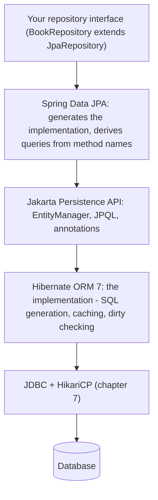
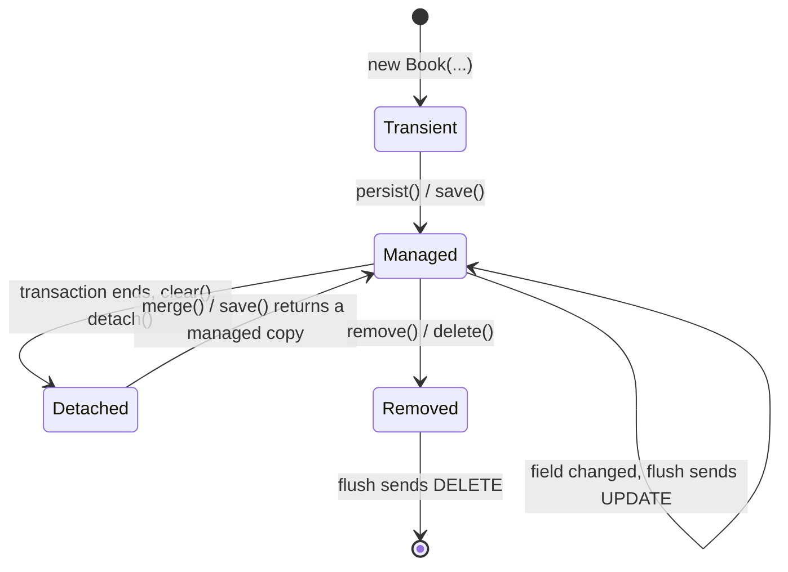
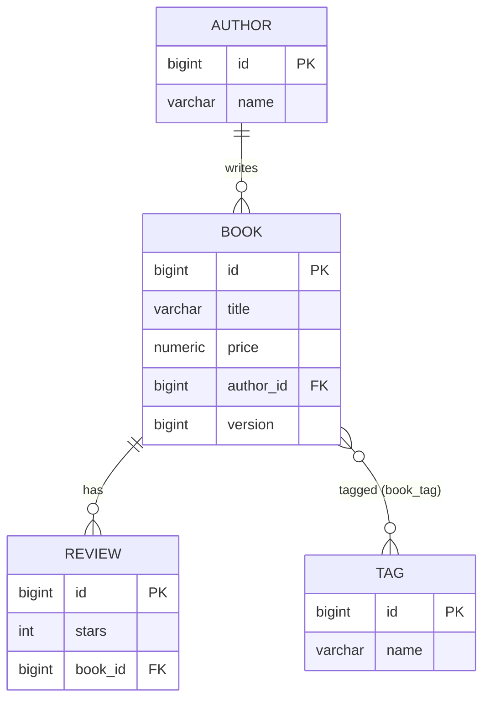

# Chapter 8 — Spring Data JPA and Hibernate

[Chapter 7](../07-data-access-jdbc-and-transactions/README.md) wrote SQL by hand. This chapter lets an **ORM** (object-relational mapper) write it. You describe Java classes and their relationships, and Hibernate (the most widely used ORM for Java) generates the `SELECT`, `INSERT`, `UPDATE` and `DELETE` statements, tracks changes to your objects, and loads related objects on demand. Spring Data JPA adds **repositories**: interfaces whose methods become queries without any implementation code. (JPA, the Jakarta Persistence API, is the standard Java API that ORMs such as Hibernate implement.)

This is very productive, and it is also where many performance problems in Spring applications come from. So every important behaviour below is *measured*. The tests count the SQL statements Hibernate really sends and print them. You will see the N+1 problem (one query for a list, then one extra query per item — §8.7) happen, then disappear with three different fixes. You will also see a `LazyInitializationException` (the error when related data is loaded after the database session has closed), dirty checking (Hibernate spotting changed objects and writing them back on its own) writing an `UPDATE` without any `save()` call, and two users colliding on an optimistic lock (a version check that detects a conflicting save instead of blocking it).

**What you'll learn**

- How JPA, Hibernate and Spring Data JPA relate (and which versions Boot 4.1 ships)
- Entities (classes whose objects are stored as table rows), ids and id generation strategies
- The persistence context: entity states, the first-level cache, dirty checking, flushing (sending queued changes to the database)
- Relationships: `@ManyToOne`, `@OneToMany`, `@ManyToMany`, owning side, `mappedBy`, cascades, `orphanRemoval`
- Fetch types (when related data is loaded), `LazyInitializationException`, and Open Session in View
- The N+1 problem and its fixes: `JOIN FETCH`, `@EntityGraph`, batch fetching, projections
- Repositories: derived queries (queries generated from a method's name), `@Query` (JPQL — JPA's object-oriented query language — and native SQL), `@Modifying`, paging and sorting, projections (queries that return only selected fields)
- Auditing (recording who changed what and when), optimistic locking with `@Version`, pessimistic locking (locking the row in the database so others must wait)
- Schema migrations (versioned scripts that evolve the table structure) with Flyway

**The code** (Spring Boot 4.1.1 → Hibernate ORM 7.4, Spring Data 2026.0, H2 — a small Java database — in memory):

| Project | What it proves |
|---|---|
| [`code/jpa-demos`](code/jpa-demos) | persistence context, relationships, lazy loading, N+1 with statement counts, repositories, projections, auditing, locking, open-in-view |
| [`code/flyway-migrations`](code/flyway-migrations) | versioned migrations + `ddl-auto=validate` |

Run everything with `bash tools_run_spring.sh spring '08-*'`. The sample data is a small library: 4 authors, 8 books, 3 tags, 6 reviews (`src/main/resources/data.sql`).

---

## 8.1 JPA, Hibernate and Spring Data — who does what

### What it is



| Layer | What it is | Version with Boot 4.1 |
|---|---|---|
| **Jakarta Persistence (JPA)** | a *specification*: the `jakarta.persistence` annotations, `EntityManager`, the JPQL query language | 3.2 |
| **Hibernate ORM** | the most used *implementation* of JPA. It does the real work | 7.4 (Boot 4.1 upgraded to 7.4; Hibernate 7.0 came out in 2025) |
| **Spring Data JPA** | a Spring layer on top of JPA: repositories, derived queries, paging, auditing | part of the Spring Data 2026.0 release train (a set of Spring Data modules released together under one version) |
| **Spring ORM** | the glue in Spring Framework: `JpaTransactionManager`, the shared `EntityManager` proxy, exception translation (turning vendor errors into Spring's `DataAccessException` family) | Framework 7.0 |

A few Hibernate 7 facts worth knowing: it implements **Jakarta Persistence 3.2** and **Jakarta Data 1.0**, it needs Java 17 or later, and it is the first Hibernate version licensed under **Apache License 2.0** (a permissive open-source licence; earlier versions were LGPL, a licence with more conditions on distribution). Spring Data 2025.1 (the Boot 4.0 generation) moved to JSpecify null annotations (standard markers for what may be `null`) and added **AOT repositories** (AOT = ahead-of-time), which generate repository code at build time for faster startup and native images (apps compiled to a stand-alone executable that needs no JVM). Spring Data 2026.0 (Boot 4.1) added **type-safe property paths**, for example `Sort.by(Book::getPrice)` instead of `Sort.by("price")`.

### When not to use JPA

JPA is a good fit for a rich domain model (classes that model the business and its rules): many related entities, loaded, changed and saved as a unit of work (one business operation whose changes are saved together). It fits poorly for:

- reporting and analytics (big joins; aggregations, i.e. sums/counts over groups; window functions, i.e. SQL calculations over a sliding set of rows): use SQL through `JdbcClient` ([7.3](../07-data-access-jdbc-and-transactions/README.md#73-jdbcclient-and-jdbctemplate)) or jOOQ (a library for writing type-safe SQL in Java)
- bulk data processing (millions of rows): use JDBC batches or database-side SQL
- teams who want to see every statement: Spring Data JDBC is simpler and has no lazy loading and no persistence context ([ch09](../09-spring-data-beyond-jpa-and-caching/README.md))

The general ORM vs raw SQL debate is covered in [SQL 14.13](../../../sql/chapters/14-advanced-sql-and-using-sql-from-code/README.md#1413-orms-vs-raw-sql).

---

## 8.2 Setting up

```xml
<dependency>
  <groupId>org.springframework.boot</groupId>
  <artifactId>spring-boot-starter-data-jpa</artifactId>   <!-- Hibernate + Spring Data JPA + HikariCP -->
</dependency>
<dependency>
  <groupId>com.h2database</groupId>
  <artifactId>h2</artifactId>
  <scope>runtime</scope>
</dependency>
<dependency>                                                  <!-- @DataJpaTest -->
  <groupId>org.springframework.boot</groupId>
  <artifactId>spring-boot-starter-data-jpa-test</artifactId>
  <scope>test</scope>
</dependency>
```

```properties
# jpa-demos/src/main/resources/application.properties
spring.jpa.hibernate.ddl-auto=create-drop
spring.jpa.defer-datasource-initialization=true          # run data.sql after Hibernate created tables
spring.jpa.properties.hibernate.generate_statistics=true # count statements
spring.jpa.properties.hibernate.session_factory.statement_inspector=ch08.jpa.support.SqlRecorder
```

Anything under `spring.jpa.properties.*` is passed to Hibernate unchanged. That is how you set any Hibernate option Boot has no property for.

### `ddl-auto`: who creates the tables?

| Value | Hibernate at startup | Use for |
|---|---|---|
| `none` | nothing | production with a migration tool |
| `validate` | checks that tables and columns match the entities, and fails startup if not | production with Flyway/Liquibase (see [8.16](#816-schema-migrations-with-flyway)) |
| `update` | adds missing tables and columns, never drops | quick prototypes only. Unreliable for real schema changes |
| `create` | drops and creates the schema | tests |
| `create-drop` | like `create`, and drops again at shutdown | tests, demos (this project) |

Boot's default is `create-drop` for an embedded database when no migration tool is present, and `none` otherwise.

### Seeing the SQL

| Option | Shows |
|---|---|
| `spring.jpa.show-sql=true` | every statement on stdout (the console output), prefixed `Hibernate:` (`@DataJpaTest` turns this on by default) |
| `logging.level.org.hibernate.SQL=DEBUG` | the same through the logger (better) |
| `logging.level.org.hibernate.orm.jdbc.bind=TRACE` | the bound parameter values too |
| `hibernate.generate_statistics=true` | counters: statements, entity loads, collection fetches, flushes |
| a `StatementInspector` | your own code sees every SQL string, which is used here to print and count |

The tests use a small helper built on Hibernate's `Statistics` and the `SqlRecorder` inspector:

```java
final class SqlCount {
    private final Statistics stats;
    SqlCount(EntityManagerFactory emf) { stats = emf.unwrap(SessionFactory.class).getStatistics(); }
    void reset()      { stats.clear(); SqlRecorder.clear(); }
    long statements() { return stats.getPrepareStatementCount(); }   // JDBC statements prepared
    void print(String label) { /* label + count + each recorded SQL string */ }
}
```

In your own projects you can get the same effect in tests with the *datasource-proxy* library or Hibernate statistics, and fail a test when a request uses more statements than expected. That turns N+1 bugs into test failures.

---

## 8.3 Entities and ids

### What it is

An **entity** is a class whose instances are rows of a table. The JPA rules: annotate it with `@Entity`, give it an `@Id`, give it a no-argument constructor (it may be `protected`), and do not make the class or its persistent methods `final`, because Hibernate subclasses entities to build lazy proxies (stand-in objects that load the real data on first use). **Records cannot be entities**, since they are final and immutable (cannot change after creation). Records work well as `@Embeddable` value types (small objects without their own id, stored as columns of the owning table) (Hibernate 6.2+) and as projections ([8.12](#812-projections)).

```java
@Entity
@EntityListeners(AuditingEntityListener.class)
public class Book {

    @Id
    @GeneratedValue(strategy = GenerationType.IDENTITY)
    private Long id;

    private String title;                 // column "title" - names are mapped automatically
    private BigDecimal price;

    @ManyToOne(fetch = FetchType.LAZY, optional = false)
    @JoinColumn(name = "author_id")
    private Author author;

    @ManyToMany
    @JoinTable(name = "book_tag",
               joinColumns = @JoinColumn(name = "book_id"),
               inverseJoinColumns = @JoinColumn(name = "tag_id"))
    private Set<Tag> tags = new HashSet<>();

    @Version private Long version;       // optimistic locking, 8.14
    @CreatedDate private Instant createdAt;       // auditing, 8.13
    @LastModifiedDate private Instant updatedAt;
    @CreatedBy private String createdBy;

    protected Book() {}                   // for JPA
    public Book(String title, BigDecimal price) { this.title = title; this.price = price; }
    // getters, a few setters ...
}
```

The chapter's tests switch `show-sql` off, but running one of them with `-Dlogging.level.org.hibernate.SQL=DEBUG` shows the table Hibernate generated at startup. Boot's default naming strategy (the rule that turns Java names into table/column names) turns `createdAt` into `created_at`:

```
create table book (price numeric(38,2), author_id bigint not null, created_at timestamp(6) with time zone,
  id bigint generated by default as identity, updated_at timestamp(6) with time zone, version bigint not null,
  created_by varchar(255), title varchar(255), primary key (id))
```

Useful column annotations: `@Column(nullable = false, length = 100, unique = true)`, `@Column(precision = 10, scale = 2)` (note the default `numeric(38,2)` above), `@Enumerated(EnumType.STRING)` (always use STRING, since ORDINAL — storing the enum's position number — breaks when someone reorders the enum), `@Transient` (not stored), and `@Embedded` for value objects such as `Address`.

### Id generation strategies

| Strategy | How the id is produced | Trade-off |
|---|---|---|
| `IDENTITY` | database auto-increment column (the database assigns the next number on insert) | simple, but Hibernate must `INSERT` **immediately** on `persist` to learn the id, which also rules out JDBC insert batching |
| `SEQUENCE` | database sequence (a database object that hands out increasing numbers). Hibernate fetches blocks of ids (`allocationSize`, default 50) | best for PostgreSQL/Oracle: inserts can wait until flush and be batched |
| `AUTO` (default) | Hibernate picks, which in Hibernate 6+ is usually a sequence per entity, `book_seq` | know what you get |
| `UUID` (JPA 3.1+) | `java.util.UUID` generated in Java | no round trip (no trip to the database and back), safe to generate anywhere. 16 bytes, and random UUIDs (universally unique identifiers) spread index inserts — an index is a lookup structure that speeds up queries, and random keys land all over it |
| assigned (no `@GeneratedValue`) | you set it | natural keys (ids that come from the real world, like an ISBN). `save()` must then use `merge`, see [8.8](#88-repositories) |

This project uses IDENTITY so `data.sql` can insert rows without ids. You can see the immediate inserts in [8.5](#85-relationships).

### equals and hashCode

Entities live in `Set`s (which use `hashCode` to place items and `equals` to compare them) and are compared across persistence contexts, so these methods matter:

- The **default** (`Object` identity) is correct inside one persistence context, because Hibernate guarantees one instance per row there ([8.4](#84-the-persistence-context-and-dirty-checking)). This project relies on that.
- **Never** base `hashCode` on a generated id that is `null` before persist. The hash changes after saving, and the object gets lost inside a `HashSet`.
- Good options: a natural business key (ISBN), or `equals` on id with a **constant** `hashCode` (`getClass().hashCode()`).
- Never include lazy associations in `equals`, `hashCode` or `toString`. Doing so triggers loading, or a `LazyInitializationException`.

---

## 8.4 The persistence context and dirty checking

### What it is

The **persistence context** is Hibernate's in-memory workspace for one unit of work. It is the `EntityManager` (Hibernate calls it `Session`). In Spring it usually lives exactly as long as the transaction. It does three jobs:

1. **Identity map / first-level cache**: each row is loaded at most once and always gives the *same* Java object.
2. **Change tracking (dirty checking)**: at load time it keeps a snapshot (a copy of the loaded values) of each entity. At **flush** time it compares every managed entity with its snapshot and writes an `UPDATE` for the ones that changed. You never call `update()`.
3. **Write-behind**: inserts, updates and deletes are queued and sent at flush. Flush happens before commit, before a query that might read the changed tables, or when you call `flush()`.

### Entity states



| State | Tracked? | Example |
|---|---|---|
| **Transient** | no — Hibernate does not know it | `new Book(...)` |
| **Managed** | yes — changes are flushed automatically | anything returned by `find`, a query, or `persist` inside the current transaction |
| **Detached** | no — it has an id but no persistence context | an entity returned by a repository call *after* its transaction ended |
| **Removed** | scheduled for `DELETE` at flush | after `remove()` |

### Demo — one row, one object, one SELECT

```java
Book first = books.findById(1L).orElseThrow();
Book second = books.findById(1L).orElseThrow();
System.out.println("same Java object? " + (first == second));
```

```
same Java object? true
findById(1) twice -> 1 SQL statement(s)
    select b1_0.id,b1_0.author_id,b1_0.created_at,b1_0.created_by,b1_0.price,b1_0.title,b1_0.updated_at,b1_0.version from book b1_0 where b1_0.id=?
```

The second `findById` came from the persistence context without any SQL. (`@DataJpaTest` wraps each test in one transaction, and so in one persistence context.)

### Demo — dirty checking: an UPDATE without save()

```java
Book book = books.findById(1L).orElseThrow();
book.setPrice(new BigDecimal("14.99"));   // just change the Java object...
em.flush();                                // ...Hibernate compares with its snapshot and writes SQL
```

```
setPrice() + flush, no save() -> 2 SQL statement(s)
    select b1_0.id,b1_0.author_id,b1_0.created_at,b1_0.created_by,b1_0.price,b1_0.title,b1_0.updated_at,b1_0.version from book b1_0 where b1_0.id=?
    update book set author_id=?,created_at=?,created_by=?,price=?,title=?,updated_at=?,version=? where id=? and version=?
version is now 1
```

In real code the flush happens at commit. `LibraryService.changePrice` is exactly this, and it is tested in [8.13](#813-auditing):

```java
@Transactional
public void changePrice(Long bookId, BigDecimal newPrice) {
    books.findById(bookId).orElseThrow().setPrice(newPrice);   // no save()
}
```

Notice that the `UPDATE` lists **all** columns. By default Hibernate uses one prepared `UPDATE` (a statement compiled once and reused with different values) per entity type, which it can cache. `@DynamicUpdate` on the entity makes it send only the changed columns instead.

### Demo — detached entities are not tracked

```java
Book book = books.findById(1L).orElseThrow();
em.clear();                                // persistence context emptied: book is DETACHED
book.setPrice(new BigDecimal("1.00"));
em.flush();
```

```
change a detached entity + flush -> 1 SQL statement(s)
    select ... from book b1_0 where b1_0.id=?
```

No `UPDATE` was sent: the change is simply lost. To store changes to a detached entity you call `save()` (which calls `merge`). Merge loads the current row, copies your state onto the managed copy, and returns that copy. Use the return value.

### readOnly transactions and JPA

`@Transactional(readOnly = true)` tells Spring to put the Hibernate session in read-only mode with manual flushing. Hibernate then keeps no snapshots and never runs dirty checking, which saves memory and CPU when you load many entities just to display them. Spring Data's `SimpleJpaRepository` is annotated `@Transactional(readOnly = true)` at class level and plain `@Transactional` on its write methods.

### Common mistakes

- Calling `save()` on an entity you just loaded in the same transaction. It is harmless but unnecessary, because the entity is managed already.
- Ignoring the result of `save()`/`merge()` for a detached entity, then modifying the old detached object.
- Loading 100 000 entities in one transaction. The persistence context keeps all of them *and* their snapshots. Process in pages and call `clear()`, or use a read-only transaction, projections or JDBC.

### In the interview

**30-second answer:** "The persistence context is the `EntityManager`'s first-level cache and unit of work. It returns the same object for the same row, keeps a snapshot of every managed entity, and at flush it writes `UPDATE`s for entities that changed. That is dirty checking, and it is why you don't need `save()` for loaded entities. Entities are transient, managed, detached or removed. Only managed ones are tracked."

- *When does Hibernate flush?* → Before commit, before a query that touches affected tables (AUTO flush mode), and on an explicit `flush()`.
- *`persist` vs `merge`?* → `persist` makes a transient object managed (the same instance). `merge` copies a detached object's state onto a managed copy and returns the copy.

### Self-check

1. How many SELECTs does `findById(1)` twice cost in one transaction? → One.
2. Why was no UPDATE sent after `em.clear()`? → The entity was detached, so nothing tracked it.
3. What does `readOnly = true` save with Hibernate? → Snapshots and dirty checking, and flushes.

---

## 8.5 Relationships

### What it is

| Annotation | Meaning | Default fetch | Example |
|---|---|---|---|
| `@ManyToOne` | many of these point to one of those | **EAGER** | `Book.author` |
| `@OneToMany` | one of these has a collection of those | LAZY | `Author.books` |
| `@OneToOne` | exactly one on each side | **EAGER** | `User.profile` |
| `@ManyToMany` | join table between the two | LAZY | `Book.tags` |

### The owning side and mappedBy

In the database a relationship is **one foreign-key column** (a column holding the id of a row in another table) or a join table (an extra table whose rows link two tables). In Java it may be navigable from both sides, but only one side may control that column. That side is the **owning side**:

- For `@ManyToOne`/`@OneToMany` the owner is the **many** side (`Book.author` → `book.author_id`).
- The other side says `mappedBy = "author"`, meaning "I am just a mirror of `Book.author`". This is the **inverse side**.
- JPA **only reads the owning side** when it writes SQL. Adding a book to `author.getBooks()` without setting `book.author` stores nothing.



That is why `Author` has helper methods that keep both sides in sync:

```java
@Entity
public class Author {
    @Id @GeneratedValue(strategy = GenerationType.IDENTITY) private Long id;
    private String name;

    @OneToMany(mappedBy = "author", cascade = CascadeType.ALL, orphanRemoval = true)
    private List<Book> books = new ArrayList<>();

    public void addBook(Book book)    { books.add(book);    book.setAuthor(this); }
    public void removeBook(Book book) { books.remove(book); book.setAuthor(null); }
    // ...
}
```

### Cascades

A **cascade** passes an operation from parent to children:

| `CascadeType` | Passes on |
|---|---|
| `PERSIST` | saving a new parent also saves new children |
| `MERGE` | merging the parent merges the children |
| `REMOVE` | deleting the parent deletes the children |
| `REFRESH`, `DETACH` | reload / detach together |
| `ALL` | all of the above |

Use cascades only from an **aggregate root** (the main object of a group that is always saved together, e.g. an order with its lines) to the parts it owns (author → books in this demo, order → order lines in real life). Never cascade `REMOVE` on `@ManyToMany` or towards shared entities. Deleting a book must not delete the "sci-fi" tag that other books use.

```java
Author author = new Author("N. K. Jemisin");
author.addBook(new Book("The Fifth Season", new BigDecimal("11.00")));
author.addBook(new Book("The Obelisk Gate", new BigDecimal("11.00")));
authors.save(author);                      // persist cascades to both books
```

```
save(new author with 2 new books) -> 3 SQL statement(s)
    insert into author (name,id) values (?,default)
    insert into book (author_id,created_at,created_by,price,title,updated_at,version,id) values (?,?,?,?,?,?,?,default)
    insert into book (author_id,created_at,created_by,price,title,updated_at,version,id) values (?,?,?,?,?,?,?,default)
ids assigned: author 5, books [9, 10]
```

The inserts ran **during `save()`**, before any flush. That is the IDENTITY strategy at work ([8.3](#83-entities-and-ids)).

### orphanRemoval

`orphanRemoval = true` means *"a child removed from the collection should be deleted"*. `CascadeType.REMOVE` only deletes children when the *parent* is deleted.

```java
Author pratchett = authors.findById(2L).orElseThrow();
Book smallGods = pratchett.getBooks().stream()
        .filter(b -> b.getTitle().equals("Small Gods")).findFirst().orElseThrow();
pratchett.removeBook(smallGods);           // no repository.delete() call
em.flush();
```

```
remove 'Small Gods' from author.books + flush -> 4 SQL statement(s)
    select a1_0.id,a1_0.name from author a1_0 where a1_0.id=?
    select b1_0.author_id,b1_0.id,b1_0.created_at,b1_0.created_by,b1_0.price,b1_0.title,b1_0.updated_at,b1_0.version from book b1_0 where b1_0.author_id=?
    delete from book_tag where book_id=?
    delete from book where id=? and version=?
```

Hibernate first removed the book's rows from the `book_tag` join table (Book owns that many-to-many), then deleted the book. The first version of this demo removed a book that had **reviews**, and the database rejected the delete with a foreign-key violation (`REVIEW FOREIGN KEY(BOOK_ID) REFERENCES BOOK(ID)`). Hibernate only cleans up relationships it knows it owns. `Review.book` points at the book from the other direction, so you must deal with those rows yourself.

### Many-to-many advice

A plain `@ManyToMany` suits a pure link with no data of its own. As soon as the link needs data ("tagged by whom, when?"), turn the join table into an **entity** (`BookTag` with two `@ManyToOne`s). Use `Set`, not `List`, for many-to-many. Hibernate handles `List` without an order column (a "bag") inefficiently: removing one element deletes all the link rows and re-inserts the rest.

### Common mistakes

- Setting only the inverse side (`author.getBooks().add(book)`), so nothing is saved.
- `cascade = ALL` everywhere, which deletes shared data.
- Bidirectional mappings (navigable from both sides) everywhere. Map the reverse side only when you really navigate it.
- `@OneToMany` without `mappedBy`. Hibernate then creates an extra join table.

### In the interview

**30-second answer:** "The owning side is the one holding the foreign key, in a one-to-many that is the `@ManyToOne` side, and it is the only side JPA reads when writing. The other side uses `mappedBy`. Keep both sides in sync with helper methods. Cascade from aggregate roots only. `orphanRemoval` deletes children removed from the collection, while `CascadeType.REMOVE` deletes children when the parent is deleted."

### Self-check

1. Which side owns `Author.books` ↔ `Book.author`? → `Book.author` (the `author_id` column).
2. Why were two DELETEs needed to remove one book? → The `book_tag` link rows go first, then the book row.
3. `orphanRemoval` vs `CascadeType.REMOVE`? → Removal from the collection vs deletion of the parent.

---

## 8.6 Fetch types and LazyInitializationException

### What it is

- **LAZY**: the related data is loaded only when you first touch it. For a collection, Hibernate puts a special `PersistentBag`/`PersistentSet` in the field. For a single entity it puts a generated **proxy** subclass there.
- **EAGER**: the related data is loaded together with the owner, always.

**Make everything LAZY** and decide per use case what to load (see [8.7](#87-the-n1-problem)). The JPA defaults are EAGER for `@ManyToOne` and `@OneToOne`, so change them explicitly: `@ManyToOne(fetch = FetchType.LAZY)`. EAGER cannot be switched off for a single query, while LAZY can always be fetched eagerly when you need it.

### LazyInitializationException

A lazy collection can only load itself while its persistence context is open. Outside a transaction, a repository call opens and closes its own short transaction. The entity it returns is already **detached**:

```java
@SpringBootTest(webEnvironment = SpringBootTest.WebEnvironment.NONE)   // no test transaction
class LazyLoadingTest {
    @Test
    void lazyCollectionOutsideTheTransaction() {
        Author a = authors.findById(2L).orElseThrow();   // transaction opens and closes inside findById
        assertThatThrownBy(() -> a.getBooks().size())
                .isInstanceOf(LazyInitializationException.class);
    }
}
```

```
LazyInitializationException: Cannot lazily initialize collection of role 'ch08.jpa.Author.books' with key '2' (no session)
```

"No session" means no open persistence context. The fixes:

```java
@EntityGraph(attributePaths = "books")
Optional<Author> findWithBooksById(Long id);       // load the books in the same query

@Transactional(readOnly = true)                     // or: do the work inside a transaction
public AuthorSummary summary(Long authorId) {
    Author a = authors.findById(authorId).orElseThrow();
    return new AuthorSummary(a.getName(), a.getBooks().size());   // return a DTO, not the entity
}
```

```
fetched with @EntityGraph -> 3 books
inside @Transactional service -> AuthorSummary[name=Terry Pratchett, books=3]
```

| Fix | Good? |
|---|---|
| fetch what the use case needs (JOIN FETCH / `@EntityGraph`) | ✅ best |
| do the work in a `@Transactional` service and return a DTO | ✅ best |
| a DTO projection query ([8.12](#812-projections)) | ✅ for read-only views |
| `spring.jpa.open-in-view=true` | ⚠️ hides the problem, see [8.15](#815-open-session-in-view) |
| switch the mapping to EAGER | ❌ every query pays for it |
| `hibernate.enable_lazy_load_no_trans=true` | ❌ each lazy load opens its own mini-transaction: N+1 with no consistency |

---

## 8.7 The N+1 problem

### What it is

You run **1** query to load N parents. Then, for each parent, touching a lazy association fires **1 more** query. With N = 1000 that is 1001 round trips for data that one query could return. It is the most common JPA performance bug, and a functional test (one that only checks the result is correct) cannot see it, because the result is correct, only slow.

### Demo — watch it happen

```java
List<Author> all = authors.findAll();
all.forEach(a -> System.out.println("  " + a.getName() + ": " + a.getBooks().size() + " books"));
```

```
  Ursula K. Le Guin: 2 books
  Terry Pratchett: 3 books
  Octavia E. Butler: 1 books
  Isaac Asimov: 2 books
findAll() then a.getBooks().size() -> 5 SQL statement(s)
    select a1_0.id,a1_0.name from author a1_0
    select b1_0.author_id,b1_0.id,b1_0.created_at,b1_0.created_by,b1_0.price,b1_0.title,b1_0.updated_at,b1_0.version from book b1_0 where b1_0.author_id=?
    select b1_0.author_id,b1_0.id,... from book b1_0 where b1_0.author_id=?
    select b1_0.author_id,b1_0.id,... from book b1_0 where b1_0.author_id=?
    select b1_0.author_id,b1_0.id,... from book b1_0 where b1_0.author_id=?
```

1 + 4 = 5 statements. The test asserts `statements() == 1 + all.size()`.

### EAGER does not fix it — demo

`Review.book` was left at the JPA default (`@ManyToOne` = EAGER). We never touch `review.getBook()`:

```java
var all = reviews.findAll();
```

```
reviews.findAll() with EAGER @ManyToOne Review.book (6 reviews) -> 6 SQL statement(s)
    select r1_0.id,r1_0.book_id,r1_0.stars from review r1_0
    select b1_0.id,b1_0.author_id,... from book b1_0 where b1_0.id=?
    select b1_0.id,b1_0.author_id,... from book b1_0 where b1_0.id=?
    select b1_0.id,b1_0.author_id,... from book b1_0 where b1_0.id=?
    select b1_0.id,b1_0.author_id,... from book b1_0 where b1_0.id=?
    select b1_0.id,b1_0.author_id,... from book b1_0 where b1_0.id=?
```

1 query for the reviews, then 1 per distinct book (5), **even though the code never used the books**. EAGER tells Hibernate that the association must be loaded. It does not say *how*. For JPQL and derived queries Hibernate runs the query as written, then loads each eager association separately.

### Fix 1 — JOIN FETCH

```java
@Query("select a from Author a join fetch a.books order by a.id")
List<Author> findAllWithBooks();
```

```
JOIN FETCH -> 1 SQL statement(s)
    select a1_0.id,b1_0.author_id,b1_0.id,...,a1_0.name from author a1_0 join book b1_0 on a1_0.id=b1_0.author_id order by a1_0.id
```

Hibernate 6+ removes the duplicate parent rows that a join produces on its own, so `distinct` is no longer needed. Note that it is an **inner** join (keeps only rows that have a match on both sides): authors with no books would disappear from the result. Use `left join fetch` (a left join keeps every row of the left table, even without a match) to keep them.

### Fix 2 — @EntityGraph

```java
@EntityGraph(attributePaths = "books")
@Query("select a from Author a order by a.id")
List<Author> findAllWithBooksGraph();
```

```
@EntityGraph(attributePaths = "books") -> 1 SQL statement(s)
    select a1_0.id,b1_0.author_id,b1_0.id,...,a1_0.name from author a1_0 left join book b1_0 on a1_0.id=b1_0.author_id order by a1_0.id
```

The effect is the same, but it is a **left** join and needs no JPQL. It also works on derived query methods (`findWithBooksById` above). Entity graphs can also be declared on the entity with `@NamedEntityGraph`.

### Fix 3 — batch fetching

Same code as the N+1 demo, one property added:

```java
@DataJpaTest(showSql = false, properties = "spring.jpa.properties.hibernate.default_batch_fetch_size=16")
```

```
findAll() + books with default_batch_fetch_size=16 -> 2 SQL statement(s)
    select a1_0.id,a1_0.name from author a1_0
    select b1_0.author_id,b1_0.id,... from book b1_0 where b1_0.author_id in (?,?,?,?,?,?,?,?,?,?,?,?,?,?,?,?)
```

When the first lazy collection is touched, Hibernate loads the collections of up to 16 authors in the persistence context at once. N+1 becomes 1 + ⌈N/16⌉. It needs no query changes, which makes it a good **global safety net**. Per association, use `@BatchSize(size = 16)`.

### Paging a JOIN FETCH (Hibernate 7.4)

Paging and fetching a collection in the same query was a classic trap. `LIMIT 2` on a joined result limits *rows*, not authors, so older Hibernate versions loaded **everything** and paged in memory, with the warning `HHH90003004: firstResult/maxResults specified with collection fetch; applying in memory`. Hibernate 7.4 pages the parents in a subquery instead. Our test, run on Boot 4.1.1:

```java
@Query(value = "select a from Author a join fetch a.books",
       countQuery = "select count(a) from Author a")
Page<Author> pageWithBooks(Pageable pageable);

authors.pageWithBooks(PageRequest.of(0, 2, Sort.by("id")));
```

```
JOIN FETCH + Pageable(page 0, size 2) -> 2 SQL statement(s)
    select a1_0.id,b1_0.author_id,...,a1_0.name from (select a1_0.id,a1_0.name from author a1_0 where exists(select 1 from book b1_0 where a1_0.id=b1_0.author_id) order by a1_0.id offset ? rows fetch first ? rows only) a1_0(id,name) join book b1_0 on a1_0.id=b1_0.author_id order by a1_0.id
    select count(a1_0.id) from author a1_0
```

The inner subquery picks 2 authors with `offset/fetch first`, and the outer query joins their books. On older Hibernate versions, set `hibernate.query.fail_on_pagination_over_collection_fetch=true` so the in-memory case fails loudly. Then page the ids first and fetch the collections in a second query (or rely on batch fetching).

### Choosing a fix

| Fix | Queries | Good for | Watch out |
|---|---|---|---|
| `JOIN FETCH` | 1 | one known use case | inner join by default. Fetching **two** `List` collections at once → `MultipleBagFetchException` (use `Set`, or two queries) |
| `@EntityGraph` | 1 | the same, declared on a repository method | same cartesian-product (every row combined with every other row) risk with several collections |
| batch size | 1 + N/size | global default, several collections | still more than one query |
| DTO projection | 1 | read-only screens and APIs | no entities, so no dirty checking (usually what you want) |

Fetching two collections in one query multiplies rows: 10 books × 10 tags = 100 rows per author. For several collections, prefer batch fetching or separate queries.

### Common mistakes

- Returning entities from a REST controller. Jackson walks every getter, triggering lazy loads (N+1) or `LazyInitializationException`, and exposes your schema. Return DTOs.
- Using `toString()`/Lombok `@Data` (Lombok is a library that generates getters, `equals`, `toString` and more) on entities with associations. Printing loads them.
- Testing with 3 rows. N+1 only hurts with real volumes, so assert statement counts in tests instead.

### In the interview

**30-second answer:** "N+1 is one query for the parents plus one per parent when a lazy association is touched, or even untouched with EAGER to-one mappings. I find it by counting statements with Hibernate statistics or a datasource proxy (a wrapper around the `DataSource` that sees every SQL statement). I fix it per use case with `JOIN FETCH` or an `@EntityGraph`, globally reduce it with `default_batch_fetch_size`, or avoid entities with a DTO projection. EAGER is not a fix, it makes the problem permanent."

- *Why doesn't EAGER prevent N+1?* → EAGER says *whether* to load, not *how*. For queries Hibernate loads the associations with separate selects after the main query.
- *JOIN FETCH with pagination?* → Historically in-memory pagination (HHH90003004). Hibernate 7.4 pages parents in a subquery. Otherwise page ids first, then fetch.
- *`MultipleBagFetchException`?* → Two `List` collections fetched in one query. Use `Set`, or fetch them in separate queries.

### Self-check

1. How many statements does `findAll()` + touching books cost for 4 authors without a fix? With batch size 16? → 5, and 2.
2. Which fix keeps authors that have no books? → `@EntityGraph` (left join), or `left join fetch`.
3. Why did `reviews.findAll()` run 6 statements? → EAGER `@ManyToOne` loaded each distinct book separately.

### TL;DR

Mappings LAZY. Decide what to fetch per query with JOIN FETCH / `@EntityGraph`. `default_batch_fetch_size` as a safety net. DTO projections for read views. Count statements in tests.

---

## 8.8 Repositories

### What it is

A **repository** is an interface. At startup Spring Data creates a proxy that implements it, using `SimpleJpaRepository` for the standard methods and generated query code for your own ones.

```java
public interface BookRepository extends JpaRepository<Book, Long> { ... }
```

| Interface | Adds |
|---|---|
| `Repository<T, ID>` | marker only. Declare exactly the methods you want |
| `CrudRepository` / `ListCrudRepository` | `save`, `findById`, `findAll`, `count`, `delete...` (the List variant returns `List` instead of `Iterable`) |
| `PagingAndSortingRepository` / `ListPagingAndSortingRepository` | `findAll(Sort)`, `findAll(Pageable)` |
| `JpaRepository` | all of the above + `flush`, `saveAndFlush`, `deleteAllInBatch`, `getReferenceById`, ... |
| `JpaSpecificationExecutor<T>` | dynamic `Specification` (criteria — conditions built in code) queries |

Expose only what callers should use. A `Repository` with a handful of methods is often better than handing out `deleteAll()`.

### How save() decides between INSERT and UPDATE

`save(entity)` asks "is this entity new?". If yes, it calls `persist` (the same instance becomes managed). If not, it calls `merge` (it returns a **different**, managed instance). An entity counts as new when its id is `null`, or when a wrapper-type `@Version` field is `null`. With **assigned ids** every entity has an id, so `save` runs `merge`, which first `SELECT`s the row. Implement `Persistable<ID>` to tell Spring Data yourself.

### Transactions in repositories

`SimpleJpaRepository` methods are transactional: read methods `readOnly = true`, write methods read-write. Each call **outside** a service transaction is its own tiny transaction, which leads straight to the "wrong layer" bug of [7.13](../07-data-access-jdbc-and-transactions/README.md#713-transaction-pitfalls). Put `@Transactional` on the service method so that all repository calls join one transaction.

---

## 8.9 Derived queries

The method name *is* the query. Spring Data parses it at startup, so a typo fails startup, not a request:

```java
List<Book> findByTitleContainingIgnoreCase(String part);
List<Book> findByPriceLessThanOrderByPriceAsc(BigDecimal max);
List<Book> findByAuthorName(String authorName);          // traverses book.author.name (a join)
long countByAuthorName(String authorName);
boolean existsByTitle(String title);
List<Book> findTop2ByOrderByPriceDesc();
List<Book> findByTagsName(String tag, Sort sort);        // many-to-many join + dynamic sort
```

```
containing 'go'      : [Small Gods, Going Postal]
price < 10 asc       : [I, Robot, Foundation, Guards! Guards!, A Wizard of Earthsea]
by author name       : [A Wizard of Earthsea, The Dispossessed]
count by author      : 3
exists 'Kindred'     : true
top 2 by price       : [Kindred, The Dispossessed]
tag sci-fi, title asc: [Foundation, I, Robot, Kindred, The Dispossessed]
tag fantasy, by price: [Guards! Guards!, A Wizard of Earthsea, Small Gods]
```

The last line used the Spring Data 2026.0 type-safe form `Sort.by(Book::getPrice)`. A renamed getter is then a compile error rather than a runtime one. The SQL Spring Data generated for some of them:

```
containing / count / exists -> 3 SQL statement(s)
    select b1_0.id,...,b1_0.version from book b1_0 where upper(b1_0.title) like upper(?) escape '\'
    select count(b1_0.id) from book b1_0 join author a1_0 on a1_0.id=b1_0.author_id where a1_0.name=?
    select b1_0.id from book b1_0 where b1_0.title=? fetch first ? rows only
```

`existsBy` fetches just one id. Note also that `upper(title) like` cannot use a normal index (a sorted lookup structure for a column) on `title` ([SQL 12.13](../../../sql/chapters/12-indexes-storage-and-query-performance/README.md#1213-anti-patterns-that-disable-indexes)).

### Keywords

| Keyword | Example | SQL idea |
|---|---|---|
| `And`, `Or` | `findByTitleAndPrice` | `title = ? and price = ?` |
| `Is`, `Equals`, `Not` | `findByTitleNot` | `title <> ?` |
| `LessThan`, `GreaterThanEqual`, `Between` | `findByPriceBetween(a, b)` | `price between ? and ?` |
| `IsNull`, `IsNotNull` | `findByAuthorIsNull` | `author_id is null` |
| `Like`, `StartingWith`, `EndingWith`, `Containing` | `findByTitleStartingWith` | `like 'x%'` |
| `IgnoreCase` | `findByTitleIgnoreCase` | `upper(title) = upper(?)` |
| `In`, `NotIn` | `findByIdIn(List)` | `id in (...)` |
| `True`, `False` | `findByActiveTrue` | `active = true` |
| `OrderBy...Asc/Desc` | `findByAuthorNameOrderByTitleDesc` | `order by` |
| `First`, `Top`, `TopN`, `Distinct` | `findFirst3ByOrderByPriceAsc` | `fetch first 3 rows` |
| nested property | `findByAuthorName` | join to `author` |
| prefixes | `count...By`, `exists...By`, `delete...By` | count / exists / load-then-delete |

Special parameters: `Sort`, `Pageable`, `Limit` (Spring Data 3.2+), `ScrollPosition` (keyset scrolling, 3.1+). Return types: `List`, `Optional`, `Stream` (close it), `Page`, `Slice`, `Window`, a single entity, or a projection.

**When not to use derived queries:** when the name grows past two or three conditions (`findByAuthorNameAndPriceLessThanAndTagsNameOrderBy...`). Switch to `@Query`.

---

## 8.10 @Query: JPQL, native SQL and @Modifying

### JPQL

**JPQL** (Jakarta Persistence Query Language) looks like SQL but talks about **entities and fields**, not tables and columns: `b.author.name` instead of a join written by hand.

```java
@Query("select b from Book b where b.author.name = :name and b.price <= :max order by b.price")
List<Book> byAuthorUpTo(@Param("name") String name, @Param("max") BigDecimal max);
```

```
JPQL  Pratchett <= 11 : [Guards! Guards!, Small Gods]
```

(`@Param` can be omitted when you compile with `-parameters`, which the Boot parent POM enables.)

### Native SQL

```java
@Query(value = "SELECT title FROM book WHERE price > ?1 ORDER BY title", nativeQuery = true)
List<String> titlesAbove(BigDecimal min);
```

```
native titles > 11    : [Going Postal, Kindred, The Dispossessed]
```

Use native queries for database features JPQL lacks (window functions; operators on `jsonb`, PostgreSQL's JSON column type; CTEs, i.e. `WITH` clauses that name a sub-query; `ON CONFLICT`, PostgreSQL's insert-or-update). The price is that the query is tied to one database and to table and column names.

### Bulk updates with @Modifying

```java
@Modifying(clearAutomatically = true) // bulk UPDATE bypasses the persistence context -> clear it
@Query("update Book b set b.price = b.price * :factor where b.author.id = :authorId")
int reprice(@Param("authorId") Long authorId, @Param("factor") BigDecimal factor);
```

```
@Modifying bulk update -> 1 SQL statement(s)
    update book b1_0 set price=(b1_0.price*cast(? as numeric(38,2))) where b1_0.author_id=?
bulk update rows      : 2 -> Asimov now [BookRow[title=Foundation, price=15.98], BookRow[title=I, Robot, price=13.98]]
```

A bulk statement goes straight to the database. Entities already loaded in the persistence context keep their **old** values, and `@Version` is **not** incremented. `clearAutomatically = true` empties the context afterwards, and `flushAutomatically = true` flushes pending changes before the statement runs. `@Modifying` methods need a read-write transaction.

### Dynamic queries

For search screens with optional filters, write `Specification`s (`JpaSpecificationExecutor`), Query by Example (pass a sample object; its non-null fields become filters), or Querydsl (a library for type-safe queries in Java code), instead of dozens of derived methods. All three build the query at runtime from the filters that are present.

### Common mistakes

- Building JPQL with string concatenation. That is injection again: always use parameters.
- Forgetting that JPQL uses **entity** names (`Book`, `b.author.name`), not table names.
- Bulk updates followed by reading "stale" entities from the same persistence context.

---

## 8.11 Pagination and sorting

```java
Page<Book> findByPriceGreaterThan(BigDecimal min, Pageable pageable);   // also runs a COUNT query
Slice<Book> findByAuthorIdIn(List<Long> authorIds, Pageable pageable);  // no COUNT, fetches size+1 rows

Page<Book> page = books.findByPriceGreaterThan(new BigDecimal("8"),
        PageRequest.of(1, 2, Sort.by("price").descending()));     // page index 1 = the second page
Slice<Book> slice = books.findByAuthorIdIn(List.of(1L, 2L), PageRequest.of(0, 3, Sort.by("id")));
```

```
Page 1 of 3 (6 rows total): [Going Postal, Small Gods]
Slice 0: [A Wizard of Earthsea, The Dispossessed, Guards! Guards!], hasNext=true
Page + Slice -> 3 SQL statement(s)
    select b1_0.id,...,b1_0.version from book b1_0 where b1_0.price>? order by b1_0.price desc offset ? rows fetch first ? rows only
    select count(*) from book b1_0 where b1_0.price>?
    select b1_0.id,...,b1_0.version from book b1_0 where b1_0.author_id in (?,?) order by b1_0.id fetch first ? rows only
```

(Column lists shortened with `...` here and in a few other listings.) The `Slice` query asks for `size + 1` rows: if the extra row arrives, `hasNext()` is true.

| Return type | Extra query | Knows | Use for |
|---|---|---|---|
| `Page<T>` | `COUNT(*)` | total elements and pages | UIs with page numbers |
| `Slice<T>` | none (fetches one extra row) | whether there is a next slice | "load more" / infinite scroll (more items load as the user scrolls down) |
| `Window<T>` + `ScrollPosition` | none | next position | keyset (cursor) scrolling over big tables |
| `List<T>` + `Limit` | none | nothing | "top N" |

Pages are numbered from **0**. `Page` and `Slice` use `OFFSET`, which gets slower the deeper you page, because the database still reads and throws away the skipped rows. For large tables use keyset pagination (`Window` with `ScrollPosition.keyset()`). The reasoning is in [SQL 12.14 — OFFSET vs keyset pagination](../../../sql/chapters/12-indexes-storage-and-query-performance/README.md#1214-offset-vs-keyset-pagination). Always sort by something unique, such as `id` as a tie-breaker, or rows can repeat or vanish between pages.

In Spring MVC, a `Pageable` controller parameter is filled from `?page=0&size=20&sort=price,desc` ([ch05](../05-spring-mvc-and-rest/README.md)).

---

## 8.12 Projections

### What it is

A **projection** returns only the fields you need, as an interface or a record, not the whole entity. There is no persistence context overhead, no dirty checking and no lazy loading surprises, and the SELECT names fewer columns.

```java
public interface BookSummary {          // interface projection (closed: only plain getters)
    String getTitle();
    BigDecimal getPrice();
}
public record BookRow(String title, BigDecimal price) {}   // class-based (DTO) projection

List<BookSummary> findByAuthorNameOrderByTitle(String authorName);      // interface
List<BookRow> findByPriceLessThan(BigDecimal max);                       // record
@Query("select new ch08.jpa.BookRow(b.title, b.price) from Book b where b.author.id = :id order by b.title")
List<BookRow> rowsForAuthor(@Param("id") Long authorId);                 // JPQL constructor expression
<T> List<T> findByAuthorId(Long authorId, Class<T> type);               // dynamic: caller picks the type
```

```
interface projection SQL -> 1 SQL statement(s)
    select b1_0.title,b1_0.price from book b1_0 join author a1_0 on a1_0.id=b1_0.author_id where a1_0.name=? order by b1_0.title
interface projection: Going Postal 11.50
interface projection: Guards! Guards! 8.99
interface projection: Small Gods 10.99
record projection     : [BookRow[title=Foundation, price=7.99], BookRow[title=I, Robot, price=6.99]]
constructor expression: [BookRow[title=A Wizard of Earthsea, price=9.99], BookRow[title=The Dispossessed, price=12.50]]
dynamic (BookSummary) : Kindred
```

Only `title` and `price` were selected, compared with eight columns for the entity.

| Kind | How | Notes |
|---|---|---|
| closed interface | getters that match properties | optimized SELECT of just those columns. Nested interfaces for associations |
| open interface | `@Value("#{target.title + ' by ' + target.author.name}")` | loads the full entity, so no SELECT optimization |
| class / record (DTO) | constructor parameters match properties | derived queries select only those columns. With `@Query` use `select new ...` |
| dynamic | `<T> List<T> find...(..., Class<T> type)` | one method, several shapes |
| native query | interface projection with column aliases | `select title as title, ...` |

**Rule of thumb:** load entities when you are going to *change* them, and use projections when you are going to *show* them.

---

## 8.13 Auditing

### What it is

**Auditing** fills "who and when" columns automatically: `@CreatedDate`, `@LastModifiedDate`, `@CreatedBy`, `@LastModifiedBy`.

```java
@SpringBootApplication
@EnableJpaAuditing                       // switch it on
public class JpaDemosApplication {
    @Bean
    AuditorAware<String> auditor() {     // "who is the current user?"
        return () -> Optional.of("system");   // real app: read it from Spring Security's context
    }
}

@Entity
@EntityListeners(AuditingEntityListener.class)   // on each audited entity
public class Book { @CreatedDate Instant createdAt; @LastModifiedDate Instant updatedAt; @CreatedBy String createdBy; ... }
```

This test runs without a test transaction, so each step commits:

```java
Book b = books.findById(bookId).orElseThrow();
library.changePrice(bookId, new BigDecimal("10.50"));   // @Transactional, dirty checking, no save()
Book after = books.findById(bookId).orElseThrow();
```

```
created: by=system at=true version=0
after changePrice: price=10.50 version=1 updatedAt moved? true
```

The auditing listener runs on the JPA `@PrePersist`/`@PreUpdate` callbacks, so it only sees changes that go through the persistence context. Bulk `@Modifying` updates bypass it. For a full history of every change use Hibernate Envers (`@Audited`, revision tables — extra tables holding every past version of a row) or database-level change data capture (reading the database's own change log to stream every change elsewhere).

---

## 8.14 Locking: optimistic and pessimistic

### Optimistic locking with @Version

**The problem:** Alice and Bob both open the edit page for the same book, which is version 0. Alice saves. Bob saves a few seconds later and silently overwrites Alice's change. This is the *lost update* from [7.11](../07-data-access-jdbc-and-transactions/README.md#711-isolation-levels) and [SQL 13.7](../../../sql/chapters/13-transactions-and-concurrency/README.md#137-lost-updates-and-how-to-prevent-them), now spread over two HTTP requests, where no database lock can help.

**How it works:**

1. Add a `@Version` field (`Long`/`Integer`, or a timestamp).
2. Every `UPDATE` becomes `... SET ..., version = version + 1 WHERE id = ? AND version = ?`, using the version the entity was loaded with.
3. If another transaction changed the row in the meantime, **0 rows** match. Hibernate reports it, and Spring throws `ObjectOptimisticLockingFailureException` (an `OptimisticLockingFailureException`).

```java
Book aliceCopy = books.findById(bookId).orElseThrow();   // two users load version 0
Book bobCopy = books.findById(bookId).orElseThrow();

aliceCopy.setPrice(new BigDecimal("8.00"));
books.save(aliceCopy);                                  // merge -> UPDATE ... WHERE id=? AND version=0

bobCopy.setPrice(new BigDecimal("12.00"));
books.save(bobCopy);                                    // still version 0 -> 0 rows -> exception
```

```
both loaded version 0 and 0
Alice saves -> 2 SQL statement(s)
    select b1_0.id,b1_0.author_id,b1_0.created_at,b1_0.created_by,b1_0.price,b1_0.title,b1_0.updated_at,b1_0.version from book b1_0 where b1_0.id=?
    update book set author_id=?,created_at=?,created_by=?,price=?,title=?,updated_at=?,version=? where id=? and version=?
Bob saves -> ObjectOptimisticLockingFailureException: Row was already updated or deleted by another transaction for entity [ch08.jpa.Book with id '10']
price in DB = 8.00 (Alice's)
```

Alice's `save` is a `merge` of a detached entity, so it first `SELECT`s the current row, then updates with the version check. For Bob the merge found version 1 in the database, while his object said 0, so it failed.

**Handling it:** tell the user "someone else changed this, reload", which a REST API reports as `409 Conflict`. Or reload and retry automatically when the change is safe to reapply. In REST APIs, send the version to the client, for example as an `ETag` (an HTTP header identifying one version of a resource), and require it back in `If-Match` (a request header meaning "only apply if the current version is still this one") ([ch05](../05-spring-mvc-and-rest/README.md)).

### Pessimistic locking

Lock the row in the database for the rest of the transaction:

```java
@Lock(LockModeType.PESSIMISTIC_WRITE)
Optional<Book> findWithLockById(Long id);
```

```
@Lock(PESSIMISTIC_WRITE) -> 1 SQL statement(s)
    select b1_0.id,b1_0.author_id,b1_0.created_at,b1_0.created_by,b1_0.price,b1_0.title,b1_0.updated_at,b1_0.version from book b1_0 where b1_0.id=? for update
```

Other transactions that want the same row wait until this one commits. Set a lock timeout (the `jakarta.persistence.lock.timeout` query hint) so they do not wait forever. How `FOR UPDATE`, `NOWAIT` and `SKIP LOCKED` behave is covered in [SQL 13.12](../../../sql/chapters/13-transactions-and-concurrency/README.md#1312-row-locks-for-work-queues-for-update-nowait-skip-locked).

| | Optimistic (`@Version`) | Pessimistic (`@Lock`) |
|---|---|---|
| Conflict detected | at write time (0 rows updated) | prevented. Others wait |
| Cost | none until a conflict | locks held, possible deadlocks and waiting |
| Works across requests / user think time | ✅ | ❌ (a lock lives only as long as its transaction) |
| Best when | conflicts are rare (most web apps) | conflicts are frequent and short (counters, stock, job queues — tables of pending work picked up by workers) |

### In the interview

**30-second answer:** "Optimistic locking adds a version column. Updates include `WHERE version = ?`, and if another transaction got there first, zero rows match and Spring throws `ObjectOptimisticLockingFailureException`, which I turn into a 409 or a retry. It holds no locks, so it works across user think time. Pessimistic locking uses `SELECT ... FOR UPDATE` through `@Lock(PESSIMISTIC_WRITE)` and makes others wait. I use it for short, high-contention updates."

---

## 8.15 Open Session in View

### What it is

**Open Session in View (OSIV)** keeps the persistence context open for the **whole web request**, including controller code and JSON serialization, not just during the service transaction. Boot enables it by default for web applications (`spring.jpa.open-in-view=true`) and logs a warning at startup:

```
WARN  JpaBaseConfiguration$JpaWebConfiguration - spring.jpa.open-in-view is enabled by default. Therefore, database queries may be performed during view rendering. Explicitly configure spring.jpa.open-in-view to disable this warning
```

The demo controller touches a lazy collection outside any `@Transactional` method:

```java
@GetMapping("/authors/{id}/summary")
String summary(@PathVariable Long id) {
    Author a = authors.findById(id).orElseThrow();
    return a.getName() + " has " + a.getBooks().size() + " books";   // lazy load in the controller
}
```

```
open-in-view=true  -> 200 Terry Pratchett has 3 books
open-in-view=false -> Cannot lazily initialize collection of role 'ch08.jpa.Author.books' with key '2' (no session)
```

### Trade-offs

| OSIV on | OSIV off |
|---|---|
| lazy loading "just works" anywhere in the request | lazy loading only inside transactions |
| **a database connection may be held for the whole request**, including slow serialization | connections held only during transactions |
| lazy loads during serialization run in auto-commit mode, one query each (hidden N+1) | forces you to fetch explicitly per use case |
| convenient for prototypes | predictable and recommended for APIs |

**Recommendation:** set `spring.jpa.open-in-view=false` in new applications, fetch what each use case needs inside the service, and return DTOs. The failing test above is exactly what you want to see during development rather than in production under load.

---

## 8.16 Schema migrations with Flyway

### What it is

In production you never let Hibernate change the schema. A **migration tool** applies small, numbered SQL scripts in order, **exactly once per database**, and records each one in a history table. The schema's history then lives in version control (e.g. Git, which tracks every change to your files), like code. **Flyway** (SQL files) and **Liquibase** (XML/YAML/SQL changelogs — files listing the changes) are the two Boot supports.

**Boot 4 change:** Flyway is only auto-configured when you use `spring-boot-starter-flyway`. `flyway-core` on its own is no longer enough, because of Boot 4's modular auto-configuration. For PostgreSQL also add `org.flywaydb:flyway-database-postgresql` (database support has been split into separate modules since Flyway 10).

```xml
<dependency>
  <groupId>org.springframework.boot</groupId>
  <artifactId>spring-boot-starter-flyway</artifactId>
</dependency>
```

```
src/main/resources/db/migration/
  V1__create_customer.sql        CREATE TABLE customer (id ... PRIMARY KEY, name VARCHAR(100) NOT NULL);
  V2__add_customer_email.sql     ALTER TABLE customer ADD COLUMN email VARCHAR(200); CREATE UNIQUE INDEX ...
  V3__seed_customers.sql         INSERT INTO customer (name, email) VALUES ('Asha', ...), ('Ben', ...);
```

```properties
spring.jpa.hibernate.ddl-auto=validate   # Hibernate only checks the entities against Flyway's schema
```

```java
@DataJpaTest(showSql = false)            // the JPA slice includes Flyway
class MigrationTest {
    @Test
    void migrationsRanInOrderAndHibernateValidatedTheSchema() {
        for (MigrationInfo m : flyway.info().all())
            System.out.printf("V%s  %-25s %s%n", m.getVersion(), m.getDescription(), m.getState());
        // + print flyway_schema_history and the customers
    }
}
```

```
V1  create customer           SUCCESS
V2  add customer email        SUCCESS
V3  seed customers            SUCCESS
history: -1 | null | << Flyway Schema History table created >> | TABLE
history: 1 | 1 | create customer | SQL
history: 2 | 2 | add customer email | SQL
history: 3 | 3 | seed customers | SQL
customer: Asha <asha@example.com>
customer: Ben <ben@example.com>
```

(Flyway 12.4 also printed a warning that H2 2.4 is newer than the H2 version it was verified with, which is harmless here.)

### How it works

1. At startup, before JPA initializes, Boot runs Flyway against the `DataSource`.
2. Flyway reads `flyway_schema_history`, finds the scripts not yet applied, runs them in version order (each in a transaction where the database allows), and records each with a **checksum** (a short fingerprint computed from the file's contents, so any edit is detected).
3. Hibernate starts with `ddl-auto=validate`. If an entity has a column the schema lacks, for example if V2 were missing, startup fails. That is a useful safety net.

### Rules

| Rule | Why |
|---|---|
| Never edit a migration that has been applied anywhere | Flyway's checksum check fails (`validate` error). Fix forward with a new version |
| Naming: `V<version>__<description>.sql` (two underscores), `R__<name>.sql` for repeatable scripts (views, functions) | how Flyway orders and classifies |
| Make changes backward-compatible (expand → migrate → contract: first add new columns, then move data and code, only later remove old ones) | during a rolling deploy (servers updated one at a time), old and new app versions share one schema |
| Big data changes in separate, batched migrations | one huge transaction locks tables |
| Test migrations against the real database type | H2 accepts SQL that PostgreSQL rejects, and the other way round. Tests with PostgreSQL via Testcontainers (a library that starts real databases in Docker for tests): [ch12](../12-testing-spring-apps/README.md) |

---

## 8.17 Testing JPA code

`@DataJpaTest` (package `org.springframework.boot.data.jpa.test.autoconfigure` in Boot 4, from `spring-boot-starter-data-jpa-test`) starts only JPA: entities, repositories, `EntityManager`, `TestEntityManager`, an embedded database, and Flyway/Liquibase if present. Like `@JdbcTest`, it wraps each test in a rolled-back transaction and turns on `show-sql` (set `showSql = false` to silence it).

Remember what that transaction hides. Inside it, lazy loading always works and nothing is ever committed. That is why this chapter's `LazyLoadingTest`, `AuditingAndLockingTest` and `OpenInViewTest` use `@SpringBootTest` **without** a test transaction. Call `em.flush()` and `em.clear()` in `@DataJpaTest` tests when you want to see the SQL and read back from the database, not from the cache. More in [ch12](../12-testing-spring-apps/README.md).

---

## 8.18 Performance checklist

| Check | How |
|---|---|
| All `@ManyToOne`/`@OneToOne` LAZY | `fetch = FetchType.LAZY` |
| No N+1 on hot paths (code that runs very often) | assert statement counts in tests. Use JOIN FETCH / `@EntityGraph` |
| Safety net | `spring.jpa.properties.hibernate.default_batch_fetch_size=16` (or similar) |
| Read-only screens | projections / DTOs, `@Transactional(readOnly = true)` |
| Batched inserts | SEQUENCE ids + `hibernate.jdbc.batch_size=50` + `hibernate.order_inserts=true` (IDENTITY disables insert batching) |
| OSIV off | `spring.jpa.open-in-view=false` |
| No unbounded queries | paging (keyset for deep pages), `Limit` |
| Big batch jobs | chunk + `flush()`/`clear()`, or JDBC |
| Indexes for your query patterns | foreign keys are not indexed automatically in PostgreSQL. See [SQL ch12](../../../sql/chapters/12-indexes-storage-and-query-performance/README.md) |

---

## 8.19 Interview questions

1. **JPA vs Hibernate vs Spring Data JPA?** → Specification vs implementation vs Spring's repository layer on top.
2. **What is the persistence context?** → The `EntityManager`'s first-level cache and unit of work. One instance per row, snapshots, dirty checking, write-behind at flush.
3. **Why don't I need `save()` after changing a loaded entity?** → Dirty checking at flush, inside a transaction.
4. **Entity states?** → Transient, managed, detached, removed.
5. **What is the owning side?** → The side with the foreign key (`@ManyToOne`). JPA only reads it. The other side uses `mappedBy`.
6. **`orphanRemoval` vs `CascadeType.REMOVE`?** → Removal from the collection deletes the child vs deleting the parent deletes the children.
7. **Default fetch types?** → To-one: EAGER. To-many: LAZY. Make everything LAZY.
8. **What causes `LazyInitializationException` and how do you fix it?** → Touching a lazy association after the persistence context closed. Fetch it in the query, work inside a transaction and return DTOs. Not EAGER, and preferably not OSIV.
9. **Explain N+1 and three fixes.** → 1 query + 1 per parent. JOIN FETCH, `@EntityGraph`, batch fetching (and DTO projections).
10. **JOIN FETCH vs `@EntityGraph`?** → The same idea. JOIN FETCH is written in JPQL (inner join unless `left`). An entity graph is declared on the method and uses a left join.
11. **How does `save()` choose between persist and merge?** → `isNew`: null id, or null wrapper version. Otherwise merge.
12. **Derived query vs `@Query` vs native?** → Short conditions vs readable JPQL vs database-specific SQL.
13. **`Page` vs `Slice`?** → `Page` runs an extra COUNT and knows totals. `Slice` only knows whether there is a next one.
14. **Interface vs DTO projections?** → Both select fewer columns. Records are plain values, interfaces are proxies. Open interface projections load the entity.
15. **How does optimistic locking work?** → A `@Version` column, `WHERE version = ?`, 0 rows → `ObjectOptimisticLockingFailureException`.
16. **What is OSIV and should it be on?** → The persistence context stays open for the whole web request. It is on by default with a warning. Turn it off for APIs.
17. **`ddl-auto` in production?** → `validate` or `none`, with Flyway/Liquibase owning the schema.
18. **What changed for Flyway in Boot 4?** → Use `spring-boot-starter-flyway`. `flyway-core` alone is not auto-configured.

---

## Chapter TL;DR

- **JPA** is the spec, **Hibernate 7** the implementation, **Spring Data JPA** the repository layer. Boot 4.1 ships Hibernate 7.4 and Spring Data 2026.0.
- The **persistence context** gives one object per row, tracks changes, and flushes `UPDATE`s automatically (**dirty checking**). Detached entities are not tracked.
- **Relationships**: the owning side holds the foreign key. Use `mappedBy` on the other side and keep both in sync. Cascade from aggregate roots only. `orphanRemoval` deletes removed children.
- **LAZY everything.** `LazyInitializationException` means you touched it outside a transaction. Fetch per use case instead.
- **N+1** is 1 + N queries, measured here as 5 statements for 4 authors. Fix it with `JOIN FETCH` (1), `@EntityGraph` (1), batch size (2), or projections. EAGER makes it worse, not better.
- **Repositories**: derived queries, `@Query` (JPQL/native), `@Modifying` (clears nothing unless asked), `Page`/`Slice`/`Window`, projections for reads.
- **Auditing** fills created/modified columns. **`@Version`** turns lost updates into `ObjectOptimisticLockingFailureException`. `@Lock(PESSIMISTIC_WRITE)` gives `FOR UPDATE`.
- Turn **open-in-view off**, and let **Flyway** (`spring-boot-starter-flyway` in Boot 4) own the schema with `ddl-auto=validate`.

Next: [Chapter 9 — Spring Data beyond JPA, and caching](../09-spring-data-beyond-jpa-and-caching/README.md) covers Spring Data JDBC, MongoDB, Redis and the cache abstraction.
