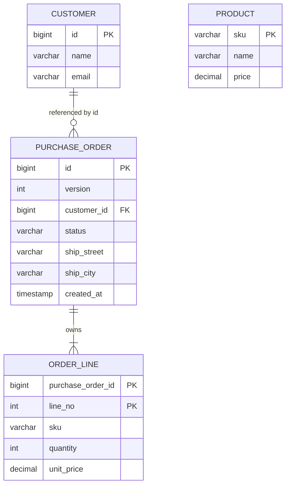
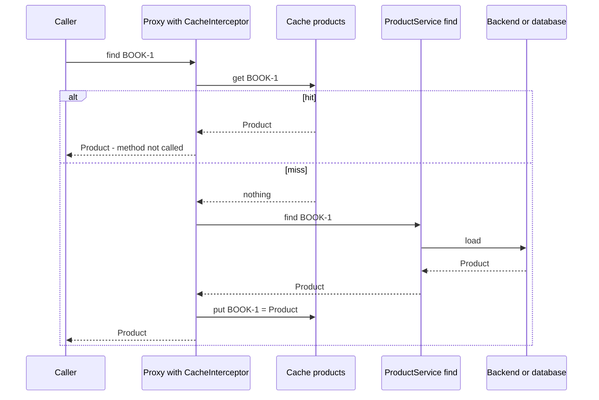

# Chapter 9 — Spring Data beyond JPA, and caching

[Chapter 8](../08-spring-data-jpa-and-hibernate/README.md) used JPA, the most common way to reach a database from Spring. But JPA is not the only option, and it is not always the best one. This chapter covers the other Spring Data modules you are most likely to meet: **Spring Data JDBC**, a simpler relational mapper built around *aggregates* (groups of objects saved and loaded as one unit, §9.2); **Spring Data MongoDB** for document databases (databases that store each record as a JSON-like document instead of table rows); **Spring Data Redis** for the in-memory key-value store (a store that maps keys to values and keeps them in RAM); and **Spring Data REST**, which turns repositories into a REST API. It then compares the two schema-migration tools (tools that apply versioned changes to table structure), **Flyway and Liquibase**.

The second half is about **caching**: remembering the result of an expensive call so the next identical call is fast. Spring's cache abstraction lets you add caching with one annotation, and it is also easy to get wrong. So every behaviour is measured. The tests count real method calls and cache hits and misses (whether the answer was already in the cache or not), move a fake clock to show expiry, and start eight threads (parallel paths of execution) at once to show a cache stampede (many requests recomputing the same missing entry at once) and its fix.

**What you'll learn**

- What the Spring Data modules share, and what each store adds
- Spring Data JDBC: aggregates, `@MappedCollection`, `AggregateReference`, `@Embedded`, the SQL it really runs, optimistic locking, queries, and the "new or existing?" trap
- Spring Data REST: repositories as hypermedia endpoints (HTTP endpoints whose responses include links to related resources)
- Flyway beyond the basics (Java and repeatable migrations, checksum validation), and Flyway vs Liquibase
- Spring Data MongoDB and Spring Data Redis: documents, repositories, templates, and Testcontainers (a library that starts real databases in Docker containers for tests) tests
- The cache abstraction: `@Cacheable`, `@CachePut`, `@CacheEvict`, `@Caching`, `@CacheConfig`, keys, `condition`/`unless`, TTL (time to live: how long an entry stays valid), `sync`
- Caffeine (a fast Java in-memory cache library) as the local cache, and Redis as a shared cache
- Cache pitfalls: self-invocation, key collisions, mutable cached objects, stampedes, stale data

**The code** (Spring Boot 4.1.1 → Spring Framework 7.0, Spring Data 2026.0, Flyway 12.4, Caffeine 3.2, H2 in memory):

| Project | What it proves | Runs here? |
|---|---|---|
| [`code/data-jdbc`](code/data-jdbc) | Spring Data JDBC aggregates with SQL printed, optimistic locking, queries, assigned-id trap; Flyway SQL + Java + repeatable migrations and checksum validation; Spring Data REST | yes |
| [`code/caching`](code/caching) | `@Cacheable`/`@CachePut`/`@CacheEvict` with Caffeine, hit/miss counts, key generation, TTL with a fake clock, mutable-object pitfall, stampede with and without `sync` | yes |
| [`code/nosql`](code/nosql) | MongoDB and Redis repositories, `MongoTemplate` aggregation, `StringRedisTemplate`, Redis cache configuration, Testcontainers test | compiled only (needs Docker — the tool that runs containers — not run) |

Run everything with `bash tools_run_spring.sh spring '09-*'`. The `nosql` project has a `.tools_run_skip` file, so the runner skips it.

---

## 9.1 The Spring Data family

### What it is

**Spring Data** is an umbrella project with one module per kind of data store. Each module gives you the same programming model:

1. You write an interface that extends a repository interface, such as `CrudRepository<T, ID>`.
2. Spring creates the implementation at startup.
3. Method names like `findByStatus` become queries (**derived queries**), and `@Query` lets you write a query yourself.

What differs is the **mapping** (how an object becomes a row, a document or a hash) and the extra features each store has.

| Module | Store | Boot starter | Maps objects to | Template class for hand-written work |
|---|---|---|---|---|
| Spring Data JPA | relational, via Hibernate | `spring-boot-starter-data-jpa` | rows, with a persistence context | `EntityManager` |
| **Spring Data JDBC** | relational, plain JDBC | `spring-boot-starter-data-jdbc` | rows, **aggregate by aggregate** | `JdbcAggregateTemplate` |
| Spring Data R2DBC | relational, reactive | `spring-boot-starter-data-r2dbc` | rows (no relationships) | `R2dbcEntityTemplate` ([ch13](../13-reactive-and-webflux/README.md)) |
| **Spring Data MongoDB** | document database | `spring-boot-starter-data-mongodb` | BSON (binary JSON) documents | `MongoTemplate` |
| **Spring Data Redis** | in-memory key-value | `spring-boot-starter-data-redis` | Redis hashes (a key holding a small map of field → value) | `RedisTemplate`, `StringRedisTemplate` |
| **Spring Data REST** | (any of the above) | `spring-boot-starter-data-rest` | repositories → HTTP endpoints | — |

Other modules exist (Elasticsearch, Cassandra, Neo4j, Couchbase, LDAP), and they follow the same pattern.

All Spring Data modules are released together as a **release train**. The train is named by year: Spring Boot 4.1.1 manages **Spring Data 2026.0**, which contains Spring Data JDBC 4.1, MongoDB 5.1 and Redis 4.1.

### What is shared, and what is not

| Shared by all modules (from `spring-data-commons`) | Store-specific |
|---|---|
| `CrudRepository`, `ListCrudRepository`, `PagingAndSortingRepository` | `JpaRepository`, `MongoRepository`, … with extra methods |
| Derived query parsing (`findByNameAndAgeGreaterThan`) | What a query *is*: SQL, a Mongo JSON filter, a Redis index lookup |
| `Pageable`, `Sort`, `Page`, `Slice` ([8.11](../08-spring-data-jpa-and-hibernate/README.md#811-pagination-and-sorting)) | Transactions (full in JDBC/JPA; limited in Mongo; very different in Redis) |
| Auditing (`@CreatedDate`, `@LastModifiedBy`), `@Version`, `@Id`, `@Transient` from `org.springframework.data.annotation` | Mapping annotations: `@Table`/`@Column` (relational), `@Document`/`@Field` (Mongo), `@RedisHash` (Redis) |
| Projections, query by example, domain events (events an aggregate publishes when it changes) | Store features: aggregations, TTLs, geo queries (searches by location) |

Because the model is shared, the repository chapter of [ch08](../08-spring-data-jpa-and-hibernate/README.md) (sections 8.8–8.12) applies here too. This chapter shows only what is different.

---

## 9.2 Spring Data JDBC and aggregates

### What it is

**Spring Data JDBC** maps Java objects to relational tables **without JPA**. It has no Hibernate, no persistence context, no lazy loading, no dirty checking and no first-level cache. When you call `save`, it runs SQL right away. When you call `findById`, it runs SQL and gives you a plain object that is not connected to anything.

Its design comes from **Domain-Driven Design (DDD)**, which uses the word **aggregate** for a cluster of objects that are always loaded, changed and saved as one unit. One object, the **aggregate root**, is the only way in. Think of an order: an order has lines, and it makes no sense to change a line without its order. Rules like "you cannot add lines to a paid order" live in the root.

Spring Data JDBC builds on that idea:

- **One repository per aggregate root.** There is a `PurchaseOrderRepository` but no `OrderLineRepository`.
- **Everything the root references by object is part of the aggregate.** It is saved and deleted with the root.
- **References to other aggregates are ids, not objects.** An order holds the *id* of its customer, never a `Customer` object.

### Why it matters

JPA is powerful but complex. Most of the surprises in [ch08](../08-spring-data-jpa-and-hibernate/README.md) (`LazyInitializationException`, N+1 queries, updates without a `save`, detached entities) come from the persistence context and lazy loading. Spring Data JDBC removes both. You get fewer features, and in exchange every call does exactly what it says.

| | Spring Data JPA (Hibernate) | Spring Data JDBC |
|---|---|---|
| Loading | lazy or eager, proxies | everything in the aggregate, eagerly; nothing outside it |
| Change tracking | dirty checking: changes are flushed automatically | none: only `save()` writes |
| Caching | first-level cache per persistence context (+ optional second level, shared across sessions) | none |
| Relationships | any direction, many-to-many, bidirectional | one direction, root → children; other aggregates by id |
| Schema generation | `ddl-auto` can create tables | never; you write the DDL (Data Definition Language: `CREATE TABLE` and friends; use Flyway) |
| SQL you can predict | not always | yes |
| Updates of child collections | only the changed rows | **delete all children, insert them again** |
| Best for | rich object graphs (many objects linked to each other), existing JPA knowledge | clear aggregates, teams that want to see the SQL |

### The example aggregate

An online shop. `Customer` and `Product` are aggregates on their own. `PurchaseOrder` is an aggregate whose root holds a list of `OrderLine`s, an embedded shipping `Address`, and the *id* of its customer.



The schema comes from a Flyway migration (`V1__create_shop.sql`), because Spring Data JDBC never creates tables. The aggregate root:

```java
public class PurchaseOrder {

    @Id Long id;
    @Version Integer version;                                   // optimistic locking; null = new
    AggregateReference<Customer, Long> customerId;             // another aggregate: id only, never loaded
    Status status = Status.NEW;
    @Embedded.Nullable(prefix = "ship_") Address shipTo;      // value object in the same row
    @CreatedDate Instant createdAt;                             // filled by auditing

    // Names written in annotations are used exactly as given AND quoted. Upper case matches H2's
    // unquoted DDL (and Oracle/DB2); on PostgreSQL/MySQL write them in lower case.
    @MappedCollection(idColumn = "PURCHASE_ORDER_ID", keyColumn = "LINE_NO")
    List<OrderLine> lines = new ArrayList<>();                 // owned children (table order_line)

    PurchaseOrder() {}                                          // for Spring Data

    public PurchaseOrder(long customerId, Address shipTo) {
        this.customerId = AggregateReference.to(customerId);
        this.shipTo = shipTo;
    }

    /** Business rules live in the root: all changes to lines go through it. */
    public void addLine(String sku, int quantity, BigDecimal unitPrice) {
        if (status != Status.NEW) throw new IllegalStateException("order is " + status);
        if (quantity <= 0) throw new IllegalArgumentException("quantity must be positive");
        lines.add(new OrderLine(sku, quantity, unitPrice));
    }
    // total(), getters ...
}

public record OrderLine(String sku, int quantity, BigDecimal unitPrice) {}   // no @Id: part of the order
public record Address(String street, String city) {}                          // value object
public record Customer(@Id Long id, String name, String email) {}             // its own aggregate
```

### The mapping rules

| Java | Table/column | Notes |
|---|---|---|
| class `PurchaseOrder` | table `purchase_order` | default naming: camelCase (`purchaseOrder`) → snake_case (`purchase_order`). Override with `@Table("...")` |
| field `createdAt` | column `created_at` | override with `@Column("...")` |
| `@Id Long id` | primary key | `null` means "new": the database generates the id (identity column — an auto-increment column) |
| `@Version Integer version` | `version` | optimistic locking, as in [8.14](../08-spring-data-jpa-and-hibernate/README.md#814-locking-optimistic-and-pessimistic) |
| `List<OrderLine>` + `@MappedCollection` | child table `order_line` | `idColumn` = foreign key to the root, `keyColumn` = the list index. `Set` needs no key column; `Map<K, V>` uses the map key |
| `AggregateReference<Customer, Long>` | `customer_id` | just the id. You cannot navigate to the customer. Load it with `CustomerRepository` if you need it |
| `@Embedded.Nullable(prefix = "ship_")` | `ship_street`, `ship_city` in the same row | `Nullable`: all columns `NULL` → field `null`. `@Embedded.Empty` gives an empty object instead |
| records | supported | Spring Data creates a new instance through the constructor when it must set a generated id |

Spring Data JDBC quotes every identifier it generates. With H2 that means upper case: `"PURCHASE_ORDER"`. A name you write in an annotation is quoted **as you wrote it**, so `idColumn = "purchase_order_id"` became `"purchase_order_id"` and H2 answered `Column "line_no" not found`. That is why the example uses upper case. On PostgreSQL, unquoted names are folded (converted) to lower case, so there you write lower case.

### How saving and loading work — measured

The tests capture the SQL that Spring's `JdbcTemplate` logs at `DEBUG` (helper [`SqlLog.java`](code/data-jdbc/src/test/java/ch09/jdbc/SqlLog.java), which also removes the quotes to make it readable). `@DataJdbcTest` is the slice for Spring Data JDBC. It starts the repositories, JDBC, Flyway and an embedded database, and rolls back each test.

```java
@DataJdbcTest                                // JDBC + Spring Data JDBC + Flyway, each test rolled back
class AggregateTests {
    @Autowired PurchaseOrderRepository orders;
    final SqlLog sql = new SqlLog();

    PurchaseOrder newOrder() {
        var order = new PurchaseOrder(1L, new Address("1 Main St", "Pune"));
        order.addLine("BOOK-1", 1, new BigDecimal("40.00"));
        order.addLine("PEN-7", 4, new BigDecimal("2.50"));
        return order;
    }

    @Test
    void savingTheRootSavesItsLinesAndLoadingReadsThemBack() {
        sql.clear();
        PurchaseOrder saved = orders.save(newOrder());
        sql.print("save(new order with 2 lines)");

        sql.clear();
        PurchaseOrder loaded = orders.findById(saved.getId()).orElseThrow();
        sql.print("findById");
        // print id, version, customer id, lines, total, address, createdAt ...
    }
}
```

Output:

```output
-- save(new order with 2 lines)
   INSERT INTO PURCHASE_ORDER (CREATED_AT, CUSTOMER_ID, SHIP_CITY, SHIP_STREET, STATUS, VERSION) VALUES (?, ?, ?, ?, ?, ?)
   [batch] INSERT INTO ORDER_LINE (LINE_NO, PURCHASE_ORDER_ID, QUANTITY, SKU, UNIT_PRICE) VALUES (?, ?, ?, ?, ?)
-- findById
   SELECT ID, STATUS, SHIP_STREET, SHIP_CITY, VERSION, CREATED_AT, CUSTOMER_ID FROM PURCHASE_ORDER WHERE PURCHASE_ORDER.ID = ?
   SELECT SKU, QUANTITY, UNIT_PRICE, LINE_NO FROM ORDER_LINE WHERE ORDER_LINE.PURCHASE_ORDER_ID = ? ORDER BY LINE_NO
loaded: id=3 version=0 customer=1 lines=2 total=50.00 shipTo=Address[street=1 Main St, city=Pune] createdAt set=true
```

What happened, step by step:

1. `save` saw `id == null`, so the order is **new**. It inserted the root row and got the generated id back.
2. It inserted both lines in **one JDBC batch**, with `PURCHASE_ORDER_ID` set to the new id and `LINE_NO` set to the list index (0 and 1).
3. Auditing filled `createdAt`. `@EnableJdbcAuditing` sits on the application class, and the test slice picks it up from there. Adding `@EnableJdbcAuditing` a second time in a test configuration fails with a duplicate bean definition error.
4. `findById` ran **two** queries: one for the root, one for its lines. There is no join, no lazy proxy, and the customer was **not** loaded. The order only knows `customer=1`.
5. The version of a new row starts at 0.

Loading the root plus one query per collection is fine for one aggregate. When you load many aggregates, it becomes an N+1 pattern (one lines query per order). Spring Data JDBC has an opt-in **single query loading** mode (`JdbcMappingContext.setSingleQueryLoadingEnabled(true)`) that loads aggregates with one SQL statement using window functions. The reference docs call it experimental. It works only for `find…` methods of `CrudRepository`, for aggregates without nested collections, embedded values or `AggregateReference`s, and not on H2. So in practice, keep aggregates small and read lists of data with a `@Query` DTO (shown below).

### Updating: all children are deleted and inserted again

```java
@Test
void updatingTheRootDeletesAndReinsertsAllLines() {
    PurchaseOrder order = orders.save(newOrder());
    order.addLine("PEN-7", 1, new BigDecimal("2.50"));     // change ONE thing: add a third line

    sql.clear();
    orders.save(order);
    sql.print("save(order with 1 added line)");
}
```

```output
-- save(order with 1 added line)
   UPDATE PURCHASE_ORDER SET VERSION = ?, STATUS = ?, SHIP_STREET = ?, SHIP_CITY = ?, CREATED_AT = ?, CUSTOMER_ID = ? WHERE PURCHASE_ORDER.ID = ? AND PURCHASE_ORDER.VERSION = ?
   DELETE FROM ORDER_LINE WHERE ORDER_LINE.PURCHASE_ORDER_ID = ?
   [batch] INSERT INTO ORDER_LINE (LINE_NO, PURCHASE_ORDER_ID, QUANTITY, SKU, UNIT_PRICE) VALUES (?, ?, ?, ?, ?)
```

Spring Data JDBC does not remember what it loaded, so it cannot know *which* line changed. It updates the root (checking the version), deletes **all** lines, and inserts all three again. This is simple and always correct, and it is the main cost of the approach:

- Fine for aggregates with a few children (an order with 1–50 lines).
- Bad for an aggregate with thousands of children. That is usually a sign the aggregate is too big: make the children a separate aggregate that references the parent by id.
- Child rows get new physical rows on every save, so do not point foreign keys from *other* tables at child rows.

### Optimistic locking

The `UPDATE` above ends with `AND PURCHASE_ORDER.VERSION = ?`. If another transaction changed the row in between, no row matches:

```java
Long id = orders.save(newOrder()).getId();
PurchaseOrder alice = orders.findById(id).orElseThrow();   // both read version 0
PurchaseOrder bob = orders.findById(id).orElseThrow();

alice.setStatus(Status.PAID);
orders.save(alice);                                        // version 0 -> 1

bob.setStatus(Status.SHIPPED);
assertThatThrownBy(() -> orders.save(bob))                 // still has version 0
        .isInstanceOf(OptimisticLockingFailureException.class);
```

```output
alice saved, version now 1
bob: OptimisticLockingFailureException: Failed to update versioned entity with id '1' (version '0') in table ["PURCHASE_ORDER"]; Was the entity updated or deleted concurrently?
```

It is the same idea as JPA's `@Version` ([8.14](../08-spring-data-jpa-and-hibernate/README.md#814-locking-optimistic-and-pessimistic)). Because the whole aggregate is saved through the root, **one** version column protects the root and all its lines together. That is exactly what you want: two users cannot both add lines to the same order and silently overwrite each other.

### Queries

```java
public interface PurchaseOrderRepository extends ListCrudRepository<PurchaseOrder, Long> {

    List<PurchaseOrder> findByStatus(Status status);              // derived query

    List<PurchaseOrder> findByCustomerId(Long customerId);        // derived query on the reference column

    @Query("SELECT order_id, customer, total FROM order_totals ORDER BY order_id")
    List<OrderTotal> totals();                                    // hand-written SQL into a DTO

    @Modifying
    @Query("UPDATE purchase_order SET status = :status WHERE id = :id")
    boolean updateStatus(Long id, String status);                 // bulk-style update, bypasses the aggregate
}

public record OrderTotal(Long orderId, String customer, BigDecimal total) {}
```

```output
findByCustomerId(2): 1 order(s)
shipTo of order without address: null
updateStatus -> true, findByStatus(PAID): 1
total: OrderTotal[orderId=4, customer=Asha, total=50.00]
total: OrderTotal[orderId=5, customer=Ben, total=80.00]
```

- **Derived queries** work as in JPA, but they may only use properties of the root row (and embedded values). You cannot write `findByLinesSku`, because that would need a join into the aggregate. Use `@Query` for that.
- **`@Query`** takes plain SQL, not JPQL. Parameters are named (`:id`) and bound by parameter name. The result can be the entity, a DTO record (columns mapped by name, `order_id` → `orderId`) or a simple value.
- **`@Modifying`** marks `UPDATE`/`DELETE` queries. It returns the row count as `int`, or `boolean` ("at least one row changed"). It bypasses the aggregate: no version check, no callbacks, no business rules. Use it for bulk or administrative changes only.
- The view (a saved query that can be read like a table) `order_totals` is a read model (a structure shaped just for queries) built by a repeatable migration (section 9.4). Reading reports with SQL and DTOs, and writing through aggregates, is a common split.

### Pitfall: "new or existing?" with assigned ids

Spring Data must decide between `INSERT` and `UPDATE`. The rule ([Spring Data JDBC reference](https://docs.spring.io/spring-data/relational/reference/jdbc/entity-persistence.html)):

- the entity is **new** if its id is `null` (or `0` for a primitive), **or** if it has a `@Version` property that is `null` (or `0` for a primitive);
- otherwise it is **existing**.

`Product` uses its SKU as the id, a value *we* assign. So a brand-new product already has a non-null id:

```java
public record Product(@Id String sku, String name, BigDecimal price) {}

Product mug = new Product("MUG-3", "Coffee mug", new BigDecimal("9.00"));
products.save(mug);                                        // no exception...
template.insert(mug);                                      // JdbcAggregateTemplate: "this is new"
```

```output
-- save(new Product("MUG-3", ...))
   UPDATE PRODUCT SET NAME = ?, PRICE = ? WHERE PRODUCT.SKU = ?
rows after save():   2   <- nothing was inserted!
rows after insert(): 3   Product[sku=MUG-3, name=Coffee mug, price=9.00]
```

`save` ran an `UPDATE` that matched zero rows, and **no exception was thrown**. The product was silently lost. This is one of the most common Spring Data JDBC bugs. The fixes:

| Fix | How |
|---|---|
| Add a `@Version` field | a new object has version `null`/`0` → `INSERT`. Also gives you optimistic locking. Usually the best fix |
| Call `JdbcAggregateTemplate.insert(entity)` / `update(entity)` | you state the intent explicitly (shown above) |
| Implement `Persistable<ID>` | you write `isNew()` yourself, e.g. with a `@Transient boolean isNew` flag |
| Let the database generate ids | `null` id → `INSERT`. Keep the natural key as a unique column |

The same `isNew` rule exists in Spring Data JPA (`save` then calls `merge`, which runs an extra `SELECT` rather than losing data).

### Callbacks, events and auditing

Spring Data JDBC calls beans at fixed points of the lifecycle. **Callbacks** can change the entity: `BeforeConvertCallback` (set an id before insert), `BeforeSaveCallback`, `AfterSaveCallback`, `AfterConvertCallback` (after loading). **Events** such as `BeforeSaveEvent`, `AfterSaveEvent` and `AfterDeleteEvent` are published as application events ([ch02](../02-ioc-and-dependency-injection/README.md)) and are for observing only. Auditing (`@CreatedDate`, `@LastModifiedDate`, `@CreatedBy`, `@LastModifiedBy`) is switched on with `@EnableJdbcAuditing`. For the "by" fields you also provide an `AuditorAware` bean.

### Common mistakes

| Mistake | Result | Fix |
|---|---|---|
| Expecting lazy loading or dirty checking | changes are lost unless you call `save` | load, change, **save** — explicitly |
| Mapping a child as an object reference to *another* aggregate | Spring Data treats it as part of your aggregate and deletes/inserts it on save | reference other aggregates with `AggregateReference` or a plain id |
| Huge child collections | every save deletes and re-inserts thousands of rows | smaller aggregates |
| Assigned ids without `@Version` or `Persistable` | `save` silently updates 0 rows | see the table above |
| Lower-case names in annotations on H2 (upper-case on PostgreSQL) | `column not found` | match the database's folding rules |
| Expecting `ddl-auto` | there is none; tables do not exist | Flyway/Liquibase |
| Relying on `@DataJdbcTest` rollback when testing concurrency | two "users" share one test transaction | `@SpringBootTest` without a test transaction, as in ch08 |

### In the interview

**30-second answer:** "Spring Data JDBC is a simpler alternative to JPA. It maps aggregates, in the DDD sense: a root plus the entities it owns, loaded and saved as one unit. There is no persistence context, so no lazy loading, no dirty checking and no caching. `save` writes immediately, loading reads the whole aggregate, and references to other aggregates are just ids (`AggregateReference`). On update it rewrites the root and deletes and re-inserts all children, which is why aggregates must stay small. I pick it when I want predictable SQL and my model has clear aggregates."

- *"How does Spring Data decide between INSERT and UPDATE?"* → id `null`/`0` or `@Version` `null`/`0` → new. With assigned ids you need `@Version`, `Persistable`, or `JdbcAggregateTemplate.insert`, otherwise `save` issues an `UPDATE` that changes nothing.
- *"How do you model many-to-many?"* → As a separate small entity inside one aggregate that holds the *id* of the other aggregate (for example `Set<BookAuthor>` in `Book`, where `BookAuthor` has an `AggregateReference<Author, Long>`).
- *"Can you mix JPA and JDBC in one app?"* → Yes, on the same `DataSource`, but give them different entities and packages, and remember that JDBC writes are not seen by an open Hibernate persistence context.

### Self-check

1. What SQL does `save` run for an existing order with 3 lines? → `UPDATE` of the root (with version check), `DELETE` of all its lines, then 3 `INSERT`s (one batch).
2. Why can `PurchaseOrder` not have a `Customer customer` field? → It would make the customer part of the order aggregate; references to other aggregates must be ids.
3. A `findById` loaded the order and its lines. How many queries? → Two: root, then one per collection.
4. Which annotation marks a list of child entities, and what are its two column settings? → `@MappedCollection`, `idColumn` (FK to the root) and `keyColumn` (list index or map key).

### TL;DR

- Spring Data JDBC = repositories over plain JDBC, **one repository per aggregate root**, no persistence context.
- Saving an existing aggregate rewrites all of its children, so keep aggregates small. `@Version` on the root protects the whole aggregate.
- Other aggregates are referenced by id (`AggregateReference`). Reports: `@Query` SQL into DTO records.
- Assigned ids need `@Version`, `Persistable` or `insert()`, or `save` loses data silently.

---

## 9.3 Spring Data REST

### What it is

**Spring Data REST** looks at your repositories and publishes each one as a REST resource, with no controller code. It uses **HAL** (Hypertext Application Language), a JSON format where every resource has a `_links` section pointing to related resources. That style is called **HATEOAS** (Hypermedia as the Engine of Application State; more in [ch05](../05-spring-mvc-and-rest/README.md)).

The `data-jdbc` project adds `spring-boot-starter-data-rest` and one property:

```properties
spring.data.rest.base-path=/api
```

```java
@RepositoryRestResource(path = "customers")
public interface CustomerRepository extends ListCrudRepository<Customer, Long> {
    List<Customer> findByName(String name);   // -> GET /api/customers/search/findByName?name=Ben
}

@RepositoryRestResource(exported = false)     // not every repository should become a public API
public interface ProductRepository extends ListCrudRepository<Product, String> {}
```

The test ([`DataRestTests.java`](code/data-jdbc/src/test/java/ch09/jdbc/DataRestTests.java)) calls it with `MockMvcTester`:

```output
GET /api/customers/2 -> 200
{
  "_links" : {
    "self" : {
      "href" : "http://localhost/api/customers/2"
    },
    "customer" : {
      "href" : "http://localhost/api/customers/2"
    }
  },
  "name" : "Ben",
  "email" : "ben@example.com"
}
GET /api/customers/search/findByName?name=Asha -> 200
GET /api/products -> 404 (exported = false)
```

For each exported repository you get `GET` (collection, with paging and sorting if the repository supports it), `GET /{id}`, `POST`, `PUT`, `PATCH`, `DELETE`, and a `/search` resource listing the query methods.

### Trade-offs

| Good for | Not good for |
|---|---|
| Internal admin tools, prototypes, simple CRUD services | public APIs with a designed contract |
| Clients that follow links (HAL browsers, hypermedia clients) | APIs with business operations ("pay order") rather than CRUD |
| | Hiding your table structure: the API *is* your domain model, so a field rename breaks clients |

### Common mistakes

- **Exposing every repository by accident.** Every public repository is exported by default. Use `exported = false`, or set `spring.data.rest.detection-strategy=annotated` so that only `@RepositoryRestResource` repositories are exported.
- **Forgetting security.** `DELETE /api/customers/1` works for anyone until you add Spring Security rules ([ch10](../10-spring-security-1-fundamentals/README.md)).
- **Business rules in the database layer.** Validation and side effects then have to go into `@RepositoryEventHandler` callbacks, which are easy to miss. When the API needs real behaviour, write controllers ([ch05](../05-spring-mvc-and-rest/README.md)).

---

## 9.4 Schema migrations: Flyway beyond the basics, and Flyway vs Liquibase

Section [8.16](../08-spring-data-jpa-and-hibernate/README.md#816-schema-migrations-with-flyway) introduced Flyway: numbered SQL scripts in `db/migration`, run once each, recorded in `flyway_schema_history`, and `spring-boot-starter-flyway` in Boot 4. Spring Data JDBC depends on migrations even more than JPA, because it has no `ddl-auto` at all. This section adds three Flyway features and compares Flyway with Liquibase.

### Three kinds of Flyway migration

The `data-jdbc` project has all three:

```
src/main/resources/db/migration/
  V1__create_shop.sql            versioned SQL: tables
  V2__seed_customers.sql         versioned SQL: data
  R__order_totals_view.sql       REPEATABLE: CREATE OR REPLACE VIEW order_totals ...
src/main/java/db/migration/
  V3__normalise_emails.java      versioned JAVA migration
```

```java
package db.migration;

/** A Java-based migration: for data changes that are awkward in SQL. Found by the class name V3__... */
public class V3__normalise_emails extends BaseJavaMigration {
    @Override
    public void migrate(Context context) throws Exception {
        var conn = context.getConnection();              // same connection and transaction as Flyway
        try (Statement select = conn.createStatement();
             ResultSet rs = select.executeQuery("SELECT id, email FROM customer");
             PreparedStatement update = conn.prepareStatement("UPDATE customer SET email = ? WHERE id = ?")) {
            while (rs.next()) {
                update.setString(1, rs.getString("email").trim().toLowerCase());
                update.setLong(2, rs.getLong("id"));
                update.addBatch();
            }
            update.executeBatch();
        }
    }
}
```

| Kind | Name | Runs | Use for |
|---|---|---|---|
| Versioned SQL | `V<version>__<description>.sql` | once, in version order | tables, columns, indexes, data fixes |
| Versioned Java | class `V<version>__<description>` extending `BaseJavaMigration`, in a scanned location (e.g. package `db.migration`), or a Spring bean implementing `JavaMigration` (Boot registers such beans) | once, in version order with the SQL ones | data changes needing logic, calling code, big batched updates |
| Repeatable | `R__<description>.sql` | after all versioned ones, **again whenever its checksum changes** | views, functions, stored procedures, grants (permission statements) — objects you can always re-create |

The test prints what Flyway recorded:

```java
for (MigrationInfo m : flyway.info().all()) {
    System.out.printf("%-4s %-22s %-5s %s%n",
            m.getVersion() == null ? "R" : "V" + m.getVersion(), m.getDescription(), m.getType(), m.getState());
}
customers.findAll().forEach(c -> System.out.println("customer: " + c));
```

```output
V1   create shop            SQL   SUCCESS
V2   seed customers         SQL   SUCCESS
V3   normalise emails       JDBC  SUCCESS
R    order totals view      SQL   SUCCESS
customer: Customer[id=1, name=Asha, email=asha@example.com]
customer: Customer[id=2, name=Ben, email=ben@example.com]
```

V2 inserted `ASHA@Example.com` and `ben@EXAMPLE.com`, and the Java migration V3 normalised them. The Java migration shows up with type `JDBC`.

### Checksums: never edit an applied migration — proved

Flyway stores a **checksum** (a number computed from the file's content) for each applied migration. On startup it validates that the files still match. The second test points a new Flyway instance at the same database but at a folder `db/tampered` that holds copies of V1, V2 and the repeatable script, with V1 edited:

```java
Flyway tampered = Flyway.configure()
        .dataSource(dataSource)
        .locations("classpath:db/tampered")                 // same files, but V1 was edited
        .load();
ValidateResult result = tampered.validateWithResult();
```

```output
validation successful: false
  1: Migration checksum mismatch for migration version 1
-> Applied to database : 1770847798
-> Resolved locally    : 415358952
Either revert the changes to the migration, or run repair to update the schema history.
```

Widening the `name` columns in V1 from `VARCHAR(100)` to `VARCHAR(150)` was enough: the file no longer matches the recorded checksum. In an application this validation runs at startup, and the app **refuses to start**. The right reaction is almost never `repair`. Undo the edit and add a new migration (`V4__widen_customer_name.sql`) instead.

### Useful Flyway properties

| Property | Default | Meaning |
|---|---|---|
| `spring.flyway.locations` | `classpath:db/migration` | where scripts are. Use `classpath:db/migration/{vendor}` for per-database folders |
| `spring.flyway.baseline-on-migrate` | `false` | adopting Flyway on an **existing** database: mark the current state as the baseline (the starting version) instead of failing on a non-empty schema |
| `spring.flyway.clean-disabled` | `true` | `clean` drops everything in the schema. Keep it disabled everywhere except throwaway databases |
| `spring.flyway.enabled` | `true` | switch off, e.g. when a separate pipeline (an automated build/deploy process) runs migrations |
| `spring.flyway.url` / `user` / `password` | the app's `DataSource` | migrate with a more powerful user than the app uses |

### Liquibase

**Liquibase** solves the same problem with a different model. Migrations are **changesets** inside **changelog** files (YAML, XML, JSON or SQL). Each changeset is identified by `id` + `author` + file name, and applied changesets are recorded in the `DATABASECHANGELOG` table (with a lock table `DATABASECHANGELOGLOCK`). Changesets can be written as database-independent *change types* (`createTable`, `addColumn`), which Liquibase turns into SQL for each database.

In Boot 4, add `spring-boot-starter-liquibase`. The default master changelog is `classpath:/db/changelog/db.changelog-master.yaml` (`spring.liquibase.change-log`). A snippet (not run):

```yaml
# src/main/resources/db/changelog/db.changelog-master.yaml
databaseChangeLog:
  - changeSet:
      id: 1
      author: asha
      changes:
        - createTable:
            tableName: customer
            columns:
              - column: { name: id, type: BIGINT, autoIncrement: true, constraints: { primaryKey: true } }
              - column: { name: name, type: VARCHAR(100), constraints: { nullable: false } }
  - changeSet:
      id: 2
      author: asha
      changes:
        - addColumn:
            tableName: customer
            columns:
              - column: { name: email, type: VARCHAR(200) }
      rollback:
        - dropColumn: { tableName: customer, columnName: email }
```

### Flyway vs Liquibase

| | Flyway | Liquibase |
|---|---|---|
| Migration format | plain SQL files (+ Java) | changelogs in YAML/XML/JSON/SQL; database-independent change types |
| Ordering | version number in the file name | order of changesets in the changelog |
| Identity of a migration | version | `id` + `author` + file path |
| History table | `flyway_schema_history` | `DATABASECHANGELOG` (+ lock table) |
| Rollback / undo | undo migrations only in Redgate's paid editions; in practice you fix forward | `rollback` blocks, and automatic rollback for many change types, in the free edition |
| Conditional logic | little (placeholders, callbacks) | preconditions, contexts, labels (e.g. "only in test") |
| Multi-database products | per-vendor folders | one changelog can target several databases |
| Learning curve | very low: you already know SQL | higher |
| Boot 4 starter | `spring-boot-starter-flyway` | `spring-boot-starter-liquibase` |
| Version in Boot 4.1.1 | Flyway 12.4 (Community edition is Apache 2.0) | Liquibase 5.0. **Since 5.0 the Community edition uses the Functional Source License (FSL)**, which turns into Apache 2.0 two years after each release. Free to use, but check it with your legal team |

**Rule of thumb:** a team that writes SQL and targets one database picks **Flyway**. A product that must run on several databases, or a team that needs rollback scripts and conditional changesets, picks **Liquibase**. Do not use both in one application.

### Migration rules that apply to both

- Fix forward: never edit or delete an applied migration.
- Make each change **backward-compatible** during rolling deploys (expand → migrate data → contract). See [8.16](../08-spring-data-jpa-and-hibernate/README.md#816-schema-migrations-with-flyway).
- Test migrations against the **real database type** (Testcontainers, [ch12](../12-testing-spring-apps/README.md)). The H2 in this chapter accepts SQL that PostgreSQL rejects, and the other way round.
- Long data migrations lock tables. Run them in batches, outside the startup path if needed.

### In the interview

- *"Flyway or Liquibase?"* → "Flyway for SQL-first teams on one database: simple versioned SQL files and a checksum history. Liquibase when I need database-independent changelogs, rollbacks or conditional changes. Either way the tool owns the schema, and Hibernate's `ddl-auto` is `validate` or `none`."
- *"Someone edited V5 after it ran in production. What happens?"* → Startup fails with a checksum mismatch. Revert the edit and ship the change as V6. `repair` only rewrites the history table's checksums; it does not change the schema.
- *"What is a repeatable migration?"* → `R__` script re-applied whenever its content changes, after all versioned ones. For views and functions.

---

## 9.5 Spring Data MongoDB (not run — needs Docker)

### What it is

**MongoDB** is a **document database**. It stores JSON-like documents (the binary format is called BSON) in **collections**, with no fixed schema. A document can hold nested objects and arrays, so data that is read together is stored together. What would be three joined tables in SQL (a review, its tags, its product reference) can be one document. The concepts are covered in [SQL book ch16](../../../sql/chapters/16-beyond-relational/README.md) and [DDIA ch2](../../../ddia/chapters/02-data-models-and-query-languages/README.md). Here we look at how Spring talks to it.

### Setup (Boot 4)

```xml
<dependency>
  <groupId>org.springframework.boot</groupId>
  <artifactId>spring-boot-starter-data-mongodb</artifactId>
</dependency>
```

```properties
spring.mongodb.uri=mongodb://localhost:27017/shop
spring.data.mongodb.auto-index-creation=true
```

**Boot 4 change:** Boot 4 split MongoDB support into a driver module (`spring-boot-mongodb`, properties `spring.mongodb.*`) and a Spring Data module (`spring-boot-data-mongodb`, properties `spring.data.mongodb.*` for repository and mapping settings). So the connection is now `spring.mongodb.uri`. The old `spring.data.mongodb.uri` (and `.host`, `.port`, `.database`, ...) is marked deprecated at **error** level in Boot 4.1's configuration metadata: it is no longer bound, and `spring-boot-properties-migrator` reports it.

### Documents and repositories

```java
/** One MongoDB document. Nested data (tags) is stored inside it - no join table. */
@Document("reviews")
public record Review(
        @Id String id,                 // Mongo's _id; null -> an ObjectId is generated on insert
        @Indexed String productSku,    // index is created only if spring.data.mongodb.auto-index-creation=true
        int stars,
        String text,
        List<String> tags,
        Instant createdAt) {}

public interface ReviewRepository extends MongoRepository<Review, String> {

    // derived queries become Mongo filters: { productSku: ?0 } sorted by createdAt desc
    List<Review> findByProductSkuOrderByCreatedAtDesc(String productSku);

    List<Review> findByStarsGreaterThanEqual(int stars);   // { stars: { $gte: ?0 } }

    @Query("{ 'tags': ?0 }")                                  // a JSON filter written by hand
    List<Review> withTag(String tag);
}
```

A saved review looks like this in MongoDB (Spring Data adds a `_class` field with the Java type, used when reading back polymorphic data — documents of several subclasses in one collection):

```json
{ "_id": ObjectId("..."), "productSku": "BOOK-1", "stars": 5, "text": "Great",
  "tags": ["clear"], "createdAt": ISODate("..."), "_class": "ch09.nosql.mongo.Review" }
```

### `MongoTemplate` for aggregations and partial updates

Repositories cover simple reads and writes. For grouping, and for changing one field without rewriting the whole document, use `MongoTemplate`:

```java
public record AverageRating(String id, double average, long count) {}   // id = the product sku

public List<AverageRating> averageByProduct() {
    var pipeline = newAggregation(
            group("productSku").avg("stars").as("average").count().as("count"),
            sort(Sort.Direction.DESC, "average"));
    return mongo.aggregate(pipeline, "reviews", AverageRating.class).getMappedResults();
}

/** Update one field in place ($push) without reading and rewriting the whole document. */
public long addTag(String reviewId, String tag) {
    return mongo.updateFirst(
            Query.query(Criteria.where("id").is(reviewId)),
            new Update().push("tags", tag),
            Review.class).getModifiedCount();
}
```

An **aggregation pipeline** is a list of stages that documents flow through (`$match`, `$group`, `$sort`, `$project`, `$lookup`), roughly the document-database version of `WHERE` / `GROUP BY` / `ORDER BY`.

### Things that work differently from JPA

| Topic | MongoDB with Spring Data |
|---|---|
| Relationships | embed data that belongs together. Reference other documents by id. `@DBRef` and `@DocumentReference` exist but cost extra queries, like lazy loading |
| Schema changes | no DDL. Old documents keep their old shape. Code must accept both, or you run a data migration (tools such as Mongock exist) |
| Transactions | single-document writes are always atomic. Multi-document transactions need a **replica set** (several MongoDB servers holding copies of the same data) and a `MongoTransactionManager` bean, which Boot does **not** create for you |
| Optimistic locking | `@Version` works (the version is part of the update filter) |
| Indexes | `@Indexed`, `@CompoundIndex`, created only if `auto-index-creation=true`. In production, many teams create indexes in a migration instead |
| Reactive | `spring-boot-starter-data-mongodb-reactive` + `ReactiveMongoRepository` ([ch13](../13-reactive-and-webflux/README.md)) |

### When to use it (and when not)

- **Good fit:** data that is read as a whole and has a flexible shape (product catalogs with different attributes per category, content, event logs, user profiles).
- **Poor fit:** data with many relationships queried from many directions, or which needs multi-row transactions and strong constraints (accounting, inventory). A relational database with a `jsonb` column is often enough for "a bit of flexible data".

---

## 9.6 Spring Data Redis (not run — needs Docker)

### What it is

**Redis** is an **in-memory data structure server**. Keys map to strings, hashes, lists, sets, sorted sets, streams and more, and each command is atomic (runs completely, with no other command interleaving) on the server. Because data lives in memory, reads and writes take well under a millisecond. It is used as a cache (section 9.8), a session store, for rate limiting (capping how many requests a client may make per second), counters, leaderboards, distributed locks (a lock shared by many app instances) and simple queues.

`spring-boot-starter-data-redis` brings **Lettuce** as the default client library (Jedis is the alternative). Connection properties keep the `spring.data.redis.*` prefix in Boot 4:

```properties
spring.data.redis.host=localhost
spring.data.redis.port=6379
```

### Templates: the usual way to use Redis

```java
@Component
public class PageViewCounter {
    private final StringRedisTemplate redis;

    public PageViewCounter(StringRedisTemplate redis) { this.redis = redis; }

    public long hit(String page) {
        return redis.opsForValue().increment("views:" + page);   // INCR is atomic on the Redis server
    }
}
```

`opsForValue()`, `opsForHash()`, `opsForList()`, `opsForSet()`, `opsForZSet()` match the Redis data types. `StringRedisTemplate` stores keys and values as plain strings. `RedisTemplate<K, V>` can use other **serializers** (components that turn objects into bytes and back; JDK serialization by default, JSON if you configure it). Choose them deliberately, because anything written with one serializer can only be read back with the same one.

### Redis repositories

```java
/** Stored as a Redis hash under key "carts:<id>"; removed by Redis after 1 hour (timeToLive, seconds). */
@RedisHash(value = "carts", timeToLive = 3600)
public record Cart(@Id String id, @Indexed String userId, List<CartItem> items) {
    public record CartItem(String sku, int quantity) {}
}

public interface CartRepository extends CrudRepository<Cart, String> {
    List<Cart> findByUserId(String userId);   // works only because userId is @Indexed (a secondary index set)
}
```

How it is stored: the cart becomes a Redis **hash** at key `carts:c1`, the key is added to a set `carts` (for `findAll`), and `@Indexed` adds it to a set `carts:userId:u42`. So derived queries work only on `@Indexed` properties (each such set acts as a secondary index: an extra lookup structure by a non-id field) and only for equality. There are no ranges and no sorting.

A trap: when Redis expires `carts:c1` because of the TTL, the index sets still contain its id. Spring Data cleans them only if you enable keyspace events (notifications Redis sends when keys change or expire) (`@EnableRedisRepositories(enableKeyspaceEvents = RedisKeyValueAdapter.EnableKeyspaceEvents.ON_STARTUP)`). Most teams use templates directly and use repositories only for simple cases.

---

## 9.7 Testing MongoDB and Redis with Testcontainers (not run)

**Testcontainers** starts real databases in Docker containers for the duration of a test. Boot's **`@ServiceConnection`** reads the container's host and port and configures the connection. You do not need `@DynamicPropertySource` or any properties. The full treatment of Testcontainers is in [ch12](../12-testing-spring-apps/README.md). Here is the setup for this chapter's NoSQL code. It compiles, but it is not run here because Docker is not available:

```xml
<dependency>
  <groupId>org.springframework.boot</groupId>
  <artifactId>spring-boot-testcontainers</artifactId>
  <scope>test</scope>
</dependency>
<dependency>
  <groupId>org.testcontainers</groupId>
  <artifactId>testcontainers-junit-jupiter</artifactId>   <!-- Testcontainers 2.x artifact names -->
  <scope>test</scope>
</dependency>
<dependency>
  <groupId>org.testcontainers</groupId>
  <artifactId>testcontainers-mongodb</artifactId>
  <scope>test</scope>
</dependency>
<dependency>
  <groupId>com.redis</groupId>
  <artifactId>testcontainers-redis</artifactId>
  <scope>test</scope>
</dependency>
```

```java
@SpringBootTest
@Testcontainers                       // starts/stops the @Container fields (needs a Docker daemon)
class NoSqlTests {

    @Container @ServiceConnection     // Boot points spring.mongodb.* at this container
    static MongoDBContainer mongo = new MongoDBContainer("mongo:8.0");   // org.testcontainers.mongodb

    @Container @ServiceConnection     // ...and spring.data.redis.* at this one
    static RedisContainer redis = new RedisContainer("redis:8.2");       // com.redis.testcontainers

    @Autowired ReviewRepository reviews;
    @Autowired RatingService ratings;
    @Autowired CartRepository carts;
    @Autowired PageViewCounter views;

    @Test
    void mongoRepositoryAndAggregation() {
        reviews.deleteAll();
        reviews.save(new Review(null, "BOOK-1", 5, "Great", List.of("clear"), Instant.now()));
        reviews.save(new Review(null, "BOOK-1", 3, "Dense", List.of(), Instant.now()));
        reviews.save(new Review(null, "PEN-7", 4, "Smooth", List.of("clear"), Instant.now()));

        assertThat(reviews.findByProductSkuOrderByCreatedAtDesc("BOOK-1")).hasSize(2);
        assertThat(reviews.withTag("clear")).hasSize(2);
        assertThat(ratings.averageByProduct()).first()
                .isEqualTo(new RatingService.AverageRating("PEN-7", 4.0, 1));
    }

    @Test
    void redisRepositoryAndCounter() {
        carts.save(new Cart("c1", "u42", List.of(new Cart.CartItem("PEN-7", 3))));
        assertThat(carts.findByUserId("u42")).extracting(Cart::id).containsExactly("c1");
        assertThat(views.hit("home")).isEqualTo(1);
        assertThat(views.hit("home")).isEqualTo(2);
    }
}
```

Testcontainers 2.0 renamed its modules (`testcontainers-mongodb` instead of `mongodb`) and moved container classes into module packages (`org.testcontainers.mongodb.MongoDBContainer`). Boot 4.1.1 manages Testcontainers 2.0.

For narrower tests there are slices: `@DataMongoTest` (starter `spring-boot-starter-data-mongodb-test`) and `@DataRedisTest` (`spring-boot-starter-data-redis-test`). They start only the store's configuration and repositories. Combine them with the same `@Container @ServiceConnection` fields.

---

## 9.8 The caching abstraction

### What it is

A **cache** keeps the results of expensive work (a slow query, a remote call, a calculation) so that the next request for the same thing is answered from memory (see also [System Design Fundamentals](../../../system-design-patterns/modules/00-system-design-fundamentals/README.md)). A **cache hit** means the answer was found there. A **cache miss** means the real work had to be done.

Spring's **cache abstraction** lets you cache the result of a *method* declaratively:

```java
@Cacheable("products")
public Product find(String sku) { ... }      // runs only if "products" has no entry for sku
```

It is an *abstraction*: the annotations talk to a `CacheManager` interface, and a **provider** does the storing. That can be a local in-memory cache such as **Caffeine**, or a shared one such as **Redis**. Switching providers is a dependency and configuration change, not a code change.

### Why it matters

Reads usually far outnumber writes. A product page might be viewed 10,000 times between two price changes. Loading the product from the database every time wastes database capacity and adds latency (time per request). With a cache, one load serves thousands of requests. The price you pay is **staleness**: the cache may show old data until it is refreshed or evicted (removed from the cache). Every caching decision is about how stale is acceptable.

### How it works

Caching is an AOP feature, built exactly like `@Transactional` ([4.6](../04-aop-and-proxies/README.md#46-spring-features-built-on-proxies)).

1. `@EnableCaching` registers a `CacheInterceptor`. Every bean with cache annotations is wrapped in a **proxy**.
2. A call to `find("BOOK-1")` reaches the proxy first. The interceptor computes a **key** from the arguments (here `"BOOK-1"`).
3. It asks the `CacheManager` for the cache named `products`, and asks that cache for the key.
4. **Hit** → return the cached value. Your method does **not** run.
5. **Miss** → call your method, store the result under the key, return it.



This pattern, "look in the cache, and on a miss load and store", is called **cache-aside**. The [system-design caching module](../../../system-design-patterns/modules/04-caching/README.md) compares it with read-through, write-through and write-behind.

### Setup with Caffeine

```xml
<dependency>
  <groupId>org.springframework.boot</groupId>
  <artifactId>spring-boot-starter-cache</artifactId>
</dependency>
<dependency>
  <groupId>com.github.ben-manes.caffeine</groupId>
  <artifactId>caffeine</artifactId>
</dependency>
```

```java
@SpringBootApplication
@EnableCaching                 // without it every cache annotation is silently ignored
public class CachingApplication { ... }

@Configuration(proxyBeanMethods = false)
public class CacheConfig {

    /** The clock Caffeine uses for expiry. Production: Ticker.systemTicker(). Tests replace it. */
    @Bean
    Ticker cacheTicker() {
        return Ticker.systemTicker();
    }

    /** Boot's CaffeineCacheManager uses this builder for every cache it creates. */
    @Bean
    Caffeine<Object, Object> caffeine(Ticker cacheTicker) {
        return Caffeine.newBuilder()
                .maximumSize(10_000)                        // bound memory: evicts least-useful entries
                .expireAfterWrite(Duration.ofMinutes(10))   // TTL: entries are at most 10 minutes old
                .ticker(cacheTicker)
                .recordStats();                             // hit/miss counters (also used by Actuator metrics)
    }
}
```

```properties
# Only these caches exist (no caches created on the fly by a typo in a cache name)
spring.cache.cache-names=products,catalog,tags,reports-plain,reports-sync
```

How Boot chooses a provider: if you define no `CacheManager` bean yourself, Boot checks the providers in a fixed order (Generic, JCache, Hazelcast, Infinispan, Couchbase, **Redis**, **Caffeine**, Cache2k, **Simple**) and configures the first one it finds on the classpath. You can force one with `spring.cache.type`. **Simple** is a `ConcurrentHashMap` (Java's thread-safe hash map) with no expiry and no size limit, fine for demos but never for production.

For Caffeine, Boot applies the settings from, in order of precedence: `spring.cache.caffeine.spec` (e.g. `maximumSize=500,expireAfterWrite=10m`), a `CaffeineSpec` bean, or a `Caffeine` bean (used here, so that the test can swap the clock). **Caffeine** is the standard local cache for Java. Its eviction policy (W-TinyLFU) keeps the entries that are used most often and most recently, which gives better hit rates than a plain LRU (Least Recently Used: evict whatever was touched longest ago).

With `spring.cache.cache-names` set, the manager is **static**: only those caches exist, and using any other name fails with an error instead of quietly creating a new, unconfigured cache.

### `@Cacheable` — hits and misses, measured

```java
@Service
@CacheConfig(cacheNames = "products")      // default cache name for the annotations in this class
public class ProductService {
    private final ProductBackend backend;   // stands in for a slow database; counts its calls

    @Cacheable(unless = "#result == null")          // do not cache "not found"
    public Product find(String sku) {
        return backend.load(sku);
    }
    // ...
}
```

```java
@Test
void cacheableRunsTheMethodOnlyOnAMiss() {
    CacheStats before = nativeCache("products").stats();          // Caffeine's own counters
    for (int i = 1; i <= 3; i++) {
        Product p = products.find("BOOK-1");
        System.out.println("call " + i + ": " + p.name() + "   backend loads so far = " + backend.loads.get());
    }
    CacheStats delta = nativeCache("products").stats().minus(before);
    // print cache manager class, hits, misses; assert loads = 1, hits = 2, misses = 1
}
```

```output
call 1: Spring in Depth   backend loads so far = 1
call 2: Spring in Depth   backend loads so far = 1
call 3: Spring in Depth   backend loads so far = 1
cache manager: CaffeineCacheManager   hits=2 misses=1
```

Three calls, one real load. `nativeCache("products")` unwraps Spring's `CaffeineCache` to the underlying Caffeine cache, whose `recordStats()` counters prove what happened. In production, the same counters are published by Actuator as `cache.gets` metrics tagged `result=hit|miss` ([ch15](../15-observability-and-production/README.md)). For Caffeine they exist only when `recordStats()` is on. The `/actuator/caches` endpoint lists caches and can clear them.

### `@CachePut` and `@CacheEvict` — keeping the cache correct

```java
/** ALWAYS runs the method, then writes the result into the cache (key = the saved product's sku). */
@CachePut(key = "#result.sku()")
public Product update(Product product) {
    return backend.store(product);
}

/** Runs the method, then removes that one key. */
@CacheEvict
public void delete(String sku) {
    backend.remove(sku);
}

/** Empties the whole "products" cache (e.g. after a bulk import). */
@CacheEvict(allEntries = true)
public void reloadAll() {}
```

```java
products.find("PEN-7");                                           // miss -> load 1
products.update(new Product("PEN-7", "Gel pen", new BigDecimal("3.00")));   // method runs + cache put
products.find("PEN-7");                                           // hit: the NEW price, no load
products.delete("PEN-7");                                         // method runs + key evicted
products.find("PEN-7");                                           // miss -> load 2 -> null
products.find("PEN-7");                                           // null was not cached -> load 3
products.find("BOOK-1");                                          // load 4
products.reloadAll();                                             // allEntries = true
```

```output
after @CachePut:   3.00  loads=1
after @CacheEvict: null  loads=2
asked again:       loads=3  (null results are not cached)
after reloadAll(): entries in 'products' = 0
```

| Annotation | Runs the method? | Effect on the cache | Typical use |
|---|---|---|---|
| `@Cacheable` | only on a miss | stores the result | reads |
| `@CachePut` | **always** | stores the result | updates, keeping the cache fresh |
| `@CacheEvict` | always | removes the key (or all entries with `allEntries = true`) | deletes; updates when you prefer "evict and reload" |
| `@Caching` | — | groups several of the above on one method (e.g. put in one cache, evict from another) | a method affecting several caches |
| `@CacheConfig` | — | class-level defaults: `cacheNames`, `keyGenerator`, `cacheManager` | less repetition |

Details that matter:

- `@CacheEvict` runs **after** the method, and only if it returns normally. `beforeInvocation = true` evicts first, even if the method then throws.
- Do not put `@Cacheable` and `@CachePut` on the same method. One skips the method, the other always runs it; the Spring docs strongly discourage it.
- **Evict or put?** Evicting is safer: the next read loads fresh data from the database. `@CachePut` saves that read, but if two updates race, the cache can end up holding the older value.
- The key of `@CachePut` must match the key the readers use. Here readers use `sku`, so the put uses `#result.sku()`.

### Keys: how they are generated, and how they collide

By default Spring uses `SimpleKeyGenerator`:

| Parameters | Key |
|---|---|
| none | `SimpleKey.EMPTY` |
| exactly one | the parameter itself |
| two or more | `SimpleKey[p1, p2, …]` (uses each parameter's `equals`/`hashCode`) |

The key does **not** include the method name. Two methods that share a cache and take the same argument therefore read each other's entries:

```java
@Service
public class CatalogService {

    @Cacheable("catalog")                             // key = sku  (default SimpleKeyGenerator)
    public String name(String sku) { return "name of " + sku; }

    @Cacheable("catalog")                             // SAME key = sku -> collides with name()!
    public String description(String sku) { return "description of " + sku; }

    @Cacheable(cacheNames = "catalog", key = "'desc:' + #sku")   // fix: make the key unique
    public String descriptionFixed(String sku) { return "description of " + sku; }

    @Cacheable(cacheNames = "catalog")                 // two parameters -> key = SimpleKey[sku, currency]
    public String price(String sku, String currency) { ... }

    @Cacheable(cacheNames = "catalog", key = "#sku", condition = "#currency == 'EUR'")
    public String priceEurOnly(String sku, String currency) { ... }   // condition: cache only EUR lookups
}
```

The test calls `name("A")`, `description("A")`, `descriptionFixed("A")`, `price("A", "EUR")`, `priceEurOnly("B", "USD")` and `priceEurOnly("C", "EUR")`, then prints the keys stored in the Caffeine cache:

```output
name("A")             -> name of A
description("A")      -> name of A   <- WRONG: same cache, same key
descriptionFixed("A") -> description of A
key in 'catalog': A
key in 'catalog': C
key in 'catalog': SimpleKey [A, EUR]
key in 'catalog': desc:A
```

- `description("A")` returned the **name**. If the two methods returned different types, you would get a `ClassCastException` instead. Fix: one cache per method (the usual choice), a key prefix, or a custom `KeyGenerator` bean (referenced with `keyGenerator = "myKeyGen"`) that includes the method name.
- `B` is missing: `condition` was false for USD, so the method ran but nothing was cached.
- `key` is a **SpEL** expression (Spring Expression Language). `#sku` is a parameter by name (Boot compiles with `-parameters`, so names are available), `#root.methodName` is the method name, `#result` is the return value (in `unless` and `@CachePut` keys only).
- Parameters used in keys need proper `equals`/`hashCode`. Records have them. A mutable object used as a key that changes after being cached can never be found again.

### `condition` vs `unless`

| Attribute | Evaluated | Can use `#result`? | If it says "no" |
|---|---|---|---|
| `condition` | **before** the call | no | cache is bypassed completely: no lookup, no store |
| `unless` | **after** the call | yes | the result is not stored (the lookup still happened) |

`@Cacheable(unless = "#result == null")` is the usual way to avoid caching "not found". Otherwise a lookup for a product that does not exist *yet* keeps returning `null` until the entry expires. For `Optional` return types, Spring caches the contained value (or `null`), and `#result` refers to that value, so write `unless = "#result == null"` there too.

### Expiry (TTL) — tested with a fake clock

**TTL** (time to live) bounds staleness: after it passes, the entry is dropped and the next call reloads. Testing a 10-minute TTL by sleeping 10 minutes is not practical, so the test replaces Caffeine's `Ticker` (its clock) with one it can move:

```java
class FakeTicker implements Ticker {
    private final AtomicLong nanos = new AtomicLong();
    @Override public long read() { return nanos.get(); }
    void advance(Duration d) { nanos.addAndGet(d.toNanos()); }
}

@SpringBootTest
class CachingTests {
    @TestConfiguration
    static class ClockConfig {
        @Bean @Primary FakeTicker fakeTicker() { return new FakeTicker(); }   // replaces the system ticker
    }

    @Test
    void entriesExpireAfterTheTtl() {
        products.find("BOOK-1");                                          // load 1, written at t=0
        ticker.advance(Duration.ofMinutes(9));
        products.find("BOOK-1");
        ticker.advance(Duration.ofMinutes(2));
        products.find("BOOK-1");
        assertThat(backend.loads).hasValue(2);
    }
}
```

```output
t=9 min:  loads=1  (still fresh -> hit)
t=11 min: loads=2  (expired after 10 min -> miss -> reload)
```

| Caffeine setting | Meaning | Use when |
|---|---|---|
| `expireAfterWrite(d)` | entry dies `d` after it was stored | data changes elsewhere; bounds staleness |
| `expireAfterAccess(d)` | entry dies `d` after its last read or write | keep hot entries, drop unused ones (staleness is **not** bounded) |
| `refreshAfterWrite(d)` | after `d`, the next read returns the old value and reloads in the background | needs a `CacheLoader` bean; avoids latency spikes |
| `maximumSize(n)` / `maximumWeight(w)` | size bound, evicts by W-TinyLFU | always: an unbounded cache is a memory leak |

The Spring annotations have **no TTL attribute**. TTL is a provider setting, per cache manager or per cache.

### Cache stampede and `sync = true` — measured

A **cache stampede** (also called *thundering herd* or *dog-piling*) happens when a popular entry is missing, because it expired or was never loaded, and many requests arrive at the same time. Each one misses, and each one runs the expensive computation. The database gets hit N times at the worst possible moment.

By default `@Cacheable` does nothing to prevent this. `sync = true` asks the provider to let **one** thread compute the value per key while the others wait for it.

```java
@Cacheable("reports-plain")                       // every thread that misses computes the report
public String plain(String day) throws InterruptedException { ... }

@Cacheable(cacheNames = "reports-sync", sync = true)   // one thread computes, the others wait for it
public String synced(String day) throws InterruptedException { ... }
```

Both methods count their computations. The "expensive work" waits until all 8 callers are inside the method, or 300 ms at most, so the unsynchronised case really overlaps. The test submits 8 tasks at once to a thread pool (a fixed set of reusable worker threads):

```output
8 concurrent callers, sync=false -> computed 8 times
8 concurrent callers, sync=true  -> computed 1 time, all got "report 2026-09-28"
```

With Caffeine, `sync = true` maps to Caffeine's atomic `get(key, loader)`: the first thread computes, and the others block on that key only. Other keys are not blocked.

**Limits of `sync = true`:** it cannot be combined with `unless`, it allows only one cache per annotation, it cannot be combined with other cache annotations on the same method, and it protects only **one JVM**. With 10 application instances you can still get 10 computations. Other stampede defences:

| Technique | Idea |
|---|---|
| `sync = true` / `get(key, loader)` | one loader per key per instance |
| Random TTL jitter | entries written together do not all expire together |
| Refresh ahead (`refreshAfterWrite`) | reload *before* expiry, while still serving the old value |
| Distributed lock / single-flight (only one caller computes; the rest share its result) in Redis | one loader across all instances (costs complexity) |
| Pre-warming | load hot (frequently requested) keys at startup or on a schedule |

More in the [system-design caching module](../../../system-design-patterns/modules/04-caching/README.md) (section "Cache Stampede Prevention").

### Pitfalls

#### 1. Self-invocation: the cache is never consulted

A call from inside the same bean (`this.find(sku)`) does not pass through the proxy, so `@Cacheable` does nothing. The same applies to `private` methods (proxy mode only works on public methods) and to calls from a constructor or `@PostConstruct`. This was **proved** in [4.5](../04-aop-and-proxies/README.md#45-proxy-limitations--proved): two internal calls ran the real method twice. Fix: move the cached method to another bean.

Related trap, hit while writing this chapter's test: reading a public **field** of the cached `ReportService` returned `null`, because the bean is a CGLIB proxy whose own fields are never initialised (also shown in 4.5). Access state on proxied beans through methods only.

#### 2. Cached mutable objects are shared

A local cache like Caffeine stores a **reference** to your object. Every caller gets the *same instance*:

```java
@Cacheable("tags")
public List<String> tags(String sku) {
    return new ArrayList<>(backend.tags(sku));
}

List<String> first = products.tags("BOOK-1");
first.add("hacked");                                              // caller changes "its" list...
List<String> second = products.tags("BOOK-1");                    // ...another caller gets the same object
```

```output
second caller sees: [new, sale, hacked]   same instance: true
```

One caller's change corrupted the cache for everyone, and nothing was written to the database. Cache **immutable** values: records, `List.copyOf`, unmodifiable collections. (A Redis cache stores a *serialized copy*, so this does not happen there. That is exactly why code that worked with Caffeine can behave differently after a switch to Redis, and the other way round.)

#### 3. Caching inside a transaction

If `@CachePut` or `@CacheEvict` runs inside a `@Transactional` method that later rolls back, the cache already holds data that the database never committed. Options: wrap the manager in `TransactionAwareCacheManagerProxy` (puts and evicts are applied only after commit), use `RedisCacheManager.builder(...).transactionAware()`, or evict in an `@TransactionalEventListener(phase = AFTER_COMMIT)` ([7.15](../07-data-access-jdbc-and-transactions/README.md#715-transactionaleventlistener)).

#### 4. Local caches in a cluster

With 5 instances, each has its own Caffeine cache. An update evicts the entry on the instance that handled it, and the other 4 keep serving the old value until their TTL expires. Either accept staleness up to the TTL (keep it short), use a shared cache (Redis), or broadcast evictions (e.g. Redis pub/sub — publish/subscribe messaging, where every subscriber gets each message). A common design is **two levels**: a small, short-TTL Caffeine cache in front of Redis.

#### 5. Other mistakes

| Mistake | Symptom | Fix |
|---|---|---|
| No `@EnableCaching` | annotations ignored, no error | add it |
| Caching everything | memory pressure, stale data everywhere, hard-to-reproduce bugs | cache only measured hot, expensive, rarely-changing reads |
| No size bound (or the `simple` provider in production) | memory grows until an `OutOfMemoryError` (the JVM has run out of heap memory) | `maximumSize`, a real provider |
| Caching per-user data under a key without the user | one user sees another's data | include the user or tenant in the key |
| Non-serializable values with Redis | `SerializationException` at runtime | JSON serializer, or `Serializable` types |
| Changing a cached class's shape with Redis | old entries fail to deserialize after deploy | versioned key prefix per release, or short TTL |
| Tests influenced by cached values from other tests | flaky tests (tests that pass or fail at random) | clear caches in `@BeforeEach` (as here), or disable caching with `spring.cache.type=none` / `@AutoConfigureCache` |

### Redis as the cache (snippet — not run)

With `spring-boot-starter-data-redis` on the classpath, Boot's detection order picks **Redis before Caffeine**. The annotations stay the same. Basic settings are properties:

```properties
spring.cache.cache-names=products,prices
spring.cache.redis.time-to-live=10m
spring.cache.redis.cache-null-values=false
# the prefix is followed by the cache name; bump v3 when cached classes change
spring.cache.redis.key-prefix=shop:v3:
```

For more control, define beans ([`RedisCacheSetup.java`](code/nosql/src/main/java/ch09/nosql/redis/RedisCacheSetup.java), compiled):

```java
@Configuration(proxyBeanMethods = false)
public class RedisCacheSetup {

    /** Defaults for every Redis cache: JSON values instead of JDK serialization. */
    @Bean
    RedisCacheConfiguration redisCacheConfiguration() {
        var allowedTypes = BasicPolymorphicTypeValidator.builder()   // tools.jackson (Jackson 3)
                .allowIfSubType("ch09.")
                .allowIfSubType("java.")
                .build();
        return RedisCacheConfiguration.defaultCacheConfig()
                .entryTtl(Duration.ofMinutes(10))
                .disableCachingNullValues()
                .serializeValuesWith(SerializationPair.fromSerializer(
                        GenericJacksonJsonRedisSerializer.builder().enableDefaultTyping(allowedTypes).build()));
    }

    /** Per-cache overrides on top of the defaults. */
    @Bean
    RedisCacheManagerBuilderCustomizer perCacheTtl(RedisCacheConfiguration defaults) {
        return builder -> builder
                .withCacheConfiguration("products", defaults.entryTtl(Duration.ofMinutes(30)))
                .withCacheConfiguration("prices", defaults.entryTtl(Duration.ofSeconds(30)));
    }
}
```

- Your own `RedisCacheConfiguration` bean **replaces** the one Boot would build from `spring.cache.redis.*`, so those properties no longer apply. Put everything in the bean.
- `RedisCacheManagerBuilderCustomizer` (package `org.springframework.boot.cache.autoconfigure` in Boot 4) adjusts the auto-configured manager, typically with per-cache TTLs.
- **Serialization:** the default is JDK serialization, which is binary, Java-only, and breaks when classes change. JSON is readable and survives small changes. Spring Data Redis 4 ships Jackson 3 serializers (`GenericJacksonJsonRedisSerializer`, `JacksonJsonRedisSerializer<T>`); the Jackson 2 ones are deprecated. The generic JSON serializer stores each value's class name, and the **type validator** restricts which classes may be created from it. Allowing any class is a known deserialization attack vector (an attacker crafts data that makes your app create and run dangerous classes). The builder's `enableUnsafeDefaultTyping()` is named that way for a reason.
- Every hit costs a network round trip plus deserialization (well under a millisecond on a local network, but not free). Cache larger, more expensive results in Redis, not tiny lookups.

### Local vs shared cache

| | Caffeine (local) | Redis (shared) |
|---|---|---|
| Speed | nanoseconds, no serialization | network hop + (de)serialization |
| Consistency across instances | each instance has its own copy | one copy for all |
| Survives restarts | no | yes (as far as Redis persistence is configured) |
| Stores | references (mutable-object trap) | serialized copies |
| Capacity | limited by the JVM heap (the memory area where Java objects live) | a separate server's memory |
| Operations cost | none | another system to run and monitor |
| Typical use | per-instance hot reference data, short TTLs | sessions, data shared between instances, expensive results |

### In the interview

**30-second answer:** "Spring's cache abstraction is proxy-based AOP. `@EnableCaching` adds an interceptor. `@Cacheable` checks the cache by a key made from the arguments and only runs the method on a miss. `@CachePut` always runs and stores the result, and `@CacheEvict` removes entries. The storage is a `CacheManager`: Caffeine for a local cache, Redis for a shared one. Boot auto-configures whichever is on the classpath. TTL and size are provider settings. The pitfalls are the proxy rules (no self-invocation, public methods only), key collisions between methods sharing a cache, mutable cached objects, stale data across instances, and stampedes, which `sync = true` mitigates within one JVM."

- *"How do you set a TTL on `@Cacheable`?"* → You don't. The annotation has no TTL. Configure it in the provider: `expireAfterWrite` in Caffeine, `spring.cache.redis.time-to-live` or `RedisCacheConfiguration.entryTtl` in Redis, per cache if needed.
- *"The cache returns stale data after an update. Why?"* → The update path does not evict or put the same key (key mismatch or a different cache name), the update happened on another instance with a local cache, or the eviction happened inside a transaction that rolled back.
- *"What is a cache stampede and how do you prevent it?"* → Many concurrent misses for the same hot key all hit the database. Use `sync = true` (one loader per JVM), TTL jitter, refresh-ahead, or a distributed lock for cluster-wide single-flight.
- *"`condition` vs `unless`?"* → `condition` is checked before the call and can bypass the cache entirely. `unless` is checked after the call, can see `#result`, and only vetoes storing.

### Self-check

1. `@Cacheable` on a `private` method: what happens? → Nothing is cached; the proxy cannot intercept private methods.
2. Two `@Cacheable("x")` methods take one `Long id` each. What goes wrong? → Same key in the same cache, so each returns the other's cached value. Use separate caches or distinct keys.
3. How did the TTL test avoid sleeping? → It gave Caffeine a fake `Ticker` and advanced it by 9 and then 2 minutes.
4. Why did 8 threads compute the report 8 times without `sync`? → All 8 missed before any of them had stored the value; plain `@Cacheable` does not coordinate loaders.
5. Why can the mutable-list bug not happen with Redis? → Redis returns a freshly deserialized copy on every hit.

### TL;DR

- `@EnableCaching` + `@Cacheable` (read), `@CachePut` (always run, store), `@CacheEvict` (remove). Proxy-based, so the AOP rules apply.
- Default key = the single argument, or `SimpleKey` of all arguments, **without the method name**.
- TTL, size and statistics are provider settings. Caffeine: `expireAfterWrite`, `maximumSize`, `recordStats`.
- Measured: 3 calls → 1 load (2 hits, 1 miss). A TTL of 10 min → reload at 11 min. 8 concurrent misses → 8 loads, or 1 with `sync = true`.
- Cache immutable values. Evict after commit. Local caches go stale across instances. Redis needs a deliberate serializer.

---

## 9.9 Choosing a data technology

| Need | Choose |
|---|---|
| Relational data, rich object graph, team knows JPA | Spring Data JPA ([ch08](../08-spring-data-jpa-and-hibernate/README.md)) |
| Relational data, clear aggregates, predictable SQL | **Spring Data JDBC** |
| Full SQL control, reports, bulk work | `JdbcClient` ([ch07](../07-data-access-jdbc-and-transactions/README.md)), or jOOQ |
| Non-blocking relational access | R2DBC ([ch13](../13-reactive-and-webflux/README.md)) |
| Flexible, nested documents read as a whole | **MongoDB** |
| Sub-millisecond counters, sessions, rate limits, shared cache | **Redis** |
| Quick CRUD API over repositories, internal use | **Spring Data REST** |
| Faster repeated reads of rarely-changing data | **Caching** (Caffeine locally, Redis shared) — after measuring |

---

## 9.10 Interview questions

Quick round; the section-level "In the interview" and "Self-check" blocks above cover `save` on existing aggregates, repeatable and edited migrations, default keys, TTL, `sync`, mutable values and transactions.

1. **What is an aggregate in Spring Data JDBC?** → A root entity plus the entities it owns, loaded and saved as one unit through one repository ([9.2](#92-spring-data-jdbc-and-aggregates)).
2. **Spring Data JDBC vs JPA?** → No persistence context, no lazy loading or dirty checking; eager aggregate loading; children rewritten on save; SQL is predictable.
3. **How do you reference another aggregate?** → By id: `AggregateReference<T, ID>` or a plain id field.
4. **Why did saving a `Product` with an assigned id insert nothing?** → Non-null id without `@Version` means "existing" → `UPDATE` of 0 rows. Use `@Version`, `Persistable` or `JdbcAggregateTemplate.insert`.
5. **What does Spring Data REST give you, and what is the risk?** → HAL CRUD endpoints for repositories without controllers. It exposes your domain model as the API and exports everything by default.
6. **Flyway vs Liquibase?** → SQL-file versioning vs changelogs with database-independent changes, rollbacks and preconditions ([9.4](#94-schema-migrations-flyway-beyond-the-basics-and-flyway-vs-liquibase)).
7. **Where does the MongoDB connection go in Boot 4?** → `spring.mongodb.uri` (driver module). `spring.data.mongodb.*` holds Spring Data settings such as `auto-index-creation`.
8. **Does Boot configure MongoDB transactions?** → No. Declare a `MongoTransactionManager`, and run a replica set.
9. **How are Redis repository queries implemented?** → Through secondary-index sets for `@Indexed` properties; equality only.
10. **How do you test against real MongoDB/Redis?** → Testcontainers with `@Container @ServiceConnection` fields ([9.7](#97-testing-mongodb-and-redis-with-testcontainers-not-run)).
11. **How does `@Cacheable` work internally?** → Proxy + `CacheInterceptor` → key → `CacheManager` → `Cache` lookup; the method runs only on a miss.
12. **`@CachePut` vs `@Cacheable`?** → `@CachePut` always runs the method and stores the result; `@Cacheable` skips it on a hit.
13. **Why is my `@Cacheable` ignored?** → No `@EnableCaching`, self-invocation, non-public method, or the bean was created with `new` ([ch04](../04-aop-and-proxies/README.md)).
14. **Caffeine or Redis?** → Caffeine: fastest, per instance, stale across instances. Redis: shared, survives restarts, costs a network hop and serialization.

---

## Chapter TL;DR

- **Spring Data** gives every store the same repository model. Only mapping and store features differ.
- **Spring Data JDBC** maps **aggregates** with no persistence context. Loading is eager, `save` writes immediately and rewrites child rows, other aggregates are referenced by id, and `@Version` on the root protects the whole aggregate. Assigned ids need `@Version`/`Persistable`/`insert()`.
- **Spring Data REST** turns repositories into HAL endpoints. Good for internal CRUD; restrict exports and secure them.
- **Flyway**: versioned SQL, Java and repeatable migrations with checksums (an edited migration stops startup). **Liquibase**: changelogs with rollbacks and preconditions; FSL-licensed since 5.0.
- **MongoDB**: documents, `MongoRepository`, `MongoTemplate` aggregations. Boot 4 uses `spring.mongodb.*` for the connection. **Redis**: templates for data structures, `@RedisHash` repositories for simple cases. Test both with Testcontainers + `@ServiceConnection`.
- **Caching**: `@Cacheable`/`@CachePut`/`@CacheEvict` over a `CacheManager`. Caffeine locally, Redis shared. TTL and size live in the provider. Watch for proxy rules, key collisions, mutable values, transactions, cluster staleness and stampedes (`sync = true` per JVM).

Next: [Chapter 10 — Spring Security fundamentals](../10-spring-security-1-fundamentals/README.md) protects the endpoints and data you have built so far.
