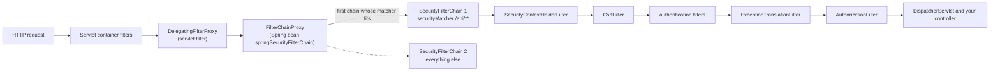
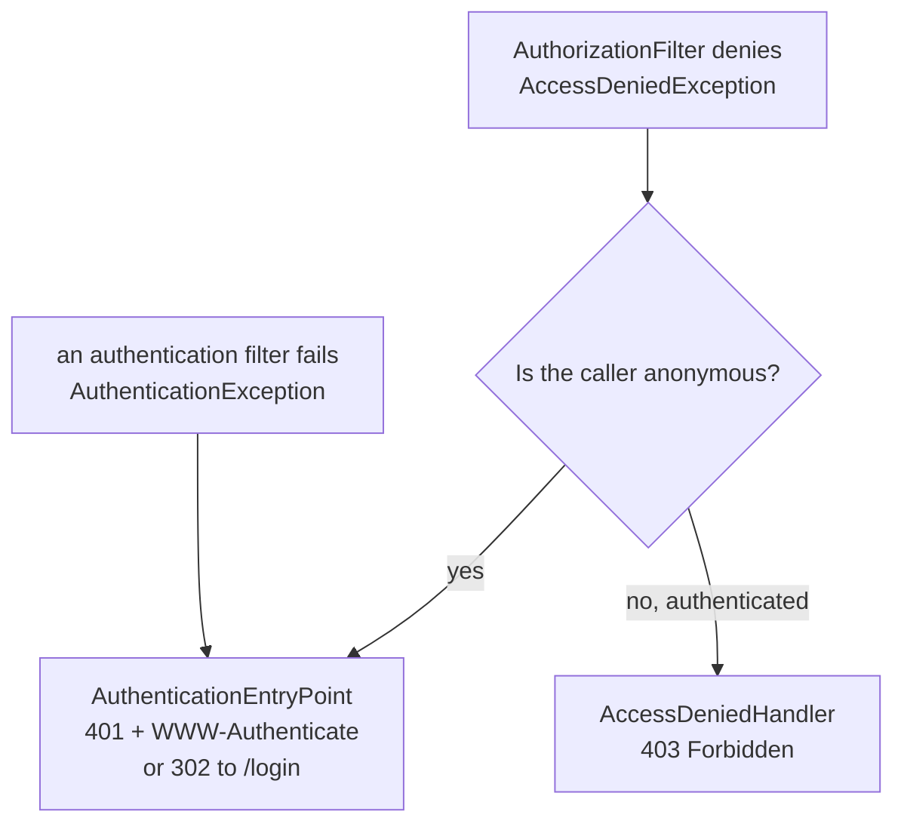
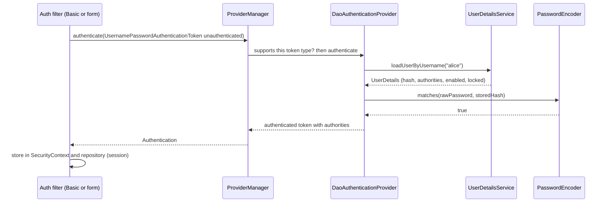

# Chapter 10 — Spring Security 1: Fundamentals

Every request raises two questions: **who is calling?** and **may they do this?** Spring Security answers both with a chain of servlet filters (code the web server runs on every request before Spring MVC) that runs *before* your controllers, and switches on protections you would otherwise forget — CSRF tokens (§10.8), security headers (§10.11), session-fixation defence (§10.10) — the moment you add the starter. It is not magic: once you can picture the filter chain, name the object holding the current user, and tell a 401 ("I don't know who you are") from a 403 ("I know you, but no"), the rest is configuration.

All code lives in [`code/`](code/) — three Spring Boot **4.1.1** projects (Spring Security **7.1.1**, Framework 7, Java 25). Output blocks are real `mvn -q -B -ntp verify` output (Spring log lines trimmed to `...`; hashes and timings change per run).

| Project | Shows |
|---|---|
| [`security-defaults`](code/security-defaults/) | the starter with zero configuration |
| [`security-basics`](code/security-basics/) | filter chain, authentication, passwords, authorization, method security |
| [`security-web-defenses`](code/security-web-defenses/) | two chains (API + browser app), CSRF on/off, CORS preflight, headers, sessions |

> **Prerequisites.** Proxies ([Chapter 4](../04-aop-and-proxies/README.md)) explain method security; controllers come from Spring MVC ([Chapter 5](../05-spring-mvc-and-rest/README.md)). The *browser* side of CORS, CSRF and XSS (cross-site scripting: an attacker's JavaScript running on your pages) is in the JavaScript handbook, [Chapter 14](../../../javascript/chapters/14-browser-apis-and-security/README.md). Tokens, JWT (JSON Web Token: a signed token carrying user details) and OAuth2 (the standard protocol for issuing access tokens) continue in [Chapter 11](../11-spring-security-2-tokens-and-oauth2/README.md).

---

## 10.1 Vocabulary and what the starter does by default

### What it is

**Spring Security** is the Spring project for authentication, authorization and protection against common web attacks; Boot 4 adds it with `spring-boot-starter-security`.

| Term | Plain meaning |
|---|---|
| **Principal** | the "who" — a user, a service, a device |
| **Credentials** | the proof — password, token, certificate |
| **Authentication** | checking the proof and deciding who the caller is |
| **Authorization** | deciding whether that caller may do *this* action |
| **Authority** (`GrantedAuthority`) | one permission string the caller holds, e.g. `report:read` |
| **Role** | an authority whose name starts with `ROLE_`, e.g. `ROLE_ADMIN`; a coarse group of permissions |
| **Security context** | the per-request holder of the current `Authentication` |

**Authentication produces an `Authentication` object** (principal + authorities + "is authenticated" flag). **Authorization reads it.**

### What happens with zero configuration

Add the starter, write one controller, and run the test in `security-defaults`:

```java
@Test
void everythingIsLockedByDefault(CapturedOutput startupLog) throws Exception {
    // 1. Boot generated a user called "user" and logged its random password at startup
    String line = startupLog.getAll().lines()
            .filter(l -> l.contains("Using generated security password")).findFirst().orElseThrow();
    String password = line.substring(line.indexOf(':') + 1).trim();
    // 2. browser-style request -> redirect to the generated login page
    MvcTestResult browser = mvc.get().uri("/hello").header(HttpHeaders.ACCEPT, "text/html").exchange();
    assertThat(browser).hasStatus(302).hasRedirectedUrl("/login");
    // 3. API-style request -> 401 plus a Basic challenge
    MvcTestResult api = mvc.get().uri("/hello").header(HttpHeaders.ACCEPT, "application/json").exchange();
    assertThat(api).hasStatus(401);
    // 4. with the generated credentials it works
    MvcTestResult ok = mvc.get().uri("/hello").with(httpBasic("user", password)).exchange();
    assertThat(ok).hasStatusOk().hasBodyTextEqualTo("hello");
}
```

Output:

```text
Using generated security password: 4030de5f-fb5d-4c46-bd81-7a0af09efd28

This generated password is for development use only. Your security configuration must be updated before running your application in production.
...
startup log   : Using generated security password: <36-char UUID>
browser, anon : 302 -> /login
api, anon     : 401 WWW-Authenticate=Basic realm="Realm", charset="UTF-8"
basic, user   : 200 body=hello
```

With no code at all, Boot and Spring Security:

1. Protect **every** URL.
2. Create one in-memory user `user` with a random UUID (128-bit identifier) password logged at startup (nothing stored). `spring.security.user.name/password/roles` fix it — for experiments only.
3. Enable **form login** (a generated `/login` page) and **HTTP Basic** (username and password sent in a header on every request).
4. Pick the response by client type: a browser asking for HTML (`Accept: text/html`, e.g. Chrome) gets a `302` redirect to `/login`; a JSON client (e.g. Postman, curl) gets `401` with `WWW-Authenticate: Basic`. The `charset="UTF-8"` parameter is new in Spring Security 7.1.
5. Turn on CSRF protection, security headers, session-fixation protection and a logout endpoint.

Declaring your own `SecurityFilterChain` bean makes Boot's default chain back off; declaring a `UserDetailsService`, `AuthenticationManager` or `AuthenticationProvider` (or an OAuth2 setup — Chapter 11) removes the generated user.

**Secure by default** means forgetting something fails *closed*: a new endpoint is protected, not exposed. The price is the "why does my new app return 401?" moment — because you have not told Spring who may call it yet.

### TL;DR

- Authentication = *who are you*, authorization = *may you*; the `Authentication` object links them.
- The starter alone locks every URL, generates a dev-only user and enables form login, Basic, CSRF and headers.

---

## 10.2 Architecture: the filter chain

### What it is

Spring Security is a **servlet filter** — code that sees every HTTP request before the `DispatcherServlet` does — made of an ordered **list of small filters**, each with one job. If any filter says no, the request never reaches your controller.

### How it works



1. **`DelegatingFilterProxy`** is a plain servlet filter Boot registers with the container. The container creates filters itself and cannot see Spring beans, so this filter only looks up a Spring bean and delegates to it.
2. That bean is **`FilterChainProxy`** (`springSecurityFilterChain`). It holds one or more **`SecurityFilterChain`s** and, per request, runs only the **first** chain whose request matcher fits (chains are never combined; order by `@Order`).
3. Each chain is an ordered list of **security filters**. The important ones:

| Filter | Job |
|---|---|
| `SecurityContextHolderFilter` | loads the `SecurityContext` (e.g. from the HTTP session) into `SecurityContextHolder` for this request, and clears it afterwards |
| `HeaderWriterFilter` | adds security headers (§10.11) |
| `CorsFilter` | answers CORS preflights (§10.9), only if `cors()` is configured |
| `CsrfFilter` | rejects state-changing requests without a valid CSRF token (§10.8) |
| `LogoutFilter` | handles `POST /logout` |
| `UsernamePasswordAuthenticationFilter` | processes the login form `POST /login` |
| `BasicAuthenticationFilter` | reads `Authorization: Basic ...` |
| `BearerTokenAuthenticationFilter` | reads `Authorization: Bearer ...` (Chapter 11) |
| `AnonymousAuthenticationFilter` | if nobody authenticated, puts an *anonymous* `Authentication` in the context |
| `ExceptionTranslationFilter` | turns security exceptions from later filters into HTTP responses: 401/redirect or 403 |
| `AuthorizationFilter` | the last gate: asks the `AuthorizationManager` whether this request is allowed |

4. **`SecurityContextHolder`** stores the current `SecurityContext` in a `ThreadLocal` (a separate value per thread; each request runs on its own thread) by default. Any code on the request thread can read it with `SecurityContextHolder.getContext().getAuthentication()`.

The test in `security-basics` prints the real filter list of our chain:

```java
@Autowired FilterChainProxy springSecurityFilterChain;

@Test
void printTheFilters() {
    List<SecurityFilterChain> chains = springSecurityFilterChain.getFilterChains();
    List<String> names = chains.getFirst().getFilters().stream().map(f -> f.getClass().getSimpleName()).toList();
    // ... print with numbers
    assertThat(names.getLast()).isEqualTo("AuthorizationFilter");
}
```

Output:

```text
security filter chains: 1
 1 DisableEncodeUrlFilter
 2 WebAsyncManagerIntegrationFilter
 3 SecurityContextHolderFilter
 4 HeaderWriterFilter
 5 CsrfFilter
 6 LogoutFilter
 7 UsernamePasswordAuthenticationFilter
 8 DefaultResourcesFilter
 9 DefaultLoginPageGeneratingFilter
10 DefaultLogoutPageGeneratingFilter
11 BasicAuthenticationFilter
12 RequestCacheAwareFilter
13 SecurityContextHolderAwareRequestFilter
14 AnonymousAuthenticationFilter
15 ExceptionTranslationFilter
16 AuthorizationFilter
```

The list changes with configuration: removing `formLogin()` removes `UsernamePasswordAuthenticationFilter` and the login page; `oauth2ResourceServer()` adds `BearerTokenAuthenticationFilter`. Printing it, or `logging.level.org.springframework.security=TRACE`, is the fastest way to see what a chain really does.

### How a denied request becomes 401 or 403

`ExceptionTranslationFilter` sits just before `AuthorizationFilter` and catches what it throws:



- An **`AuthenticationEntryPoint`** "starts authentication". It is `401` with a challenge header for APIs, or a redirect to a login page for browsers. Before redirecting, the original request is saved in the **request cache**, so after login the user lands where they wanted to go.
- An **`AccessDeniedHandler`** answers `403` for callers who *are* known but lack permission.

### Why it matters

- **Debugging.** "403 before my controller runs" is a filter problem, not an MVC problem; the filter list tells you which one.
- **Ordering.** Place custom filters with `http.addFilterBefore(myFilter, BasicAuthenticationFilter.class)` and friends, never a guessed order number.
- **Threads.** The `ThreadLocal` context does *not* follow work handed to another thread (`@Async`, executors, `CompletableFuture`, scheduled jobs); use `DelegatingSecurityContextExecutor` (or the `DelegatingSecurityContext*` wrappers).

### Common mistakes

- Registering your security filter as a plain `@Component` `Filter`: Boot *also* adds it to the servlet container, so it runs twice, once outside the chain. Add it via `http.addFilter...` and disable the servlet registration with a `FilterRegistrationBean` whose `setEnabled(false)`.

### TL;DR

Container → `DelegatingFilterProxy` → `FilterChainProxy` → first matching `SecurityFilterChain` → ordered filters → `AuthorizationFilter` last; `ExceptionTranslationFilter` turns denials into 401/redirect (anonymous) or 403 (known). The current user lives in `SecurityContextHolder` (a `ThreadLocal`).

---

## 10.3 Configuring a chain: the lambda DSL in Spring Security 7

### What it is

Declare a `SecurityFilterChain` bean and build it with the **`HttpSecurity` DSL** (domain-specific language: a fluent builder where each method configures one feature via a `Customizer` lambda). The whole configuration of `security-basics`:

```java
@Configuration
@EnableMethodSecurity // turns on @PreAuthorize / @PostAuthorize / @PreFilter / @PostFilter
class SecurityConfig {

    @Bean
    SecurityFilterChain appSecurity(HttpSecurity http) throws Exception {
        http
            .authorizeHttpRequests(auth -> auth                      // first match wins, top to bottom
                .requestMatchers("/public/**").permitAll()
                .requestMatchers("/admin/**").hasRole("ADMIN")        // checks authority "ROLE_ADMIN"
                .requestMatchers("/user/**").hasRole("USER")          // ADMIN also passes (hierarchy below)
                .requestMatchers(HttpMethod.GET, "/reports/**").hasAuthority("report:read")
                .requestMatchers("/me", "/orders/**").authenticated()
                .anyRequest().denyAll())                              // anything we forgot is closed
            .httpBasic(Customizer.withDefaults())                     // Authorization: Basic ... for APIs
            .formLogin(Customizer.withDefaults());                    // /login page for browsers
        return http.build();
    }

    @Bean
    PasswordEncoder passwordEncoder() {
        return PasswordEncoderFactories.createDelegatingPasswordEncoder();
    }

    @Bean
    static RoleHierarchy roleHierarchy() {
        return RoleHierarchyImpl.fromHierarchy("ROLE_ADMIN > ROLE_USER");
    }
}
```

- `Customizer.withDefaults()` is a no-op lambda: "turn this feature on with default settings". `feature(f -> f.disable())` turns one off.
- With Boot, `@EnableWebSecurity` is applied for you (harmless to add).

### What changed in Spring Security 7

Spring Security 7 finished clean-ups that 6.x had deprecated; old tutorials use the removed style:

| Removed in 7 | Use instead |
|---|---|
| `.and()` chaining (`http.csrf().disable().and().httpBasic()`) | one lambda per feature (above) |
| `authorizeRequests(...)` | `authorizeHttpRequests(...)` (built on `AuthorizationManager`) |
| `AntPathRequestMatcher`, `MvcRequestMatcher` | `PathPatternRequestMatcher` — the same `PathPattern` syntax Spring MVC uses. `requestMatchers("/x/**")` creates them for you |
| `WebSecurityConfigurerAdapter` (already gone in 6.0) | `SecurityFilterChain` beans |
| `AccessDecisionManager` / voters in the main jar | moved to the legacy `spring-security-access` module; prefer `AuthorizationManager` |
| OAuth2 *password* grant support | authorization code or client credentials (Chapter 11) |

Other 7.0 additions: built-in **multi-factor authentication** (MFA: two or more kinds of proof; §10.4), `csrf(c -> c.spa())` for single-page apps (SPAs; §10.8), Password4j-based encoders (§10.5), and Spring Authorization Server (issues OAuth2 tokens) now shipping *inside* Spring Security (Chapter 11).

### Several chains in one application

Apps serving a JSON API *and* browser pages need different rules: the API stateless (the server keeps no login state; every request carries credentials) without CSRF, the pages on a session cookie with CSRF on. Declare two chains, each with a **`securityMatcher`** and an **`@Order`**:

```java
@Bean @Order(1)
SecurityFilterChain apiChain(HttpSecurity http) throws Exception {
    http.securityMatcher("/api/**")                       // this chain only handles /api/**
        .authorizeHttpRequests(auth -> auth.anyRequest().authenticated())
        .httpBasic(Customizer.withDefaults())
        .cors(Customizer.withDefaults())
        .csrf(csrf -> csrf.disable())                     // safe ONLY because nothing relies on cookies
        .sessionManagement(s -> s.sessionCreationPolicy(SessionCreationPolicy.STATELESS));
    return http.build();
}

@Bean @Order(2)
SecurityFilterChain webChain(HttpSecurity http) throws Exception {   // no securityMatcher = everything else
    http.authorizeHttpRequests(auth -> auth.requestMatchers("/login").permitAll().anyRequest().authenticated())
        .formLogin(Customizer.withDefaults())
        .logout(Customizer.withDefaults());
    return http.build();
}
```

`securityMatcher` selects which *requests* the whole chain handles; `requestMatchers` inside `authorizeHttpRequests` defines *rules* within the chain. Mixing them up is a classic bug.

### Common mistakes

- A chain **without** `securityMatcher` placed *before* a specific one matches everything, so the later chain never runs. Catch-all chains go last (highest `@Order`).
- Copying `.and()` or `authorizeRequests()` code from old posts — it no longer compiles in Spring Security 7.
- Declaring the `SecurityFilterChain` bean outside a scanned `@Configuration`: Boot's default chain stays active and nothing you wrote applies.

### TL;DR

One `SecurityFilterChain` bean per chain, one lambda per feature. Spring Security 7 removed `and()`, `authorizeRequests` and the Ant/Mvc matchers. Several chains = `securityMatcher` + `@Order`, specific first.

---

## 10.4 Authentication: users, providers, form login and Basic

### What it is

**Authentication** turns *credentials* into an **`Authentication`** saying who the caller is and what authorities they hold. Spring splits the work into small, replaceable interfaces.

### How it works (username + password)



1. An **authentication filter** extracts credentials (`BasicAuthenticationFilter`: the `Authorization` header; `UsernamePasswordAuthenticationFilter`: the `POST /login` form) and builds an *unauthenticated* token.
2. It calls the **`AuthenticationManager`**; the standard **`ProviderManager`** asks each **`AuthenticationProvider`** whether it `supports` that token type.
3. **`DaoAuthenticationProvider`** loads the user through your **`UserDetailsService`**, checks account flags (enabled, not locked, not expired), and verifies the password with the **`PasswordEncoder`**.
4. On success the filter stores the token in the `SecurityContext`; form login also saves it in the HTTP session (recognised next time via the session cookie), while Basic resends credentials on *every* request.
5. On failure an `AuthenticationException` is thrown. Wrong password and unknown user both surface as `BadCredentialsException` (no username enumeration — discovering which accounts exist), and for an unknown user the provider still checks a dummy hash so timing does not leak it either.

### `UserDetailsService`: your user store behind one method

`UserDetailsService` has one method, `loadUserByUsername(String)`, backed by a table, LDAP (a corporate directory protocol) or anything else. `security-basics` uses a map (a real app would use JPA — [Chapter 8](../08-spring-data-jpa-and-hibernate/README.md)):

```java
@Service
public class AccountUserDetailsService implements UserDetailsService, UserDetailsPasswordService {

    public record Account(String username, String passwordHash, List<String> authorities, boolean enabled) {}
    private final Map<String, Account> accounts = new ConcurrentHashMap<>();

    AccountUserDetailsService(PasswordEncoder encoder) {
        save(new Account("alice", encoder.encode("alice-pass"), List.of("ROLE_USER", "report:read"), true));
        save(new Account("bob", encoder.encode("bob-pass"), List.of("ROLE_ADMIN"), true));
        save(new Account("carol", encoder.encode("carol-pass"), List.of("ROLE_USER"), true));
        save(new Account("dave", "{noop}dave-pass", List.of("ROLE_USER"), true));    // legacy plain-text row
        save(new Account("erin", encoder.encode("erin-pass"), List.of("ROLE_USER"), false)); // disabled
    }

    @Override
    public UserDetails loadUserByUsername(String username) {
        Account a = accounts.get(username);
        if (a == null) throw new UsernameNotFoundException(username);
        return User.withUsername(a.username()).password(a.passwordHash())
                .authorities(a.authorities().toArray(String[]::new))
                .disabled(!a.enabled()).build();
    }

    @Override   // see 10.5: called when a stored hash should be upgraded
    public UserDetails updatePassword(UserDetails user, String newEncodedPassword) { /* save new hash */ }
}
```

With this bean plus a `PasswordEncoder` bean, Spring builds the `DaoAuthenticationProvider` for you. Ready-made implementations: `InMemoryUserDetailsManager` (tests, demos), `JdbcUserDetailsManager` (Spring's `users`/`authorities` schema), LDAP.

### Form login vs HTTP Basic

| | Form login | HTTP Basic |
|---|---|---|
| Credentials sent | once, in `POST /login` | on **every** request, Base64 (a reversible text encoding) in `Authorization` (encoded, **not encrypted**, so HTTPS — HTTP over an encrypted TLS connection — only) |
| Remembered by | HTTP session cookie (`JSESSIONID`) | nothing, the client resends them |
| Unauthenticated response | `302` redirect to `/login` | `401` + `WWW-Authenticate: Basic realm=...` |
| Logout | `POST /logout` invalidates the session | impossible server-side (browser caches credentials) |
| Good for | server-rendered browser apps | scripts, service-to-service in trusted networks, quick demos |

With both enabled, Spring picks the entry point per request: HTML-accepting browsers get the redirect, others (e.g. `Accept: application/json`) the `401` challenge:

```java
MvcTestResult noCreds  = mvc.get().uri("/me").header("Accept", "application/json").exchange();
MvcTestResult wrong    = mvc.get().uri("/me").with(httpBasic("alice", "nope")).exchange();
MvcTestResult disabled = mvc.get().uri("/me").with(httpBasic("erin", "erin-pass")).exchange();
MvcTestResult ok       = mvc.get().uri("/me").with(httpBasic("alice", "alice-pass")).exchange();
// formLogin() builds POST /login with username, password AND a valid CSRF token
mockMvc.perform(formLogin().user("alice").password("alice-pass")).andExpect(authenticated().withUsername("alice"));
mockMvc.perform(formLogin().user("alice").password("wrong")).andExpect(unauthenticated());
```

Output:

```text
no credentials (JSON)        401 WWW-Authenticate=Basic realm="Realm", charset="UTF-8"
alice, wrong password        401 WWW-Authenticate=Basic realm="Realm", charset="UTF-8"
erin, disabled account       401 WWW-Authenticate=Basic realm="Realm", charset="UTF-8"
alice, right password        200 {"name":"alice","principalType":"User","authorities":["FACTOR_PASSWORD","ROLE_USER","report:read"]}
no credentials (HTML)        302 -> /login
form login, good password   302 -> /
form login, bad password    302 -> /login?error
```

### Reading the current user

```java
@GetMapping("/me")
Me me(Authentication auth, @AuthenticationPrincipal UserDetails principal) {
    return new Me(auth.getName(), principal.getClass().getSimpleName(),
            auth.getAuthorities().stream().map(GrantedAuthority::getAuthority).sorted().toList());
}
```

Spring MVC fills an `Authentication` (or `Principal`) parameter; `@AuthenticationPrincipal` gives the principal object itself (here our `UserDetails`). Elsewhere use `SecurityContextHolder.getContext().getAuthentication()`, but prefer passing the user in — `ThreadLocal` access is harder to test.

### The `FACTOR_PASSWORD` authority: multi-factor authentication in Spring Security 7

Alice's authorities include **`FACTOR_PASSWORD`**. Spring Security 7 adds a **factor authority** (`FactorGrantedAuthority`) for every mechanism a user completes: `FACTOR_PASSWORD`, `FACTOR_OTT` (one-time token, e.g. an e-mailed code), `FACTOR_WEBAUTHN` (passkeys: password-less login with a key on the user's device). Rules can then demand several factors ("`/admin/**` needs `ROLE_ADMIN` **and** password **and** one-time token") via `@EnableMultiFactorAuthentication(authorities = ...)` or selectively `AuthorizationManagerFactories.multiFactor()`; a missing factor sends the user to that factor's login step. Don't be surprised by `FACTOR_*` entries, and filter them out when copying authorities into a token (Chapter 11 does).

### Common mistakes

- Returning `null` from `loadUserByUsername` — the contract is to throw `UsernameNotFoundException`.
- Telling users "unknown username" vs "wrong password" — enables account enumeration.
- Logging or returning the `UserDetails` (with its hash). Map it to a DTO.
- HTTP Basic over plain HTTP — Base64 is readable by anyone on the path.

### In the interview

**30-second answer:** "An authentication filter extracts credentials and hands an unauthenticated token to the `AuthenticationManager`. `ProviderManager` delegates to a provider that supports the token — for passwords, `DaoAuthenticationProvider`, which loads the user via `UserDetailsService` and verifies the hash with the `PasswordEncoder`. The result goes into the `SecurityContext`, and form login persists it in the session."

- *Why is `UsernameNotFoundException` turned into `BadCredentialsException`?* → To prevent username enumeration; a dummy password check also equalises timing.
- *How would you add login by API key?* → A filter (or `AuthenticationConverter`) building an `ApiKeyAuthenticationToken`, an `AuthenticationProvider` validating it, registered with `addFilterBefore(..., BasicAuthenticationFilter.class)`.
- *Why can't you "log out" of HTTP Basic?* → No server-side session; the browser caches and resends the credentials.

### TL;DR

Filter → `AuthenticationManager` (`ProviderManager`) → `AuthenticationProvider` (`DaoAuthenticationProvider`) → `UserDetailsService` + `PasswordEncoder` → `Authentication` in the `SecurityContext`. Browsers: form login + session. Scripts: Basic (HTTPS only). Tokens: Chapter 11.

---

## 10.5 Password storage: hashing with `DelegatingPasswordEncoder`

### What it is

Never store passwords, not even encrypted. Store a **password hash**: the output of a one-way function, cheap to check once but expensive to compute billions of times, so a leaked database must be cracked one guess at a time. Three properties make it suitable:

| Idea | Meaning | Why |
|---|---|---|
| **One-way** | you can't compute the password from the hash | a leak does not reveal passwords directly |
| **Salt** | a random value stored with each hash and mixed in | equal passwords get different hashes, and precomputed "rainbow tables" are useless |
| **Work factor** (cost) | a tunable amount of CPU and/or memory per check | makes each guess slow. Raise it as hardware gets faster |

Fast general-purpose hashes (SHA-256, MD5 — built for checksums) are exactly wrong for passwords. Use an **adaptive password hash**:

| Algorithm | Spring encoder | Notes |
|---|---|---|
| **bcrypt** | `BCryptPasswordEncoder` (default strength 10) | CPU-hard, battle-tested. Uses only the first **72 bytes** of the password |
| **Argon2id** | `Argon2PasswordEncoder` (needs Bouncy Castle `bcprov-jdk18on`) | memory-hard (resists GPU/ASIC cracking hardware). Password Hashing Competition winner; first choice of OWASP (Open Worldwide Application Security Project) |
| **scrypt** | `SCryptPasswordEncoder` (Bouncy Castle) | memory-hard |
| **PBKDF2** | `Pbkdf2PasswordEncoder` | when FIPS-140 (US approved-cryptography standard) compliance is required |

Spring Security 7.0 also added **Password4j-based** encoders (`Argon2Password4jPasswordEncoder`, `BcryptPassword4jPasswordEncoder`, `ScryptPassword4jPasswordEncoder`, `Pbkdf2Password4jPasswordEncoder`, `BalloonHashingPassword4jPasswordEncoder`).

### How `DelegatingPasswordEncoder` works

Algorithms age (MD5 → bcrypt → Argon2). `DelegatingPasswordEncoder` lets one database hold several generations; each stored value carries its algorithm id as a prefix:

```text
{bcrypt}$2a$10$oExJt1cCgjfvb4DzBrmNo.VLE45g8zG8GLlEik43AL6a3Xbk8q20a
{argon2@SpringSecurity_v5_8}$argon2id$v=19$m=16384,t=2,p=1$...
{noop}dave-pass                       <- legacy plain text (never do this for real)
```

1. **`encode(raw)`** always uses the *current default* id. `PasswordEncoderFactories.createDelegatingPasswordEncoder()` uses `bcrypt`.
2. **`matches(raw, stored)`** reads the `{id}` prefix and delegates to that algorithm's encoder. Old hashes keep working.
3. **`upgradeEncoding(stored)`** is `true` when the stored hash is not in the current default format. `DaoAuthenticationProvider` calls it after each successful login; if true *and* your `UserDetailsService` implements **`UserDetailsPasswordService`**, it re-hashes the just-received password and calls `updatePassword(...)`. Users migrate silently, one login at a time.

`PasswordEncodingTest` (a plain unit test, no Spring context) shows all of this:

```java
PasswordEncoder enc = PasswordEncoderFactories.createDelegatingPasswordEncoder();
String h1 = enc.encode("s3cret");
String h2 = enc.encode("s3cret");
// ...
String argon = "{argon2@SpringSecurity_v5_8}" + Argon2PasswordEncoder.defaultsForSpringSecurity_v5_8().encode("s3cret");
enc.matches("s3cret", argon);          // true: same encoder reads other algorithms
enc.upgradeEncoding("{noop}s3cret");   // true
```

Output:

```text
encode #1 : {bcrypt}$2a$10$oExJt1cCgjfvb4DzBrmNo.VLE45g8zG8GLlEik43AL6a3Xbk8q20a
encode #2 : {bcrypt}$2a$10$oYZZ7zXC3LyJEl6nbQ9KbuQxmg1.oblxK/JPZ0/EufIiGHGFWX2ai
same input, different hash (random salt): true
matches(s3cret) = true, matches(S3cret) = false
argon2 row: {argon2@SpringSecurity_v5_8}$argon2id$v=19$m=16384,t=2,p=1$0...
matches(argon2 row) = true
upgradeEncoding({noop})  = true
upgradeEncoding(argon2)  = true
upgradeEncoding(bcrypt)  = false
```

A bcrypt value: `$2a$` variant, `10` cost (2^10 rounds), 22 chars of salt, 31 of hash — the salt is inside the string, no extra column. `upgradeEncoding(argon2)` is `true` only because this encoder's *default* is bcrypt: "upgrade" means "not the current default".

### Choosing Argon2 as the default

To hash new passwords with Argon2 while accepting everything stored, build your own `DelegatingPasswordEncoder`:

```java
Map<String, PasswordEncoder> known = Map.of(
        "argon2@SpringSecurity_v5_8", Argon2PasswordEncoder.defaultsForSpringSecurity_v5_8(),
        "bcrypt", new BCryptPasswordEncoder(),
        "noop", NoOpPasswordEncoder.getInstance());           // only to READ legacy rows
var enc = new DelegatingPasswordEncoder("argon2@SpringSecurity_v5_8", known);
```

Output:

```text
argon2 default: {argon2@SpringSecurity_v5_8}$argon2id$v=19$m=16384,t=2,p=1$Y...
old bcrypt row still matches: true, needs upgrade: true
```

`m=16384,t=2,p=1` = 16 MiB memory, 2 passes, 1 lane (Spring's `v5_8` defaults). OWASP's Password Storage Cheat Sheet currently suggests somewhat more memory for Argon2id (e.g. 19 MiB, 2 passes) — use the `Argon2PasswordEncoder(saltLength, hashLength, parallelism, memory, iterations)` constructor. Changing parameters under the same id makes `upgradeEncoding` flag weaker stored hashes too. Measure on production hardware.

### The work factor in numbers

```text
bcrypt strength 10 -> $2a$10$...  ~59 ms per check
bcrypt strength 12 -> $2a$12$...  ~239 ms per check
```

Each +1 doubles the work (~4x for +2). Aim for "as slow as your login latency budget allows", often several hundred ms — but the cost hits *your* servers on every login, so slow hashing without rate limiting makes login an easy denial-of-service target ([Chapter 11 rate limiting](../11-spring-security-2-tokens-and-oauth2/README.md#1115-rate-limiting-and-brute-force-protection)).

### bcrypt's 72-byte limit

```text
73-byte password -> IllegalArgumentException: password cannot be more than 72 bytes
```

bcrypt only reads the first 72 bytes; current Spring Security refuses longer input instead of silently truncating. Allow long passphrases → validate length at sign-up or choose Argon2.

### Upgrading on login — proved

`dave` is stored as `{noop}dave-pass`; after one successful login his row holds a bcrypt hash:

```java
System.out.println("before login: " + accounts.find("dave").passwordHash());
assertThat(mvc.get().uri("/me").with(httpBasic("dave", "dave-pass"))).hasStatusOk();
String after = accounts.find("dave").passwordHash();
assertThat(after).startsWith("{bcrypt}$2a$10$");
```

Output:

```text
before login: {noop}dave-pass
after login : {bcrypt}$2a$10$6G6hiKY...
```

### Common mistakes

- **Encrypting** passwords (AES) "so support can see them" — anyone with the key decrypts them all.
- Hand-made `sha256(password + "pepper")` — fast, so it cracks quickly.
- `NoOpPasswordEncoder` as the bean "for now" (deprecated for a reason).
- Hashes stored without the `{id}` prefix, then switching encoders: every old row breaks. `DelegatingPasswordEncoder.setDefaultPasswordEncoderForMatches(...)` tells Spring how to read unprefixed values.
- Too-short hash column: bcrypt is 60 chars plus `{bcrypt}`, Argon2 longer. Use `VARCHAR(255)`+.

### In the interview

**30-second answer:** "Store only adaptive, salted hashes such as bcrypt or Argon2id, never encrypted or plain passwords. In Spring I use `DelegatingPasswordEncoder`: each hash carries an `{id}` prefix, new passwords use the current default, old formats still verify, and with `UserDetailsPasswordService` hashes upgrade transparently on the next successful login."

- *Why a salt?* → Equal passwords get different hashes; precomputed tables become useless. The salt is not secret.
- *bcrypt or Argon2?* → Both fine. Argon2id is memory-hard (GPU cracking costlier), OWASP's first choice; bcrypt is ubiquitous but has the 72-byte limit.
- *What is a pepper?* → An optional secret mixed into every hash and stored *outside* the database (in a vault). Helps only if the database leaks without the app secrets.

### TL;DR

Hash, don't encrypt: Argon2id or bcrypt via `DelegatingPasswordEncoder` (`{id}hash`), `UserDetailsPasswordService` to upgrade on login, cost tuned to your hardware.

---

## 10.6 Authorizing requests: roles, authorities, 401 vs 403

### What it is

`authorizeHttpRequests` is a list of **rules**, each pairing a request matcher with a requirement. For each request, `AuthorizationFilter` walks the list **top to bottom** and applies the **first rule that matches**. The rules you write most often:

| Rule | Passes when |
|---|---|
| `permitAll()` | always (still goes through the other filters, e.g. CSRF) |
| `denyAll()` | never |
| `authenticated()` | caller is not anonymous |
| `hasAuthority("report:read")` | caller holds exactly that authority string |
| `hasAnyAuthority("a", "b")` | holds at least one |
| `hasRole("ADMIN")` | holds authority **`ROLE_ADMIN`** (the prefix is added for you) |
| `hasAnyRole("ADMIN", "OPS")` | holds `ROLE_ADMIN` or `ROLE_OPS` |
| `access(authorizationManager)` | your own `AuthorizationManager` decides, e.g. IP ranges or time of day |

Matchers can take HTTP methods (`requestMatchers(HttpMethod.GET, "/reports/**")`) and use Spring MVC's `PathPattern` syntax (`*` one segment, `**` any number).

### Roles vs authorities

Under the hood **there is only `GrantedAuthority`, a string**; a "role" is the convention that it starts with `ROLE_`.

| | Role | Authority (permission) |
|---|---|---|
| Example | `ROLE_ADMIN` | `report:read`, `order:refund` |
| Granularity | coarse: *who the user is* | fine: *what the user may do* |
| Checked with | `hasRole("ADMIN")` | `hasAuthority("report:read")` |
| Typical source | user's group membership | role-to-permission mapping, OAuth2 scopes (permissions granted to a token, e.g. `read`; `SCOPE_...`, Chapter 11) |

Many teams check **authorities** in code and assign them to users *through* roles, so a role change is not a code change. Spring rejects both prefix mistakes:

```text
hasRole("ROLE_ADMIN") -> ROLE_ADMIN should not start with ROLE_ since ROLE_ is automatically prepended when using hasRole. Consider using hasAuthority instead.
User.roles("ROLE_ADMIN") -> ROLE_ADMIN cannot start with ROLE_ (it is automatically added)
```

`User.withUsername(...).roles("ADMIN")` stores `ROLE_ADMIN`; `.authorities("ROLE_ADMIN", "report:read")` stores the strings as given. The two setters **replace** each other (last call wins), so mixed lists use `authorities(...)`.

### 401 vs 403 — proved

| Status | Name | Meaning | Client should |
|---|---|---|---|
| **401** | Unauthorized (really "unauthenticated") | "I don't know who you are" | authenticate, then retry |
| **403** | Forbidden | "I know who you are, and the answer is no" | not retry with the same identity |

The matrix test calls five URLs as four callers:

```java
assertThat(status("/admin/stats", null)).isEqualTo(401);      // who are you?
assertThat(status("/admin/stats", "carol")).isEqualTo(403);   // I know you, but no
assertThat(status("/reports/daily", "alice")).isEqualTo(200); // authority, not role
assertThat(status("/reports/daily", "bob")).isEqualTo(403);   // ADMIN role is not report:read
assertThat(status("/user/profile", "bob")).isEqualTo(200);    // role hierarchy ADMIN > USER
assertThat(status("/nowhere", "bob")).isEqualTo(403);         // denyAll catch-all
```

Output:

```text
                               /public/hello  /user/profile  /admin/stats   /reports/daily /nowhere
anonymous                      200            401            401            401            401
alice (ROLE_USER, report:read) 200            200            403            200            403
carol (ROLE_USER)              200            200            403            403            403
bob (ROLE_ADMIN)               200            200            200            403            403
```

- **anonymous** gets 401 everywhere except the public URL, even `/nowhere`: a denied *anonymous* caller is always asked to authenticate first (§10.2).
- **alice** reaches `/reports/daily` via the `report:read` **authority**, though not an admin; **bob** (admin) gets **403** there — a role does not imply permissions never mapped to it.
- **bob** reaches `/user/profile` via the **role hierarchy** `ROLE_ADMIN > ROLE_USER` (applies to URL rules and method security).
- `/nowhere` has no controller yet is 403 for logged-in users: `anyRequest().denyAll()` closes everything unlisted, and security runs before MVC looks for a handler.

**Why `denyAll()` last:** with `anyRequest().authenticated()`, next month's new endpoint is open to *every logged-in user*; with `denyAll()` it stays closed until someone writes a rule. `authenticated()` is fine for internal apps; `denyAll()` is safer customer-facing.

### Common mistakes

- **Rule order.** `requestMatchers("/**").authenticated()` first makes every later rule dead code. Most specific first.
- **Securing only the URL.** Can alice read `/orders/2`, which is carol's? That needs the *data* — method security or the query (IDOR, insecure direct object reference: reaching another user's record by changing an id; §10.7).
- Returning **404** for "exists but you may not see it" hides existence — decide deliberately; Spring gives 403.
- Relying on `permitAll()` to *skip* security — the request still passes CSRF and header filters. For static files use their own `permitAll()` chain; avoid `WebSecurityCustomizer.ignoring()`, which also drops security headers.

### In the interview

**30-second answer:** "401 means the server doesn't know who you are, so authenticate. 403 means it knows and refuses. In Spring, an `AccessDeniedException` for an anonymous user goes to the `AuthenticationEntryPoint` (401 or login redirect), for an authenticated user to the `AccessDeniedHandler` (403). Roles are authorities with a `ROLE_` prefix. I check fine-grained authorities and map them to roles."

- *`hasRole("ADMIN")` vs `hasAuthority("ADMIN")`?* → The first checks `ROLE_ADMIN`, the second the literal `ADMIN`.
- *Admins inheriting user permissions?* → A `RoleHierarchy` bean (`RoleHierarchyImpl.fromHierarchy("ROLE_ADMIN > ROLE_USER")`).

### TL;DR

First matching rule wins: specific first, finish with `denyAll()` (or `authenticated()`). A role is a `ROLE_` authority; `hasRole` adds the prefix. 401 = unknown caller, 403 = known but not allowed.

---

## 10.7 Method security

### What it is

URL rules protect *endpoints*. **Method security** (`@EnableMethodSecurity`) protects *business methods* whoever calls them — controller, listener, scheduled job — and can inspect **arguments and return value**, which URL rules cannot.

| Annotation | When it runs | Typical use |
|---|---|---|
| `@PreAuthorize("expr")` | before the call | role/authority checks, argument checks (`#owner == authentication.name`) |
| `@PostAuthorize("expr")` | after the call, sees `returnObject` | "load it, then check it belongs to the caller" |
| `@PreFilter("expr")` | before, filters a collection argument | rarely needed |
| `@PostFilter("expr")` | after, removes elements of the returned collection (`filterObject`) | small lists only |
| `@Secured("ROLE_ADMIN")` | before (enable with `securedEnabled = true`) | legacy, no SpEL |
| `@RolesAllowed("ADMIN")` | before (enable with `jsr250Enabled = true`; JSR-250 is the Java standard that defined it) | Jakarta standard annotation |

Expressions are **SpEL** (Spring Expression Language) with `authentication`, `principal`, `hasRole(...)`, `hasAuthority(...)`, parameters as `#name`, and `returnObject`.

```java
@Service
public class OrderService {

    @PreAuthorize("#owner == authentication.name or hasRole('ADMIN')")
    public List<Order> ordersOf(String owner) { ... }

    @PostAuthorize("returnObject.owner() == authentication.name")
    public Order find(long id) { ... }

    @PostFilter("filterObject.owner() == authentication.name or hasRole('ADMIN')")
    public List<Order> all() { return new ArrayList<>(orders); }   // must be mutable

    @PreAuthorize("hasAuthority('order:refund')")
    public String refund(long id) { ... }
}
```

### How it works

Method security is **proxy-based AOP** ([Chapter 4](../04-aop-and-proxies/README.md)): a proxy's interceptor evaluates the expression and throws **`AccessDeniedException`** if false. Same proxy rules as `@Transactional`: calls from inside the same class (`this.refund(1)`, **self-invocation** — proved in [Chapter 4](../04-aop-and-proxies/README.md#45-proxy-limitations--proved)) skip the check, and `private` (and, with CGLIB, `final`) methods are never intercepted.

### Proved

The tests call the service directly, with `@WithMockUser` supplying the security context:

```java
@Test
@WithMockUser(username = "alice") // default role USER
void ownerCanReadOwnOrders() {
    orders.ordersOf("alice");                                  // allowed
    assertThatThrownBy(() -> orders.ordersOf("carol")).isInstanceOf(AccessDeniedException.class);
    assertThat(orders.all()).extracting(OrderService.Order::owner).containsOnly("alice");
    assertThatThrownBy(() -> orders.find(2)).isInstanceOf(AccessDeniedException.class);
    assertThatThrownBy(() -> orders.refund(1)).isInstanceOf(AccessDeniedException.class);
}
```

Output:

```text
no SecurityContext, refund(1) -> AuthenticationCredentialsNotFoundException
alice ordersOf(alice)        -> [Order[id=1, owner=alice, cents=1999], Order[id=3, owner=alice, cents=250]]
alice ordersOf(carol)        -> AccessDeniedException
alice all() after @PostFilter -> [Order[id=1, owner=alice, cents=1999], Order[id=3, owner=alice, cents=250]]
alice find(2) (carol's)      -> AccessDeniedException (@PostAuthorize)
alice refund(1)              -> AccessDeniedException (needs order:refund)
bob(ADMIN) ordersOf(carol)   -> [Order[id=2, owner=carol, cents=500]]
support refund(1)            -> refunded 1
GET /orders/of/carol as alice -> HTTP 403
```

- A secured method called with **no** authentication (e.g. a background thread) fails with `AuthenticationCredentialsNotFoundException`.
- Over HTTP the service's `AccessDeniedException` travels back through the filters and becomes **403** via `ExceptionTranslationFilter`. A `@ControllerAdvice` `@ExceptionHandler(Exception.class)` must not swallow it into a 500.

### Trade-offs

| | URL rules | Method security |
|---|---|---|
| Protects | HTTP endpoints | any bean method, any caller |
| Can see | path, method, headers | arguments, return value, domain objects |
| Cost | cheap, before MVC | a proxy per bean. `@PostAuthorize` runs the method (and its SQL) before denying |
| Best for | coarse gates (`/admin/**`) | ownership and business rules |

Use both: URLs as the outer fence, methods for "may *this* user touch *this* record". For large collections skip `@PostFilter` (loads everything, discards most) — filter in the query (`where owner = :currentUser`).

### Common mistakes

- Forgetting `@EnableMethodSecurity` — annotations silently ignored.
- Self-invocation; annotating `private` methods.
- `@PostFilter` on an immutable `List.of(...)` — it removes elements, so needs a mutable collection.
- Complex SpEL strings — move logic into a bean: `@PreAuthorize("@orderGuard.canRead(#id, authentication)")`.

### TL;DR

`@EnableMethodSecurity` + `@PreAuthorize` for business rules and ownership. Proxy-based: self-invocation and private methods are unprotected; `@PostAuthorize` runs the method (and its SQL) before denying. A denial becomes 403 over HTTP.

---

## 10.8 CSRF protection

### What it is

**Cross-site request forgery (CSRF)** tricks a logged-in user's browser into sending a state-changing request to your site from another site; the browser attaches the session cookie automatically. The attack and browser-side defences (tokens, `SameSite` cookies) are in [JS 14.11](../../../javascript/chapters/14-browser-apis-and-security/README.md#1411-cross-site-request-forgery-csrf); here, what Spring does.

### How Spring's CSRF protection works

1. `CsrfFilter` generates a random **CSRF token** per session, stored by default in the HTTP session (`HttpSessionCsrfTokenRepository`).
2. Server-rendered pages include it: Spring's login page, Thymeleaf forms and JSP tags add a hidden `_csrf` field automatically.
3. For **unsafe** methods (`POST`, `PUT`, `PATCH`, `DELETE`) the filter compares the `_csrf` parameter or `X-CSRF-TOKEN` / `X-XSRF-TOKEN` header with the stored token; missing or wrong → **403**.
4. **Safe** methods (`GET`, `HEAD`, `OPTIONS`, `TRACE`) are not checked — never change state in a `GET`.
5. Since Spring Security 6 the token is loaded **lazily** (no session touch when not needed) and the rendered value is **XOR-masked** with fresh randomness per request (defeats BREACH, which recovers secrets from compressed-response sizes): it looks different each time but validates the same.

### Proved: on for the cookie app, off for the stateless API

```java
// web chain (session cookie): CSRF on
mvc.post().uri("/web/notes").param("text", "hi").with(user("alice"))                              // no token
mvc.post().uri("/web/notes").param("text", "hi").with(user("alice")).with(csrf().useInvalidToken())
mvc.post().uri("/web/notes").param("text", "hi").with(user("alice")).with(csrf())                  // valid token
// api chain (Basic auth, STATELESS): CSRF disabled
mvc.post().uri("/api/notes").contentType(MediaType.TEXT_PLAIN).content("from curl").with(httpBasic("alice", "alice-pass"))
```

Output:

```text
login page hidden field: <input name="_csrf" type="hidden" value="<token>" />
POST /web/notes, logged in, no CSRF token  -> 403
POST /web/notes, logged in, wrong token    -> 403
POST /web/notes, logged in, valid token    -> 200
GET  /web/home,  no token needed (safe)     -> 200
POST /api/notes, Basic auth, no CSRF token -> 201
```

### When may you disable it?

CSRF needs **ambient credentials** — ones the *browser* attaches on its own: cookies, browser-cached HTTP Basic, client certificates.

| Your API authenticates with... | CSRF protection |
|---|---|
| session cookie (form login, OAuth2 login, BFF — Backend for Frontend, a server holding tokens for a browser app) | **keep it on** |
| `Authorization: Bearer <token>` added by JavaScript or a server, never cookies | can be disabled for that chain |
| Basic auth from scripts / other services only | can be disabled |
| both cookies *and* tokens on the same endpoints | keep it on |

### Single-page apps: `csrf.spa()` (Spring Security 7)

A cookie-session SPA still needs CSRF protection but can't read a hidden field. `http.csrf(c -> c.spa())` sets up the standard arrangement:

- token in a JavaScript-readable cookie `XSRF-TOKEN` (`HttpOnly=false`),
- the app echoes it in `X-XSRF-TOKEN` (Angular and axios do this automatically),
- a handler accepting both the raw cookie value and the masked form.

Before 7.0 this took `CookieCsrfTokenRepository.withHttpOnlyFalse()` plus a custom handler, as many tutorials still show.

### Common mistakes

- `csrf.disable()` "because POST returned 403" in a session-cookie app — re-opens the attack. Send the token.
- Actions on `GET` (`GET /delete?id=5`) — unprotected, and link prefetchers can trigger them.
- Forgetting that `POST /logout` also needs the token (§10.10).

### TL;DR

On by default for unsafe methods. Keep it wherever the browser sends credentials automatically; disable only for explicit-header chains; `csrf.spa()` for cookie-based SPAs.

---

## 10.9 CORS

### What it is

**CORS (Cross-Origin Resource Sharing)** is how a *browser* lets JavaScript from origin A (scheme + host + port) read responses from origin B; the server opts in with `Access-Control-Allow-*` headers. For "non-simple" requests (e.g. `POST` with JSON or an `Authorization` header) the browser first sends a **preflight** `OPTIONS`. Browser rules: [JS 14.2](../../../javascript/chapters/14-browser-apis-and-security/README.md#142-the-same-origin-policy-and-cors). CORS **protects nothing on the server** — it relaxes a browser restriction, and `curl` ignores it.

### Why Spring Security must be involved

A preflight carries **no credentials** (browsers never send cookies or `Authorization` on it). If authentication ran first it would answer 401 and the browser would block the real request. `http.cors(...)` adds a `CorsFilter` *early* so preflights are answered before authentication.

```java
@Bean
CorsConfigurationSource corsConfigurationSource() {
    CorsConfiguration api = new CorsConfiguration();
    api.setAllowedOrigins(List.of("https://app.example.com"));
    api.setAllowedMethods(List.of("GET", "POST"));
    api.setAllowedHeaders(List.of("Authorization", "Content-Type"));
    api.setMaxAge(3600L);                                 // browser may cache the preflight 1 hour
    UrlBasedCorsConfigurationSource source = new UrlBasedCorsConfigurationSource();
    source.registerCorsConfiguration("/api/**", api);
    return source;
}
// in the API chain:  .cors(Customizer.withDefaults())   -> uses this bean
```

### Proved: a preflight, allowed and refused

```java
mvc.options().uri("/api/notes")
        .header("Origin", origin)
        .header("Access-Control-Request-Method", "POST")
        .header("Access-Control-Request-Headers", "authorization,content-type")
```

Output:

```text
preflight from https://app.example.com -> 200
  Access-Control-Allow-Origin: https://app.example.com
  Access-Control-Allow-Methods: GET,POST
  Access-Control-Allow-Headers: authorization, content-type
  Access-Control-Max-Age: 3600
preflight from https://evil.example   -> 403 body=Invalid CORS request
GET with Origin + Basic -> 200, Access-Control-Allow-Origin: https://app.example.com, Vary: [Origin, Access-Control-Request-Method, Access-Control-Request-Headers]
```

The allowed preflight gets **200 without credentials**; an unknown origin **403 "Invalid CORS request"**; the real request also gets `Access-Control-Allow-Origin`, with `Vary: Origin` telling caches the answer depends on the origin.

### Trade-offs and choices

| Option | Where | Use when |
|---|---|---|
| `CorsConfigurationSource` bean + `http.cors(...)` | security chain | the endpoints are secured (almost always) |
| `@CrossOrigin` on controllers / `WebMvcConfigurer.addCorsMappings` | Spring MVC ([Chapter 5](../05-spring-mvc-and-rest/README.md)) | no Spring Security, or as the source that `http.cors()` falls back to when no `CorsConfigurationSource` bean exists |
| gateway / reverse proxy (see [System Design Fundamentals](../../../system-design-patterns/modules/00-system-design-fundamentals/README.md)) | outside the app | many services behind one edge |

The general CORS mistakes (`"*"` with credentials, CORS only in MVC) are listed in [Chapter 5, section 5.10](../05-spring-mvc-and-rest/README.md#510-cors-and-file-upload).

### TL;DR

`CorsConfigurationSource` + `http.cors(...)` so preflights are answered before authentication. Exact origins.

---

## 10.10 Sessions, the security context and logout

### What it is

After form login the `Authentication` must survive to the next request: by default the `SecurityContext` is saved in the **HTTP session** (`HttpSessionSecurityContextRepository`), whose id the browser keeps in the `JSESSIONID` cookie. `sessionManagement(...)` controls this:

| `SessionCreationPolicy` | Meaning |
|---|---|
| `IF_REQUIRED` (default) | create a session when needed (e.g. at login) |
| `ALWAYS` | always create one |
| `NEVER` | never create one, but use an existing session |
| `STATELESS` | never create or use one for the security context, so every request must authenticate itself (Basic, Bearer token) |

### Session fixation, concurrency and logout — proved

**Session fixation**: an attacker plants a known session id in the victim's browser *before* login and reuses it after. Defence: **change the session id at login** — Spring's default (`changeSessionId()`, via Servlet `HttpServletRequest.changeSessionId()`).

```java
MockHttpSession session = new MockHttpSession();       // the anonymous visitor's session
String before = session.getId();
var login = mvc.post().uri("/login").session(session)
        .param("username", "alice").param("password", "alice-pass").with(csrf()).exchange();
MockHttpSession after = (MockHttpSession) login.getRequest().getSession(false);
// ... use the new session, then POST /logout with it
```

Output:

```text
login  -> 302 /, session id changed: true (session fixation protection)
GET /web/home with that session -> 200
logout -> 302 /login?logout, session invalidated: true
API call -> session created? false, Set-Cookie: null
```

- Login changed the session id; the old one is worthless.
- `POST /logout` (with CSRF token) invalidated the session, cleared the context and redirected to `/login?logout`. `GET /logout` only shows a confirmation page — logout is a state change needing CSRF protection.
- The `STATELESS` API chain never created a session or sent `Set-Cookie`.

Other session features:

- **`maximumSessions(1)`** limits concurrent logins (the second expires the first, or `maxSessionsPreventsLogin(true)` rejects it); register an `HttpSessionEventPublisher` bean so Spring hears about timeouts.
- **Remember-me** (`rememberMe(...)`): a long-lived cookie across browser restarts; prefer the persistent-token variant.
- **Timeout**: `server.servlet.session.timeout=30m`; harden the cookie with `server.servlet.session.cookie.secure=true`, `http-only=true` (default), `same-site=lax` or `strict`.
- Several instances need a shared store: **Spring Session** keeps sessions in Redis or JDBC.

### Stateless vs session: which one?

| | Server session + cookie | Stateless (token per request) |
|---|---|---|
| Logout / revoke | immediate (invalidate session) | hard until the token expires (Chapter 11) |
| Scaling | needs sticky sessions (load balancer pins a user to one server) or Spring Session | any node can serve any request |
| CSRF | needed | not needed if the token is not in a cookie |
| Best for | browser apps, BFF | APIs called by other services, mobile apps |

### TL;DR

Form login stores the context in the session; the id changes at login; logout is `POST /logout` with a CSRF token; `STATELESS` chains never create sessions.

---

## 10.11 Security headers

### What it is

`HeaderWriterFilter` adds response headers that switch on browser defences. From the test:

```text
response headers on GET /web/home:
  Cache-Control: no-cache, no-store, max-age=0, must-revalidate
  Content-Length: 4
  Content-Security-Policy: default-src 'self'; frame-ancestors 'none'
  Content-Type: text/plain;charset=UTF-8
  Expires: 0
  Pragma: no-cache
  Referrer-Policy: strict-origin-when-cross-origin
  X-Content-Type-Options: nosniff
  X-Frame-Options: DENY
  X-XSS-Protection: 0
over HTTPS also: Strict-Transport-Security: max-age=31536000 ; includeSubDomains
```

| Header | Default? | What it tells the browser |
|---|---|---|
| `Cache-Control`/`Pragma`/`Expires` | yes | don't cache authenticated pages (shared computers, proxies). Your own `Cache-Control` wins |
| `X-Content-Type-Options: nosniff` | yes | trust `Content-Type`, don't guess (stops some script-injection tricks) |
| `X-Frame-Options: DENY` | yes | don't render inside a frame (**clickjacking**: hiding your page in an invisible frame to steal clicks) |
| `Strict-Transport-Security` (HSTS — HTTP Strict Transport Security) | yes, **HTTPS responses only** | use HTTPS for this host for one year |
| `X-XSS-Protection: 0` | yes | *turn off* the old browser XSS filter, which itself caused vulnerabilities |
| `Content-Security-Policy` | **no**, you write it | which sources may load scripts, styles and frames. It is the strongest defence against **XSS** |
| `Referrer-Policy` | no (configured here) | how much of the URL to leak in `Referer` |

We added CSP and Referrer-Policy in the web chain:

```java
.headers(h -> h
    .contentSecurityPolicy(csp -> csp.policyDirectives("default-src 'self'; frame-ancestors 'none'"))
    .referrerPolicy(r -> r.policy(ReferrerPolicy.STRICT_ORIGIN_WHEN_CROSS_ORIGIN)))
```

XSS and CSP authoring: [JS 14.10](../../../javascript/chapters/14-browser-apis-and-security/README.md#1410-cross-site-scripting-xss-and-sanitizing), [JS 14.12](../../../javascript/chapters/14-browser-apis-and-security/README.md#1412-content-security-policy-csp). Roll out a new CSP with `.reportOnly()` first.

### Common mistakes

- Disabling all headers (`headers(h -> h.disable())`) to fix one (e.g. an iframe) — change just that one: `frameOptions(f -> f.sameOrigin())`.
- Expecting HSTS on `http://localhost` — HTTPS only. Behind a TLS-terminating proxy set `server.forward-headers-strategy=framework` so the app knows the request was HTTPS.

### TL;DR

Five protective headers on by default (HSTS only over HTTPS); add a CSP yourself; change individual headers rather than disabling all.

---

## 10.12 Testing security with `spring-security-test`

### What it is

`spring-boot-starter-security-test` brings **spring-security-test**: helpers that put an identity or token into a test request — mock identities for rules, real credentials where login itself is under test:

| Helper | Kind | What it does |
|---|---|---|
| `@WithMockUser(username, roles, authorities)` | annotation | puts a `UsernamePasswordAuthenticationToken` in the context for the test method, with no `UserDetailsService` involved. Default user `user`, role `USER` |
| `@WithUserDetails("alice")` | annotation | loads the real user from *your* `UserDetailsService` |
| `@WithAnonymousUser` | annotation | explicit anonymous caller |
| `with(user("alice").roles("USER"))` | request post-processor | like `@WithMockUser`, per request |
| `with(httpBasic("alice", "alice-pass"))` | request post-processor | adds a real `Authorization: Basic` header, so the full login path runs |
| `with(csrf())` / `csrf().useInvalidToken()` | request post-processor | adds a valid (or broken) CSRF token |
| `formLogin().user(..).password(..)` | request builder | a real `POST /login` including CSRF |
| `logout()` | request builder | a real `POST /logout` |
| `jwt()`, `opaqueToken()`, `oauth2Login()`, `oidcLogin()` | request post-processors | token and OAuth2 identities ([Chapter 11](../11-spring-security-2-tokens-and-oauth2/README.md#116-testing-token-security)) |
| `authenticated().withUsername(..)`, `unauthenticated()`, `withAuthorities(..)` | result matchers | assert on the security context after the request. `withAuthorities(String...)` is new in 7.0 |

`MockMvcTester` accepts these with `.with(...)`. `@SpringBootTest` + `@AutoConfigureMockMvc` applies the security chain automatically; with the `@WebMvcTest` slice add `@Import(SecurityConfig.class)` so *your* rules run, not Boot's defaults ([Chapter 12](../12-testing-spring-apps/README.md)).

### What to test

1. **Each rule's boundaries**: anonymous, wrong role, right role (the 401/403 matrix is one test).
2. **The catch-all**: an unlisted URL is denied.
3. **CSRF**: unsafe requests fail without a token, succeed with one.
4. **Method rules** directly on the service with `@WithMockUser`, including ownership.
5. **At least one real login** (`httpBasic`/`formLogin`) to exercise the encoder and user lookup.

### Common mistakes

- Testing only the happy path with `@WithMockUser(roles = "ADMIN")` — proves admins get in, not that others are kept out.
- `@WithMockUser` when code needs your custom principal class — use `@WithUserDetails` or a custom `@WithSecurityContext`.
- Forgetting `with(csrf())` and concluding "security blocks my POST".

### TL;DR

`@WithMockUser`/`user()` for rules, `httpBasic()`/`formLogin()` for real logins, `csrf()` for unsafe methods, result matchers for "who is logged in". Test the denials.

---

## 10.13 Common mistakes (whole chapter)

| Mistake | Symptom | Fix |
|---|---|---|
| Own `SecurityFilterChain` not picked up | generated password still printed | bean inside a scanned `@Configuration` |
| Catch-all chain ordered first | specific chain ignored | `securityMatcher` + `@Order`, specific first |
| `hasRole("ROLE_X")` | startup `IllegalArgumentException` | `hasRole("X")` or `hasAuthority("ROLE_X")` |
| `roles()` then `authorities()` on `User` | roles vanish | one call with the full list |
| `csrf.disable()` with session login | CSRF hole | send the token, or `csrf.spa()` |
| CORS only in MVC | preflight 401 | `http.cors(...)` + `CorsConfigurationSource` |
| Plain/SHA hashed passwords | leak = cracked passwords | `DelegatingPasswordEncoder` with bcrypt/Argon2 |
| Method security not enabled / self-invocation | annotations ignored | `@EnableMethodSecurity`, call through another bean |
| `anyRequest().permitAll()` at the end | new endpoints public | `denyAll()` or `authenticated()` |
| Security filter declared as `@Component` | runs twice, once outside the chain | `addFilterBefore` + disabled `FilterRegistrationBean` |
| Context lost in `@Async` | `AuthenticationCredentialsNotFoundException` | `DelegatingSecurityContextExecutor` |
| Actuator exposed with the app rules | `/actuator/env` public | its own chain or rules ([Chapter 15](../15-observability-and-production/README.md)) |

## 10.14 In the interview

**"Walk me through what happens when a request hits a Spring Security app."**
"The container calls `DelegatingFilterProxy`, which hands off to the `FilterChainProxy` bean; it picks the first `SecurityFilterChain` whose matcher fits. Filters run in order: the context is loaded (e.g. from the session), headers added, CSRF checked for unsafe methods, authentication filters try form/Basic/bearer, an anonymous token is set if nobody authenticated, and `AuthorizationFilter` checks the rules. `ExceptionTranslationFilter` turns a denial into 401/redirect for anonymous callers or 403 for known ones. If everything passes, the request reaches the `DispatcherServlet`."

Follow-ups:

- *Where is the user stored during and between requests?* → During: `SecurityContextHolder` (`ThreadLocal`). Between: the HTTP session (form login), or nowhere for stateless chains (client resends credentials/token).
- *Passwords?* → §10.5. *When is disabling CSRF safe?* → §10.8 (no ambient credentials, e.g. pure bearer-token APIs).
- *"Users only see their own orders"?* → Method security ownership expression, or better, scope the query by the current user; URL rules can't see ownership.
- *What changed in Spring Security 7?* → Lambda DSL only, old matchers and `authorizeRequests` removed, built-in MFA, `csrf.spa()`, Authorization Server merged in (§10.3).

---

## Chapter 10 TL;DR

- **Architecture**: `DelegatingFilterProxy` → `FilterChainProxy` → first matching `SecurityFilterChain` → ordered filters → `AuthorizationFilter`. The user lives in `SecurityContextHolder`.
- **Configuration**: `SecurityFilterChain` beans, one lambda per feature. Spring Security 7 removed `and()`, `authorizeRequests` and the Ant/Mvc matchers. Use several chains with `securityMatcher` + `@Order`.
- **Authentication**: filter → `ProviderManager` → `DaoAuthenticationProvider` → `UserDetailsService` + `PasswordEncoder`. Browsers get a 302 to `/login`, APIs get a 401 challenge. Spring Security 7 adds `FACTOR_*` authorities for MFA.
- **Passwords**: adaptive salted hashes (bcrypt, Argon2id) via `DelegatingPasswordEncoder` (`{id}hash`), upgraded on login.
- **Authorization**: first matching rule wins. Roles are `ROLE_`-prefixed authorities. **401 = who are you, 403 = no**. End with `denyAll()`. Use method security for ownership.
- **Web defences**: CSRF on for cookie sessions (off only for header-token chains, `csrf.spa()` for SPAs). `http.cors()` so preflights pass. Session id changes at login. Default headers plus your own CSP.
- **Testing**: spring-security-test's `@WithMockUser`, `user()`, `httpBasic()`, `csrf()`, `formLogin()`, and test the denials.

Next: [Chapter 11 — Tokens and OAuth2](../11-spring-security-2-tokens-and-oauth2/README.md) replaces sessions and passwords with signed tokens and identity providers.
