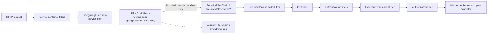
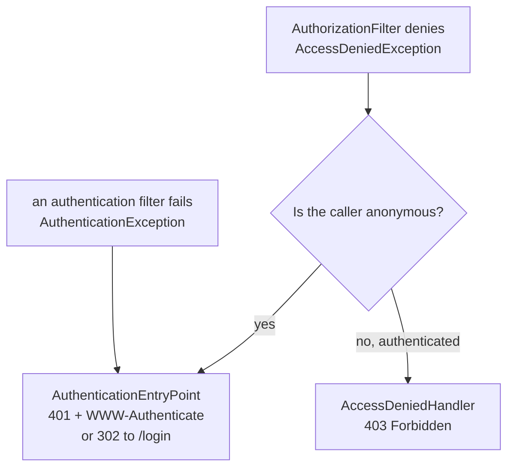
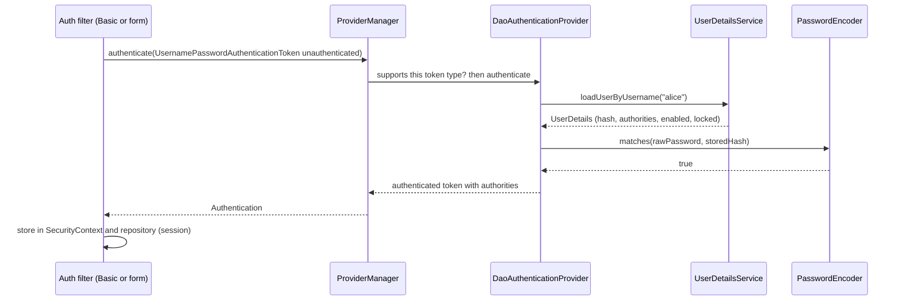

# Chapter 10 — Spring Security 1: Fundamentals

Every web application eventually has to answer two questions for every request: **who is calling?** and **are they allowed to do this?** Spring Security answers both with a chain of servlet filters (pieces of code the web server runs on every request before it reaches Spring MVC) that runs *before* your controllers. It also switches on protections you would otherwise forget — CSRF tokens (secret values that prove a form was sent by your own site, §10.8), security headers (response headers that turn on browser defences, §10.11), session-fixation defence (§10.10) — the moment you add the starter.

Spring Security has a reputation for being "magic". It is not. Once you can picture the filter chain, name the object that holds the current user, and tell a 401 (HTTP "I don't know who you are") from a 403 (HTTP "I know you, but no"), the rest is configuration. This chapter builds that picture with small projects whose tests prove each behaviour.

**What you'll learn**

1. What the starter does on its own (and why "everything is locked" is a feature).
2. The architecture: `DelegatingFilterProxy`, `FilterChainProxy`, `SecurityFilterChain`, the filters, `SecurityContextHolder`.
3. The lambda DSL (domain-specific language: a fluent, chained configuration API) in Spring Security 7 (what was removed and why), and several chains in one app.
4. Authentication: `AuthenticationManager`, `UserDetailsService`, form login vs HTTP Basic (username and password sent in a header on every request), 302 (HTTP redirect) vs 401.
5. Password storage: hashing, salt, work factor, bcrypt/Argon2 via `DelegatingPasswordEncoder`, upgrading old hashes on login.
6. Request authorization: matchers, **roles vs authorities**, **401 vs 403**, role hierarchy, `denyAll` as the safe default.
7. Method security: `@PreAuthorize`, `@PostAuthorize`, `@PostFilter` and the proxy rule behind them.
8. CSRF, CORS, sessions, logout and security headers — what Spring does and when to change it.
9. Testing all of it with `spring-security-test`.

All code lives in [`code/`](code/) — three Spring Boot **4.1.1** projects (Spring Security **7.1.1**, Framework 7, Java 25):

| Project | Shows |
|---|---|
| [`security-defaults`](code/security-defaults/) | the starter with zero configuration |
| [`security-basics`](code/security-basics/) | filter chain, authentication, passwords, authorization, method security |
| [`security-web-defenses`](code/security-web-defenses/) | two chains (API + browser app), CSRF on/off, CORS preflight, headers, sessions |

Every output block is real `mvn -q -B -ntp verify` output with Spring's log lines trimmed to `...`. Hash values and timings change on every run.

> **Prerequisites.** Proxies ([Chapter 4](../04-aop-and-proxies/README.md)) explain how method security works. Spring MVC ([Chapter 5](../05-spring-mvc-and-rest/README.md)) is where the controllers come from. The *browser* side of CORS (rules for letting one website's scripts call another site), CSRF and XSS (cross-site scripting: an attacker getting their JavaScript to run on your pages) is taught in the JavaScript handbook, [Chapter 14](../../../javascript/chapters/14-browser-apis-and-security/README.md). This chapter links there instead of repeating it. Tokens, JWT (JSON Web Token: a signed token carrying user details) and OAuth2 (the standard protocol for issuing access tokens) continue in [Chapter 11](../11-spring-security-2-tokens-and-oauth2/README.md).

---

## 10.1 Vocabulary and what the starter does by default

### What it is

**Spring Security** is the Spring project for authentication, authorization and protection against common web attacks. Boot 4 adds it with `spring-boot-starter-security`. Seven terms carry the rest of the chapter:

| Term | Plain meaning | Everyday analogy |
|---|---|---|
| **Principal** | the "who" — a user, a service, a device | the person at the door |
| **Credentials** | the proof — password, token, certificate | ID card |
| **Authentication** | checking the proof and deciding who the caller is | the guard checks the ID card |
| **Authorization** | deciding whether that caller may do *this* action | the guest list says "floors 1–3 only" |
| **Authority** (`GrantedAuthority`) | one permission string the caller holds, e.g. `report:read` | a stamp on the wristband |
| **Role** | an authority whose name starts with `ROLE_`, e.g. `ROLE_ADMIN`; a coarse group of permissions | "staff" wristband colour |
| **Security context** | the per-request holder of the current `Authentication` | the wristband you wear inside |

In Spring terms, **authentication produces an `Authentication` object** (principal + authorities + "is authenticated" flag). **Authorization reads it.**

### What happens with zero configuration

Add the starter, write one controller, and run the test in `security-defaults`:

```java
@Test
void everythingIsLockedByDefault(CapturedOutput startupLog) throws Exception {
    // 1. Boot generated a user called "user" and logged its random password at startup
    String line = startupLog.getAll().lines()
            .filter(l -> l.contains("Using generated security password")).findFirst().orElseThrow();
    String password = line.substring(line.indexOf(':') + 1).trim();
    // 2. browser-style request -> redirect to the generated login page
    MvcTestResult browser = mvc.get().uri("/hello").header(HttpHeaders.ACCEPT, "text/html").exchange();
    assertThat(browser).hasStatus(302).hasRedirectedUrl("/login");
    // 3. API-style request -> 401 plus a Basic challenge
    MvcTestResult api = mvc.get().uri("/hello").header(HttpHeaders.ACCEPT, "application/json").exchange();
    assertThat(api).hasStatus(401);
    // 4. with the generated credentials it works
    MvcTestResult ok = mvc.get().uri("/hello").with(httpBasic("user", password)).exchange();
    assertThat(ok).hasStatusOk().hasBodyTextEqualTo("hello");
}
```

Output:

```text
Using generated security password: 4030de5f-fb5d-4c46-bd81-7a0af09efd28

This generated password is for development use only. Your security configuration must be updated before running your application in production.
...
startup log   : Using generated security password: <36-char UUID>
browser, anon : 302 -> /login
api, anon     : 401 WWW-Authenticate=Basic realm="Realm", charset="UTF-8"
basic, user   : 200 body=hello
```

So, with no code at all, Boot and Spring Security:

1. Protect **every** URL, so any request must be authenticated.
2. Create one in-memory user named `user` with a random UUID (a random 128-bit identifier) password printed at startup. You can fix it with `spring.security.user.name`, `spring.security.user.password` and `spring.security.user.roles`, but only for experiments.
3. Enable **form login** (a generated `/login` page) and **HTTP Basic**.
4. Pick the response by client type. A browser asking for HTML gets a `302` redirect to `/login`. A client asking for JSON gets `401` with `WWW-Authenticate: Basic`. The `charset="UTF-8"` parameter is new in Spring Security 7.1.
5. Turn on CSRF protection, security headers, session-fixation protection and a logout endpoint.

As soon as you declare your own `SecurityFilterChain` bean, Boot's default chain backs off. As soon as you declare a `UserDetailsService` (or an `AuthenticationManager`/`AuthenticationProvider`), the generated user disappears.

### Why "locked by default" matters

**Secure by default** means that forgetting something fails *closed*: a new endpoint nobody thought about is protected, not exposed. The price is the familiar "why does my new app return 401?" moment. The answer is always "because you have not told Spring who may call it yet".

### Self-check

1. *You add the starter and your endpoint returns 401 in Postman (a desktop tool for sending API requests) but a login page in Chrome. Why?* → Chrome sends `Accept: text/html`, so Spring redirects it to the form login page. Postman's JSON-style request gets the HTTP Basic `401` challenge.
2. *Where does the password come from?* → Boot generates a random UUID at startup and logs it. Nothing is stored anywhere.
3. *What makes the generated user disappear?* → Defining your own `UserDetailsService`, `AuthenticationManager` or `AuthenticationProvider` bean (or an OAuth2 setup — Chapter 11).

### TL;DR

- Authentication = *who are you*, authorization = *may you*. The link between them is the `Authentication` object.
- The starter alone locks every URL, generates a dev-only user and enables form login, Basic, CSRF and headers.

---

## 10.2 Architecture: the filter chain

### What it is

Spring Security is a **servlet filter** — code that sees every HTTP request before the `DispatcherServlet` does. It is not one filter doing everything. It is an ordered **list of small filters**, each with a single job. Think of an airport: one desk checks passports, the next checks boarding passes, the last one opens the gate. If any desk says no, you never reach the plane (your controller).

### How it works



1. **`DelegatingFilterProxy`** is a plain servlet filter that Boot registers with the container. The container knows nothing about Spring beans, so this filter's only job is to hand the request to a Spring bean.
2. That bean is **`FilterChainProxy`**, named `springSecurityFilterChain`. It holds one or more **`SecurityFilterChain`s**. For each request it picks the **first** chain whose request matcher fits, and only that chain runs.
3. Each chain is an ordered list of **security filters**. The important ones:

| Filter | Job |
|---|---|
| `SecurityContextHolderFilter` | loads the `SecurityContext` (e.g. from the HTTP session) into `SecurityContextHolder` for this request, and clears it afterwards |
| `HeaderWriterFilter` | adds security headers (§10.11) |
| `CorsFilter` | answers CORS preflights (§10.9), only if `cors()` is configured |
| `CsrfFilter` | rejects state-changing requests without a valid CSRF token (§10.8) |
| `LogoutFilter` | handles `POST /logout` |
| `UsernamePasswordAuthenticationFilter` | processes the login form `POST /login` |
| `BasicAuthenticationFilter` | reads `Authorization: Basic ...` |
| `BearerTokenAuthenticationFilter` | reads `Authorization: Bearer ...` (Chapter 11) |
| `AnonymousAuthenticationFilter` | if nobody authenticated, puts an *anonymous* `Authentication` in the context |
| `ExceptionTranslationFilter` | turns security exceptions from later filters into HTTP responses: 401/redirect or 403 |
| `AuthorizationFilter` | the last gate: asks the `AuthorizationManager` whether this request is allowed |

4. **`SecurityContextHolder`** stores the current `SecurityContext` in a `ThreadLocal` (a variable with a separate value for each thread; each request runs on its own thread) by default. Any code on the request thread — controller, service, logging — can read it with `SecurityContextHolder.getContext().getAuthentication()`.

The test in `security-basics` prints the real filter list of our chain:

```java
@Autowired FilterChainProxy springSecurityFilterChain;

@Test
void printTheFilters() {
    List<SecurityFilterChain> chains = springSecurityFilterChain.getFilterChains();
    List<String> names = chains.getFirst().getFilters().stream().map(f -> f.getClass().getSimpleName()).toList();
    // ... print with numbers
    assertThat(names.getLast()).isEqualTo("AuthorizationFilter");
}
```

Output:

```text
security filter chains: 1
 1 DisableEncodeUrlFilter
 2 WebAsyncManagerIntegrationFilter
 3 SecurityContextHolderFilter
 4 HeaderWriterFilter
 5 CsrfFilter
 6 LogoutFilter
 7 UsernamePasswordAuthenticationFilter
 8 DefaultResourcesFilter
 9 DefaultLoginPageGeneratingFilter
10 DefaultLogoutPageGeneratingFilter
11 BasicAuthenticationFilter
12 RequestCacheAwareFilter
13 SecurityContextHolderAwareRequestFilter
14 AnonymousAuthenticationFilter
15 ExceptionTranslationFilter
16 AuthorizationFilter
```

The list changes with your configuration. Removing `formLogin()` removes `UsernamePasswordAuthenticationFilter` and the generated login page, and adding `oauth2ResourceServer()` adds `BearerTokenAuthenticationFilter`. Printing it is the fastest way to understand what a chain really does. You can also set `logging.level.org.springframework.security=TRACE` and watch each filter run.

### How a denied request becomes 401 or 403

`ExceptionTranslationFilter` sits just before `AuthorizationFilter` and catches what it throws:



- An **`AuthenticationEntryPoint`** "starts authentication". It is `401` with a challenge header for APIs, or a redirect to a login page for browsers. Before redirecting, the original request is saved in the **request cache**, so after login the user lands where they wanted to go.
- An **`AccessDeniedHandler`** answers `403` for callers who *are* known but lack permission.

### Why it matters

- **Debugging.** "My endpoint returns 403 before my controller runs" is a filter problem, not an MVC problem. The filter list tells you which one.
- **Ordering.** Custom filters must go in the right place. Use `http.addFilterBefore(myFilter, BasicAuthenticationFilter.class)` and friends, never a guessed order number.
- **Threads.** The context lives in a `ThreadLocal`, so it does *not* follow work you hand to another thread. `@Async` tasks and executors need `DelegatingSecurityContextExecutor` (or the `DelegatingSecurityContext*` wrappers) to carry it over.

### Common mistakes

- Registering your own security filter as a plain `@Component` `Filter`. Boot then *also* adds it to the servlet container, so it runs twice, once outside the security chain. Add it through `http.addFilter...` and disable the servlet registration with a `FilterRegistrationBean` whose `setEnabled(false)`.
- Expecting `SecurityContextHolder` to be filled inside a new thread, a `CompletableFuture` or a scheduled job.

### Self-check

1. *Why does `DelegatingFilterProxy` exist?* → The servlet container creates filters itself and cannot see Spring beans. The proxy is a container filter that looks up the `springSecurityFilterChain` bean and delegates to it.
2. *Two chains both match `/api/users`. Which runs?* → Only the first one in order (`@Order`). Chains are never combined.
3. *Which filter decides 401 vs 403?* → `ExceptionTranslationFilter`: anonymous callers go to the entry point (401/redirect), authenticated ones to the access-denied handler (403).

### TL;DR

Container → `DelegatingFilterProxy` → `FilterChainProxy` → the first matching `SecurityFilterChain` → ordered filters → `AuthorizationFilter` last. The current user lives in `SecurityContextHolder` (a `ThreadLocal`).

---

## 10.3 Configuring a chain: the lambda DSL in Spring Security 7

### What it is

You configure a chain by declaring a `SecurityFilterChain` bean. You build it with the **`HttpSecurity` DSL** — a builder where each method configures one feature and takes a lambda (a `Customizer`). This is the whole configuration of `security-basics`:

```java
@Configuration
@EnableMethodSecurity // turns on @PreAuthorize / @PostAuthorize / @PreFilter / @PostFilter
class SecurityConfig {

    @Bean
    SecurityFilterChain appSecurity(HttpSecurity http) throws Exception {
        http
            .authorizeHttpRequests(auth -> auth                      // first match wins, top to bottom
                .requestMatchers("/public/**").permitAll()
                .requestMatchers("/admin/**").hasRole("ADMIN")        // checks authority "ROLE_ADMIN"
                .requestMatchers("/user/**").hasRole("USER")          // ADMIN also passes (hierarchy below)
                .requestMatchers(HttpMethod.GET, "/reports/**").hasAuthority("report:read")
                .requestMatchers("/me", "/orders/**").authenticated()
                .anyRequest().denyAll())                              // anything we forgot is closed
            .httpBasic(Customizer.withDefaults())                     // Authorization: Basic ... for APIs
            .formLogin(Customizer.withDefaults());                    // /login page for browsers
        return http.build();
    }

    @Bean
    PasswordEncoder passwordEncoder() {
        return PasswordEncoderFactories.createDelegatingPasswordEncoder();
    }

    @Bean
    static RoleHierarchy roleHierarchy() {
        return RoleHierarchyImpl.fromHierarchy("ROLE_ADMIN > ROLE_USER");
    }
}
```

- `Customizer.withDefaults()` means "turn this feature on with its default settings".
- `feature(f -> f.disable())` turns a feature off, e.g. `csrf(c -> c.disable())`.
- With Boot you do not need `@EnableWebSecurity`. Boot applies it for you. It is harmless to add.

### What changed in Spring Security 7

Spring Security 7 finished several clean-ups that 6.x had deprecated. Old tutorials use the removed style, so it helps to recognise it:

| Removed in 7 | Use instead |
|---|---|
| `.and()` chaining (`http.csrf().disable().and().httpBasic()`) | one lambda per feature (above) |
| `authorizeRequests(...)` | `authorizeHttpRequests(...)` (built on `AuthorizationManager`) |
| `AntPathRequestMatcher`, `MvcRequestMatcher` | `PathPatternRequestMatcher` — the same `PathPattern` syntax Spring MVC uses. `requestMatchers("/x/**")` creates them for you |
| `WebSecurityConfigurerAdapter` (already gone in 6.0) | `SecurityFilterChain` beans |
| `AccessDecisionManager` / voters in the main jar | moved to the legacy `spring-security-access` module; prefer `AuthorizationManager` |
| OAuth2 *password* grant support | authorization code or client credentials (Chapter 11) |

Other 7.0 additions worth knowing: built-in **multi-factor authentication** (MFA: requiring two or more kinds of proof, e.g. password plus a code; below and §10.4), `csrf(c -> c.spa())` for single-page apps (SPAs: browser apps that load once and then talk to the server only through JavaScript calls; §10.8), Password4j-based encoders (§10.5), and Spring Authorization Server (a server that issues OAuth2 tokens) now shipping *inside* Spring Security (Chapter 11).

### Several chains in one application

Real apps often serve a JSON API *and* browser pages, and these need different rules. The API should be stateless (the server keeps no login state; every request carries its own credentials) with no CSRF. The browser pages should use a session cookie (a cookie holding the id of the user's server-side session) with CSRF on. Declare two chains and give each a **`securityMatcher`** (which requests this chain handles) and an **`@Order`**:

```java
@Bean @Order(1)
SecurityFilterChain apiChain(HttpSecurity http) throws Exception {
    http.securityMatcher("/api/**")                       // this chain only handles /api/**
        .authorizeHttpRequests(auth -> auth.anyRequest().authenticated())
        .httpBasic(Customizer.withDefaults())
        .cors(Customizer.withDefaults())
        .csrf(csrf -> csrf.disable())                     // safe ONLY because nothing relies on cookies
        .sessionManagement(s -> s.sessionCreationPolicy(SessionCreationPolicy.STATELESS));
    return http.build();
}

@Bean @Order(2)
SecurityFilterChain webChain(HttpSecurity http) throws Exception {   // no securityMatcher = everything else
    http.authorizeHttpRequests(auth -> auth.requestMatchers("/login").permitAll().anyRequest().authenticated())
        .formLogin(Customizer.withDefaults())
        .logout(Customizer.withDefaults());
    return http.build();
}
```

`securityMatcher` (which *requests* the chain handles) is different from `requestMatchers` inside `authorizeHttpRequests` (which *rules* apply within the chain). Mixing them up is a classic bug.

### Common mistakes

- A chain **without** `securityMatcher` placed *before* a specific one. It matches everything, so the later chain never runs. Put catch-all chains last (highest `@Order` number).
- Copying `.and()` code from an old blog post. It no longer compiles in Spring Security 7.
- Declaring the `SecurityFilterChain` bean in a class that is not a `@Configuration`, or outside component scanning. Boot's default chain then stays active and nothing you wrote applies.

### Self-check

1. *What does `Customizer.withDefaults()` do?* → It is a no-op lambda. It switches the feature on with default settings.
2. *Difference between `securityMatcher` and `requestMatchers`?* → `securityMatcher` selects which requests the whole chain handles. `requestMatchers` inside `authorizeHttpRequests` defines access rules for requests already in that chain.
3. *Your old code calls `authorizeRequests()`. What now?* → Rewrite it as `authorizeHttpRequests()`. The old API was removed in Spring Security 7.

### TL;DR

One `SecurityFilterChain` bean per chain, configured with one lambda per feature. Spring Security 7 removed `and()`, `authorizeRequests` and the Ant/Mvc matchers. Several chains = `securityMatcher` + `@Order`, specific first.

---

## 10.4 Authentication: users, providers, form login and Basic

### What it is

**Authentication** turns *credentials* (username + password, a token, a certificate) into an **`Authentication`** that says who the caller is and what authorities they hold. Spring splits the work into small interfaces, so you can replace one piece without touching the rest.

### How it works (username + password)



1. An **authentication filter** extracts credentials. `BasicAuthenticationFilter` reads the `Authorization` header. `UsernamePasswordAuthenticationFilter` reads the `POST /login` form. Each builds an *unauthenticated* token.
2. It calls the **`AuthenticationManager`**. The standard implementation, **`ProviderManager`**, asks each **`AuthenticationProvider`** in turn whether it `supports` that token type.
3. **`DaoAuthenticationProvider`** handles username/password. It loads the user through your **`UserDetailsService`**, checks the account flags (enabled, not locked, not expired), and verifies the password with the **`PasswordEncoder`**.
4. On success the filter stores the authenticated token in the `SecurityContext`. Form login also saves it in the HTTP session, so the next request is recognised via the session cookie. Basic auth sends credentials on *every* request instead.
5. On failure an `AuthenticationException` is thrown. A wrong password and an unknown user both surface as `BadCredentialsException`, so an attacker cannot tell which usernames exist. For an unknown user, the provider still runs a password check against a dummy hash, so both cases take about the same time.

### `UserDetailsService`: your user store behind one method

`UserDetailsService` has a single method, `loadUserByUsername(String)`. Behind it can sit a database table, LDAP (a directory protocol companies use to store employee accounts), or anything else. `security-basics` implements it over a map (in a real app, a JPA repository — [Chapter 8](../08-spring-data-jpa-and-hibernate/README.md)):

```java
@Service
public class AccountUserDetailsService implements UserDetailsService, UserDetailsPasswordService {

    public record Account(String username, String passwordHash, List<String> authorities, boolean enabled) {}
    private final Map<String, Account> accounts = new ConcurrentHashMap<>();

    AccountUserDetailsService(PasswordEncoder encoder) {
        save(new Account("alice", encoder.encode("alice-pass"), List.of("ROLE_USER", "report:read"), true));
        save(new Account("bob", encoder.encode("bob-pass"), List.of("ROLE_ADMIN"), true));
        save(new Account("carol", encoder.encode("carol-pass"), List.of("ROLE_USER"), true));
        save(new Account("dave", "{noop}dave-pass", List.of("ROLE_USER"), true));    // legacy plain-text row
        save(new Account("erin", encoder.encode("erin-pass"), List.of("ROLE_USER"), false)); // disabled
    }

    @Override
    public UserDetails loadUserByUsername(String username) {
        Account a = accounts.get(username);
        if (a == null) throw new UsernameNotFoundException(username);
        return User.withUsername(a.username()).password(a.passwordHash())
                .authorities(a.authorities().toArray(String[]::new))
                .disabled(!a.enabled()).build();
    }

    @Override   // see 10.5: called when a stored hash should be upgraded
    public UserDetails updatePassword(UserDetails user, String newEncodedPassword) { /* save new hash */ }
}
```

Because this bean exists together with a `PasswordEncoder` bean, Spring Security builds the `DaoAuthenticationProvider` for you. No extra wiring is needed. Ready-made implementations include `InMemoryUserDetailsManager` (tests and demos), `JdbcUserDetailsManager` (Spring's own `users`/`authorities` table schema), and LDAP support.

### Form login vs HTTP Basic

| | Form login | HTTP Basic |
|---|---|---|
| Credentials sent | once, in `POST /login` | on **every** request, Base64 (a reversible text encoding) in `Authorization` (encoded, **not encrypted**, so HTTPS — HTTP over an encrypted TLS connection — only) |
| Remembered by | HTTP session cookie (`JSESSIONID`) | nothing, the client resends them |
| Unauthenticated response | `302` redirect to `/login` | `401` + `WWW-Authenticate: Basic realm=...` |
| Logout | `POST /logout` invalidates the session | impossible server-side (browser caches credentials) |
| Good for | server-rendered browser apps | scripts, service-to-service in trusted networks, quick demos |

When both are enabled, Spring picks the entry point per request. HTML-accepting browsers get the redirect, and other clients (for example `Accept: application/json`) get the `401` challenge. The tests show every case:

```java
MvcTestResult noCreds  = mvc.get().uri("/me").header("Accept", "application/json").exchange();
MvcTestResult wrong    = mvc.get().uri("/me").with(httpBasic("alice", "nope")).exchange();
MvcTestResult disabled = mvc.get().uri("/me").with(httpBasic("erin", "erin-pass")).exchange();
MvcTestResult ok       = mvc.get().uri("/me").with(httpBasic("alice", "alice-pass")).exchange();
// formLogin() builds POST /login with username, password AND a valid CSRF token
mockMvc.perform(formLogin().user("alice").password("alice-pass")).andExpect(authenticated().withUsername("alice"));
mockMvc.perform(formLogin().user("alice").password("wrong")).andExpect(unauthenticated());
```

Output:

```text
no credentials (JSON)        401 WWW-Authenticate=Basic realm="Realm", charset="UTF-8"
alice, wrong password        401 WWW-Authenticate=Basic realm="Realm", charset="UTF-8"
erin, disabled account       401 WWW-Authenticate=Basic realm="Realm", charset="UTF-8"
alice, right password        200 {"name":"alice","principalType":"User","authorities":["FACTOR_PASSWORD","ROLE_USER","report:read"]}
no credentials (HTML)        302 -> /login
form login, good password   302 -> /
form login, bad password    302 -> /login?error
```

### Reading the current user

The `/me` endpoint shows three ways to reach the logged-in user:

```java
@GetMapping("/me")
Me me(Authentication auth, @AuthenticationPrincipal UserDetails principal) {
    return new Me(auth.getName(), principal.getClass().getSimpleName(),
            auth.getAuthorities().stream().map(GrantedAuthority::getAuthority).sorted().toList());
}
```

- Declare an `Authentication` (or `Principal`) parameter and Spring MVC fills it in.
- `@AuthenticationPrincipal` gives you the principal object itself, here the `UserDetails` from our service.
- Anywhere else, use `SecurityContextHolder.getContext().getAuthentication()`, but prefer passing the user in explicitly. Code that reaches into a `ThreadLocal` is harder to test.

### The `FACTOR_PASSWORD` authority: multi-factor authentication in Spring Security 7

Look at alice's authorities in the output: besides `ROLE_USER` and `report:read`, there is **`FACTOR_PASSWORD`**. Spring Security 7 adds a **factor authority** (`FactorGrantedAuthority`) for every authentication mechanism a user completes. Password login adds `FACTOR_PASSWORD`, one-time-token login (a single-use code, e.g. sent by e-mail) adds `FACTOR_OTT`, and passkeys (WebAuthn: password-less login with a key stored on the user's device) add `FACTOR_WEBAUTHN`. Authorization rules can then demand several factors, for example "`/admin/**` needs `ROLE_ADMIN` **and** both a password and a one-time token". You turn this on with `@EnableMultiFactorAuthentication(authorities = ...)` or selectively with `AuthorizationManagerFactories.multiFactor()`. If a factor is missing, Spring sends the user to the login step for that factor. The takeaway for now: **do not be surprised by `FACTOR_*` entries**, and filter them out if you copy authorities into a token (Chapter 11 does exactly that).

### Common mistakes

- Returning `null` from `loadUserByUsername`. The contract is to throw `UsernameNotFoundException`.
- Telling users "unknown username" vs "wrong password". It lets attackers enumerate accounts (find out which usernames exist by trying many). Spring deliberately reports both the same way.
- Storing the `UserDetails` (with its password hash) in logs or sending it to the client. Map it to a DTO.
- Using HTTP Basic over plain HTTP. Base64 is readable by anyone on the path.

### In the interview

**30-second answer:** "An authentication filter extracts credentials and hands an unauthenticated token to the `AuthenticationManager`. `ProviderManager` delegates to a provider that supports the token — for passwords, `DaoAuthenticationProvider`, which loads the user via `UserDetailsService` and verifies the hash with the `PasswordEncoder`. The authenticated result goes into the `SecurityContext`, and form login persists it in the session."

- *Why is `UsernameNotFoundException` turned into `BadCredentialsException`?* → To prevent username enumeration. The provider also spends a dummy password check so timing does not leak it either.
- *How would you add login by API key (a long secret string a client sends to identify itself)?* → Write a filter (or an `AuthenticationConverter`) that builds an `ApiKeyAuthenticationToken`, plus an `AuthenticationProvider` that validates it. Register the filter with `addFilterBefore(..., BasicAuthenticationFilter.class)`.

### Self-check

1. *Which object checks the password?* → `DaoAuthenticationProvider`, using the `PasswordEncoder` on the hash that `UserDetailsService` returned.
2. *Why can't you "log out" of HTTP Basic?* → There is no server-side session. The browser caches and resends the credentials itself.
3. *What is `FACTOR_PASSWORD`?* → A Spring Security 7 factor authority recording that the user authenticated with a password. It is used for multi-factor rules.

### TL;DR

Filter → `AuthenticationManager` (`ProviderManager`) → `AuthenticationProvider` (`DaoAuthenticationProvider`) → `UserDetailsService` + `PasswordEncoder` → `Authentication` in the `SecurityContext`. Browsers: form login + session. Scripts: Basic (HTTPS only). Tokens: Chapter 11.

---

## 10.5 Password storage: hashing with `DelegatingPasswordEncoder`

### What it is

You must never store passwords, not even encrypted. Store a **password hash**: the output of a one-way function (easy to compute from the input, practically impossible to reverse) that is cheap to check once but expensive to compute billions of times. If the database leaks, attackers get hashes they must crack one guess at a time.

Three ideas make a hash suitable for passwords:

| Idea | Meaning | Why |
|---|---|---|
| **One-way** | you can't compute the password from the hash | a leak does not reveal passwords directly |
| **Salt** | a random value stored with each hash and mixed in | equal passwords get different hashes, and precomputed "rainbow tables" are useless |
| **Work factor** (cost) | a tunable amount of CPU and/or memory per check | makes each guess slow. Raise it as hardware gets faster |

General-purpose hashes like SHA-256 or MD5 (fast hash functions built for checksums and signatures) are designed to be *fast*, which is exactly wrong for passwords. Use an **adaptive password hash**:

| Algorithm | Spring encoder | Notes |
|---|---|---|
| **bcrypt** | `BCryptPasswordEncoder` (default strength 10) | CPU-hard, battle-tested. Uses only the first **72 bytes** of the password |
| **Argon2id** | `Argon2PasswordEncoder` (needs Bouncy Castle `bcprov-jdk18on`) | memory-hard (resists GPU/ASIC — graphics cards and custom chips that try billions of guesses — cracking). Winner of the Password Hashing Competition; OWASP's (Open Worldwide Application Security Project, a respected web-security community) first choice |
| **scrypt** | `SCryptPasswordEncoder` (Bouncy Castle) | memory-hard |
| **PBKDF2** | `Pbkdf2PasswordEncoder` | choose it when FIPS-140 (a US government standard for approved cryptography) compliance is required |

Spring Security 7.0 also added **Password4j-based** encoders (`Argon2Password4jPasswordEncoder`, `BcryptPassword4jPasswordEncoder`, `ScryptPassword4jPasswordEncoder`, `Pbkdf2Password4jPasswordEncoder`, `BalloonHashingPassword4jPasswordEncoder`) for teams that prefer that library.

### How `DelegatingPasswordEncoder` works

Algorithms age: MD5 was once normal, and today bcrypt is being replaced by Argon2. `DelegatingPasswordEncoder` lets one database hold hashes from several generations. Each stored value carries its algorithm id as a prefix:

```text
{bcrypt}$2a$10$oExJt1cCgjfvb4DzBrmNo.VLE45g8zG8GLlEik43AL6a3Xbk8q20a
{argon2@SpringSecurity_v5_8}$argon2id$v=19$m=16384,t=2,p=1$...
{noop}dave-pass                       <- legacy plain text (never do this for real)
```

1. **`encode(raw)`** always uses the *current default* id. `PasswordEncoderFactories.createDelegatingPasswordEncoder()` uses `bcrypt`.
2. **`matches(raw, stored)`** reads the `{id}` prefix and delegates to that algorithm's encoder. Old hashes keep working.
3. **`upgradeEncoding(stored)`** returns `true` when the stored hash is not in the current default format. `DaoAuthenticationProvider` calls it after every successful login. If it returns true *and* your `UserDetailsService` also implements **`UserDetailsPasswordService`**, the provider re-hashes the password it just received and calls `updatePassword(...)`. Users migrate silently, one login at a time.

`PasswordEncodingTest` (a plain unit test, no Spring context) shows all of this:

```java
PasswordEncoder enc = PasswordEncoderFactories.createDelegatingPasswordEncoder();
String h1 = enc.encode("s3cret");
String h2 = enc.encode("s3cret");
// ...
String argon = "{argon2@SpringSecurity_v5_8}" + Argon2PasswordEncoder.defaultsForSpringSecurity_v5_8().encode("s3cret");
enc.matches("s3cret", argon);          // true: same encoder reads other algorithms
enc.upgradeEncoding("{noop}s3cret");   // true
```

Output:

```text
encode #1 : {bcrypt}$2a$10$oExJt1cCgjfvb4DzBrmNo.VLE45g8zG8GLlEik43AL6a3Xbk8q20a
encode #2 : {bcrypt}$2a$10$oYZZ7zXC3LyJEl6nbQ9KbuQxmg1.oblxK/JPZ0/EufIiGHGFWX2ai
same input, different hash (random salt): true
matches(s3cret) = true, matches(S3cret) = false
argon2 row: {argon2@SpringSecurity_v5_8}$argon2id$v=19$m=16384,t=2,p=1$0...
matches(argon2 row) = true
upgradeEncoding({noop})  = true
upgradeEncoding(argon2)  = true
upgradeEncoding(bcrypt)  = false
```

Read a bcrypt value left to right: `$2a$` is the variant, `10` is the cost (2^10 rounds), then 22 characters of salt and 31 of hash. The salt is inside the string, so no separate column is needed. Note that `upgradeEncoding(argon2)` is `true` here only because this encoder's *default* is bcrypt. "Upgrade" just means "not the current default".

### Choosing Argon2 as the default

To hash new passwords with Argon2 while still accepting everything already stored, build your own `DelegatingPasswordEncoder`:

```java
Map<String, PasswordEncoder> known = Map.of(
        "argon2@SpringSecurity_v5_8", Argon2PasswordEncoder.defaultsForSpringSecurity_v5_8(),
        "bcrypt", new BCryptPasswordEncoder(),
        "noop", NoOpPasswordEncoder.getInstance());           // only to READ legacy rows
var enc = new DelegatingPasswordEncoder("argon2@SpringSecurity_v5_8", known);
```

Output:

```text
argon2 default: {argon2@SpringSecurity_v5_8}$argon2id$v=19$m=16384,t=2,p=1$Y...
old bcrypt row still matches: true, needs upgrade: true
```

`m=16384,t=2,p=1` means 16 MiB (mebibytes, 1 MiB = 1024 × 1024 bytes) of memory, 2 passes and 1 lane (parallel thread of work). Those are Spring's `v5_8` defaults. OWASP's Password Storage Cheat Sheet currently suggests somewhat more memory for Argon2id (for example 19 MiB with 2 passes). Use the `Argon2PasswordEncoder(saltLength, hashLength, parallelism, memory, iterations)` constructor if you follow it. If you change parameters under the same id, `upgradeEncoding` also notices weaker stored parameters. Always measure the cost on your production hardware.

### The work factor in numbers

```text
bcrypt strength 10 -> $2a$10$...  ~59 ms per check
bcrypt strength 12 -> $2a$12$...  ~239 ms per check
```

Each +1 of strength doubles the work (here about 4x for +2). A common target is **"as slow as your login latency budget allows"**, often several hundred milliseconds. Remember the cost hits *your* servers on every login. Slow hashing plus no rate limiting (capping how many attempts a client may make per second) makes the login endpoint an easy denial-of-service (overloading a service so real users cannot use it) target (see the rate-limiting note in [Chapter 11](../11-spring-security-2-tokens-and-oauth2/README.md#1115-rate-limiting-and-brute-force-protection)).

### bcrypt's 72-byte limit

```text
73-byte password -> IllegalArgumentException: password cannot be more than 72 bytes
```

bcrypt only ever looked at the first 72 bytes, and current Spring Security versions refuse longer input instead of silently truncating it. If you allow long passphrases, validate the length in your sign-up form or choose Argon2.

### Upgrading on login — proved

`dave` is stored as `{noop}dave-pass`. After one successful login his row holds a bcrypt hash:

```java
System.out.println("before login: " + accounts.find("dave").passwordHash());
assertThat(mvc.get().uri("/me").with(httpBasic("dave", "dave-pass"))).hasStatusOk();
String after = accounts.find("dave").passwordHash();
assertThat(after).startsWith("{bcrypt}$2a$10$");
```

Output:

```text
before login: {noop}dave-pass
after login : {bcrypt}$2a$10$6G6hiKY...
```

### Common mistakes

- **Encrypting** passwords (AES, a standard two-way encryption algorithm) "so we can show them to support staff". Anyone with the key can decrypt them all. Hash them instead.
- A hand-made `sha256(password + "pepper")` (a pepper is a fixed secret mixed into every hash). It is fast, so it cracks quickly.
- Declaring `NoOpPasswordEncoder` as the bean "for now". It is deprecated for a reason.
- Storing hashes without the `{id}` prefix, then switching encoders later. Every old row breaks. If you have such rows, `DelegatingPasswordEncoder.setDefaultPasswordEncoderForMatches(...)` tells Spring how to read unprefixed values.
- Forgetting that the prefix makes the hash column longer. bcrypt is 60 characters plus `{bcrypt}`, and Argon2 values are longer still. Use `VARCHAR(255)` or more.

### In the interview

**30-second answer:** "Store only adaptive, salted hashes such as bcrypt or Argon2id, never encrypted or plain passwords. In Spring I use `DelegatingPasswordEncoder`: each hash is stored with an `{id}` prefix, new passwords use the current default, old formats still verify, and with `UserDetailsPasswordService` hashes are upgraded transparently on the next successful login."

- *Why a salt?* → Equal passwords get different hashes, and precomputed tables become useless. The salt is not secret.
- *bcrypt or Argon2?* → Both are fine. Argon2id is memory-hard, which makes GPU cracking more expensive, so it is OWASP's first choice. bcrypt is ubiquitous but has the 72-byte limit.
- *What is a pepper?* → A secret added to every hash and stored *outside* the database (in a vault — a secure service for storing secrets). It helps only if the database leaks without the app secrets. It is optional.

### TL;DR

Hash, don't encrypt. Use an adaptive, salted, slow algorithm (Argon2id or bcrypt) through `DelegatingPasswordEncoder` (`{id}hash`). Implement `UserDetailsPasswordService` so old hashes upgrade on login. Tune the cost to your hardware.

---

## 10.6 Authorizing requests: roles, authorities, 401 vs 403

### What it is

`authorizeHttpRequests` is a list of **rules**, each pairing a request matcher with a requirement. For each request, `AuthorizationFilter` walks the list **top to bottom** and applies the **first rule that matches**. The rules you write most often:

| Rule | Passes when |
|---|---|
| `permitAll()` | always (still goes through the other filters, e.g. CSRF) |
| `denyAll()` | never |
| `authenticated()` | caller is not anonymous |
| `hasAuthority("report:read")` | caller holds exactly that authority string |
| `hasAnyAuthority("a", "b")` | holds at least one |
| `hasRole("ADMIN")` | holds authority **`ROLE_ADMIN`** (the prefix is added for you) |
| `hasAnyRole("ADMIN", "OPS")` | holds `ROLE_ADMIN` or `ROLE_OPS` |
| `access(authorizationManager)` | your own `AuthorizationManager` decides, e.g. IP ranges (blocks of network addresses) or time of day |

Matchers can take HTTP methods (`requestMatchers(HttpMethod.GET, "/reports/**")`). They use the same `PathPattern` syntax as Spring MVC mappings: `*` matches one path segment and `**` matches any number of segments.

### Roles vs authorities

Under the hood **there is only one concept: `GrantedAuthority`, a string**. A "role" is just the convention that the string starts with `ROLE_`.

| | Role | Authority (permission) |
|---|---|---|
| Example | `ROLE_ADMIN` | `report:read`, `order:refund` |
| Granularity | coarse: *who the user is* | fine: *what the user may do* |
| Checked with | `hasRole("ADMIN")` | `hasAuthority("report:read")` |
| Typical source | user's group membership | role-to-permission mapping, OAuth2 scopes (permissions granted to a token, e.g. `read`; `SCOPE_...`, Chapter 11) |

Many teams check **authorities** in code and assign them to users *through* roles. Then a role change doesn't mean a code change. The prefix trips people up in two ways, and Spring rejects both:

```text
hasRole("ROLE_ADMIN") -> ROLE_ADMIN should not start with ROLE_ since ROLE_ is automatically prepended when using hasRole. Consider using hasAuthority instead.
User.roles("ROLE_ADMIN") -> ROLE_ADMIN cannot start with ROLE_ (it is automatically added)
```

`User.withUsername(...).roles("ADMIN")` stores `ROLE_ADMIN`. `.authorities("ROLE_ADMIN", "report:read")` stores the strings exactly as given. The two setters **replace** each other, so whichever you call last wins. Our users therefore use `authorities(...)` for mixed lists.

### 401 vs 403 — proved

| Status | Name | Meaning | Client should |
|---|---|---|---|
| **401** | Unauthorized (really "unauthenticated") | "I don't know who you are" | authenticate, then retry |
| **403** | Forbidden | "I know who you are, and the answer is no" | not retry with the same identity |

The matrix test calls five URLs as four callers:

```java
assertThat(status("/admin/stats", null)).isEqualTo(401);      // who are you?
assertThat(status("/admin/stats", "carol")).isEqualTo(403);   // I know you, but no
assertThat(status("/reports/daily", "alice")).isEqualTo(200); // authority, not role
assertThat(status("/reports/daily", "bob")).isEqualTo(403);   // ADMIN role is not report:read
assertThat(status("/user/profile", "bob")).isEqualTo(200);    // role hierarchy ADMIN > USER
assertThat(status("/nowhere", "bob")).isEqualTo(403);         // denyAll catch-all
```

Output:

```text
                               /public/hello  /user/profile  /admin/stats   /reports/daily /nowhere
anonymous                      200            401            401            401            401
alice (ROLE_USER, report:read) 200            200            403            200            403
carol (ROLE_USER)              200            200            403            403            403
bob (ROLE_ADMIN)               200            200            200            403            403
```

Read it row by row:

- **anonymous** gets 401 everywhere except the public URL, even for `/nowhere`. A denied *anonymous* caller is always asked to authenticate first (§10.2).
- **alice** reaches `/reports/daily` because she holds the `report:read` **authority**, although she is not an admin.
- **bob** is an admin but gets **403** on `/reports/daily`. A role does not imply permissions you never mapped to it.
- **bob** reaches `/user/profile` because of the **role hierarchy** bean `ROLE_ADMIN > ROLE_USER`. Spring treats him as also holding `ROLE_USER`, both in `authorizeHttpRequests` and in method security.
- `/nowhere` has no controller, yet it is still 403 for logged-in users, because `anyRequest().denyAll()` closes everything not listed. Security runs before Spring MVC looks for a handler.

### Why `denyAll()` as the last rule

With `anyRequest().authenticated()` as the last rule, any endpoint someone adds next month is open to *every logged-in user*. With `denyAll()`, it stays closed until someone writes a rule, so mistakes fail closed. Pick consciously: `authenticated()` is common and fine for internal apps, and `denyAll()` is safer for anything customer-facing.

### Common mistakes

- **Rule order.** `requestMatchers("/**").authenticated()` first makes every later rule dead code. Write rules from most specific to least specific.
- **Securing only the URL.** `/orders/{id}` is protected, but can alice read order 2, which belongs to carol? That question needs the *data* and belongs in method security or in the query ("insecure direct object reference": letting a user reach someone else's record just by changing an id in the URL; §10.7).
- Returning **404** for "exists but you may not see it" is sometimes a good idea, because it hides existence. Decide it deliberately. Spring gives 403 by default.
- Relying on `permitAll()` to *skip* security. The request still passes CSRF and header filters. To bypass the chain for static files, give them their own chain with `permitAll()`. Avoid `WebSecurityCustomizer.ignoring()`, which also drops the security headers.

### In the interview

**30-second answer:** "401 means the server doesn't know who you are, so authenticate. 403 means it knows and refuses. In Spring, an `AccessDeniedException` for an anonymous user goes to the `AuthenticationEntryPoint` (401 or login redirect), and for an authenticated user to the `AccessDeniedHandler` (403). Roles are authorities with a `ROLE_` prefix. I check fine-grained authorities and map them to roles."

- *`hasRole("ADMIN")` vs `hasAuthority("ADMIN")`?* → The first checks `ROLE_ADMIN`, the second checks the literal string `ADMIN`.
- *How do you make admins inherit user permissions?* → A `RoleHierarchy` bean (`RoleHierarchyImpl.fromHierarchy("ROLE_ADMIN > ROLE_USER")`).

### Self-check

1. *Carol (USER) calls `/admin/stats`. Status?* → 403. She is authenticated but lacks `ROLE_ADMIN`.
2. *Same URL without credentials?* → 401 (or a login redirect for a browser).
3. *Why does bob (ADMIN) get 403 on `/reports/daily`?* → The rule requires the `report:read` authority, and bob only has `ROLE_ADMIN` (plus `ROLE_USER` via the hierarchy).

### TL;DR

First matching rule wins, so write specific rules first and finish with `denyAll()` (or `authenticated()`). A role is an authority starting with `ROLE_`, and `hasRole` adds the prefix. 401 = unknown caller, 403 = known but not allowed.

---

## 10.7 Method security

### What it is

URL rules protect *endpoints*. **Method security** protects *business methods*, wherever they are called from: a controller, a message listener, a scheduled job. It can also look at the method's **arguments and return value**, which URL rules cannot. `@EnableMethodSecurity` turns it on.

| Annotation | When it runs | Typical use |
|---|---|---|
| `@PreAuthorize("expr")` | before the call | role/authority checks, argument checks (`#owner == authentication.name`) |
| `@PostAuthorize("expr")` | after the call, sees `returnObject` | "load it, then check it belongs to the caller" |
| `@PreFilter("expr")` | before, filters a collection argument | rarely needed |
| `@PostFilter("expr")` | after, removes elements of the returned collection (`filterObject`) | small lists only |
| `@Secured("ROLE_ADMIN")` | before (enable with `securedEnabled = true`) | legacy, no SpEL |
| `@RolesAllowed("ADMIN")` | before (enable with `jsr250Enabled = true`; JSR-250 is the Java standard that defined it) | Jakarta standard annotation |

Expressions are **SpEL** (Spring Expression Language). `authentication`, `principal`, `hasRole(...)`, `hasAuthority(...)`, method parameters as `#name` and `returnObject` are available.

```java
@Service
public class OrderService {

    @PreAuthorize("#owner == authentication.name or hasRole('ADMIN')")
    public List<Order> ordersOf(String owner) { ... }

    @PostAuthorize("returnObject.owner() == authentication.name")
    public Order find(long id) { ... }

    @PostFilter("filterObject.owner() == authentication.name or hasRole('ADMIN')")
    public List<Order> all() { return new ArrayList<>(orders); }   // must be mutable

    @PreAuthorize("hasAuthority('order:refund')")
    public String refund(long id) { ... }
}
```

### How it works

Method security is **proxy-based AOP** ([Chapter 4](../04-aop-and-proxies/README.md)). Spring wraps `OrderService` in a proxy whose interceptor evaluates the expression and throws **`AccessDeniedException`** if it is false. The same proxy rules apply as for `@Transactional`:

- Only calls that go **through the proxy** are checked. A call from inside the same class (`this.refund(1)`) skips the check. This is **self-invocation**, proved for `@Cacheable` in [Chapter 4](../04-aop-and-proxies/README.md#45-proxy-limitations--proved).
- `private` methods, and in CGLIB proxies `final` methods, are never intercepted.

### Proved

The tests call the service directly, with `@WithMockUser` supplying the security context:

```java
@Test
@WithMockUser(username = "alice") // default role USER
void ownerCanReadOwnOrders() {
    orders.ordersOf("alice");                                  // allowed
    assertThatThrownBy(() -> orders.ordersOf("carol")).isInstanceOf(AccessDeniedException.class);
    assertThat(orders.all()).extracting(OrderService.Order::owner).containsOnly("alice");
    assertThatThrownBy(() -> orders.find(2)).isInstanceOf(AccessDeniedException.class);
    assertThatThrownBy(() -> orders.refund(1)).isInstanceOf(AccessDeniedException.class);
}
```

Output:

```text
no SecurityContext, refund(1) -> AuthenticationCredentialsNotFoundException
alice ordersOf(alice)        -> [Order[id=1, owner=alice, cents=1999], Order[id=3, owner=alice, cents=250]]
alice ordersOf(carol)        -> AccessDeniedException
alice all() after @PostFilter -> [Order[id=1, owner=alice, cents=1999], Order[id=3, owner=alice, cents=250]]
alice find(2) (carol's)      -> AccessDeniedException (@PostAuthorize)
alice refund(1)              -> AccessDeniedException (needs order:refund)
bob(ADMIN) ordersOf(carol)   -> [Order[id=2, owner=carol, cents=500]]
support refund(1)            -> refunded 1
GET /orders/of/carol as alice -> HTTP 403
```

- Calling a secured method with **no** authentication at all (for example from a background thread) fails with `AuthenticationCredentialsNotFoundException`.
- Over HTTP, the `AccessDeniedException` thrown by the service travels back through the filters, and `ExceptionTranslationFilter` turns it into a **403**, just as for URL rules. If you add an `@ExceptionHandler(Exception.class)` in a `@ControllerAdvice`, make sure it does not swallow `AccessDeniedException` and return 500.

### Trade-offs

| | URL rules | Method security |
|---|---|---|
| Protects | HTTP endpoints | any bean method, any caller |
| Can see | path, method, headers | arguments, return value, domain objects |
| Cost | cheap, before MVC | a proxy per bean. `@PostAuthorize` runs the method (and its SQL) before denying |
| Best for | coarse gates (`/admin/**`) | ownership and business rules |

Use both: URLs as the outer fence, methods for "may *this* user touch *this* record". For large collections, don't use `@PostFilter`. It loads everything and then throws most of it away. Filter in the query instead (`where owner = :currentUser`).

### Common mistakes

- Forgetting `@EnableMethodSecurity`. The annotations are then silently ignored.
- Self-invocation, and annotating `private` methods.
- `@PostFilter` on an immutable `List.of(...)`. It must remove elements, so it needs a mutable collection.
- Writing complex SpEL strings. Move the logic into a bean and call it: `@PreAuthorize("@orderGuard.canRead(#id, authentication)")`.

### Self-check

1. *Why can `@PreAuthorize` check `#owner` but a URL rule cannot?* → It runs inside the method proxy with access to the arguments. URL rules only see the HTTP request.
2. *A `@PreAuthorize` method is called from another method of the same class. Is it checked?* → No, the call does not pass through the proxy.
3. *What does `@PostAuthorize` cost?* → The method runs fully (including database access) before the check can deny.

### TL;DR

`@EnableMethodSecurity` + `@PreAuthorize` for business rules and ownership checks. It is proxy-based, so self-invocation and private methods are not protected. A denial becomes 403 over HTTP.

---

## 10.8 CSRF protection

### What it is

**Cross-site request forgery (CSRF)** tricks a logged-in user's browser into sending a state-changing request to your site from another site. The browser attaches the session cookie automatically. The attack and the browser side of the defence (tokens, `SameSite` cookies — a cookie flag that stops the browser sending it on requests from other sites) are explained in the JavaScript handbook: [14.11 Cross-site request forgery](../../../javascript/chapters/14-browser-apis-and-security/README.md#1411-cross-site-request-forgery-csrf). Here we only cover what Spring does.

### How Spring's CSRF protection works

1. `CsrfFilter` generates a random **CSRF token** per session and stores it (by default in the HTTP session: `HttpSessionCsrfTokenRepository`).
2. Server-rendered pages include it. Spring's login page, Thymeleaf forms and JSP tags add a hidden `_csrf` field automatically.
3. For every **unsafe** method (`POST`, `PUT`, `PATCH`, `DELETE`), the filter compares the token sent in the `_csrf` parameter or the `X-CSRF-TOKEN` / `X-XSRF-TOKEN` header with the stored one. A missing or wrong token gets **403**.
4. **Safe** methods (`GET`, `HEAD`, `OPTIONS`, `TRACE`) are not checked, so never change state in a `GET` handler.
5. Refinements since Spring Security 6: the token is loaded **lazily** (no session touch for requests that don't need it), and the value rendered into pages is **XOR-masked** (combined bit by bit with a fresh random value) on each request (protection against the BREACH compression attack, which recovers secrets from the size of compressed HTTPS responses). It looks different every time but validates the same.

### Proved: on for the cookie app, off for the stateless API

```java
// web chain (session cookie): CSRF on
mvc.post().uri("/web/notes").param("text", "hi").with(user("alice"))                              // no token
mvc.post().uri("/web/notes").param("text", "hi").with(user("alice")).with(csrf().useInvalidToken())
mvc.post().uri("/web/notes").param("text", "hi").with(user("alice")).with(csrf())                  // valid token
// api chain (Basic auth, STATELESS): CSRF disabled
mvc.post().uri("/api/notes").contentType(MediaType.TEXT_PLAIN).content("from curl").with(httpBasic("alice", "alice-pass"))
```

Output:

```text
login page hidden field: <input name="_csrf" type="hidden" value="<token>" />
POST /web/notes, logged in, no CSRF token  -> 403
POST /web/notes, logged in, wrong token    -> 403
POST /web/notes, logged in, valid token    -> 200
GET  /web/home,  no token needed (safe)     -> 200
POST /api/notes, Basic auth, no CSRF token -> 201
```

### When may you disable it?

CSRF needs **ambient credentials**, meaning credentials the *browser* attaches on its own: cookies, HTTP Basic cached by the browser, client certificates.

| Your API authenticates with... | CSRF protection |
|---|---|
| session cookie (form login, OAuth2 login, BFF — Backend for Frontend, a server that holds tokens on behalf of a browser app) | **keep it on** |
| `Authorization: Bearer <token>` added by JavaScript or a server, never cookies | can be disabled for that chain |
| Basic auth from scripts / other services only | can be disabled |
| both cookies *and* tokens on the same endpoints | keep it on |

### Single-page apps: `csrf.spa()` (Spring Security 7)

A JavaScript SPA that uses a session cookie still needs CSRF protection, but it can't read a hidden form field. `http.csrf(c -> c.spa())` sets up the standard SPA arrangement in one call:

- the token is stored in a cookie named `XSRF-TOKEN` that JavaScript *can* read (`HttpOnly=false`),
- the app echoes it in the `X-XSRF-TOKEN` header (Angular, a front-end framework, and axios, a JavaScript HTTP library, do this automatically),
- a request handler accepts both the raw cookie value and the masked form value.

Before 7.0 this took several lines (`CookieCsrfTokenRepository.withHttpOnlyFalse()` plus a custom handler), and many tutorials still show that form.

### Common mistakes

- `csrf.disable()` "because POST returned 403" in an app that logs users in with a session cookie. That re-opens the attack. Send the token instead.
- Using `GET` for actions (`GET /delete?id=5`). CSRF protection ignores `GET`, and link prefetchers (browsers or tools that load links in advance) can trigger it.
- Forgetting that `POST /logout` also needs the token (see §10.10).

### TL;DR

CSRF protection is on by default for unsafe methods. Keep it wherever the browser sends credentials automatically. Disable it only for chains that authenticate with explicit headers. Use `csrf.spa()` for cookie-based SPAs.

---

## 10.9 CORS

### What it is

**CORS (Cross-Origin Resource Sharing)** is how a *browser* lets JavaScript from origin A read responses from origin B (an *origin* is scheme + host + port, e.g. `https://app.example.com`). The server opts in with `Access-Control-Allow-*` headers. For "non-simple" requests (for example `POST` with JSON or an `Authorization` header), the browser first sends a **preflight** `OPTIONS` request to ask permission. The browser rules are covered in [14.2 The same-origin policy and CORS](../../../javascript/chapters/14-browser-apis-and-security/README.md#142-the-same-origin-policy-and-cors). CORS is **not** a protection for your server. It relaxes a browser restriction, and `curl` ignores it completely.

### Why Spring Security must be involved

A preflight carries **no credentials**, because browsers never send cookies or `Authorization` on it. If the security chain ran first, it would answer the preflight with 401 and the browser would block the real request. `http.cors(...)` adds a `CorsFilter` *early* in the chain, so preflights are answered before authentication.

```java
@Bean
CorsConfigurationSource corsConfigurationSource() {
    CorsConfiguration api = new CorsConfiguration();
    api.setAllowedOrigins(List.of("https://app.example.com"));
    api.setAllowedMethods(List.of("GET", "POST"));
    api.setAllowedHeaders(List.of("Authorization", "Content-Type"));
    api.setMaxAge(3600L);                                 // browser may cache the preflight 1 hour
    UrlBasedCorsConfigurationSource source = new UrlBasedCorsConfigurationSource();
    source.registerCorsConfiguration("/api/**", api);
    return source;
}
// in the API chain:  .cors(Customizer.withDefaults())   -> uses this bean
```

### Proved: a preflight, allowed and refused

```java
mvc.options().uri("/api/notes")
        .header("Origin", origin)
        .header("Access-Control-Request-Method", "POST")
        .header("Access-Control-Request-Headers", "authorization,content-type")
```

Output:

```text
preflight from https://app.example.com -> 200
  Access-Control-Allow-Origin: https://app.example.com
  Access-Control-Allow-Methods: GET,POST
  Access-Control-Allow-Headers: authorization, content-type
  Access-Control-Max-Age: 3600
preflight from https://evil.example   -> 403 body=Invalid CORS request
GET with Origin + Basic -> 200, Access-Control-Allow-Origin: https://app.example.com, Vary: [Origin, Access-Control-Request-Method, Access-Control-Request-Headers]
```

- The allowed preflight gets **200 without credentials**, so CORS runs before authentication.
- An unknown origin gets **403 "Invalid CORS request"**.
- The real request also gets `Access-Control-Allow-Origin`. `Vary: Origin` tells caches that the answer depends on the origin.

### Trade-offs and choices

| Option | Where | Use when |
|---|---|---|
| `CorsConfigurationSource` bean + `http.cors(...)` | security chain | the endpoints are secured (almost always) |
| `@CrossOrigin` on controllers / `WebMvcConfigurer.addCorsMappings` | Spring MVC ([Chapter 5](../05-spring-mvc-and-rest/README.md)) | no Spring Security, or as the source that `http.cors()` falls back to when no `CorsConfigurationSource` bean exists |
| gateway / reverse proxy (a server in front of your apps that receives requests and forwards them; see [System Design Fundamentals](../../../system-design-patterns/modules/00-system-design-fundamentals/README.md)) | outside the app | many services behind one edge |

The general CORS mistakes (`"*"` with credentials, CORS only in MVC) are listed in [Chapter 5, section 5.10](../05-spring-mvc-and-rest/README.md#510-cors-and-file-upload).

### TL;DR

Configure a `CorsConfigurationSource` and call `http.cors(...)` so preflights are answered before authentication. List exact origins. CORS relaxes the browser's same-origin policy and protects nothing on the server.

---

## 10.10 Sessions, the security context and logout

### What it is

After form login, the `Authentication` must survive to the next request. By default Spring saves the `SecurityContext` in the **HTTP session** (`HttpSessionSecurityContextRepository`), and the browser keeps the session id in the `JSESSIONID` cookie. `sessionManagement(...)` controls this:

| `SessionCreationPolicy` | Meaning |
|---|---|
| `IF_REQUIRED` (default) | create a session when needed (e.g. at login) |
| `ALWAYS` | always create one |
| `NEVER` | never create one, but use an existing session |
| `STATELESS` | never create or use one for the security context, so every request must authenticate itself (Basic, Bearer token) |

### Session fixation, concurrency and logout — proved

**Session fixation** is an attack where an attacker plants a known session id in the victim's browser *before* login and reuses it after. The defence is simple: **change the session id at login**. Spring does this by default (`changeSessionId()`, via the Servlet `HttpServletRequest.changeSessionId()` method).

```java
MockHttpSession session = new MockHttpSession();       // the anonymous visitor's session
String before = session.getId();
var login = mvc.post().uri("/login").session(session)
        .param("username", "alice").param("password", "alice-pass").with(csrf()).exchange();
MockHttpSession after = (MockHttpSession) login.getRequest().getSession(false);
// ... use the new session, then POST /logout with it
```

Output:

```text
login  -> 302 /, session id changed: true (session fixation protection)
GET /web/home with that session -> 200
logout -> 302 /login?logout, session invalidated: true
API call -> session created? false, Set-Cookie: null
```

- The login changed the session id, and the old id is worthless.
- `POST /logout` (with CSRF token) invalidated the session, cleared the context and redirected to `/login?logout`. `GET /logout` only shows a confirmation page, because logout is a state change and needs CSRF protection.
- The `STATELESS` API chain never created a session or sent `Set-Cookie`.

Other session features:

- **`maximumSessions(1)`** limits concurrent logins per user (the second login expires the first, or `maxSessionsPreventsLogin(true)` rejects it). Register an `HttpSessionEventPublisher` bean so Spring hears about sessions that end by timeout.
- **Remember-me** (`rememberMe(...)`) keeps users logged in across browser restarts with a long-lived cookie. Prefer the persistent-token variant.
- **Session timeout**: `server.servlet.session.timeout=30m`. Harden the cookie with `server.servlet.session.cookie.secure=true`, `http-only=true` (the default) and `same-site=lax` or `strict`.
- Several app instances need a shared session store. **Spring Session** puts sessions in Redis or JDBC, so any node can serve any user.

### Stateless vs session: which one?

| | Server session + cookie | Stateless (token per request) |
|---|---|---|
| Logout / revoke | immediate (invalidate session) | hard until the token expires (Chapter 11) |
| Scaling | needs sticky sessions (the load balancer always sends a user to the same server) or Spring Session | any node can serve any request |
| CSRF | needed | not needed if the token is not in a cookie |
| Best for | browser apps, BFF | APIs called by other services, mobile apps |

### TL;DR

Form login stores the context in the HTTP session. Spring changes the session id at login (fixation defence). Logout is `POST /logout` with a CSRF token. `STATELESS` chains never create sessions.

---

## 10.11 Security headers

### What it is

`HeaderWriterFilter` adds HTTP response headers that tell the browser to switch on its own defences. From the test:

```text
response headers on GET /web/home:
  Cache-Control: no-cache, no-store, max-age=0, must-revalidate
  Content-Length: 4
  Content-Security-Policy: default-src 'self'; frame-ancestors 'none'
  Content-Type: text/plain;charset=UTF-8
  Expires: 0
  Pragma: no-cache
  Referrer-Policy: strict-origin-when-cross-origin
  X-Content-Type-Options: nosniff
  X-Frame-Options: DENY
  X-XSS-Protection: 0
over HTTPS also: Strict-Transport-Security: max-age=31536000 ; includeSubDomains
```

| Header | Default? | What it tells the browser |
|---|---|---|
| `Cache-Control`/`Pragma`/`Expires` | yes | don't cache authenticated pages (shared computers, proxies). Your own `Cache-Control` wins |
| `X-Content-Type-Options: nosniff` | yes | trust `Content-Type`, don't guess (stops some script-injection tricks) |
| `X-Frame-Options: DENY` | yes | don't render this page inside a frame (**clickjacking**: hiding your page in an invisible frame so the user clicks something they did not mean to) |
| `Strict-Transport-Security` (HSTS — HTTP Strict Transport Security) | yes, **HTTPS responses only** | use HTTPS for this host for one year |
| `X-XSS-Protection: 0` | yes | *turn off* the old browser XSS filter, which itself caused vulnerabilities |
| `Content-Security-Policy` | **no**, you write it | which sources may load scripts, styles and frames. It is the strongest defence against **XSS** |
| `Referrer-Policy` | no (configured here) | how much of the URL to leak in `Referer` |

We added CSP and Referrer-Policy in the web chain:

```java
.headers(h -> h
    .contentSecurityPolicy(csp -> csp.policyDirectives("default-src 'self'; frame-ancestors 'none'"))
    .referrerPolicy(r -> r.policy(ReferrerPolicy.STRICT_ORIGIN_WHEN_CROSS_ORIGIN)))
```

What XSS is and how to write a CSP are explained in [14.10 XSS](../../../javascript/chapters/14-browser-apis-and-security/README.md#1410-cross-site-scripting-xss-and-sanitizing) and [14.12 Content Security Policy](../../../javascript/chapters/14-browser-apis-and-security/README.md#1412-content-security-policy-csp). Roll out a new CSP first with `.reportOnly()`, so violations are reported instead of breaking the page.

### Common mistakes

- Disabling all headers (`headers(h -> h.disable())`) to fix one problem, such as an iframe. Change just that header: `frameOptions(f -> f.sameOrigin())`.
- Expecting HSTS on `http://localhost`. It is only sent over HTTPS. Behind a TLS-terminating proxy (one that decrypts HTTPS and forwards plain HTTP to the app), set `server.forward-headers-strategy=framework` so the app knows the request was HTTPS.

### TL;DR

Five protective headers are on by default (HSTS only over HTTPS). Add a Content-Security-Policy yourself. Change individual headers instead of disabling them all.

---

## 10.12 Testing security with `spring-security-test`

### What it is

`spring-boot-starter-security-test` brings in **spring-security-test**, a set of helpers that put an identity or a token into a test request. You can test rules without real passwords where that is convenient, or with real ones where the login itself is under test. Every test in this chapter uses them:

| Helper | Kind | What it does |
|---|---|---|
| `@WithMockUser(username, roles, authorities)` | annotation | puts a `UsernamePasswordAuthenticationToken` in the context for the test method, with no `UserDetailsService` involved. Default user `user`, role `USER` |
| `@WithUserDetails("alice")` | annotation | loads the real user from *your* `UserDetailsService` |
| `@WithAnonymousUser` | annotation | explicit anonymous caller |
| `with(user("alice").roles("USER"))` | request post-processor | like `@WithMockUser`, per request |
| `with(httpBasic("alice", "alice-pass"))` | request post-processor | adds a real `Authorization: Basic` header, so the full login path runs |
| `with(csrf())` / `csrf().useInvalidToken()` | request post-processor | adds a valid (or broken) CSRF token |
| `formLogin().user(..).password(..)` | request builder | a real `POST /login` including CSRF |
| `logout()` | request builder | a real `POST /logout` |
| `jwt()`, `opaqueToken()`, `oauth2Login()`, `oidcLogin()` | request post-processors | token and OAuth2 identities ([Chapter 11](../11-spring-security-2-tokens-and-oauth2/README.md#116-testing-token-security)) |
| `authenticated().withUsername(..)`, `unauthenticated()`, `withAuthorities(..)` | result matchers | assert on the security context after the request. `withAuthorities(String...)` is new in 7.0 |

`MockMvcTester` (the AssertJ-based MockMvc used throughout this book) accepts these post-processors with `.with(...)`. With `@SpringBootTest` + `@AutoConfigureMockMvc`, the security filter chain is applied automatically. With the `@WebMvcTest` slice, add `@Import(SecurityConfig.class)` so the test runs with *your* rules and not Boot's defaults. See [Chapter 12](../12-testing-spring-apps/README.md) for slices.

### What to test

1. **Each rule's boundaries**: anonymous, wrong role, right role. The 401/403 matrix above is one test.
2. **The catch-all**: an unlisted URL is denied.
3. **CSRF**: unsafe requests fail without a token, and succeed with one.
4. **Method rules** directly on the service with `@WithMockUser`, including ownership cases.
5. **At least one real login** (`httpBasic`/`formLogin`) so the password encoder and user lookup are exercised.

### Common mistakes

- Only testing the happy path (the case where everything goes right) with `@WithMockUser(roles = "ADMIN")`. It proves admins get in, not that others are kept out.
- Using `@WithMockUser` when the code needs your custom principal class. Use `@WithUserDetails`, or a custom `@WithSecurityContext` annotation.
- Forgetting `with(csrf())` and concluding "security blocks my POST" when the rule is actually fine.

### TL;DR

`@WithMockUser`/`user()` for rules, `httpBasic()`/`formLogin()` for real logins, `csrf()` for unsafe methods, result matchers for "who is logged in now". Test the denials, not just the grants.

---

## 10.13 Common mistakes (whole chapter)

| Mistake | Symptom | Fix |
|---|---|---|
| Own `SecurityFilterChain` not picked up | generated password still printed | bean inside a scanned `@Configuration` |
| Catch-all chain ordered first | specific chain ignored | `securityMatcher` + `@Order`, specific first |
| `hasRole("ROLE_X")` | startup `IllegalArgumentException` | `hasRole("X")` or `hasAuthority("ROLE_X")` |
| `roles()` then `authorities()` on `User` | roles vanish | one call with the full list |
| `csrf.disable()` with session login | CSRF hole | send the token, or `csrf.spa()` |
| CORS only in MVC | preflight 401 | `http.cors(...)` + `CorsConfigurationSource` |
| Plain/SHA hashed passwords | leak = cracked passwords | `DelegatingPasswordEncoder` with bcrypt/Argon2 |
| Method security not enabled / self-invocation | annotations ignored | `@EnableMethodSecurity`, call through another bean |
| `anyRequest().permitAll()` at the end | new endpoints public | `denyAll()` or `authenticated()` |
| Security filter declared as `@Component` | runs twice, once outside the chain | `addFilterBefore` + disabled `FilterRegistrationBean` |
| Context lost in `@Async` | `AuthenticationCredentialsNotFoundException` | `DelegatingSecurityContextExecutor` |
| Actuator exposed with the app rules | `/actuator/env` public | its own chain or rules ([Chapter 15](../15-observability-and-production/README.md)) |

## 10.14 In the interview

**"Walk me through what happens when a request hits a Spring Security app."**
"The container calls `DelegatingFilterProxy`, which hands off to the `FilterChainProxy` bean. It picks the first `SecurityFilterChain` whose matcher fits. The filters then run in order: the security context is loaded (e.g. from the session), headers are added, CSRF is checked for unsafe methods, authentication filters try to authenticate (form, Basic, bearer), an anonymous token is set if nobody did, and finally `AuthorizationFilter` checks the rules. A denial becomes 401/redirect for anonymous callers or 403 for known ones via `ExceptionTranslationFilter`. If everything passes, the request reaches the `DispatcherServlet`."

Follow-ups:

- *Where is the logged-in user stored during a request, and between requests?* → During: `SecurityContextHolder` (`ThreadLocal`). Between: the HTTP session (form login), or nowhere for stateless chains, where the client resends credentials or a token.
- *How do you store passwords?* → `DelegatingPasswordEncoder` with bcrypt or Argon2id, `{id}` prefix, upgrade on login via `UserDetailsPasswordService`.
- *When is it safe to disable CSRF?* → When the chain never authenticates with credentials the browser adds automatically (cookies, cached Basic), for example pure bearer-token APIs.
- *How do you protect "users can only see their own orders"?* → Method security with an ownership expression, or better, scope the query by the current user. URL rules alone can't see ownership.
- *What changed in Spring Security 7?* → Lambda DSL only, old matchers and `authorizeRequests` removed, built-in MFA, `csrf.spa()`, Authorization Server merged in (full list in §10.3).

---

## Chapter 10 TL;DR

- **Architecture**: `DelegatingFilterProxy` → `FilterChainProxy` → first matching `SecurityFilterChain` → ordered filters → `AuthorizationFilter`. The user lives in `SecurityContextHolder`.
- **Configuration**: `SecurityFilterChain` beans, one lambda per feature. Spring Security 7 removed `and()`, `authorizeRequests` and the Ant/Mvc matchers. Use several chains with `securityMatcher` + `@Order`.
- **Authentication**: filter → `ProviderManager` → `DaoAuthenticationProvider` → `UserDetailsService` + `PasswordEncoder`. Browsers get a 302 to `/login`, APIs get a 401 challenge. Spring Security 7 adds `FACTOR_*` authorities for MFA.
- **Passwords**: adaptive salted hashes (bcrypt, Argon2id) via `DelegatingPasswordEncoder` (`{id}hash`), upgraded on login.
- **Authorization**: first matching rule wins. Roles are `ROLE_`-prefixed authorities. **401 = who are you, 403 = no**. End with `denyAll()`. Use method security for ownership.
- **Web defences**: CSRF on for cookie sessions (off only for header-token chains, `csrf.spa()` for SPAs). `http.cors()` so preflights pass. Session id changes at login. Default headers plus your own CSP.
- **Testing**: spring-security-test's `@WithMockUser`, `user()`, `httpBasic()`, `csrf()`, `formLogin()`, and test the denials.

Next: [Chapter 11 — Tokens and OAuth2](../11-spring-security-2-tokens-and-oauth2/README.md) replaces sessions and passwords with signed tokens and identity providers.
